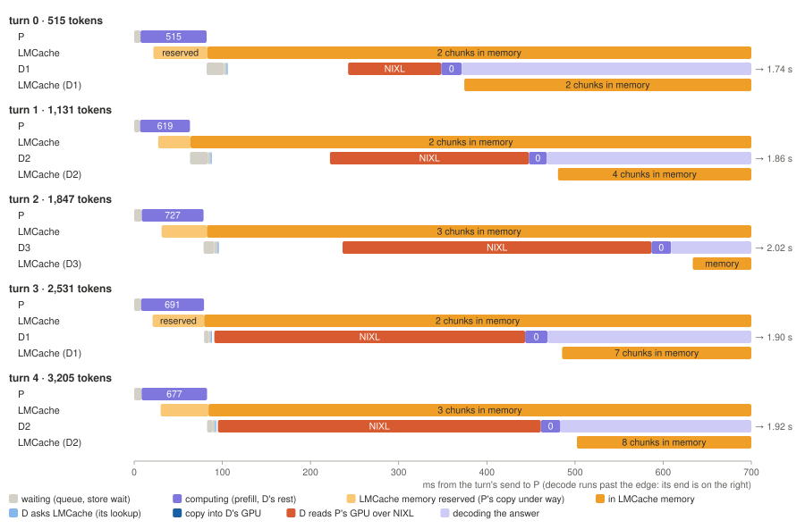

# Conversation 0: mt-rag-clapnq-elser-512-100-20240503 (memory mode, NIXL, per-engine servers, carry-forward, all passages)

P's KV reaches D over NIXL (D reads P's GPU blocks); every engine's LMCache connector stores beside it, to its own server. 5 turns on D1, D2, D3 (round-robin: each turn to the next D engine); prompts grow from 515 to 3,205 tokens (interleaved: each turn's prompt is the previous one, its answer, then this turn's documents and question). Chunks are 256 tokens (16 vLLM blocks of 16); a chunk's name is LMCache's hash of its tokens and everything before them, so the same prefix has the same chunks on every turn and engine.

Legend for the strips (one character a chunk): P: `=` on P's GPU from an earlier turn, `#` computed and stored now, `+` computed, not stored (a partial chunk). D: `=` on D's GPU from an earlier turn, `M` pulled from memory, `S` pulled from disk, `N` read from P's GPU over NIXL, `+` computed by D (a partial chunk), `?` missed.

GPU blocks (the chunk tables): where each engine keeps the chunk's 16 vLLM blocks in its GPU KV cache, by vLLM's block ids (vLLM's paged KV cache: a block, or page, holds 16 tokens; block 0 is its reserved null block), in the prompt's block order, a run of consecutive ids written as a range: `P 1, 138-152` is the prompt's block 0 in GPU block 1 and its blocks 1-15 in GPU blocks 138-152. An engine takes a GPU block from its free list when it first computes or loads a block, and the block keeps it while cached, so a later turn that reuses the block shows the same id. Blocks that are the same in several prompts (the same tokens and everything before them) share one GPU block once the first is cached: the system prompt's first block, the same in every conversation, is the usual one. `16/16 hashes = P's`: of the blocks D pulled, how many have the same vLLM hash on D as on P.

The prompts' text is the driver's own record of what it sent (answers included); lines over 100 characters are wrapped here for reading.

| turn | prompt | chunks + tail | P: own GPU / computed / stored | D: own GPU / loaded / computed | pulled | pull ms | D first token ms |
| ---: | ---: | --- | --- | --- | --- | ---: | ---: |
| [0](#turn-0) | 515 | 2 + 3 | 0 / 515 / 2 chunks | 0 / 515 / 0 | 3 chunks (NIXL 3) | 105.6 | 269.6 |
| [1](#turn-1) | 1,131 | 4 + 107 | 512 / 619 / 2 chunks | 0 / 1,131 / 0 | 5 chunks (NIXL 5) | 225.7 | 384.6 |
| [2](#turn-2) | 1,847 | 7 + 55 | 1,120 / 727 / 3 chunks | 0 / 1,847 / 0 | 8 chunks (NIXL 8) | 350.3 | 517.9 |
| [3](#turn-3) | 2,531 | 9 + 227 | 1,840 / 691 / 2 chunks | 640 / 1,891 / 0 | 8 chunks (NIXL 8) | 352.5 | 383.9 |
| [4](#turn-4) | 3,205 | 12 + 133 | 2,528 / 677 / 3 chunks | 1,248 / 1,957 / 0 | 9 chunks (NIXL 9) | 366.3 | 394.3 |

## How the prompt grows

Each turn's prompt is the previous one, token for token, and then: D's answer to the previous turn, this turn's documents, its question and the framing (the system prompt on turn 0, `Assistant:` and newlines). Only the new tokens can make new chunks: the previous prompt's partial chunk fills first. A document sent before comes again at another place, so in other chunks.

| turn | prompt | new | previous answer | documents | question | framing | whole chunks |
| ---: | ---: | ---: | ---: | --- | --- | ---: | --- |
| 0 | 515 | +515 | – | 5 docs, 474 | 11: who takes photos of planes in the air | 30 | 2 (+2) |
| 1 | 1,131 | +616 | 128 | 5 docs, 474 (5 sent before: 474) | 11: No, I meant photos in the air. | 3 | 4 (+2) |
| 2 | 1,847 | +716 | 128 | 5 docs, 568 (3 sent before: 335) | 17: So does that mean pilot of the second aircraft also acts as a photogr… | 3 | 7 (+3) |
| 3 | 2,531 | +684 | 128 | 5 docs, 537 (5 sent before: 537) | 16: Is air-to-air phtography more difficult that ground-to-air? | 3 | 9 (+2) |
| 4 | 3,205 | +674 | 128 | 5 docs, 532 (4 sent before: 423) | 11: are there any other types of aviation photography? | 3 | 12 (+3) |

## Timeline

Every turn on one clock: ms from the moment the proxy sent the turn to P. P prefills it (one token out) and holds its blocks for D; the proxy sends the turn to the next D engine at once with P's reply's kv_transfer_params (no wait), D reads P's blocks over NIXL (orange-red), computes the rest and decodes the answer. Beside it every engine's LMCache connector stores its new whole chunks (P's lane, and D's own when it stored any). The lanes: P, LMCache (P's chunks), D, and LMCache (D's chunks).



| turn | P queued → done | P's chunks: in memory / on disk | D | D starts | NIXL read | D: held / from P / from LMCache / computed | D's chunks stored | first token | P freed | D done |
| ---: | --- | --- | --- | ---: | --- | --- | ---: | ---: | ---: | ---: |
| 0 | 7 → 82 | 2: 83 / – | D1 | 102 | 243-348 | 0 / 515 / 0 / 0 | 2 | 372 | 349 | 1,742 |
| 1 | 7 → 63 | 2: 64 / – | D2 | 83 | 222-448 | 0 / 1,131 / 0 / 0 | 4 | 468 | 448 | 1,858 |
| 2 | 9 → 79 | 3: 83 / – | D3 | 91 | 236-587 | 0 / 1,847 / 0 / 0 | 7 | 609 | 588 | 2,016 |
| 3 | 8 → 79 | 2: 79 / – | D1 | 85 | 91-443 | 640 / 1,891 / 0 / 0 | 7 | 469 | 444 | 1,895 |
| 4 | 8 → 83 | 3: 84 / – | D2 | 89 | 95-461 | 1,248 / 1,957 / 0 / 0 | 8 | 483 | 462 | 1,918 |

All times in ms from the turn's send to P. NIXL read: D's worker posts the read of P's blocks to the KV in D's GPU blocks; P freed: D has read, P's blocks go back to its free queue (still cached). Each turn's section below tells it in a sentence and step by step.

### One chunk, block by block: chunk 0 of turn 0 (`2fef896f56fe534c`)

Tokens 0-256 (system: 28; doc 825986711_374-: 93; doc 825986711_2085: 82; doc 825986711_1099: 53). P computed its blocks; D1 read them from P's GPU over NIXL, P's block into D's block, one for one:

| block | tokens | P's GPU block | vLLM hash on P | D's GPU block | same hash on D |
| ---: | --- | ---: | --- | ---: | --- |
| 0 | 0-16 | 1 | `9f9c499d1c876b7e` | 1 | True |
| 1 | 16-32 | 2 | `f0727f2add33e5a6` | 2 | True |
| 2 | 32-48 | 3 | `c70c54d18b660b4b` | 3 | True |
| 3 | 48-64 | 4 | `7bd08cad874a71cf` | 4 | True |
| 4 | 64-80 | 5 | `0f5dc93992cce93e` | 5 | True |
| 5 | 80-96 | 6 | `57b2a1f55ccfc5c7` | 6 | True |
| 6 | 96-112 | 7 | `bc8f658981da9de4` | 7 | True |
| 7 | 112-128 | 8 | `a5eac5f5c163dc62` | 8 | True |
| 8 | 128-144 | 9 | `217a069ac4edb482` | 9 | True |
| 9 | 144-160 | 10 | `127794ef0dcf52c3` | 10 | True |
| 10 | 160-176 | 11 | `989b0ef59b56c79c` | 11 | True |
| 11 | 176-192 | 12 | `73da0d8623ac0536` | 12 | True |
| 12 | 192-208 | 13 | `439685f3da49a709` | 13 | True |
| 13 | 208-224 | 14 | `560bbdcd7d6bf2c5` | 14 | True |
| 14 | 224-240 | 15 | `e8837aee21d9e249` | 15 | True |
| 15 | 240-256 | 16 | `edc1367af924a57d` | 16 | True |

## Turn 0

**Timeline:** P queued until 7 ms, prefilled 515 tokens (held 0) and was done at 82 ms; its 2 new chunks were in LMCache's memory at 83 ms. D1 started at 102 ms (no wait) holding 0 tokens, read 515 from P's GPU over NIXL (posted at 243 ms, in its GPU at 348 ms; P freed its blocks at 349 ms), computed 0 and gave its first token at 372 ms; it decoded 128 tokens until 1,742 ms; its LMCache connector stored 2 new chunks. ([all turns](#timeline))

### Step by step

Every move of this turn's KV, ms from the proxy sending the turn to P. P's KV reaches D over NIXL: D's worker reads P's GPU blocks into its own (a NIXL READ, P told when D is done); LMCache's copies (to and from each server's memory) its servers do themselves through CUDA IPC handles each engine registered at start.

| ms | where | what |
| ---: | --- | --- |
| 0.0 | proxy → P | sends the turn (515 prompt tokens; P is asked for one token: prefill only) |
| 2.2 | P | the request arrives |
| 7.1 | P GPU | its prefix cache holds 0 of the prompt's tokens |
| 7.1 | P ↔ LMCache | LMCache has 0 of its tokens; P loads 0 and computes the rest |
| 7.2 | P GPU | 33 new GPU blocks for the 515 tokens it computes: 1-33; the prefill runs |
| 7.4 | P → LMCache | store planned: tokens 0-512, chunks 0-1 (32 blocks) |
| 21.3 | LMCache | the store request is in; it waits for P's forward pass to finish (a CUDA event) |
| 21.8 | LMCache memory | space reserved for 2 chunks (59 MB) |
| 79.8 | P GPU → LMCache memory | the copy starts: LMCache reads P's GPU blocks (CUDA IPC) |
| 80.0 | P GPU | the request is done: P holds its 33 blocks for D to read over NIXL, and its reply carries them (kv_transfer_params: the blocks, its NIXL agent) |
| 82.2 | P → proxy | P answers its one token: the prefill is done |
| 82.5 | P GPU → LMCache memory | copy done: 2 chunks, 59 MB in 2.7 ms |
| 83.0 | LMCache memory | 2 chunks in memory, kept for later requests (D gets this turn's KV from P over NIXL); P keeps its copy in its GPU blocks |
| 101.9 | proxy → D1 | sends the turn to D1 at once, with P's kv_transfer_params (round-robin; no wait) |
| 104.5 | D1 ↔ P (NIXL) | handshake starts: first contact with P's NIXL agent |
| 104.7 | D1 ↔ LMCache | asks LMCache for the prompt's chunks |
| 105.4 | LMCache memory | found 0 tokens it lacks |
| 105.9 | D1 GPU | its prefix cache holds 0 of the prompt's tokens |
| 105.9 | D1 ↔ P (NIXL) | will read 515 prompt tokens from P's GPU (beyond the 0 its own cache holds) |
| 105.9 | D1 ↔ LMCache | LMCache has 0 of its tokens; NIXL loads it (MultiConnector: the first connector with tokens) |
| 106.1 | D1 GPU | 33 GPU blocks for the KV from P: 1-33 |
| 241.7 | D1 ↔ P (NIXL) | handshake done |
| 242.7 | P GPU → D1 GPU (NIXL) | D1 reads P's GPU blocks 1-33 into its 1-33 (a NIXL READ) |
| 348.3 | D1 | the KV from P is in its GPU blocks (515 tokens) |
| 349.4 | P GPU | D1 has read: P frees its blocks (they stay in its prefix cache) |
| 351.8 | D1 → LMCache | store planned: tokens 0-512; 2 chunks new to its server |
| 371.5 | D1 → proxy | the first answer token |
| 374.4 | LMCache memory | 2 chunks from D1 in memory |
| 500.7 | D1 GPU | 1 new GPU block for the 1 prompt tokens it computes: 34 |
| 673.5 | D1 GPU | decoding: the answer's KV takes 7 new GPU blocks as it grows, one per 16 tokens: 35-41, until 1,709 ms |
| 1,741.5 | D1 | done: 128 tokens decoded; its blocks stay cached in its GPU for the next turn |
| 1,742.9 | proxy | the response is complete |

515 prompt tokens: 2 whole chunks and 3 tokens over (the partial chunk, computed by both engines and stored only when a later turn completes it). P held 0 tokens on its GPU, computed 515 and stored 2 new chunks; D1 held 0, read 515 from P over NIXL, loaded 0 from LMCache and computed 0.

### The prompt

The whole prompt, piece by piece:

- **system prompt** · tokens 0-28 (28) · chunk 0

```text
You are a helpful assistant. Answer the user's last question from the documents. If they do not hold
the answer, say so.
```

<details><summary>document <code>825986711_374-788-0-414</code> · tokens 28-121 (93) · chunk 0</summary>

```text
Document: Aviation photography
Aviation photography
Aviation photography is the act of taking images of aircraft , either in flight , or on the ground .
Types of aviation photography include air - to - air , ground - to - air , ground - static , and
remote photography . Military aviation photography , especially air - to - air , requires additional
skills , as the photo and target aircraft often fly at velocities of over Mach 1 , while under
moderate to high G .
```

</details>

<details><summary>document <code>825986711_2085-2489-0-404</code> · tokens 121-203 (82) · chunk 0</summary>

```text
Document: Aviation photography
Aviation photography
In ground - to - air photography , photos of aircraft in flight are taken with the photographer on
the ground . This type of photography is common at airshows or airports . Generally , a long focus
photographic lens is necessary due to the greater distance between the photographer and the target
aircraft . Along with ground - static photography , this is the most popular form of aviation
photography .
```

</details>

<details><summary>document <code>825986711_1099-1546-0-447</code> · tokens 203-291 (88) · chunks 0-1</summary>

```text
Document: Aviation photography
Aviation photography
In ground - static photography , photos of stationary aircraft are taken by photographers on the
ground . Photos can be of aircraft exteriors , interiors , and aircraft details . The photographer
has full control over lighting , aircraft placement , camera angles , and background . Involving
other subjects such as the pilot or other aircraft is much easier to accomplish in ground - static
photography than in other forms of aerial photography .
```

</details>

<details><summary>document <code>825986711_3052-3893-0-841</code> · tokens 291-451 (160) · chunk 1</summary>

```text
Document: Aviation photography
Aviation photography
Air - to - air photography is the art of photographing aircraft in the air , while using another
aircraft as a photo platform . The subject aircraft is photographed while both aircraft are in
flight . This allows the photographer to position the subject in specific locations and angles to
get the most desirable shot . Some things that must be considered to achieve best results are
lighting and background . Proper lighting is achieved through correct placement of the aircraft
relative to the sun , and is accomplished flying only at certain times of the day and / or by flying
at a heading that lines the sun up on the subject aircraft properly . The background can highlight
or distract from the subject and must be carefully considered when taking shots . Air - to - air
photography uses include commercial use and advertising . Remote
```

</details>

<details><summary>document <code>825986711_5257-5487-0-230</code> · tokens 451-502 (51) · chunk 1</summary>

```text
Document: Aviation photography
Aviation photography
Databases exist on the internet , cataloguing aviation photographs . These include airliners.net ,
jetphotos.net and airplane-pictures.net allow users to search them for photographs of aircraft based
on user - specified criteria .
```

</details>

- **question 0** · tokens 502-513 (11) · chunks 1-2

```text
User: who takes photos of planes in the air
```

- `Assistant:` · tokens 513-515 (2) · chunk 2

### Pieces, chunks and blocks

| piece | tokens | length | chunks | |
| --- | --- | ---: | --- | --- |
| system | 0-28 | 28 | 0 |  |
| doc 825986711_374- | 28-121 | 93 | 0 |  |
| doc 825986711_2085 | 121-203 | 82 | 0 |  |
| doc 825986711_1099 | 203-291 | 88 | 0-1 |  |
| doc 825986711_3052 | 291-451 | 160 | 1 |  |
| doc 825986711_5257 | 451-502 | 51 | 1 |  |
| question 0 | 502-513 | 11 | 1-2 |  |
| `assistant:` 0 | 513-515 | 2 | 2 |  |

```
P  ##+
D  NNN
```

| chunk | tokens | pieces in it (tokens) | vLLM blocks | GPU blocks | in LMCache | P this turn | D this turn |
| ---: | --- | --- | --- | --- | --- | --- | --- |
| 0 | 0-256 | system: 28; doc 825986711_374-: 93; doc 825986711_2085: 82; doc 825986711_1099: 53 | 0-15 | P 1-16; D 1-16; 16/16 hashes = P's | `2fef896f56fe534c`: LMC_P: stored on turn 0 by P; LMC_D1: stored on turn 0 by D1; LMC_D2: stored on turn 1 by D2; LMC_D3: stored on turn 2 by D3 | computed, **stored now** | **read from P's GPU over NIXL** |
| 1 | 256-512 | doc 825986711_1099: 35; doc 825986711_3052: 160; doc 825986711_5257: 51; question 0: 10 | 16-31 | P 17-32; D 17-32; 16/16 hashes = P's | `32f7fefc6cd7bd05`: LMC_P: stored on turn 0 by P; LMC_D1: stored on turn 0 by D1; LMC_D2: stored on turn 1 by D2; LMC_D3: stored on turn 2 by D3 | computed, **stored now** | **read from P's GPU over NIXL** |
| 2 | 512-515 | question 0: 1; `assistant:` 0: 2 | 32 | P –; D 33 | – | computed (partial chunk: not stored) | **read from P's GPU over NIXL** (partial chunk) |

## Turn 1

**Timeline:** P queued until 7 ms, prefilled 619 tokens (held 512) and was done at 63 ms; its 2 new chunks were in LMCache's memory at 64 ms. D2 started at 83 ms (no wait) holding 0 tokens, read 1,131 from P's GPU over NIXL (posted at 222 ms, in its GPU at 448 ms; P freed its blocks at 448 ms), computed 0 and gave its first token at 468 ms; it decoded 128 tokens until 1,858 ms; its LMCache connector stored 4 new chunks. ([all turns](#timeline))

### Step by step

Every move of this turn's KV, ms from the proxy sending the turn to P. P's KV reaches D over NIXL: D's worker reads P's GPU blocks into its own (a NIXL READ, P told when D is done); LMCache's copies (to and from each server's memory) its servers do themselves through CUDA IPC handles each engine registered at start.

| ms | where | what |
| ---: | --- | --- |
| 0.0 | proxy → P | sends the turn (1,131 prompt tokens; P is asked for one token: prefill only) |
| 2.9 | P | the request arrives |
| 6.5 | P GPU | its prefix cache holds 512 of the prompt's tokens: 32 blocks in GPU blocks 1-32 |
| 6.6 | P ↔ LMCache | LMCache has 512 of its tokens; P loads 0 and computes the rest |
| 6.7 | P GPU | 39 new GPU blocks for the 619 tokens it computes: 33-71; the prefill runs |
| 7.1 | P → LMCache | store planned: tokens 512-1,024, chunks 2-3 (32 blocks) |
| 26.6 | LMCache | the store request is in; it waits for P's forward pass to finish (a CUDA event) |
| 27.3 | LMCache memory | space reserved for 2 chunks (59 MB) |
| 59.7 | P GPU → LMCache memory | the copy starts: LMCache reads P's GPU blocks (CUDA IPC) |
| 59.8 | P GPU | the request is done: P holds its 71 blocks for D to read over NIXL, and its reply carries them (kv_transfer_params: the blocks, its NIXL agent) |
| 62.3 | P GPU → LMCache memory | copy done: 2 chunks, 59 MB in 2.6 ms |
| 63.3 | P → proxy | P answers its one token: the prefill is done |
| 63.9 | LMCache memory | 2 chunks in memory, kept for later requests (D gets this turn's KV from P over NIXL); P keeps its copy in its GPU blocks |
| 83.4 | proxy → D2 | sends the turn to D2 at once, with P's kv_transfer_params (round-robin; no wait) |
| 86.0 | D2 ↔ P (NIXL) | handshake starts: first contact with P's NIXL agent |
| 86.5 | D2 ↔ LMCache | asks LMCache for the prompt's chunks |
| 87.6 | LMCache memory | found 0 tokens it lacks |
| 88.8 | D2 GPU | its prefix cache holds 0 of the prompt's tokens |
| 88.8 | D2 ↔ P (NIXL) | will read 1,131 prompt tokens from P's GPU (beyond the 0 its own cache holds) |
| 88.8 | D2 ↔ LMCache | LMCache has 0 of its tokens; NIXL loads it (MultiConnector: the first connector with tokens) |
| 89.0 | D2 GPU | 71 GPU blocks for the KV from P: 1-71 |
| 221.4 | D2 ↔ P (NIXL) | handshake done |
| 222.1 | P GPU → D2 GPU (NIXL) | D2 reads P's GPU blocks 1-71 into its 1-71 (a NIXL READ) |
| 447.8 | D2 | the KV from P is in its GPU blocks (1,131 tokens) |
| 448.1 | P GPU | D2 has read: P frees its blocks (they stay in its prefix cache) |
| 450.8 | D2 → LMCache | store planned: tokens 0-1,024; 4 chunks new to its server |
| 468.0 | D2 → proxy | the first answer token |
| 480.7 | LMCache memory | 4 chunks from D2 in memory |
| 511.5 | D2 GPU | 1 new GPU block for the 1 prompt tokens it computes: 72 |
| 687.0 | D2 GPU | decoding: the answer's KV takes 7 new GPU blocks as it grows, one per 16 tokens: 73-79, until 1,738 ms |
| 1,858.5 | D2 | done: 128 tokens decoded; its blocks stay cached in its GPU for the next turn |
| 1,859.6 | proxy | the response is complete |

1,131 prompt tokens: 4 whole chunks and 107 tokens over (the partial chunk, computed by both engines and stored only when a later turn completes it). P held 512 tokens on its GPU, computed 619 and stored 2 new chunks; D2 held 0, read 1,131 from P over NIXL, loaded 0 from LMCache and computed 0.

### The prompt

Tokens 0-515: [turn 0](#turn-0)'s prompt, unchanged (checked: its first 515 token ids are the previous prompt's), so chunks 0-1 are the same chunks; chunk 2 (partial then, 3 tokens) fills now. New from token 515:

- **D's answer to turn 0** · tokens 515-643 (128) · chunk 2

```text
 I don't know. I don't know what you mean by "in the air". I don't know what you mean by "photos". I
don't know what you mean by "planes". I don't know what you mean by "air". I don't know what you
mean by "photos of planes in the air". I don't know what you mean by "photos". I don't know what you
mean by "planes". I don't know what you mean by "in the air". I don't know what you mean by "air". I
don't know what you mean by "photos of planes in the air
```

- `\n` · tokens 643-644 (1) · chunk 2

- document `825986711_374-788-0-414` · tokens 644-737 (93) · chunk 2 · **again**: sent on [turn 0](#turn-0) already (the same 93 tokens), here at another place in the prompt, so in other chunks: a prefix cache cannot reuse it

- document `825986711_3052-3893-0-841` · tokens 737-897 (160) · chunks 2-3 · **again**: sent on [turn 0](#turn-0) already (the same 160 tokens), here at another place in the prompt, so in other chunks: a prefix cache cannot reuse it

- document `825986711_2085-2489-0-404` · tokens 897-979 (82) · chunk 3 · **again**: sent on [turn 0](#turn-0) already (the same 82 tokens), here at another place in the prompt, so in other chunks: a prefix cache cannot reuse it

- document `825986711_1099-1546-0-447` · tokens 979-1067 (88) · chunks 3-4 · **again**: sent on [turn 0](#turn-0) already (the same 88 tokens), here at another place in the prompt, so in other chunks: a prefix cache cannot reuse it

- document `825986711_5257-5487-0-230` · tokens 1067-1118 (51) · chunk 4 · **again**: sent on [turn 0](#turn-0) already (the same 51 tokens), here at another place in the prompt, so in other chunks: a prefix cache cannot reuse it

- **question 1** · tokens 1118-1129 (11) · chunk 4

```text
User: No, I meant photos in the air.
```

- `Assistant:` · tokens 1129-1131 (2) · chunk 4

### Pieces, chunks and blocks

| piece | tokens | length | chunks | |
| --- | --- | ---: | --- | --- |
| system | 0-28 | 28 | 0 |  |
| doc 825986711_374- | 28-121 | 93 | 0 |  |
| doc 825986711_2085 | 121-203 | 82 | 0 |  |
| doc 825986711_1099 | 203-291 | 88 | 0-1 |  |
| doc 825986711_3052 | 291-451 | 160 | 1 |  |
| doc 825986711_5257 | 451-502 | 51 | 1 |  |
| question 0 | 502-513 | 11 | 1-2 |  |
| `assistant:` 0 | 513-515 | 2 | 2 |  |
| answer 0 | 515-643 | 128 | 2 | new this turn |
| newline 0 | 643-644 | 1 | 2 | new this turn |
| doc 825986711_374- | 644-737 | 93 | 2 | new this turn |
| doc 825986711_3052 | 737-897 | 160 | 2-3 | new this turn |
| doc 825986711_2085 | 897-979 | 82 | 3 | new this turn |
| doc 825986711_1099 | 979-1067 | 88 | 3-4 | new this turn |
| doc 825986711_5257 | 1067-1118 | 51 | 4 | new this turn |
| question 1 | 1118-1129 | 11 | 4 | new this turn |
| `assistant:` 1 | 1129-1131 | 2 | 4 | new this turn |

```
P  ==##+
D  NNNNN
```

| chunk | tokens | pieces in it (tokens) | vLLM blocks | GPU blocks | in LMCache | P this turn | D this turn |
| ---: | --- | --- | --- | --- | --- | --- | --- |
| 0 | 0-256 | system: 28; doc 825986711_374-: 93; doc 825986711_2085: 82; doc 825986711_1099: 53 | 0-15 | P 1-16; D 1-16 | `2fef896f56fe534c`: LMC_P: stored on turn 0 by P; LMC_D1: stored on turn 0 by D1; LMC_D2: stored on turn 1 by D2; LMC_D3: stored on turn 2 by D3 | on P's GPU (earlier turn) | **read from P's GPU over NIXL** |
| 1 | 256-512 | doc 825986711_1099: 35; doc 825986711_3052: 160; doc 825986711_5257: 51; question 0: 10 | 16-31 | P 17-32; D 17-32 | `32f7fefc6cd7bd05`: LMC_P: stored on turn 0 by P; LMC_D1: stored on turn 0 by D1; LMC_D2: stored on turn 1 by D2; LMC_D3: stored on turn 2 by D3 | on P's GPU (earlier turn) | **read from P's GPU over NIXL** |
| 2 | 512-768 | question 0: 1; `assistant:` 0: 2; answer 0 (new): 128; newline 0 (new): 1; doc 825986711_374- (new): 93; doc 825986711_3052 (new): 31 | 32-47 | P 33-48; D 33-48; 16/16 hashes = P's | `f13c70fbe9394d98`: LMC_P: stored on turn 1 by P; LMC_D2: stored on turn 1 by D2; LMC_D3: stored on turn 2 by D3; LMC_D1: stored on turn 3 by D1 | computed, **stored now** | **read from P's GPU over NIXL** |
| 3 | 768-1024 | doc 825986711_3052 (new): 129; doc 825986711_2085 (new): 82; doc 825986711_1099 (new): 45 | 48-63 | P 49-64; D 49-64; 16/16 hashes = P's | `37d3846c2f6fd0c5`: LMC_P: stored on turn 1 by P; LMC_D2: stored on turn 1 by D2; LMC_D3: stored on turn 2 by D3; LMC_D1: stored on turn 3 by D1 | computed, **stored now** | **read from P's GPU over NIXL** |
| 4 | 1024-1131 | doc 825986711_1099 (new): 43; doc 825986711_5257 (new): 51; question 1 (new): 11; `assistant:` 1 (new): 2 | 64-70 | P 65-70; D 65-71; 6/6 hashes = P's | – | computed (partial chunk: not stored) | **read from P's GPU over NIXL** (partial chunk) |

## Turn 2

**Timeline:** P queued until 9 ms, prefilled 727 tokens (held 1,120) and was done at 79 ms; its 3 new chunks were in LMCache's memory at 83 ms. D3 started at 91 ms (no wait) holding 0 tokens, read 1,847 from P's GPU over NIXL (posted at 236 ms, in its GPU at 587 ms; P freed its blocks at 588 ms), computed 0 and gave its first token at 609 ms; it decoded 128 tokens until 2,016 ms; its LMCache connector stored 7 new chunks. ([all turns](#timeline))

### Step by step

Every move of this turn's KV, ms from the proxy sending the turn to P. P's KV reaches D over NIXL: D's worker reads P's GPU blocks into its own (a NIXL READ, P told when D is done); LMCache's copies (to and from each server's memory) its servers do themselves through CUDA IPC handles each engine registered at start.

| ms | where | what |
| ---: | --- | --- |
| 0.0 | proxy → P | sends the turn (1,847 prompt tokens; P is asked for one token: prefill only) |
| 3.5 | P | the request arrives |
| 8.3 | P GPU | its prefix cache holds 1,120 of the prompt's tokens: 70 blocks in GPU blocks 1-70 |
| 8.4 | P ↔ LMCache | LMCache has 1,024 of its tokens; P loads 0 and computes the rest |
| 8.6 | P GPU | 46 new GPU blocks for the 727 tokens it computes: 71-116; the prefill runs |
| 9.1 | P → LMCache | store planned: tokens 1,024-1,792, chunks 4-6 (48 blocks) |
| 30.5 | LMCache | the store request is in; it waits for P's forward pass to finish (a CUDA event) |
| 31.1 | LMCache memory | space reserved for 3 chunks (88 MB) |
| 74.6 | P GPU → LMCache memory | the copy starts: LMCache reads P's GPU blocks (CUDA IPC) |
| 74.8 | P GPU | the request is done: P holds its 116 blocks for D to read over NIXL, and its reply carries them (kv_transfer_params: the blocks, its NIXL agent) |
| 78.5 | P GPU → LMCache memory | copy done: 3 chunks, 88 MB in 3.8 ms |
| 78.7 | P → proxy | P answers its one token: the prefill is done |
| 82.6 | LMCache memory | 3 chunks in memory, kept for later requests (D gets this turn's KV from P over NIXL); P keeps its copy in its GPU blocks |
| 91.0 | proxy → D3 | sends the turn to D3 at once, with P's kv_transfer_params (round-robin; no wait) |
| 93.8 | D3 ↔ P (NIXL) | handshake starts: first contact with P's NIXL agent |
| 94.6 | D3 ↔ LMCache | asks LMCache for the prompt's chunks |
| 95.3 | LMCache memory | found 0 tokens it lacks |
| 96.8 | D3 GPU | its prefix cache holds 0 of the prompt's tokens |
| 96.8 | D3 ↔ P (NIXL) | will read 1,847 prompt tokens from P's GPU (beyond the 0 its own cache holds) |
| 96.9 | D3 ↔ LMCache | LMCache has 0 of its tokens; NIXL loads it (MultiConnector: the first connector with tokens) |
| 97.1 | D3 GPU | 116 GPU blocks for the KV from P: 1-116 |
| 235.8 | D3 ↔ P (NIXL) | handshake done |
| 236.4 | P GPU → D3 GPU (NIXL) | D3 reads P's GPU blocks 1-116 into its 1-116 (a NIXL READ) |
| 586.7 | D3 | the KV from P is in its GPU blocks (1,847 tokens) |
| 587.9 | P GPU | D3 has read: P frees its blocks (they stay in its prefix cache) |
| 590.6 | D3 → LMCache | store planned: tokens 0-1,792; 7 chunks new to its server |
| 609.0 | D3 → proxy | the first answer token |
| 633.6 | LMCache memory | 7 chunks from D3 in memory |
| 697.5 | D3 GPU | 1 new GPU block for the 1 prompt tokens it computes: 117 |
| 874.5 | D3 GPU | decoding: the answer's KV takes 7 new GPU blocks as it grows, one per 16 tokens: 118-124, until 1,938 ms |
| 2,015.8 | D3 | done: 128 tokens decoded; its blocks stay cached in its GPU for the next turn |
| 2,017.1 | proxy | the response is complete |

1,847 prompt tokens: 7 whole chunks and 55 tokens over (the partial chunk, computed by both engines and stored only when a later turn completes it). P held 1,120 tokens on its GPU, computed 727 and stored 3 new chunks; D3 held 0, read 1,847 from P over NIXL, loaded 0 from LMCache and computed 0.

### The prompt

Tokens 0-1,131: [turn 1](#turn-1)'s prompt, unchanged (checked: its first 1,131 token ids are the previous prompt's), so chunks 0-3 are the same chunks; chunk 4 (partial then, 107 tokens) fills now. New from token 1,131:

- **D's answer to turn 1** · tokens 1131-1259 (128) · chunk 4

```text
 I don't know what you mean by "photos in the air". I don't know what you mean by "photos". I don't
know what you mean by "air". I don't know what you mean by "photos in the air". I don't know what
you mean by "photos". I don't know what you mean by "air". I don't know what you mean by "photos in
the air
Document: Aviation photography
Aviation photography
Aviation photography is the act of taking images of aircraft , either in flight , or on the ground .
Types of aviation photography include air - to - air , ground
```

- `\n` · tokens 1259-1260 (1) · chunk 4

- document `825986711_3052-3893-0-841` · tokens 1260-1420 (160) · chunks 4-5 · **again**: sent on [turn 0](#turn-0) already (the same 160 tokens), here at another place in the prompt, so in other chunks: a prefix cache cannot reuse it

- document `825986711_374-788-0-414` · tokens 1420-1513 (93) · chunk 5 · **again**: sent on [turn 0](#turn-0) already (the same 93 tokens), here at another place in the prompt, so in other chunks: a prefix cache cannot reuse it

<details><summary>document <code>825986711_4469-5006-0-537</code> · tokens 1513-1632 (119) · chunks 5-6</summary>

```text
Document: Aviation photography
Aviation photography
The first time close head - on remote photography had been used was in 1977 when photographer
Richard Cooke , working with Sqn Ldr Alan Voyle , Senior Engineering Officer of The Red Arrows ,
developed a camera bracket to fit on the underside of a spare Red Arrows Folland Gnat aircraft . The
pilots were carefully briefed on the ground and then , in the air , the photographer operated the
camera from the back seat of the camera aircraft , using a mechanical release triggered by a
solenoid , operated through the anti-collision light .
```

</details>

<details><summary>document <code>825986711_2490-2909-0-419</code> · tokens 1632-1746 (114) · chunk 6</summary>

```text
Document: Aviation photography
Aviation photography
Ground to air photograph of an Emirates Airbus A380 departing London Heathrow Airport A Qantas
Boeing 747 - 400 overflying Starbeyevo , Moscow at 11,000 m . The aircraft was photographed from the
ground using a Canon 400D , a 1200mm telescope and 2x Barlow lens . Fat Albert , a U.S. Marine Corps
C - 130T Hercules with the Blue Angels , flies over Marines with the Silent Drill Platoon at Marine
Corps Air Station Yuma
```

</details>

- document `825986711_2085-2489-0-404` · tokens 1746-1828 (82) · chunks 6-7 · **again**: sent on [turn 0](#turn-0) already (the same 82 tokens), here at another place in the prompt, so in other chunks: a prefix cache cannot reuse it

- **question 2** · tokens 1828-1845 (17) · chunk 7

```text
User: So does that mean pilot of the second aircraft also acts as a photographer?
```

- `Assistant:` · tokens 1845-1847 (2) · chunk 7

### Pieces, chunks and blocks

| piece | tokens | length | chunks | |
| --- | --- | ---: | --- | --- |
| system | 0-28 | 28 | 0 |  |
| doc 825986711_374- | 28-121 | 93 | 0 |  |
| doc 825986711_2085 | 121-203 | 82 | 0 |  |
| doc 825986711_1099 | 203-291 | 88 | 0-1 |  |
| doc 825986711_3052 | 291-451 | 160 | 1 |  |
| doc 825986711_5257 | 451-502 | 51 | 1 |  |
| question 0 | 502-513 | 11 | 1-2 |  |
| `assistant:` 0 | 513-515 | 2 | 2 |  |
| answer 0 | 515-643 | 128 | 2 |  |
| newline 0 | 643-644 | 1 | 2 |  |
| doc 825986711_374- | 644-737 | 93 | 2 |  |
| doc 825986711_3052 | 737-897 | 160 | 2-3 |  |
| doc 825986711_2085 | 897-979 | 82 | 3 |  |
| doc 825986711_1099 | 979-1067 | 88 | 3-4 |  |
| doc 825986711_5257 | 1067-1118 | 51 | 4 |  |
| question 1 | 1118-1129 | 11 | 4 |  |
| `assistant:` 1 | 1129-1131 | 2 | 4 |  |
| answer 1 | 1131-1259 | 128 | 4 | new this turn |
| newline 1 | 1259-1260 | 1 | 4 | new this turn |
| doc 825986711_3052 | 1260-1420 | 160 | 4-5 | new this turn |
| doc 825986711_374- | 1420-1513 | 93 | 5 | new this turn |
| doc 825986711_4469 | 1513-1632 | 119 | 5-6 | new this turn |
| doc 825986711_2490 | 1632-1746 | 114 | 6 | new this turn |
| doc 825986711_2085 | 1746-1828 | 82 | 6-7 | new this turn |
| question 2 | 1828-1845 | 17 | 7 | new this turn |
| `assistant:` 2 | 1845-1847 | 2 | 7 | new this turn |

```
P  ====###+
D  NNNNNNNN
```

| chunk | tokens | pieces in it (tokens) | vLLM blocks | GPU blocks | in LMCache | P this turn | D this turn |
| ---: | --- | --- | --- | --- | --- | --- | --- |
| 0 | 0-256 | system: 28; doc 825986711_374-: 93; doc 825986711_2085: 82; doc 825986711_1099: 53 | 0-15 | P 1-16; D 1-16 | `2fef896f56fe534c`: LMC_P: stored on turn 0 by P; LMC_D1: stored on turn 0 by D1; LMC_D2: stored on turn 1 by D2; LMC_D3: stored on turn 2 by D3 | on P's GPU (earlier turn) | **read from P's GPU over NIXL** |
| 1 | 256-512 | doc 825986711_1099: 35; doc 825986711_3052: 160; doc 825986711_5257: 51; question 0: 10 | 16-31 | P 17-32; D 17-32 | `32f7fefc6cd7bd05`: LMC_P: stored on turn 0 by P; LMC_D1: stored on turn 0 by D1; LMC_D2: stored on turn 1 by D2; LMC_D3: stored on turn 2 by D3 | on P's GPU (earlier turn) | **read from P's GPU over NIXL** |
| 2 | 512-768 | question 0: 1; `assistant:` 0: 2; answer 0: 128; newline 0: 1; doc 825986711_374-: 93; doc 825986711_3052: 31 | 32-47 | P 33-48; D 33-48 | `f13c70fbe9394d98`: LMC_P: stored on turn 1 by P; LMC_D2: stored on turn 1 by D2; LMC_D3: stored on turn 2 by D3; LMC_D1: stored on turn 3 by D1 | on P's GPU (earlier turn) | **read from P's GPU over NIXL** |
| 3 | 768-1024 | doc 825986711_3052: 129; doc 825986711_2085: 82; doc 825986711_1099: 45 | 48-63 | P 49-64; D 49-64 | `37d3846c2f6fd0c5`: LMC_P: stored on turn 1 by P; LMC_D2: stored on turn 1 by D2; LMC_D3: stored on turn 2 by D3; LMC_D1: stored on turn 3 by D1 | on P's GPU (earlier turn) | **read from P's GPU over NIXL** |
| 4 | 1024-1280 | doc 825986711_1099: 43; doc 825986711_5257: 51; question 1: 11; `assistant:` 1: 2; answer 1 (new): 128; newline 1 (new): 1; doc 825986711_3052 (new): 20 | 64-79 | P 65-80; D 65-80; 10/10 hashes = P's | `e2765aa9b8e1d8ce`: LMC_P: stored on turn 2 by P; LMC_D3: stored on turn 2 by D3; LMC_D1: stored on turn 3 by D1; LMC_D2: stored on turn 4 by D2 | computed (its first 96 tokens on P's GPU already), **stored now** | **read from P's GPU over NIXL** |
| 5 | 1280-1536 | doc 825986711_3052 (new): 140; doc 825986711_374- (new): 93; doc 825986711_4469 (new): 23 | 80-95 | P 81-96; D 81-96; 16/16 hashes = P's | `a83af0f0f3a251f3`: LMC_P: stored on turn 2 by P; LMC_D3: stored on turn 2 by D3; LMC_D1: stored on turn 3 by D1; LMC_D2: stored on turn 4 by D2 | computed, **stored now** | **read from P's GPU over NIXL** |
| 6 | 1536-1792 | doc 825986711_4469 (new): 96; doc 825986711_2490 (new): 114; doc 825986711_2085 (new): 46 | 96-111 | P 97-112; D 97-112; 16/16 hashes = P's | `ae4d54ec84b7d388`: LMC_P: stored on turn 2 by P; LMC_D3: stored on turn 2 by D3; LMC_D1: stored on turn 3 by D1; LMC_D2: stored on turn 4 by D2 | computed, **stored now** | **read from P's GPU over NIXL** |
| 7 | 1792-1847 | doc 825986711_2085 (new): 36; question 2 (new): 17; `assistant:` 2 (new): 2 | 112-115 | P 113-115; D 113-116; 3/3 hashes = P's | – | computed (partial chunk: not stored) | **read from P's GPU over NIXL** (partial chunk) |

## Turn 3

**Timeline:** P queued until 8 ms, prefilled 691 tokens (held 1,840) and was done at 79 ms; its 2 new chunks were in LMCache's memory at 79 ms. D1 started at 85 ms (no wait) holding 640 tokens, read 1,891 from P's GPU over NIXL (posted at 91 ms, in its GPU at 443 ms; P freed its blocks at 444 ms), computed 0 and gave its first token at 469 ms; it decoded 128 tokens until 1,895 ms; its LMCache connector stored 7 new chunks. ([all turns](#timeline))

### Step by step

Every move of this turn's KV, ms from the proxy sending the turn to P. P's KV reaches D over NIXL: D's worker reads P's GPU blocks into its own (a NIXL READ, P told when D is done); LMCache's copies (to and from each server's memory) its servers do themselves through CUDA IPC handles each engine registered at start.

| ms | where | what |
| ---: | --- | --- |
| 0.0 | proxy → P | sends the turn (2,531 prompt tokens; P is asked for one token: prefill only) |
| 4.0 | P | the request arrives |
| 7.8 | P GPU | its prefix cache holds 1,840 of the prompt's tokens: 115 blocks in GPU blocks 1-115 |
| 7.8 | P ↔ LMCache | LMCache has 1,792 of its tokens; P loads 0 and computes the rest |
| 7.9 | P GPU | 44 new GPU blocks for the 691 tokens it computes: 116-159; the prefill runs |
| 8.2 | P → LMCache | store planned: tokens 1,792-2,304, chunks 7-8 (32 blocks) |
| 20.3 | LMCache | the store request is in; it waits for P's forward pass to finish (a CUDA event) |
| 20.9 | LMCache memory | space reserved for 2 chunks (59 MB) |
| 74.5 | P GPU → LMCache memory | the copy starts: LMCache reads P's GPU blocks (CUDA IPC) |
| 74.6 | P GPU | the request is done: P holds its 159 blocks for D to read over NIXL, and its reply carries them (kv_transfer_params: the blocks, its NIXL agent) |
| 77.1 | P GPU → LMCache memory | copy done: 2 chunks, 59 MB in 2.6 ms |
| 79.2 | P → proxy | P answers its one token: the prefill is done |
| 79.4 | LMCache memory | 2 chunks in memory, kept for later requests (D gets this turn's KV from P over NIXL); P keeps its copy in its GPU blocks |
| 84.9 | proxy → D1 | sends the turn to D1 at once, with P's kv_transfer_params (round-robin; no wait) |
| 86.7 | D1 ↔ LMCache | asks LMCache for the prompt's chunks |
| 87.7 | LMCache memory | found 0 tokens it lacks |
| 89.6 | D1 GPU | its prefix cache holds 640 of the prompt's tokens: 40 blocks in GPU blocks 1-40 |
| 89.7 | D1 ↔ P (NIXL) | will read 1,891 prompt tokens from P's GPU (beyond the 640 its own cache holds) |
| 89.8 | D1 ↔ LMCache | LMCache has 512 of its tokens; NIXL loads it (MultiConnector: the first connector with tokens) |
| 90.1 | D1 GPU | 119 GPU blocks for the KV from P: 41-159 |
| 90.9 | P GPU → D1 GPU (NIXL) | D1 reads P's GPU blocks 1-159 into its 41-159 (a NIXL READ) |
| 443.4 | D1 | the KV from P is in its GPU blocks (1,891 tokens) |
| 444.4 | P GPU | D1 has read: P frees its blocks (they stay in its prefix cache) |
| 447.0 | D1 → LMCache | store planned: tokens 512-2,304; 7 chunks new to its server |
| 468.8 | D1 → proxy | the first answer token |
| 485.3 | LMCache memory | 7 chunks from D1 in memory |
| 600.5 | D1 GPU | 1 new GPU block for the 1 prompt tokens it computes: 160 |
| 780.6 | D1 GPU | decoding: the answer's KV takes 7 new GPU blocks as it grows, one per 16 tokens: 161-167, until 1,861 ms |
| 1,895.0 | D1 | done: 128 tokens decoded; its blocks stay cached in its GPU for the next turn |
| 1,896.4 | proxy | the response is complete |

2,531 prompt tokens: 9 whole chunks and 227 tokens over (the partial chunk, computed by both engines and stored only when a later turn completes it). P held 1,840 tokens on its GPU, computed 691 and stored 2 new chunks; D1 held 640, read 1,891 from P over NIXL, loaded 0 from LMCache and computed 0.

### The prompt

Tokens 0-1,847: [turn 2](#turn-2)'s prompt, unchanged (checked: its first 1,847 token ids are the previous prompt's), so chunks 0-6 are the same chunks; chunk 7 (partial then, 55 tokens) fills now. New from token 1,847:

- **D's answer to turn 2** · tokens 1847-1975 (128) · chunk 7

```text
 I don't know what you mean by "pilot of the second aircraft". I don't know what you mean by
"photographer". I don't know what you mean by "second aircraft". I don't know what you mean by
"pilot". I don't know what you mean by "photographer". I don't know what you mean by "second
aircraft". I don't know what you mean by "pilot". I don't know what you mean by "photographer". I
don't know what you mean by "second aircraft". I don't know what you mean by "pilot". I don't know
```

- `\n` · tokens 1975-1976 (1) · chunk 7

- document `825986711_2085-2489-0-404` · tokens 1976-2058 (82) · chunks 7-8 · **again**: sent on [turn 0](#turn-0) already (the same 82 tokens), here at another place in the prompt, so in other chunks: a prefix cache cannot reuse it

- document `825986711_374-788-0-414` · tokens 2058-2151 (93) · chunk 8 · **again**: sent on [turn 0](#turn-0) already (the same 93 tokens), here at another place in the prompt, so in other chunks: a prefix cache cannot reuse it

- document `825986711_3052-3893-0-841` · tokens 2151-2311 (160) · chunks 8-9 · **again**: sent on [turn 0](#turn-0) already (the same 160 tokens), here at another place in the prompt, so in other chunks: a prefix cache cannot reuse it

- document `825986711_1099-1546-0-447` · tokens 2311-2399 (88) · chunk 9 · **again**: sent on [turn 0](#turn-0) already (the same 88 tokens), here at another place in the prompt, so in other chunks: a prefix cache cannot reuse it

- document `825986711_2490-2909-0-419` · tokens 2399-2513 (114) · chunk 9 · **again**: sent on [turn 2](#turn-2) already (the same 114 tokens), here at another place in the prompt, so in other chunks: a prefix cache cannot reuse it

- **question 3** · tokens 2513-2529 (16) · chunk 9

```text
User: Is air-to-air phtography more difficult that ground-to-air?
```

- `Assistant:` · tokens 2529-2531 (2) · chunk 9

### Pieces, chunks and blocks

| piece | tokens | length | chunks | |
| --- | --- | ---: | --- | --- |
| system | 0-28 | 28 | 0 |  |
| doc 825986711_374- | 28-121 | 93 | 0 |  |
| doc 825986711_2085 | 121-203 | 82 | 0 |  |
| doc 825986711_1099 | 203-291 | 88 | 0-1 |  |
| doc 825986711_3052 | 291-451 | 160 | 1 |  |
| doc 825986711_5257 | 451-502 | 51 | 1 |  |
| question 0 | 502-513 | 11 | 1-2 |  |
| `assistant:` 0 | 513-515 | 2 | 2 |  |
| answer 0 | 515-643 | 128 | 2 |  |
| newline 0 | 643-644 | 1 | 2 |  |
| doc 825986711_374- | 644-737 | 93 | 2 |  |
| doc 825986711_3052 | 737-897 | 160 | 2-3 |  |
| doc 825986711_2085 | 897-979 | 82 | 3 |  |
| doc 825986711_1099 | 979-1067 | 88 | 3-4 |  |
| doc 825986711_5257 | 1067-1118 | 51 | 4 |  |
| question 1 | 1118-1129 | 11 | 4 |  |
| `assistant:` 1 | 1129-1131 | 2 | 4 |  |
| answer 1 | 1131-1259 | 128 | 4 |  |
| newline 1 | 1259-1260 | 1 | 4 |  |
| doc 825986711_3052 | 1260-1420 | 160 | 4-5 |  |
| doc 825986711_374- | 1420-1513 | 93 | 5 |  |
| doc 825986711_4469 | 1513-1632 | 119 | 5-6 |  |
| doc 825986711_2490 | 1632-1746 | 114 | 6 |  |
| doc 825986711_2085 | 1746-1828 | 82 | 6-7 |  |
| question 2 | 1828-1845 | 17 | 7 |  |
| `assistant:` 2 | 1845-1847 | 2 | 7 |  |
| answer 2 | 1847-1975 | 128 | 7 | new this turn |
| newline 2 | 1975-1976 | 1 | 7 | new this turn |
| doc 825986711_2085 | 1976-2058 | 82 | 7-8 | new this turn |
| doc 825986711_374- | 2058-2151 | 93 | 8 | new this turn |
| doc 825986711_3052 | 2151-2311 | 160 | 8-9 | new this turn |
| doc 825986711_1099 | 2311-2399 | 88 | 9 | new this turn |
| doc 825986711_2490 | 2399-2513 | 114 | 9 | new this turn |
| question 3 | 2513-2529 | 16 | 9 | new this turn |
| `assistant:` 3 | 2529-2531 | 2 | 9 | new this turn |

```
P  =======##+
D  ==NNNNNNNN
```

| chunk | tokens | pieces in it (tokens) | vLLM blocks | GPU blocks | in LMCache | P this turn | D this turn |
| ---: | --- | --- | --- | --- | --- | --- | --- |
| 0 | 0-256 | system: 28; doc 825986711_374-: 93; doc 825986711_2085: 82; doc 825986711_1099: 53 | 0-15 | P 1-16; D 1-16 | `2fef896f56fe534c`: LMC_P: stored on turn 0 by P; LMC_D1: stored on turn 0 by D1; LMC_D2: stored on turn 1 by D2; LMC_D3: stored on turn 2 by D3 | on P's GPU (earlier turn) | on D's GPU (earlier turn) |
| 1 | 256-512 | doc 825986711_1099: 35; doc 825986711_3052: 160; doc 825986711_5257: 51; question 0: 10 | 16-31 | P 17-32; D 17-32 | `32f7fefc6cd7bd05`: LMC_P: stored on turn 0 by P; LMC_D1: stored on turn 0 by D1; LMC_D2: stored on turn 1 by D2; LMC_D3: stored on turn 2 by D3 | on P's GPU (earlier turn) | on D's GPU (earlier turn) |
| 2 | 512-768 | question 0: 1; `assistant:` 0: 2; answer 0: 128; newline 0: 1; doc 825986711_374-: 93; doc 825986711_3052: 31 | 32-47 | P 33-48; D 33-48 | `f13c70fbe9394d98`: LMC_P: stored on turn 1 by P; LMC_D2: stored on turn 1 by D2; LMC_D3: stored on turn 2 by D3; LMC_D1: stored on turn 3 by D1 | on P's GPU (earlier turn) | **read from P's GPU over NIXL** (its first 128 tokens on D's GPU already) |
| 3 | 768-1024 | doc 825986711_3052: 129; doc 825986711_2085: 82; doc 825986711_1099: 45 | 48-63 | P 49-64; D 49-64 | `37d3846c2f6fd0c5`: LMC_P: stored on turn 1 by P; LMC_D2: stored on turn 1 by D2; LMC_D3: stored on turn 2 by D3; LMC_D1: stored on turn 3 by D1 | on P's GPU (earlier turn) | **read from P's GPU over NIXL** |
| 4 | 1024-1280 | doc 825986711_1099: 43; doc 825986711_5257: 51; question 1: 11; `assistant:` 1: 2; answer 1: 128; newline 1: 1; doc 825986711_3052: 20 | 64-79 | P 65-80; D 65-80 | `e2765aa9b8e1d8ce`: LMC_P: stored on turn 2 by P; LMC_D3: stored on turn 2 by D3; LMC_D1: stored on turn 3 by D1; LMC_D2: stored on turn 4 by D2 | on P's GPU (earlier turn) | **read from P's GPU over NIXL** |
| 5 | 1280-1536 | doc 825986711_3052: 140; doc 825986711_374-: 93; doc 825986711_4469: 23 | 80-95 | P 81-96; D 81-96 | `a83af0f0f3a251f3`: LMC_P: stored on turn 2 by P; LMC_D3: stored on turn 2 by D3; LMC_D1: stored on turn 3 by D1; LMC_D2: stored on turn 4 by D2 | on P's GPU (earlier turn) | **read from P's GPU over NIXL** |
| 6 | 1536-1792 | doc 825986711_4469: 96; doc 825986711_2490: 114; doc 825986711_2085: 46 | 96-111 | P 97-112; D 97-112 | `ae4d54ec84b7d388`: LMC_P: stored on turn 2 by P; LMC_D3: stored on turn 2 by D3; LMC_D1: stored on turn 3 by D1; LMC_D2: stored on turn 4 by D2 | on P's GPU (earlier turn) | **read from P's GPU over NIXL** |
| 7 | 1792-2048 | doc 825986711_2085: 36; question 2: 17; `assistant:` 2: 2; answer 2 (new): 128; newline 2 (new): 1; doc 825986711_2085 (new): 72 | 112-127 | P 113-128; D 113-128; 13/13 hashes = P's | `fc96562cf29f25f1`: LMC_P: stored on turn 3 by P; LMC_D1: stored on turn 3 by D1; LMC_D2: stored on turn 4 by D2 | computed (its first 48 tokens on P's GPU already), **stored now** | **read from P's GPU over NIXL** |
| 8 | 2048-2304 | doc 825986711_2085 (new): 10; doc 825986711_374- (new): 93; doc 825986711_3052 (new): 153 | 128-143 | P 129-144; D 129-144; 16/16 hashes = P's | `95bb8cd66bcd1b27`: LMC_P: stored on turn 3 by P; LMC_D1: stored on turn 3 by D1; LMC_D2: stored on turn 4 by D2 | computed, **stored now** | **read from P's GPU over NIXL** |
| 9 | 2304-2531 | doc 825986711_3052 (new): 7; doc 825986711_1099 (new): 88; doc 825986711_2490 (new): 114; question 3 (new): 16; `assistant:` 3 (new): 2 | 144-158 | P 145-158; D 145-159; 14/14 hashes = P's | – | computed (partial chunk: not stored) | **read from P's GPU over NIXL** (partial chunk) |

## Turn 4

**Timeline:** P queued until 8 ms, prefilled 677 tokens (held 2,528) and was done at 83 ms; its 3 new chunks were in LMCache's memory at 84 ms. D2 started at 89 ms (no wait) holding 1,248 tokens, read 1,957 from P's GPU over NIXL (posted at 95 ms, in its GPU at 461 ms; P freed its blocks at 462 ms), computed 0 and gave its first token at 483 ms; it decoded 128 tokens until 1,918 ms; its LMCache connector stored 8 new chunks. ([all turns](#timeline))

### Step by step

Every move of this turn's KV, ms from the proxy sending the turn to P. P's KV reaches D over NIXL: D's worker reads P's GPU blocks into its own (a NIXL READ, P told when D is done); LMCache's copies (to and from each server's memory) its servers do themselves through CUDA IPC handles each engine registered at start.

| ms | where | what |
| ---: | --- | --- |
| 0.0 | proxy → P | sends the turn (3,205 prompt tokens; P is asked for one token: prefill only) |
| 3.1 | P | the request arrives |
| 8.1 | P GPU | its prefix cache holds 2,528 of the prompt's tokens: 158 blocks in GPU blocks 1-158 |
| 8.2 | P ↔ LMCache | LMCache has 2,304 of its tokens; P loads 0 and computes the rest |
| 8.4 | P GPU | 43 new GPU blocks for the 677 tokens it computes: 159-201; the prefill runs |
| 8.9 | P → LMCache | store planned: tokens 2,304-3,072, chunks 9-11 (48 blocks) |
| 29.3 | LMCache | the store request is in; it waits for P's forward pass to finish (a CUDA event) |
| 30.0 | LMCache memory | space reserved for 3 chunks (88 MB) |
| 78.8 | P GPU → LMCache memory | the copy starts: LMCache reads P's GPU blocks (CUDA IPC) |
| 79.1 | P GPU | the request is done: P holds its 201 blocks for D to read over NIXL, and its reply carries them (kv_transfer_params: the blocks, its NIXL agent) |
| 82.7 | P GPU → LMCache memory | copy done: 3 chunks, 88 MB in 3.9 ms |
| 82.7 | P → proxy | P answers its one token: the prefill is done |
| 84.3 | LMCache memory | 3 chunks in memory, kept for later requests (D gets this turn's KV from P over NIXL); P keeps its copy in its GPU blocks |
| 89.1 | proxy → D2 | sends the turn to D2 at once, with P's kv_transfer_params (round-robin; no wait) |
| 91.6 | D2 ↔ LMCache | asks LMCache for the prompt's chunks |
| 93.1 | LMCache memory | found 0 tokens it lacks |
| 93.8 | D2 GPU | its prefix cache holds 1,248 of the prompt's tokens: 78 blocks in GPU blocks 1-78 |
| 93.9 | D2 ↔ P (NIXL) | will read 1,957 prompt tokens from P's GPU (beyond the 1,248 its own cache holds) |
| 94.0 | D2 ↔ LMCache | LMCache has 1,024 of its tokens; NIXL loads it (MultiConnector: the first connector with tokens) |
| 94.3 | D2 GPU | 123 GPU blocks for the KV from P: 79-201 |
| 95.0 | P GPU → D2 GPU (NIXL) | D2 reads P's GPU blocks 1-201 into its 79-201 (a NIXL READ) |
| 461.3 | D2 | the KV from P is in its GPU blocks (1,957 tokens) |
| 461.7 | P GPU | D2 has read: P frees its blocks (they stay in its prefix cache) |
| 464.9 | D2 → LMCache | store planned: tokens 1,024-3,072; 8 chunks new to its server |
| 483.4 | D2 → proxy | the first answer token |
| 502.2 | LMCache memory | 8 chunks from D2 in memory |
| 596.3 | D2 GPU | 1 new GPU block for the 1 prompt tokens it computes: 202 |
| 776.9 | D2 GPU | decoding: the answer's KV takes 7 new GPU blocks as it grows, one per 16 tokens: 203-209, until 1,861 ms |
| 1,917.6 | D2 | done: 128 tokens decoded; its blocks stay cached in its GPU for the next turn |
| 1,918.7 | proxy | the response is complete |

3,205 prompt tokens: 12 whole chunks and 133 tokens over (the partial chunk, computed by both engines and stored only when a later turn completes it). P held 2,528 tokens on its GPU, computed 677 and stored 3 new chunks; D2 held 1,248, read 1,957 from P over NIXL, loaded 0 from LMCache and computed 0.

### The prompt

Tokens 0-2,531: [turn 3](#turn-3)'s prompt, unchanged (checked: its first 2,531 token ids are the previous prompt's), so chunks 0-8 are the same chunks; chunk 9 (partial then, 227 tokens) fills now. New from token 2,531:

- **D's answer to turn 3** · tokens 2531-2659 (128) · chunks 9-10

```text
 I don't know what you mean by "air-to-air". I don't know what you mean by "ground-to-air". I don't
know what you mean by "phtography". I don't know what you mean by "air-to-air". I don't know what
you mean by "ground-to-air". I don't know what you mean by "phtography". I don't know what you mean
by "air-to-air". I don't know what you mean by "ground-to-air". I don't know what you mean by
"phtography". I don't know what you mean by "air-to
```

- `\n` · tokens 2659-2660 (1) · chunk 10

- document `825986711_374-788-0-414` · tokens 2660-2753 (93) · chunk 10 · **again**: sent on [turn 0](#turn-0) already (the same 93 tokens), here at another place in the prompt, so in other chunks: a prefix cache cannot reuse it

- document `825986711_1099-1546-0-447` · tokens 2753-2841 (88) · chunks 10-11 · **again**: sent on [turn 0](#turn-0) already (the same 88 tokens), here at another place in the prompt, so in other chunks: a prefix cache cannot reuse it

<details><summary>document <code>825986711_3903-4468-0-565</code> · tokens 2841-2950 (109) · chunk 11</summary>

```text
Document: Aviation photography
Aviation photography
Remote photography is a variation on aerial air - to - air photography , whereby the camera is
mounted onto the external aircraft structure away from the photographer and is triggered remotely
using a mechanical or electrical shutter release . The image has to be composed when the aircraft is
on the ground , because the photographer has no access to the camera while the aircraft is in flight
. Much brainstorming and planning must be done while setting up the camera to get the desired shot .
Remote photography is the least common type of aviation photography .
```

</details>

- document `825986711_2085-2489-0-404` · tokens 2950-3032 (82) · chunk 11 · **again**: sent on [turn 0](#turn-0) already (the same 82 tokens), here at another place in the prompt, so in other chunks: a prefix cache cannot reuse it

- document `825986711_3052-3893-0-841` · tokens 3032-3192 (160) · chunks 11-12 · **again**: sent on [turn 0](#turn-0) already (the same 160 tokens), here at another place in the prompt, so in other chunks: a prefix cache cannot reuse it

- **question 4** · tokens 3192-3203 (11) · chunk 12

```text
User: are there any other types of aviation photography?
```

- `Assistant:` · tokens 3203-3205 (2) · chunk 12

### Pieces, chunks and blocks

| piece | tokens | length | chunks | |
| --- | --- | ---: | --- | --- |
| system | 0-28 | 28 | 0 |  |
| doc 825986711_374- | 28-121 | 93 | 0 |  |
| doc 825986711_2085 | 121-203 | 82 | 0 |  |
| doc 825986711_1099 | 203-291 | 88 | 0-1 |  |
| doc 825986711_3052 | 291-451 | 160 | 1 |  |
| doc 825986711_5257 | 451-502 | 51 | 1 |  |
| question 0 | 502-513 | 11 | 1-2 |  |
| `assistant:` 0 | 513-515 | 2 | 2 |  |
| answer 0 | 515-643 | 128 | 2 |  |
| newline 0 | 643-644 | 1 | 2 |  |
| doc 825986711_374- | 644-737 | 93 | 2 |  |
| doc 825986711_3052 | 737-897 | 160 | 2-3 |  |
| doc 825986711_2085 | 897-979 | 82 | 3 |  |
| doc 825986711_1099 | 979-1067 | 88 | 3-4 |  |
| doc 825986711_5257 | 1067-1118 | 51 | 4 |  |
| question 1 | 1118-1129 | 11 | 4 |  |
| `assistant:` 1 | 1129-1131 | 2 | 4 |  |
| answer 1 | 1131-1259 | 128 | 4 |  |
| newline 1 | 1259-1260 | 1 | 4 |  |
| doc 825986711_3052 | 1260-1420 | 160 | 4-5 |  |
| doc 825986711_374- | 1420-1513 | 93 | 5 |  |
| doc 825986711_4469 | 1513-1632 | 119 | 5-6 |  |
| doc 825986711_2490 | 1632-1746 | 114 | 6 |  |
| doc 825986711_2085 | 1746-1828 | 82 | 6-7 |  |
| question 2 | 1828-1845 | 17 | 7 |  |
| `assistant:` 2 | 1845-1847 | 2 | 7 |  |
| answer 2 | 1847-1975 | 128 | 7 |  |
| newline 2 | 1975-1976 | 1 | 7 |  |
| doc 825986711_2085 | 1976-2058 | 82 | 7-8 |  |
| doc 825986711_374- | 2058-2151 | 93 | 8 |  |
| doc 825986711_3052 | 2151-2311 | 160 | 8-9 |  |
| doc 825986711_1099 | 2311-2399 | 88 | 9 |  |
| doc 825986711_2490 | 2399-2513 | 114 | 9 |  |
| question 3 | 2513-2529 | 16 | 9 |  |
| `assistant:` 3 | 2529-2531 | 2 | 9 |  |
| answer 3 | 2531-2659 | 128 | 9-10 | new this turn |
| newline 3 | 2659-2660 | 1 | 10 | new this turn |
| doc 825986711_374- | 2660-2753 | 93 | 10 | new this turn |
| doc 825986711_1099 | 2753-2841 | 88 | 10-11 | new this turn |
| doc 825986711_3903 | 2841-2950 | 109 | 11 | new this turn |
| doc 825986711_2085 | 2950-3032 | 82 | 11 | new this turn |
| doc 825986711_3052 | 3032-3192 | 160 | 11-12 | new this turn |
| question 4 | 3192-3203 | 11 | 12 | new this turn |
| `assistant:` 4 | 3203-3205 | 2 | 12 | new this turn |

```
P  =========###+
D  ====NNNNNNNNN
```

| chunk | tokens | pieces in it (tokens) | vLLM blocks | GPU blocks | in LMCache | P this turn | D this turn |
| ---: | --- | --- | --- | --- | --- | --- | --- |
| 0 | 0-256 | system: 28; doc 825986711_374-: 93; doc 825986711_2085: 82; doc 825986711_1099: 53 | 0-15 | P 1-16; D 1-16 | `2fef896f56fe534c`: LMC_P: stored on turn 0 by P; LMC_D1: stored on turn 0 by D1; LMC_D2: stored on turn 1 by D2; LMC_D3: stored on turn 2 by D3 | on P's GPU (earlier turn) | on D's GPU (earlier turn) |
| 1 | 256-512 | doc 825986711_1099: 35; doc 825986711_3052: 160; doc 825986711_5257: 51; question 0: 10 | 16-31 | P 17-32; D 17-32 | `32f7fefc6cd7bd05`: LMC_P: stored on turn 0 by P; LMC_D1: stored on turn 0 by D1; LMC_D2: stored on turn 1 by D2; LMC_D3: stored on turn 2 by D3 | on P's GPU (earlier turn) | on D's GPU (earlier turn) |
| 2 | 512-768 | question 0: 1; `assistant:` 0: 2; answer 0: 128; newline 0: 1; doc 825986711_374-: 93; doc 825986711_3052: 31 | 32-47 | P 33-48; D 33-48 | `f13c70fbe9394d98`: LMC_P: stored on turn 1 by P; LMC_D2: stored on turn 1 by D2; LMC_D3: stored on turn 2 by D3; LMC_D1: stored on turn 3 by D1 | on P's GPU (earlier turn) | on D's GPU (earlier turn, its own answer) |
| 3 | 768-1024 | doc 825986711_3052: 129; doc 825986711_2085: 82; doc 825986711_1099: 45 | 48-63 | P 49-64; D 49-64 | `37d3846c2f6fd0c5`: LMC_P: stored on turn 1 by P; LMC_D2: stored on turn 1 by D2; LMC_D3: stored on turn 2 by D3; LMC_D1: stored on turn 3 by D1 | on P's GPU (earlier turn) | on D's GPU (earlier turn) |
| 4 | 1024-1280 | doc 825986711_1099: 43; doc 825986711_5257: 51; question 1: 11; `assistant:` 1: 2; answer 1: 128; newline 1: 1; doc 825986711_3052: 20 | 64-79 | P 65-80; D 65-80 | `e2765aa9b8e1d8ce`: LMC_P: stored on turn 2 by P; LMC_D3: stored on turn 2 by D3; LMC_D1: stored on turn 3 by D1; LMC_D2: stored on turn 4 by D2 | on P's GPU (earlier turn) | **read from P's GPU over NIXL** (its first 224 tokens on D's GPU already) |
| 5 | 1280-1536 | doc 825986711_3052: 140; doc 825986711_374-: 93; doc 825986711_4469: 23 | 80-95 | P 81-96; D 81-96 | `a83af0f0f3a251f3`: LMC_P: stored on turn 2 by P; LMC_D3: stored on turn 2 by D3; LMC_D1: stored on turn 3 by D1; LMC_D2: stored on turn 4 by D2 | on P's GPU (earlier turn) | **read from P's GPU over NIXL** |
| 6 | 1536-1792 | doc 825986711_4469: 96; doc 825986711_2490: 114; doc 825986711_2085: 46 | 96-111 | P 97-112; D 97-112 | `ae4d54ec84b7d388`: LMC_P: stored on turn 2 by P; LMC_D3: stored on turn 2 by D3; LMC_D1: stored on turn 3 by D1; LMC_D2: stored on turn 4 by D2 | on P's GPU (earlier turn) | **read from P's GPU over NIXL** |
| 7 | 1792-2048 | doc 825986711_2085: 36; question 2: 17; `assistant:` 2: 2; answer 2: 128; newline 2: 1; doc 825986711_2085: 72 | 112-127 | P 113-128; D 113-128 | `fc96562cf29f25f1`: LMC_P: stored on turn 3 by P; LMC_D1: stored on turn 3 by D1; LMC_D2: stored on turn 4 by D2 | on P's GPU (earlier turn) | **read from P's GPU over NIXL** |
| 8 | 2048-2304 | doc 825986711_2085: 10; doc 825986711_374-: 93; doc 825986711_3052: 153 | 128-143 | P 129-144; D 129-144 | `95bb8cd66bcd1b27`: LMC_P: stored on turn 3 by P; LMC_D1: stored on turn 3 by D1; LMC_D2: stored on turn 4 by D2 | on P's GPU (earlier turn) | **read from P's GPU over NIXL** |
| 9 | 2304-2560 | doc 825986711_3052: 7; doc 825986711_1099: 88; doc 825986711_2490: 114; question 3: 16; `assistant:` 3: 2; answer 3 (new): 29 | 144-159 | P 145-160; D 145-160; 2/2 hashes = P's | `89f10cef83761758`: LMC_P: stored on turn 4 by P; LMC_D2: stored on turn 4 by D2 | computed (its first 224 tokens on P's GPU already), **stored now** | **read from P's GPU over NIXL** |
| 10 | 2560-2816 | answer 3 (new): 99; newline 3 (new): 1; doc 825986711_374- (new): 93; doc 825986711_1099 (new): 63 | 160-175 | P 161-176; D 161-176; 16/16 hashes = P's | `6e3239fe450ad051`: LMC_P: stored on turn 4 by P; LMC_D2: stored on turn 4 by D2 | computed, **stored now** | **read from P's GPU over NIXL** |
| 11 | 2816-3072 | doc 825986711_1099 (new): 25; doc 825986711_3903 (new): 109; doc 825986711_2085 (new): 82; doc 825986711_3052 (new): 40 | 176-191 | P 177-192; D 177-192; 16/16 hashes = P's | `e90aac5f591dd04b`: LMC_P: stored on turn 4 by P; LMC_D2: stored on turn 4 by D2 | computed, **stored now** | **read from P's GPU over NIXL** |
| 12 | 3072-3205 | doc 825986711_3052 (new): 120; question 4 (new): 11; `assistant:` 4 (new): 2 | 192-200 | P 193-200; D 193-201; 8/8 hashes = P's | – | computed (partial chunk: not stored) | **read from P's GPU over NIXL** (partial chunk) |
