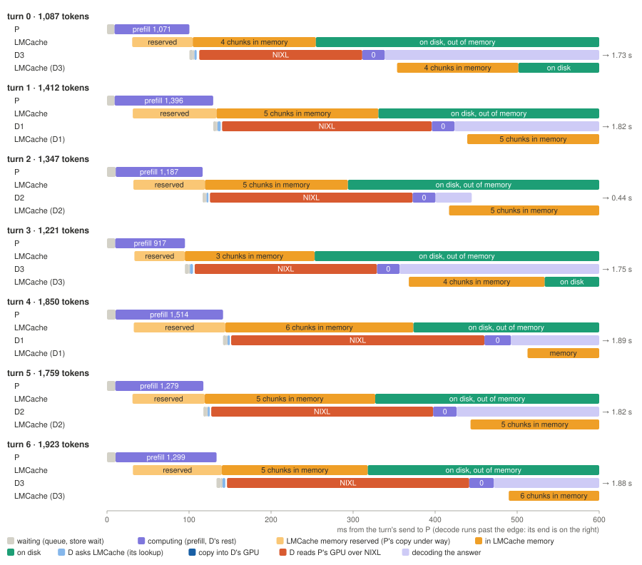

# Conversation 1: mt-rag-clapnq-elser-512-100-20240503 (disk mode, NIXL, per-engine servers, chat RAG, all passages)

P's KV reaches D over NIXL (D reads P's GPU blocks); every engine's LMCache connector stores beside it, to its own server. 7 turns on D1, D2, D3 (round-robin: each turn to the next D engine); prompts grow from 1,087 to 1,923 tokens (interleaved: each turn's prompt is the previous one, its answer, then this turn's documents and question). Chunks are 256 tokens (16 vLLM blocks of 16); a chunk's name is LMCache's hash of its tokens and everything before them, so the same prefix has the same chunks on every turn and engine.

Legend for the strips (one character a chunk): P: `=` on P's GPU from an earlier turn, `#` computed and stored now, `+` computed, not stored (a partial chunk). D: `=` on D's GPU from an earlier turn, `M` pulled from memory, `S` pulled from disk, `N` read from P's GPU over NIXL, `+` computed by D (a partial chunk), `?` missed.

GPU blocks (the chunk tables): where each engine keeps the chunk's 16 vLLM blocks in its GPU KV cache, by vLLM's block ids (vLLM's paged KV cache: a block, or page, holds 16 tokens; block 0 is its reserved null block), in the prompt's block order, a run of consecutive ids written as a range: `P 1, 138-152` is the prompt's block 0 in GPU block 1 and its blocks 1-15 in GPU blocks 138-152. An engine takes a GPU block from its free list when it first computes or loads a block, and the block keeps it while cached, so a later turn that reuses the block shows the same id. Blocks that are the same in several prompts (the same tokens and everything before them) share one GPU block once the first is cached: the system prompt's first block, the same in every conversation, is the usual one. `16/16 hashes = P's`: of the blocks D pulled, how many have the same vLLM hash on D as on P.

The prompts' text is the driver's own record of what it sent (answers included); lines over 100 characters are wrapped here for reading.

| turn | prompt | chunks + tail | P: own GPU / computed / stored | D: own GPU / loaded / computed | pulled | pull ms | D first token ms |
| ---: | ---: | --- | --- | --- | --- | ---: | ---: |
| [0](#turn-0) | 1,087 | 4 + 63 | 16 / 1,071 / 4 chunks | 16 / 1,071 / 0 | 5 chunks (NIXL 5) | 198.7 | 233.7 |
| [1](#turn-1) | 1,412 | 5 + 132 | 16 / 1,396 / 5 chunks | 16 / 1,396 / 0 | 6 chunks (NIXL 6) | 255.6 | 290.4 |
| [2](#turn-2) | 1,347 | 5 + 67 | 160 / 1,187 / 5 chunks | 16 / 1,331 / 0 | 6 chunks (NIXL 6) | 247.0 | 280.7 |
| [3](#turn-3) | 1,221 | 4 + 197 | 304 / 917 / 3 chunks | 16 / 1,205 / 0 | 5 chunks (NIXL 5) | 222.2 | 257.4 |
| [4](#turn-4) | 1,850 | 7 + 58 | 336 / 1,514 / 6 chunks | 160 / 1,690 / 0 | 8 chunks (NIXL 8) | 308.8 | 347.2 |
| [5](#turn-5) | 1,759 | 6 + 223 | 480 / 1,279 / 5 chunks | 304 / 1,455 / 0 | 6 chunks (NIXL 6) | 270.7 | 305.2 |
| [6](#turn-6) | 1,923 | 7 + 131 | 624 / 1,299 / 5 chunks | 336 / 1,587 / 0 | 7 chunks (NIXL 7) | 295.3 | 333.2 |

## How the prompt grows

Each turn's prompt is the previous one, token for token, and then: D's answer to the previous turn, this turn's documents, its question and the framing (the system prompt on turn 0, `Assistant:` and newlines). Only the new tokens can make new chunks: the previous prompt's partial chunk fills first. A document sent before comes again at another place, so in other chunks.

| turn | prompt | new | previous answer | documents | question | framing | whole chunks |
| ---: | ---: | ---: | ---: | --- | --- | ---: | --- |
| 0 | 1,087 | +1,087 | – | 5 docs, 1,045 | 12: Where do guinea pigs sleep in the wild? | 30 | 4 (+4) |
| 1 | 1,412 | +325 | – | 1 doc, 145 | 9: What do guinea pigs eat? | 2 | 5 (+1) |
| 2 | 1,347 | +-65 | – | 0 docs, 0 | 0 | 0 | 5 (+0) |
| 3 | 1,221 | +-126 | – | 0 docs, 0 | 0 | 0 | 4 (+-1) |
| 4 | 1,850 | +629 | – | 3 docs, 567 | 18: I'm told guinea pigs are raised for human consumption. Is that true? | 2 | 7 (+3) |
| 5 | 1,759 | +-91 | – | 0 docs, 0 | 0 | 0 | 6 (+-1) |
| 6 | 1,923 | +164 | – | 0 docs, 0 | 6: Vitamin C research | 2 | 7 (+1) |

## Timeline

Every turn on one clock: ms from the moment the proxy sent the turn to P. P prefills it (one token out) and holds its blocks for D; the proxy sends the turn to the next D engine at once with P's reply's kv_transfer_params (no wait), D reads P's blocks over NIXL (orange-red), computes the rest and decodes the answer. Beside it every engine's LMCache connector stores its new whole chunks (P's lane, and D's own when it stored any). The lanes: P, LMCache (P's chunks), D, and LMCache (D's chunks).



| turn | P queued → done | P's chunks: in memory / on disk | D | D starts | NIXL read | D: held / from P / from LMCache / computed | D's chunks stored | first token | P freed | D done |
| ---: | --- | --- | --- | ---: | --- | --- | ---: | ---: | ---: | ---: |
| 0 | 9 → 100 | 4: 104 / 255 | D3 | 105 | 112-311 | 16 / 1,071 / 0 / 0 | 4 | 339 | 312 | 1,733 |
| 1 | 9 → 130 | 5: 134 / 331 | D1 | 133 | 140-396 | 16 / 1,396 / 0 / 0 | 5 | 424 | 397 | 1,820 |
| 2 | 11 → 117 | 5: 119 / 294 | D2 | 120 | 126-372 | 16 / 1,331 / 0 / 0 | 5 | 400 | 373 | 445 |
| 3 | 10 → 95 | 3: 95 / 253 | D3 | 99 | 107-329 | 16 / 1,205 / 0 / 0 | 4 | 357 | 330 | 1,755 |
| 4 | 10 → 141 | 6: 144 / 374 | D1 | 145 | 151-460 | 160 / 1,690 / 0 / 0 | 7 | 492 | 461 | 1,894 |
| 5 | 10 → 118 | 5: 119 / 327 | D2 | 121 | 127-398 | 304 / 1,455 / 0 / 0 | 5 | 426 | 398 | 1,824 |
| 6 | 10 → 134 | 5: 140 / 318 | D3 | 138 | 146-442 | 336 / 1,587 / 0 / 0 | 6 | 472 | 442 | 1,879 |

All times in ms from the turn's send to P. NIXL read: D's worker posts the read of P's blocks to the KV in D's GPU blocks; P freed: D has read, P's blocks go back to its free queue (still cached). Each turn's section below tells it in a sentence and step by step.

### One chunk, block by block: chunk 1 of turn 0 (`8511e0c6bcaee97a`)

Tokens 256-512 (doc 850931827_1108: 89; doc 850931827_1243: 167). P computed its blocks; D3 read them from P's GPU over NIXL, P's block into D's block, one for one:

| block | tokens | P's GPU block | vLLM hash on P | D's GPU block | same hash on D |
| ---: | --- | ---: | --- | ---: | --- |
| 16 | 256-272 | 221 | `2e5a421df2df660f` | 80 | True |
| 17 | 272-288 | 222 | `c22558f0df91d7be` | 81 | True |
| 18 | 288-304 | 223 | `361002542a486dc4` | 82 | True |
| 19 | 304-320 | 224 | `9600f036d3567d2d` | 83 | True |
| 20 | 320-336 | 225 | `21269e0ec0699696` | 84 | True |
| 21 | 336-352 | 226 | `e9aa2009479d3255` | 85 | True |
| 22 | 352-368 | 227 | `641e11c53774c479` | 86 | True |
| 23 | 368-384 | 228 | `8859b817c4371256` | 87 | True |
| 24 | 384-400 | 229 | `8b3db890ee9f9bba` | 88 | True |
| 25 | 400-416 | 230 | `06258b0efe30d239` | 89 | True |
| 26 | 416-432 | 231 | `05617b04b72c1bc4` | 90 | True |
| 27 | 432-448 | 232 | `4d2f0e225da14590` | 91 | True |
| 28 | 448-464 | 233 | `558cbb354414f6d8` | 92 | True |
| 29 | 464-480 | 234 | `82d0763ab2957d0c` | 93 | True |
| 30 | 480-496 | 235 | `47850a4962e1441a` | 94 | True |
| 31 | 496-512 | 236 | `c72baed0b95cd252` | 95 | True |

## Turn 0

**Timeline:** P queued until 9 ms, prefilled 1,071 tokens (held 16) and was done at 100 ms; its 4 new chunks were in LMCache's memory at 104 ms, on disk at 255 ms and out of memory. D3 started at 105 ms (no wait) holding 16 tokens, read 1,071 from P's GPU over NIXL (posted at 112 ms, in its GPU at 311 ms; P freed its blocks at 312 ms), computed 0 and gave its first token at 339 ms; it decoded 128 tokens until 1,733 ms; its LMCache connector stored 4 new chunks. ([all turns](#timeline))

### Step by step

Every move of this turn's KV, ms from the proxy sending the turn to P. P's KV reaches D over NIXL: D's worker reads P's GPU blocks into its own (a NIXL READ, P told when D is done); LMCache's copies (to and from each server's memory) its servers do themselves through CUDA IPC handles each engine registered at start.

| ms | where | what |
| ---: | --- | --- |
| 0.0 | proxy → P | sends the turn (1,087 prompt tokens; P is asked for one token: prefill only) |
| 2.2 | P | the request arrives |
| 8.9 | P GPU | its prefix cache holds 16 of the prompt's tokens: 1 block in GPU blocks 1 |
| 9.0 | P ↔ LMCache | LMCache has 0 of its tokens; P loads 0 and computes the rest |
| 9.1 | P GPU | 67 new GPU blocks for the 1,071 tokens it computes: 207-273; the prefill runs |
| 9.6 | P → LMCache | store planned: tokens 0-1,024, chunks 0-3 (64 blocks) |
| 30.1 | LMCache | the store request is in; it waits for P's forward pass to finish (a CUDA event) |
| 30.7 | LMCache memory | space reserved for 4 chunks (117 MB) |
| 97.3 | P GPU → LMCache memory | the copy starts: LMCache reads P's GPU blocks (CUDA IPC) |
| 97.7 | P GPU | the request is done: P holds its 68 blocks for D to read over NIXL, and its reply carries them (kv_transfer_params: the blocks, its NIXL agent) |
| 100.4 | P → proxy | P answers its one token: the prefill is done |
| 102.4 | P GPU → LMCache memory | copy done: 4 chunks, 117 MB in 5.1 ms |
| 104.5 | LMCache memory | 4 chunks in memory, kept for later requests (D gets this turn's KV from P over NIXL); P keeps its copy in its GPU blocks |
| 105.0 | proxy → D3 | sends the turn to D3 at once, with P's kv_transfer_params (round-robin; no wait) |
| 106.6 | D3 ↔ LMCache | asks LMCache for the prompt's chunks |
| 109.3 | LMCache memory | found 0 tokens it lacks |
| 111.5 | D3 GPU | its prefix cache holds 16 of the prompt's tokens: 1 block in GPU blocks 1 |
| 111.6 | D3 ↔ P (NIXL) | will read 1,071 prompt tokens from P's GPU (beyond the 16 its own cache holds) |
| 111.6 | D3 ↔ LMCache | LMCache has 0 of its tokens; NIXL loads it (MultiConnector: the first connector with tokens) |
| 111.9 | D3 GPU | 67 GPU blocks for the KV from P: 65-131 |
| 112.4 | P GPU → D3 GPU (NIXL) | D3 reads P's GPU blocks 1, 207-273 into its 65-131 (a NIXL READ) |
| 254.6 | LMCache disk | 4 chunks written to disk (one file each) |
| 255.0 | LMCache memory | 4 memory copies dropped: on disk only now |
| 311.1 | D3 | the KV from P is in its GPU blocks (1,071 tokens) |
| 311.5 | P GPU | D3 has read: P frees its blocks (they stay in its prefix cache) |
| 321.3 | D3 → LMCache | store planned: tokens 0-1,024; 4 chunks new to its server |
| 336.0 | D3 GPU | 1 new GPU block for the 1 prompt tokens it computes: 132 |
| 338.7 | D3 → proxy | the first answer token |
| 353.6 | LMCache memory | 4 chunks from D3 in memory |
| 501.6 | LMCache disk | 4 chunks from D3 written to disk |
| 513.6 | D3 GPU | decoding: the answer's KV takes 7 new GPU blocks as it grows, one per 16 tokens: 133-139, until 1,568 ms |
| 1,733.2 | D3 | done: 128 tokens decoded; its blocks stay cached in its GPU for the next turn |
| 1,734.3 | proxy | the response is complete |

1,087 prompt tokens: 4 whole chunks and 63 tokens over (the partial chunk, computed by both engines and stored only when a later turn completes it). P held 16 tokens on its GPU, computed 1,071 and stored 4 new chunks; D3 held 16, read 1,071 from P over NIXL, loaded 0 from LMCache and computed 0.

### The prompt

The whole prompt, piece by piece:

- **system prompt** · tokens 0-28 (28) · chunk 0

```text
You are a helpful assistant. Answer the user's last question from the documents. If they do not hold
the answer, say so.
```

<details><summary>document <code>850931827_11086-12414-0-1328</code> · tokens 28-345 (317) · chunks 0-1</summary>

```text
Document: Guinea pig
Guinea pig
C. porcellus is not found naturally in the wild ; it is likely descended from closely related
species of cavies , such as C. aperea , C. fulgida , and C. tschudii , which are still commonly
found in various regions of South America . Studies from 2007 -- 2010 applied molecular markers and
studied the skull and skeletal morphology of current and mummified animals , thereby revealing the
ancestor to most likely be Cavia tschudii . Some species of cavy identified in the 20th century ,
such as C. anolaimae and C. guianae , may be domestic guinea pigs that have become feral by
reintroduction into the wild . Wild cavies are found on grassy plains and occupy an ecological niche
similar to that of cattle . They are social , living in the wild in small groups that consist of
several females ( sows ) , a male ( boar ) , and the young ( which , in a break with the preceding
porcine nomenclature , are called `` pups '' not `` piglets '' ) . They move together in groups (
herds ) eating grass or other vegetation , and do not store food . While they do not burrow
themselves or build nests , they frequently seek shelter in the burrows of other animals , as well
as in crevices and tunnels formed by vegetation . They tend to be most active during dawn and dusk (
crepuscular ) , when it is harder for predators to spot them .
```

</details>

<details><summary>document <code>850931827_12432-13339-0-907</code> · tokens 345-528 (183) · chunks 1-2</summary>

```text
Document: Guinea pig
Guinea pig
Domesticated guinea pigs thrive in groups of two or more ; groups of sows , or groups of one or more
sows and a neutered boar are common combinations , but boars can sometimes live together . Guinea
pigs learn to recognize and bond with other individual pigs , and testing of boars shows their
neuroendocrine stress response is significantly lowered in the presence of a bonded female when
compared to the presence of unfamiliar females . Groups of boars may also get along , provided their
cage has enough space , they are introduced at an early age , and no females are present . Domestic
guinea pigs have developed a different biological rhythm from their wild counterparts , and have
longer periods of activity followed by short periods of sleep in between . Activity is scattered
randomly throughout the day ; aside from an avoidance of intense light , no regular circadian
patterns are apparent . This
```

</details>

<details><summary>document <code>850931827_13486-14754-0-1268</code> · tokens 528-803 (275) · chunks 2-3</summary>

```text
Document: Guinea pig
Guinea pig
Domestic guinea pigs generally live in cages , although some owners of large numbers of guinea pigs
dedicate entire rooms to their pets . Cages with solid or wire mesh floors are used , although wire
mesh floors can cause injury and may be associated with an infection commonly known as bumblefoot (
ulcerative pododermatitis ) . `` Cubes and Coroplast '' ( C&C ) style cages are now a common choice
. Cages are often lined with wood shavings or a similar material . Bedding made from red cedar (
Eastern or Western ) and pine , both softwoods , were commonly used in the past , but these
materials are now believed to contain harmful phenols ( aromatic hydrocarbons ) and oils . Safer
bedding materials made from hardwoods ( such as aspen ) , paper products , and corn cob materials
are other alternatives . Guinea pigs tend to be messy within their cages ; they often jump into
their food bowls or kick bedding and feces into them , and their urine sometimes crystallizes on
cage surfaces , making it difficult to remove . After its cage has been cleaned , a guinea pig
typically urinates and drags its lower body across the floor of the cage to mark its territory .
Male guinea pigs may also mark their territory in this way when they are taken out of their cages .
```

</details>

<details><summary>document <code>850931827_588-1089-0-501</code> · tokens 803-928 (125) · chunk 3</summary>

```text
Document: Guinea pig
Guinea pig
The guinea pig or domestic guinea pig ( Cavia porcellus ) , also known as cavy or domestic cavy , is
a species of rodent belonging to the family Caviidae and the genus Cavia . Despite their common name
, these animals are not in the pig family Suidae , nor do they come from Guinea in Africa ; they
originated in the Andes of South America and studies based on biochemistry and hybridization suggest
they are domestic , not wild , descendants of a closely related species of cavy such as C. tschudii
.
```

</details>

<details><summary>document <code>850931827_30008-30728-0-720</code> · tokens 928-1073 (145) · chunks 3-4</summary>

```text
Document: Guinea pig
Guinea pig
If handled correctly early in life , guinea pigs become amenable to being picked up and carried ,
and seldom bite or scratch . They are timid explorers and often hesitate to attempt an escape from
their cage even when an opportunity presents itself . Still , they show considerable curiosity when
allowed to walk freely , especially in familiar and safe terrain . Guinea pigs that become familiar
with their owner will whistle on the owner 's approach ; they will also learn to whistle in response
to the rustling of plastic bags or the opening of refrigerator doors , where their food is most
commonly stored . In Switzerland , owning a single guinea pig is considered harmful to its well -
being and forbidden by law .
```

</details>

- **question 0** · tokens 1073-1085 (12) · chunk 4

```text
User: Where do guinea pigs sleep in the wild?
```

- `Assistant:` · tokens 1085-1087 (2) · chunk 4

### Pieces, chunks and blocks

| piece | tokens | length | chunks | |
| --- | --- | ---: | --- | --- |
| system | 0-28 | 28 | 0 |  |
| doc 850931827_1108 | 28-345 | 317 | 0-1 |  |
| doc 850931827_1243 | 345-528 | 183 | 1-2 |  |
| doc 850931827_1348 | 528-803 | 275 | 2-3 |  |
| doc 850931827_588- | 803-928 | 125 | 3 |  |
| doc 850931827_3000 | 928-1073 | 145 | 3-4 |  |
| question 0 | 1073-1085 | 12 | 4 |  |
| `assistant:` 0 | 1085-1087 | 2 | 4 |  |

```
P  ####+
D  NNNNN
```

| chunk | tokens | pieces in it (tokens) | vLLM blocks | GPU blocks | in LMCache | P this turn | D this turn |
| ---: | --- | --- | --- | --- | --- | --- | --- |
| 0 | 0-256 | system: 28; doc 850931827_1108: 228 | 0-15 | P 1, 207-221; D 1, 65-79; 15/15 hashes = P's | `5e868214004923dc`: LMC_P: stored on turn 0 by P, on disk, out of memory; LMC_D3: stored on turn 0 by D3, on disk, out of memory; LMC_D1: stored on turn 0 by D1, on disk, out of memory | computed (its first 16 tokens on P's GPU already), **stored now** | **read from P's GPU over NIXL** (its first 16 tokens on D's GPU already) |
| 1 | 256-512 | doc 850931827_1108: 89; doc 850931827_1243: 167 | 16-31 | P 222-237; D 80-95; 16/16 hashes = P's | `8511e0c6bcaee97a`: LMC_P: stored on turn 0 by P, on disk, out of memory; LMC_D3: stored on turn 0 by D3, on disk, out of memory; LMC_D1: stored on turn 0 by D1, on disk, out of memory | computed, **stored now** | **read from P's GPU over NIXL** |
| 2 | 512-768 | doc 850931827_1243: 16; doc 850931827_1348: 240 | 32-47 | P 238-253; D 96-111; 16/16 hashes = P's | `5b7d0f205cab2dd1`: LMC_P: stored on turn 0 by P, on disk, out of memory; LMC_D3: stored on turn 0 by D3, on disk, out of memory; LMC_D1: stored on turn 0 by D1, on disk, out of memory | computed, **stored now** | **read from P's GPU over NIXL** |
| 3 | 768-1024 | doc 850931827_1348: 35; doc 850931827_588-: 125; doc 850931827_3000: 96 | 48-63 | P 254-269; D 112-127; 16/16 hashes = P's | `cdf6026e22fae037`: LMC_P: stored on turn 0 by P, on disk, out of memory; LMC_D3: stored on turn 0 by D3, on disk, out of memory; LMC_D1: stored on turn 0 by D1, on disk, out of memory | computed, **stored now** | **read from P's GPU over NIXL** |
| 4 | 1024-1087 | doc 850931827_3000: 49; question 0: 12; `assistant:` 0: 2 | 64-67 | P 270-272; D 128-131; 3/3 hashes = P's | – | computed (partial chunk: not stored) | **read from P's GPU over NIXL** (partial chunk) |

## Turn 1

**Timeline:** P queued until 9 ms, prefilled 1,396 tokens (held 16) and was done at 130 ms; its 5 new chunks were in LMCache's memory at 134 ms, on disk at 331 ms and out of memory. D1 started at 133 ms (no wait) holding 16 tokens, read 1,396 from P's GPU over NIXL (posted at 140 ms, in its GPU at 396 ms; P freed its blocks at 397 ms), computed 0 and gave its first token at 424 ms; it decoded 128 tokens until 1,820 ms; its LMCache connector stored 5 new chunks. ([all turns](#timeline))

### Step by step

Every move of this turn's KV, ms from the proxy sending the turn to P. P's KV reaches D over NIXL: D's worker reads P's GPU blocks into its own (a NIXL READ, P told when D is done); LMCache's copies (to and from each server's memory) its servers do themselves through CUDA IPC handles each engine registered at start.

| ms | where | what |
| ---: | --- | --- |
| 0.0 | proxy → P | sends the turn (1,412 prompt tokens; P is asked for one token: prefill only) |
| 3.1 | P | the request arrives |
| 9.1 | P GPU | its prefix cache holds 16 of the prompt's tokens: 1 block in GPU blocks 1 |
| 9.1 | P ↔ LMCache | LMCache has 0 of its tokens; P loads 0 and computes the rest |
| 9.3 | P GPU | 88 new GPU blocks for the 1,396 tokens it computes: 273-360; the prefill runs |
| 9.8 | P → LMCache | store planned: tokens 0-1,280, chunks 0-4 (80 blocks) |
| 30.6 | LMCache | the store request is in; it waits for P's forward pass to finish (a CUDA event) |
| 31.4 | LMCache memory | space reserved for 5 chunks (147 MB) |
| 125.3 | P GPU → LMCache memory | the copy starts: LMCache reads P's GPU blocks (CUDA IPC) |
| 125.5 | P GPU | the request is done: P holds its 89 blocks for D to read over NIXL, and its reply carries them (kv_transfer_params: the blocks, its NIXL agent) |
| 129.5 | P → proxy | P answers its one token: the prefill is done |
| 131.6 | P GPU → LMCache memory | copy done: 5 chunks, 147 MB in 6.3 ms |
| 133.2 | proxy → D1 | sends the turn to D1 at once, with P's kv_transfer_params (round-robin; no wait) |
| 133.5 | LMCache memory | 5 chunks in memory, kept for later requests (D gets this turn's KV from P over NIXL); P keeps its copy in its GPU blocks |
| 134.8 | D1 ↔ LMCache | asks LMCache for the prompt's chunks |
| 138.6 | LMCache memory | found 0 tokens it lacks |
| 139.5 | D1 GPU | its prefix cache holds 16 of the prompt's tokens: 1 block in GPU blocks 1 |
| 139.5 | D1 ↔ P (NIXL) | will read 1,396 prompt tokens from P's GPU (beyond the 16 its own cache holds) |
| 139.6 | D1 ↔ LMCache | LMCache has 0 of its tokens; NIXL loads it (MultiConnector: the first connector with tokens) |
| 139.8 | D1 GPU | 88 GPU blocks for the KV from P: 111-198 |
| 140.3 | P GPU → D1 GPU (NIXL) | D1 reads P's GPU blocks 1, 273-360 into its 111-198 (a NIXL READ) |
| 330.9 | LMCache disk | 5 chunks written to disk (one file each) |
| 331.4 | LMCache memory | 5 memory copies dropped: on disk only now |
| 395.9 | D1 | the KV from P is in its GPU blocks (1,396 tokens) |
| 396.6 | P GPU | D1 has read: P frees its blocks (they stay in its prefix cache) |
| 407.4 | D1 → LMCache | store planned: tokens 0-1,280; 5 chunks new to its server |
| 423.6 | D1 → proxy | the first answer token |
| 439.1 | LMCache memory | 5 chunks from D1 in memory |
| 545.5 | D1 GPU | 1 new GPU block for the 1 prompt tokens it computes: 199 |
| 644.4 | LMCache disk | 5 chunks from D1 written to disk |
| 721.7 | D1 GPU | decoding: the answer's KV takes 7 new GPU blocks as it grows, one per 16 tokens: 200-206, until 1,776 ms |
| 1,820.1 | D1 | done: 128 tokens decoded; its blocks stay cached in its GPU for the next turn |
| 1,821.0 | proxy | the response is complete |

1,412 prompt tokens: 5 whole chunks and 132 tokens over (the partial chunk, computed by both engines and stored only when a later turn completes it). P held 16 tokens on its GPU, computed 1,396 and stored 5 new chunks; D1 held 16, read 1,396 from P over NIXL, loaded 0 from LMCache and computed 0.

### The prompt

Tokens 0-1,087: [turn 0](#turn-0)'s prompt, unchanged (NOT the previous prompt's ids), so chunks 0-3 are the same chunks; chunk 4 (partial then, 63 tokens) fills now. New from token 1,087:

<details><summary>document <code>850931827_26385-26900-0-515</code> · tokens 1256-1401 (145) · chunks 4-5</summary>

```text
Document: Guinea pig
Guinea pig
A number of plants are poisonous to guinea pigs , including bracken , bryony , buttercup , charlock
, deadly nightshade , foxglove , hellebore , hemlock , lily of the valley , mayweed , monkshood ,
privet , ragwort , rhubarb , speedwell , toadflax ( both Linaria vulgaris and Linaria dalmatica ) ,
and wild celery . Additionally , any plant which grows from a bulb ( e.g. , tulip or onion ) is
normally considered poisonous , as well as ivy and oak tree leaves . A guinea pig may or may not eat
poisonous material .
```

</details>

- **question 1** · tokens 1401-1410 (9) · chunk 5

```text
User: What do guinea pigs eat?
```

- `Assistant:` · tokens 1410-1412 (2) · chunk 5

### Pieces, chunks and blocks

| piece | tokens | length | chunks | |
| --- | --- | ---: | --- | --- |
| system | 0-28 | 28 | 0 |  |
| question 0 | 28-40 | 12 | 0 |  |
| `assistant:` 0 | 40-42 | 2 | 0 |  |
| answer 0 | 42-170 | 128 | 0 |  |
| newline 0 | 170-171 | 1 | 0 |  |
| doc 850931827_1108 | 171-488 | 317 | 0-1 |  |
| doc 850931827_2277 | 488-734 | 246 | 1-2 |  |
| doc 850931827_2391 | 734-891 | 157 | 2-3 |  |
| doc 850931827_2464 | 891-1057 | 166 | 3-4 |  |
| doc 850931827_2541 | 1057-1256 | 199 | 4 |  |
| doc 850931827_2638 | 1256-1401 | 145 | 4-5 | new this turn |
| question 1 | 1401-1410 | 9 | 5 | new this turn |
| `assistant:` 1 | 1410-1412 | 2 | 5 | new this turn |

```
P  #####+
D  NNNNNN
```

| chunk | tokens | pieces in it (tokens) | vLLM blocks | GPU blocks | in LMCache | P this turn | D this turn |
| ---: | --- | --- | --- | --- | --- | --- | --- |
| 0 | 0-256 | system: 28; question 0: 12; `assistant:` 0: 2; answer 0: 128; newline 0: 1; doc 850931827_1108: 85 | 0-15 | P 1, 273-287; D 1, 111-125; 15/15 hashes = P's | `787103a158cd867d`: LMC_P: stored on turn 1 by P, on disk, out of memory; LMC_D1: stored on turn 1 by D1, on disk, out of memory | computed (its first 16 tokens on P's GPU already), **stored now** | **read from P's GPU over NIXL** (its first 16 tokens on D's GPU already) |
| 1 | 256-512 | doc 850931827_1108: 232; doc 850931827_2277: 24 | 16-31 | P 288-303; D 126-141; 16/16 hashes = P's | `0c44f0282bdbfcd5`: LMC_P: stored on turn 1 by P, on disk, out of memory; LMC_D1: stored on turn 1 by D1, on disk, out of memory | computed, **stored now** | **read from P's GPU over NIXL** |
| 2 | 512-768 | doc 850931827_2277: 222; doc 850931827_2391: 34 | 32-47 | P 304-319; D 142-157; 16/16 hashes = P's | `4e56c59b8815b4d5`: LMC_P: stored on turn 1 by P, on disk, out of memory; LMC_D1: stored on turn 1 by D1, on disk, out of memory | computed, **stored now** | **read from P's GPU over NIXL** |
| 3 | 768-1024 | doc 850931827_2391: 123; doc 850931827_2464: 133 | 48-63 | P 320-335; D 158-173; 16/16 hashes = P's | `7f9ac07dfd8d2b05`: LMC_P: stored on turn 1 by P, on disk, out of memory; LMC_D1: stored on turn 1 by D1, on disk, out of memory | computed, **stored now** | **read from P's GPU over NIXL** |
| 4 | 1024-1280 | doc 850931827_2464: 33; doc 850931827_2541: 199; doc 850931827_2638 (new): 24 | 64-79 | P 336-351; D 174-189; 16/16 hashes = P's | `27dd4b06ff01ba8e`: LMC_P: stored on turn 1 by P, on disk, out of memory; LMC_D1: stored on turn 1 by D1, on disk, out of memory | computed, **stored now** | **read from P's GPU over NIXL** |
| 5 | 1280-1412 | doc 850931827_2638 (new): 121; question 1 (new): 9; `assistant:` 1 (new): 2 | 80-88 | P 352-359; D 190-198; 8/8 hashes = P's | – | computed (partial chunk: not stored) | **read from P's GPU over NIXL** (partial chunk) |

## Turn 2

**Timeline:** P queued until 11 ms, prefilled 1,187 tokens (held 160) and was done at 117 ms; its 5 new chunks were in LMCache's memory at 119 ms, on disk at 294 ms and out of memory. D2 started at 120 ms (no wait) holding 16 tokens, read 1,331 from P's GPU over NIXL (posted at 126 ms, in its GPU at 372 ms; P freed its blocks at 373 ms), computed 0 and gave its first token at 400 ms; it decoded 5 tokens until 445 ms; its LMCache connector stored 5 new chunks. ([all turns](#timeline))

### Step by step

Every move of this turn's KV, ms from the proxy sending the turn to P. P's KV reaches D over NIXL: D's worker reads P's GPU blocks into its own (a NIXL READ, P told when D is done); LMCache's copies (to and from each server's memory) its servers do themselves through CUDA IPC handles each engine registered at start.

| ms | where | what |
| ---: | --- | --- |
| 0.0 | proxy → P | sends the turn (1,347 prompt tokens; P is asked for one token: prefill only) |
| 3.9 | P | the request arrives |
| 10.3 | P GPU | its prefix cache holds 160 of the prompt's tokens: 10 blocks in GPU blocks 1, 273-281 |
| 10.4 | P ↔ LMCache | LMCache has 0 of its tokens; P loads 0 and computes the rest |
| 10.6 | P GPU | 75 new GPU blocks for the 1,187 tokens it computes: 360-434; the prefill runs |
| 11.1 | P → LMCache | store planned: tokens 0-1,280, chunks 0-4 (80 blocks) |
| 31.4 | LMCache | the store request is in; it waits for P's forward pass to finish (a CUDA event) |
| 32.2 | LMCache memory | space reserved for 5 chunks (147 MB) |
| 109.3 | P GPU → LMCache memory | the copy starts: LMCache reads P's GPU blocks (CUDA IPC) |
| 109.5 | P GPU | the request is done: P holds its 85 blocks for D to read over NIXL, and its reply carries them (kv_transfer_params: the blocks, its NIXL agent) |
| 115.7 | P GPU → LMCache memory | copy done: 5 chunks, 147 MB in 6.4 ms |
| 116.6 | P → proxy | P answers its one token: the prefill is done |
| 119.4 | LMCache memory | 5 chunks in memory, kept for later requests (D gets this turn's KV from P over NIXL); P keeps its copy in its GPU blocks |
| 119.8 | proxy → D2 | sends the turn to D2 at once, with P's kv_transfer_params (round-robin; no wait) |
| 121.4 | D2 ↔ LMCache | asks LMCache for the prompt's chunks |
| 123.7 | LMCache memory | found 0 tokens it lacks |
| 124.6 | D2 GPU | its prefix cache holds 16 of the prompt's tokens: 1 block in GPU blocks 1 |
| 124.7 | D2 ↔ P (NIXL) | will read 1,331 prompt tokens from P's GPU (beyond the 16 its own cache holds) |
| 124.7 | D2 ↔ LMCache | LMCache has 0 of its tokens; NIXL loads it (MultiConnector: the first connector with tokens) |
| 125.0 | D2 GPU | 84 GPU blocks for the KV from P: 119-202 |
| 125.5 | P GPU → D2 GPU (NIXL) | D2 reads P's GPU blocks 1, 273-281, 360-434 into its 119-202 (a NIXL READ) |
| 293.7 | LMCache disk | 5 chunks written to disk (one file each) |
| 294.2 | LMCache memory | 5 memory copies dropped: on disk only now |
| 372.5 | D2 | the KV from P is in its GPU blocks (1,331 tokens) |
| 373.1 | P GPU | D2 has read: P frees its blocks (they stay in its prefix cache) |
| 383.9 | D2 → LMCache | store planned: tokens 0-1,280; 5 chunks new to its server |
| 400.5 | D2 → proxy | the first answer token |
| 417.0 | LMCache memory | 5 chunks from D2 in memory |
| 444.6 | D2 | done: 5 tokens decoded; its blocks stay cached in its GPU for the next turn |
| 446.0 | proxy | the response is complete |
| 635.3 | LMCache disk | 5 chunks from D2 written to disk |

1,347 prompt tokens: 5 whole chunks and 67 tokens over (the partial chunk, computed by both engines and stored only when a later turn completes it). P held 160 tokens on its GPU, computed 1,187 and stored 5 new chunks; D2 held 16, read 1,331 from P over NIXL, loaded 0 from LMCache and computed 0.

### The prompt

Tokens 0-1,412: [turn 1](#turn-1)'s prompt, unchanged (NOT the previous prompt's ids), so chunks 0-4 are the same chunks; chunk 5 (partial then, 132 tokens) fills now. New from token 1,412:

### Pieces, chunks and blocks

| piece | tokens | length | chunks | |
| --- | --- | ---: | --- | --- |
| system | 0-28 | 28 | 0 |  |
| question 0 | 28-40 | 12 | 0 |  |
| `assistant:` 0 | 40-42 | 2 | 0 |  |
| answer 0 | 42-170 | 128 | 0 |  |
| newline 0 | 170-171 | 1 | 0 |  |
| question 1 | 171-180 | 9 | 0 |  |
| `assistant:` 1 | 180-182 | 2 | 0 |  |
| answer 1 | 182-310 | 128 | 0-1 |  |
| newline 1 | 310-311 | 1 | 1 |  |
| doc 850931827_1108 | 311-628 | 317 | 1-2 |  |
| doc 850931827_588- | 628-753 | 125 | 2 |  |
| doc 850931827_1243 | 753-936 | 183 | 2-3 |  |
| doc 850931827_1348 | 936-1211 | 275 | 3-4 |  |
| doc 850931827_1090 | 1211-1319 | 108 | 4-5 |  |
| question 2 | 1319-1345 | 26 | 5 |  |
| `assistant:` 2 | 1345-1347 | 2 | 5 |  |

```
P  #####+
D  NNNNNN
```

| chunk | tokens | pieces in it (tokens) | vLLM blocks | GPU blocks | in LMCache | P this turn | D this turn |
| ---: | --- | --- | --- | --- | --- | --- | --- |
| 0 | 0-256 | system: 28; question 0: 12; `assistant:` 0: 2; answer 0: 128; newline 0: 1; question 1: 9; `assistant:` 1: 2; answer 1: 74 | 0-15 | P 1, 273-281, 360-365; D 1, 119-133; 6/6 hashes = P's | `1c04bb6bfe2175b0`: LMC_P: stored on turn 2 by P, on disk, out of memory; LMC_D2: stored on turn 2 by D2, on disk, out of memory; LMC_D3: stored on turn 3 by D3, on disk, out of memory; LMC_D1: stored on turn 4 by D1, on disk, out of memory | computed (its first 160 tokens on P's GPU already), **stored now** | **read from P's GPU over NIXL** (its first 16 tokens on D's GPU already) |
| 1 | 256-512 | answer 1: 54; newline 1: 1; doc 850931827_1108: 201 | 16-31 | P 366-381; D 134-149; 16/16 hashes = P's | `8e6c4483702a2f1a`: LMC_P: stored on turn 2 by P, on disk, out of memory; LMC_D2: stored on turn 2 by D2, on disk, out of memory | computed, **stored now** | **read from P's GPU over NIXL** |
| 2 | 512-768 | doc 850931827_1108: 116; doc 850931827_588-: 125; doc 850931827_1243: 15 | 32-47 | P 382-397; D 150-165; 16/16 hashes = P's | `61c6c4950a98b71b`: LMC_P: stored on turn 2 by P, on disk, out of memory; LMC_D2: stored on turn 2 by D2, on disk, out of memory | computed, **stored now** | **read from P's GPU over NIXL** |
| 3 | 768-1024 | doc 850931827_1243: 168; doc 850931827_1348: 88 | 48-63 | P 398-413; D 166-181; 16/16 hashes = P's | `0f109c0ddc8b8a9e`: LMC_P: stored on turn 2 by P, on disk, out of memory; LMC_D2: stored on turn 2 by D2, on disk, out of memory | computed, **stored now** | **read from P's GPU over NIXL** |
| 4 | 1024-1280 | doc 850931827_1348: 187; doc 850931827_1090: 69 | 64-79 | P 414-429; D 182-197; 16/16 hashes = P's | `990f7ac4b7216639`: LMC_P: stored on turn 2 by P, on disk, out of memory; LMC_D2: stored on turn 2 by D2, on disk, out of memory | computed, **stored now** | **read from P's GPU over NIXL** |
| 5 | 1280-1347 | doc 850931827_1090: 39; question 2: 26; `assistant:` 2: 2 | 80-84 | P 430-433; D 198-202; 4/4 hashes = P's | – | computed (partial chunk: not stored) | **read from P's GPU over NIXL** (partial chunk) |

## Turn 3

**Timeline:** P queued until 10 ms, prefilled 917 tokens (held 304) and was done at 95 ms; its 3 new chunks were in LMCache's memory at 95 ms, on disk at 253 ms and out of memory. D3 started at 99 ms (no wait) holding 16 tokens, read 1,205 from P's GPU over NIXL (posted at 107 ms, in its GPU at 329 ms; P freed its blocks at 330 ms), computed 0 and gave its first token at 357 ms; it decoded 128 tokens until 1,755 ms; its LMCache connector stored 4 new chunks. ([all turns](#timeline))

### Step by step

Every move of this turn's KV, ms from the proxy sending the turn to P. P's KV reaches D over NIXL: D's worker reads P's GPU blocks into its own (a NIXL READ, P told when D is done); LMCache's copies (to and from each server's memory) its servers do themselves through CUDA IPC handles each engine registered at start.

| ms | where | what |
| ---: | --- | --- |
| 0.0 | proxy → P | sends the turn (1,221 prompt tokens; P is asked for one token: prefill only) |
| 3.2 | P | the request arrives |
| 9.8 | P GPU | its prefix cache holds 304 of the prompt's tokens: 19 blocks in GPU blocks 1, 273-281, 360-368 |
| 9.9 | P ↔ LMCache | LMCache has 256 of its tokens; P loads 0 and computes the rest |
| 10.0 | P GPU | 58 new GPU blocks for the 917 tokens it computes: 434-491; the prefill runs |
| 10.5 | P → LMCache | store planned: tokens 256-1,024, chunks 1-3 (48 blocks) |
| 32.9 | LMCache | the store request is in; it waits for P's forward pass to finish (a CUDA event) |
| 33.4 | LMCache memory | space reserved for 3 chunks (88 MB) |
| 90.2 | P GPU → LMCache memory | the copy starts: LMCache reads P's GPU blocks (CUDA IPC) |
| 90.4 | P GPU | the request is done: P holds its 77 blocks for D to read over NIXL, and its reply carries them (kv_transfer_params: the blocks, its NIXL agent) |
| 94.1 | P GPU → LMCache memory | copy done: 3 chunks, 88 MB in 3.8 ms |
| 94.9 | LMCache memory | 3 chunks in memory, kept for later requests (D gets this turn's KV from P over NIXL); P keeps its copy in its GPU blocks |
| 95.0 | P → proxy | P answers its one token: the prefill is done |
| 99.4 | proxy → D3 | sends the turn to D3 at once, with P's kv_transfer_params (round-robin; no wait) |
| 101.1 | D3 ↔ LMCache | asks LMCache for the prompt's chunks |
| 104.8 | LMCache memory | found 0 tokens it lacks |
| 106.1 | D3 GPU | its prefix cache holds 16 of the prompt's tokens: 1 block in GPU blocks 1 |
| 106.1 | D3 ↔ P (NIXL) | will read 1,205 prompt tokens from P's GPU (beyond the 16 its own cache holds) |
| 106.2 | D3 ↔ LMCache | LMCache has 0 of its tokens; NIXL loads it (MultiConnector: the first connector with tokens) |
| 106.4 | D3 GPU | 76 GPU blocks for the KV from P: 139-214 |
| 106.9 | P GPU → D3 GPU (NIXL) | D3 reads P's GPU blocks 1 … 434-491 (77 blocks) into its 139-214 (a NIXL READ) |
| 253.1 | LMCache disk | 3 chunks written to disk (one file each) |
| 253.6 | LMCache memory | 3 memory copies dropped: on disk only now |
| 329.1 | D3 | the KV from P is in its GPU blocks (1,205 tokens) |
| 330.2 | P GPU | D3 has read: P frees its blocks (they stay in its prefix cache) |
| 340.0 | D3 → LMCache | store planned: tokens 0-1,024; 4 chunks new to its server |
| 356.7 | D3 → proxy | the first answer token |
| 367.9 | LMCache memory | 4 chunks from D3 in memory |
| 466.5 | D3 GPU | 1 new GPU block for the 1 prompt tokens it computes: 215 |
| 533.6 | LMCache disk | 4 chunks from D3 written to disk |
| 642.2 | D3 GPU | decoding: the answer's KV takes 7 new GPU blocks as it grows, one per 16 tokens: 216-222, until 1,700 ms |
| 1,755.0 | D3 | done: 128 tokens decoded; its blocks stay cached in its GPU for the next turn |
| 1,756.1 | proxy | the response is complete |

1,221 prompt tokens: 4 whole chunks and 197 tokens over (the partial chunk, computed by both engines and stored only when a later turn completes it). P held 304 tokens on its GPU, computed 917 and stored 3 new chunks; D3 held 16, read 1,205 from P over NIXL, loaded 0 from LMCache and computed 0.

### The prompt

Tokens 0-1,347: [turn 2](#turn-2)'s prompt, unchanged (NOT the previous prompt's ids), so chunks 0-4 are the same chunks; chunk 5 (partial then, 67 tokens) fills now. New from token 1,347:

### Pieces, chunks and blocks

| piece | tokens | length | chunks | |
| --- | --- | ---: | --- | --- |
| system | 0-28 | 28 | 0 |  |
| question 0 | 28-40 | 12 | 0 |  |
| `assistant:` 0 | 40-42 | 2 | 0 |  |
| answer 0 | 42-170 | 128 | 0 |  |
| newline 0 | 170-171 | 1 | 0 |  |
| question 1 | 171-180 | 9 | 0 |  |
| `assistant:` 1 | 180-182 | 2 | 0 |  |
| answer 1 | 182-310 | 128 | 0-1 |  |
| newline 1 | 310-311 | 1 | 1 |  |
| question 2 | 311-337 | 26 | 1 |  |
| `assistant:` 2 | 337-339 | 2 | 1 |  |
| answer 2 | 339-344 | 5 | 1 |  |
| newline 2 | 344-345 | 1 | 1 |  |
| doc 850931827_1108 | 345-662 | 317 | 1-2 |  |
| doc 850931827_588- | 662-787 | 125 | 2-3 |  |
| doc 833896439_9734 | 787-828 | 41 | 3 |  |
| doc 806876356_2596 | 828-1048 | 220 | 3-4 |  |
| doc 801238658_1475 | 1048-1207 | 159 | 4 |  |
| question 3 | 1207-1219 | 12 | 4 |  |
| `assistant:` 3 | 1219-1221 | 2 | 4 |  |

```
P  =###+
D  NNNNN
```

| chunk | tokens | pieces in it (tokens) | vLLM blocks | GPU blocks | in LMCache | P this turn | D this turn |
| ---: | --- | --- | --- | --- | --- | --- | --- |
| 0 | 0-256 | system: 28; question 0: 12; `assistant:` 0: 2; answer 0: 128; newline 0: 1; question 1: 9; `assistant:` 1: 2; answer 1: 74 | 0-15 | P 1, 273-281, 360-365; D 1, 139-153 | `1c04bb6bfe2175b0`: LMC_P: stored on turn 2 by P, on disk, out of memory; LMC_D2: stored on turn 2 by D2, on disk, out of memory; LMC_D3: stored on turn 3 by D3, on disk, out of memory; LMC_D1: stored on turn 4 by D1, on disk, out of memory | on P's GPU (earlier turn) | **read from P's GPU over NIXL** (its first 16 tokens on D's GPU already) |
| 1 | 256-512 | answer 1: 54; newline 1: 1; question 2: 26; `assistant:` 2: 2; answer 2: 5; newline 2: 1; doc 850931827_1108: 167 | 16-31 | P 366-368, 434-446; D 154-169; 13/13 hashes = P's | `45aaffac896cb96d`: LMC_P: stored on turn 3 by P, on disk, out of memory; LMC_D3: stored on turn 3 by D3, on disk, out of memory | computed (its first 48 tokens on P's GPU already), **stored now** | **read from P's GPU over NIXL** |
| 2 | 512-768 | doc 850931827_1108: 150; doc 850931827_588-: 106 | 32-47 | P 447-462; D 170-185; 16/16 hashes = P's | `031bc6dd71db8caa`: LMC_P: stored on turn 3 by P, on disk, out of memory; LMC_D3: stored on turn 3 by D3, on disk, out of memory | computed, **stored now** | **read from P's GPU over NIXL** |
| 3 | 768-1024 | doc 850931827_588-: 19; doc 833896439_9734: 41; doc 806876356_2596: 196 | 48-63 | P 463-478; D 186-201; 16/16 hashes = P's | `673697b34f5e8940`: LMC_P: stored on turn 3 by P, on disk, out of memory; LMC_D3: stored on turn 3 by D3, on disk, out of memory | computed, **stored now** | **read from P's GPU over NIXL** |
| 4 | 1024-1221 | doc 806876356_2596: 24; doc 801238658_1475: 159; question 3: 12; `assistant:` 3: 2 | 64-76 | P 479-490; D 202-214; 12/12 hashes = P's | – | computed (partial chunk: not stored) | **read from P's GPU over NIXL** (partial chunk) |

## Turn 4

**Timeline:** P queued until 10 ms, prefilled 1,514 tokens (held 336) and was done at 141 ms; its 6 new chunks were in LMCache's memory at 144 ms, on disk at 374 ms and out of memory. D1 started at 145 ms (no wait) holding 160 tokens, read 1,690 from P's GPU over NIXL (posted at 151 ms, in its GPU at 460 ms; P freed its blocks at 461 ms), computed 0 and gave its first token at 492 ms; it decoded 128 tokens until 1,894 ms; its LMCache connector stored 7 new chunks. ([all turns](#timeline))

### Step by step

Every move of this turn's KV, ms from the proxy sending the turn to P. P's KV reaches D over NIXL: D's worker reads P's GPU blocks into its own (a NIXL READ, P told when D is done); LMCache's copies (to and from each server's memory) its servers do themselves through CUDA IPC handles each engine registered at start.

| ms | where | what |
| ---: | --- | --- |
| 0.0 | proxy → P | sends the turn (1,850 prompt tokens; P is asked for one token: prefill only) |
| 3.7 | P | the request arrives |
| 10.2 | P GPU | its prefix cache holds 336 of the prompt's tokens: GPU blocks 1 … 434-435 (21 blocks) |
| 10.3 | P ↔ LMCache | LMCache has 256 of its tokens; P loads 0 and computes the rest |
| 10.4 | P GPU | 95 new GPU blocks for the 1,514 tokens it computes: 491-585; the prefill runs |
| 11.0 | P → LMCache | store planned: tokens 256-1,792, chunks 1-6 (96 blocks) |
| 31.9 | LMCache | the store request is in; it waits for P's forward pass to finish (a CUDA event) |
| 32.6 | LMCache memory | space reserved for 6 chunks (176 MB) |
| 135.3 | P GPU → LMCache memory | the copy starts: LMCache reads P's GPU blocks (CUDA IPC) |
| 135.5 | P GPU | the request is done: P holds its 116 blocks for D to read over NIXL, and its reply carries them (kv_transfer_params: the blocks, its NIXL agent) |
| 141.4 | P → proxy | P answers its one token: the prefill is done |
| 142.8 | P GPU → LMCache memory | copy done: 6 chunks, 176 MB in 7.5 ms |
| 144.2 | LMCache memory | 6 chunks in memory, kept for later requests (D gets this turn's KV from P over NIXL); P keeps its copy in its GPU blocks |
| 145.3 | proxy → D1 | sends the turn to D1 at once, with P's kv_transfer_params (round-robin; no wait) |
| 147.0 | D1 ↔ LMCache | asks LMCache for the prompt's chunks |
| 149.7 | LMCache memory | found 0 tokens it lacks |
| 150.2 | D1 GPU | its prefix cache holds 160 of the prompt's tokens: 10 blocks in GPU blocks 1, 111-119 |
| 150.3 | D1 ↔ P (NIXL) | will read 1,690 prompt tokens from P's GPU (beyond the 160 its own cache holds) |
| 150.4 | D1 ↔ LMCache | LMCache has 0 of its tokens; NIXL loads it (MultiConnector: the first connector with tokens) |
| 150.7 | D1 GPU | 106 GPU blocks for the KV from P: 206-311 |
| 151.3 | P GPU → D1 GPU (NIXL) | D1 reads P's GPU blocks 1 … 491-585 (116 blocks) into its 206-311 (a NIXL READ) |
| 373.6 | LMCache disk | 6 chunks written to disk (one file each) |
| 374.3 | LMCache memory | 6 memory copies dropped: on disk only now |
| 460.1 | D1 | the KV from P is in its GPU blocks (1,690 tokens) |
| 461.1 | P GPU | D1 has read: P frees its blocks (they stay in its prefix cache) |
| 475.5 | D1 → LMCache | store planned: tokens 0-1,792; 7 chunks new to its server |
| 492.5 | D1 → proxy | the first answer token |
| 512.6 | LMCache memory | 7 chunks from D1 in memory |
| 548.2 | D1 GPU | 1 new GPU block for the 1 prompt tokens it computes: 312 |
| 724.8 | D1 GPU | decoding: the answer's KV takes 7 new GPU blocks as it grows, one per 16 tokens: 313-319, until 1,783 ms |
| 786.8 | LMCache disk | 7 chunks from D1 written to disk |
| 1,893.9 | D1 | done: 128 tokens decoded; its blocks stay cached in its GPU for the next turn |
| 1,894.9 | proxy | the response is complete |

1,850 prompt tokens: 7 whole chunks and 58 tokens over (the partial chunk, computed by both engines and stored only when a later turn completes it). P held 336 tokens on its GPU, computed 1,514 and stored 6 new chunks; D1 held 160, read 1,690 from P over NIXL, loaded 0 from LMCache and computed 0.

### The prompt

Tokens 0-1,221: [turn 3](#turn-3)'s prompt, unchanged (NOT the previous prompt's ids), so chunks 0-3 are the same chunks; chunk 4 (partial then, 197 tokens) fills now. New from token 1,221:

<details><summary>document <code>850931827_45056-45809-0-753</code> · tokens 1263-1418 (155) · chunks 4-5</summary>

```text
Document: Guinea pig
Guinea pig
Andean immigrants in New York City raise and sell guinea pigs for meat , and some ethnic restaurants
in major United States cities serve cuy as a delicacy . Peruvian research universities , especially
La Molina National Agrarian University , began experimental programs in the 1960s with the intention
of breeding larger - sized guinea pigs . Subsequent university efforts have sought to change
breeding and husbandry procedures in South America , to make the raising of guinea pigs as livestock
more economically sustainable . In the 1990s and 2000s , the university began exporting the larger
breed guinea pigs to Europe , Japan , and the United States in the hope of increasing human
consumption outside of these countries in northern South America .
```

</details>

<details><summary>document <code>850931827_24645-25411-0-766</code> · tokens 1418-1584 (166) · chunks 5-6</summary>

```text
Document: Guinea pig
Guinea pig
Like humans , but unlike most other mammals , guinea pigs can not synthesize their own vitamin C and
must obtain this vital nutrient from food . If guinea pigs do not ingest enough vitamin C , they can
suffer from potentially fatal scurvy . Guinea pigs require about 10 mg of vitamin C daily ( 20 mg if
pregnant ) , which can be obtained through fresh , raw fruits and vegetables ( such as broccoli ,
apple , cabbage , carrot , celery , and spinach ) or through dietary supplements or by eating fresh
pellets designed for guinea pigs , if they have been handled properly . Healthy diets for guinea
pigs require a complex balance of calcium , magnesium , phosphorus , potassium , and hydrogen ions ;
but adequate amounts of vitamins A , D , and E are also necessary .
```

</details>

<details><summary>document <code>850931827_22771-23911-0-1140</code> · tokens 1584-1830 (246) · chunks 6-7</summary>

```text
Document: Guinea pig
Guinea pig
The guinea pig 's natural diet is grass ; their molars are particularly suited for grinding plant
matter and grow continuously throughout their life . Most mammals that graze are large and have a
long digestive tract ; guinea pigs have much longer colons than most rodents , but they must also
supplement their diet by eating their feces ( coprophagy ) . However , they do not consume all their
feces indiscriminately , but produce special soft pellets , called cecotropes ( or caecal pellets )
, which recycle B vitamins , fiber , and bacteria required for proper digestion . The cecotropes are
eaten directly from the anus , unless the guinea pig is pregnant or obese . They share this
behaviour with rabbits . In geriatric boars or sows ( rarely in young ones ) , the muscles which
allow the softer pellets to be expelled from the anus can become weak . This creates a condition
known as `` anal impaction '' , which prevents the animal from redigesting cecotropes even though
harder pellets may pass through the impacted mass . The condition may be temporarily alleviated by a
human carefully removing the impacted feces from the anus .
```

</details>

- **question 4** · tokens 1830-1848 (18) · chunk 7

```text
User: I'm told guinea pigs are raised for human consumption. Is that true?
```

- `Assistant:` · tokens 1848-1850 (2) · chunk 7

### Pieces, chunks and blocks

| piece | tokens | length | chunks | |
| --- | --- | ---: | --- | --- |
| system | 0-28 | 28 | 0 |  |
| question 0 | 28-40 | 12 | 0 |  |
| `assistant:` 0 | 40-42 | 2 | 0 |  |
| answer 0 | 42-170 | 128 | 0 |  |
| newline 0 | 170-171 | 1 | 0 |  |
| question 1 | 171-180 | 9 | 0 |  |
| `assistant:` 1 | 180-182 | 2 | 0 |  |
| answer 1 | 182-310 | 128 | 0-1 |  |
| newline 1 | 310-311 | 1 | 1 |  |
| question 2 | 311-337 | 26 | 1 |  |
| `assistant:` 2 | 337-339 | 2 | 1 |  |
| answer 2 | 339-344 | 5 | 1 |  |
| newline 2 | 344-345 | 1 | 1 |  |
| question 3 | 345-357 | 12 | 1 |  |
| `assistant:` 3 | 357-359 | 2 | 1 |  |
| answer 3 | 359-487 | 128 | 1 |  |
| newline 3 | 487-488 | 1 | 1 |  |
| doc 850931827_4186 | 488-817 | 329 | 1-3 |  |
| doc 850931827_1090 | 817-925 | 108 | 3 |  |
| doc 850931827_6950 | 925-1263 | 338 | 3-4 |  |
| doc 850931827_4505 | 1263-1418 | 155 | 4-5 | new this turn |
| doc 850931827_2464 | 1418-1584 | 166 | 5-6 | new this turn |
| doc 850931827_2277 | 1584-1830 | 246 | 6-7 | new this turn |
| question 4 | 1830-1848 | 18 | 7 | new this turn |
| `assistant:` 4 | 1848-1850 | 2 | 7 | new this turn |

```
P  =######+
D  NNNNNNNN
```

| chunk | tokens | pieces in it (tokens) | vLLM blocks | GPU blocks | in LMCache | P this turn | D this turn |
| ---: | --- | --- | --- | --- | --- | --- | --- |
| 0 | 0-256 | system: 28; question 0: 12; `assistant:` 0: 2; answer 0: 128; newline 0: 1; question 1: 9; `assistant:` 1: 2; answer 1: 74 | 0-15 | P 1, 273-281, 360-365; D 1, 111-119, 206-211 | `1c04bb6bfe2175b0`: LMC_P: stored on turn 2 by P, on disk, out of memory; LMC_D2: stored on turn 2 by D2, on disk, out of memory; LMC_D3: stored on turn 3 by D3, on disk, out of memory; LMC_D1: stored on turn 4 by D1, on disk, out of memory | on P's GPU (earlier turn) | **read from P's GPU over NIXL** (its first 160 tokens on D's GPU already) |
| 1 | 256-512 | answer 1: 54; newline 1: 1; question 2: 26; `assistant:` 2: 2; answer 2: 5; newline 2: 1; question 3: 12; `assistant:` 3: 2; answer 3: 128; newline 3: 1; doc 850931827_4186: 24 | 16-31 | P 366-368, 434-435, 491-501; D 212-227; 11/11 hashes = P's | `2ba643e2be3a877e`: LMC_P: stored on turn 4 by P, on disk, out of memory; LMC_D1: stored on turn 4 by D1, on disk, out of memory | computed (its first 80 tokens on P's GPU already), **stored now** | **read from P's GPU over NIXL** |
| 2 | 512-768 | doc 850931827_4186: 256 | 32-47 | P 502-517; D 228-243; 16/16 hashes = P's | `28c2bca7d249c7a8`: LMC_P: stored on turn 4 by P, on disk, out of memory; LMC_D1: stored on turn 4 by D1, on disk, out of memory | computed, **stored now** | **read from P's GPU over NIXL** |
| 3 | 768-1024 | doc 850931827_4186: 49; doc 850931827_1090: 108; doc 850931827_6950: 99 | 48-63 | P 518-533; D 244-259; 16/16 hashes = P's | `3991189a8c4abb74`: LMC_P: stored on turn 4 by P, on disk, out of memory; LMC_D1: stored on turn 4 by D1, on disk, out of memory | computed, **stored now** | **read from P's GPU over NIXL** |
| 4 | 1024-1280 | doc 850931827_6950: 239; doc 850931827_4505 (new): 17 | 64-79 | P 534-549; D 260-275; 16/16 hashes = P's | `5a2283b9331ecaf0`: LMC_P: stored on turn 4 by P, on disk, out of memory; LMC_D1: stored on turn 4 by D1, on disk, out of memory | computed, **stored now** | **read from P's GPU over NIXL** |
| 5 | 1280-1536 | doc 850931827_4505 (new): 138; doc 850931827_2464 (new): 118 | 80-95 | P 550-565; D 276-291; 16/16 hashes = P's | `a66e6d7418839d74`: LMC_P: stored on turn 4 by P, on disk, out of memory; LMC_D1: stored on turn 4 by D1, on disk, out of memory | computed, **stored now** | **read from P's GPU over NIXL** |
| 6 | 1536-1792 | doc 850931827_2464 (new): 48; doc 850931827_2277 (new): 208 | 96-111 | P 566-581; D 292-307; 16/16 hashes = P's | `2adb5f4ff855aee6`: LMC_P: stored on turn 4 by P, on disk, out of memory; LMC_D1: stored on turn 4 by D1, on disk, out of memory | computed, **stored now** | **read from P's GPU over NIXL** |
| 7 | 1792-1850 | doc 850931827_2277 (new): 38; question 4 (new): 18; `assistant:` 4 (new): 2 | 112-115 | P 582-584; D 308-311; 3/3 hashes = P's | – | computed (partial chunk: not stored) | **read from P's GPU over NIXL** (partial chunk) |

## Turn 5

**Timeline:** P queued until 10 ms, prefilled 1,279 tokens (held 480) and was done at 118 ms; its 5 new chunks were in LMCache's memory at 119 ms, on disk at 327 ms and out of memory. D2 started at 121 ms (no wait) holding 304 tokens, read 1,455 from P's GPU over NIXL (posted at 127 ms, in its GPU at 398 ms; P freed its blocks at 398 ms), computed 0 and gave its first token at 426 ms; it decoded 128 tokens until 1,824 ms; its LMCache connector stored 5 new chunks. ([all turns](#timeline))

### Step by step

Every move of this turn's KV, ms from the proxy sending the turn to P. P's KV reaches D over NIXL: D's worker reads P's GPU blocks into its own (a NIXL READ, P told when D is done); LMCache's copies (to and from each server's memory) its servers do themselves through CUDA IPC handles each engine registered at start.

| ms | where | what |
| ---: | --- | --- |
| 0.0 | proxy → P | sends the turn (1,759 prompt tokens; P is asked for one token: prefill only) |
| 3.6 | P | the request arrives |
| 9.9 | P GPU | its prefix cache holds 480 of the prompt's tokens: GPU blocks 1 … 491-499 (30 blocks) |
| 10.0 | P ↔ LMCache | LMCache has 256 of its tokens; P loads 0 and computes the rest |
| 10.1 | P GPU | 80 new GPU blocks for the 1,279 tokens it computes: 585-664; the prefill runs |
| 10.7 | P → LMCache | store planned: tokens 256-1,536, chunks 1-5 (80 blocks) |
| 30.3 | LMCache | the store request is in; it waits for P's forward pass to finish (a CUDA event) |
| 31.0 | LMCache memory | space reserved for 5 chunks (147 MB) |
| 111.8 | P GPU → LMCache memory | the copy starts: LMCache reads P's GPU blocks (CUDA IPC) |
| 112.2 | P GPU | the request is done: P holds its 110 blocks for D to read over NIXL, and its reply carries them (kv_transfer_params: the blocks, its NIXL agent) |
| 117.5 | P → proxy | P answers its one token: the prefill is done |
| 118.2 | P GPU → LMCache memory | copy done: 5 chunks, 147 MB in 6.3 ms |
| 119.1 | LMCache memory | 5 chunks in memory, kept for later requests (D gets this turn's KV from P over NIXL); P keeps its copy in its GPU blocks |
| 121.0 | proxy → D2 | sends the turn to D2 at once, with P's kv_transfer_params (round-robin; no wait) |
| 122.8 | D2 ↔ LMCache | asks LMCache for the prompt's chunks |
| 125.2 | LMCache memory | found 0 tokens it lacks |
| 125.8 | D2 GPU | its prefix cache holds 304 of the prompt's tokens: 19 blocks in GPU blocks 1, 119-136 |
| 125.9 | D2 ↔ P (NIXL) | will read 1,455 prompt tokens from P's GPU (beyond the 304 its own cache holds) |
| 126.0 | D2 ↔ LMCache | LMCache has 256 of its tokens; NIXL loads it (MultiConnector: the first connector with tokens) |
| 126.3 | D2 GPU | 91 GPU blocks for the KV from P: 202-292 |
| 127.0 | P GPU → D2 GPU (NIXL) | D2 reads P's GPU blocks 1 … 585-664 (110 blocks) into its 202-292 (a NIXL READ) |
| 327.0 | LMCache disk | 5 chunks written to disk (one file each) |
| 327.7 | LMCache memory | 5 memory copies dropped: on disk only now |
| 397.6 | D2 | the KV from P is in its GPU blocks (1,455 tokens) |
| 398.2 | P GPU | D2 has read: P frees its blocks (they stay in its prefix cache) |
| 409.3 | D2 → LMCache | store planned: tokens 256-1,536; 5 chunks new to its server |
| 423.6 | D2 GPU | 1 new GPU block for the 1 prompt tokens it computes: 293 |
| 426.2 | D2 → proxy | the first answer token |
| 443.1 | LMCache memory | 5 chunks from D2 in memory |
| 602.6 | D2 GPU | decoding: the answer's KV takes 7 new GPU blocks as it grows, one per 16 tokens: 294-300, until 1,659 ms |
| 617.2 | LMCache disk | 5 chunks from D2 written to disk |
| 1,823.6 | D2 | done: 128 tokens decoded; its blocks stay cached in its GPU for the next turn |
| 1,824.9 | proxy | the response is complete |

1,759 prompt tokens: 6 whole chunks and 223 tokens over (the partial chunk, computed by both engines and stored only when a later turn completes it). P held 480 tokens on its GPU, computed 1,279 and stored 5 new chunks; D2 held 304, read 1,455 from P over NIXL, loaded 0 from LMCache and computed 0.

### The prompt

Tokens 0-1,850: [turn 4](#turn-4)'s prompt, unchanged (NOT the previous prompt's ids), so chunks 0-6 are the same chunks; chunk 7 (partial then, 58 tokens) fills now. New from token 1,850:

### Pieces, chunks and blocks

| piece | tokens | length | chunks | |
| --- | --- | ---: | --- | --- |
| system | 0-28 | 28 | 0 |  |
| question 0 | 28-40 | 12 | 0 |  |
| `assistant:` 0 | 40-42 | 2 | 0 |  |
| answer 0 | 42-170 | 128 | 0 |  |
| newline 0 | 170-171 | 1 | 0 |  |
| question 1 | 171-180 | 9 | 0 |  |
| `assistant:` 1 | 180-182 | 2 | 0 |  |
| answer 1 | 182-310 | 128 | 0-1 |  |
| newline 1 | 310-311 | 1 | 1 |  |
| question 2 | 311-337 | 26 | 1 |  |
| `assistant:` 2 | 337-339 | 2 | 1 |  |
| answer 2 | 339-344 | 5 | 1 |  |
| newline 2 | 344-345 | 1 | 1 |  |
| question 3 | 345-357 | 12 | 1 |  |
| `assistant:` 3 | 357-359 | 2 | 1 |  |
| answer 3 | 359-487 | 128 | 1 |  |
| newline 3 | 487-488 | 1 | 1 |  |
| question 4 | 488-506 | 18 | 1 |  |
| `assistant:` 4 | 506-508 | 2 | 1 |  |
| answer 4 | 508-636 | 128 | 1-2 |  |
| newline 4 | 636-637 | 1 | 2 |  |
| doc 850931827_3672 | 637-1097 | 460 | 2-4 |  |
| doc 850931827_2155 | 1097-1203 | 106 | 4 |  |
| doc 850931827_3573 | 1203-1427 | 224 | 4-5 |  |
| doc 850931827_3887 | 1427-1619 | 192 | 5-6 |  |
| doc 850931827_4049 | 1619-1750 | 131 | 6 |  |
| question 5 | 1750-1757 | 7 | 6 |  |
| `assistant:` 5 | 1757-1759 | 2 | 6 |  |

```
P  =#####+
D  =NNNNNN
```

| chunk | tokens | pieces in it (tokens) | vLLM blocks | GPU blocks | in LMCache | P this turn | D this turn |
| ---: | --- | --- | --- | --- | --- | --- | --- |
| 0 | 0-256 | system: 28; question 0: 12; `assistant:` 0: 2; answer 0: 128; newline 0: 1; question 1: 9; `assistant:` 1: 2; answer 1: 74 | 0-15 | P 1, 273-281, 360-365; D 1, 119-133 | `1c04bb6bfe2175b0`: LMC_P: stored on turn 2 by P, on disk, out of memory; LMC_D2: stored on turn 2 by D2, on disk, out of memory; LMC_D3: stored on turn 3 by D3, on disk, out of memory; LMC_D1: stored on turn 4 by D1, on disk, out of memory | on P's GPU (earlier turn) | on D's GPU (earlier turn, its own answer) |
| 1 | 256-512 | answer 1: 54; newline 1: 1; question 2: 26; `assistant:` 2: 2; answer 2: 5; newline 2: 1; question 3: 12; `assistant:` 3: 2; answer 3: 128; newline 3: 1; question 4: 18; `assistant:` 4: 2; answer 4: 4 | 16-31 | P 366-368 … 585-586 (16 blocks); D 134-136, 202-214; 2/2 hashes = P's | `befd7099bf409802`: LMC_P: stored on turn 5 by P, on disk, out of memory; LMC_D2: stored on turn 5 by D2, on disk, out of memory; LMC_D3: stored on turn 6 by D3, on disk, out of memory | computed (its first 224 tokens on P's GPU already), **stored now** | **read from P's GPU over NIXL** (its first 48 tokens on D's GPU already) |
| 2 | 512-768 | answer 4: 124; newline 4: 1; doc 850931827_3672: 131 | 32-47 | P 587-602; D 215-230; 16/16 hashes = P's | `d7370734ba1c1bba`: LMC_P: stored on turn 5 by P, on disk, out of memory; LMC_D2: stored on turn 5 by D2, on disk, out of memory | computed, **stored now** | **read from P's GPU over NIXL** |
| 3 | 768-1024 | doc 850931827_3672: 256 | 48-63 | P 603-618; D 231-246; 16/16 hashes = P's | `833de2db41efdf0c`: LMC_P: stored on turn 5 by P, on disk, out of memory; LMC_D2: stored on turn 5 by D2, on disk, out of memory | computed, **stored now** | **read from P's GPU over NIXL** |
| 4 | 1024-1280 | doc 850931827_3672: 73; doc 850931827_2155: 106; doc 850931827_3573: 77 | 64-79 | P 619-634; D 247-262; 16/16 hashes = P's | `6eae391c83c37c78`: LMC_P: stored on turn 5 by P, on disk, out of memory; LMC_D2: stored on turn 5 by D2, on disk, out of memory | computed, **stored now** | **read from P's GPU over NIXL** |
| 5 | 1280-1536 | doc 850931827_3573: 147; doc 850931827_3887: 109 | 80-95 | P 635-650; D 263-278; 16/16 hashes = P's | `000a340769ac344f`: LMC_P: stored on turn 5 by P, on disk, out of memory; LMC_D2: stored on turn 5 by D2, on disk, out of memory | computed, **stored now** | **read from P's GPU over NIXL** |
| 6 | 1536-1759 | doc 850931827_3887: 83; doc 850931827_4049: 131; question 5: 7; `assistant:` 5: 2 | 96-109 | P 651-663; D 279-292; 13/13 hashes = P's | – | computed (partial chunk: not stored) | **read from P's GPU over NIXL** (partial chunk) |

## Turn 6

**Timeline:** P queued until 10 ms, prefilled 1,299 tokens (held 624) and was done at 134 ms; its 5 new chunks were in LMCache's memory at 140 ms, on disk at 318 ms and out of memory. D3 started at 138 ms (no wait) holding 336 tokens, read 1,587 from P's GPU over NIXL (posted at 146 ms, in its GPU at 442 ms; P freed its blocks at 442 ms), computed 0 and gave its first token at 472 ms; it decoded 128 tokens until 1,879 ms; its LMCache connector stored 6 new chunks. ([all turns](#timeline))

### Step by step

Every move of this turn's KV, ms from the proxy sending the turn to P. P's KV reaches D over NIXL: D's worker reads P's GPU blocks into its own (a NIXL READ, P told when D is done); LMCache's copies (to and from each server's memory) its servers do themselves through CUDA IPC handles each engine registered at start.

| ms | where | what |
| ---: | --- | --- |
| 0.0 | proxy → P | sends the turn (1,923 prompt tokens; P is asked for one token: prefill only) |
| 3.5 | P | the request arrives |
| 10.2 | P GPU | its prefix cache holds 624 of the prompt's tokens: GPU blocks 1 … 585-593 (39 blocks) |
| 10.3 | P ↔ LMCache | LMCache has 512 of its tokens; P loads 0 and computes the rest |
| 10.4 | P GPU | 82 new GPU blocks for the 1,299 tokens it computes: 664-745; the prefill runs |
| 11.0 | P → LMCache | store planned: tokens 512-1,792, chunks 2-6 (80 blocks) |
| 30.9 | LMCache | the store request is in; it waits for P's forward pass to finish (a CUDA event) |
| 31.6 | LMCache memory | space reserved for 5 chunks (147 MB) |
| 128.8 | P GPU → LMCache memory | the copy starts: LMCache reads P's GPU blocks (CUDA IPC) |
| 129.1 | P GPU | the request is done: P holds its 121 blocks for D to read over NIXL, and its reply carries them (kv_transfer_params: the blocks, its NIXL agent) |
| 133.5 | P → proxy | P answers its one token: the prefill is done |
| 135.1 | P GPU → LMCache memory | copy done: 5 chunks, 147 MB in 6.3 ms |
| 138.5 | proxy → D3 | sends the turn to D3 at once, with P's kv_transfer_params (round-robin; no wait) |
| 140.0 | LMCache memory | 5 chunks in memory, kept for later requests (D gets this turn's KV from P over NIXL); P keeps its copy in its GPU blocks |
| 140.8 | D3 ↔ LMCache | asks LMCache for the prompt's chunks |
| 144.3 | LMCache memory | found 0 tokens it lacks |
| 145.3 | D3 GPU | its prefix cache holds 336 of the prompt's tokens: 21 blocks in GPU blocks 1, 139-158 |
| 145.3 | D3 ↔ P (NIXL) | will read 1,587 prompt tokens from P's GPU (beyond the 336 its own cache holds) |
| 145.4 | D3 ↔ LMCache | LMCache has 256 of its tokens; NIXL loads it (MultiConnector: the first connector with tokens) |
| 145.7 | D3 GPU | 100 GPU blocks for the KV from P: 222-321 |
| 146.3 | P GPU → D3 GPU (NIXL) | D3 reads P's GPU blocks 1 … 664-745 (121 blocks) into its 222-321 (a NIXL READ) |
| 317.9 | LMCache disk | 5 chunks written to disk (one file each) |
| 318.5 | LMCache memory | 5 memory copies dropped: on disk only now |
| 441.6 | D3 | the KV from P is in its GPU blocks (1,587 tokens) |
| 442.0 | P GPU | D3 has read: P frees its blocks (they stay in its prefix cache) |
| 453.9 | D3 → LMCache | store planned: tokens 256-1,792; 6 chunks new to its server |
| 471.7 | D3 → proxy | the first answer token |
| 489.7 | LMCache memory | 6 chunks from D3 in memory |
| 603.5 | D3 GPU | 1 new GPU block for the 1 prompt tokens it computes: 322 |
| 718.4 | LMCache disk | 6 chunks from D3 written to disk |
| 780.6 | D3 GPU | decoding: the answer's KV takes 7 new GPU blocks as it grows, one per 16 tokens: 323-329, until 1,846 ms |
| 1,879.1 | D3 | done: 128 tokens decoded; its blocks stay cached in its GPU for the next turn |
| 1,880.2 | proxy | the response is complete |

1,923 prompt tokens: 7 whole chunks and 131 tokens over (the partial chunk, computed by both engines and stored only when a later turn completes it). P held 624 tokens on its GPU, computed 1,299 and stored 5 new chunks; D3 held 336, read 1,587 from P over NIXL, loaded 0 from LMCache and computed 0.

### The prompt

Tokens 0-1,759: [turn 5](#turn-5)'s prompt, unchanged (NOT the previous prompt's ids), so chunks 0-5 are the same chunks; chunk 6 (partial then, 223 tokens) fills now. New from token 1,759:

- **question 6** · tokens 1915-1921 (6) · chunk 7

```text
User: Vitamin C research
```

- `Assistant:` · tokens 1921-1923 (2) · chunk 7

### Pieces, chunks and blocks

| piece | tokens | length | chunks | |
| --- | --- | ---: | --- | --- |
| system | 0-28 | 28 | 0 |  |
| question 0 | 28-40 | 12 | 0 |  |
| `assistant:` 0 | 40-42 | 2 | 0 |  |
| answer 0 | 42-170 | 128 | 0 |  |
| newline 0 | 170-171 | 1 | 0 |  |
| question 1 | 171-180 | 9 | 0 |  |
| `assistant:` 1 | 180-182 | 2 | 0 |  |
| answer 1 | 182-310 | 128 | 0-1 |  |
| newline 1 | 310-311 | 1 | 1 |  |
| question 2 | 311-337 | 26 | 1 |  |
| `assistant:` 2 | 337-339 | 2 | 1 |  |
| answer 2 | 339-344 | 5 | 1 |  |
| newline 2 | 344-345 | 1 | 1 |  |
| question 3 | 345-357 | 12 | 1 |  |
| `assistant:` 3 | 357-359 | 2 | 1 |  |
| answer 3 | 359-487 | 128 | 1 |  |
| newline 3 | 487-488 | 1 | 1 |  |
| question 4 | 488-506 | 18 | 1 |  |
| `assistant:` 4 | 506-508 | 2 | 1 |  |
| answer 4 | 508-636 | 128 | 1-2 |  |
| newline 4 | 636-637 | 1 | 2 |  |
| question 5 | 637-644 | 7 | 2 |  |
| `assistant:` 5 | 644-646 | 2 | 2 |  |
| answer 5 | 646-774 | 128 | 2-3 |  |
| newline 5 | 774-775 | 1 | 3 |  |
| doc 850931827_3887 | 775-967 | 192 | 3 |  |
| doc 850931827_2464 | 967-1133 | 166 | 3-4 |  |
| doc 850931827_2698 | 1133-1209 | 76 | 4 |  |
| doc 850931827_3672 | 1209-1669 | 460 | 4-6 |  |
| doc 850931827_2277 | 1669-1915 | 246 | 6-7 |  |
| question 6 | 1915-1921 | 6 | 7 | new this turn |
| `assistant:` 6 | 1921-1923 | 2 | 7 | new this turn |

```
P  ==#####+
D  =NNNNNNN
```

| chunk | tokens | pieces in it (tokens) | vLLM blocks | GPU blocks | in LMCache | P this turn | D this turn |
| ---: | --- | --- | --- | --- | --- | --- | --- |
| 0 | 0-256 | system: 28; question 0: 12; `assistant:` 0: 2; answer 0: 128; newline 0: 1; question 1: 9; `assistant:` 1: 2; answer 1: 74 | 0-15 | P 1, 273-281, 360-365; D 1, 139-153 | `1c04bb6bfe2175b0`: LMC_P: stored on turn 2 by P, on disk, out of memory; LMC_D2: stored on turn 2 by D2, on disk, out of memory; LMC_D3: stored on turn 3 by D3, on disk, out of memory; LMC_D1: stored on turn 4 by D1, on disk, out of memory | on P's GPU (earlier turn) | on D's GPU (earlier turn, its own answer) |
| 1 | 256-512 | answer 1: 54; newline 1: 1; question 2: 26; `assistant:` 2: 2; answer 2: 5; newline 2: 1; question 3: 12; `assistant:` 3: 2; answer 3: 128; newline 3: 1; question 4: 18; `assistant:` 4: 2; answer 4: 4 | 16-31 | P 366-368 … 585-586 (16 blocks); D 154-158, 222-232 | `befd7099bf409802`: LMC_P: stored on turn 5 by P, on disk, out of memory; LMC_D2: stored on turn 5 by D2, on disk, out of memory; LMC_D3: stored on turn 6 by D3, on disk, out of memory | on P's GPU (earlier turn) | **read from P's GPU over NIXL** (its first 80 tokens on D's GPU already) |
| 2 | 512-768 | answer 4: 124; newline 4: 1; question 5: 7; `assistant:` 5: 2; answer 5: 122 | 32-47 | P 587-593, 664-672; D 233-248; 9/9 hashes = P's | `c4b4840d61f654a2`: LMC_P: stored on turn 6 by P, on disk, out of memory; LMC_D3: stored on turn 6 by D3, on disk, out of memory | computed (its first 112 tokens on P's GPU already), **stored now** | **read from P's GPU over NIXL** |
| 3 | 768-1024 | answer 5: 6; newline 5: 1; doc 850931827_3887: 192; doc 850931827_2464: 57 | 48-63 | P 673-688; D 249-264; 16/16 hashes = P's | `23628cd27d98ccc3`: LMC_P: stored on turn 6 by P, on disk, out of memory; LMC_D3: stored on turn 6 by D3, on disk, out of memory | computed, **stored now** | **read from P's GPU over NIXL** |
| 4 | 1024-1280 | doc 850931827_2464: 109; doc 850931827_2698: 76; doc 850931827_3672: 71 | 64-79 | P 689-704; D 265-280; 16/16 hashes = P's | `ca573bb8b325dc3a`: LMC_P: stored on turn 6 by P, on disk, out of memory; LMC_D3: stored on turn 6 by D3, on disk, out of memory | computed, **stored now** | **read from P's GPU over NIXL** |
| 5 | 1280-1536 | doc 850931827_3672: 256 | 80-95 | P 705-720; D 281-296; 16/16 hashes = P's | `6178e3470be809fd`: LMC_P: stored on turn 6 by P, on disk, out of memory; LMC_D3: stored on turn 6 by D3, on disk, out of memory | computed, **stored now** | **read from P's GPU over NIXL** |
| 6 | 1536-1792 | doc 850931827_3672: 133; doc 850931827_2277: 123 | 96-111 | P 721-736; D 297-312; 16/16 hashes = P's | `1a065077a83142bf`: LMC_P: stored on turn 6 by P, on disk, out of memory; LMC_D3: stored on turn 6 by D3, on disk, out of memory | computed, **stored now** | **read from P's GPU over NIXL** |
| 7 | 1792-1923 | doc 850931827_2277: 123; question 6 (new): 6; `assistant:` 6 (new): 2 | 112-120 | P 737-744; D 313-321; 8/8 hashes = P's | – | computed (partial chunk: not stored) | **read from P's GPU over NIXL** (partial chunk) |
