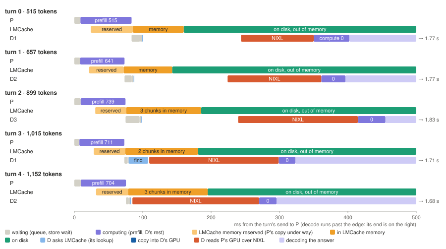

# Conversation 0: mt-rag-clapnq-elser-512-100-20240503 (disk mode, NIXL, shared servers, chat RAG, all passages)

P's KV reaches D over NIXL (D reads P's GPU blocks); every engine's LMCache connector stores beside it, to the one shared server. 5 turns on D1, D2, D3 (round-robin: each turn to the next D engine); prompts grow from 515 to 1,152 tokens (interleaved: each turn's prompt is the previous one, its answer, then this turn's documents and question). Chunks are 256 tokens (16 vLLM blocks of 16); a chunk's name is LMCache's hash of its tokens and everything before them, so the same prefix has the same chunks on every turn and engine.

Legend for the strips (one character a chunk): P: `=` on P's GPU from an earlier turn, `#` computed and stored now, `+` computed, not stored (a partial chunk). D: `=` on D's GPU from an earlier turn, `M` pulled from memory, `S` pulled from disk, `N` read from P's GPU over NIXL, `+` computed by D (a partial chunk), `?` missed.

GPU blocks (the chunk tables): where each engine keeps the chunk's 16 vLLM blocks in its GPU KV cache, by vLLM's block ids (vLLM's paged KV cache: a block, or page, holds 16 tokens; block 0 is its reserved null block), in the prompt's block order, a run of consecutive ids written as a range: `P 1, 138-152` is the prompt's block 0 in GPU block 1 and its blocks 1-15 in GPU blocks 138-152. An engine takes a GPU block from its free list when it first computes or loads a block, and the block keeps it while cached, so a later turn that reuses the block shows the same id. Blocks that are the same in several prompts (the same tokens and everything before them) share one GPU block once the first is cached: the system prompt's first block, the same in every conversation, is the usual one. `16/16 hashes = P's`: of the blocks D pulled, how many have the same vLLM hash on D as on P.

The prompts' text is the driver's own record of what it sent (answers included); lines over 100 characters are wrapped here for reading.

| turn | prompt | chunks + tail | P: own GPU / computed / stored | D: own GPU / loaded / computed | pulled | pull ms | D first token ms |
| ---: | ---: | --- | --- | --- | --- | ---: | ---: |
| [0](#turn-0) | 515 | 2 + 3 | 0 / 515 / 2 chunks | 0 / 515 / 0 | 3 chunks (NIXL 3) | 106.2 | 306.2 |
| [1](#turn-1) | 657 | 2 + 145 | 16 / 641 / 2 chunks | 0 / 657 / 0 | 3 chunks (NIXL 3) | 137.1 | 312.5 |
| [2](#turn-2) | 899 | 3 + 131 | 160 / 739 / 3 chunks | 0 / 899 / 0 | 4 chunks (NIXL 4) | 175.3 | 359.5 |
| [3](#turn-3) | 1,015 | 3 + 247 | 304 / 711 / 2 chunks | 16 / 999 / 0 | 4 chunks (NIXL 4) | 189.4 | 245.6 |
| [4](#turn-4) | 1,152 | 4 + 128 | 448 / 704 / 3 chunks | 160 / 992 / 0 | 5 chunks (NIXL 5) | 185.3 | 216.1 |

## How the prompt grows

Each turn's prompt is the previous one, token for token, and then: D's answer to the previous turn, this turn's documents, its question and the framing (the system prompt on turn 0, `Assistant:` and newlines). Only the new tokens can make new chunks: the previous prompt's partial chunk fills first. A document sent before comes again at another place, so in other chunks.

| turn | prompt | new | previous answer | documents | question | framing | whole chunks |
| ---: | ---: | ---: | ---: | --- | --- | ---: | --- |
| 0 | 515 | +515 | – | 5 docs, 474 | 11: who takes photos of planes in the air | 30 | 2 (+2) |
| 1 | 657 | +142 | – | 1 doc, 51 | 11: No, I meant photos in the air. | 2 | 2 (+0) |
| 2 | 899 | +242 | – | 2 docs, 196 | 17: So does that mean pilot of the second aircraft also acts as a photogr… | 2 | 3 (+1) |
| 3 | 1,015 | +116 | – | 0 docs, 0 | 16: Is air-to-air phtography more difficult that ground-to-air? | 2 | 3 (+0) |
| 4 | 1,152 | +137 | – | 0 docs, 0 | 11: are there any other types of aviation photography? | 2 | 4 (+1) |

## Timeline

Every turn on one clock: ms from the moment the proxy sent the turn to P. P prefills it (one token out) and holds its blocks for D; the proxy sends the turn to the next D engine at once with P's reply's kv_transfer_params (no wait), D reads P's blocks over NIXL (orange-red), computes the rest and decodes the answer. Beside it every engine's LMCache connector stores its new whole chunks (P's lane, and D's own when it stored any). The lanes: P, LMCache (P's chunks), D, and LMCache (D's chunks).



| turn | P queued → done | P's chunks: in memory / on disk | D | D starts | NIXL read | D: held / from P / from LMCache / computed | D's chunks stored | first token | P freed | D done |
| ---: | --- | --- | --- | ---: | --- | --- | ---: | ---: | ---: | ---: |
| 0 | 9 → 84 | 2: 86 / 160 | D1 | 96 | 244-350 | 0 / 515 / 0 / 0 | 0 | 402 | 351 | 1,771 |
| 1 | 8 → 73 | 2: 72 / 143 | D2 | 84 | 224-361 | 0 / 657 / 0 / 0 | 0 | 396 | 362 | 1,765 |
| 2 | 9 → 75 | 3: 76 / 185 | D3 | 95 | 240-415 | 0 / 899 / 0 / 0 | 0 | 455 | 415 | 1,834 |
| 3 | 7 → 73 | 2: 75 / 181 | D1 | 78 | 110-299 | 16 / 999 / 0 / 0 | 0 | 324 | 299 | 1,711 |
| 4 | 9 → 75 | 3: 79 / 195 | D2 | 80 | 85-270 | 160 / 992 / 0 / 0 | 0 | 296 | 271 | 1,684 |

All times in ms from the turn's send to P. NIXL read: D's worker posts the read of P's blocks to the KV in D's GPU blocks; P freed: D has read, P's blocks go back to its free queue (still cached). Each turn's section below tells it in a sentence and step by step.

### One chunk, block by block: chunk 0 of turn 0 (`2fef896f56fe534c`)

Tokens 0-256 (system: 28; doc 825986711_374-: 93; doc 825986711_2085: 82; doc 825986711_1099: 53). P computed its blocks; D1 read them from P's GPU over NIXL, P's block into D's block, one for one:

| block | tokens | P's GPU block | vLLM hash on P | D's GPU block | same hash on D |
| ---: | --- | ---: | --- | ---: | --- |
| 0 | 0-16 | 1 | `9f9c499d1c876b7e` | 1 | True |
| 1 | 16-32 | 2 | `f0727f2add33e5a6` | 2 | True |
| 2 | 32-48 | 3 | `c70c54d18b660b4b` | 3 | True |
| 3 | 48-64 | 4 | `7bd08cad874a71cf` | 4 | True |
| 4 | 64-80 | 5 | `0f5dc93992cce93e` | 5 | True |
| 5 | 80-96 | 6 | `57b2a1f55ccfc5c7` | 6 | True |
| 6 | 96-112 | 7 | `bc8f658981da9de4` | 7 | True |
| 7 | 112-128 | 8 | `a5eac5f5c163dc62` | 8 | True |
| 8 | 128-144 | 9 | `217a069ac4edb482` | 9 | True |
| 9 | 144-160 | 10 | `127794ef0dcf52c3` | 10 | True |
| 10 | 160-176 | 11 | `989b0ef59b56c79c` | 11 | True |
| 11 | 176-192 | 12 | `73da0d8623ac0536` | 12 | True |
| 12 | 192-208 | 13 | `439685f3da49a709` | 13 | True |
| 13 | 208-224 | 14 | `560bbdcd7d6bf2c5` | 14 | True |
| 14 | 224-240 | 15 | `e8837aee21d9e249` | 15 | True |
| 15 | 240-256 | 16 | `edc1367af924a57d` | 16 | True |

## Turn 0

**Timeline:** P queued until 9 ms, prefilled 515 tokens (held 0) and was done at 84 ms; its 2 new chunks were in LMCache's memory at 86 ms, on disk at 160 ms and out of memory. D1 started at 96 ms (no wait) holding 0 tokens, read 515 from P's GPU over NIXL (posted at 244 ms, in its GPU at 350 ms; P freed its blocks at 351 ms), computed 0 and gave its first token at 402 ms; it decoded 128 tokens until 1,771 ms. ([all turns](#timeline))

### Step by step

Every move of this turn's KV, ms from the proxy sending the turn to P. P's KV reaches D over NIXL: D's worker reads P's GPU blocks into its own (a NIXL READ, P told when D is done); LMCache's copies (to and from each server's memory) its servers do themselves through CUDA IPC handles each engine registered at start.

| ms | where | what |
| ---: | --- | --- |
| 0.0 | proxy → P | sends the turn (515 prompt tokens; P is asked for one token: prefill only) |
| 2.2 | P | the request arrives |
| 8.8 | P GPU | its prefix cache holds 0 of the prompt's tokens |
| 8.8 | P ↔ LMCache | LMCache has 0 of its tokens; P loads 0 and computes the rest |
| 8.9 | P GPU | 33 new GPU blocks for the 515 tokens it computes: 1-33; the prefill runs |
| 9.2 | P → LMCache | store planned: tokens 0-512, chunks 0-1 (32 blocks) |
| 23.5 | LMCache | the store request is in; it waits for P's forward pass to finish (a CUDA event) |
| 24.0 | LMCache memory | space reserved for 2 chunks (59 MB) |
| 80.6 | P GPU → LMCache memory | the copy starts: LMCache reads P's GPU blocks (CUDA IPC) |
| 80.7 | P GPU | the request is done: P holds its 33 blocks for D to read over NIXL, and its reply carries them (kv_transfer_params: the blocks, its NIXL agent) |
| 83.3 | P GPU → LMCache memory | copy done: 2 chunks, 59 MB in 2.7 ms |
| 83.7 | P → proxy | P answers its one token: the prefill is done |
| 85.6 | LMCache memory | 2 chunks in memory, kept for later requests (D gets this turn's KV from P over NIXL); P keeps its copy in its GPU blocks |
| 96.1 | proxy → D1 | sends the turn to D1 at once, with P's kv_transfer_params (round-robin; no wait) |
| 99.2 | D1 ↔ LMCache | asks LMCache for the prompt's chunks |
| 99.3 | D1 ↔ P (NIXL) | handshake starts: first contact with P's NIXL agent |
| 100.6 | LMCache memory | found 512 tokens it lacks: 2 chunks in memory |
| 103.7 | D1 GPU | its prefix cache holds 0 of the prompt's tokens |
| 103.8 | D1 ↔ P (NIXL) | will read 515 prompt tokens from P's GPU (beyond the 0 its own cache holds) |
| 103.9 | D1 ↔ LMCache | LMCache has 512 of its tokens; NIXL loads it (MultiConnector: the first connector with tokens) |
| 104.3 | D1 GPU | 33 GPU blocks for the KV from P: 1-33 |
| 160.0 | LMCache disk | 2 chunks written to disk (one file each) |
| 160.8 | LMCache memory | 2 memory copies dropped: on disk only now |
| 243.0 | D1 ↔ P (NIXL) | handshake done |
| 243.7 | P GPU → D1 GPU (NIXL) | D1 reads P's GPU blocks 1-33 into its 1-33 (a NIXL READ) |
| 350.0 | D1 | the KV from P is in its GPU blocks (515 tokens) |
| 351.1 | P GPU | D1 has read: P frees its blocks (they stay in its prefix cache) |
| 402.3 | D1 → proxy | the first answer token |
| 531.1 | D1 GPU | 1 new GPU block for the 1 prompt tokens it computes: 34 |
| 703.9 | D1 GPU | decoding: the answer's KV takes 7 new GPU blocks as it grows, one per 16 tokens: 35-41, until 1,739 ms |
| 1,771.3 | D1 | done: 128 tokens decoded; its blocks stay cached in its GPU for the next turn |
| 1,772.4 | proxy | the response is complete |

515 prompt tokens: 2 whole chunks and 3 tokens over (the partial chunk, computed by both engines and stored only when a later turn completes it). P held 0 tokens on its GPU, computed 515 and stored 2 new chunks; D1 held 0, read 515 from P over NIXL, loaded 0 from LMCache and computed 0.

### The prompt

The whole prompt, piece by piece:

- **system prompt** · tokens 0-28 (28) · chunk 0

```text
You are a helpful assistant. Answer the user's last question from the documents. If they do not hold
the answer, say so.
```

<details><summary>document <code>825986711_374-788-0-414</code> · tokens 28-121 (93) · chunk 0</summary>

```text
Document: Aviation photography
Aviation photography
Aviation photography is the act of taking images of aircraft , either in flight , or on the ground .
Types of aviation photography include air - to - air , ground - to - air , ground - static , and
remote photography . Military aviation photography , especially air - to - air , requires additional
skills , as the photo and target aircraft often fly at velocities of over Mach 1 , while under
moderate to high G .
```

</details>

<details><summary>document <code>825986711_2085-2489-0-404</code> · tokens 121-203 (82) · chunk 0</summary>

```text
Document: Aviation photography
Aviation photography
In ground - to - air photography , photos of aircraft in flight are taken with the photographer on
the ground . This type of photography is common at airshows or airports . Generally , a long focus
photographic lens is necessary due to the greater distance between the photographer and the target
aircraft . Along with ground - static photography , this is the most popular form of aviation
photography .
```

</details>

<details><summary>document <code>825986711_1099-1546-0-447</code> · tokens 203-291 (88) · chunks 0-1</summary>

```text
Document: Aviation photography
Aviation photography
In ground - static photography , photos of stationary aircraft are taken by photographers on the
ground . Photos can be of aircraft exteriors , interiors , and aircraft details . The photographer
has full control over lighting , aircraft placement , camera angles , and background . Involving
other subjects such as the pilot or other aircraft is much easier to accomplish in ground - static
photography than in other forms of aerial photography .
```

</details>

<details><summary>document <code>825986711_3052-3893-0-841</code> · tokens 291-451 (160) · chunk 1</summary>

```text
Document: Aviation photography
Aviation photography
Air - to - air photography is the art of photographing aircraft in the air , while using another
aircraft as a photo platform . The subject aircraft is photographed while both aircraft are in
flight . This allows the photographer to position the subject in specific locations and angles to
get the most desirable shot . Some things that must be considered to achieve best results are
lighting and background . Proper lighting is achieved through correct placement of the aircraft
relative to the sun , and is accomplished flying only at certain times of the day and / or by flying
at a heading that lines the sun up on the subject aircraft properly . The background can highlight
or distract from the subject and must be carefully considered when taking shots . Air - to - air
photography uses include commercial use and advertising . Remote
```

</details>

<details><summary>document <code>825986711_5257-5487-0-230</code> · tokens 451-502 (51) · chunk 1</summary>

```text
Document: Aviation photography
Aviation photography
Databases exist on the internet , cataloguing aviation photographs . These include airliners.net ,
jetphotos.net and airplane-pictures.net allow users to search them for photographs of aircraft based
on user - specified criteria .
```

</details>

- **question 0** · tokens 502-513 (11) · chunks 1-2

```text
User: who takes photos of planes in the air
```

- `Assistant:` · tokens 513-515 (2) · chunk 2

### Pieces, chunks and blocks

| piece | tokens | length | chunks | |
| --- | --- | ---: | --- | --- |
| system | 0-28 | 28 | 0 |  |
| doc 825986711_374- | 28-121 | 93 | 0 |  |
| doc 825986711_2085 | 121-203 | 82 | 0 |  |
| doc 825986711_1099 | 203-291 | 88 | 0-1 |  |
| doc 825986711_3052 | 291-451 | 160 | 1 |  |
| doc 825986711_5257 | 451-502 | 51 | 1 |  |
| question 0 | 502-513 | 11 | 1-2 |  |
| `assistant:` 0 | 513-515 | 2 | 2 |  |

```
P  ##+
D  NNN
```

| chunk | tokens | pieces in it (tokens) | vLLM blocks | GPU blocks | in LMCache | P this turn | D this turn |
| ---: | --- | --- | --- | --- | --- | --- | --- |
| 0 | 0-256 | system: 28; doc 825986711_374-: 93; doc 825986711_2085: 82; doc 825986711_1099: 53 | 0-15 | P 1-16; D 1-16; 16/16 hashes = P's | `2fef896f56fe534c` stored on turn 0 by P, on disk, out of memory | computed, **stored now** | **read from P's GPU over NIXL** |
| 1 | 256-512 | doc 825986711_1099: 35; doc 825986711_3052: 160; doc 825986711_5257: 51; question 0: 10 | 16-31 | P 17-32; D 17-32; 16/16 hashes = P's | `32f7fefc6cd7bd05` stored on turn 0 by P, on disk, out of memory | computed, **stored now** | **read from P's GPU over NIXL** |
| 2 | 512-515 | question 0: 1; `assistant:` 0: 2 | 32 | P –; D 33 | – | computed (partial chunk: not stored) | **read from P's GPU over NIXL** (partial chunk) |

## Turn 1

**Timeline:** P queued until 8 ms, prefilled 641 tokens (held 16) and was done at 73 ms; its 2 new chunks were in LMCache's memory at 72 ms, on disk at 143 ms and out of memory. D2 started at 84 ms (no wait) holding 0 tokens, read 657 from P's GPU over NIXL (posted at 224 ms, in its GPU at 361 ms; P freed its blocks at 362 ms), computed 0 and gave its first token at 396 ms; it decoded 128 tokens until 1,765 ms. ([all turns](#timeline))

### Step by step

Every move of this turn's KV, ms from the proxy sending the turn to P. P's KV reaches D over NIXL: D's worker reads P's GPU blocks into its own (a NIXL READ, P told when D is done); LMCache's copies (to and from each server's memory) its servers do themselves through CUDA IPC handles each engine registered at start.

| ms | where | what |
| ---: | --- | --- |
| 0.0 | proxy → P | sends the turn (657 prompt tokens; P is asked for one token: prefill only) |
| 3.4 | P | the request arrives |
| 8.4 | P GPU | its prefix cache holds 16 of the prompt's tokens: 1 block in GPU blocks 1 |
| 8.4 | P ↔ LMCache | LMCache has 0 of its tokens; P loads 0 and computes the rest |
| 8.5 | P GPU | 41 new GPU blocks for the 641 tokens it computes: 33-73; the prefill runs |
| 8.8 | P → LMCache | store planned: tokens 0-512, chunks 0-1 (32 blocks) |
| 21.4 | LMCache | the store request is in; it waits for P's forward pass to finish (a CUDA event) |
| 21.7 | LMCache memory | space reserved for 2 chunks (59 MB) |
| 67.9 | P GPU → LMCache memory | the copy starts: LMCache reads P's GPU blocks (CUDA IPC) |
| 68.0 | P GPU | the request is done: P holds its 42 blocks for D to read over NIXL, and its reply carries them (kv_transfer_params: the blocks, its NIXL agent) |
| 70.5 | P GPU → LMCache memory | copy done: 2 chunks, 59 MB in 2.6 ms |
| 72.1 | LMCache memory | 2 chunks in memory, kept for later requests (D gets this turn's KV from P over NIXL); P keeps its copy in its GPU blocks |
| 73.4 | P → proxy | P answers its one token: the prefill is done |
| 83.9 | proxy → D2 | sends the turn to D2 at once, with P's kv_transfer_params (round-robin; no wait) |
| 86.6 | D2 ↔ P (NIXL) | handshake starts: first contact with P's NIXL agent |
| 86.6 | D2 ↔ LMCache | asks LMCache for the prompt's chunks |
| 87.7 | LMCache memory | found 512 tokens it lacks: 2 chunks in memory |
| 88.0 | D2 GPU | its prefix cache holds 0 of the prompt's tokens |
| 88.0 | D2 ↔ P (NIXL) | will read 657 prompt tokens from P's GPU (beyond the 0 its own cache holds) |
| 88.0 | D2 ↔ LMCache | LMCache has 512 of its tokens; NIXL loads it (MultiConnector: the first connector with tokens) |
| 88.2 | D2 GPU | 42 GPU blocks for the KV from P: 1-42 |
| 143.2 | LMCache disk | 2 chunks written to disk (one file each) |
| 143.8 | LMCache memory | 2 memory copies dropped: on disk only now |
| 223.4 | D2 ↔ P (NIXL) | handshake done |
| 224.1 | P GPU → D2 GPU (NIXL) | D2 reads P's GPU blocks 1, 33-73 into its 1-42 (a NIXL READ) |
| 361.2 | D2 | the KV from P is in its GPU blocks (657 tokens) |
| 362.5 | P GPU | D2 has read: P frees its blocks (they stay in its prefix cache) |
| 396.4 | D2 → proxy | the first answer token |
| 546.0 | D2 GPU | 1 new GPU block for the 1 prompt tokens it computes: 43 |
| 719.0 | D2 GPU | decoding: the answer's KV takes 6 new GPU blocks as it grows, one per 16 tokens: 44-49, until 1,581 ms |
| 1,765.2 | D2 | done: 128 tokens decoded; its blocks stay cached in its GPU for the next turn |
| 1,766.5 | proxy | the response is complete |

657 prompt tokens: 2 whole chunks and 145 tokens over (the partial chunk, computed by both engines and stored only when a later turn completes it). P held 16 tokens on its GPU, computed 641 and stored 2 new chunks; D2 held 0, read 657 from P over NIXL, loaded 0 from LMCache and computed 0.

### The prompt

Tokens 0-515: [turn 0](#turn-0)'s prompt, unchanged (NOT the previous prompt's ids), so chunks 0-1 are the same chunks; chunk 2 (partial then, 3 tokens) fills now. New from token 515:

- document `825986711_5257-5487-0-230` · tokens 593-644 (51) · chunk 2 · **again**: sent on [turn 0](#turn-0) already (the same 51 tokens), here at another place in the prompt, so in other chunks: a prefix cache cannot reuse it

- **question 1** · tokens 644-655 (11) · chunk 2

```text
User: No, I meant photos in the air.
```

- `Assistant:` · tokens 655-657 (2) · chunk 2

### Pieces, chunks and blocks

| piece | tokens | length | chunks | |
| --- | --- | ---: | --- | --- |
| system | 0-28 | 28 | 0 |  |
| question 0 | 28-39 | 11 | 0 |  |
| `assistant:` 0 | 39-41 | 2 | 0 |  |
| answer 0 | 41-169 | 128 | 0 |  |
| newline 0 | 169-170 | 1 | 0 |  |
| doc 825986711_374- | 170-263 | 93 | 0-1 |  |
| doc 825986711_3052 | 263-423 | 160 | 1 |  |
| doc 825986711_2085 | 423-505 | 82 | 1 |  |
| doc 825986711_1099 | 505-593 | 88 | 1-2 |  |
| doc 825986711_5257 | 593-644 | 51 | 2 | new this turn |
| question 1 | 644-655 | 11 | 2 | new this turn |
| `assistant:` 1 | 655-657 | 2 | 2 | new this turn |

```
P  ##+
D  NNN
```

| chunk | tokens | pieces in it (tokens) | vLLM blocks | GPU blocks | in LMCache | P this turn | D this turn |
| ---: | --- | --- | --- | --- | --- | --- | --- |
| 0 | 0-256 | system: 28; question 0: 11; `assistant:` 0: 2; answer 0: 128; newline 0: 1; doc 825986711_374-: 86 | 0-15 | P 1, 33-47; D 1-16; 15/15 hashes = P's | `933a7927ff05f0c9` stored on turn 1 by P, on disk, out of memory | computed (its first 16 tokens on P's GPU already), **stored now** | **read from P's GPU over NIXL** |
| 1 | 256-512 | doc 825986711_374-: 7; doc 825986711_3052: 160; doc 825986711_2085: 82; doc 825986711_1099: 7 | 16-31 | P 48-63; D 17-32; 16/16 hashes = P's | `f54130f974759cdb` stored on turn 1 by P, on disk, out of memory | computed, **stored now** | **read from P's GPU over NIXL** |
| 2 | 512-657 | doc 825986711_1099: 81; doc 825986711_5257 (new): 51; question 1 (new): 11; `assistant:` 1 (new): 2 | 32-41 | P 64-72; D 33-42; 9/9 hashes = P's | – | computed (partial chunk: not stored) | **read from P's GPU over NIXL** (partial chunk) |

## Turn 2

**Timeline:** P queued until 9 ms, prefilled 739 tokens (held 160) and was done at 75 ms; its 3 new chunks were in LMCache's memory at 76 ms, on disk at 185 ms and out of memory. D3 started at 95 ms (no wait) holding 0 tokens, read 899 from P's GPU over NIXL (posted at 240 ms, in its GPU at 415 ms; P freed its blocks at 415 ms), computed 0 and gave its first token at 455 ms; it decoded 128 tokens until 1,834 ms. ([all turns](#timeline))

### Step by step

Every move of this turn's KV, ms from the proxy sending the turn to P. P's KV reaches D over NIXL: D's worker reads P's GPU blocks into its own (a NIXL READ, P told when D is done); LMCache's copies (to and from each server's memory) its servers do themselves through CUDA IPC handles each engine registered at start.

| ms | where | what |
| ---: | --- | --- |
| 0.0 | proxy → P | sends the turn (899 prompt tokens; P is asked for one token: prefill only) |
| 2.8 | P | the request arrives |
| 9.0 | P GPU | its prefix cache holds 160 of the prompt's tokens: 10 blocks in GPU blocks 1, 33-41 |
| 9.1 | P ↔ LMCache | LMCache has 0 of its tokens; P loads 0 and computes the rest |
| 9.3 | P GPU | 47 new GPU blocks for the 739 tokens it computes: 73-119; the prefill runs |
| 9.7 | P → LMCache | store planned: tokens 0-768, chunks 0-2 (48 blocks) |
| 30.1 | LMCache | the store request is in; it waits for P's forward pass to finish (a CUDA event) |
| 30.6 | LMCache memory | space reserved for 3 chunks (88 MB) |
| 71.2 | P GPU → LMCache memory | the copy starts: LMCache reads P's GPU blocks (CUDA IPC) |
| 71.3 | P GPU | the request is done: P holds its 57 blocks for D to read over NIXL, and its reply carries them (kv_transfer_params: the blocks, its NIXL agent) |
| 74.9 | P → proxy | P answers its one token: the prefill is done |
| 75.1 | P GPU → LMCache memory | copy done: 3 chunks, 88 MB in 3.8 ms |
| 75.7 | LMCache memory | 3 chunks in memory, kept for later requests (D gets this turn's KV from P over NIXL); P keeps its copy in its GPU blocks |
| 95.4 | proxy → D3 | sends the turn to D3 at once, with P's kv_transfer_params (round-robin; no wait) |
| 97.9 | D3 ↔ LMCache | asks LMCache for the prompt's chunks |
| 98.0 | D3 ↔ P (NIXL) | handshake starts: first contact with P's NIXL agent |
| 99.2 | LMCache memory | found 768 tokens it lacks: 3 chunks in memory |
| 101.2 | D3 GPU | its prefix cache holds 0 of the prompt's tokens |
| 101.2 | D3 ↔ P (NIXL) | will read 899 prompt tokens from P's GPU (beyond the 0 its own cache holds) |
| 101.3 | D3 ↔ LMCache | LMCache has 768 of its tokens; NIXL loads it (MultiConnector: the first connector with tokens) |
| 101.4 | D3 GPU | 57 GPU blocks for the KV from P: 1-57 |
| 185.4 | LMCache disk | 3 chunks written to disk (one file each) |
| 186.0 | LMCache memory | 3 memory copies dropped: on disk only now |
| 238.8 | D3 ↔ P (NIXL) | handshake done |
| 239.5 | P GPU → D3 GPU (NIXL) | D3 reads P's GPU blocks 1, 33-41, 73-119 into its 1-57 (a NIXL READ) |
| 414.7 | D3 | the KV from P is in its GPU blocks (899 tokens) |
| 415.4 | P GPU | D3 has read: P frees its blocks (they stay in its prefix cache) |
| 454.9 | D3 → proxy | the first answer token |
| 583.2 | D3 GPU | 1 new GPU block for the 1 prompt tokens it computes: 58 |
| 757.2 | D3 GPU | decoding: the answer's KV takes 7 new GPU blocks as it grows, one per 16 tokens: 59-65, until 1,802 ms |
| 1,834.5 | D3 | done: 128 tokens decoded; its blocks stay cached in its GPU for the next turn |
| 1,835.7 | proxy | the response is complete |

899 prompt tokens: 3 whole chunks and 131 tokens over (the partial chunk, computed by both engines and stored only when a later turn completes it). P held 160 tokens on its GPU, computed 739 and stored 3 new chunks; D3 held 0, read 899 from P over NIXL, loaded 0 from LMCache and computed 0.

### The prompt

Tokens 0-657: [turn 1](#turn-1)'s prompt, unchanged (NOT the previous prompt's ids), so chunks 0-1 are the same chunks; chunk 2 (partial then, 145 tokens) fills now. New from token 657:

<details><summary>document <code>825986711_2490-2909-0-419</code> · tokens 684-798 (114) · chunks 2-3</summary>

```text
Document: Aviation photography
Aviation photography
Ground to air photograph of an Emirates Airbus A380 departing London Heathrow Airport A Qantas
Boeing 747 - 400 overflying Starbeyevo , Moscow at 11,000 m . The aircraft was photographed from the
ground using a Canon 400D , a 1200mm telescope and 2x Barlow lens . Fat Albert , a U.S. Marine Corps
C - 130T Hercules with the Blue Angels , flies over Marines with the Silent Drill Platoon at Marine
Corps Air Station Yuma
```

</details>

- document `825986711_2085-2489-0-404` · tokens 798-880 (82) · chunk 3 · **again**: sent on [turn 0](#turn-0) already (the same 82 tokens), here at another place in the prompt, so in other chunks: a prefix cache cannot reuse it

- **question 2** · tokens 880-897 (17) · chunk 3

```text
User: So does that mean pilot of the second aircraft also acts as a photographer?
```

- `Assistant:` · tokens 897-899 (2) · chunk 3

### Pieces, chunks and blocks

| piece | tokens | length | chunks | |
| --- | --- | ---: | --- | --- |
| system | 0-28 | 28 | 0 |  |
| question 0 | 28-39 | 11 | 0 |  |
| `assistant:` 0 | 39-41 | 2 | 0 |  |
| answer 0 | 41-169 | 128 | 0 |  |
| newline 0 | 169-170 | 1 | 0 |  |
| question 1 | 170-181 | 11 | 0 |  |
| `assistant:` 1 | 181-183 | 2 | 0 |  |
| answer 1 | 183-311 | 128 | 0-1 |  |
| newline 1 | 311-312 | 1 | 1 |  |
| doc 825986711_3052 | 312-472 | 160 | 1 |  |
| doc 825986711_374- | 472-565 | 93 | 1-2 |  |
| doc 825986711_4469 | 565-684 | 119 | 2 |  |
| doc 825986711_2490 | 684-798 | 114 | 2-3 | new this turn |
| doc 825986711_2085 | 798-880 | 82 | 3 | new this turn |
| question 2 | 880-897 | 17 | 3 | new this turn |
| `assistant:` 2 | 897-899 | 2 | 3 | new this turn |

```
P  ###+
D  NNNN
```

| chunk | tokens | pieces in it (tokens) | vLLM blocks | GPU blocks | in LMCache | P this turn | D this turn |
| ---: | --- | --- | --- | --- | --- | --- | --- |
| 0 | 0-256 | system: 28; question 0: 11; `assistant:` 0: 2; answer 0: 128; newline 0: 1; question 1: 11; `assistant:` 1: 2; answer 1: 73 | 0-15 | P 1, 33-41, 73-78; D 1-16; 6/6 hashes = P's | `803ab0bea97e045e` stored on turn 2 by P, on disk, out of memory | computed (its first 160 tokens on P's GPU already), **stored now** | **read from P's GPU over NIXL** |
| 1 | 256-512 | answer 1: 55; newline 1: 1; doc 825986711_3052: 160; doc 825986711_374-: 40 | 16-31 | P 79-94; D 17-32; 16/16 hashes = P's | `6a25b9ed7c7dbc23` stored on turn 2 by P, on disk, out of memory | computed, **stored now** | **read from P's GPU over NIXL** |
| 2 | 512-768 | doc 825986711_374-: 53; doc 825986711_4469: 119; doc 825986711_2490 (new): 84 | 32-47 | P 95-110; D 33-48; 16/16 hashes = P's | `27793bf3c67f9c6e` stored on turn 2 by P, on disk, out of memory | computed, **stored now** | **read from P's GPU over NIXL** |
| 3 | 768-899 | doc 825986711_2490 (new): 30; doc 825986711_2085 (new): 82; question 2 (new): 17; `assistant:` 2 (new): 2 | 48-56 | P 111-118; D 49-57; 8/8 hashes = P's | – | computed (partial chunk: not stored) | **read from P's GPU over NIXL** (partial chunk) |

## Turn 3

**Timeline:** P queued until 7 ms, prefilled 711 tokens (held 304) and was done at 73 ms; its 2 new chunks were in LMCache's memory at 75 ms, on disk at 181 ms and out of memory. D1 started at 78 ms (no wait) holding 16 tokens, read 999 from P's GPU over NIXL (posted at 110 ms, in its GPU at 299 ms; P freed its blocks at 299 ms), computed 0 and gave its first token at 324 ms; it decoded 128 tokens until 1,711 ms. ([all turns](#timeline))

### Step by step

Every move of this turn's KV, ms from the proxy sending the turn to P. P's KV reaches D over NIXL: D's worker reads P's GPU blocks into its own (a NIXL READ, P told when D is done); LMCache's copies (to and from each server's memory) its servers do themselves through CUDA IPC handles each engine registered at start.

| ms | where | what |
| ---: | --- | --- |
| 0.0 | proxy → P | sends the turn (1,015 prompt tokens; P is asked for one token: prefill only) |
| 2.9 | P | the request arrives |
| 7.2 | P GPU | its prefix cache holds 304 of the prompt's tokens: 19 blocks in GPU blocks 1, 33-41, 73-81 |
| 7.3 | P ↔ LMCache | LMCache has 256 of its tokens; P loads 0 and computes the rest |
| 7.4 | P GPU | 45 new GPU blocks for the 711 tokens it computes: 119-163; the prefill runs |
| 7.9 | P → LMCache | store planned: tokens 256-768, chunks 1-2 (32 blocks) |
| 27.7 | LMCache | the store request is in; it waits for P's forward pass to finish (a CUDA event) |
| 28.5 | LMCache memory | space reserved for 2 chunks (59 MB) |
| 69.4 | P GPU → LMCache memory | the copy starts: LMCache reads P's GPU blocks (CUDA IPC) |
| 69.5 | P GPU | the request is done: P holds its 64 blocks for D to read over NIXL, and its reply carries them (kv_transfer_params: the blocks, its NIXL agent) |
| 72.0 | P GPU → LMCache memory | copy done: 2 chunks, 59 MB in 2.6 ms |
| 73.2 | P → proxy | P answers its one token: the prefill is done |
| 74.6 | LMCache memory | 2 chunks in memory, kept for later requests (D gets this turn's KV from P over NIXL); P keeps its copy in its GPU blocks |
| 77.9 | proxy → D1 | sends the turn to D1 at once, with P's kv_transfer_params (round-robin; no wait) |
| 79.4 | D1 ↔ LMCache | asks LMCache for the prompt's chunks |
| 107.8 | LMCache disk → memory | found 768 tokens it lacks: 1 chunk read from disk into a memory buffer |
| 108.5 | D1 GPU | its prefix cache holds 16 of the prompt's tokens: 1 block in GPU blocks 1 |
| 108.5 | D1 ↔ P (NIXL) | will read 999 prompt tokens from P's GPU (beyond the 16 its own cache holds) |
| 108.6 | D1 ↔ LMCache | LMCache has 768 of its tokens; NIXL loads it (MultiConnector: the first connector with tokens) |
| 108.8 | D1 GPU | 63 GPU blocks for the KV from P: 41-103 |
| 109.5 | P GPU → D1 GPU (NIXL) | D1 reads P's GPU blocks 1 … 119-163 (64 blocks) into its 41-103 (a NIXL READ) |
| 180.8 | LMCache disk | 2 chunks written to disk (one file each) |
| 181.3 | LMCache memory | 2 memory copies dropped: on disk only now |
| 298.9 | D1 | the KV from P is in its GPU blocks (999 tokens) |
| 299.2 | P GPU | D1 has read: P frees its blocks (they stay in its prefix cache) |
| 323.5 | D1 → proxy | the first answer token |
| 408.7 | D1 GPU | 1 new GPU block for the 1 prompt tokens it computes: 104 |
| 584.4 | D1 GPU | decoding: the answer's KV takes 7 new GPU blocks as it grows, one per 16 tokens: 105-111, until 1,634 ms |
| 1,711.0 | D1 | done: 128 tokens decoded; its blocks stay cached in its GPU for the next turn |
| 1,712.3 | proxy | the response is complete |

1,015 prompt tokens: 3 whole chunks and 247 tokens over (the partial chunk, computed by both engines and stored only when a later turn completes it). P held 304 tokens on its GPU, computed 711 and stored 2 new chunks; D1 held 16, read 999 from P over NIXL, loaded 0 from LMCache and computed 0.

### The prompt

Tokens 0-899: [turn 2](#turn-2)'s prompt, unchanged (NOT the previous prompt's ids), so chunks 0-2 are the same chunks; chunk 3 (partial then, 131 tokens) fills now. New from token 899:

- **question 3** · tokens 997-1013 (16) · chunk 3

```text
User: Is air-to-air phtography more difficult that ground-to-air?
```

- `Assistant:` · tokens 1013-1015 (2) · chunk 3

### Pieces, chunks and blocks

| piece | tokens | length | chunks | |
| --- | --- | ---: | --- | --- |
| system | 0-28 | 28 | 0 |  |
| question 0 | 28-39 | 11 | 0 |  |
| `assistant:` 0 | 39-41 | 2 | 0 |  |
| answer 0 | 41-169 | 128 | 0 |  |
| newline 0 | 169-170 | 1 | 0 |  |
| question 1 | 170-181 | 11 | 0 |  |
| `assistant:` 1 | 181-183 | 2 | 0 |  |
| answer 1 | 183-311 | 128 | 0-1 |  |
| newline 1 | 311-312 | 1 | 1 |  |
| question 2 | 312-329 | 17 | 1 |  |
| `assistant:` 2 | 329-331 | 2 | 1 |  |
| answer 2 | 331-459 | 128 | 1 |  |
| newline 2 | 459-460 | 1 | 1 |  |
| doc 825986711_2085 | 460-542 | 82 | 1-2 |  |
| doc 825986711_374- | 542-635 | 93 | 2 |  |
| doc 825986711_3052 | 635-795 | 160 | 2-3 |  |
| doc 825986711_1099 | 795-883 | 88 | 3 |  |
| doc 825986711_2490 | 883-997 | 114 | 3 |  |
| question 3 | 997-1013 | 16 | 3 | new this turn |
| `assistant:` 3 | 1013-1015 | 2 | 3 | new this turn |

```
P  =##+
D  NNNN
```

| chunk | tokens | pieces in it (tokens) | vLLM blocks | GPU blocks | in LMCache | P this turn | D this turn |
| ---: | --- | --- | --- | --- | --- | --- | --- |
| 0 | 0-256 | system: 28; question 0: 11; `assistant:` 0: 2; answer 0: 128; newline 0: 1; question 1: 11; `assistant:` 1: 2; answer 1: 73 | 0-15 | P 1, 33-41, 73-78; D 1, 41-55 | `803ab0bea97e045e` stored on turn 2 by P, on disk, out of memory | on P's GPU (earlier turn) | **read from P's GPU over NIXL** (its first 16 tokens on D's GPU already) |
| 1 | 256-512 | answer 1: 55; newline 1: 1; question 2: 17; `assistant:` 2: 2; answer 2: 128; newline 2: 1; doc 825986711_2085: 52 | 16-31 | P 79-81, 119-131; D 56-71; 13/13 hashes = P's | `3bc778194a4e9407` stored on turn 3 by P, on disk, out of memory | computed (its first 48 tokens on P's GPU already), **stored now** | **read from P's GPU over NIXL** |
| 2 | 512-768 | doc 825986711_2085: 30; doc 825986711_374-: 93; doc 825986711_3052: 133 | 32-47 | P 132-147; D 72-87; 16/16 hashes = P's | `aa648b2d0cf5b1e0` stored on turn 3 by P, on disk, out of memory | computed, **stored now** | **read from P's GPU over NIXL** |
| 3 | 768-1015 | doc 825986711_3052: 27; doc 825986711_1099: 88; doc 825986711_2490: 114; question 3 (new): 16; `assistant:` 3 (new): 2 | 48-63 | P 148-162; D 88-103; 15/15 hashes = P's | – | computed (partial chunk: not stored) | **read from P's GPU over NIXL** (partial chunk) |

## Turn 4

**Timeline:** P queued until 9 ms, prefilled 704 tokens (held 448) and was done at 75 ms; its 3 new chunks were in LMCache's memory at 79 ms, on disk at 195 ms and out of memory. D2 started at 80 ms (no wait) holding 160 tokens, read 992 from P's GPU over NIXL (posted at 85 ms, in its GPU at 270 ms; P freed its blocks at 271 ms), computed 0 and gave its first token at 296 ms; it decoded 128 tokens until 1,684 ms. ([all turns](#timeline))

### Step by step

Every move of this turn's KV, ms from the proxy sending the turn to P. P's KV reaches D over NIXL: D's worker reads P's GPU blocks into its own (a NIXL READ, P told when D is done); LMCache's copies (to and from each server's memory) its servers do themselves through CUDA IPC handles each engine registered at start.

| ms | where | what |
| ---: | --- | --- |
| 0.0 | proxy → P | sends the turn (1,152 prompt tokens; P is asked for one token: prefill only) |
| 3.0 | P | the request arrives |
| 9.1 | P GPU | its prefix cache holds 448 of the prompt's tokens: GPU blocks 1 … 119-127 (28 blocks) |
| 9.2 | P ↔ LMCache | LMCache has 256 of its tokens; P loads 0 and computes the rest |
| 9.4 | P GPU | 44 new GPU blocks for the 704 tokens it computes: 163-206; the prefill runs |
| 9.8 | P → LMCache | store planned: tokens 256-1,024, chunks 1-3 (48 blocks) |
| 31.1 | LMCache | the store request is in; it waits for P's forward pass to finish (a CUDA event) |
| 31.8 | LMCache memory | space reserved for 3 chunks (88 MB) |
| 71.3 | P GPU → LMCache memory | the copy starts: LMCache reads P's GPU blocks (CUDA IPC) |
| 71.5 | P GPU | the request is done: P holds its 72 blocks for D to read over NIXL, and its reply carries them (kv_transfer_params: the blocks, its NIXL agent) |
| 75.2 | P GPU → LMCache memory | copy done: 3 chunks, 88 MB in 3.9 ms |
| 75.4 | P → proxy | P answers its one token: the prefill is done |
| 78.6 | LMCache memory | 3 chunks in memory, kept for later requests (D gets this turn's KV from P over NIXL); P keeps its copy in its GPU blocks |
| 79.6 | proxy → D2 | sends the turn to D2 at once, with P's kv_transfer_params (round-robin; no wait) |
| 81.4 | D2 ↔ LMCache | asks LMCache for the prompt's chunks |
| 82.9 | LMCache memory | found 1,024 tokens it lacks: 4 chunks in memory |
| 83.9 | D2 GPU | its prefix cache holds 160 of the prompt's tokens: 10 blocks in GPU blocks 1-10 |
| 84.0 | D2 ↔ P (NIXL) | will read 992 prompt tokens from P's GPU (beyond the 160 its own cache holds) |
| 84.0 | D2 ↔ LMCache | LMCache has 1,024 of its tokens; NIXL loads it (MultiConnector: the first connector with tokens) |
| 84.3 | D2 GPU | 62 GPU blocks for the KV from P: 50-111 |
| 84.9 | P GPU → D2 GPU (NIXL) | D2 reads P's GPU blocks 1 … 163-206 (72 blocks) into its 50-111 (a NIXL READ) |
| 195.0 | LMCache disk | 3 chunks written to disk (one file each) |
| 195.6 | LMCache memory | 3 memory copies dropped: on disk only now |
| 270.2 | D2 | the KV from P is in its GPU blocks (992 tokens) |
| 271.1 | P GPU | D2 has read: P frees its blocks (they stay in its prefix cache) |
| 284.0 | D2 GPU | 1 new GPU block for the 1 prompt tokens it computes: 112 |
| 295.7 | D2 → proxy | the first answer token |
| 458.8 | D2 GPU | decoding: the answer's KV takes 7 new GPU blocks as it grows, one per 16 tokens: 113-119, until 1,509 ms |
| 1,684.1 | D2 | done: 128 tokens decoded; its blocks stay cached in its GPU for the next turn |
| 1,685.2 | proxy | the response is complete |

1,152 prompt tokens: 4 whole chunks and 128 tokens over (the partial chunk, computed by both engines and stored only when a later turn completes it). P held 448 tokens on its GPU, computed 704 and stored 3 new chunks; D2 held 160, read 992 from P over NIXL, loaded 0 from LMCache and computed 0.

### The prompt

Tokens 0-1,015: [turn 3](#turn-3)'s prompt, unchanged (NOT the previous prompt's ids), so chunks 0-2 are the same chunks; chunk 3 (partial then, 247 tokens) fills now. New from token 1,015:

- **question 4** · tokens 1139-1150 (11) · chunk 4

```text
User: are there any other types of aviation photography?
```

- `Assistant:` · tokens 1150-1152 (2) · chunk 4

### Pieces, chunks and blocks

| piece | tokens | length | chunks | |
| --- | --- | ---: | --- | --- |
| system | 0-28 | 28 | 0 |  |
| question 0 | 28-39 | 11 | 0 |  |
| `assistant:` 0 | 39-41 | 2 | 0 |  |
| answer 0 | 41-169 | 128 | 0 |  |
| newline 0 | 169-170 | 1 | 0 |  |
| question 1 | 170-181 | 11 | 0 |  |
| `assistant:` 1 | 181-183 | 2 | 0 |  |
| answer 1 | 183-311 | 128 | 0-1 |  |
| newline 1 | 311-312 | 1 | 1 |  |
| question 2 | 312-329 | 17 | 1 |  |
| `assistant:` 2 | 329-331 | 2 | 1 |  |
| answer 2 | 331-459 | 128 | 1 |  |
| newline 2 | 459-460 | 1 | 1 |  |
| question 3 | 460-476 | 16 | 1 |  |
| `assistant:` 3 | 476-478 | 2 | 1 |  |
| answer 3 | 478-606 | 128 | 1-2 |  |
| newline 3 | 606-607 | 1 | 2 |  |
| doc 825986711_374- | 607-700 | 93 | 2 |  |
| doc 825986711_1099 | 700-788 | 88 | 2-3 |  |
| doc 825986711_3903 | 788-897 | 109 | 3 |  |
| doc 825986711_2085 | 897-979 | 82 | 3 |  |
| doc 825986711_3052 | 979-1139 | 160 | 3-4 |  |
| question 4 | 1139-1150 | 11 | 4 | new this turn |
| `assistant:` 4 | 1150-1152 | 2 | 4 | new this turn |

```
P  =###+
D  NNNNN
```

| chunk | tokens | pieces in it (tokens) | vLLM blocks | GPU blocks | in LMCache | P this turn | D this turn |
| ---: | --- | --- | --- | --- | --- | --- | --- |
| 0 | 0-256 | system: 28; question 0: 11; `assistant:` 0: 2; answer 0: 128; newline 0: 1; question 1: 11; `assistant:` 1: 2; answer 1: 73 | 0-15 | P 1, 33-41, 73-78; D 1-10, 50-55 | `803ab0bea97e045e` stored on turn 2 by P, on disk, out of memory | on P's GPU (earlier turn) | **read from P's GPU over NIXL** (its first 160 tokens on D's GPU already) |
| 1 | 256-512 | answer 1: 55; newline 1: 1; question 2: 17; `assistant:` 2: 2; answer 2: 128; newline 2: 1; question 3: 16; `assistant:` 3: 2; answer 3: 34 | 16-31 | P 79-81, 119-127, 163-166; D 56-71; 4/4 hashes = P's | `f420430f0e1cfa55` stored on turn 4 by P, on disk, out of memory | computed (its first 192 tokens on P's GPU already), **stored now** | **read from P's GPU over NIXL** |
| 2 | 512-768 | answer 3: 94; newline 3: 1; doc 825986711_374-: 93; doc 825986711_1099: 68 | 32-47 | P 167-182; D 72-87; 16/16 hashes = P's | `d68640efd7d7f0a1` stored on turn 4 by P, on disk, out of memory | computed, **stored now** | **read from P's GPU over NIXL** |
| 3 | 768-1024 | doc 825986711_1099: 20; doc 825986711_3903: 109; doc 825986711_2085: 82; doc 825986711_3052: 45 | 48-63 | P 183-198; D 88-103; 16/16 hashes = P's | `f20fda311901d7ad` stored on turn 4 by P, on disk, out of memory | computed, **stored now** | **read from P's GPU over NIXL** |
| 4 | 1024-1152 | doc 825986711_3052: 115; question 4 (new): 11; `assistant:` 4 (new): 2 | 64-71 | P 199-206; D 104-111; 8/8 hashes = P's | – | computed (partial chunk: not stored) | **read from P's GPU over NIXL** (partial chunk) |
