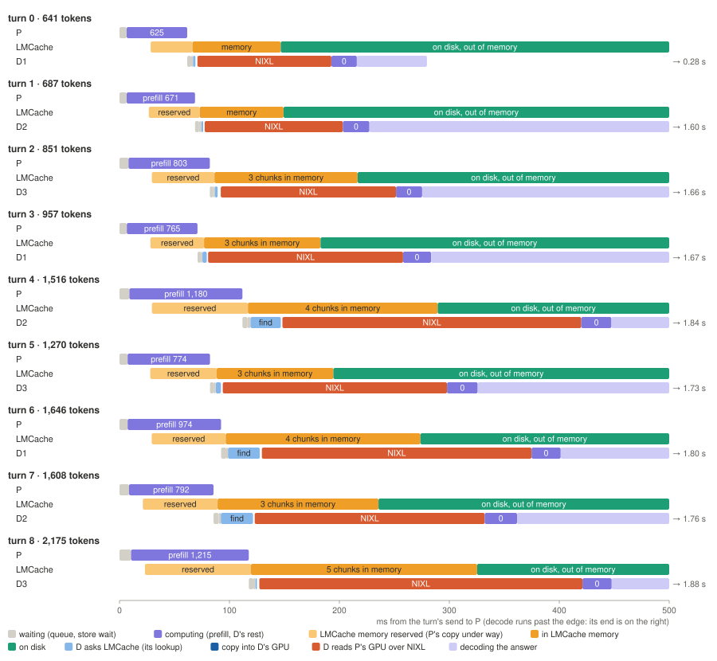

# Conversation 2: mt-rag-clapnq-elser-512-100-20240503 (disk mode, NIXL, shared servers, chat RAG, all passages)

P's KV reaches D over NIXL (D reads P's GPU blocks); every engine's LMCache connector stores beside it, to the one shared server. 9 turns on D1, D2, D3 (round-robin: each turn to the next D engine); prompts grow from 641 to 2,175 tokens (interleaved: each turn's prompt is the previous one, its answer, then this turn's documents and question). Chunks are 256 tokens (16 vLLM blocks of 16); a chunk's name is LMCache's hash of its tokens and everything before them, so the same prefix has the same chunks on every turn and engine.

Legend for the strips (one character a chunk): P: `=` on P's GPU from an earlier turn, `#` computed and stored now, `+` computed, not stored (a partial chunk). D: `=` on D's GPU from an earlier turn, `M` pulled from memory, `S` pulled from disk, `N` read from P's GPU over NIXL, `+` computed by D (a partial chunk), `?` missed.

GPU blocks (the chunk tables): where each engine keeps the chunk's 16 vLLM blocks in its GPU KV cache, by vLLM's block ids (vLLM's paged KV cache: a block, or page, holds 16 tokens; block 0 is its reserved null block), in the prompt's block order, a run of consecutive ids written as a range: `P 1, 138-152` is the prompt's block 0 in GPU block 1 and its blocks 1-15 in GPU blocks 138-152. An engine takes a GPU block from its free list when it first computes or loads a block, and the block keeps it while cached, so a later turn that reuses the block shows the same id. Blocks that are the same in several prompts (the same tokens and everything before them) share one GPU block once the first is cached: the system prompt's first block, the same in every conversation, is the usual one. `16/16 hashes = P's`: of the blocks D pulled, how many have the same vLLM hash on D as on P.

The prompts' text is the driver's own record of what it sent (answers included); lines over 100 characters are wrapped here for reading.

| turn | prompt | chunks + tail | P: own GPU / computed / stored | D: own GPU / loaded / computed | pulled | pull ms | D first token ms |
| ---: | ---: | --- | --- | --- | --- | ---: | ---: |
| [0](#turn-0) | 641 | 2 + 129 | 16 / 625 / 2 chunks | 16 / 625 / 0 | 3 chunks (NIXL 3) | 121.8 | 150.7 |
| [1](#turn-1) | 687 | 2 + 175 | 16 / 671 / 2 chunks | 16 / 671 / 0 | 3 chunks (NIXL 3) | 125.6 | 154.9 |
| [2](#turn-2) | 851 | 3 + 83 | 48 / 803 / 3 chunks | 16 / 835 / 0 | 4 chunks (NIXL 4) | 159.4 | 190.3 |
| [3](#turn-3) | 957 | 3 + 189 | 192 / 765 / 3 chunks | 16 / 941 / 0 | 4 chunks (NIXL 4) | 177.3 | 209.4 |
| [4](#turn-4) | 1,516 | 5 + 236 | 336 / 1,180 / 4 chunks | 48 / 1,468 / 0 | 6 chunks (NIXL 6) | 271.7 | 331.0 |
| [5](#turn-5) | 1,270 | 4 + 246 | 496 / 774 / 3 chunks | 192 / 1,078 / 0 | 5 chunks (NIXL 5) | 204.0 | 240.2 |
| [6](#turn-6) | 1,646 | 6 + 110 | 672 / 974 / 4 chunks | 336 / 1,310 / 0 | 6 chunks (NIXL 6) | 245.4 | 304.3 |
| [7](#turn-7) | 1,608 | 6 + 72 | 816 / 792 / 3 chunks | 496 / 1,112 / 0 | 6 chunks (NIXL 6) | 209.2 | 271.4 |
| [8](#turn-8) | 2,175 | 8 + 127 | 960 / 1,215 / 5 chunks | 672 / 1,503 / 0 | 7 chunks (NIXL 7) | 293.9 | 326.0 |

## How the prompt grows

Each turn's prompt is the previous one, token for token, and then: D's answer to the previous turn, this turn's documents, its question and the framing (the system prompt on turn 0, `Assistant:` and newlines). Only the new tokens can make new chunks: the previous prompt's partial chunk fills first. A document sent before comes again at another place, so in other chunks.

| turn | prompt | new | previous answer | documents | question | framing | whole chunks |
| ---: | ---: | ---: | ---: | --- | --- | ---: | --- |
| 0 | 641 | +641 | – | 6 docs, 598 | 13: where does water go after it enters a storm drain | 30 | 2 (+2) |
| 1 | 687 | +46 | – | 0 docs, 0 | 14: What is a catchbasin and how they are designed? | 2 | 2 (+0) |
| 2 | 851 | +164 | – | 1 doc, 128 | 23: Does the basin really capture the litter and debris from the water fr… | 2 | 3 (+1) |
| 3 | 957 | +106 | – | 0 docs, 0 | 26: Could be the water that enters a storm drain recycled and be used in … | 2 | 3 (+0) |
| 4 | 1,516 | +559 | – | 3 docs, 350 | 36: And about on the level of the Federal government, do they have guidel… | 2 | 5 (+2) |
| 5 | 1,270 | +-246 | – | 0 docs, 0 | 0 | 0 | 4 (+-1) |
| 6 | 1,646 | +376 | – | 2 docs, 330 | 18: Do you have any information about how the ancient civilization deal w… | 2 | 6 (+2) |
| 7 | 1,608 | +-38 | – | 0 docs, 0 | 0 | 0 | 6 (+0) |
| 8 | 2,175 | +567 | – | 3 docs, 439 | 22: That is really surprised me. Do you have information when the first s… | 2 | 8 (+2) |

## Timeline

Every turn on one clock: ms from the moment the proxy sent the turn to P. P prefills it (one token out) and holds its blocks for D; the proxy sends the turn to the next D engine at once with P's reply's kv_transfer_params (no wait), D reads P's blocks over NIXL (orange-red), computes the rest and decodes the answer. Beside it every engine's LMCache connector stores its new whole chunks (P's lane, and D's own when it stored any). The lanes: P, LMCache (P's chunks), D, and LMCache (D's chunks).



| turn | P queued → done | P's chunks: in memory / on disk | D | D starts | NIXL read | D: held / from P / from LMCache / computed | D's chunks stored | first token | P freed | D done |
| ---: | --- | --- | --- | ---: | --- | --- | ---: | ---: | ---: | ---: |
| 0 | 6 → 62 | 2: 66 / 147 | D1 | 65 | 71-193 | 16 / 625 / 0 / 0 | 0 | 216 | 193 | 280 |
| 1 | 6 → 69 | 2: 73 / 149 | D2 | 72 | 78-203 | 16 / 671 / 0 / 0 | 0 | 227 | 204 | 1,597 |
| 2 | 8 → 82 | 3: 86 / 217 | D3 | 85 | 92-252 | 16 / 835 / 0 / 0 | 0 | 275 | 252 | 1,656 |
| 3 | 7 → 71 | 3: 77 / 183 | D1 | 74 | 81-258 | 16 / 941 / 0 / 0 | 0 | 283 | 259 | 1,668 |
| 4 | 9 → 112 | 4: 117 / 289 | D2 | 116 | 148-420 | 48 / 1,468 / 0 / 0 | 0 | 448 | 421 | 1,842 |
| 5 | 7 → 82 | 3: 88 / 195 | D3 | 86 | 94-298 | 192 / 1,078 / 0 / 0 | 0 | 326 | 299 | 1,726 |
| 6 | 7 → 92 | 4: 97 / 274 | D1 | 97 | 130-375 | 336 / 1,310 / 0 / 0 | 0 | 401 | 375 | 1,802 |
| 7 | 9 → 86 | 3: 89 / 236 | D2 | 90 | 123-332 | 496 / 1,112 / 0 / 0 | 0 | 362 | 334 | 1,758 |
| 8 | 10 → 118 | 5: 120 / 325 | D3 | 122 | 127-421 | 672 / 1,503 / 0 / 0 | 0 | 448 | 422 | 1,881 |

All times in ms from the turn's send to P. NIXL read: D's worker posts the read of P's blocks to the KV in D's GPU blocks; P freed: D has read, P's blocks go back to its free queue (still cached). Each turn's section below tells it in a sentence and step by step.

### One chunk, block by block: chunk 1 of turn 0 (`8950c18ab6f86296`)

Tokens 256-512 (doc 834226571_1148: 70; doc 834226571_364-: 90; doc 834226571_8587: 96). P computed its blocks; D1 read them from P's GPU over NIXL, P's block into D's block, one for one:

| block | tokens | P's GPU block | vLLM hash on P | D's GPU block | same hash on D |
| ---: | --- | ---: | --- | ---: | --- |
| 16 | 256-272 | 759 | `fa7a6c33921defdc` | 334 | True |
| 17 | 272-288 | 760 | `3a19022b13ad6c9a` | 335 | True |
| 18 | 288-304 | 761 | `75ab5d092a981ddc` | 336 | True |
| 19 | 304-320 | 762 | `7977f5c58132ca4a` | 337 | True |
| 20 | 320-336 | 763 | `d91b9e8b41a404d2` | 338 | True |
| 21 | 336-352 | 764 | `a955d070d128c32f` | 339 | True |
| 22 | 352-368 | 765 | `5197dbbb38f2ff79` | 340 | True |
| 23 | 368-384 | 766 | `72bcb130229c22b3` | 341 | True |
| 24 | 384-400 | 767 | `8cd78f6f52fd2d81` | 342 | True |
| 25 | 400-416 | 768 | `9203ec672aac8bf3` | 343 | True |
| 26 | 416-432 | 769 | `7d38412c70ed5231` | 344 | True |
| 27 | 432-448 | 770 | `75771b84adc1cc39` | 345 | True |
| 28 | 448-464 | 771 | `1c27dc440f9e8eb5` | 346 | True |
| 29 | 464-480 | 772 | `e006bdeb73fffb66` | 347 | True |
| 30 | 480-496 | 773 | `1c30f1c4a1a9502e` | 348 | True |
| 31 | 496-512 | 774 | `a030d42c28596f94` | 349 | True |

## Turn 0

**Timeline:** P queued until 6 ms, prefilled 625 tokens (held 16) and was done at 62 ms; its 2 new chunks were in LMCache's memory at 66 ms, on disk at 147 ms and out of memory. D1 started at 65 ms (no wait) holding 16 tokens, read 625 from P's GPU over NIXL (posted at 71 ms, in its GPU at 193 ms; P freed its blocks at 193 ms), computed 0 and gave its first token at 216 ms; it decoded 7 tokens until 280 ms. ([all turns](#timeline))

### Step by step

Every move of this turn's KV, ms from the proxy sending the turn to P. P's KV reaches D over NIXL: D's worker reads P's GPU blocks into its own (a NIXL READ, P told when D is done); LMCache's copies (to and from each server's memory) its servers do themselves through CUDA IPC handles each engine registered at start.

| ms | where | what |
| ---: | --- | --- |
| 0.0 | proxy → P | sends the turn (641 prompt tokens; P is asked for one token: prefill only) |
| 1.9 | P | the request arrives |
| 6.3 | P GPU | its prefix cache holds 16 of the prompt's tokens: 1 block in GPU blocks 1 |
| 6.4 | P ↔ LMCache | LMCache has 0 of its tokens; P loads 0 and computes the rest |
| 6.5 | P GPU | 40 new GPU blocks for the 625 tokens it computes: 745-784; the prefill runs |
| 6.9 | P → LMCache | store planned: tokens 0-512, chunks 0-1 (32 blocks) |
| 27.8 | LMCache | the store request is in; it waits for P's forward pass to finish (a CUDA event) |
| 28.3 | LMCache memory | space reserved for 2 chunks (59 MB) |
| 59.2 | P GPU → LMCache memory | the copy starts: LMCache reads P's GPU blocks (CUDA IPC) |
| 59.3 | P GPU | the request is done: P holds its 41 blocks for D to read over NIXL, and its reply carries them (kv_transfer_params: the blocks, its NIXL agent) |
| 61.6 | P → proxy | P answers its one token: the prefill is done |
| 61.8 | P GPU → LMCache memory | copy done: 2 chunks, 59 MB in 2.6 ms |
| 65.2 | proxy → D1 | sends the turn to D1 at once, with P's kv_transfer_params (round-robin; no wait) |
| 66.4 | LMCache memory | 2 chunks in memory, kept for later requests (D gets this turn's KV from P over NIXL); P keeps its copy in its GPU blocks |
| 66.9 | D1 ↔ LMCache | asks LMCache for the prompt's chunks |
| 69.1 | LMCache memory | found 512 tokens it lacks: 2 chunks in memory |
| 69.9 | D1 GPU | its prefix cache holds 16 of the prompt's tokens: 1 block in GPU blocks 1 |
| 70.0 | D1 ↔ P (NIXL) | will read 625 prompt tokens from P's GPU (beyond the 16 its own cache holds) |
| 70.0 | D1 ↔ LMCache | LMCache has 512 of its tokens; NIXL loads it (MultiConnector: the first connector with tokens) |
| 70.2 | D1 GPU | 40 GPU blocks for the KV from P: 319-358 |
| 70.9 | P GPU → D1 GPU (NIXL) | D1 reads P's GPU blocks 1, 745-784 into its 319-358 (a NIXL READ) |
| 146.7 | LMCache disk | 2 chunks written to disk (one file each) |
| 147.0 | LMCache memory | 2 memory copies dropped: on disk only now |
| 192.7 | D1 | the KV from P is in its GPU blocks (625 tokens) |
| 193.2 | P GPU | D1 has read: P frees its blocks (they stay in its prefix cache) |
| 215.9 | D1 → proxy | the first answer token |
| 279.7 | D1 | done: 7 tokens decoded; its blocks stay cached in its GPU for the next turn |
| 280.9 | proxy | the response is complete |

641 prompt tokens: 2 whole chunks and 129 tokens over (the partial chunk, computed by both engines and stored only when a later turn completes it). P held 16 tokens on its GPU, computed 625 and stored 2 new chunks; D1 held 16, read 625 from P over NIXL, loaded 0 from LMCache and computed 0.

### The prompt

The whole prompt, piece by piece:

- **system prompt** · tokens 0-28 (28) · chunk 0

```text
You are a helpful assistant. Answer the user's last question from the documents. If they do not hold
the answer, say so.
```

<details><summary>document <code>834226571_4749-5081-0-332</code> · tokens 28-103 (75) · chunk 0</summary>

```text
Document: Storm drain
Storm drain
Some of the heavier sediment and small objects may settle in a catchbasin , or sump , which lies
immediately below the outlet , where water from the top of the catchbasin reservoir overflows into
the sewer proper . The catchbasin serves much the same function as the `` trap '' in household
wastewater plumbing in trapping objects .
```

</details>

<details><summary>document <code>834226571_7232-7729-0-497</code> · tokens 103-209 (106) · chunk 0</summary>

```text
Document: Storm drain
Storm drain
Most drains have a single large exit at their point of discharge ( often covered by a grating ) into
a canal , river , lake , reservoir , sea or ocean . Other than catchbasins , typically there are no
treatment facilities in the piping system . Small storm drains may discharge into individual dry
wells . Storm drains may be interconnected using slotted pipe , to make a larger dry well system .
Storm drains may discharge into man - made excavations known as recharge basins or retention ponds .
```

</details>

<details><summary>document <code>834226571_11488-12059-0-571</code> · tokens 209-326 (117) · chunks 0-1</summary>

```text
Document: Storm drain
Storm drain
Catch basins are commonly designed with a sump area below the outlet pipe level which is a reservoir
for water and debris to help prevent the pipe from clogging . Unless they are constructed with
permeable bottoms to allow water to infiltrate into the underlying soil , this subterranean basin
can become a perfect mosquito breeding area because it is cool , dark , and retains stagnant water
for long periods of time . Combined with standard grates which have holes large enough for
mosquitoes to enter and leave the basin , this is a major problem in mosquito control .
```

</details>

<details><summary>document <code>834226571_364-764-0-400</code> · tokens 326-416 (90) · chunk 1</summary>

```text
Document: Storm drain
Storm drain
A storm drain , storm sewer ( U.S. and Canada ) , surface water drain / sewer ( United Kingdom ) ,
or stormwater drain ( Australia and New Zealand ) is designed to drain excess rain and ground water
from impervious surfaces such as paved streets , car parks , parking lots , footpaths , sidewalks ,
and roofs . Storm drains vary in design from small residential dry wells to large municipal systems
.
```

</details>

<details><summary>document <code>834226571_8587-9336-0-749</code> · tokens 416-575 (159) · chunks 1-2</summary>

```text
Document: Storm drain
Storm drain
Runoff into storm sewers can be minimized by including sustainable urban drainage systems ( UK term
) or low impact development or green infrastructure practices ( US terms ) into municipal plans . To
reduce stormwater from rooftops , flows from eaves troughs ( rain gutters and downspouts ) may be
infiltrated into adjacent soil , rather than discharged into the storm sewer system . Storm water
runoff from paved surfaces can be directed to unlined ditches ( sometimes called swales or bioswales
) before flowing into the storm sewers , again to allow the runoff to soak into the ground .
Permeable paving materials can be used in building sidewalks , driveways and in some cases , parking
lots , to infiltrate a portion of the stormwater volume .
```

</details>

<details><summary>document <code>834226571_10005-10224-0-219</code> · tokens 575-626 (51) · chunk 2</summary>

```text
Document: Storm drain
Storm drain
The first flush from urban runoff can be extremely dirty . Storm water may become contaminated while
running down the road or other impervious surface , or from lawn chemical run - off , before
entering the drain . Lack
```

</details>

- **question 0** · tokens 626-639 (13) · chunk 2

```text
User: where does water go after it enters a storm drain
```

- `Assistant:` · tokens 639-641 (2) · chunk 2

### Pieces, chunks and blocks

| piece | tokens | length | chunks | |
| --- | --- | ---: | --- | --- |
| system | 0-28 | 28 | 0 |  |
| doc 834226571_4749 | 28-103 | 75 | 0 |  |
| doc 834226571_7232 | 103-209 | 106 | 0 |  |
| doc 834226571_1148 | 209-326 | 117 | 0-1 |  |
| doc 834226571_364- | 326-416 | 90 | 1 |  |
| doc 834226571_8587 | 416-575 | 159 | 1-2 |  |
| doc 834226571_1000 | 575-626 | 51 | 2 |  |
| question 0 | 626-639 | 13 | 2 |  |
| `assistant:` 0 | 639-641 | 2 | 2 |  |

```
P  ##+
D  NNN
```

| chunk | tokens | pieces in it (tokens) | vLLM blocks | GPU blocks | in LMCache | P this turn | D this turn |
| ---: | --- | --- | --- | --- | --- | --- | --- |
| 0 | 0-256 | system: 28; doc 834226571_4749: 75; doc 834226571_7232: 106; doc 834226571_1148: 47 | 0-15 | P 1, 745-759; D 1, 319-333; 15/15 hashes = P's | `b62d5d8072b22be0` stored on turn 0 by P, on disk, out of memory | computed (its first 16 tokens on P's GPU already), **stored now** | **read from P's GPU over NIXL** (its first 16 tokens on D's GPU already) |
| 1 | 256-512 | doc 834226571_1148: 70; doc 834226571_364-: 90; doc 834226571_8587: 96 | 16-31 | P 760-775; D 334-349; 16/16 hashes = P's | `8950c18ab6f86296` stored on turn 0 by P, on disk, out of memory | computed, **stored now** | **read from P's GPU over NIXL** |
| 2 | 512-641 | doc 834226571_8587: 63; doc 834226571_1000: 51; question 0: 13; `assistant:` 0: 2 | 32-40 | P 776-783; D 350-358; 8/8 hashes = P's | – | computed (partial chunk: not stored) | **read from P's GPU over NIXL** (partial chunk) |

## Turn 1

**Timeline:** P queued until 6 ms, prefilled 671 tokens (held 16) and was done at 69 ms; its 2 new chunks were in LMCache's memory at 73 ms, on disk at 149 ms and out of memory. D2 started at 72 ms (no wait) holding 16 tokens, read 671 from P's GPU over NIXL (posted at 78 ms, in its GPU at 203 ms; P freed its blocks at 204 ms), computed 0 and gave its first token at 227 ms; it decoded 128 tokens until 1,597 ms. ([all turns](#timeline))

### Step by step

Every move of this turn's KV, ms from the proxy sending the turn to P. P's KV reaches D over NIXL: D's worker reads P's GPU blocks into its own (a NIXL READ, P told when D is done); LMCache's copies (to and from each server's memory) its servers do themselves through CUDA IPC handles each engine registered at start.

| ms | where | what |
| ---: | --- | --- |
| 0.0 | proxy → P | sends the turn (687 prompt tokens; P is asked for one token: prefill only) |
| 1.9 | P | the request arrives |
| 6.3 | P GPU | its prefix cache holds 16 of the prompt's tokens: 1 block in GPU blocks 1 |
| 6.4 | P ↔ LMCache | LMCache has 0 of its tokens; P loads 0 and computes the rest |
| 6.5 | P GPU | 42 new GPU blocks for the 671 tokens it computes: 784-825; the prefill runs |
| 6.9 | P → LMCache | store planned: tokens 0-512, chunks 0-1 (32 blocks) |
| 26.2 | LMCache | the store request is in; it waits for P's forward pass to finish (a CUDA event) |
| 26.7 | LMCache memory | space reserved for 2 chunks (59 MB) |
| 66.2 | P GPU → LMCache memory | the copy starts: LMCache reads P's GPU blocks (CUDA IPC) |
| 66.4 | P GPU | the request is done: P holds its 43 blocks for D to read over NIXL, and its reply carries them (kv_transfer_params: the blocks, its NIXL agent) |
| 68.7 | P → proxy | P answers its one token: the prefill is done |
| 68.8 | P GPU → LMCache memory | copy done: 2 chunks, 59 MB in 2.6 ms |
| 72.4 | proxy → D2 | sends the turn to D2 at once, with P's kv_transfer_params (round-robin; no wait) |
| 73.0 | LMCache memory | 2 chunks in memory, kept for later requests (D gets this turn's KV from P over NIXL); P keeps its copy in its GPU blocks |
| 74.4 | D2 ↔ LMCache | asks LMCache for the prompt's chunks |
| 76.1 | LMCache memory | found 512 tokens it lacks: 2 chunks in memory |
| 76.7 | D2 GPU | its prefix cache holds 16 of the prompt's tokens: 1 block in GPU blocks 1 |
| 76.7 | D2 ↔ P (NIXL) | will read 671 prompt tokens from P's GPU (beyond the 16 its own cache holds) |
| 76.8 | D2 ↔ LMCache | LMCache has 512 of its tokens; NIXL loads it (MultiConnector: the first connector with tokens) |
| 77.0 | D2 GPU | 42 GPU blocks for the KV from P: 300-341 |
| 77.5 | P GPU → D2 GPU (NIXL) | D2 reads P's GPU blocks 1, 784-825 into its 300-341 (a NIXL READ) |
| 149.2 | LMCache disk | 2 chunks written to disk (one file each) |
| 149.6 | LMCache memory | 2 memory copies dropped: on disk only now |
| 203.2 | D2 | the KV from P is in its GPU blocks (671 tokens) |
| 203.9 | P GPU | D2 has read: P frees its blocks (they stay in its prefix cache) |
| 224.7 | D2 GPU | 1 new GPU block for the 1 prompt tokens it computes: 342 |
| 227.3 | D2 → proxy | the first answer token |
| 398.0 | D2 GPU | decoding: the answer's KV takes 7 new GPU blocks as it grows, one per 16 tokens: 343-349, until 1,435 ms |
| 1,596.8 | D2 | done: 128 tokens decoded; its blocks stay cached in its GPU for the next turn |
| 1,598.0 | proxy | the response is complete |

687 prompt tokens: 2 whole chunks and 175 tokens over (the partial chunk, computed by both engines and stored only when a later turn completes it). P held 16 tokens on its GPU, computed 671 and stored 2 new chunks; D2 held 16, read 671 from P over NIXL, loaded 0 from LMCache and computed 0.

### The prompt

Tokens 0-641: [turn 0](#turn-0)'s prompt, unchanged (NOT the previous prompt's ids), so chunks 0-1 are the same chunks; chunk 2 (partial then, 129 tokens) fills now. New from token 641:

- **question 1** · tokens 671-685 (14) · chunk 2

```text
User: What is a catchbasin and how they are designed?
```

- `Assistant:` · tokens 685-687 (2) · chunk 2

### Pieces, chunks and blocks

| piece | tokens | length | chunks | |
| --- | --- | ---: | --- | --- |
| system | 0-28 | 28 | 0 |  |
| question 0 | 28-41 | 13 | 0 |  |
| `assistant:` 0 | 41-43 | 2 | 0 |  |
| answer 0 | 43-50 | 7 | 0 |  |
| newline 0 | 50-51 | 1 | 0 |  |
| doc 834226571_4749 | 51-126 | 75 | 0 |  |
| doc 834226571_7232 | 126-232 | 106 | 0 |  |
| doc 834226571_6342 | 232-283 | 51 | 0-1 |  |
| doc 834226571_5082 | 283-356 | 73 | 1 |  |
| doc 834226571_6020 | 356-426 | 70 | 1 |  |
| doc 834226571_1148 | 426-543 | 117 | 1-2 |  |
| doc 834226571_5404 | 543-671 | 128 | 2 |  |
| question 1 | 671-685 | 14 | 2 | new this turn |
| `assistant:` 1 | 685-687 | 2 | 2 | new this turn |

```
P  ##+
D  NNN
```

| chunk | tokens | pieces in it (tokens) | vLLM blocks | GPU blocks | in LMCache | P this turn | D this turn |
| ---: | --- | --- | --- | --- | --- | --- | --- |
| 0 | 0-256 | system: 28; question 0: 13; `assistant:` 0: 2; answer 0: 7; newline 0: 1; doc 834226571_4749: 75; doc 834226571_7232: 106; doc 834226571_6342: 24 | 0-15 | P 1, 784-798; D 1, 300-314; 15/15 hashes = P's | `c7aa52545420a8ae` stored on turn 1 by P, on disk, out of memory | computed (its first 16 tokens on P's GPU already), **stored now** | **read from P's GPU over NIXL** (its first 16 tokens on D's GPU already) |
| 1 | 256-512 | doc 834226571_6342: 27; doc 834226571_5082: 73; doc 834226571_6020: 70; doc 834226571_1148: 86 | 16-31 | P 799-814; D 315-330; 16/16 hashes = P's | `ae39f17d2c587d28` stored on turn 1 by P, on disk, out of memory | computed, **stored now** | **read from P's GPU over NIXL** |
| 2 | 512-687 | doc 834226571_1148: 31; doc 834226571_5404: 128; question 1 (new): 14; `assistant:` 1 (new): 2 | 32-42 | P 815-824; D 331-341; 10/10 hashes = P's | – | computed (partial chunk: not stored) | **read from P's GPU over NIXL** (partial chunk) |

## Turn 2

**Timeline:** P queued until 8 ms, prefilled 803 tokens (held 48) and was done at 82 ms; its 3 new chunks were in LMCache's memory at 86 ms, on disk at 217 ms and out of memory. D3 started at 85 ms (no wait) holding 16 tokens, read 835 from P's GPU over NIXL (posted at 92 ms, in its GPU at 252 ms; P freed its blocks at 252 ms), computed 0 and gave its first token at 275 ms; it decoded 128 tokens until 1,656 ms. ([all turns](#timeline))

### Step by step

Every move of this turn's KV, ms from the proxy sending the turn to P. P's KV reaches D over NIXL: D's worker reads P's GPU blocks into its own (a NIXL READ, P told when D is done); LMCache's copies (to and from each server's memory) its servers do themselves through CUDA IPC handles each engine registered at start.

| ms | where | what |
| ---: | --- | --- |
| 0.0 | proxy → P | sends the turn (851 prompt tokens; P is asked for one token: prefill only) |
| 2.0 | P | the request arrives |
| 8.0 | P GPU | its prefix cache holds 48 of the prompt's tokens: 3 blocks in GPU blocks 1, 784-785 |
| 8.0 | P ↔ LMCache | LMCache has 0 of its tokens; P loads 0 and computes the rest |
| 8.2 | P GPU | 51 new GPU blocks for the 803 tokens it computes: 825-875; the prefill runs |
| 8.6 | P → LMCache | store planned: tokens 0-768, chunks 0-2 (48 blocks) |
| 28.8 | LMCache | the store request is in; it waits for P's forward pass to finish (a CUDA event) |
| 29.4 | LMCache memory | space reserved for 3 chunks (88 MB) |
| 79.6 | P GPU → LMCache memory | the copy starts: LMCache reads P's GPU blocks (CUDA IPC) |
| 79.8 | P GPU | the request is done: P holds its 54 blocks for D to read over NIXL, and its reply carries them (kv_transfer_params: the blocks, its NIXL agent) |
| 82.2 | P → proxy | P answers its one token: the prefill is done |
| 83.5 | P GPU → LMCache memory | copy done: 3 chunks, 88 MB in 3.9 ms |
| 85.0 | proxy → D3 | sends the turn to D3 at once, with P's kv_transfer_params (round-robin; no wait) |
| 86.4 | LMCache memory | 3 chunks in memory, kept for later requests (D gets this turn's KV from P over NIXL); P keeps its copy in its GPU blocks |
| 86.7 | D3 ↔ LMCache | asks LMCache for the prompt's chunks |
| 89.3 | LMCache memory | found 768 tokens it lacks: 3 chunks in memory |
| 91.1 | D3 GPU | its prefix cache holds 16 of the prompt's tokens: 1 block in GPU blocks 1 |
| 91.1 | D3 ↔ P (NIXL) | will read 835 prompt tokens from P's GPU (beyond the 16 its own cache holds) |
| 91.2 | D3 ↔ LMCache | LMCache has 768 of its tokens; NIXL loads it (MultiConnector: the first connector with tokens) |
| 91.4 | D3 GPU | 53 GPU blocks for the KV from P: 329-381 |
| 92.1 | P GPU → D3 GPU (NIXL) | D3 reads P's GPU blocks 1, 784-785, 825-875 into its 329-381 (a NIXL READ) |
| 216.6 | LMCache disk | 3 chunks written to disk (one file each) |
| 217.0 | LMCache memory | 3 memory copies dropped: on disk only now |
| 251.5 | D3 | the KV from P is in its GPU blocks (835 tokens) |
| 252.0 | P GPU | D3 has read: P frees its blocks (they stay in its prefix cache) |
| 275.3 | D3 → proxy | the first answer token |
| 403.7 | D3 GPU | 1 new GPU block for the 1 prompt tokens it computes: 382 |
| 577.5 | D3 GPU | decoding: the answer's KV takes 7 new GPU blocks as it grows, one per 16 tokens: 383-389, until 1,623 ms |
| 1,655.9 | D3 | done: 128 tokens decoded; its blocks stay cached in its GPU for the next turn |
| 1,656.8 | proxy | the response is complete |

851 prompt tokens: 3 whole chunks and 83 tokens over (the partial chunk, computed by both engines and stored only when a later turn completes it). P held 48 tokens on its GPU, computed 803 and stored 3 new chunks; D3 held 16, read 835 from P over NIXL, loaded 0 from LMCache and computed 0.

### The prompt

Tokens 0-687: [turn 1](#turn-1)'s prompt, unchanged (NOT the previous prompt's ids), so chunks 0-1 are the same chunks; chunk 2 (partial then, 175 tokens) fills now. New from token 687:

<details><summary>document <code>834226571_5404-6019-0-615</code> · tokens 698-826 (128) · chunks 2-3</summary>

```text
Document: Storm drain
Storm drain
Most catchbasins will contain stagnant water during the drier parts of the year , and can , in warm
countries , be used by mosquitos for breeding . Larvicides or disruptive larval hormones , sometimes
released from `` mosquito biscuits '' , have been used to control mosquito breeding in catchbasins .
Mosquitoes may be physically prevented from reaching the standing water or migrating into the sewer
proper by the use of an `` inverted cone filter '' . Another method of mosquito control is to spread
a thin layer of oil on the surface of stagnant water , interfering with the breathing tubes of
mosquito larvae .
```

</details>

- **question 2** · tokens 826-849 (23) · chunk 3

```text
User: Does the basin really capture the litter  and debris from the water from the streets, roads,
roofs?
```

- `Assistant:` · tokens 849-851 (2) · chunk 3

### Pieces, chunks and blocks

| piece | tokens | length | chunks | |
| --- | --- | ---: | --- | --- |
| system | 0-28 | 28 | 0 |  |
| question 0 | 28-41 | 13 | 0 |  |
| `assistant:` 0 | 41-43 | 2 | 0 |  |
| answer 0 | 43-50 | 7 | 0 |  |
| newline 0 | 50-51 | 1 | 0 |  |
| question 1 | 51-65 | 14 | 0 |  |
| `assistant:` 1 | 65-67 | 2 | 0 |  |
| answer 1 | 67-195 | 128 | 0 |  |
| newline 1 | 195-196 | 1 | 0 |  |
| doc 834226571_6342 | 196-247 | 51 | 0 |  |
| doc 834226571_1148 | 247-364 | 117 | 0-1 |  |
| doc 834226571_1206 | 364-480 | 116 | 1 |  |
| doc 834226571_6020 | 480-550 | 70 | 1-2 |  |
| doc 834226571_4749 | 550-625 | 75 | 2 |  |
| doc 834226571_5082 | 625-698 | 73 | 2 |  |
| doc 834226571_5404 | 698-826 | 128 | 2-3 | new this turn |
| question 2 | 826-849 | 23 | 3 | new this turn |
| `assistant:` 2 | 849-851 | 2 | 3 | new this turn |

```
P  ###+
D  NNNN
```

| chunk | tokens | pieces in it (tokens) | vLLM blocks | GPU blocks | in LMCache | P this turn | D this turn |
| ---: | --- | --- | --- | --- | --- | --- | --- |
| 0 | 0-256 | system: 28; question 0: 13; `assistant:` 0: 2; answer 0: 7; newline 0: 1; question 1: 14; `assistant:` 1: 2; answer 1: 128; newline 1: 1; doc 834226571_6342: 51; doc 834226571_1148: 9 | 0-15 | P 1, 784-785, 825-837; D 1, 329-343; 13/13 hashes = P's | `352fb3a72c911d15` stored on turn 2 by P, on disk, out of memory | computed (its first 48 tokens on P's GPU already), **stored now** | **read from P's GPU over NIXL** (its first 16 tokens on D's GPU already) |
| 1 | 256-512 | doc 834226571_1148: 108; doc 834226571_1206: 116; doc 834226571_6020: 32 | 16-31 | P 838-853; D 344-359; 16/16 hashes = P's | `3f36e03d33041e64` stored on turn 2 by P, on disk, out of memory | computed, **stored now** | **read from P's GPU over NIXL** |
| 2 | 512-768 | doc 834226571_6020: 38; doc 834226571_4749: 75; doc 834226571_5082: 73; doc 834226571_5404 (new): 70 | 32-47 | P 854-869; D 360-375; 16/16 hashes = P's | `fa51f3c9857c9923` stored on turn 2 by P, on disk, out of memory | computed, **stored now** | **read from P's GPU over NIXL** |
| 3 | 768-851 | doc 834226571_5404 (new): 58; question 2 (new): 23; `assistant:` 2 (new): 2 | 48-53 | P 870-874; D 376-381; 5/5 hashes = P's | – | computed (partial chunk: not stored) | **read from P's GPU over NIXL** (partial chunk) |

## Turn 3

**Timeline:** P queued until 7 ms, prefilled 765 tokens (held 192) and was done at 71 ms; its 3 new chunks were in LMCache's memory at 77 ms, on disk at 183 ms and out of memory. D1 started at 74 ms (no wait) holding 16 tokens, read 941 from P's GPU over NIXL (posted at 81 ms, in its GPU at 258 ms; P freed its blocks at 259 ms), computed 0 and gave its first token at 283 ms; it decoded 128 tokens until 1,668 ms. ([all turns](#timeline))

### Step by step

Every move of this turn's KV, ms from the proxy sending the turn to P. P's KV reaches D over NIXL: D's worker reads P's GPU blocks into its own (a NIXL READ, P told when D is done); LMCache's copies (to and from each server's memory) its servers do themselves through CUDA IPC handles each engine registered at start.

| ms | where | what |
| ---: | --- | --- |
| 0.0 | proxy → P | sends the turn (957 prompt tokens; P is asked for one token: prefill only) |
| 2.1 | P | the request arrives |
| 6.4 | P GPU | its prefix cache holds 192 of the prompt's tokens: 12 blocks in GPU blocks 1, 784-785, 825-833 |
| 6.5 | P ↔ LMCache | LMCache has 0 of its tokens; P loads 0 and computes the rest |
| 6.7 | P GPU | 48 new GPU blocks for the 765 tokens it computes: 875-922; the prefill runs |
| 7.1 | P → LMCache | store planned: tokens 0-768, chunks 0-2 (48 blocks) |
| 27.6 | LMCache | the store request is in; it waits for P's forward pass to finish (a CUDA event) |
| 28.1 | LMCache memory | space reserved for 3 chunks (88 MB) |
| 68.4 | P GPU → LMCache memory | the copy starts: LMCache reads P's GPU blocks (CUDA IPC) |
| 68.5 | P GPU | the request is done: P holds its 60 blocks for D to read over NIXL, and its reply carries them (kv_transfer_params: the blocks, its NIXL agent) |
| 71.0 | P → proxy | P answers its one token: the prefill is done |
| 72.3 | P GPU → LMCache memory | copy done: 3 chunks, 88 MB in 3.9 ms |
| 74.0 | proxy → D1 | sends the turn to D1 at once, with P's kv_transfer_params (round-robin; no wait) |
| 75.4 | D1 ↔ LMCache | asks LMCache for the prompt's chunks |
| 76.9 | LMCache memory | 3 chunks in memory, kept for later requests (D gets this turn's KV from P over NIXL); P keeps its copy in its GPU blocks |
| 79.3 | LMCache memory | found 0 tokens it lacks |
| 80.2 | D1 GPU | its prefix cache holds 16 of the prompt's tokens: 1 block in GPU blocks 1 |
| 80.2 | D1 ↔ P (NIXL) | will read 941 prompt tokens from P's GPU (beyond the 16 its own cache holds) |
| 80.3 | D1 ↔ LMCache | LMCache has 0 of its tokens; NIXL loads it (MultiConnector: the first connector with tokens) |
| 80.4 | D1 GPU | 59 GPU blocks for the KV from P: 358-416 |
| 80.6 | P GPU → D1 GPU (NIXL) | D1 reads P's GPU blocks 1 … 875-922 (60 blocks) into its 358-416 (a NIXL READ) |
| 182.8 | LMCache disk | 3 chunks written to disk (one file each) |
| 183.2 | LMCache memory | 3 memory copies dropped: on disk only now |
| 257.9 | D1 | the KV from P is in its GPU blocks (941 tokens) |
| 258.7 | P GPU | D1 has read: P frees its blocks (they stay in its prefix cache) |
| 265.2 | D1 → LMCache | store planned: tokens 0-768; its server has them all already |
| 283.4 | D1 → proxy | the first answer token |
| 292.0 | LMCache memory | the read buffer dropped (3 chunks) |
| 305.2 | D1 GPU | 1 new GPU block for the 1 prompt tokens it computes: 417 |
| 479.6 | D1 GPU | decoding: the answer's KV takes 7 new GPU blocks as it grows, one per 16 tokens: 418-424, until 1,526 ms |
| 1,668.2 | D1 | done: 128 tokens decoded; its blocks stay cached in its GPU for the next turn |
| 1,669.2 | proxy | the response is complete |

957 prompt tokens: 3 whole chunks and 189 tokens over (the partial chunk, computed by both engines and stored only when a later turn completes it). P held 192 tokens on its GPU, computed 765 and stored 3 new chunks; D1 held 16, read 941 from P over NIXL, loaded 0 from LMCache and computed 0.

### The prompt

Tokens 0-851: [turn 2](#turn-2)'s prompt, unchanged (NOT the previous prompt's ids), so chunks 0-2 are the same chunks; chunk 3 (partial then, 83 tokens) fills now. New from token 851:

- **question 3** · tokens 929-955 (26) · chunk 3

```text
User: Could be the water that enters a storm drain recycled and be used in the house chores like
cleaning, gardening , etc?
```

- `Assistant:` · tokens 955-957 (2) · chunk 3

### Pieces, chunks and blocks

| piece | tokens | length | chunks | |
| --- | --- | ---: | --- | --- |
| system | 0-28 | 28 | 0 |  |
| question 0 | 28-41 | 13 | 0 |  |
| `assistant:` 0 | 41-43 | 2 | 0 |  |
| answer 0 | 43-50 | 7 | 0 |  |
| newline 0 | 50-51 | 1 | 0 |  |
| question 1 | 51-65 | 14 | 0 |  |
| `assistant:` 1 | 65-67 | 2 | 0 |  |
| answer 1 | 67-195 | 128 | 0 |  |
| newline 1 | 195-196 | 1 | 0 |  |
| question 2 | 196-219 | 23 | 0 |  |
| `assistant:` 2 | 219-221 | 2 | 0 |  |
| answer 2 | 221-349 | 128 | 0-1 |  |
| newline 2 | 349-350 | 1 | 1 |  |
| doc 834226571_1000 | 350-401 | 51 | 1 |  |
| doc 834226571_1037 | 401-541 | 140 | 1-2 |  |
| doc 834226571_1316 | 541-642 | 101 | 2 |  |
| doc 834226571_8587 | 642-801 | 159 | 2-3 |  |
| doc 834226571_5404 | 801-929 | 128 | 3 |  |
| question 3 | 929-955 | 26 | 3 | new this turn |
| `assistant:` 3 | 955-957 | 2 | 3 | new this turn |

```
P  ###+
D  NNNN
```

| chunk | tokens | pieces in it (tokens) | vLLM blocks | GPU blocks | in LMCache | P this turn | D this turn |
| ---: | --- | --- | --- | --- | --- | --- | --- |
| 0 | 0-256 | system: 28; question 0: 13; `assistant:` 0: 2; answer 0: 7; newline 0: 1; question 1: 14; `assistant:` 1: 2; answer 1: 128; newline 1: 1; question 2: 23; `assistant:` 2: 2; answer 2: 35 | 0-15 | P 1 … 875-878 (16 blocks); D 1, 358-372; 4/4 hashes = P's | `aa54d2c3db5e0d3a` stored on turn 3 by P, on disk, out of memory | computed (its first 192 tokens on P's GPU already), **stored now** | **read from P's GPU over NIXL** (its first 16 tokens on D's GPU already) |
| 1 | 256-512 | answer 2: 93; newline 2: 1; doc 834226571_1000: 51; doc 834226571_1037: 111 | 16-31 | P 879-894; D 373-388; 16/16 hashes = P's | `f4a4527a33e2f4df` stored on turn 3 by P, on disk, out of memory | computed, **stored now** | **read from P's GPU over NIXL** |
| 2 | 512-768 | doc 834226571_1037: 29; doc 834226571_1316: 101; doc 834226571_8587: 126 | 32-47 | P 895-910; D 389-404; 16/16 hashes = P's | `29847962563cc51e` stored on turn 3 by P, on disk, out of memory | computed, **stored now** | **read from P's GPU over NIXL** |
| 3 | 768-957 | doc 834226571_8587: 33; doc 834226571_5404: 128; question 3 (new): 26; `assistant:` 3 (new): 2 | 48-59 | P 911-921; D 405-416; 11/11 hashes = P's | – | computed (partial chunk: not stored) | **read from P's GPU over NIXL** (partial chunk) |

## Turn 4

**Timeline:** P queued until 9 ms, prefilled 1,180 tokens (held 336) and was done at 112 ms; its 4 new chunks were in LMCache's memory at 117 ms, on disk at 289 ms and out of memory. D2 started at 116 ms (no wait) holding 48 tokens, read 1,468 from P's GPU over NIXL (posted at 148 ms, in its GPU at 420 ms; P freed its blocks at 421 ms), computed 0 and gave its first token at 448 ms; it decoded 128 tokens until 1,842 ms. ([all turns](#timeline))

### Step by step

Every move of this turn's KV, ms from the proxy sending the turn to P. P's KV reaches D over NIXL: D's worker reads P's GPU blocks into its own (a NIXL READ, P told when D is done); LMCache's copies (to and from each server's memory) its servers do themselves through CUDA IPC handles each engine registered at start.

| ms | where | what |
| ---: | --- | --- |
| 0.0 | proxy → P | sends the turn (1,516 prompt tokens; P is asked for one token: prefill only) |
| 2.4 | P | the request arrives |
| 8.7 | P GPU | its prefix cache holds 336 of the prompt's tokens: GPU blocks 1 … 875-883 (21 blocks) |
| 8.8 | P ↔ LMCache | LMCache has 256 of its tokens; P loads 0 and computes the rest |
| 9.0 | P GPU | 74 new GPU blocks for the 1,180 tokens it computes: 922-995; the prefill runs |
| 9.5 | P → LMCache | store planned: tokens 256-1,280, chunks 1-4 (64 blocks) |
| 28.8 | LMCache | the store request is in; it waits for P's forward pass to finish (a CUDA event) |
| 29.5 | LMCache memory | space reserved for 4 chunks (117 MB) |
| 108.5 | P GPU → LMCache memory | the copy starts: LMCache reads P's GPU blocks (CUDA IPC) |
| 108.8 | P GPU | the request is done: P holds its 95 blocks for D to read over NIXL, and its reply carries them (kv_transfer_params: the blocks, its NIXL agent) |
| 111.8 | P → proxy | P answers its one token: the prefill is done |
| 113.6 | P GPU → LMCache memory | copy done: 4 chunks, 117 MB in 5.1 ms |
| 116.5 | proxy → D2 | sends the turn to D2 at once, with P's kv_transfer_params (round-robin; no wait) |
| 116.8 | LMCache memory | 4 chunks in memory, kept for later requests (D gets this turn's KV from P over NIXL); P keeps its copy in its GPU blocks |
| 119.1 | D2 ↔ LMCache | asks LMCache for the prompt's chunks |
| 146.7 | LMCache disk → memory | found 1,280 tokens it lacks: 1 chunk read from disk into a memory buffer |
| 147.2 | D2 GPU | its prefix cache holds 48 of the prompt's tokens: 3 blocks in GPU blocks 1, 300-301 |
| 147.2 | D2 ↔ P (NIXL) | will read 1,468 prompt tokens from P's GPU (beyond the 48 its own cache holds) |
| 147.3 | D2 ↔ LMCache | LMCache has 1,280 of its tokens; NIXL loads it (MultiConnector: the first connector with tokens) |
| 147.5 | D2 GPU | 92 GPU blocks for the KV from P: 349-440 |
| 148.2 | P GPU → D2 GPU (NIXL) | D2 reads P's GPU blocks 1 … 922-995 (95 blocks) into its 349-440 (a NIXL READ) |
| 289.4 | LMCache disk | 4 chunks written to disk (one file each) |
| 289.8 | LMCache memory | 4 memory copies dropped: on disk only now |
| 420.0 | D2 | the KV from P is in its GPU blocks (1,468 tokens) |
| 420.7 | P GPU | D2 has read: P frees its blocks (they stay in its prefix cache) |
| 447.5 | D2 → proxy | the first answer token |
| 477.6 | D2 GPU | 1 new GPU block for the 1 prompt tokens it computes: 441 |
| 654.3 | D2 GPU | decoding: the answer's KV takes 7 new GPU blocks as it grows, one per 16 tokens: 442-448, until 1,710 ms |
| 1,842.2 | D2 | done: 128 tokens decoded; its blocks stay cached in its GPU for the next turn |
| 1,843.3 | proxy | the response is complete |

1,516 prompt tokens: 5 whole chunks and 236 tokens over (the partial chunk, computed by both engines and stored only when a later turn completes it). P held 336 tokens on its GPU, computed 1,180 and stored 4 new chunks; D2 held 48, read 1,468 from P over NIXL, loaded 0 from LMCache and computed 0.

### The prompt

Tokens 0-957: [turn 3](#turn-3)'s prompt, unchanged (NOT the previous prompt's ids), so chunks 0-2 are the same chunks; chunk 3 (partial then, 189 tokens) fills now. New from token 957:

<details><summary>document <code>834226571_13168-13671-0-503</code> · tokens 1128-1229 (101) · chunk 4</summary>

```text
Document: Storm drain
Storm drain
Many storm drainage systems are designed to drain the storm water , untreated , into rivers or
streams . Many local governments conduct public awareness campaigns about this , lest waste be
dumped into the storm drain system . In the city of Cleveland , Ohio , for example , all new catch
basins installed have inscriptions on them not to dump any waste , and usually include a fish
imprint as well . Trout Unlimited Canada recommends that a yellow fish symbol be painted next to
existing storm drains .
```

</details>

- document `834226571_8587-9336-0-749` · tokens 1229-1388 (159) · chunks 4-5 · **again**: sent on [turn 0](#turn-0) already (the same 159 tokens), here at another place in the prompt, so in other chunks: a prefix cache cannot reuse it

- document `834226571_364-764-0-400` · tokens 1388-1478 (90) · chunk 5 · **again**: sent on [turn 0](#turn-0) already (the same 90 tokens), here at another place in the prompt, so in other chunks: a prefix cache cannot reuse it

- **question 4** · tokens 1478-1514 (36) · chunk 5

```text
User: And about on the level of the Federal government, do  they have guidelines or even a law to
how to build more sustainable storm drain so the water could be recycled ?
```

- `Assistant:` · tokens 1514-1516 (2) · chunk 5

### Pieces, chunks and blocks

| piece | tokens | length | chunks | |
| --- | --- | ---: | --- | --- |
| system | 0-28 | 28 | 0 |  |
| question 0 | 28-41 | 13 | 0 |  |
| `assistant:` 0 | 41-43 | 2 | 0 |  |
| answer 0 | 43-50 | 7 | 0 |  |
| newline 0 | 50-51 | 1 | 0 |  |
| question 1 | 51-65 | 14 | 0 |  |
| `assistant:` 1 | 65-67 | 2 | 0 |  |
| answer 1 | 67-195 | 128 | 0 |  |
| newline 1 | 195-196 | 1 | 0 |  |
| question 2 | 196-219 | 23 | 0 |  |
| `assistant:` 2 | 219-221 | 2 | 0 |  |
| answer 2 | 221-349 | 128 | 0-1 |  |
| newline 2 | 349-350 | 1 | 1 |  |
| question 3 | 350-376 | 26 | 1 |  |
| `assistant:` 3 | 376-378 | 2 | 1 |  |
| answer 3 | 378-506 | 128 | 1 |  |
| newline 3 | 506-507 | 1 | 1 |  |
| doc 834226571_1595 | 507-670 | 163 | 1-2 |  |
| doc 834226571_1563 | 670-731 | 61 | 2 |  |
| doc 799262937_4587 | 731-814 | 83 | 2-3 |  |
| doc 848480323_3405 | 814-897 | 83 | 3 |  |
| doc 799262937_1446 | 897-1128 | 231 | 3-4 |  |
| doc 834226571_1316 | 1128-1229 | 101 | 4 | new this turn |
| doc 834226571_8587 | 1229-1388 | 159 | 4-5 | new this turn |
| doc 834226571_364- | 1388-1478 | 90 | 5 | new this turn |
| question 4 | 1478-1514 | 36 | 5 | new this turn |
| `assistant:` 4 | 1514-1516 | 2 | 5 | new this turn |

```
P  =####+
D  NNNNNN
```

| chunk | tokens | pieces in it (tokens) | vLLM blocks | GPU blocks | in LMCache | P this turn | D this turn |
| ---: | --- | --- | --- | --- | --- | --- | --- |
| 0 | 0-256 | system: 28; question 0: 13; `assistant:` 0: 2; answer 0: 7; newline 0: 1; question 1: 14; `assistant:` 1: 2; answer 1: 128; newline 1: 1; question 2: 23; `assistant:` 2: 2; answer 2: 35 | 0-15 | P 1 … 875-878 (16 blocks); D 1, 300-301, 349-361 | `aa54d2c3db5e0d3a` stored on turn 3 by P, on disk, out of memory | on P's GPU (earlier turn) | **read from P's GPU over NIXL** (its first 48 tokens on D's GPU already) |
| 1 | 256-512 | answer 2: 93; newline 2: 1; question 3: 26; `assistant:` 3: 2; answer 3: 128; newline 3: 1; doc 834226571_1595: 5 | 16-31 | P 879-883, 922-932; D 362-377; 11/11 hashes = P's | `5d0e5c797d4174d0` stored on turn 4 by P, on disk, out of memory | computed (its first 80 tokens on P's GPU already), **stored now** | **read from P's GPU over NIXL** |
| 2 | 512-768 | doc 834226571_1595: 158; doc 834226571_1563: 61; doc 799262937_4587: 37 | 32-47 | P 933-948; D 378-393; 16/16 hashes = P's | `5ec4924f7247b916` stored on turn 4 by P, on disk, out of memory | computed, **stored now** | **read from P's GPU over NIXL** |
| 3 | 768-1024 | doc 799262937_4587: 46; doc 848480323_3405: 83; doc 799262937_1446: 127 | 48-63 | P 949-964; D 394-409; 16/16 hashes = P's | `e51fc3bfa402d271` stored on turn 4 by P, on disk, out of memory | computed, **stored now** | **read from P's GPU over NIXL** |
| 4 | 1024-1280 | doc 799262937_1446: 104; doc 834226571_1316 (new): 101; doc 834226571_8587 (new): 51 | 64-79 | P 965-980; D 410-425; 16/16 hashes = P's | `5555a749b5406bfb` stored on turn 4 by P, on disk, out of memory | computed, **stored now** | **read from P's GPU over NIXL** |
| 5 | 1280-1516 | doc 834226571_8587 (new): 108; doc 834226571_364- (new): 90; question 4 (new): 36; `assistant:` 4 (new): 2 | 80-94 | P 981-994; D 426-440; 14/14 hashes = P's | – | computed (partial chunk: not stored) | **read from P's GPU over NIXL** (partial chunk) |

## Turn 5

**Timeline:** P queued until 7 ms, prefilled 774 tokens (held 496) and was done at 82 ms; its 3 new chunks were in LMCache's memory at 88 ms, on disk at 195 ms and out of memory. D3 started at 86 ms (no wait) holding 192 tokens, read 1,078 from P's GPU over NIXL (posted at 94 ms, in its GPU at 298 ms; P freed its blocks at 299 ms), computed 0 and gave its first token at 326 ms; it decoded 128 tokens until 1,726 ms. ([all turns](#timeline))

### Step by step

Every move of this turn's KV, ms from the proxy sending the turn to P. P's KV reaches D over NIXL: D's worker reads P's GPU blocks into its own (a NIXL READ, P told when D is done); LMCache's copies (to and from each server's memory) its servers do themselves through CUDA IPC handles each engine registered at start.

| ms | where | what |
| ---: | --- | --- |
| 0.0 | proxy → P | sends the turn (1,270 prompt tokens; P is asked for one token: prefill only) |
| 2.4 | P | the request arrives |
| 7.2 | P GPU | its prefix cache holds 496 of the prompt's tokens: GPU blocks 1 … 922-931 (31 blocks) |
| 7.3 | P ↔ LMCache | LMCache has 256 of its tokens; P loads 0 and computes the rest |
| 7.4 | P GPU | 49 new GPU blocks for the 774 tokens it computes: 995-1043; the prefill runs |
| 7.9 | P → LMCache | store planned: tokens 256-1,024, chunks 1-3 (48 blocks) |
| 27.3 | LMCache | the store request is in; it waits for P's forward pass to finish (a CUDA event) |
| 28.0 | LMCache memory | space reserved for 3 chunks (88 MB) |
| 79.4 | P GPU → LMCache memory | the copy starts: LMCache reads P's GPU blocks (CUDA IPC) |
| 79.6 | P GPU | the request is done: P holds its 80 blocks for D to read over NIXL, and its reply carries them (kv_transfer_params: the blocks, its NIXL agent) |
| 82.3 | P → proxy | P answers its one token: the prefill is done |
| 83.2 | P GPU → LMCache memory | copy done: 3 chunks, 88 MB in 3.8 ms |
| 85.6 | proxy → D3 | sends the turn to D3 at once, with P's kv_transfer_params (round-robin; no wait) |
| 87.5 | D3 ↔ LMCache | asks LMCache for the prompt's chunks |
| 88.4 | LMCache memory | 3 chunks in memory, kept for later requests (D gets this turn's KV from P over NIXL); P keeps its copy in its GPU blocks |
| 92.2 | LMCache memory | found 256 tokens it lacks: 1 chunk in memory |
| 92.7 | D3 GPU | its prefix cache holds 192 of the prompt's tokens: 12 blocks in GPU blocks 1, 329-339 |
| 92.7 | D3 ↔ P (NIXL) | will read 1,078 prompt tokens from P's GPU (beyond the 192 its own cache holds) |
| 92.8 | D3 ↔ LMCache | LMCache has 256 of its tokens; NIXL loads it (MultiConnector: the first connector with tokens) |
| 93.1 | D3 GPU | 68 GPU blocks for the KV from P: 389-456 |
| 93.9 | P GPU → D3 GPU (NIXL) | D3 reads P's GPU blocks 1 … 995-1043 (80 blocks) into its 389-456 (a NIXL READ) |
| 194.6 | LMCache disk | 3 chunks written to disk (one file each) |
| 195.0 | LMCache memory | 3 memory copies dropped: on disk only now |
| 297.9 | D3 | the KV from P is in its GPU blocks (1,078 tokens) |
| 299.1 | P GPU | D3 has read: P frees its blocks (they stay in its prefix cache) |
| 307.4 | D3 → LMCache | store planned: tokens 256-1,024; its server has them all already |
| 325.8 | D3 → proxy | the first answer token |
| 334.5 | LMCache memory | the read buffer dropped (3 chunks) |
| 424.3 | D3 GPU | 1 new GPU block for the 1 prompt tokens it computes: 457 |
| 600.3 | D3 GPU | decoding: the answer's KV takes 7 new GPU blocks as it grows, one per 16 tokens: 458-464, until 1,660 ms |
| 1,726.5 | D3 | done: 128 tokens decoded; its blocks stay cached in its GPU for the next turn |
| 1,727.6 | proxy | the response is complete |

1,270 prompt tokens: 4 whole chunks and 246 tokens over (the partial chunk, computed by both engines and stored only when a later turn completes it). P held 496 tokens on its GPU, computed 774 and stored 3 new chunks; D3 held 192, read 1,078 from P over NIXL, loaded 0 from LMCache and computed 0.

### The prompt

Tokens 0-1,516: [turn 4](#turn-4)'s prompt, unchanged (NOT the previous prompt's ids), so chunks 0-4 are the same chunks; chunk 5 (partial then, 236 tokens) fills now. New from token 1,516:

### Pieces, chunks and blocks

| piece | tokens | length | chunks | |
| --- | --- | ---: | --- | --- |
| system | 0-28 | 28 | 0 |  |
| question 0 | 28-41 | 13 | 0 |  |
| `assistant:` 0 | 41-43 | 2 | 0 |  |
| answer 0 | 43-50 | 7 | 0 |  |
| newline 0 | 50-51 | 1 | 0 |  |
| question 1 | 51-65 | 14 | 0 |  |
| `assistant:` 1 | 65-67 | 2 | 0 |  |
| answer 1 | 67-195 | 128 | 0 |  |
| newline 1 | 195-196 | 1 | 0 |  |
| question 2 | 196-219 | 23 | 0 |  |
| `assistant:` 2 | 219-221 | 2 | 0 |  |
| answer 2 | 221-349 | 128 | 0-1 |  |
| newline 2 | 349-350 | 1 | 1 |  |
| question 3 | 350-376 | 26 | 1 |  |
| `assistant:` 3 | 376-378 | 2 | 1 |  |
| answer 3 | 378-506 | 128 | 1 |  |
| newline 3 | 506-507 | 1 | 1 |  |
| question 4 | 507-543 | 36 | 1-2 |  |
| `assistant:` 4 | 543-545 | 2 | 2 |  |
| answer 4 | 545-673 | 128 | 2 |  |
| newline 4 | 673-674 | 1 | 2 |  |
| doc 834226571_364- | 674-764 | 90 | 2 |  |
| doc 834226571_1710 | 764-825 | 61 | 2-3 |  |
| doc 834226571_3561 | 825-911 | 86 | 3 |  |
| doc 834226571_7232 | 911-1017 | 106 | 3 |  |
| doc 834226571_765- | 1017-1118 | 101 | 3-4 |  |
| doc 834226571_1286 | 1118-1177 | 59 | 4 |  |
| doc 834226571_4749 | 1177-1252 | 75 | 4 |  |
| question 5 | 1252-1268 | 16 | 4 |  |
| `assistant:` 5 | 1268-1270 | 2 | 4 |  |

```
P  =###+
D  NNNNN
```

| chunk | tokens | pieces in it (tokens) | vLLM blocks | GPU blocks | in LMCache | P this turn | D this turn |
| ---: | --- | --- | --- | --- | --- | --- | --- |
| 0 | 0-256 | system: 28; question 0: 13; `assistant:` 0: 2; answer 0: 7; newline 0: 1; question 1: 14; `assistant:` 1: 2; answer 1: 128; newline 1: 1; question 2: 23; `assistant:` 2: 2; answer 2: 35 | 0-15 | P 1 … 875-878 (16 blocks); D 1, 329-339, 389-392 | `aa54d2c3db5e0d3a` stored on turn 3 by P, on disk, out of memory | on P's GPU (earlier turn) | **read from P's GPU over NIXL** (its first 192 tokens on D's GPU already) |
| 1 | 256-512 | answer 2: 93; newline 2: 1; question 3: 26; `assistant:` 3: 2; answer 3: 128; newline 3: 1; question 4: 5 | 16-31 | P 879-883, 922-931, 995; D 393-408; 1/1 hashes = P's | `5d9498e60e33b463` stored on turn 5 by P, on disk, out of memory | computed (its first 240 tokens on P's GPU already), **stored now** | **read from P's GPU over NIXL** |
| 2 | 512-768 | question 4: 31; `assistant:` 4: 2; answer 4: 128; newline 4: 1; doc 834226571_364-: 90; doc 834226571_1710: 4 | 32-47 | P 996-1011; D 409-424; 16/16 hashes = P's | `75d44d1dcbe13796` stored on turn 5 by P, on disk, out of memory | computed, **stored now** | **read from P's GPU over NIXL** |
| 3 | 768-1024 | doc 834226571_1710: 57; doc 834226571_3561: 86; doc 834226571_7232: 106; doc 834226571_765-: 7 | 48-63 | P 1012-1027; D 425-440; 16/16 hashes = P's | `ac91384fb5615ed1` stored on turn 5 by P, on disk, out of memory | computed, **stored now** | **read from P's GPU over NIXL** |
| 4 | 1024-1270 | doc 834226571_765-: 94; doc 834226571_1286: 59; doc 834226571_4749: 75; question 5: 16; `assistant:` 5: 2 | 64-79 | P 1028-1042; D 441-456; 15/15 hashes = P's | – | computed (partial chunk: not stored) | **read from P's GPU over NIXL** (partial chunk) |

## Turn 6

**Timeline:** P queued until 7 ms, prefilled 974 tokens (held 672) and was done at 92 ms; its 4 new chunks were in LMCache's memory at 97 ms, on disk at 274 ms and out of memory. D1 started at 97 ms (no wait) holding 336 tokens, read 1,310 from P's GPU over NIXL (posted at 130 ms, in its GPU at 375 ms; P freed its blocks at 375 ms), computed 0 and gave its first token at 401 ms; it decoded 128 tokens until 1,802 ms. ([all turns](#timeline))

### Step by step

Every move of this turn's KV, ms from the proxy sending the turn to P. P's KV reaches D over NIXL: D's worker reads P's GPU blocks into its own (a NIXL READ, P told when D is done); LMCache's copies (to and from each server's memory) its servers do themselves through CUDA IPC handles each engine registered at start.

| ms | where | what |
| ---: | --- | --- |
| 0.0 | proxy → P | sends the turn (1,646 prompt tokens; P is asked for one token: prefill only) |
| 2.5 | P | the request arrives |
| 7.2 | P GPU | its prefix cache holds 672 of the prompt's tokens: GPU blocks 1 … 995-1005 (42 blocks) |
| 7.3 | P ↔ LMCache | LMCache has 512 of its tokens; P loads 0 and computes the rest |
| 7.4 | P GPU | 61 new GPU blocks for the 974 tokens it computes: 1043-1103; the prefill runs |
| 8.0 | P → LMCache | store planned: tokens 512-1,536, chunks 2-5 (64 blocks) |
| 28.6 | LMCache | the store request is in; it waits for P's forward pass to finish (a CUDA event) |
| 29.3 | LMCache memory | space reserved for 4 chunks (117 MB) |
| 89.6 | P GPU → LMCache memory | the copy starts: LMCache reads P's GPU blocks (CUDA IPC) |
| 89.7 | P GPU | the request is done: P holds its 103 blocks for D to read over NIXL, and its reply carries them (kv_transfer_params: the blocks, its NIXL agent) |
| 92.4 | P → proxy | P answers its one token: the prefill is done |
| 94.6 | P GPU → LMCache memory | copy done: 4 chunks, 117 MB in 5.1 ms |
| 96.6 | LMCache memory | 4 chunks in memory, kept for later requests (D gets this turn's KV from P over NIXL); P keeps its copy in its GPU blocks |
| 97.1 | proxy → D1 | sends the turn to D1 at once, with P's kv_transfer_params (round-robin; no wait) |
| 98.7 | D1 ↔ LMCache | asks LMCache for the prompt's chunks |
| 127.6 | LMCache disk → memory | found 1,280 tokens it lacks: 1 chunk read from disk into a memory buffer |
| 128.4 | D1 GPU | its prefix cache holds 336 of the prompt's tokens: 21 blocks in GPU blocks 1, 358-377 |
| 128.5 | D1 ↔ P (NIXL) | will read 1,310 prompt tokens from P's GPU (beyond the 336 its own cache holds) |
| 128.5 | D1 ↔ LMCache | LMCache has 1,536 of its tokens; NIXL loads it (MultiConnector: the first connector with tokens) |
| 128.8 | D1 GPU | 82 GPU blocks for the KV from P: 424-505 |
| 129.5 | P GPU → D1 GPU (NIXL) | D1 reads P's GPU blocks 1 … 1043-1103 (103 blocks) into its 424-505 (a NIXL READ) |
| 273.7 | LMCache disk | 4 chunks written to disk (one file each) |
| 274.3 | LMCache memory | 4 memory copies dropped: on disk only now |
| 374.8 | D1 | the KV from P is in its GPU blocks (1,310 tokens) |
| 375.4 | P GPU | D1 has read: P frees its blocks (they stay in its prefix cache) |
| 401.3 | D1 → proxy | the first answer token |
| 409.8 | D1 GPU | 1 new GPU block for the 1 prompt tokens it computes: 506 |
| 587.2 | D1 GPU | decoding: the answer's KV takes 7 new GPU blocks as it grows, one per 16 tokens: 507-513, until 1,647 ms |
| 1,801.5 | D1 | done: 128 tokens decoded; its blocks stay cached in its GPU for the next turn |
| 1,803.0 | proxy | the response is complete |

1,646 prompt tokens: 6 whole chunks and 110 tokens over (the partial chunk, computed by both engines and stored only when a later turn completes it). P held 672 tokens on its GPU, computed 974 and stored 4 new chunks; D1 held 336, read 1,310 from P over NIXL, loaded 0 from LMCache and computed 0.

### The prompt

Tokens 0-1,270: [turn 5](#turn-5)'s prompt, unchanged (NOT the previous prompt's ids), so chunks 0-3 are the same chunks; chunk 4 (partial then, 246 tokens) fills now. New from token 1,270:

<details><summary>document <code>810295079_1378-2155-0-777</code> · tokens 1296-1442 (146) · chunk 5</summary>

```text
Document: Rainwater harvesting
Rainwater harvesting
Rainwater harvesting provides an independent water supply during regional water restrictions , and
in developed countries , is often used to supplement the main supply . It provides water when a
drought occurs , can help mitigate flooding of low - lying areas , and reduces demand on wells which
may enable groundwater levels to be sustained . It also helps in the availability of potable water ,
as rainwater is substantially free of salinity and other salts . Application of rainwater harvesting
in urban water system provides a substantial benefit for both water supply and wastewater subsystems
by reducing the need for clean water in water distribution system , less generated stormwater in
sewer system , and a reduction in stormwater runoff polluting freshwater bodies .
```

</details>

<details><summary>document <code>810295079_9286-9973-0-683</code> · tokens 1442-1626 (184) · chunks 5-6</summary>

```text
Document: Rainwater harvesting
Rainwater harvesting
Around the third century BCE , the farming communities in Balochistan ( now located in Pakistan ,
Afghanistan , and Iran ) , and Kutch , India , used rainwater harvesting for agriculture and many
other uses . In ancient Tamil Nadu , rainwater harvesting was done by Chola kings . Rainwater from
the Brihadeeswarar temple ( located in Balaganpathy Nagar , Thanjavur , India ) was collected in
Shivaganga tank . During the later Chola period , the Vīrānam tank was built ( 1011 to 1037 CE ) in
Cuddalore district of Tamil Nadu state to store water for drinking and irrigation purposes . Vīrānam
is a 16 - km - long tank with a storage capacity of 1,465,000,000 cu ft ( 41,500,000 m ) .
```

</details>

- **question 6** · tokens 1626-1644 (18) · chunk 6

```text
User: Do you have any information about how the ancient civilization deal with the stormwater?
```

- `Assistant:` · tokens 1644-1646 (2) · chunk 6

### Pieces, chunks and blocks

| piece | tokens | length | chunks | |
| --- | --- | ---: | --- | --- |
| system | 0-28 | 28 | 0 |  |
| question 0 | 28-41 | 13 | 0 |  |
| `assistant:` 0 | 41-43 | 2 | 0 |  |
| answer 0 | 43-50 | 7 | 0 |  |
| newline 0 | 50-51 | 1 | 0 |  |
| question 1 | 51-65 | 14 | 0 |  |
| `assistant:` 1 | 65-67 | 2 | 0 |  |
| answer 1 | 67-195 | 128 | 0 |  |
| newline 1 | 195-196 | 1 | 0 |  |
| question 2 | 196-219 | 23 | 0 |  |
| `assistant:` 2 | 219-221 | 2 | 0 |  |
| answer 2 | 221-349 | 128 | 0-1 |  |
| newline 2 | 349-350 | 1 | 1 |  |
| question 3 | 350-376 | 26 | 1 |  |
| `assistant:` 3 | 376-378 | 2 | 1 |  |
| answer 3 | 378-506 | 128 | 1 |  |
| newline 3 | 506-507 | 1 | 1 |  |
| question 4 | 507-543 | 36 | 1-2 |  |
| `assistant:` 4 | 543-545 | 2 | 2 |  |
| answer 4 | 545-673 | 128 | 2 |  |
| newline 4 | 673-674 | 1 | 2 |  |
| question 5 | 674-690 | 16 | 2 |  |
| `assistant:` 5 | 690-692 | 2 | 2 |  |
| answer 5 | 692-820 | 128 | 2-3 |  |
| newline 5 | 820-821 | 1 | 3 |  |
| doc 834226571_1802 | 821-945 | 124 | 3 |  |
| doc 804150900_3742 | 945-1107 | 162 | 3-4 |  |
| doc 810295079_8252 | 1107-1209 | 102 | 4 |  |
| doc 810295079_1380 | 1209-1296 | 87 | 4-5 |  |
| doc 810295079_1378 | 1296-1442 | 146 | 5 | new this turn |
| doc 810295079_9286 | 1442-1626 | 184 | 5-6 | new this turn |
| question 6 | 1626-1644 | 18 | 6 | new this turn |
| `assistant:` 6 | 1644-1646 | 2 | 6 | new this turn |

```
P  ==####+
D  =NNNNNN
```

| chunk | tokens | pieces in it (tokens) | vLLM blocks | GPU blocks | in LMCache | P this turn | D this turn |
| ---: | --- | --- | --- | --- | --- | --- | --- |
| 0 | 0-256 | system: 28; question 0: 13; `assistant:` 0: 2; answer 0: 7; newline 0: 1; question 1: 14; `assistant:` 1: 2; answer 1: 128; newline 1: 1; question 2: 23; `assistant:` 2: 2; answer 2: 35 | 0-15 | P 1 … 875-878 (16 blocks); D 1, 358-372 | `aa54d2c3db5e0d3a` stored on turn 3 by P, on disk, out of memory | on P's GPU (earlier turn) | on D's GPU (earlier turn, its own answer) |
| 1 | 256-512 | answer 2: 93; newline 2: 1; question 3: 26; `assistant:` 3: 2; answer 3: 128; newline 3: 1; question 4: 5 | 16-31 | P 879-883, 922-931, 995; D 373-377, 424-434 | `5d9498e60e33b463` stored on turn 5 by P, on disk, out of memory | on P's GPU (earlier turn) | **read from P's GPU over NIXL** (its first 80 tokens on D's GPU already) |
| 2 | 512-768 | question 4: 31; `assistant:` 4: 2; answer 4: 128; newline 4: 1; question 5: 16; `assistant:` 5: 2; answer 5: 76 | 32-47 | P 996-1005, 1043-1048; D 435-450; 6/6 hashes = P's | `efa686a1c338d08b` stored on turn 6 by P, on disk, out of memory | computed (its first 160 tokens on P's GPU already), **stored now** | **read from P's GPU over NIXL** |
| 3 | 768-1024 | answer 5: 52; newline 5: 1; doc 834226571_1802: 124; doc 804150900_3742: 79 | 48-63 | P 1049-1064; D 451-466; 16/16 hashes = P's | `aef70ed071ca4b76` stored on turn 6 by P, on disk, out of memory | computed, **stored now** | **read from P's GPU over NIXL** |
| 4 | 1024-1280 | doc 804150900_3742: 83; doc 810295079_8252: 102; doc 810295079_1380: 71 | 64-79 | P 1065-1080; D 467-482; 16/16 hashes = P's | `077b8b468c24e792` stored on turn 6 by P, on disk, out of memory | computed, **stored now** | **read from P's GPU over NIXL** |
| 5 | 1280-1536 | doc 810295079_1380: 16; doc 810295079_1378 (new): 146; doc 810295079_9286 (new): 94 | 80-95 | P 1081-1096; D 483-498; 16/16 hashes = P's | `1180addc9e193b5e` stored on turn 6 by P, on disk, out of memory | computed, **stored now** | **read from P's GPU over NIXL** |
| 6 | 1536-1646 | doc 810295079_9286 (new): 90; question 6 (new): 18; `assistant:` 6 (new): 2 | 96-102 | P 1097-1102; D 499-505; 6/6 hashes = P's | – | computed (partial chunk: not stored) | **read from P's GPU over NIXL** (partial chunk) |

## Turn 7

**Timeline:** P queued until 9 ms, prefilled 792 tokens (held 816) and was done at 86 ms; its 3 new chunks were in LMCache's memory at 89 ms, on disk at 236 ms and out of memory. D2 started at 90 ms (no wait) holding 496 tokens, read 1,112 from P's GPU over NIXL (posted at 123 ms, in its GPU at 332 ms; P freed its blocks at 334 ms), computed 0 and gave its first token at 362 ms; it decoded 128 tokens until 1,758 ms. ([all turns](#timeline))

### Step by step

Every move of this turn's KV, ms from the proxy sending the turn to P. P's KV reaches D over NIXL: D's worker reads P's GPU blocks into its own (a NIXL READ, P told when D is done); LMCache's copies (to and from each server's memory) its servers do themselves through CUDA IPC handles each engine registered at start.

| ms | where | what |
| ---: | --- | --- |
| 0.0 | proxy → P | sends the turn (1,608 prompt tokens; P is asked for one token: prefill only) |
| 3.3 | P | the request arrives |
| 8.5 | P GPU | its prefix cache holds 816 of the prompt's tokens: GPU blocks 1 … 1043-1051 (51 blocks) |
| 8.5 | P ↔ LMCache | LMCache has 768 of its tokens; P loads 0 and computes the rest |
| 8.6 | P GPU | 50 new GPU blocks for the 792 tokens it computes: 1103-1152; the prefill runs |
| 8.9 | P → LMCache | store planned: tokens 768-1,536, chunks 3-5 (48 blocks) |
| 20.7 | LMCache | the store request is in; it waits for P's forward pass to finish (a CUDA event) |
| 21.2 | LMCache memory | space reserved for 3 chunks (88 MB) |
| 81.2 | P GPU → LMCache memory | the copy starts: LMCache reads P's GPU blocks (CUDA IPC) |
| 81.3 | P GPU | the request is done: P holds its 101 blocks for D to read over NIXL, and its reply carries them (kv_transfer_params: the blocks, its NIXL agent) |
| 85.0 | P GPU → LMCache memory | copy done: 3 chunks, 88 MB in 3.8 ms |
| 85.5 | P → proxy | P answers its one token: the prefill is done |
| 89.2 | LMCache memory | 3 chunks in memory, kept for later requests (D gets this turn's KV from P over NIXL); P keeps its copy in its GPU blocks |
| 90.2 | proxy → D2 | sends the turn to D2 at once, with P's kv_transfer_params (round-robin; no wait) |
| 92.2 | D2 ↔ LMCache | asks LMCache for the prompt's chunks |
| 121.5 | LMCache disk → memory | found 1,280 tokens it lacks: 1 chunk read from disk into a memory buffer |
| 122.1 | D2 GPU | its prefix cache holds 496 of the prompt's tokens: 31 blocks in GPU blocks 1, 300-301, 349-376 |
| 122.1 | D2 ↔ P (NIXL) | will read 1,112 prompt tokens from P's GPU (beyond the 496 its own cache holds) |
| 122.2 | D2 ↔ LMCache | LMCache has 1,536 of its tokens; NIXL loads it (MultiConnector: the first connector with tokens) |
| 122.4 | D2 GPU | 70 GPU blocks for the KV from P: 448-517 |
| 123.0 | P GPU → D2 GPU (NIXL) | D2 reads P's GPU blocks 1 … 1103-1152 (101 blocks) into its 448-517 (a NIXL READ) |
| 235.6 | LMCache disk | 3 chunks written to disk (one file each) |
| 236.1 | LMCache memory | 3 memory copies dropped: on disk only now |
| 332.2 | D2 | the KV from P is in its GPU blocks (1,112 tokens) |
| 333.7 | P GPU | D2 has read: P frees its blocks (they stay in its prefix cache) |
| 361.6 | D2 → proxy | the first answer token |
| 436.7 | D2 GPU | 1 new GPU block for the 1 prompt tokens it computes: 518 |
| 612.9 | D2 GPU | decoding: the answer's KV takes 7 new GPU blocks as it grows, one per 16 tokens: 519-525, until 1,670 ms |
| 1,758.2 | D2 | done: 128 tokens decoded; its blocks stay cached in its GPU for the next turn |
| 1,759.0 | proxy | the response is complete |

1,608 prompt tokens: 6 whole chunks and 72 tokens over (the partial chunk, computed by both engines and stored only when a later turn completes it). P held 816 tokens on its GPU, computed 792 and stored 3 new chunks; D2 held 496, read 1,112 from P over NIXL, loaded 0 from LMCache and computed 0.

### The prompt

Tokens 0-1,646: [turn 6](#turn-6)'s prompt, unchanged (NOT the previous prompt's ids), so chunks 0-5 are the same chunks; chunk 6 (partial then, 110 tokens) fills now. New from token 1,646:

### Pieces, chunks and blocks

| piece | tokens | length | chunks | |
| --- | --- | ---: | --- | --- |
| system | 0-28 | 28 | 0 |  |
| question 0 | 28-41 | 13 | 0 |  |
| `assistant:` 0 | 41-43 | 2 | 0 |  |
| answer 0 | 43-50 | 7 | 0 |  |
| newline 0 | 50-51 | 1 | 0 |  |
| question 1 | 51-65 | 14 | 0 |  |
| `assistant:` 1 | 65-67 | 2 | 0 |  |
| answer 1 | 67-195 | 128 | 0 |  |
| newline 1 | 195-196 | 1 | 0 |  |
| question 2 | 196-219 | 23 | 0 |  |
| `assistant:` 2 | 219-221 | 2 | 0 |  |
| answer 2 | 221-349 | 128 | 0-1 |  |
| newline 2 | 349-350 | 1 | 1 |  |
| question 3 | 350-376 | 26 | 1 |  |
| `assistant:` 3 | 376-378 | 2 | 1 |  |
| answer 3 | 378-506 | 128 | 1 |  |
| newline 3 | 506-507 | 1 | 1 |  |
| question 4 | 507-543 | 36 | 1-2 |  |
| `assistant:` 4 | 543-545 | 2 | 2 |  |
| answer 4 | 545-673 | 128 | 2 |  |
| newline 4 | 673-674 | 1 | 2 |  |
| question 5 | 674-690 | 16 | 2 |  |
| `assistant:` 5 | 690-692 | 2 | 2 |  |
| answer 5 | 692-820 | 128 | 2-3 |  |
| newline 5 | 820-821 | 1 | 3 |  |
| question 6 | 821-839 | 18 | 3 |  |
| `assistant:` 6 | 839-841 | 2 | 3 |  |
| answer 6 | 841-969 | 128 | 3 |  |
| newline 6 | 969-970 | 1 | 3 |  |
| doc 865341845_2494 | 970-1129 | 159 | 3-4 |  |
| doc 865292047_1090 | 1129-1230 | 101 | 4 |  |
| doc 843324743_9875 | 1230-1273 | 43 | 4 |  |
| doc 848935469_4005 | 1273-1398 | 125 | 4-5 |  |
| doc 865719407_1147 | 1398-1442 | 44 | 5 |  |
| doc 848935469_1529 | 1442-1583 | 141 | 5-6 |  |
| question 7 | 1583-1606 | 23 | 6 |  |
| `assistant:` 7 | 1606-1608 | 2 | 6 |  |

```
P  ===###+
D  =NNNNNN
```

| chunk | tokens | pieces in it (tokens) | vLLM blocks | GPU blocks | in LMCache | P this turn | D this turn |
| ---: | --- | --- | --- | --- | --- | --- | --- |
| 0 | 0-256 | system: 28; question 0: 13; `assistant:` 0: 2; answer 0: 7; newline 0: 1; question 1: 14; `assistant:` 1: 2; answer 1: 128; newline 1: 1; question 2: 23; `assistant:` 2: 2; answer 2: 35 | 0-15 | P 1 … 875-878 (16 blocks); D 1, 300-301, 349-361 | `aa54d2c3db5e0d3a` stored on turn 3 by P, on disk, out of memory | on P's GPU (earlier turn) | on D's GPU (earlier turn, its own answer) |
| 1 | 256-512 | answer 2: 93; newline 2: 1; question 3: 26; `assistant:` 3: 2; answer 3: 128; newline 3: 1; question 4: 5 | 16-31 | P 879-883, 922-931, 995; D 362-376, 448 | `5d9498e60e33b463` stored on turn 5 by P, on disk, out of memory | on P's GPU (earlier turn) | **read from P's GPU over NIXL** (its first 240 tokens on D's GPU already) |
| 2 | 512-768 | question 4: 31; `assistant:` 4: 2; answer 4: 128; newline 4: 1; question 5: 16; `assistant:` 5: 2; answer 5: 76 | 32-47 | P 996-1005, 1043-1048; D 449-464 | `efa686a1c338d08b` stored on turn 6 by P, on disk, out of memory | on P's GPU (earlier turn) | **read from P's GPU over NIXL** |
| 3 | 768-1024 | answer 5: 52; newline 5: 1; question 6: 18; `assistant:` 6: 2; answer 6: 128; newline 6: 1; doc 865341845_2494: 54 | 48-63 | P 1049-1051, 1103-1115; D 465-480; 13/13 hashes = P's | `2d3f3491436c09ff` stored on turn 7 by P, on disk, out of memory | computed (its first 48 tokens on P's GPU already), **stored now** | **read from P's GPU over NIXL** |
| 4 | 1024-1280 | doc 865341845_2494: 105; doc 865292047_1090: 101; doc 843324743_9875: 43; doc 848935469_4005: 7 | 64-79 | P 1116-1131; D 481-496; 16/16 hashes = P's | `93ca6399062213d9` stored on turn 7 by P, on disk, out of memory | computed, **stored now** | **read from P's GPU over NIXL** |
| 5 | 1280-1536 | doc 848935469_4005: 118; doc 865719407_1147: 44; doc 848935469_1529: 94 | 80-95 | P 1132-1147; D 497-512; 16/16 hashes = P's | `1bac631bb0b895c4` stored on turn 7 by P, on disk, out of memory | computed, **stored now** | **read from P's GPU over NIXL** |
| 6 | 1536-1608 | doc 848935469_1529: 47; question 7: 23; `assistant:` 7: 2 | 96-100 | P 1148-1151; D 513-517; 4/4 hashes = P's | – | computed (partial chunk: not stored) | **read from P's GPU over NIXL** (partial chunk) |

## Turn 8

**Timeline:** P queued until 10 ms, prefilled 1,215 tokens (held 960) and was done at 118 ms; its 5 new chunks were in LMCache's memory at 120 ms, on disk at 325 ms and out of memory. D3 started at 122 ms (no wait) holding 672 tokens, read 1,503 from P's GPU over NIXL (posted at 127 ms, in its GPU at 421 ms; P freed its blocks at 422 ms), computed 0 and gave its first token at 448 ms; it decoded 128 tokens until 1,881 ms. ([all turns](#timeline))

### Step by step

Every move of this turn's KV, ms from the proxy sending the turn to P. P's KV reaches D over NIXL: D's worker reads P's GPU blocks into its own (a NIXL READ, P told when D is done); LMCache's copies (to and from each server's memory) its servers do themselves through CUDA IPC handles each engine registered at start.

| ms | where | what |
| ---: | --- | --- |
| 0.0 | proxy → P | sends the turn (2,175 prompt tokens; P is asked for one token: prefill only) |
| 3.7 | P | the request arrives |
| 10.4 | P GPU | its prefix cache holds 960 of the prompt's tokens: GPU blocks 1 … 1103-1111 (60 blocks) |
| 10.4 | P ↔ LMCache | LMCache has 768 of its tokens; P loads 0 and computes the rest |
| 10.5 | P GPU | 76 new GPU blocks for the 1,215 tokens it computes: 1152-1227; the prefill runs |
| 10.9 | P → LMCache | store planned: tokens 768-2,048, chunks 3-7 (80 blocks) |
| 22.7 | LMCache | the store request is in; it waits for P's forward pass to finish (a CUDA event) |
| 23.1 | LMCache memory | space reserved for 5 chunks (147 MB) |
| 112.4 | P GPU → LMCache memory | the copy starts: LMCache reads P's GPU blocks (CUDA IPC) |
| 112.7 | P GPU | the request is done: P holds its 136 blocks for D to read over NIXL, and its reply carries them (kv_transfer_params: the blocks, its NIXL agent) |
| 117.6 | P → proxy | P answers its one token: the prefill is done |
| 118.8 | P GPU → LMCache memory | copy done: 5 chunks, 147 MB in 6.3 ms |
| 119.6 | LMCache memory | 5 chunks in memory, kept for later requests (D gets this turn's KV from P over NIXL); P keeps its copy in its GPU blocks |
| 121.7 | proxy → D3 | sends the turn to D3 at once, with P's kv_transfer_params (round-robin; no wait) |
| 123.7 | D3 ↔ LMCache | asks LMCache for the prompt's chunks |
| 125.1 | LMCache memory | found 1,536 tokens it lacks: 6 chunks in memory |
| 126.6 | D3 GPU | its prefix cache holds 672 of the prompt's tokens: 42 blocks in GPU blocks 1, 329-339, 389-418 |
| 126.6 | D3 ↔ P (NIXL) | will read 1,503 prompt tokens from P's GPU (beyond the 672 its own cache holds) |
| 126.7 | D3 ↔ LMCache | LMCache has 2,048 of its tokens; NIXL loads it (MultiConnector: the first connector with tokens) |
| 126.8 | D3 GPU | 94 GPU blocks for the KV from P: 464-557 |
| 127.2 | P GPU → D3 GPU (NIXL) | D3 reads P's GPU blocks 1 … 1152-1227 (136 blocks) into its 464-557 (a NIXL READ) |
| 325.3 | LMCache disk | 5 chunks written to disk (one file each) |
| 325.9 | LMCache memory | 5 memory copies dropped: on disk only now |
| 421.1 | D3 | the KV from P is in its GPU blocks (1,503 tokens) |
| 422.1 | P GPU | D3 has read: P frees its blocks (they stay in its prefix cache) |
| 444.9 | D3 GPU | 1 new GPU block for the 1 prompt tokens it computes: 558 |
| 447.7 | D3 → proxy | the first answer token |
| 625.2 | D3 GPU | decoding: the answer's KV takes 7 new GPU blocks as it grows, one per 16 tokens: 559-565, until 1,711 ms |
| 1,881.1 | D3 | done: 128 tokens decoded; its blocks stay cached in its GPU for the next turn |
| 1,882.4 | proxy | the response is complete |

2,175 prompt tokens: 8 whole chunks and 127 tokens over (the partial chunk, computed by both engines and stored only when a later turn completes it). P held 960 tokens on its GPU, computed 1,215 and stored 5 new chunks; D3 held 672, read 1,503 from P over NIXL, loaded 0 from LMCache and computed 0.

### The prompt

Tokens 0-1,608: [turn 7](#turn-7)'s prompt, unchanged (NOT the previous prompt's ids), so chunks 0-5 are the same chunks; chunk 6 (partial then, 72 tokens) fills now. New from token 1,608:

<details><summary>document <code>848935469_4492-5386-0-894</code> · tokens 1712-1918 (206) · chunks 6-7</summary>

```text
Document: Drinking water supply and sanitation in the United States
Drinking water supply and sanitation in the United States
In the 19th century numerous American cities were afflicted with major outbreaks of disease ,
including cholera in 1832 , 1849 and 1866 and typhoid in 1848 . The fast - growing cities did not
have sewers and relied on contaminated wells within the city confines for drinking water supply . In
the mid-19th century many cities built centralized water supply systems . However , initially these
systems provided raw river water without any treatment . Only after John Snow established the link
between contaminated water and disease in 1854 and after authorities became gradually convinced of
that link , water treatment plants were added and public health improved . Sewers were built since
the 1850s , initially based on the erroneous belief that bad air ( miasma theory ) caused cholera
and typhoid . It took until the 1890s for the now universally accepted germ theory of disease to
prevail .
```

</details>

<details><summary>document <code>848935469_50383-50882-0-499</code> · tokens 1918-2031 (113) · chunk 7</summary>

```text
Document: Drinking water supply and sanitation in the United States
Drinking water supply and sanitation in the United States
There are examples of communities that have safely used recycled water for many years . Los Angeles
County 's sanitation districts have provided treated wastewater for landscape irrigation in parks
and golf courses since 1929 . The first reclaimed water facility in California was built at San
Francisco 's Golden Gate Park in 1932 . The Water Replenishment District of Southern California was
the first groundwater agency to obtain permitted use of recycled water for groundwater recharge in
1962 .
```

</details>

<details><summary>document <code>848935469_7129-7655-0-526</code> · tokens 2031-2151 (120) · chunks 7-8</summary>

```text
Document: Drinking water supply and sanitation in the United States
Drinking water supply and sanitation in the United States
In 1854 , the British physician John Snow found that cholera was spread through contaminated water .
As a result of his findings , several cities began to treat all water with sand filters and chlorine
before distributing it to the public . Cities also began to construct sewers . As a result of water
treatment and sanitation , the incidence of cholera and typhoid rapidly decreased . Slow sand
filtration was initially the technology of choice for water treatment , later being gradually
displaced by rapid sand filtration .
```

</details>

- **question 8** · tokens 2151-2173 (22) · chunk 8

```text
User: That is really surprised me. Do you have information when the first sewage treatment
facilities  were built?
```

- `Assistant:` · tokens 2173-2175 (2) · chunk 8

### Pieces, chunks and blocks

| piece | tokens | length | chunks | |
| --- | --- | ---: | --- | --- |
| system | 0-28 | 28 | 0 |  |
| question 0 | 28-41 | 13 | 0 |  |
| `assistant:` 0 | 41-43 | 2 | 0 |  |
| answer 0 | 43-50 | 7 | 0 |  |
| newline 0 | 50-51 | 1 | 0 |  |
| question 1 | 51-65 | 14 | 0 |  |
| `assistant:` 1 | 65-67 | 2 | 0 |  |
| answer 1 | 67-195 | 128 | 0 |  |
| newline 1 | 195-196 | 1 | 0 |  |
| question 2 | 196-219 | 23 | 0 |  |
| `assistant:` 2 | 219-221 | 2 | 0 |  |
| answer 2 | 221-349 | 128 | 0-1 |  |
| newline 2 | 349-350 | 1 | 1 |  |
| question 3 | 350-376 | 26 | 1 |  |
| `assistant:` 3 | 376-378 | 2 | 1 |  |
| answer 3 | 378-506 | 128 | 1 |  |
| newline 3 | 506-507 | 1 | 1 |  |
| question 4 | 507-543 | 36 | 1-2 |  |
| `assistant:` 4 | 543-545 | 2 | 2 |  |
| answer 4 | 545-673 | 128 | 2 |  |
| newline 4 | 673-674 | 1 | 2 |  |
| question 5 | 674-690 | 16 | 2 |  |
| `assistant:` 5 | 690-692 | 2 | 2 |  |
| answer 5 | 692-820 | 128 | 2-3 |  |
| newline 5 | 820-821 | 1 | 3 |  |
| question 6 | 821-839 | 18 | 3 |  |
| `assistant:` 6 | 839-841 | 2 | 3 |  |
| answer 6 | 841-969 | 128 | 3 |  |
| newline 6 | 969-970 | 1 | 3 |  |
| question 7 | 970-993 | 23 | 3 |  |
| `assistant:` 7 | 993-995 | 2 | 3 |  |
| answer 7 | 995-1123 | 128 | 3-4 |  |
| newline 7 | 1123-1124 | 1 | 4 |  |
| doc 848935469_8724 | 1124-1335 | 211 | 4-5 |  |
| doc 848935469_9775 | 1335-1409 | 74 | 5 |  |
| doc 848935469_8066 | 1409-1557 | 148 | 5-6 |  |
| doc 848935469_5637 | 1557-1712 | 155 | 6 |  |
| doc 848935469_4492 | 1712-1918 | 206 | 6-7 | new this turn |
| doc 848935469_5038 | 1918-2031 | 113 | 7 | new this turn |
| doc 848935469_7129 | 2031-2151 | 120 | 7-8 | new this turn |
| question 8 | 2151-2173 | 22 | 8 | new this turn |
| `assistant:` 8 | 2173-2175 | 2 | 8 | new this turn |

```
P  ===#####+
D  ==NNNNNNN
```

| chunk | tokens | pieces in it (tokens) | vLLM blocks | GPU blocks | in LMCache | P this turn | D this turn |
| ---: | --- | --- | --- | --- | --- | --- | --- |
| 0 | 0-256 | system: 28; question 0: 13; `assistant:` 0: 2; answer 0: 7; newline 0: 1; question 1: 14; `assistant:` 1: 2; answer 1: 128; newline 1: 1; question 2: 23; `assistant:` 2: 2; answer 2: 35 | 0-15 | P 1 … 875-878 (16 blocks); D 1, 329-339, 389-392 | `aa54d2c3db5e0d3a` stored on turn 3 by P, on disk, out of memory | on P's GPU (earlier turn) | on D's GPU (earlier turn, its own answer) |
| 1 | 256-512 | answer 2: 93; newline 2: 1; question 3: 26; `assistant:` 3: 2; answer 3: 128; newline 3: 1; question 4: 5 | 16-31 | P 879-883, 922-931, 995; D 393-408 | `5d9498e60e33b463` stored on turn 5 by P, on disk, out of memory | on P's GPU (earlier turn) | on D's GPU (earlier turn, its own answer) |
| 2 | 512-768 | question 4: 31; `assistant:` 4: 2; answer 4: 128; newline 4: 1; question 5: 16; `assistant:` 5: 2; answer 5: 76 | 32-47 | P 996-1005, 1043-1048; D 409-418, 464-469 | `efa686a1c338d08b` stored on turn 6 by P, on disk, out of memory | on P's GPU (earlier turn) | **read from P's GPU over NIXL** (its first 160 tokens on D's GPU already) |
| 3 | 768-1024 | answer 5: 52; newline 5: 1; question 6: 18; `assistant:` 6: 2; answer 6: 128; newline 6: 1; question 7: 23; `assistant:` 7: 2; answer 7: 29 | 48-63 | P 1049-1051, 1103-1111, 1152-1155; D 470-485; 4/4 hashes = P's | `b359c7caffbf05dc` stored on turn 8 by P, on disk, out of memory | computed (its first 192 tokens on P's GPU already), **stored now** | **read from P's GPU over NIXL** |
| 4 | 1024-1280 | answer 7: 99; newline 7: 1; doc 848935469_8724: 156 | 64-79 | P 1156-1171; D 486-501; 16/16 hashes = P's | `0bc316776950bcbc` stored on turn 8 by P, on disk, out of memory | computed, **stored now** | **read from P's GPU over NIXL** |
| 5 | 1280-1536 | doc 848935469_8724: 55; doc 848935469_9775: 74; doc 848935469_8066: 127 | 80-95 | P 1172-1187; D 502-517; 16/16 hashes = P's | `9fd3f47e20f3955f` stored on turn 8 by P, on disk, out of memory | computed, **stored now** | **read from P's GPU over NIXL** |
| 6 | 1536-1792 | doc 848935469_8066: 21; doc 848935469_5637: 155; doc 848935469_4492 (new): 80 | 96-111 | P 1188-1203; D 518-533; 16/16 hashes = P's | `16ccd1778deb0b2f` stored on turn 8 by P, on disk, out of memory | computed, **stored now** | **read from P's GPU over NIXL** |
| 7 | 1792-2048 | doc 848935469_4492 (new): 126; doc 848935469_5038 (new): 113; doc 848935469_7129 (new): 17 | 112-127 | P 1204-1219; D 534-549; 16/16 hashes = P's | `e9952e28dd20ca89` stored on turn 8 by P, on disk, out of memory | computed, **stored now** | **read from P's GPU over NIXL** |
| 8 | 2048-2175 | doc 848935469_7129 (new): 103; question 8 (new): 22; `assistant:` 8 (new): 2 | 128-135 | P 1220-1226; D 550-557; 7/7 hashes = P's | – | computed (partial chunk: not stored) | **read from P's GPU over NIXL** (partial chunk) |
