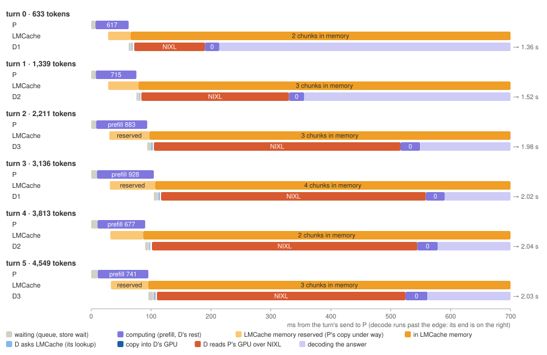

# Conversation 3: mt-rag-clapnq-elser-512-100-20240503 (memory mode, NIXL, shared servers, carry-forward, all passages)

P's KV reaches D over NIXL (D reads P's GPU blocks); every engine's LMCache connector stores beside it, to the one shared server. 6 turns on D1, D2, D3 (round-robin: each turn to the next D engine); prompts grow from 633 to 4,549 tokens (interleaved: each turn's prompt is the previous one, its answer, then this turn's documents and question). Chunks are 256 tokens (16 vLLM blocks of 16); a chunk's name is LMCache's hash of its tokens and everything before them, so the same prefix has the same chunks on every turn and engine.

Legend for the strips (one character a chunk): P: `=` on P's GPU from an earlier turn, `#` computed and stored now, `+` computed, not stored (a partial chunk). D: `=` on D's GPU from an earlier turn, `M` pulled from memory, `S` pulled from disk, `N` read from P's GPU over NIXL, `+` computed by D (a partial chunk), `?` missed.

GPU blocks (the chunk tables): where each engine keeps the chunk's 16 vLLM blocks in its GPU KV cache, by vLLM's block ids (vLLM's paged KV cache: a block, or page, holds 16 tokens; block 0 is its reserved null block), in the prompt's block order, a run of consecutive ids written as a range: `P 1, 138-152` is the prompt's block 0 in GPU block 1 and its blocks 1-15 in GPU blocks 138-152. An engine takes a GPU block from its free list when it first computes or loads a block, and the block keeps it while cached, so a later turn that reuses the block shows the same id. Blocks that are the same in several prompts (the same tokens and everything before them) share one GPU block once the first is cached: the system prompt's first block, the same in every conversation, is the usual one. `16/16 hashes = P's`: of the blocks D pulled, how many have the same vLLM hash on D as on P.

The prompts' text is the driver's own record of what it sent (answers included); lines over 100 characters are wrapped here for reading.

| turn | prompt | chunks + tail | P: own GPU / computed / stored | D: own GPU / loaded / computed | pulled | pull ms | D first token ms |
| ---: | ---: | --- | --- | --- | --- | ---: | ---: |
| [0](#turn-0) | 633 | 2 + 121 | 16 / 617 / 2 chunks | 16 / 617 / 0 | 3 chunks (NIXL 3) | 118.1 | 147.7 |
| [1](#turn-1) | 1,339 | 5 + 59 | 624 / 715 / 3 chunks | 16 / 1,323 / 0 | 6 chunks (NIXL 6) | 246.6 | 277.3 |
| [2](#turn-2) | 2,211 | 8 + 163 | 1,328 / 883 / 3 chunks | 16 / 2,195 / 0 | 9 chunks (NIXL 9) | 411.7 | 450.7 |
| [3](#turn-3) | 3,136 | 12 + 64 | 2,208 / 928 / 4 chunks | 736 / 2,400 / 0 | 11 chunks (NIXL 11) | 442.0 | 479.9 |
| [4](#turn-4) | 3,813 | 14 + 229 | 3,136 / 677 / 2 chunks | 1,440 / 2,373 / 0 | 10 chunks (NIXL 10) | 443.1 | 483.8 |
| [5](#turn-5) | 4,549 | 17 + 197 | 3,808 / 741 / 3 chunks | 2,336 / 2,213 / 0 | 9 chunks (NIXL 9) | 414.8 | 458.5 |

## How the prompt grows

Each turn's prompt is the previous one, token for token, and then: D's answer to the previous turn, this turn's documents, its question and the framing (the system prompt on turn 0, `Assistant:` and newlines). Only the new tokens can make new chunks: the previous prompt's partial chunk fills first. A document sent before comes again at another place, so in other chunks.

| turn | prompt | new | previous answer | documents | question | framing | whole chunks |
| ---: | ---: | ---: | ---: | --- | --- | ---: | --- |
| 0 | 633 | +633 | – | 5 docs, 589 | 14: robert louis stevenson a child's garden of verses | 30 | 2 (+2) |
| 1 | 1,339 | +706 | 107 | 5 docs, 583 (4 sent before: 424) | 13: is a child's garden of verses only in English? | 3 | 5 (+3) |
| 2 | 2,211 | +872 | 107 | 6 docs, 748 (6 sent before: 748) | 14: what are the contents of a child's garden of verses | 3 | 8 (+3) |
| 3 | 3,136 | +925 | 128 | 8 docs, 782 | 12: any other famous poets you recommend me to know? | 3 | 12 (+4) |
| 4 | 3,813 | +677 | 128 | 7 docs, 532 (2 sent before: 147) | 14: can you provide more details of E. E. Cummings? | 3 | 14 (+2) |
| 5 | 4,549 | +736 | 128 | 6 docs, 580 (3 sent before: 198) | 25: how was E. E. Cummings's life? Was E. E. Cummings's famous poem affec… | 3 | 17 (+3) |

## Timeline

Every turn on one clock: ms from the moment the proxy sent the turn to P. P prefills it (one token out) and holds its blocks for D; the proxy sends the turn to the next D engine at once with P's reply's kv_transfer_params (no wait), D reads P's blocks over NIXL (orange-red), computes the rest and decodes the answer. Beside it every engine's LMCache connector stores its new whole chunks (P's lane, and D's own when it stored any). The lanes: P, LMCache (P's chunks), D, and LMCache (D's chunks).



| turn | P queued → done | P's chunks: in memory / on disk | D | D starts | NIXL read | D: held / from P / from LMCache / computed | D's chunks stored | first token | P freed | D done |
| ---: | --- | --- | --- | ---: | --- | --- | ---: | ---: | ---: | ---: |
| 0 | 7 → 63 | 2: 66 / – | D1 | 66 | 72-190 | 16 / 617 / 0 / 0 | 0 | 214 | 191 | 1,359 |
| 1 | 8 → 76 | 3: 79 / – | D2 | 78 | 84-330 | 16 / 1,323 / 0 / 0 | 0 | 356 | 331 | 1,519 |
| 2 | 8 → 94 | 3: 97 / – | D3 | 98 | 105-516 | 16 / 2,195 / 0 / 0 | 0 | 549 | 517 | 1,978 |
| 3 | 10 → 105 | 4: 107 / – | D1 | 110 | 117-559 | 736 / 2,400 / 0 / 0 | 0 | 590 | 560 | 2,025 |
| 4 | 11 → 90 | 2: 87 / – | D2 | 95 | 101-544 | 1,440 / 2,373 / 0 / 0 | 0 | 579 | 545 | 2,038 |
| 5 | 11 → 96 | 3: 95 / – | D3 | 103 | 110-525 | 2,336 / 2,213 / 0 / 0 | 0 | 561 | 525 | 2,031 |

All times in ms from the turn's send to P. NIXL read: D's worker posts the read of P's blocks to the KV in D's GPU blocks; P freed: D has read, P's blocks go back to its free queue (still cached). Each turn's section below tells it in a sentence and step by step.

### One chunk, block by block: chunk 1 of turn 0 (`87459d277a0228c0`)

Tokens 256-512 (doc 815546445_2827: 93; doc 815546445_1364: 62; doc 815546445_2716: 41; doc 815546445_1737: 60). P computed its blocks; D1 read them from P's GPU over NIXL, P's block into D's block, one for one:

| block | tokens | P's GPU block | vLLM hash on P | D's GPU block | same hash on D |
| ---: | --- | ---: | --- | ---: | --- |
| 16 | 256-272 | 1226 | `e129960621340dd6` | 929 | True |
| 17 | 272-288 | 1227 | `84e3d0a0591000d6` | 930 | True |
| 18 | 288-304 | 1228 | `26eebb6c1ce28218` | 931 | True |
| 19 | 304-320 | 1229 | `b60a7834bdbaf5c0` | 932 | True |
| 20 | 320-336 | 1230 | `33378f2a700eccbc` | 933 | True |
| 21 | 336-352 | 1231 | `245c146fc1c1fb46` | 934 | True |
| 22 | 352-368 | 1232 | `bf6841aac2b19dbd` | 935 | True |
| 23 | 368-384 | 1233 | `e82eda0e09e7d768` | 936 | True |
| 24 | 384-400 | 1234 | `af0d4e1650aa85e9` | 937 | True |
| 25 | 400-416 | 1235 | `eeaf8dbd7c8ad45c` | 938 | True |
| 26 | 416-432 | 1236 | `7976c989a143796f` | 939 | True |
| 27 | 432-448 | 1237 | `a6e7aa44cc5bd50f` | 940 | True |
| 28 | 448-464 | 1238 | `2a63ff96afc1ff11` | 941 | True |
| 29 | 464-480 | 1239 | `95f4b768af737370` | 942 | True |
| 30 | 480-496 | 1240 | `40e2f7103fdbf855` | 943 | True |
| 31 | 496-512 | 1241 | `6dca27fac5708aba` | 944 | True |

## Turn 0

**Timeline:** P queued until 7 ms, prefilled 617 tokens (held 16) and was done at 63 ms; its 2 new chunks were in LMCache's memory at 66 ms. D1 started at 66 ms (no wait) holding 16 tokens, read 617 from P's GPU over NIXL (posted at 72 ms, in its GPU at 190 ms; P freed its blocks at 191 ms), computed 0 and gave its first token at 214 ms; it decoded 107 tokens until 1,359 ms. ([all turns](#timeline))

### Step by step

Every move of this turn's KV, ms from the proxy sending the turn to P. P's KV reaches D over NIXL: D's worker reads P's GPU blocks into its own (a NIXL READ, P told when D is done); LMCache's copies (to and from each server's memory) its servers do themselves through CUDA IPC handles each engine registered at start.

| ms | where | what |
| ---: | --- | --- |
| 0.0 | proxy → P | sends the turn (633 prompt tokens; P is asked for one token: prefill only) |
| 2.5 | P | the request arrives |
| 7.0 | P GPU | its prefix cache holds 16 of the prompt's tokens: 1 block in GPU blocks 1 |
| 7.0 | P ↔ LMCache | LMCache has 0 of its tokens; P loads 0 and computes the rest |
| 7.2 | P GPU | 39 new GPU blocks for the 617 tokens it computes: 1212-1250; the prefill runs |
| 7.6 | P → LMCache | store planned: tokens 0-512, chunks 0-1 (32 blocks) |
| 27.6 | LMCache | the store request is in; it waits for P's forward pass to finish (a CUDA event) |
| 28.2 | LMCache memory | space reserved for 2 chunks (59 MB) |
| 59.4 | P GPU → LMCache memory | the copy starts: LMCache reads P's GPU blocks (CUDA IPC) |
| 59.5 | P GPU | the request is done: P holds its 40 blocks for D to read over NIXL, and its reply carries them (kv_transfer_params: the blocks, its NIXL agent) |
| 62.0 | P GPU → LMCache memory | copy done: 2 chunks, 59 MB in 2.6 ms |
| 62.6 | P → proxy | P answers its one token: the prefill is done |
| 65.9 | LMCache memory | 2 chunks in memory, kept for later requests (D gets this turn's KV from P over NIXL); P keeps its copy in its GPU blocks |
| 66.3 | proxy → D1 | sends the turn to D1 at once, with P's kv_transfer_params (round-robin; no wait) |
| 67.7 | D1 ↔ LMCache | asks LMCache for the prompt's chunks |
| 68.7 | LMCache memory | found 512 tokens it lacks: 2 chunks in memory |
| 70.8 | D1 GPU | its prefix cache holds 16 of the prompt's tokens: 1 block in GPU blocks 1 |
| 70.8 | D1 ↔ P (NIXL) | will read 617 prompt tokens from P's GPU (beyond the 16 its own cache holds) |
| 70.9 | D1 ↔ LMCache | LMCache has 512 of its tokens; NIXL loads it (MultiConnector: the first connector with tokens) |
| 71.1 | D1 GPU | 39 GPU blocks for the KV from P: 914-952 |
| 71.8 | P GPU → D1 GPU (NIXL) | D1 reads P's GPU blocks 1, 1212-1250 into its 914-952 (a NIXL READ) |
| 189.9 | D1 | the KV from P is in its GPU blocks (617 tokens) |
| 190.6 | P GPU | D1 has read: P frees its blocks (they stay in its prefix cache) |
| 213.9 | D1 → proxy | the first answer token |
| 276.9 | D1 GPU | 1 new GPU block for the 1 prompt tokens it computes: 953 |
| 450.5 | D1 GPU | decoding: the answer's KV takes 6 new GPU blocks as it grows, one per 16 tokens: 954-959, until 1,315 ms |
| 1,358.7 | D1 | done: 107 tokens decoded; its blocks stay cached in its GPU for the next turn |
| 1,360.0 | proxy | the response is complete |

633 prompt tokens: 2 whole chunks and 121 tokens over (the partial chunk, computed by both engines and stored only when a later turn completes it). P held 16 tokens on its GPU, computed 617 and stored 2 new chunks; D1 held 16, read 617 from P over NIXL, loaded 0 from LMCache and computed 0.

### The prompt

The whole prompt, piece by piece:

- **system prompt** · tokens 0-28 (28) · chunk 0

```text
You are a helpful assistant. Answer the user's last question from the documents. If they do not hold
the answer, say so.
```

<details><summary>document <code>815546445_881-1363-0-482</code> · tokens 28-147 (119) · chunk 0</summary>

```text
Document: A Child's Garden of Verses
A Child's Garden of Verses
A Child 's Garden of Verses is a collection of poetry for children about darkness and solitude by
the Scottish author Robert Louis Stevenson . The collection first appeared in 1885 under the title
Penny Whistles , but has been reprinted many times , often in illustrated versions . It contains
about 65 poems including the cherished classics `` Foreign Children , '' `` The Lamplighter , '' ``
The Land of Counterpane , '' `` Bed in Summer , '' `` My Shadow '' and `` The Swing . ''
```

</details>

<details><summary>document <code>815546445_2827-3534-0-705</code> · tokens 147-349 (202) · chunks 0-1</summary>

```text
Document: A Child's Garden of Verses
A Child's Garden of Verses
Disneyland Record released a LP record of the poems set to music . Gwyn Conger wrote the music which
was performed by Francis Archer and Beverly Gile . The Italian composer Carlo Deri composed , in
2005 , a song for voice and piano , The Unseen Playmate , on Stevenson 's poem . This song is also
included in Deri 's one - act opera Markheim ( 2008 ) . The contemporary Lithuanian composer
Giedrius Alkauskas ( b . 1978 ) arranged five poems -- `` The Wind '' ( two alternative arrangements
) , `` Rain '' , `` Singing '' , `` Marching Song '' , and `` At the Sea - side '' -- as a six -
song cycle , `` A Child 's Garden of Songs '' , for mezzo - soprano , piano , and trumpet in B ♭ ,
released in 2014 .
```

</details>

<details><summary>document <code>815546445_1364-1547-0-183</code> · tokens 349-411 (62) · chunk 1</summary>

```text
Document: A Child's Garden of Verses
A Child's Garden of Verses
The classical scholar Terrot Reaveley Glover published a translation of the poems into Latin in 1922
under the title Carmina non prius audita de ludis et hortis virginibus puerisque .
```

</details>

<details><summary>document <code>815546445_2716-2805-0-89</code> · tokens 411-452 (41) · chunk 1</summary>

```text
Document: A Child's Garden of Verses
A Child's Garden of Verses
To Willie and Henrietta To My Mother To Auntie To Minnie To My Name - child To Any Reader
```

</details>

<details><summary>document <code>815546445_1737-2410-0-673</code> · tokens 452-617 (165) · chunks 1-2</summary>

```text
Document: A Child's Garden of Verses
A Child's Garden of Verses
To Alison Cunningham Bed in Summer A Thought At the Sea - side Young Night Thought Whole Duty of
Children Rain Pirate Story ( poem ) Foreign Lands Windy Nights Travelling Singing Looking Forward A
Good Play Where Go the Boats ? Auntie 's Skirts The Land of Counterpane The Land of Nod My Shadow
System A Good Boy Escape at Bedtime Marching Song The Cow Happy Thought The Wind Keepsake Mill Good
and Bad Children Foreign Children The Sun 's Travels The Lamplighter My Bed is a Boat The Moon The
Swing Time to Rise Looking - glass River Fairy Bread From a Railway Carriage Winter - time The
Hayloft Farewell to the Farm Northwest Passage : Good Night , Shadow March , In Port
```

</details>

- **question 0** · tokens 617-631 (14) · chunk 2

```text
User: robert louis stevenson a child's garden of verses
```

- `Assistant:` · tokens 631-633 (2) · chunk 2

### Pieces, chunks and blocks

| piece | tokens | length | chunks | |
| --- | --- | ---: | --- | --- |
| system | 0-28 | 28 | 0 |  |
| doc 815546445_881- | 28-147 | 119 | 0 |  |
| doc 815546445_2827 | 147-349 | 202 | 0-1 |  |
| doc 815546445_1364 | 349-411 | 62 | 1 |  |
| doc 815546445_2716 | 411-452 | 41 | 1 |  |
| doc 815546445_1737 | 452-617 | 165 | 1-2 |  |
| question 0 | 617-631 | 14 | 2 |  |
| `assistant:` 0 | 631-633 | 2 | 2 |  |

```
P  ##+
D  NNN
```

| chunk | tokens | pieces in it (tokens) | vLLM blocks | GPU blocks | in LMCache | P this turn | D this turn |
| ---: | --- | --- | --- | --- | --- | --- | --- |
| 0 | 0-256 | system: 28; doc 815546445_881-: 119; doc 815546445_2827: 109 | 0-15 | P 1, 1212-1226; D 1, 914-928; 15/15 hashes = P's | `603db94c5cf688f6` stored on turn 0 by P | computed (its first 16 tokens on P's GPU already), **stored now** | **read from P's GPU over NIXL** (its first 16 tokens on D's GPU already) |
| 1 | 256-512 | doc 815546445_2827: 93; doc 815546445_1364: 62; doc 815546445_2716: 41; doc 815546445_1737: 60 | 16-31 | P 1227-1242; D 929-944; 16/16 hashes = P's | `87459d277a0228c0` stored on turn 0 by P | computed, **stored now** | **read from P's GPU over NIXL** |
| 2 | 512-633 | doc 815546445_1737: 105; question 0: 14; `assistant:` 0: 2 | 32-39 | P 1243-1249; D 945-952; 7/7 hashes = P's | – | computed (partial chunk: not stored) | **read from P's GPU over NIXL** (partial chunk) |

## Turn 1

**Timeline:** P queued until 8 ms, prefilled 715 tokens (held 624) and was done at 76 ms; its 3 new chunks were in LMCache's memory at 79 ms. D2 started at 78 ms (no wait) holding 16 tokens, read 1,323 from P's GPU over NIXL (posted at 84 ms, in its GPU at 330 ms; P freed its blocks at 331 ms), computed 0 and gave its first token at 356 ms; it decoded 107 tokens until 1,519 ms. ([all turns](#timeline))

### Step by step

Every move of this turn's KV, ms from the proxy sending the turn to P. P's KV reaches D over NIXL: D's worker reads P's GPU blocks into its own (a NIXL READ, P told when D is done); LMCache's copies (to and from each server's memory) its servers do themselves through CUDA IPC handles each engine registered at start.

| ms | where | what |
| ---: | --- | --- |
| 0.0 | proxy → P | sends the turn (1,339 prompt tokens; P is asked for one token: prefill only) |
| 2.9 | P | the request arrives |
| 7.5 | P GPU | its prefix cache holds 624 of the prompt's tokens: 39 blocks in GPU blocks 1, 1212-1249 |
| 7.6 | P ↔ LMCache | LMCache has 512 of its tokens; P loads 0 and computes the rest |
| 7.7 | P GPU | 45 new GPU blocks for the 715 tokens it computes: 1250-1294; the prefill runs |
| 8.2 | P → LMCache | store planned: tokens 512-1,280, chunks 2-4 (48 blocks) |
| 27.8 | LMCache | the store request is in; it waits for P's forward pass to finish (a CUDA event) |
| 28.4 | LMCache memory | space reserved for 3 chunks (88 MB) |
| 71.5 | P GPU → LMCache memory | the copy starts: LMCache reads P's GPU blocks (CUDA IPC) |
| 71.7 | P GPU | the request is done: P holds its 84 blocks for D to read over NIXL, and its reply carries them (kv_transfer_params: the blocks, its NIXL agent) |
| 75.4 | P GPU → LMCache memory | copy done: 3 chunks, 88 MB in 3.9 ms |
| 75.5 | P → proxy | P answers its one token: the prefill is done |
| 78.5 | proxy → D2 | sends the turn to D2 at once, with P's kv_transfer_params (round-robin; no wait) |
| 78.7 | LMCache memory | 3 chunks in memory, kept for later requests (D gets this turn's KV from P over NIXL); P keeps its copy in its GPU blocks |
| 80.4 | D2 ↔ LMCache | asks LMCache for the prompt's chunks |
| 81.5 | LMCache memory | found 1,280 tokens it lacks: 5 chunks in memory |
| 82.6 | D2 GPU | its prefix cache holds 16 of the prompt's tokens: 1 block in GPU blocks 1 |
| 82.7 | D2 ↔ P (NIXL) | will read 1,323 prompt tokens from P's GPU (beyond the 16 its own cache holds) |
| 82.7 | D2 ↔ LMCache | LMCache has 1,280 of its tokens; NIXL loads it (MultiConnector: the first connector with tokens) |
| 83.0 | D2 GPU | 83 GPU blocks for the KV from P: 1082-1164 |
| 83.7 | P GPU → D2 GPU (NIXL) | D2 reads P's GPU blocks 1, 1212-1294 into its 1082-1164 (a NIXL READ) |
| 330.3 | D2 | the KV from P is in its GPU blocks (1,323 tokens) |
| 330.9 | P GPU | D2 has read: P frees its blocks (they stay in its prefix cache) |
| 355.7 | D2 → proxy | the first answer token |
| 398.3 | D2 GPU | 1 new GPU block for the 1 prompt tokens it computes: 1165 |
| 574.5 | D2 GPU | decoding: the answer's KV takes 6 new GPU blocks as it grows, one per 16 tokens: 1166-1171, until 1,453 ms |
| 1,518.7 | D2 | done: 107 tokens decoded; its blocks stay cached in its GPU for the next turn |
| 1,519.7 | proxy | the response is complete |

1,339 prompt tokens: 5 whole chunks and 59 tokens over (the partial chunk, computed by both engines and stored only when a later turn completes it). P held 624 tokens on its GPU, computed 715 and stored 3 new chunks; D2 held 16, read 1,323 from P over NIXL, loaded 0 from LMCache and computed 0.

### The prompt

Tokens 0-633: [turn 0](#turn-0)'s prompt, unchanged (checked: its first 633 token ids are the previous prompt's), so chunks 0-1 are the same chunks; chunk 2 (partial then, 121 tokens) fills now. New from token 633:

- **D's answer to turn 0** · tokens 633-740 (107) · chunk 2

```text
 I have found the answer to your question. The book A Child's Garden of Verses is a collection of
poetry for children about darkness and solitude by the Scottish author Robert Louis Stevenson. The
collection first appeared in 1885 under the title Penny Whistles, but has been reprinted many times,
often in illustrated versions. It contains about 65 poems including the cherished classics "Foreign
Children," "The Lamplighter," "The Land of Counterpane," "Bed in Summer," "My Shadow" and "The
Swing."
```

- `\n` · tokens 740-741 (1) · chunk 2

- document `815546445_1364-1547-0-183` · tokens 741-803 (62) · chunks 2-3 · **again**: sent on [turn 0](#turn-0) already (the same 62 tokens), here at another place in the prompt, so in other chunks: a prefix cache cannot reuse it

- document `815546445_2827-3534-0-705` · tokens 803-1005 (202) · chunk 3 · **again**: sent on [turn 0](#turn-0) already (the same 202 tokens), here at another place in the prompt, so in other chunks: a prefix cache cannot reuse it

- document `815546445_881-1363-0-482` · tokens 1005-1124 (119) · chunks 3-4 · **again**: sent on [turn 0](#turn-0) already (the same 119 tokens), here at another place in the prompt, so in other chunks: a prefix cache cannot reuse it

<details><summary>document <code>815546445_98-851-0-753</code> · tokens 1124-1283 (159) · chunks 4-5</summary>

```text
Document: A Child's Garden of Verses
A Child's Garden of Verses
( hide ) This article has multiple issues . Please help improve it or discuss these issues on the
talk page . ( Learn how and when to remove these template messages ) This article needs additional
citations for verification . Please help improve this article by adding citations to reliable
sources . Unsourced material may be challenged and removed . ( November 2015 ) ( Learn how and when
to remove this template message ) This article includes a list of references , but its sources
remain unclear because it has insufficient inline citations . Please help to improve this article by
introducing more precise citations . ( August 2017 ) ( Learn how and when to remove this template
message ) ( Learn how and when to remove this template message ) The
```

</details>

- document `815546445_2716-2805-0-89` · tokens 1283-1324 (41) · chunk 5 · **again**: sent on [turn 0](#turn-0) already (the same 41 tokens), here at another place in the prompt, so in other chunks: a prefix cache cannot reuse it

- **question 1** · tokens 1324-1337 (13) · chunk 5

```text
User: is a child's garden of verses only in English?
```

- `Assistant:` · tokens 1337-1339 (2) · chunk 5

### Pieces, chunks and blocks

| piece | tokens | length | chunks | |
| --- | --- | ---: | --- | --- |
| system | 0-28 | 28 | 0 |  |
| doc 815546445_881- | 28-147 | 119 | 0 |  |
| doc 815546445_2827 | 147-349 | 202 | 0-1 |  |
| doc 815546445_1364 | 349-411 | 62 | 1 |  |
| doc 815546445_2716 | 411-452 | 41 | 1 |  |
| doc 815546445_1737 | 452-617 | 165 | 1-2 |  |
| question 0 | 617-631 | 14 | 2 |  |
| `assistant:` 0 | 631-633 | 2 | 2 |  |
| answer 0 | 633-740 | 107 | 2 | new this turn |
| newline 0 | 740-741 | 1 | 2 | new this turn |
| doc 815546445_1364 | 741-803 | 62 | 2-3 | new this turn |
| doc 815546445_2827 | 803-1005 | 202 | 3 | new this turn |
| doc 815546445_881- | 1005-1124 | 119 | 3-4 | new this turn |
| doc 815546445_98-8 | 1124-1283 | 159 | 4-5 | new this turn |
| doc 815546445_2716 | 1283-1324 | 41 | 5 | new this turn |
| question 1 | 1324-1337 | 13 | 5 | new this turn |
| `assistant:` 1 | 1337-1339 | 2 | 5 | new this turn |

```
P  ==###+
D  NNNNNN
```

| chunk | tokens | pieces in it (tokens) | vLLM blocks | GPU blocks | in LMCache | P this turn | D this turn |
| ---: | --- | --- | --- | --- | --- | --- | --- |
| 0 | 0-256 | system: 28; doc 815546445_881-: 119; doc 815546445_2827: 109 | 0-15 | P 1, 1212-1226; D 1, 1082-1096 | `603db94c5cf688f6` stored on turn 0 by P | on P's GPU (earlier turn) | **read from P's GPU over NIXL** (its first 16 tokens on D's GPU already) |
| 1 | 256-512 | doc 815546445_2827: 93; doc 815546445_1364: 62; doc 815546445_2716: 41; doc 815546445_1737: 60 | 16-31 | P 1227-1242; D 1097-1112 | `87459d277a0228c0` stored on turn 0 by P | on P's GPU (earlier turn) | **read from P's GPU over NIXL** |
| 2 | 512-768 | doc 815546445_1737: 105; question 0: 14; `assistant:` 0: 2; answer 0 (new): 107; newline 0 (new): 1; doc 815546445_1364 (new): 27 | 32-47 | P 1243-1258; D 1113-1128; 9/9 hashes = P's | `dc29df8c9fdba03d` stored on turn 1 by P | computed (its first 112 tokens on P's GPU already), **stored now** | **read from P's GPU over NIXL** |
| 3 | 768-1024 | doc 815546445_1364 (new): 35; doc 815546445_2827 (new): 202; doc 815546445_881- (new): 19 | 48-63 | P 1259-1274; D 1129-1144; 16/16 hashes = P's | `2c0cc2f28b6eb00c` stored on turn 1 by P | computed, **stored now** | **read from P's GPU over NIXL** |
| 4 | 1024-1280 | doc 815546445_881- (new): 100; doc 815546445_98-8 (new): 156 | 64-79 | P 1275-1290; D 1145-1160; 16/16 hashes = P's | `5a96a2835324dcc3` stored on turn 1 by P | computed, **stored now** | **read from P's GPU over NIXL** |
| 5 | 1280-1339 | doc 815546445_98-8 (new): 3; doc 815546445_2716 (new): 41; question 1 (new): 13; `assistant:` 1 (new): 2 | 80-83 | P 1291-1293; D 1161-1164; 3/3 hashes = P's | – | computed (partial chunk: not stored) | **read from P's GPU over NIXL** (partial chunk) |

## Turn 2

**Timeline:** P queued until 8 ms, prefilled 883 tokens (held 1,328) and was done at 94 ms; its 3 new chunks were in LMCache's memory at 97 ms. D3 started at 98 ms (no wait) holding 16 tokens, read 2,195 from P's GPU over NIXL (posted at 105 ms, in its GPU at 516 ms; P freed its blocks at 517 ms), computed 0 and gave its first token at 549 ms; it decoded 128 tokens until 1,978 ms. ([all turns](#timeline))

### Step by step

Every move of this turn's KV, ms from the proxy sending the turn to P. P's KV reaches D over NIXL: D's worker reads P's GPU blocks into its own (a NIXL READ, P told when D is done); LMCache's copies (to and from each server's memory) its servers do themselves through CUDA IPC handles each engine registered at start.

| ms | where | what |
| ---: | --- | --- |
| 0.0 | proxy → P | sends the turn (2,211 prompt tokens; P is asked for one token: prefill only) |
| 3.5 | P | the request arrives |
| 8.0 | P GPU | its prefix cache holds 1,328 of the prompt's tokens: 83 blocks in GPU blocks 1, 1212-1293 |
| 8.1 | P ↔ LMCache | LMCache has 1,280 of its tokens; P loads 0 and computes the rest |
| 8.3 | P GPU | 56 new GPU blocks for the 883 tokens it computes: 1294-1349; the prefill runs |
| 8.8 | P → LMCache | store planned: tokens 1,280-2,048, chunks 5-7 (48 blocks) |
| 29.6 | LMCache | the store request is in; it waits for P's forward pass to finish (a CUDA event) |
| 30.2 | LMCache memory | space reserved for 3 chunks (88 MB) |
| 89.1 | P GPU → LMCache memory | the copy starts: LMCache reads P's GPU blocks (CUDA IPC) |
| 89.2 | P GPU | the request is done: P holds its 139 blocks for D to read over NIXL, and its reply carries them (kv_transfer_params: the blocks, its NIXL agent) |
| 92.9 | P GPU → LMCache memory | copy done: 3 chunks, 88 MB in 3.9 ms |
| 93.5 | P → proxy | P answers its one token: the prefill is done |
| 97.0 | LMCache memory | 3 chunks in memory, kept for later requests (D gets this turn's KV from P over NIXL); P keeps its copy in its GPU blocks |
| 98.4 | proxy → D3 | sends the turn to D3 at once, with P's kv_transfer_params (round-robin; no wait) |
| 100.3 | D3 ↔ LMCache | asks LMCache for the prompt's chunks |
| 102.7 | LMCache memory | found 2,048 tokens it lacks: 8 chunks in memory |
| 103.3 | D3 GPU | its prefix cache holds 16 of the prompt's tokens: 1 block in GPU blocks 1 |
| 103.4 | D3 ↔ P (NIXL) | will read 2,195 prompt tokens from P's GPU (beyond the 16 its own cache holds) |
| 103.4 | D3 ↔ LMCache | LMCache has 2,048 of its tokens; NIXL loads it (MultiConnector: the first connector with tokens) |
| 103.7 | D3 GPU | 138 GPU blocks for the KV from P: 1151-1288 |
| 104.7 | P GPU → D3 GPU (NIXL) | D3 reads P's GPU blocks 1, 1212-1349 into its 1151-1288 (a NIXL READ) |
| 516.4 | D3 | the KV from P is in its GPU blocks (2,195 tokens) |
| 517.4 | P GPU | D3 has read: P frees its blocks (they stay in its prefix cache) |
| 549.1 | D3 → proxy | the first answer token |
| 680.0 | D3 GPU | 1 new GPU block for the 1 prompt tokens it computes: 1289 |
| 860.3 | D3 GPU | decoding: the answer's KV takes 7 new GPU blocks as it grows, one per 16 tokens: 1290-1296, until 1,944 ms |
| 1,978.1 | D3 | done: 128 tokens decoded; its blocks stay cached in its GPU for the next turn |
| 1,979.2 | proxy | the response is complete |

2,211 prompt tokens: 8 whole chunks and 163 tokens over (the partial chunk, computed by both engines and stored only when a later turn completes it). P held 1,328 tokens on its GPU, computed 883 and stored 3 new chunks; D3 held 16, read 2,195 from P over NIXL, loaded 0 from LMCache and computed 0.

### The prompt

Tokens 0-1,339: [turn 1](#turn-1)'s prompt, unchanged (checked: its first 1,339 token ids are the previous prompt's), so chunks 0-4 are the same chunks; chunk 5 (partial then, 59 tokens) fills now. New from token 1,339:

- **D's answer to turn 1** · tokens 1339-1446 (107) · chunk 5

```text
 I have found the answer to your question. The book A Child's Garden of Verses is a collection of
poetry for children about darkness and solitude by the Scottish author Robert Louis Stevenson. The
collection first appeared in 1885 under the title Penny Whistles, but has been reprinted many times,
often in illustrated versions. It contains about 65 poems including the cherished classics "Foreign
Children," "The Lamplighter," "The Land of Counterpane," "Bed in Summer," "My Shadow" and "The
Swing."
```

- `\n` · tokens 1446-1447 (1) · chunk 5

- document `815546445_881-1363-0-482` · tokens 1447-1566 (119) · chunks 5-6 · **again**: sent on [turn 0](#turn-0) already (the same 119 tokens), here at another place in the prompt, so in other chunks: a prefix cache cannot reuse it

- document `815546445_1737-2410-0-673` · tokens 1566-1731 (165) · chunk 6 · **again**: sent on [turn 0](#turn-0) already (the same 165 tokens), here at another place in the prompt, so in other chunks: a prefix cache cannot reuse it

- document `815546445_1364-1547-0-183` · tokens 1731-1793 (62) · chunks 6-7 · **again**: sent on [turn 0](#turn-0) already (the same 62 tokens), here at another place in the prompt, so in other chunks: a prefix cache cannot reuse it

- document `815546445_98-851-0-753` · tokens 1793-1952 (159) · chunk 7 · **again**: sent on [turn 1](#turn-1) already (the same 159 tokens), here at another place in the prompt, so in other chunks: a prefix cache cannot reuse it

- document `815546445_2716-2805-0-89` · tokens 1952-1993 (41) · chunk 7 · **again**: sent on [turn 0](#turn-0) already (the same 41 tokens), here at another place in the prompt, so in other chunks: a prefix cache cannot reuse it

- document `815546445_2827-3534-0-705` · tokens 1993-2195 (202) · chunks 7-8 · **again**: sent on [turn 0](#turn-0) already (the same 202 tokens), here at another place in the prompt, so in other chunks: a prefix cache cannot reuse it

- **question 2** · tokens 2195-2209 (14) · chunk 8

```text
User: what are the contents of a child's garden of verses
```

- `Assistant:` · tokens 2209-2211 (2) · chunk 8

### Pieces, chunks and blocks

| piece | tokens | length | chunks | |
| --- | --- | ---: | --- | --- |
| system | 0-28 | 28 | 0 |  |
| doc 815546445_881- | 28-147 | 119 | 0 |  |
| doc 815546445_2827 | 147-349 | 202 | 0-1 |  |
| doc 815546445_1364 | 349-411 | 62 | 1 |  |
| doc 815546445_2716 | 411-452 | 41 | 1 |  |
| doc 815546445_1737 | 452-617 | 165 | 1-2 |  |
| question 0 | 617-631 | 14 | 2 |  |
| `assistant:` 0 | 631-633 | 2 | 2 |  |
| answer 0 | 633-740 | 107 | 2 |  |
| newline 0 | 740-741 | 1 | 2 |  |
| doc 815546445_1364 | 741-803 | 62 | 2-3 |  |
| doc 815546445_2827 | 803-1005 | 202 | 3 |  |
| doc 815546445_881- | 1005-1124 | 119 | 3-4 |  |
| doc 815546445_98-8 | 1124-1283 | 159 | 4-5 |  |
| doc 815546445_2716 | 1283-1324 | 41 | 5 |  |
| question 1 | 1324-1337 | 13 | 5 |  |
| `assistant:` 1 | 1337-1339 | 2 | 5 |  |
| answer 1 | 1339-1446 | 107 | 5 | new this turn |
| newline 1 | 1446-1447 | 1 | 5 | new this turn |
| doc 815546445_881- | 1447-1566 | 119 | 5-6 | new this turn |
| doc 815546445_1737 | 1566-1731 | 165 | 6 | new this turn |
| doc 815546445_1364 | 1731-1793 | 62 | 6-7 | new this turn |
| doc 815546445_98-8 | 1793-1952 | 159 | 7 | new this turn |
| doc 815546445_2716 | 1952-1993 | 41 | 7 | new this turn |
| doc 815546445_2827 | 1993-2195 | 202 | 7-8 | new this turn |
| question 2 | 2195-2209 | 14 | 8 | new this turn |
| `assistant:` 2 | 2209-2211 | 2 | 8 | new this turn |

```
P  =====###+
D  NNNNNNNNN
```

| chunk | tokens | pieces in it (tokens) | vLLM blocks | GPU blocks | in LMCache | P this turn | D this turn |
| ---: | --- | --- | --- | --- | --- | --- | --- |
| 0 | 0-256 | system: 28; doc 815546445_881-: 119; doc 815546445_2827: 109 | 0-15 | P 1, 1212-1226; D 1, 1151-1165 | `603db94c5cf688f6` stored on turn 0 by P | on P's GPU (earlier turn) | **read from P's GPU over NIXL** (its first 16 tokens on D's GPU already) |
| 1 | 256-512 | doc 815546445_2827: 93; doc 815546445_1364: 62; doc 815546445_2716: 41; doc 815546445_1737: 60 | 16-31 | P 1227-1242; D 1166-1181 | `87459d277a0228c0` stored on turn 0 by P | on P's GPU (earlier turn) | **read from P's GPU over NIXL** |
| 2 | 512-768 | doc 815546445_1737: 105; question 0: 14; `assistant:` 0: 2; answer 0: 107; newline 0: 1; doc 815546445_1364: 27 | 32-47 | P 1243-1258; D 1182-1197 | `dc29df8c9fdba03d` stored on turn 1 by P | on P's GPU (earlier turn) | **read from P's GPU over NIXL** |
| 3 | 768-1024 | doc 815546445_1364: 35; doc 815546445_2827: 202; doc 815546445_881-: 19 | 48-63 | P 1259-1274; D 1198-1213 | `2c0cc2f28b6eb00c` stored on turn 1 by P | on P's GPU (earlier turn) | **read from P's GPU over NIXL** |
| 4 | 1024-1280 | doc 815546445_881-: 100; doc 815546445_98-8: 156 | 64-79 | P 1275-1290; D 1214-1229 | `5a96a2835324dcc3` stored on turn 1 by P | on P's GPU (earlier turn) | **read from P's GPU over NIXL** |
| 5 | 1280-1536 | doc 815546445_98-8: 3; doc 815546445_2716: 41; question 1: 13; `assistant:` 1: 2; answer 1 (new): 107; newline 1 (new): 1; doc 815546445_881- (new): 89 | 80-95 | P 1291-1306; D 1230-1245; 13/13 hashes = P's | `c7e2cced60296515` stored on turn 2 by P | computed (its first 48 tokens on P's GPU already), **stored now** | **read from P's GPU over NIXL** |
| 6 | 1536-1792 | doc 815546445_881- (new): 30; doc 815546445_1737 (new): 165; doc 815546445_1364 (new): 61 | 96-111 | P 1307-1322; D 1246-1261; 16/16 hashes = P's | `1377f8ec505aba87` stored on turn 2 by P | computed, **stored now** | **read from P's GPU over NIXL** |
| 7 | 1792-2048 | doc 815546445_1364 (new): 1; doc 815546445_98-8 (new): 159; doc 815546445_2716 (new): 41; doc 815546445_2827 (new): 55 | 112-127 | P 1323-1338; D 1262-1277; 16/16 hashes = P's | `1dda4de1a70d0b33` stored on turn 2 by P | computed, **stored now** | **read from P's GPU over NIXL** |
| 8 | 2048-2211 | doc 815546445_2827 (new): 147; question 2 (new): 14; `assistant:` 2 (new): 2 | 128-138 | P 1339-1348; D 1278-1288; 10/10 hashes = P's | – | computed (partial chunk: not stored) | **read from P's GPU over NIXL** (partial chunk) |

## Turn 3

**Timeline:** P queued until 10 ms, prefilled 928 tokens (held 2,208) and was done at 105 ms; its 4 new chunks were in LMCache's memory at 107 ms. D1 started at 110 ms (no wait) holding 736 tokens, read 2,400 from P's GPU over NIXL (posted at 117 ms, in its GPU at 559 ms; P freed its blocks at 560 ms), computed 0 and gave its first token at 590 ms; it decoded 128 tokens until 2,025 ms. ([all turns](#timeline))

### Step by step

Every move of this turn's KV, ms from the proxy sending the turn to P. P's KV reaches D over NIXL: D's worker reads P's GPU blocks into its own (a NIXL READ, P told when D is done); LMCache's copies (to and from each server's memory) its servers do themselves through CUDA IPC handles each engine registered at start.

| ms | where | what |
| ---: | --- | --- |
| 0.0 | proxy → P | sends the turn (3,136 prompt tokens; P is asked for one token: prefill only) |
| 4.1 | P | the request arrives |
| 9.3 | P GPU | its prefix cache holds 2,208 of the prompt's tokens: 138 blocks in GPU blocks 1, 1212-1348 |
| 9.4 | P ↔ LMCache | LMCache has 2,048 of its tokens; P loads 0 and computes the rest |
| 9.6 | P GPU | 58 new GPU blocks for the 928 tokens it computes: 1349-1406; the prefill runs |
| 10.1 | P → LMCache | store planned: tokens 2,048-3,072, chunks 8-11 (64 blocks) |
| 30.3 | LMCache | the store request is in; it waits for P's forward pass to finish (a CUDA event) |
| 31.1 | LMCache memory | space reserved for 4 chunks (117 MB) |
| 98.3 | P GPU → LMCache memory | the copy starts: LMCache reads P's GPU blocks (CUDA IPC) |
| 98.5 | P GPU | the request is done: P holds its 196 blocks for D to read over NIXL, and its reply carries them (kv_transfer_params: the blocks, its NIXL agent) |
| 103.4 | P GPU → LMCache memory | copy done: 4 chunks, 117 MB in 5.1 ms |
| 104.6 | P → proxy | P answers its one token: the prefill is done |
| 106.7 | LMCache memory | 4 chunks in memory, kept for later requests (D gets this turn's KV from P over NIXL); P keeps its copy in its GPU blocks |
| 110.4 | proxy → D1 | sends the turn to D1 at once, with P's kv_transfer_params (round-robin; no wait) |
| 112.4 | D1 ↔ LMCache | asks LMCache for the prompt's chunks |
| 114.7 | LMCache memory | found 2,560 tokens it lacks: 10 chunks in memory |
| 115.5 | D1 GPU | its prefix cache holds 736 of the prompt's tokens: 46 blocks in GPU blocks 1, 914-958 |
| 115.5 | D1 ↔ P (NIXL) | will read 2,400 prompt tokens from P's GPU (beyond the 736 its own cache holds) |
| 115.6 | D1 ↔ LMCache | LMCache has 3,072 of its tokens; NIXL loads it (MultiConnector: the first connector with tokens) |
| 115.9 | D1 GPU | 150 GPU blocks for the KV from P: 959-1108 |
| 116.7 | P GPU → D1 GPU (NIXL) | D1 reads P's GPU blocks 1, 1212-1406 into its 959-1108 (a NIXL READ) |
| 558.7 | D1 | the KV from P is in its GPU blocks (2,400 tokens) |
| 560.1 | P GPU | D1 has read: P frees its blocks (they stay in its prefix cache) |
| 577.5 | D1 GPU | 1 new GPU block for the 1 prompt tokens it computes: 1109 |
| 590.3 | D1 → proxy | the first answer token |
| 757.8 | D1 GPU | decoding: the answer's KV takes 7 new GPU blocks as it grows, one per 16 tokens: 1110-1116, until 1,843 ms |
| 2,024.6 | D1 | done: 128 tokens decoded; its blocks stay cached in its GPU for the next turn |
| 2,025.5 | proxy | the response is complete |

3,136 prompt tokens: 12 whole chunks and 64 tokens over (the partial chunk, computed by both engines and stored only when a later turn completes it). P held 2,208 tokens on its GPU, computed 928 and stored 4 new chunks; D1 held 736, read 2,400 from P over NIXL, loaded 0 from LMCache and computed 0.

### The prompt

Tokens 0-2,211: [turn 2](#turn-2)'s prompt, unchanged (checked: its first 2,211 token ids are the previous prompt's), so chunks 0-7 are the same chunks; chunk 8 (partial then, 163 tokens) fills now. New from token 2,211:

- **D's answer to turn 2** · tokens 2211-2339 (128) · chunks 8-9

```text
 I have found the answer to your question. The book A Child's Garden of Verses is a collection of
poetry for children about darkness and solitude by the Scottish author Robert Louis Stevenson. The
collection first appeared in 1885 under the title Penny Whistles, but has been reprinted many times,
often in illustrated versions. It contains about 65 poems including the cherished classics "Foreign
Children," "The Lamplighter," "The Land of Counterpane," "Bed in Summer," "My Shadow" and "The
Swing." se
Document: A Child's Garden of Verses
A Child's Garden of Verses
A Child
```

- `\n` · tokens 2339-2340 (1) · chunk 9

<details><summary>document <code>851649357_5734-5868-0-134</code> · tokens 2340-2378 (38) · chunk 9</summary>

```text
Document: The Tyger
The Tyger
Blake 's original tunes for his poems have been lost in time , but many artists have tried to create
their own versions of the tunes .
```

</details>

<details><summary>document <code>818287024_15431-15519-0-88</code> · tokens 2378-2408 (30) · chunk 9</summary>

```text
Document: E. E. Cummings
E. E. Cummings
Cummings is known for controversial subject matter , as he wrote numerous erotic poems .
```

</details>

<details><summary>document <code>803829007_104850-106386-0-1536</code> · tokens 2408-2752 (344) · chunks 9-10</summary>

```text
Document: United Kingdom
United Kingdom
Britain 's oldest known poem , Y Gododdin , was composed in Yr Hen Ogledd ( The Old North ) , most
likely in the late 6th century . It was written in Cumbric or Old Welsh and contains the earliest
known reference to King Arthur . From around the seventh century , the connection between Wales and
the Old North was lost , and the focus of Welsh - language culture shifted to Wales , where
Arthurian legend was further developed by Geoffrey of Monmouth . Wales 's most celebrated medieval
poet , Dafydd ap Gwilym ( fl. 1320 -- 1370 ) , composed poetry on themes including nature , religion
and especially love . He is widely regarded as one of the greatest European poets of his age . Until
the late 19th century the majority of Welsh literature was in Welsh and much of the prose was
religious in character . Daniel Owen is credited as the first Welsh - language novelist , publishing
Rhys Lewis in 1885 . The best - known of the Anglo - Welsh poets are both Thomases . Dylan Thomas
became famous on both sides of the Atlantic in the mid-20th century . He is remembered for his
poetry -- his `` Do not go gentle into that good night ; Rage , rage against the dying of the light
'' is one of the most quoted couplets of English language verse -- and for his `` play for voices ''
, Under Milk Wood . The influential Church in Wales `` poet - priest '' and Welsh nationalist R.S.
Thomas was nominated for the Nobel Prize in Literature in 1996 . Leading Welsh novelists of the
twentieth century include Richard Llewellyn and Kate Roberts .
```

</details>

<details><summary>document <code>806718226_31050-31385-0-335</code> · tokens 2752-2835 (83) · chunks 10-11</summary>

```text
Document: James Russell Lowell
James Russell Lowell
Lowell is considered one of the Fireside Poets , a group of writers from New England in the 1840s
who all had a substantial national following and whose work was often read aloud by the family
fireplace . Besides Lowell , the main figures from this group were Longfellow , Holmes , John
Greenleaf Whittier , and William Cullen Bryant .
```

</details>

<details><summary>document <code>851649357_437-801-0-364</code> · tokens 2835-2924 (89) · chunk 11</summary>

```text
Document: The Tyger
The Tyger
`` The Tyger '' is a poem by the English poet William Blake published in 1794 as part of the Songs
of Experience collection . Literary critic Alfred Kazin calls it `` the most famous of his poems ''
, and The Cambridge Companion to William Blake says it is `` the most anthologized poem in English
'' . It is one of Blake 's most reinterpreted and arranged works .
```

</details>

<details><summary>document <code>818287024_13516-13713-0-197</code> · tokens 2924-2975 (51) · chunk 11</summary>

```text
Document: E. E. Cummings
E. E. Cummings
Some of Cummings ' most famous poems do not involve much , if any , odd typography or punctuation ,
but still carry his unmistakable style , particularly in unusual and impressionistic word order .
```

</details>

<details><summary>document <code>818287024_15044-15245-0-201</code> · tokens 2975-3030 (55) · chunk 11</summary>

```text
Document: E. E. Cummings
E. E. Cummings
Many of Cummings ' poems are satirical and address social issues but have an equal or even stronger
bias toward romanticism : time and again his poems celebrate love , sex , and the season of rebirth
.
```

</details>

<details><summary>document <code>818287024_330-644-0-314</code> · tokens 3030-3122 (92) · chunks 11-12</summary>

```text
Document: E. E. Cummings
E. E. Cummings
Edward Estlin `` E.E. '' Cummings ( October 14 , 1894 -- September 3 , 1962 ) , often styled as e e
cummings , as he sometimes signed his name , was an American poet , painter , essayist , author ,
and playwright . He wrote approximately 2900 poems , two autobiographical novels , four plays , and
several essays .
```

</details>

- **question 3** · tokens 3122-3134 (12) · chunk 12

```text
User: any other famous poets you recommend me to know?
```

- `Assistant:` · tokens 3134-3136 (2) · chunk 12

### Pieces, chunks and blocks

| piece | tokens | length | chunks | |
| --- | --- | ---: | --- | --- |
| system | 0-28 | 28 | 0 |  |
| doc 815546445_881- | 28-147 | 119 | 0 |  |
| doc 815546445_2827 | 147-349 | 202 | 0-1 |  |
| doc 815546445_1364 | 349-411 | 62 | 1 |  |
| doc 815546445_2716 | 411-452 | 41 | 1 |  |
| doc 815546445_1737 | 452-617 | 165 | 1-2 |  |
| question 0 | 617-631 | 14 | 2 |  |
| `assistant:` 0 | 631-633 | 2 | 2 |  |
| answer 0 | 633-740 | 107 | 2 |  |
| newline 0 | 740-741 | 1 | 2 |  |
| doc 815546445_1364 | 741-803 | 62 | 2-3 |  |
| doc 815546445_2827 | 803-1005 | 202 | 3 |  |
| doc 815546445_881- | 1005-1124 | 119 | 3-4 |  |
| doc 815546445_98-8 | 1124-1283 | 159 | 4-5 |  |
| doc 815546445_2716 | 1283-1324 | 41 | 5 |  |
| question 1 | 1324-1337 | 13 | 5 |  |
| `assistant:` 1 | 1337-1339 | 2 | 5 |  |
| answer 1 | 1339-1446 | 107 | 5 |  |
| newline 1 | 1446-1447 | 1 | 5 |  |
| doc 815546445_881- | 1447-1566 | 119 | 5-6 |  |
| doc 815546445_1737 | 1566-1731 | 165 | 6 |  |
| doc 815546445_1364 | 1731-1793 | 62 | 6-7 |  |
| doc 815546445_98-8 | 1793-1952 | 159 | 7 |  |
| doc 815546445_2716 | 1952-1993 | 41 | 7 |  |
| doc 815546445_2827 | 1993-2195 | 202 | 7-8 |  |
| question 2 | 2195-2209 | 14 | 8 |  |
| `assistant:` 2 | 2209-2211 | 2 | 8 |  |
| answer 2 | 2211-2339 | 128 | 8-9 | new this turn |
| newline 2 | 2339-2340 | 1 | 9 | new this turn |
| doc 851649357_5734 | 2340-2378 | 38 | 9 | new this turn |
| doc 818287024_1543 | 2378-2408 | 30 | 9 | new this turn |
| doc 803829007_1048 | 2408-2752 | 344 | 9-10 | new this turn |
| doc 806718226_3105 | 2752-2835 | 83 | 10-11 | new this turn |
| doc 851649357_437- | 2835-2924 | 89 | 11 | new this turn |
| doc 818287024_1351 | 2924-2975 | 51 | 11 | new this turn |
| doc 818287024_1504 | 2975-3030 | 55 | 11 | new this turn |
| doc 818287024_330- | 3030-3122 | 92 | 11-12 | new this turn |
| question 3 | 3122-3134 | 12 | 12 | new this turn |
| `assistant:` 3 | 3134-3136 | 2 | 12 | new this turn |

```
P  ========####+
D  ==NNNNNNNNNNN
```

| chunk | tokens | pieces in it (tokens) | vLLM blocks | GPU blocks | in LMCache | P this turn | D this turn |
| ---: | --- | --- | --- | --- | --- | --- | --- |
| 0 | 0-256 | system: 28; doc 815546445_881-: 119; doc 815546445_2827: 109 | 0-15 | P 1, 1212-1226; D 1, 914-928 | `603db94c5cf688f6` stored on turn 0 by P | on P's GPU (earlier turn) | on D's GPU (earlier turn) |
| 1 | 256-512 | doc 815546445_2827: 93; doc 815546445_1364: 62; doc 815546445_2716: 41; doc 815546445_1737: 60 | 16-31 | P 1227-1242; D 929-944 | `87459d277a0228c0` stored on turn 0 by P | on P's GPU (earlier turn) | on D's GPU (earlier turn) |
| 2 | 512-768 | doc 815546445_1737: 105; question 0: 14; `assistant:` 0: 2; answer 0: 107; newline 0: 1; doc 815546445_1364: 27 | 32-47 | P 1243-1258; D 945-960 | `dc29df8c9fdba03d` stored on turn 1 by P | on P's GPU (earlier turn) | **read from P's GPU over NIXL** (its first 224 tokens on D's GPU already) |
| 3 | 768-1024 | doc 815546445_1364: 35; doc 815546445_2827: 202; doc 815546445_881-: 19 | 48-63 | P 1259-1274; D 961-976 | `2c0cc2f28b6eb00c` stored on turn 1 by P | on P's GPU (earlier turn) | **read from P's GPU over NIXL** |
| 4 | 1024-1280 | doc 815546445_881-: 100; doc 815546445_98-8: 156 | 64-79 | P 1275-1290; D 977-992 | `5a96a2835324dcc3` stored on turn 1 by P | on P's GPU (earlier turn) | **read from P's GPU over NIXL** |
| 5 | 1280-1536 | doc 815546445_98-8: 3; doc 815546445_2716: 41; question 1: 13; `assistant:` 1: 2; answer 1: 107; newline 1: 1; doc 815546445_881-: 89 | 80-95 | P 1291-1306; D 993-1008 | `c7e2cced60296515` stored on turn 2 by P | on P's GPU (earlier turn) | **read from P's GPU over NIXL** |
| 6 | 1536-1792 | doc 815546445_881-: 30; doc 815546445_1737: 165; doc 815546445_1364: 61 | 96-111 | P 1307-1322; D 1009-1024 | `1377f8ec505aba87` stored on turn 2 by P | on P's GPU (earlier turn) | **read from P's GPU over NIXL** |
| 7 | 1792-2048 | doc 815546445_1364: 1; doc 815546445_98-8: 159; doc 815546445_2716: 41; doc 815546445_2827: 55 | 112-127 | P 1323-1338; D 1025-1040 | `1dda4de1a70d0b33` stored on turn 2 by P | on P's GPU (earlier turn) | **read from P's GPU over NIXL** |
| 8 | 2048-2304 | doc 815546445_2827: 147; question 2: 14; `assistant:` 2: 2; answer 2 (new): 93 | 128-143 | P 1339-1354; D 1041-1056; 6/6 hashes = P's | `2969369e5be77afd` stored on turn 3 by P | computed (its first 160 tokens on P's GPU already), **stored now** | **read from P's GPU over NIXL** |
| 9 | 2304-2560 | answer 2 (new): 35; newline 2 (new): 1; doc 851649357_5734 (new): 38; doc 818287024_1543 (new): 30; doc 803829007_1048 (new): 152 | 144-159 | P 1355-1370; D 1057-1072; 16/16 hashes = P's | `6d2706fa9ed1b460` stored on turn 3 by P | computed, **stored now** | **read from P's GPU over NIXL** |
| 10 | 2560-2816 | doc 803829007_1048 (new): 192; doc 806718226_3105 (new): 64 | 160-175 | P 1371-1386; D 1073-1088; 16/16 hashes = P's | `c7c395c0267b4dcb` stored on turn 3 by P | computed, **stored now** | **read from P's GPU over NIXL** |
| 11 | 2816-3072 | doc 806718226_3105 (new): 19; doc 851649357_437- (new): 89; doc 818287024_1351 (new): 51; doc 818287024_1504 (new): 55; doc 818287024_330- (new): 42 | 176-191 | P 1387-1402; D 1089-1104; 16/16 hashes = P's | `33547e4b4eff1477` stored on turn 3 by P | computed, **stored now** | **read from P's GPU over NIXL** |
| 12 | 3072-3136 | doc 818287024_330- (new): 50; question 3 (new): 12; `assistant:` 3 (new): 2 | 192-195 | P 1403-1406; D 1105-1108; 4/4 hashes = P's | – | computed (partial chunk: not stored) | **read from P's GPU over NIXL** (partial chunk) |

## Turn 4

**Timeline:** P queued until 11 ms, prefilled 677 tokens (held 3,136) and was done at 90 ms; its 2 new chunks were in LMCache's memory at 87 ms. D2 started at 95 ms (no wait) holding 1,440 tokens, read 2,373 from P's GPU over NIXL (posted at 101 ms, in its GPU at 544 ms; P freed its blocks at 545 ms), computed 0 and gave its first token at 579 ms; it decoded 128 tokens until 2,038 ms. ([all turns](#timeline))

### Step by step

Every move of this turn's KV, ms from the proxy sending the turn to P. P's KV reaches D over NIXL: D's worker reads P's GPU blocks into its own (a NIXL READ, P told when D is done); LMCache's copies (to and from each server's memory) its servers do themselves through CUDA IPC handles each engine registered at start.

| ms | where | what |
| ---: | --- | --- |
| 0.0 | proxy → P | sends the turn (3,813 prompt tokens; P is asked for one token: prefill only) |
| 4.8 | P | the request arrives |
| 10.2 | P GPU | its prefix cache holds 3,136 of the prompt's tokens: 196 blocks in GPU blocks 1, 1212-1406 |
| 10.3 | P ↔ LMCache | LMCache has 3,072 of its tokens; P loads 0 and computes the rest |
| 10.6 | P GPU | 43 new GPU blocks for the 677 tokens it computes: 1407-1449; the prefill runs |
| 11.1 | P → LMCache | store planned: tokens 3,072-3,584, chunks 12-13 (32 blocks) |
| 31.4 | LMCache | the store request is in; it waits for P's forward pass to finish (a CUDA event) |
| 32.0 | LMCache memory | space reserved for 2 chunks (59 MB) |
| 83.2 | P GPU → LMCache memory | the copy starts: LMCache reads P's GPU blocks (CUDA IPC) |
| 83.5 | P GPU | the request is done: P holds its 239 blocks for D to read over NIXL, and its reply carries them (kv_transfer_params: the blocks, its NIXL agent) |
| 85.8 | P GPU → LMCache memory | copy done: 2 chunks, 59 MB in 2.6 ms |
| 86.6 | LMCache memory | 2 chunks in memory, kept for later requests (D gets this turn's KV from P over NIXL); P keeps its copy in its GPU blocks |
| 90.2 | P → proxy | P answers its one token: the prefill is done |
| 94.9 | proxy → D2 | sends the turn to D2 at once, with P's kv_transfer_params (round-robin; no wait) |
| 97.1 | D2 ↔ LMCache | asks LMCache for the prompt's chunks |
| 98.3 | LMCache memory | found 2,304 tokens it lacks: 9 chunks in memory |
| 100.2 | D2 GPU | its prefix cache holds 1,440 of the prompt's tokens: 90 blocks in GPU blocks 1, 1082-1170 |
| 100.2 | D2 ↔ P (NIXL) | will read 2,373 prompt tokens from P's GPU (beyond the 1,440 its own cache holds) |
| 100.3 | D2 ↔ LMCache | LMCache has 3,584 of its tokens; NIXL loads it (MultiConnector: the first connector with tokens) |
| 100.6 | D2 GPU | 149 GPU blocks for the KV from P: 1171-1319 |
| 101.4 | P GPU → D2 GPU (NIXL) | D2 reads P's GPU blocks 1, 1212-1449 into its 1171-1319 (a NIXL READ) |
| 544.5 | D2 | the KV from P is in its GPU blocks (2,373 tokens) |
| 544.9 | P GPU | D2 has read: P frees its blocks (they stay in its prefix cache) |
| 578.7 | D2 → proxy | the first answer token |
| 689.5 | D2 GPU | 1 new GPU block for the 1 prompt tokens it computes: 1320 |
| 874.3 | D2 GPU | decoding: the answer's KV takes 7 new GPU blocks as it grows, one per 16 tokens: 1321-1327, until 1,980 ms |
| 2,037.8 | D2 | done: 128 tokens decoded; its blocks stay cached in its GPU for the next turn |
| 2,038.7 | proxy | the response is complete |

3,813 prompt tokens: 14 whole chunks and 229 tokens over (the partial chunk, computed by both engines and stored only when a later turn completes it). P held 3,136 tokens on its GPU, computed 677 and stored 2 new chunks; D2 held 1,440, read 2,373 from P over NIXL, loaded 0 from LMCache and computed 0.

### The prompt

Tokens 0-3,136: [turn 3](#turn-3)'s prompt, unchanged (checked: its first 3,136 token ids are the previous prompt's), so chunks 0-11 are the same chunks; chunk 12 (partial then, 64 tokens) fills now. New from token 3,136:

- **D's answer to turn 3** · tokens 3136-3264 (128) · chunk 12

```text
 I have found the answer to your question. The book A Child's Garden of Verses is a collection of
poetry for children about darkness and solitude by the Scottish author Robert Louis Stevenson. The
collection first appeared in 1885 under the title Penny Whistles, but has been reprinted many times,
often in illustrated versions. It contains about 65 poems including the cherished classics "Foreign
Children," "The Lamplighter," "The Land of Counterpane," "Bed in Summer," "My Shadow" and "The
Swing." se
Document: A Child's Garden of Verses
A Child's Garden of Verses
A Child
```

- `\n` · tokens 3264-3265 (1) · chunk 12

- document `818287024_330-644-0-314` · tokens 3265-3357 (92) · chunks 12-13 · **again**: sent on [turn 3](#turn-3) already (the same 92 tokens), here at another place in the prompt, so in other chunks: a prefix cache cannot reuse it

- document `818287024_15044-15245-0-201` · tokens 3357-3412 (55) · chunk 13 · **again**: sent on [turn 3](#turn-3) already (the same 55 tokens), here at another place in the prompt, so in other chunks: a prefix cache cannot reuse it

<details><summary>document <code>818287024_13250-13515-0-265</code> · tokens 3412-3479 (67) · chunk 13</summary>

```text
Document: E. E. Cummings
E. E. Cummings
Following his autobiographical novel , The Enormous Room , Cummings ' first published work was a
collection of poems titled Tulips and Chimneys ( 1923 ) . This work was the public 's first
encounter with his characteristic eccentric use of grammar and punctuation .
```

</details>

<details><summary>document <code>818287024_15246-15409-0-163</code> · tokens 3479-3526 (47) · chunk 13</summary>

```text
Document: E. E. Cummings
E. E. Cummings
Cummings also wrote children 's books and novels . A notable example of his versatility is an
introduction he wrote for a collection of the comic strip Krazy Kat .
```

</details>

<details><summary>document <code>818287024_9554-9975-0-421</code> · tokens 3526-3635 (109) · chunks 13-14</summary>

```text
Document: E. E. Cummings
E. E. Cummings
In 1934 , after his separation from his second wife , Cummings met Marion Morehouse , a fashion
model and photographer . Although it is not clear whether the two were ever formally married ,
Morehouse lived with Cummings in a common - law marriage until his death in 1962 . She died on May
18 , 1969 , while living at 4 Patchin Place , Greenwich Village , New York City , where Cummings had
resided since September 1924 .
```

</details>

<details><summary>document <code>818287024_10001-10317-0-316</code> · tokens 3635-3715 (80) · chunk 14</summary>

```text
Document: E. E. Cummings
E. E. Cummings
According to his testimony in EIMI , Cummings had little interest in politics until his trip to the
Soviet Union in 1931 , after which he shifted rightward on many political and social issues .
Despite his radical and bohemian public image , he was a Republican , and later , an ardent
supporter of Joseph McCarthy .
```

</details>

<details><summary>document <code>818287024_6474-6775-0-301</code> · tokens 3715-3797 (82) · chunk 14</summary>

```text
Document: E. E. Cummings
E. E. Cummings
In 1926 , Cummings 's parents were in a car accident ; only his mother survived , although she was
severely injured . Cummings later described the accident in the following passage from his i : six
nonlectures series given at Harvard ( as part of the Charles Eliot Norton Lectures ) in 1952 and
1953 :
```

</details>

- **question 4** · tokens 3797-3811 (14) · chunk 14

```text
User: can you provide more details of E. E. Cummings?
```

- `Assistant:` · tokens 3811-3813 (2) · chunk 14

### Pieces, chunks and blocks

| piece | tokens | length | chunks | |
| --- | --- | ---: | --- | --- |
| system | 0-28 | 28 | 0 |  |
| doc 815546445_881- | 28-147 | 119 | 0 |  |
| doc 815546445_2827 | 147-349 | 202 | 0-1 |  |
| doc 815546445_1364 | 349-411 | 62 | 1 |  |
| doc 815546445_2716 | 411-452 | 41 | 1 |  |
| doc 815546445_1737 | 452-617 | 165 | 1-2 |  |
| question 0 | 617-631 | 14 | 2 |  |
| `assistant:` 0 | 631-633 | 2 | 2 |  |
| answer 0 | 633-740 | 107 | 2 |  |
| newline 0 | 740-741 | 1 | 2 |  |
| doc 815546445_1364 | 741-803 | 62 | 2-3 |  |
| doc 815546445_2827 | 803-1005 | 202 | 3 |  |
| doc 815546445_881- | 1005-1124 | 119 | 3-4 |  |
| doc 815546445_98-8 | 1124-1283 | 159 | 4-5 |  |
| doc 815546445_2716 | 1283-1324 | 41 | 5 |  |
| question 1 | 1324-1337 | 13 | 5 |  |
| `assistant:` 1 | 1337-1339 | 2 | 5 |  |
| answer 1 | 1339-1446 | 107 | 5 |  |
| newline 1 | 1446-1447 | 1 | 5 |  |
| doc 815546445_881- | 1447-1566 | 119 | 5-6 |  |
| doc 815546445_1737 | 1566-1731 | 165 | 6 |  |
| doc 815546445_1364 | 1731-1793 | 62 | 6-7 |  |
| doc 815546445_98-8 | 1793-1952 | 159 | 7 |  |
| doc 815546445_2716 | 1952-1993 | 41 | 7 |  |
| doc 815546445_2827 | 1993-2195 | 202 | 7-8 |  |
| question 2 | 2195-2209 | 14 | 8 |  |
| `assistant:` 2 | 2209-2211 | 2 | 8 |  |
| answer 2 | 2211-2339 | 128 | 8-9 |  |
| newline 2 | 2339-2340 | 1 | 9 |  |
| doc 851649357_5734 | 2340-2378 | 38 | 9 |  |
| doc 818287024_1543 | 2378-2408 | 30 | 9 |  |
| doc 803829007_1048 | 2408-2752 | 344 | 9-10 |  |
| doc 806718226_3105 | 2752-2835 | 83 | 10-11 |  |
| doc 851649357_437- | 2835-2924 | 89 | 11 |  |
| doc 818287024_1351 | 2924-2975 | 51 | 11 |  |
| doc 818287024_1504 | 2975-3030 | 55 | 11 |  |
| doc 818287024_330- | 3030-3122 | 92 | 11-12 |  |
| question 3 | 3122-3134 | 12 | 12 |  |
| `assistant:` 3 | 3134-3136 | 2 | 12 |  |
| answer 3 | 3136-3264 | 128 | 12 | new this turn |
| newline 3 | 3264-3265 | 1 | 12 | new this turn |
| doc 818287024_330- | 3265-3357 | 92 | 12-13 | new this turn |
| doc 818287024_1504 | 3357-3412 | 55 | 13 | new this turn |
| doc 818287024_1325 | 3412-3479 | 67 | 13 | new this turn |
| doc 818287024_1524 | 3479-3526 | 47 | 13 | new this turn |
| doc 818287024_9554 | 3526-3635 | 109 | 13-14 | new this turn |
| doc 818287024_1000 | 3635-3715 | 80 | 14 | new this turn |
| doc 818287024_6474 | 3715-3797 | 82 | 14 | new this turn |
| question 4 | 3797-3811 | 14 | 14 | new this turn |
| `assistant:` 4 | 3811-3813 | 2 | 14 | new this turn |

```
P  ============##+
D  =====NNNNNNNNNN
```

| chunk | tokens | pieces in it (tokens) | vLLM blocks | GPU blocks | in LMCache | P this turn | D this turn |
| ---: | --- | --- | --- | --- | --- | --- | --- |
| 0 | 0-256 | system: 28; doc 815546445_881-: 119; doc 815546445_2827: 109 | 0-15 | P 1, 1212-1226; D 1, 1082-1096 | `603db94c5cf688f6` stored on turn 0 by P | on P's GPU (earlier turn) | on D's GPU (earlier turn) |
| 1 | 256-512 | doc 815546445_2827: 93; doc 815546445_1364: 62; doc 815546445_2716: 41; doc 815546445_1737: 60 | 16-31 | P 1227-1242; D 1097-1112 | `87459d277a0228c0` stored on turn 0 by P | on P's GPU (earlier turn) | on D's GPU (earlier turn) |
| 2 | 512-768 | doc 815546445_1737: 105; question 0: 14; `assistant:` 0: 2; answer 0: 107; newline 0: 1; doc 815546445_1364: 27 | 32-47 | P 1243-1258; D 1113-1128 | `dc29df8c9fdba03d` stored on turn 1 by P | on P's GPU (earlier turn) | on D's GPU (earlier turn, its own answer) |
| 3 | 768-1024 | doc 815546445_1364: 35; doc 815546445_2827: 202; doc 815546445_881-: 19 | 48-63 | P 1259-1274; D 1129-1144 | `2c0cc2f28b6eb00c` stored on turn 1 by P | on P's GPU (earlier turn) | on D's GPU (earlier turn) |
| 4 | 1024-1280 | doc 815546445_881-: 100; doc 815546445_98-8: 156 | 64-79 | P 1275-1290; D 1145-1160 | `5a96a2835324dcc3` stored on turn 1 by P | on P's GPU (earlier turn) | on D's GPU (earlier turn) |
| 5 | 1280-1536 | doc 815546445_98-8: 3; doc 815546445_2716: 41; question 1: 13; `assistant:` 1: 2; answer 1: 107; newline 1: 1; doc 815546445_881-: 89 | 80-95 | P 1291-1306; D 1161-1176 | `c7e2cced60296515` stored on turn 2 by P | on P's GPU (earlier turn) | **read from P's GPU over NIXL** (its first 160 tokens on D's GPU already) |
| 6 | 1536-1792 | doc 815546445_881-: 30; doc 815546445_1737: 165; doc 815546445_1364: 61 | 96-111 | P 1307-1322; D 1177-1192 | `1377f8ec505aba87` stored on turn 2 by P | on P's GPU (earlier turn) | **read from P's GPU over NIXL** |
| 7 | 1792-2048 | doc 815546445_1364: 1; doc 815546445_98-8: 159; doc 815546445_2716: 41; doc 815546445_2827: 55 | 112-127 | P 1323-1338; D 1193-1208 | `1dda4de1a70d0b33` stored on turn 2 by P | on P's GPU (earlier turn) | **read from P's GPU over NIXL** |
| 8 | 2048-2304 | doc 815546445_2827: 147; question 2: 14; `assistant:` 2: 2; answer 2: 93 | 128-143 | P 1339-1354; D 1209-1224 | `2969369e5be77afd` stored on turn 3 by P | on P's GPU (earlier turn) | **read from P's GPU over NIXL** |
| 9 | 2304-2560 | answer 2: 35; newline 2: 1; doc 851649357_5734: 38; doc 818287024_1543: 30; doc 803829007_1048: 152 | 144-159 | P 1355-1370; D 1225-1240 | `6d2706fa9ed1b460` stored on turn 3 by P | on P's GPU (earlier turn) | **read from P's GPU over NIXL** |
| 10 | 2560-2816 | doc 803829007_1048: 192; doc 806718226_3105: 64 | 160-175 | P 1371-1386; D 1241-1256 | `c7c395c0267b4dcb` stored on turn 3 by P | on P's GPU (earlier turn) | **read from P's GPU over NIXL** |
| 11 | 2816-3072 | doc 806718226_3105: 19; doc 851649357_437-: 89; doc 818287024_1351: 51; doc 818287024_1504: 55; doc 818287024_330-: 42 | 176-191 | P 1387-1402; D 1257-1272 | `33547e4b4eff1477` stored on turn 3 by P | on P's GPU (earlier turn) | **read from P's GPU over NIXL** |
| 12 | 3072-3328 | doc 818287024_330-: 50; question 3: 12; `assistant:` 3: 2; answer 3 (new): 128; newline 3 (new): 1; doc 818287024_330- (new): 63 | 192-207 | P 1403-1418; D 1273-1288; 12/12 hashes = P's | `9a5bca62e06c6786` stored on turn 4 by P | computed (its first 64 tokens on P's GPU already), **stored now** | **read from P's GPU over NIXL** |
| 13 | 3328-3584 | doc 818287024_330- (new): 29; doc 818287024_1504 (new): 55; doc 818287024_1325 (new): 67; doc 818287024_1524 (new): 47; doc 818287024_9554 (new): 58 | 208-223 | P 1419-1434; D 1289-1304; 16/16 hashes = P's | `e8a33cd36c00e506` stored on turn 4 by P | computed, **stored now** | **read from P's GPU over NIXL** |
| 14 | 3584-3813 | doc 818287024_9554 (new): 51; doc 818287024_1000 (new): 80; doc 818287024_6474 (new): 82; question 4 (new): 14; `assistant:` 4 (new): 2 | 224-238 | P 1435-1448; D 1305-1319; 14/14 hashes = P's | – | computed (partial chunk: not stored) | **read from P's GPU over NIXL** (partial chunk) |

## Turn 5

**Timeline:** P queued until 11 ms, prefilled 741 tokens (held 3,808) and was done at 96 ms; its 3 new chunks were in LMCache's memory at 95 ms. D3 started at 103 ms (no wait) holding 2,336 tokens, read 2,213 from P's GPU over NIXL (posted at 110 ms, in its GPU at 525 ms; P freed its blocks at 525 ms), computed 0 and gave its first token at 561 ms; it decoded 128 tokens until 2,031 ms. ([all turns](#timeline))

### Step by step

Every move of this turn's KV, ms from the proxy sending the turn to P. P's KV reaches D over NIXL: D's worker reads P's GPU blocks into its own (a NIXL READ, P told when D is done); LMCache's copies (to and from each server's memory) its servers do themselves through CUDA IPC handles each engine registered at start.

| ms | where | what |
| ---: | --- | --- |
| 0.0 | proxy → P | sends the turn (4,549 prompt tokens; P is asked for one token: prefill only) |
| 5.2 | P | the request arrives |
| 10.7 | P GPU | its prefix cache holds 3,808 of the prompt's tokens: 238 blocks in GPU blocks 1, 1212-1448 |
| 10.8 | P ↔ LMCache | LMCache has 3,584 of its tokens; P loads 0 and computes the rest |
| 11.1 | P GPU | 47 new GPU blocks for the 741 tokens it computes: 1449-1495; the prefill runs |
| 11.6 | P → LMCache | store planned: tokens 3,584-4,352, chunks 14-16 (48 blocks) |
| 32.1 | LMCache | the store request is in; it waits for P's forward pass to finish (a CUDA event) |
| 32.9 | LMCache memory | space reserved for 3 chunks (88 MB) |
| 88.3 | P GPU → LMCache memory | the copy starts: LMCache reads P's GPU blocks (CUDA IPC) |
| 88.6 | P GPU | the request is done: P holds its 285 blocks for D to read over NIXL, and its reply carries them (kv_transfer_params: the blocks, its NIXL agent) |
| 92.1 | P GPU → LMCache memory | copy done: 3 chunks, 88 MB in 3.9 ms |
| 95.2 | LMCache memory | 3 chunks in memory, kept for later requests (D gets this turn's KV from P over NIXL); P keeps its copy in its GPU blocks |
| 95.5 | P → proxy | P answers its one token: the prefill is done |
| 103.0 | proxy → D3 | sends the turn to D3 at once, with P's kv_transfer_params (round-robin; no wait) |
| 105.1 | D3 ↔ LMCache | asks LMCache for the prompt's chunks |
| 107.6 | LMCache memory | found 2,048 tokens it lacks: 8 chunks in memory |
| 108.4 | D3 GPU | its prefix cache holds 2,336 of the prompt's tokens: 146 blocks in GPU blocks 1, 1151-1295 |
| 108.5 | D3 ↔ P (NIXL) | will read 2,213 prompt tokens from P's GPU (beyond the 2,336 its own cache holds) |
| 108.5 | D3 ↔ LMCache | LMCache has 4,352 of its tokens; NIXL loads it (MultiConnector: the first connector with tokens) |
| 108.9 | D3 GPU | 139 GPU blocks for the KV from P: 1296-1434 |
| 109.8 | P GPU → D3 GPU (NIXL) | D3 reads P's GPU blocks 1, 1212-1495 into its 1296-1434 (a NIXL READ) |
| 524.6 | D3 | the KV from P is in its GPU blocks (2,213 tokens) |
| 525.0 | P GPU | D3 has read: P frees its blocks (they stay in its prefix cache) |
| 561.4 | D3 → proxy | the first answer token |
| 669.6 | D3 GPU | 1 new GPU block for the 1 prompt tokens it computes: 1435 |
| 855.4 | D3 GPU | decoding: the answer's KV takes 7 new GPU blocks as it grows, one per 16 tokens: 1436-1442, until 1,972 ms |
| 2,030.7 | D3 | done: 128 tokens decoded; its blocks stay cached in its GPU for the next turn |
| 2,032.0 | proxy | the response is complete |

4,549 prompt tokens: 17 whole chunks and 197 tokens over (the partial chunk, computed by both engines and stored only when a later turn completes it). P held 3,808 tokens on its GPU, computed 741 and stored 3 new chunks; D3 held 2,336, read 2,213 from P over NIXL, loaded 0 from LMCache and computed 0.

### The prompt

Tokens 0-3,813: [turn 4](#turn-4)'s prompt, unchanged (checked: its first 3,813 token ids are the previous prompt's), so chunks 0-13 are the same chunks; chunk 14 (partial then, 229 tokens) fills now. New from token 3,813:

- **D's answer to turn 4** · tokens 3813-3941 (128) · chunks 14-15

```text
 I have found the answer to your question. The book A Child's Garden of Verses is a collection of
poetry for children about darkness and solitude by the Scottish author Robert Louis Stevenson. The
collection first appeared in 1885 under the title Penny Whistles, but has been reprinted many times,
often in illustrated versions. It contains about 65 poems including the cherished classics "Foreign
Children," "The Lamplighter," "The Land of Counterpane," "Bed in Summer," "My Shadow" and "The
Swing." se
Document: E. E. Cummings
E. E. Cummings
Edward Estlin `` E.E
```

- `\n` · tokens 3941-3942 (1) · chunk 15

<details><summary>document <code>818287024_2912-3352-0-440</code> · tokens 3942-4046 (104) · chunk 15</summary>

```text
Document: E. E. Cummings
E. E. Cummings
Cummings wanted to be a poet from childhood and wrote poetry daily from age 8 to 22 , exploring
assorted forms. He graduated from Harvard University in 1915 and received an advanced degree from
the university in 1916 . In his studies at Harvard , he developed an interest in modern poetry ,
which ignored conventional grammar and syntax , while aiming for a dynamic use of language . Upon
graduating , he worked for a book dealer . Masthead
```

</details>

<details><summary>document <code>818287024_11663-12378-0-715</code> · tokens 4046-4205 (159) · chunks 15-16</summary>

```text
Document: E. E. Cummings
E. E. Cummings
As well as being influenced by notable modernists , including Gertrude Stein and Ezra Pound ,
Cummings in his early work drew upon the imagist experiments of Amy Lowell . Later , his visits to
Paris exposed him to Dada and surrealism , which he reflected in his work . He began to rely on
symbolism and allegory , where he once had used simile and metaphor . In his later work , he rarely
used comparisons that required objects that were not previously mentioned in the poem , choosing to
use a symbol instead . Due to this , his later poetry is `` frequently more lucid , more moving ,
and more profound than his earlier . '' Cummings also liked to incorporate imagery of nature and
death into much of his poetry .
```

</details>

<details><summary>document <code>818287024_10348-10866-0-518</code> · tokens 4205-4324 (119) · chunk 16</summary>

```text
Document: E. E. Cummings
E. E. Cummings
Despite Cummings 's familiarity with avant - garde styles ( undoubtedly affected by the Calligrammes
of French poet Apollinaire , according to a contemporary observation ) , much of his work is quite
traditional . Many of his poems are sonnets , albeit often with a modern twist . He occasionally
used the blues form and acrostics . Cummings ' poetry often deals with themes of love and nature ,
as well as the relationship of the individual to the masses and to the world . His poems are also
often rife with satire .
```

</details>

- document `818287024_15044-15245-0-201` · tokens 4324-4379 (55) · chunks 16-17 · **again**: sent on [turn 3](#turn-3) already (the same 55 tokens), here at another place in the prompt, so in other chunks: a prefix cache cannot reuse it

- document `818287024_13516-13713-0-197` · tokens 4379-4430 (51) · chunk 17 · **again**: sent on [turn 3](#turn-3) already (the same 51 tokens), here at another place in the prompt, so in other chunks: a prefix cache cannot reuse it

- document `818287024_330-644-0-314` · tokens 4430-4522 (92) · chunk 17 · **again**: sent on [turn 3](#turn-3) already (the same 92 tokens), here at another place in the prompt, so in other chunks: a prefix cache cannot reuse it

- **question 5** · tokens 4522-4547 (25) · chunk 17

```text
User: how was E. E. Cummings's life? Was E. E. Cummings's famous poem affected by something?
```

- `Assistant:` · tokens 4547-4549 (2) · chunk 17

### Pieces, chunks and blocks

| piece | tokens | length | chunks | |
| --- | --- | ---: | --- | --- |
| system | 0-28 | 28 | 0 |  |
| doc 815546445_881- | 28-147 | 119 | 0 |  |
| doc 815546445_2827 | 147-349 | 202 | 0-1 |  |
| doc 815546445_1364 | 349-411 | 62 | 1 |  |
| doc 815546445_2716 | 411-452 | 41 | 1 |  |
| doc 815546445_1737 | 452-617 | 165 | 1-2 |  |
| question 0 | 617-631 | 14 | 2 |  |
| `assistant:` 0 | 631-633 | 2 | 2 |  |
| answer 0 | 633-740 | 107 | 2 |  |
| newline 0 | 740-741 | 1 | 2 |  |
| doc 815546445_1364 | 741-803 | 62 | 2-3 |  |
| doc 815546445_2827 | 803-1005 | 202 | 3 |  |
| doc 815546445_881- | 1005-1124 | 119 | 3-4 |  |
| doc 815546445_98-8 | 1124-1283 | 159 | 4-5 |  |
| doc 815546445_2716 | 1283-1324 | 41 | 5 |  |
| question 1 | 1324-1337 | 13 | 5 |  |
| `assistant:` 1 | 1337-1339 | 2 | 5 |  |
| answer 1 | 1339-1446 | 107 | 5 |  |
| newline 1 | 1446-1447 | 1 | 5 |  |
| doc 815546445_881- | 1447-1566 | 119 | 5-6 |  |
| doc 815546445_1737 | 1566-1731 | 165 | 6 |  |
| doc 815546445_1364 | 1731-1793 | 62 | 6-7 |  |
| doc 815546445_98-8 | 1793-1952 | 159 | 7 |  |
| doc 815546445_2716 | 1952-1993 | 41 | 7 |  |
| doc 815546445_2827 | 1993-2195 | 202 | 7-8 |  |
| question 2 | 2195-2209 | 14 | 8 |  |
| `assistant:` 2 | 2209-2211 | 2 | 8 |  |
| answer 2 | 2211-2339 | 128 | 8-9 |  |
| newline 2 | 2339-2340 | 1 | 9 |  |
| doc 851649357_5734 | 2340-2378 | 38 | 9 |  |
| doc 818287024_1543 | 2378-2408 | 30 | 9 |  |
| doc 803829007_1048 | 2408-2752 | 344 | 9-10 |  |
| doc 806718226_3105 | 2752-2835 | 83 | 10-11 |  |
| doc 851649357_437- | 2835-2924 | 89 | 11 |  |
| doc 818287024_1351 | 2924-2975 | 51 | 11 |  |
| doc 818287024_1504 | 2975-3030 | 55 | 11 |  |
| doc 818287024_330- | 3030-3122 | 92 | 11-12 |  |
| question 3 | 3122-3134 | 12 | 12 |  |
| `assistant:` 3 | 3134-3136 | 2 | 12 |  |
| answer 3 | 3136-3264 | 128 | 12 |  |
| newline 3 | 3264-3265 | 1 | 12 |  |
| doc 818287024_330- | 3265-3357 | 92 | 12-13 |  |
| doc 818287024_1504 | 3357-3412 | 55 | 13 |  |
| doc 818287024_1325 | 3412-3479 | 67 | 13 |  |
| doc 818287024_1524 | 3479-3526 | 47 | 13 |  |
| doc 818287024_9554 | 3526-3635 | 109 | 13-14 |  |
| doc 818287024_1000 | 3635-3715 | 80 | 14 |  |
| doc 818287024_6474 | 3715-3797 | 82 | 14 |  |
| question 4 | 3797-3811 | 14 | 14 |  |
| `assistant:` 4 | 3811-3813 | 2 | 14 |  |
| answer 4 | 3813-3941 | 128 | 14-15 | new this turn |
| newline 4 | 3941-3942 | 1 | 15 | new this turn |
| doc 818287024_2912 | 3942-4046 | 104 | 15 | new this turn |
| doc 818287024_1166 | 4046-4205 | 159 | 15-16 | new this turn |
| doc 818287024_1034 | 4205-4324 | 119 | 16 | new this turn |
| doc 818287024_1504 | 4324-4379 | 55 | 16-17 | new this turn |
| doc 818287024_1351 | 4379-4430 | 51 | 17 | new this turn |
| doc 818287024_330- | 4430-4522 | 92 | 17 | new this turn |
| question 5 | 4522-4547 | 25 | 17 | new this turn |
| `assistant:` 5 | 4547-4549 | 2 | 17 | new this turn |

```
P  ==============###+
D  =========NNNNNNNNN
```

| chunk | tokens | pieces in it (tokens) | vLLM blocks | GPU blocks | in LMCache | P this turn | D this turn |
| ---: | --- | --- | --- | --- | --- | --- | --- |
| 0 | 0-256 | system: 28; doc 815546445_881-: 119; doc 815546445_2827: 109 | 0-15 | P 1, 1212-1226; D 1, 1151-1165 | `603db94c5cf688f6` stored on turn 0 by P | on P's GPU (earlier turn) | on D's GPU (earlier turn) |
| 1 | 256-512 | doc 815546445_2827: 93; doc 815546445_1364: 62; doc 815546445_2716: 41; doc 815546445_1737: 60 | 16-31 | P 1227-1242; D 1166-1181 | `87459d277a0228c0` stored on turn 0 by P | on P's GPU (earlier turn) | on D's GPU (earlier turn) |
| 2 | 512-768 | doc 815546445_1737: 105; question 0: 14; `assistant:` 0: 2; answer 0: 107; newline 0: 1; doc 815546445_1364: 27 | 32-47 | P 1243-1258; D 1182-1197 | `dc29df8c9fdba03d` stored on turn 1 by P | on P's GPU (earlier turn) | on D's GPU (earlier turn, its own answer) |
| 3 | 768-1024 | doc 815546445_1364: 35; doc 815546445_2827: 202; doc 815546445_881-: 19 | 48-63 | P 1259-1274; D 1198-1213 | `2c0cc2f28b6eb00c` stored on turn 1 by P | on P's GPU (earlier turn) | on D's GPU (earlier turn) |
| 4 | 1024-1280 | doc 815546445_881-: 100; doc 815546445_98-8: 156 | 64-79 | P 1275-1290; D 1214-1229 | `5a96a2835324dcc3` stored on turn 1 by P | on P's GPU (earlier turn) | on D's GPU (earlier turn) |
| 5 | 1280-1536 | doc 815546445_98-8: 3; doc 815546445_2716: 41; question 1: 13; `assistant:` 1: 2; answer 1: 107; newline 1: 1; doc 815546445_881-: 89 | 80-95 | P 1291-1306; D 1230-1245 | `c7e2cced60296515` stored on turn 2 by P | on P's GPU (earlier turn) | on D's GPU (earlier turn, its own answer) |
| 6 | 1536-1792 | doc 815546445_881-: 30; doc 815546445_1737: 165; doc 815546445_1364: 61 | 96-111 | P 1307-1322; D 1246-1261 | `1377f8ec505aba87` stored on turn 2 by P | on P's GPU (earlier turn) | on D's GPU (earlier turn) |
| 7 | 1792-2048 | doc 815546445_1364: 1; doc 815546445_98-8: 159; doc 815546445_2716: 41; doc 815546445_2827: 55 | 112-127 | P 1323-1338; D 1262-1277 | `1dda4de1a70d0b33` stored on turn 2 by P | on P's GPU (earlier turn) | on D's GPU (earlier turn) |
| 8 | 2048-2304 | doc 815546445_2827: 147; question 2: 14; `assistant:` 2: 2; answer 2: 93 | 128-143 | P 1339-1354; D 1278-1293 | `2969369e5be77afd` stored on turn 3 by P | on P's GPU (earlier turn) | on D's GPU (earlier turn, its own answer) |
| 9 | 2304-2560 | answer 2: 35; newline 2: 1; doc 851649357_5734: 38; doc 818287024_1543: 30; doc 803829007_1048: 152 | 144-159 | P 1355-1370; D 1294-1309 | `6d2706fa9ed1b460` stored on turn 3 by P | on P's GPU (earlier turn) | **read from P's GPU over NIXL** (its first 32 tokens on D's GPU already) |
| 10 | 2560-2816 | doc 803829007_1048: 192; doc 806718226_3105: 64 | 160-175 | P 1371-1386; D 1310-1325 | `c7c395c0267b4dcb` stored on turn 3 by P | on P's GPU (earlier turn) | **read from P's GPU over NIXL** |
| 11 | 2816-3072 | doc 806718226_3105: 19; doc 851649357_437-: 89; doc 818287024_1351: 51; doc 818287024_1504: 55; doc 818287024_330-: 42 | 176-191 | P 1387-1402; D 1326-1341 | `33547e4b4eff1477` stored on turn 3 by P | on P's GPU (earlier turn) | **read from P's GPU over NIXL** |
| 12 | 3072-3328 | doc 818287024_330-: 50; question 3: 12; `assistant:` 3: 2; answer 3: 128; newline 3: 1; doc 818287024_330-: 63 | 192-207 | P 1403-1418; D 1342-1357 | `9a5bca62e06c6786` stored on turn 4 by P | on P's GPU (earlier turn) | **read from P's GPU over NIXL** |
| 13 | 3328-3584 | doc 818287024_330-: 29; doc 818287024_1504: 55; doc 818287024_1325: 67; doc 818287024_1524: 47; doc 818287024_9554: 58 | 208-223 | P 1419-1434; D 1358-1373 | `e8a33cd36c00e506` stored on turn 4 by P | on P's GPU (earlier turn) | **read from P's GPU over NIXL** |
| 14 | 3584-3840 | doc 818287024_9554: 51; doc 818287024_1000: 80; doc 818287024_6474: 82; question 4: 14; `assistant:` 4: 2; answer 4 (new): 27 | 224-239 | P 1435-1450; D 1374-1389; 2/2 hashes = P's | `25263375c3399f04` stored on turn 5 by P | computed (its first 224 tokens on P's GPU already), **stored now** | **read from P's GPU over NIXL** |
| 15 | 3840-4096 | answer 4 (new): 101; newline 4 (new): 1; doc 818287024_2912 (new): 104; doc 818287024_1166 (new): 50 | 240-255 | P 1451-1466; D 1390-1405; 16/16 hashes = P's | `da8a0abd1d18c2a9` stored on turn 5 by P | computed, **stored now** | **read from P's GPU over NIXL** |
| 16 | 4096-4352 | doc 818287024_1166 (new): 109; doc 818287024_1034 (new): 119; doc 818287024_1504 (new): 28 | 256-271 | P 1467-1482; D 1406-1421; 16/16 hashes = P's | `befdcaa4478ff268` stored on turn 5 by P | computed, **stored now** | **read from P's GPU over NIXL** |
| 17 | 4352-4549 | doc 818287024_1504 (new): 27; doc 818287024_1351 (new): 51; doc 818287024_330- (new): 92; question 5 (new): 25; `assistant:` 5 (new): 2 | 272-284 | P 1483-1494; D 1422-1434; 12/12 hashes = P's | – | computed (partial chunk: not stored) | **read from P's GPU over NIXL** (partial chunk) |
