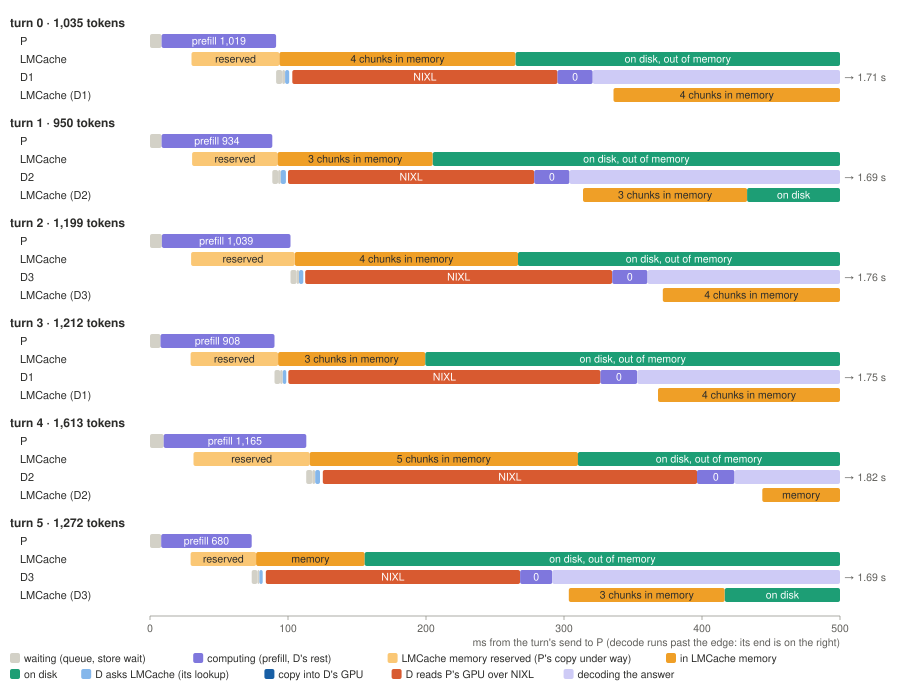

# Conversation 5: mt-rag-clapnq-elser-512-100-20240503 (disk mode, NIXL, per-engine servers, chat RAG, all passages)

P's KV reaches D over NIXL (D reads P's GPU blocks); every engine's LMCache connector stores beside it, to its own server. 6 turns on D1, D2, D3 (round-robin: each turn to the next D engine); prompts grow from 1,035 to 1,272 tokens (interleaved: each turn's prompt is the previous one, its answer, then this turn's documents and question). Chunks are 256 tokens (16 vLLM blocks of 16); a chunk's name is LMCache's hash of its tokens and everything before them, so the same prefix has the same chunks on every turn and engine.

Legend for the strips (one character a chunk): P: `=` on P's GPU from an earlier turn, `#` computed and stored now, `+` computed, not stored (a partial chunk). D: `=` on D's GPU from an earlier turn, `M` pulled from memory, `S` pulled from disk, `N` read from P's GPU over NIXL, `+` computed by D (a partial chunk), `?` missed.

GPU blocks (the chunk tables): where each engine keeps the chunk's 16 vLLM blocks in its GPU KV cache, by vLLM's block ids (vLLM's paged KV cache: a block, or page, holds 16 tokens; block 0 is its reserved null block), in the prompt's block order, a run of consecutive ids written as a range: `P 1, 138-152` is the prompt's block 0 in GPU block 1 and its blocks 1-15 in GPU blocks 138-152. An engine takes a GPU block from its free list when it first computes or loads a block, and the block keeps it while cached, so a later turn that reuses the block shows the same id. Blocks that are the same in several prompts (the same tokens and everything before them) share one GPU block once the first is cached: the system prompt's first block, the same in every conversation, is the usual one. `16/16 hashes = P's`: of the blocks D pulled, how many have the same vLLM hash on D as on P.

The prompts' text is the driver's own record of what it sent (answers included); lines over 100 characters are wrapped here for reading.

| turn | prompt | chunks + tail | P: own GPU / computed / stored | D: own GPU / loaded / computed | pulled | pull ms | D first token ms |
| ---: | ---: | --- | --- | --- | --- | ---: | ---: |
| [0](#turn-0) | 1,035 | 4 + 11 | 16 / 1,019 / 4 chunks | 16 / 1,019 / 0 | 5 chunks (NIXL 5) | 192.2 | 224.9 |
| [1](#turn-1) | 950 | 3 + 182 | 16 / 934 / 3 chunks | 16 / 934 / 0 | 4 chunks (NIXL 4) | 178.4 | 211.3 |
| [2](#turn-2) | 1,199 | 4 + 175 | 160 / 1,039 / 4 chunks | 16 / 1,183 / 0 | 5 chunks (NIXL 5) | 222.4 | 254.2 |
| [3](#turn-3) | 1,212 | 4 + 188 | 304 / 908 / 3 chunks | 16 / 1,196 / 0 | 5 chunks (NIXL 5) | 226.2 | 258.8 |
| [4](#turn-4) | 1,613 | 6 + 77 | 448 / 1,165 / 5 chunks | 160 / 1,453 / 0 | 7 chunks (NIXL 7) | 271.1 | 306.0 |
| [5](#turn-5) | 1,272 | 4 + 248 | 592 / 680 / 2 chunks | 304 / 968 / 0 | 4 chunks (NIXL 4) | 184.3 | 213.7 |

## How the prompt grows

Each turn's prompt is the previous one, token for token, and then: D's answer to the previous turn, this turn's documents, its question and the framing (the system prompt on turn 0, `Assistant:` and newlines). Only the new tokens can make new chunks: the previous prompt's partial chunk fills first. A document sent before comes again at another place, so in other chunks.

| turn | prompt | new | previous answer | documents | question | framing | whole chunks |
| ---: | ---: | ---: | ---: | --- | --- | ---: | --- |
| 0 | 1,035 | +1,035 | – | 5 docs, 994 | 11: what makes the different shapes of the moon | 30 | 4 (+4) |
| 1 | 950 | +-85 | – | 0 docs, 0 | 0 | 0 | 3 (+-1) |
| 2 | 1,199 | +249 | – | 2 docs, 199 | 8: How old is the moon? | 2 | 4 (+1) |
| 3 | 1,212 | +13 | – | 0 docs, 0 | 11: What was the longest mission to the moon? | 2 | 4 (+0) |
| 4 | 1,613 | +401 | – | 1 doc, 196 | 10: what makes monkeys suitable for space travel? | 2 | 6 (+2) |
| 5 | 1,272 | +-341 | – | 0 docs, 0 | 0 | 0 | 4 (+-2) |

## Timeline

Every turn on one clock: ms from the moment the proxy sent the turn to P. P prefills it (one token out) and holds its blocks for D; the proxy sends the turn to the next D engine at once with P's reply's kv_transfer_params (no wait), D reads P's blocks over NIXL (orange-red), computes the rest and decodes the answer. Beside it every engine's LMCache connector stores its new whole chunks (P's lane, and D's own when it stored any). The lanes: P, LMCache (P's chunks), D, and LMCache (D's chunks).



| turn | P queued → done | P's chunks: in memory / on disk | D | D starts | NIXL read | D: held / from P / from LMCache / computed | D's chunks stored | first token | P freed | D done |
| ---: | --- | --- | --- | ---: | --- | --- | ---: | ---: | ---: | ---: |
| 0 | 8 → 91 | 4: 94 / 265 | D1 | 96 | 103-295 | 16 / 1,019 / 0 / 0 | 4 | 321 | 296 | 1,710 |
| 1 | 8 → 89 | 3: 92 / 205 | D2 | 93 | 100-278 | 16 / 934 / 0 / 0 | 3 | 304 | 279 | 1,685 |
| 2 | 9 → 102 | 4: 105 / 267 | D3 | 106 | 112-335 | 16 / 1,183 / 0 / 0 | 4 | 360 | 336 | 1,758 |
| 3 | 8 → 90 | 3: 93 / 200 | D1 | 94 | 100-326 | 16 / 1,196 / 0 / 0 | 4 | 353 | 327 | 1,746 |
| 4 | 10 → 113 | 5: 116 / 310 | D2 | 118 | 125-396 | 160 / 1,453 / 0 / 0 | 6 | 424 | 398 | 1,824 |
| 5 | 8 → 74 | 2: 77 / 156 | D3 | 78 | 84-268 | 304 / 968 / 0 / 0 | 3 | 292 | 268 | 1,689 |

All times in ms from the turn's send to P. NIXL read: D's worker posts the read of P's blocks to the KV in D's GPU blocks; P freed: D has read, P's blocks go back to its free queue (still cached). Each turn's section below tells it in a sentence and step by step.

### One chunk, block by block: chunk 1 of turn 0 (`b916db0f1b67829b`)

Tokens 256-512 (doc 800869209_855-: 201; doc 800869209_2267: 55). P computed its blocks; D1 read them from P's GPU over NIXL, P's block into D's block, one for one:

| block | tokens | P's GPU block | vLLM hash on P | D's GPU block | same hash on D |
| ---: | --- | ---: | --- | ---: | --- |
| 16 | 256-272 | 1889 | `8fa275ed77b0a89f` | 833 | True |
| 17 | 272-288 | 1890 | `7ea3ae2fbf968599` | 834 | True |
| 18 | 288-304 | 1891 | `31e41a0a125bd76f` | 835 | True |
| 19 | 304-320 | 1892 | `c914d72648a6307f` | 836 | True |
| 20 | 320-336 | 1893 | `1e98a96f113874a2` | 837 | True |
| 21 | 336-352 | 1894 | `01da72ec9390ef52` | 838 | True |
| 22 | 352-368 | 1895 | `e17c7aec1f5845fc` | 839 | True |
| 23 | 368-384 | 1896 | `67af35d2d848ff54` | 840 | True |
| 24 | 384-400 | 1897 | `e5d17013cf5e4963` | 841 | True |
| 25 | 400-416 | 1898 | `8d1a60163a6b8905` | 842 | True |
| 26 | 416-432 | 1899 | `3a80fee76139060c` | 843 | True |
| 27 | 432-448 | 1900 | `5618fb3e1cf93832` | 844 | True |
| 28 | 448-464 | 1901 | `28ba96aab0c25ebb` | 845 | True |
| 29 | 464-480 | 1902 | `745a865bc9133042` | 846 | True |
| 30 | 480-496 | 1903 | `61c081210b8aedaa` | 847 | True |
| 31 | 496-512 | 1904 | `8b05f8e5a3857306` | 848 | True |

## Turn 0

**Timeline:** P queued until 8 ms, prefilled 1,019 tokens (held 16) and was done at 91 ms; its 4 new chunks were in LMCache's memory at 94 ms, on disk at 265 ms and out of memory. D1 started at 96 ms (no wait) holding 16 tokens, read 1,019 from P's GPU over NIXL (posted at 103 ms, in its GPU at 295 ms; P freed its blocks at 296 ms), computed 0 and gave its first token at 321 ms; it decoded 128 tokens until 1,710 ms; its LMCache connector stored 4 new chunks. ([all turns](#timeline))

### Step by step

Every move of this turn's KV, ms from the proxy sending the turn to P. P's KV reaches D over NIXL: D's worker reads P's GPU blocks into its own (a NIXL READ, P told when D is done); LMCache's copies (to and from each server's memory) its servers do themselves through CUDA IPC handles each engine registered at start.

| ms | where | what |
| ---: | --- | --- |
| 0.0 | proxy → P | sends the turn (1,035 prompt tokens; P is asked for one token: prefill only) |
| 2.1 | P | the request arrives |
| 8.2 | P GPU | its prefix cache holds 16 of the prompt's tokens: 1 block in GPU blocks 1 |
| 8.3 | P ↔ LMCache | LMCache has 0 of its tokens; P loads 0 and computes the rest |
| 8.4 | P GPU | 64 new GPU blocks for the 1,019 tokens it computes: 1874-1937; the prefill runs |
| 8.9 | P → LMCache | store planned: tokens 0-1,024, chunks 0-3 (64 blocks) |
| 29.5 | LMCache | the store request is in; it waits for P's forward pass to finish (a CUDA event) |
| 30.1 | LMCache memory | space reserved for 4 chunks (117 MB) |
| 88.1 | P GPU → LMCache memory | the copy starts: LMCache reads P's GPU blocks (CUDA IPC) |
| 88.3 | P GPU | the request is done: P holds its 65 blocks for D to read over NIXL, and its reply carries them (kv_transfer_params: the blocks, its NIXL agent) |
| 91.4 | P → proxy | P answers its one token: the prefill is done |
| 93.2 | P GPU → LMCache memory | copy done: 4 chunks, 117 MB in 5.1 ms |
| 93.8 | LMCache memory | 4 chunks in memory, kept for later requests (D gets this turn's KV from P over NIXL); P keeps its copy in its GPU blocks |
| 95.8 | proxy → D1 | sends the turn to D1 at once, with P's kv_transfer_params (round-robin; no wait) |
| 97.9 | D1 ↔ LMCache | asks LMCache for the prompt's chunks |
| 100.9 | LMCache memory | found 0 tokens it lacks |
| 102.3 | D1 GPU | its prefix cache holds 16 of the prompt's tokens: 1 block in GPU blocks 1 |
| 102.3 | D1 ↔ P (NIXL) | will read 1,019 prompt tokens from P's GPU (beyond the 16 its own cache holds) |
| 102.4 | D1 ↔ LMCache | LMCache has 0 of its tokens; NIXL loads it (MultiConnector: the first connector with tokens) |
| 102.6 | D1 GPU | 64 GPU blocks for the KV from P: 818-881 |
| 103.1 | P GPU → D1 GPU (NIXL) | D1 reads P's GPU blocks 1, 1874-1937 into its 818-881 (a NIXL READ) |
| 264.9 | LMCache disk | 4 chunks written to disk (one file each) |
| 265.3 | LMCache memory | 4 memory copies dropped: on disk only now |
| 295.3 | D1 | the KV from P is in its GPU blocks (1,019 tokens) |
| 295.6 | P GPU | D1 has read: P frees its blocks (they stay in its prefix cache) |
| 304.0 | D1 → LMCache | store planned: tokens 0-1,024; 4 chunks new to its server |
| 320.8 | D1 → proxy | the first answer token |
| 335.9 | LMCache memory | 4 chunks from D1 in memory |
| 364.1 | D1 GPU | 1 new GPU block for the 1 prompt tokens it computes: 882 |
| 502.9 | LMCache disk | 4 chunks from D1 written to disk |
| 539.2 | D1 GPU | decoding: the answer's KV takes 7 new GPU blocks as it grows, one per 16 tokens: 883-889, until 1,589 ms |
| 1,709.7 | D1 | done: 128 tokens decoded; its blocks stay cached in its GPU for the next turn |
| 1,710.7 | proxy | the response is complete |

1,035 prompt tokens: 4 whole chunks and 11 tokens over (the partial chunk, computed by both engines and stored only when a later turn completes it). P held 16 tokens on its GPU, computed 1,019 and stored 4 new chunks; D1 held 16, read 1,019 from P over NIXL, loaded 0 from LMCache and computed 0.

### The prompt

The whole prompt, piece by piece:

- **system prompt** · tokens 0-28 (28) · chunk 0

```text
You are a helpful assistant. Answer the user's last question from the documents. If they do not hold
the answer, say so.
```

<details><summary>document <code>800869209_6198-6886-0-688</code> · tokens 28-181 (153) · chunk 0</summary>

```text
Document: Lunar phase
Lunar phase
When a sphere is illuminated on one hemisphere and viewed from a different angle , the portion of
the illuminated area that is visible will have a two - dimensional shape defined by the intersection
of an ellipse and circle ( where the major axis of the ellipse coincides with a diameter of the
circle ) . If the half - ellipse is convex with respect to the half - circle , then the shape will
be gibbous ( bulging outwards ) whereas if the half - ellipse is concave with respect to the half -
circle , then the shape will be a crescent . When a crescent Moon occurs , the phenomenon of
earthshine may be apparent , where the night side of the Moon faintly reflects light from the Earth
.
```

</details>

<details><summary>document <code>800869209_855-2044-0-1189</code> · tokens 181-457 (276) · chunks 0-1</summary>

```text
Document: Lunar phase
Lunar phase
The lunar phase or phase of the moon is the shape of the illuminated ( sunlit ) portion of the Moon
as seen by an observer on Earth . The lunar phases change cyclically as the Moon orbits the Earth ,
according to the changing positions of the Moon and Sun relative to the Earth . The Moon 's rotation
is tidally locked by the Earth 's gravity , therefore the same lunar surface always faces Earth .
This face is variously sunlit depending on the position of the Moon in its orbit . Therefore , the
portion of this hemisphere that is visible to an observer on Earth can vary from about 100 % ( full
moon ) to 0 % ( new moon ) . The lunar terminator is the boundary between the illuminated and
darkened hemispheres . Each of the four `` intermediate '' lunar phases ( see below ) is roughly
seven days ( ~ 7.4 days ) but this varies slightly due to the elliptical shape of the Moon 's orbit
. Aside from some craters near the lunar poles such as Shoemaker , all parts of the Moon see around
14.77 days of sunlight , followed by 14.77 days of `` night '' . ( The side of the Moon facing away
from the Earth is sometimes called the `` dark side of the Moon '' , although that is a misnomer . )
```

</details>

<details><summary>document <code>800869209_2267-3302-0-1031</code> · tokens 457-683 (226) · chunks 1-2</summary>

```text
Document: Lunar phase
Lunar phase
In Western culture , the four principal lunar phases are new moon , first quarter , full moon , and
third quarter ( also known as last quarter ) . These are the instances when the Moon 's apparent
geocentric celestial longitude minus the Sun 's apparent geocentric celestial longitude is 0 ° , 90
° , 180 ° and 270 ° , respectively . Each of these phases occur at slightly different times when
viewed from different points on the Earth . During the intervals between principal phases , the Moon
appears either crescent - shaped or gibbous . These shapes , and the periods of time when the Moon
shows them , are called the intermediate phases . They last , on average , one - quarter of a
synodic month , roughly 7.38 days , but their durations vary slightly because the Moon 's orbit is
slightly elliptical , and thus its speed in orbit is not constant . The descriptor waxing is used
for an intermediate phase when the Moon 's apparent size is increasing , from new moon toward full
moon , and waning when the size is decreasing .
```

</details>

<details><summary>document <code>800869209_5261-6197-0-936</code> · tokens 683-906 (223) · chunks 2-3</summary>

```text
Document: Lunar phase
Lunar phase
When the Sun and Moon are aligned on the same side of the Earth , the moon is `` new '' , and the
side of the Moon facing Earth is not illuminated by the Sun . As the moon waxes ( the amount of
illuminated surface as seen from Earth is increasing ) , the lunar phases progress through new moon
, crescent moon , first - quarter moon , gibbous moon , and full moon . The moon is then said to
wane as it passes through the gibbous moon , third - quarter moon , crescent moon and back to new
moon . The terms `` old moon '' and `` new moon '' are not interchangeable . The `` old moon '' is a
waning sliver ( which eventually becomes undetectable to the naked eye ) until the moment it aligns
with the sun and begins to wax , at which point it becomes new again . Half moon is often used to
mean the first - and third - quarter moons , while the term ' quarter ' refers to the extent of the
moon 's cycle around the Earth , not its shape .
```

</details>

<details><summary>document <code>821797291_40617-41173-0-556</code> · tokens 906-1022 (116) · chunk 3</summary>

```text
Document: Jupiter
Jupiter
The eccentricity of their orbits causes regular flexing of the three moons ' shapes , with Jupiter
's gravity stretching them out as they approach it and allowing them to spring back to more
spherical shapes as they swing away . This tidal flexing heats the moons ' interiors by friction .
This is seen most dramatically in the extraordinary volcanic activity of innermost Io ( which is
subject to the strongest tidal forces ) , and to a lesser degree in the geological youth of Europa
's surface ( indicating recent resurfacing of the moon 's exterior ) .
```

</details>

- **question 0** · tokens 1022-1033 (11) · chunks 3-4

```text
User: what makes the different shapes of the moon
```

- `Assistant:` · tokens 1033-1035 (2) · chunk 4

### Pieces, chunks and blocks

| piece | tokens | length | chunks | |
| --- | --- | ---: | --- | --- |
| system | 0-28 | 28 | 0 |  |
| doc 800869209_6198 | 28-181 | 153 | 0 |  |
| doc 800869209_855- | 181-457 | 276 | 0-1 |  |
| doc 800869209_2267 | 457-683 | 226 | 1-2 |  |
| doc 800869209_5261 | 683-906 | 223 | 2-3 |  |
| doc 821797291_4061 | 906-1022 | 116 | 3 |  |
| question 0 | 1022-1033 | 11 | 3-4 |  |
| `assistant:` 0 | 1033-1035 | 2 | 4 |  |

```
P  ####+
D  NNNNN
```

| chunk | tokens | pieces in it (tokens) | vLLM blocks | GPU blocks | in LMCache | P this turn | D this turn |
| ---: | --- | --- | --- | --- | --- | --- | --- |
| 0 | 0-256 | system: 28; doc 800869209_6198: 153; doc 800869209_855-: 75 | 0-15 | P 1, 1874-1888; D 1, 818-832; 15/15 hashes = P's | `13939ad53740b0db`: LMC_P: stored on turn 0 by P, on disk, out of memory; LMC_D1: stored on turn 0 by D1, on disk, out of memory | computed (its first 16 tokens on P's GPU already), **stored now** | **read from P's GPU over NIXL** (its first 16 tokens on D's GPU already) |
| 1 | 256-512 | doc 800869209_855-: 201; doc 800869209_2267: 55 | 16-31 | P 1889-1904; D 833-848; 16/16 hashes = P's | `b916db0f1b67829b`: LMC_P: stored on turn 0 by P, on disk, out of memory; LMC_D1: stored on turn 0 by D1, on disk, out of memory | computed, **stored now** | **read from P's GPU over NIXL** |
| 2 | 512-768 | doc 800869209_2267: 171; doc 800869209_5261: 85 | 32-47 | P 1905-1920; D 849-864; 16/16 hashes = P's | `0a46dff80516830e`: LMC_P: stored on turn 0 by P, on disk, out of memory; LMC_D1: stored on turn 0 by D1, on disk, out of memory | computed, **stored now** | **read from P's GPU over NIXL** |
| 3 | 768-1024 | doc 800869209_5261: 138; doc 821797291_4061: 116; question 0: 2 | 48-63 | P 1921-1936; D 865-880; 16/16 hashes = P's | `0e4a36c995b14947`: LMC_P: stored on turn 0 by P, on disk, out of memory; LMC_D1: stored on turn 0 by D1, on disk, out of memory | computed, **stored now** | **read from P's GPU over NIXL** |
| 4 | 1024-1035 | question 0: 9; `assistant:` 0: 2 | 64 | P –; D 881 | – | computed (partial chunk: not stored) | **read from P's GPU over NIXL** (partial chunk) |

## Turn 1

**Timeline:** P queued until 8 ms, prefilled 934 tokens (held 16) and was done at 89 ms; its 3 new chunks were in LMCache's memory at 92 ms, on disk at 205 ms and out of memory. D2 started at 93 ms (no wait) holding 16 tokens, read 934 from P's GPU over NIXL (posted at 100 ms, in its GPU at 278 ms; P freed its blocks at 279 ms), computed 0 and gave its first token at 304 ms; it decoded 128 tokens until 1,685 ms; its LMCache connector stored 3 new chunks. ([all turns](#timeline))

### Step by step

Every move of this turn's KV, ms from the proxy sending the turn to P. P's KV reaches D over NIXL: D's worker reads P's GPU blocks into its own (a NIXL READ, P told when D is done); LMCache's copies (to and from each server's memory) its servers do themselves through CUDA IPC handles each engine registered at start.

| ms | where | what |
| ---: | --- | --- |
| 0.0 | proxy → P | sends the turn (950 prompt tokens; P is asked for one token: prefill only) |
| 2.1 | P | the request arrives |
| 8.2 | P GPU | its prefix cache holds 16 of the prompt's tokens: 1 block in GPU blocks 1 |
| 8.2 | P ↔ LMCache | LMCache has 0 of its tokens; P loads 0 and computes the rest |
| 8.4 | P GPU | 59 new GPU blocks for the 934 tokens it computes: 1937-1995; the prefill runs |
| 8.8 | P → LMCache | store planned: tokens 0-768, chunks 0-2 (48 blocks) |
| 30.0 | LMCache | the store request is in; it waits for P's forward pass to finish (a CUDA event) |
| 30.5 | LMCache memory | space reserved for 3 chunks (88 MB) |
| 85.7 | P GPU → LMCache memory | the copy starts: LMCache reads P's GPU blocks (CUDA IPC) |
| 85.8 | P GPU | the request is done: P holds its 60 blocks for D to read over NIXL, and its reply carries them (kv_transfer_params: the blocks, its NIXL agent) |
| 88.6 | P → proxy | P answers its one token: the prefill is done |
| 89.6 | P GPU → LMCache memory | copy done: 3 chunks, 88 MB in 3.9 ms |
| 92.5 | LMCache memory | 3 chunks in memory, kept for later requests (D gets this turn's KV from P over NIXL); P keeps its copy in its GPU blocks |
| 92.8 | proxy → D2 | sends the turn to D2 at once, with P's kv_transfer_params (round-robin; no wait) |
| 94.7 | D2 ↔ LMCache | asks LMCache for the prompt's chunks |
| 98.5 | LMCache memory | found 0 tokens it lacks |
| 99.2 | D2 GPU | its prefix cache holds 16 of the prompt's tokens: 1 block in GPU blocks 1 |
| 99.3 | D2 ↔ P (NIXL) | will read 934 prompt tokens from P's GPU (beyond the 16 its own cache holds) |
| 99.3 | D2 ↔ LMCache | LMCache has 0 of its tokens; NIXL loads it (MultiConnector: the first connector with tokens) |
| 99.5 | D2 GPU | 59 GPU blocks for the KV from P: 825-883 |
| 100.0 | P GPU → D2 GPU (NIXL) | D2 reads P's GPU blocks 1, 1937-1995 into its 825-883 (a NIXL READ) |
| 204.9 | LMCache disk | 3 chunks written to disk (one file each) |
| 205.2 | LMCache memory | 3 memory copies dropped: on disk only now |
| 278.4 | D2 | the KV from P is in its GPU blocks (934 tokens) |
| 279.2 | P GPU | D2 has read: P frees its blocks (they stay in its prefix cache) |
| 286.9 | D2 → LMCache | store planned: tokens 0-768; 3 chunks new to its server |
| 304.0 | D2 → proxy | the first answer token |
| 313.8 | LMCache memory | 3 chunks from D2 in memory |
| 400.4 | D2 GPU | 1 new GPU block for the 1 prompt tokens it computes: 884 |
| 432.7 | LMCache disk | 3 chunks from D2 written to disk |
| 574.1 | D2 GPU | decoding: the answer's KV takes 7 new GPU blocks as it grows, one per 16 tokens: 885-891, until 1,619 ms |
| 1,685.0 | D2 | done: 128 tokens decoded; its blocks stay cached in its GPU for the next turn |
| 1,685.8 | proxy | the response is complete |

950 prompt tokens: 3 whole chunks and 182 tokens over (the partial chunk, computed by both engines and stored only when a later turn completes it). P held 16 tokens on its GPU, computed 934 and stored 3 new chunks; D2 held 16, read 934 from P over NIXL, loaded 0 from LMCache and computed 0.

### The prompt

Tokens 0-1,035: [turn 0](#turn-0)'s prompt, unchanged (NOT the previous prompt's ids), so chunks 0-3 are the same chunks; chunk 4 (partial then, 11 tokens) fills now. New from token 1,035:

### Pieces, chunks and blocks

| piece | tokens | length | chunks | |
| --- | --- | ---: | --- | --- |
| system | 0-28 | 28 | 0 |  |
| question 0 | 28-39 | 11 | 0 |  |
| `assistant:` 0 | 39-41 | 2 | 0 |  |
| answer 0 | 41-169 | 128 | 0 |  |
| newline 0 | 169-170 | 1 | 0 |  |
| doc 800694603_1069 | 170-304 | 134 | 0-1 |  |
| doc 800694603_3260 | 304-400 | 96 | 1 |  |
| doc 800694603_465- | 400-546 | 146 | 1-2 |  |
| doc 800694603_9892 | 546-668 | 122 | 2 |  |
| doc 800694603_1027 | 668-810 | 142 | 2-3 |  |
| doc 800694603_1973 | 810-936 | 126 | 3 |  |
| question 1 | 936-948 | 12 | 3 |  |
| `assistant:` 1 | 948-950 | 2 | 3 |  |

```
P  ###+
D  NNNN
```

| chunk | tokens | pieces in it (tokens) | vLLM blocks | GPU blocks | in LMCache | P this turn | D this turn |
| ---: | --- | --- | --- | --- | --- | --- | --- |
| 0 | 0-256 | system: 28; question 0: 11; `assistant:` 0: 2; answer 0: 128; newline 0: 1; doc 800694603_1069: 86 | 0-15 | P 1, 1937-1951; D 1, 825-839; 15/15 hashes = P's | `b02ab41d6fda0372`: LMC_P: stored on turn 1 by P, on disk, out of memory; LMC_D2: stored on turn 1 by D2, on disk, out of memory | computed (its first 16 tokens on P's GPU already), **stored now** | **read from P's GPU over NIXL** (its first 16 tokens on D's GPU already) |
| 1 | 256-512 | doc 800694603_1069: 48; doc 800694603_3260: 96; doc 800694603_465-: 112 | 16-31 | P 1952-1967; D 840-855; 16/16 hashes = P's | `35f520b22ce9a527`: LMC_P: stored on turn 1 by P, on disk, out of memory; LMC_D2: stored on turn 1 by D2, on disk, out of memory | computed, **stored now** | **read from P's GPU over NIXL** |
| 2 | 512-768 | doc 800694603_465-: 34; doc 800694603_9892: 122; doc 800694603_1027: 100 | 32-47 | P 1968-1983; D 856-871; 16/16 hashes = P's | `8f08b76438951102`: LMC_P: stored on turn 1 by P, on disk, out of memory; LMC_D2: stored on turn 1 by D2, on disk, out of memory | computed, **stored now** | **read from P's GPU over NIXL** |
| 3 | 768-950 | doc 800694603_1027: 42; doc 800694603_1973: 126; question 1: 12; `assistant:` 1: 2 | 48-59 | P 1984-1994; D 872-883; 11/11 hashes = P's | – | computed (partial chunk: not stored) | **read from P's GPU over NIXL** (partial chunk) |

## Turn 2

**Timeline:** P queued until 9 ms, prefilled 1,039 tokens (held 160) and was done at 102 ms; its 4 new chunks were in LMCache's memory at 105 ms, on disk at 267 ms and out of memory. D3 started at 106 ms (no wait) holding 16 tokens, read 1,183 from P's GPU over NIXL (posted at 112 ms, in its GPU at 335 ms; P freed its blocks at 336 ms), computed 0 and gave its first token at 360 ms; it decoded 128 tokens until 1,758 ms; its LMCache connector stored 4 new chunks. ([all turns](#timeline))

### Step by step

Every move of this turn's KV, ms from the proxy sending the turn to P. P's KV reaches D over NIXL: D's worker reads P's GPU blocks into its own (a NIXL READ, P told when D is done); LMCache's copies (to and from each server's memory) its servers do themselves through CUDA IPC handles each engine registered at start.

| ms | where | what |
| ---: | --- | --- |
| 0.0 | proxy → P | sends the turn (1,199 prompt tokens; P is asked for one token: prefill only) |
| 2.1 | P | the request arrives |
| 8.4 | P GPU | its prefix cache holds 160 of the prompt's tokens: 10 blocks in GPU blocks 1, 1937-1945 |
| 8.5 | P ↔ LMCache | LMCache has 0 of its tokens; P loads 0 and computes the rest |
| 8.6 | P GPU | 65 new GPU blocks for the 1,039 tokens it computes: 1995-2059; the prefill runs |
| 9.1 | P → LMCache | store planned: tokens 0-1,024, chunks 0-3 (64 blocks) |
| 29.2 | LMCache | the store request is in; it waits for P's forward pass to finish (a CUDA event) |
| 29.8 | LMCache memory | space reserved for 4 chunks (117 MB) |
| 97.0 | P GPU → LMCache memory | the copy starts: LMCache reads P's GPU blocks (CUDA IPC) |
| 97.2 | P GPU | the request is done: P holds its 75 blocks for D to read over NIXL, and its reply carries them (kv_transfer_params: the blocks, its NIXL agent) |
| 101.8 | P → proxy | P answers its one token: the prefill is done |
| 102.1 | P GPU → LMCache memory | copy done: 4 chunks, 117 MB in 5.1 ms |
| 104.9 | LMCache memory | 4 chunks in memory, kept for later requests (D gets this turn's KV from P over NIXL); P keeps its copy in its GPU blocks |
| 106.2 | proxy → D3 | sends the turn to D3 at once, with P's kv_transfer_params (round-robin; no wait) |
| 108.0 | D3 ↔ LMCache | asks LMCache for the prompt's chunks |
| 111.1 | LMCache memory | found 0 tokens it lacks |
| 112.0 | D3 GPU | its prefix cache holds 16 of the prompt's tokens: 1 block in GPU blocks 1 |
| 112.0 | D3 ↔ P (NIXL) | will read 1,183 prompt tokens from P's GPU (beyond the 16 its own cache holds) |
| 112.1 | D3 ↔ LMCache | LMCache has 0 of its tokens; NIXL loads it (MultiConnector: the first connector with tokens) |
| 112.2 | D3 GPU | 74 GPU blocks for the KV from P: 877-950 |
| 112.5 | P GPU → D3 GPU (NIXL) | D3 reads P's GPU blocks 1, 1937-1945, 1995-2059 into its 877-950 (a NIXL READ) |
| 266.7 | LMCache disk | 4 chunks written to disk (one file each) |
| 267.1 | LMCache memory | 4 memory copies dropped: on disk only now |
| 334.9 | D3 | the KV from P is in its GPU blocks (1,183 tokens) |
| 335.6 | P GPU | D3 has read: P frees its blocks (they stay in its prefix cache) |
| 344.3 | D3 → LMCache | store planned: tokens 0-1,024; 4 chunks new to its server |
| 358.5 | D3 GPU | 1 new GPU block for the 1 prompt tokens it computes: 951 |
| 360.5 | D3 → proxy | the first answer token |
| 371.6 | LMCache memory | 4 chunks from D3 in memory |
| 536.1 | D3 GPU | decoding: the answer's KV takes 7 new GPU blocks as it grows, one per 16 tokens: 952-958, until 1,592 ms |
| 546.3 | LMCache disk | 4 chunks from D3 written to disk |
| 1,757.7 | D3 | done: 128 tokens decoded; its blocks stay cached in its GPU for the next turn |
| 1,758.8 | proxy | the response is complete |

1,199 prompt tokens: 4 whole chunks and 175 tokens over (the partial chunk, computed by both engines and stored only when a later turn completes it). P held 160 tokens on its GPU, computed 1,039 and stored 4 new chunks; D3 held 16, read 1,183 from P over NIXL, loaded 0 from LMCache and computed 0.

### The prompt

Tokens 0-950: [turn 1](#turn-1)'s prompt, unchanged (NOT the previous prompt's ids), so chunks 0-2 are the same chunks; chunk 3 (partial then, 182 tokens) fills now. New from token 950:

<details><summary>document <code>856136637_62301-62879-0-578</code> · tokens 990-1112 (122) · chunks 3-4</summary>

```text
Document: Earth
Earth
Lord Kelvin used thermodynamics to estimate the age of Earth to be between 20 million and 400
million years in 1864 , sparking a vigorous debate on the subject ; it was only when radioactivity
and radioactive dating were discovered in the late 19th and early 20th centuries that a reliable
mechanism for determining Earth 's age was established , proving the planet to be billions of years
old . The perception of Earth shifted again in the 20th century when humans first viewed it from
orbit , and especially with photographs of Earth returned by the Apollo program . Clickable
```

</details>

<details><summary>document <code>807014669_17419-17684-0-265</code> · tokens 1112-1189 (77) · chunk 4</summary>

```text
Document: Maya calendar
Maya calendar
A new moon glyph was used for day zero in the lunar cycle . D glyphs were used for lunar ages for
days 1 through 19 , with the number of days that had passed from the new moon . For lunar ages 20 to
30 , an E glyph was used , with the number of days from 20 . Count
```

</details>

- **question 2** · tokens 1189-1197 (8) · chunk 4

```text
User: How old is the moon?
```

- `Assistant:` · tokens 1197-1199 (2) · chunk 4

### Pieces, chunks and blocks

| piece | tokens | length | chunks | |
| --- | --- | ---: | --- | --- |
| system | 0-28 | 28 | 0 |  |
| question 0 | 28-39 | 11 | 0 |  |
| `assistant:` 0 | 39-41 | 2 | 0 |  |
| answer 0 | 41-169 | 128 | 0 |  |
| newline 0 | 169-170 | 1 | 0 |  |
| question 1 | 170-182 | 12 | 0 |  |
| `assistant:` 1 | 182-184 | 2 | 0 |  |
| answer 1 | 184-312 | 128 | 0-1 |  |
| newline 1 | 312-313 | 1 | 1 |  |
| doc 800694603_5028 | 313-507 | 194 | 1 |  |
| doc 800869209_1087 | 507-719 | 212 | 1-2 |  |
| doc 866491906_4001 | 719-990 | 271 | 2-3 |  |
| doc 856136637_6230 | 990-1112 | 122 | 3-4 | new this turn |
| doc 807014669_1741 | 1112-1189 | 77 | 4 | new this turn |
| question 2 | 1189-1197 | 8 | 4 | new this turn |
| `assistant:` 2 | 1197-1199 | 2 | 4 | new this turn |

```
P  ####+
D  NNNNN
```

| chunk | tokens | pieces in it (tokens) | vLLM blocks | GPU blocks | in LMCache | P this turn | D this turn |
| ---: | --- | --- | --- | --- | --- | --- | --- |
| 0 | 0-256 | system: 28; question 0: 11; `assistant:` 0: 2; answer 0: 128; newline 0: 1; question 1: 12; `assistant:` 1: 2; answer 1: 72 | 0-15 | P 1, 1937-1945, 1995-2000; D 1, 877-891; 6/6 hashes = P's | `d0c6030cc3aeca80`: LMC_P: stored on turn 2 by P, on disk, out of memory; LMC_D3: stored on turn 2 by D3, on disk, out of memory; LMC_D1: stored on turn 3 by D1, on disk, out of memory; LMC_D2: stored on turn 4 by D2, on disk, out of memory | computed (its first 160 tokens on P's GPU already), **stored now** | **read from P's GPU over NIXL** (its first 16 tokens on D's GPU already) |
| 1 | 256-512 | answer 1: 56; newline 1: 1; doc 800694603_5028: 194; doc 800869209_1087: 5 | 16-31 | P 2001-2016; D 892-907; 16/16 hashes = P's | `3aed1a29cc824e3d`: LMC_P: stored on turn 2 by P, on disk, out of memory; LMC_D3: stored on turn 2 by D3, on disk, out of memory | computed, **stored now** | **read from P's GPU over NIXL** |
| 2 | 512-768 | doc 800869209_1087: 207; doc 866491906_4001: 49 | 32-47 | P 2017-2032; D 908-923; 16/16 hashes = P's | `f6bc14b36c97d47a`: LMC_P: stored on turn 2 by P, on disk, out of memory; LMC_D3: stored on turn 2 by D3, on disk, out of memory | computed, **stored now** | **read from P's GPU over NIXL** |
| 3 | 768-1024 | doc 866491906_4001: 222; doc 856136637_6230 (new): 34 | 48-63 | P 2033-2048; D 924-939; 16/16 hashes = P's | `85d9a1aa9ffef18e`: LMC_P: stored on turn 2 by P, on disk, out of memory; LMC_D3: stored on turn 2 by D3, on disk, out of memory | computed, **stored now** | **read from P's GPU over NIXL** |
| 4 | 1024-1199 | doc 856136637_6230 (new): 88; doc 807014669_1741 (new): 77; question 2 (new): 8; `assistant:` 2 (new): 2 | 64-74 | P 2049-2058; D 940-950; 10/10 hashes = P's | – | computed (partial chunk: not stored) | **read from P's GPU over NIXL** (partial chunk) |

## Turn 3

**Timeline:** P queued until 8 ms, prefilled 908 tokens (held 304) and was done at 90 ms; its 3 new chunks were in LMCache's memory at 93 ms, on disk at 200 ms and out of memory. D1 started at 94 ms (no wait) holding 16 tokens, read 1,196 from P's GPU over NIXL (posted at 100 ms, in its GPU at 326 ms; P freed its blocks at 327 ms), computed 0 and gave its first token at 353 ms; it decoded 128 tokens until 1,746 ms; its LMCache connector stored 4 new chunks. ([all turns](#timeline))

### Step by step

Every move of this turn's KV, ms from the proxy sending the turn to P. P's KV reaches D over NIXL: D's worker reads P's GPU blocks into its own (a NIXL READ, P told when D is done); LMCache's copies (to and from each server's memory) its servers do themselves through CUDA IPC handles each engine registered at start.

| ms | where | what |
| ---: | --- | --- |
| 0.0 | proxy → P | sends the turn (1,212 prompt tokens; P is asked for one token: prefill only) |
| 2.9 | P | the request arrives |
| 7.4 | P GPU | its prefix cache holds 304 of the prompt's tokens: 19 blocks in GPU blocks 1, 1937-1945, 1995-2003 |
| 7.5 | P ↔ LMCache | LMCache has 256 of its tokens; P loads 0 and computes the rest |
| 7.6 | P GPU | 57 new GPU blocks for the 908 tokens it computes: 2059-2115; the prefill runs |
| 8.2 | P → LMCache | store planned: tokens 256-1,024, chunks 1-3 (48 blocks) |
| 28.8 | LMCache | the store request is in; it waits for P's forward pass to finish (a CUDA event) |
| 29.4 | LMCache memory | space reserved for 3 chunks (88 MB) |
| 86.0 | P GPU → LMCache memory | the copy starts: LMCache reads P's GPU blocks (CUDA IPC) |
| 86.1 | P GPU | the request is done: P holds its 76 blocks for D to read over NIXL, and its reply carries them (kv_transfer_params: the blocks, its NIXL agent) |
| 89.9 | P GPU → LMCache memory | copy done: 3 chunks, 88 MB in 3.9 ms |
| 90.2 | P → proxy | P answers its one token: the prefill is done |
| 92.8 | LMCache memory | 3 chunks in memory, kept for later requests (D gets this turn's KV from P over NIXL); P keeps its copy in its GPU blocks |
| 94.3 | proxy → D1 | sends the turn to D1 at once, with P's kv_transfer_params (round-robin; no wait) |
| 96.2 | D1 ↔ LMCache | asks LMCache for the prompt's chunks |
| 98.7 | LMCache memory | found 0 tokens it lacks |
| 99.3 | D1 GPU | its prefix cache holds 16 of the prompt's tokens: 1 block in GPU blocks 1 |
| 99.4 | D1 ↔ P (NIXL) | will read 1,196 prompt tokens from P's GPU (beyond the 16 its own cache holds) |
| 99.4 | D1 ↔ LMCache | LMCache has 0 of its tokens; NIXL loads it (MultiConnector: the first connector with tokens) |
| 99.7 | D1 GPU | 75 GPU blocks for the KV from P: 889-963 |
| 100.2 | P GPU → D1 GPU (NIXL) | D1 reads P's GPU blocks 1 … 2059-2115 (76 blocks) into its 889-963 (a NIXL READ) |
| 199.5 | LMCache disk | 3 chunks written to disk (one file each) |
| 199.8 | LMCache memory | 3 memory copies dropped: on disk only now |
| 326.4 | D1 | the KV from P is in its GPU blocks (1,196 tokens) |
| 327.4 | P GPU | D1 has read: P frees its blocks (they stay in its prefix cache) |
| 336.0 | D1 → LMCache | store planned: tokens 0-1,024; 4 chunks new to its server |
| 353.1 | D1 → proxy | the first answer token |
| 368.1 | LMCache memory | 4 chunks from D1 in memory |
| 385.1 | D1 GPU | 1 new GPU block for the 1 prompt tokens it computes: 964 |
| 512.9 | LMCache disk | 4 chunks from D1 written to disk |
| 561.0 | D1 GPU | decoding: the answer's KV takes 7 new GPU blocks as it grows, one per 16 tokens: 965-971, until 1,614 ms |
| 1,746.2 | D1 | done: 128 tokens decoded; its blocks stay cached in its GPU for the next turn |
| 1,747.0 | proxy | the response is complete |

1,212 prompt tokens: 4 whole chunks and 188 tokens over (the partial chunk, computed by both engines and stored only when a later turn completes it). P held 304 tokens on its GPU, computed 908 and stored 3 new chunks; D1 held 16, read 1,196 from P over NIXL, loaded 0 from LMCache and computed 0.

### The prompt

Tokens 0-1,199: [turn 2](#turn-2)'s prompt, unchanged (NOT the previous prompt's ids), so chunks 0-3 are the same chunks; chunk 4 (partial then, 175 tokens) fills now. New from token 1,199:

- **question 3** · tokens 1199-1210 (11) · chunk 4

```text
User: What was the longest mission to the moon?
```

- `Assistant:` · tokens 1210-1212 (2) · chunk 4

### Pieces, chunks and blocks

| piece | tokens | length | chunks | |
| --- | --- | ---: | --- | --- |
| system | 0-28 | 28 | 0 |  |
| question 0 | 28-39 | 11 | 0 |  |
| `assistant:` 0 | 39-41 | 2 | 0 |  |
| answer 0 | 41-169 | 128 | 0 |  |
| newline 0 | 169-170 | 1 | 0 |  |
| question 1 | 170-182 | 12 | 0 |  |
| `assistant:` 1 | 182-184 | 2 | 0 |  |
| answer 1 | 184-312 | 128 | 0-1 |  |
| newline 1 | 312-313 | 1 | 1 |  |
| question 2 | 313-321 | 8 | 1 |  |
| `assistant:` 2 | 321-323 | 2 | 1 |  |
| answer 2 | 323-451 | 128 | 1 |  |
| newline 2 | 451-452 | 1 | 1 |  |
| doc 866491906_5522 | 452-617 | 165 | 1-2 |  |
| doc 866491906_5480 | 617-721 | 104 | 2 |  |
| doc 866491906_2053 | 721-898 | 177 | 2-3 |  |
| doc 866491906_1283 | 898-979 | 81 | 3 |  |
| doc 866491906_4893 | 979-1199 | 220 | 3-4 |  |
| question 3 | 1199-1210 | 11 | 4 | new this turn |
| `assistant:` 3 | 1210-1212 | 2 | 4 | new this turn |

```
P  =###+
D  NNNNN
```

| chunk | tokens | pieces in it (tokens) | vLLM blocks | GPU blocks | in LMCache | P this turn | D this turn |
| ---: | --- | --- | --- | --- | --- | --- | --- |
| 0 | 0-256 | system: 28; question 0: 11; `assistant:` 0: 2; answer 0: 128; newline 0: 1; question 1: 12; `assistant:` 1: 2; answer 1: 72 | 0-15 | P 1, 1937-1945, 1995-2000; D 1, 889-903 | `d0c6030cc3aeca80`: LMC_P: stored on turn 2 by P, on disk, out of memory; LMC_D3: stored on turn 2 by D3, on disk, out of memory; LMC_D1: stored on turn 3 by D1, on disk, out of memory; LMC_D2: stored on turn 4 by D2, on disk, out of memory | on P's GPU (earlier turn) | **read from P's GPU over NIXL** (its first 16 tokens on D's GPU already) |
| 1 | 256-512 | answer 1: 56; newline 1: 1; question 2: 8; `assistant:` 2: 2; answer 2: 128; newline 2: 1; doc 866491906_5522: 60 | 16-31 | P 2001-2003, 2059-2071; D 904-919; 13/13 hashes = P's | `a306ac35e2a15a7c`: LMC_P: stored on turn 3 by P, on disk, out of memory; LMC_D1: stored on turn 3 by D1, on disk, out of memory | computed (its first 48 tokens on P's GPU already), **stored now** | **read from P's GPU over NIXL** |
| 2 | 512-768 | doc 866491906_5522: 105; doc 866491906_5480: 104; doc 866491906_2053: 47 | 32-47 | P 2072-2087; D 920-935; 16/16 hashes = P's | `e6fcac3217facbb8`: LMC_P: stored on turn 3 by P, on disk, out of memory; LMC_D1: stored on turn 3 by D1, on disk, out of memory | computed, **stored now** | **read from P's GPU over NIXL** |
| 3 | 768-1024 | doc 866491906_2053: 130; doc 866491906_1283: 81; doc 866491906_4893: 45 | 48-63 | P 2088-2103; D 936-951; 16/16 hashes = P's | `948c9f45043f71ba`: LMC_P: stored on turn 3 by P, on disk, out of memory; LMC_D1: stored on turn 3 by D1, on disk, out of memory | computed, **stored now** | **read from P's GPU over NIXL** |
| 4 | 1024-1212 | doc 866491906_4893: 175; question 3 (new): 11; `assistant:` 3 (new): 2 | 64-75 | P 2104-2114; D 952-963; 11/11 hashes = P's | – | computed (partial chunk: not stored) | **read from P's GPU over NIXL** (partial chunk) |

## Turn 4

**Timeline:** P queued until 10 ms, prefilled 1,165 tokens (held 448) and was done at 113 ms; its 5 new chunks were in LMCache's memory at 116 ms, on disk at 310 ms and out of memory. D2 started at 118 ms (no wait) holding 160 tokens, read 1,453 from P's GPU over NIXL (posted at 125 ms, in its GPU at 396 ms; P freed its blocks at 398 ms), computed 0 and gave its first token at 424 ms; it decoded 128 tokens until 1,824 ms; its LMCache connector stored 6 new chunks. ([all turns](#timeline))

### Step by step

Every move of this turn's KV, ms from the proxy sending the turn to P. P's KV reaches D over NIXL: D's worker reads P's GPU blocks into its own (a NIXL READ, P told when D is done); LMCache's copies (to and from each server's memory) its servers do themselves through CUDA IPC handles each engine registered at start.

| ms | where | what |
| ---: | --- | --- |
| 0.0 | proxy → P | sends the turn (1,613 prompt tokens; P is asked for one token: prefill only) |
| 3.1 | P | the request arrives |
| 9.6 | P GPU | its prefix cache holds 448 of the prompt's tokens: GPU blocks 1 … 2059-2067 (28 blocks) |
| 9.7 | P ↔ LMCache | LMCache has 256 of its tokens; P loads 0 and computes the rest |
| 9.9 | P GPU | 73 new GPU blocks for the 1,165 tokens it computes: 2115-2187; the prefill runs |
| 10.5 | P → LMCache | store planned: tokens 256-1,536, chunks 1-5 (80 blocks) |
| 30.8 | LMCache | the store request is in; it waits for P's forward pass to finish (a CUDA event) |
| 31.5 | LMCache memory | space reserved for 5 chunks (147 MB) |
| 108.5 | P GPU → LMCache memory | the copy starts: LMCache reads P's GPU blocks (CUDA IPC) |
| 108.7 | P GPU | the request is done: P holds its 101 blocks for D to read over NIXL, and its reply carries them (kv_transfer_params: the blocks, its NIXL agent) |
| 113.2 | P → proxy | P answers its one token: the prefill is done |
| 114.8 | P GPU → LMCache memory | copy done: 5 chunks, 147 MB in 6.3 ms |
| 115.7 | LMCache memory | 5 chunks in memory, kept for later requests (D gets this turn's KV from P over NIXL); P keeps its copy in its GPU blocks |
| 117.6 | proxy → D2 | sends the turn to D2 at once, with P's kv_transfer_params (round-robin; no wait) |
| 119.7 | D2 ↔ LMCache | asks LMCache for the prompt's chunks |
| 123.2 | LMCache memory | found 0 tokens it lacks |
| 124.4 | D2 GPU | its prefix cache holds 160 of the prompt's tokens: 10 blocks in GPU blocks 1, 825-833 |
| 124.4 | D2 ↔ P (NIXL) | will read 1,453 prompt tokens from P's GPU (beyond the 160 its own cache holds) |
| 124.5 | D2 ↔ LMCache | LMCache has 0 of its tokens; NIXL loads it (MultiConnector: the first connector with tokens) |
| 124.7 | D2 GPU | 91 GPU blocks for the KV from P: 891-981 |
| 125.2 | P GPU → D2 GPU (NIXL) | D2 reads P's GPU blocks 1 … 2115-2187 (101 blocks) into its 891-981 (a NIXL READ) |
| 310.1 | LMCache disk | 5 chunks written to disk (one file each) |
| 310.5 | LMCache memory | 5 memory copies dropped: on disk only now |
| 396.4 | D2 | the KV from P is in its GPU blocks (1,453 tokens) |
| 397.6 | P GPU | D2 has read: P frees its blocks (they stay in its prefix cache) |
| 407.0 | D2 → LMCache | store planned: tokens 0-1,536; 6 chunks new to its server |
| 423.6 | D2 → proxy | the first answer token |
| 443.7 | LMCache memory | 6 chunks from D2 in memory |
| 446.2 | D2 GPU | 1 new GPU block for the 1 prompt tokens it computes: 982 |
| 622.5 | D2 GPU | decoding: the answer's KV takes 7 new GPU blocks as it grows, one per 16 tokens: 983-989, until 1,681 ms |
| 699.2 | LMCache disk | 6 chunks from D2 written to disk |
| 1,823.8 | D2 | done: 128 tokens decoded; its blocks stay cached in its GPU for the next turn |
| 1,824.6 | proxy | the response is complete |

1,613 prompt tokens: 6 whole chunks and 77 tokens over (the partial chunk, computed by both engines and stored only when a later turn completes it). P held 448 tokens on its GPU, computed 1,165 and stored 5 new chunks; D2 held 160, read 1,453 from P over NIXL, loaded 0 from LMCache and computed 0.

### The prompt

Tokens 0-1,212: [turn 3](#turn-3)'s prompt, unchanged (NOT the previous prompt's ids), so chunks 0-3 are the same chunks; chunk 4 (partial then, 188 tokens) fills now. New from token 1,212:

<details><summary>document <code>850372895_3902-4797-0-895</code> · tokens 1405-1601 (196) · chunks 5-6</summary>

```text
Document: New World monkey
New World monkey
About 40 million years ago , the Simiiformes infraorder split into the parvorders Platyrrhini ( New
World monkeys -- in South America ) and Catarrhini ( apes and Old World monkeys -- in Africa ) . The
individuals whose descendents would become Platyrrhini are currently conjectured to have migrated to
South America either on a raft of vegetation or via a land bridge . There are two possible rafting
routes , either across the Atlantic Ocean from Africa or across the Caribbean from North America .
However , there is no fossil record to support the hypothesis of a migration from North America .
The land bridge hypothesis relies on the existence of Atlantic Ocean ridges and a fall in the sea
level in the Oligocene . This would have either produced a single land bridge or a series of
mid-Atlantic islands to act as stepping stones for the migration . The latter is now the favorite
choice .
```

</details>

- **question 4** · tokens 1601-1611 (10) · chunk 6

```text
User: what makes monkeys suitable for space travel?
```

- `Assistant:` · tokens 1611-1613 (2) · chunk 6

### Pieces, chunks and blocks

| piece | tokens | length | chunks | |
| --- | --- | ---: | --- | --- |
| system | 0-28 | 28 | 0 |  |
| question 0 | 28-39 | 11 | 0 |  |
| `assistant:` 0 | 39-41 | 2 | 0 |  |
| answer 0 | 41-169 | 128 | 0 |  |
| newline 0 | 169-170 | 1 | 0 |  |
| question 1 | 170-182 | 12 | 0 |  |
| `assistant:` 1 | 182-184 | 2 | 0 |  |
| answer 1 | 184-312 | 128 | 0-1 |  |
| newline 1 | 312-313 | 1 | 1 |  |
| question 2 | 313-321 | 8 | 1 |  |
| `assistant:` 2 | 321-323 | 2 | 1 |  |
| answer 2 | 323-451 | 128 | 1 |  |
| newline 2 | 451-452 | 1 | 1 |  |
| question 3 | 452-463 | 11 | 1 |  |
| `assistant:` 3 | 463-465 | 2 | 1 |  |
| answer 3 | 465-593 | 128 | 1-2 |  |
| newline 3 | 593-594 | 1 | 2 |  |
| doc 799931694_5261 | 594-658 | 64 | 2 |  |
| doc 799931694_1818 | 658-864 | 206 | 2-3 |  |
| doc 799931694_4938 | 864-1192 | 328 | 3-4 |  |
| doc 831466236_4621 | 1192-1405 | 213 | 4-5 |  |
| doc 850372895_3902 | 1405-1601 | 196 | 5-6 | new this turn |
| question 4 | 1601-1611 | 10 | 6 | new this turn |
| `assistant:` 4 | 1611-1613 | 2 | 6 | new this turn |

```
P  =#####+
D  NNNNNNN
```

| chunk | tokens | pieces in it (tokens) | vLLM blocks | GPU blocks | in LMCache | P this turn | D this turn |
| ---: | --- | --- | --- | --- | --- | --- | --- |
| 0 | 0-256 | system: 28; question 0: 11; `assistant:` 0: 2; answer 0: 128; newline 0: 1; question 1: 12; `assistant:` 1: 2; answer 1: 72 | 0-15 | P 1, 1937-1945, 1995-2000; D 1, 825-833, 891-896 | `d0c6030cc3aeca80`: LMC_P: stored on turn 2 by P, on disk, out of memory; LMC_D3: stored on turn 2 by D3, on disk, out of memory; LMC_D1: stored on turn 3 by D1, on disk, out of memory; LMC_D2: stored on turn 4 by D2, on disk, out of memory | on P's GPU (earlier turn) | **read from P's GPU over NIXL** (its first 160 tokens on D's GPU already) |
| 1 | 256-512 | answer 1: 56; newline 1: 1; question 2: 8; `assistant:` 2: 2; answer 2: 128; newline 2: 1; question 3: 11; `assistant:` 3: 2; answer 3: 47 | 16-31 | P 2001-2003, 2059-2067, 2115-2118; D 897-912; 4/4 hashes = P's | `44b89cbf93fb280e`: LMC_P: stored on turn 4 by P, on disk, out of memory; LMC_D2: stored on turn 4 by D2, on disk, out of memory; LMC_D3: stored on turn 5 by D3, on disk, out of memory | computed (its first 192 tokens on P's GPU already), **stored now** | **read from P's GPU over NIXL** |
| 2 | 512-768 | answer 3: 81; newline 3: 1; doc 799931694_5261: 64; doc 799931694_1818: 110 | 32-47 | P 2119-2134; D 913-928; 16/16 hashes = P's | `b425cb47387464b6`: LMC_P: stored on turn 4 by P, on disk, out of memory; LMC_D2: stored on turn 4 by D2, on disk, out of memory | computed, **stored now** | **read from P's GPU over NIXL** |
| 3 | 768-1024 | doc 799931694_1818: 96; doc 799931694_4938: 160 | 48-63 | P 2135-2150; D 929-944; 16/16 hashes = P's | `d44bb288deb1c1dc`: LMC_P: stored on turn 4 by P, on disk, out of memory; LMC_D2: stored on turn 4 by D2, on disk, out of memory | computed, **stored now** | **read from P's GPU over NIXL** |
| 4 | 1024-1280 | doc 799931694_4938: 168; doc 831466236_4621: 88 | 64-79 | P 2151-2166; D 945-960; 16/16 hashes = P's | `9507d80324b67054`: LMC_P: stored on turn 4 by P, on disk, out of memory; LMC_D2: stored on turn 4 by D2, on disk, out of memory | computed, **stored now** | **read from P's GPU over NIXL** |
| 5 | 1280-1536 | doc 831466236_4621: 125; doc 850372895_3902 (new): 131 | 80-95 | P 2167-2182; D 961-976; 16/16 hashes = P's | `3833a217a66b740b`: LMC_P: stored on turn 4 by P, on disk, out of memory; LMC_D2: stored on turn 4 by D2, on disk, out of memory | computed, **stored now** | **read from P's GPU over NIXL** |
| 6 | 1536-1613 | doc 850372895_3902 (new): 65; question 4 (new): 10; `assistant:` 4 (new): 2 | 96-100 | P 2183-2186; D 977-981; 4/4 hashes = P's | – | computed (partial chunk: not stored) | **read from P's GPU over NIXL** (partial chunk) |

## Turn 5

**Timeline:** P queued until 8 ms, prefilled 680 tokens (held 592) and was done at 74 ms; its 2 new chunks were in LMCache's memory at 77 ms, on disk at 156 ms and out of memory. D3 started at 78 ms (no wait) holding 304 tokens, read 968 from P's GPU over NIXL (posted at 84 ms, in its GPU at 268 ms; P freed its blocks at 268 ms), computed 0 and gave its first token at 292 ms; it decoded 128 tokens until 1,689 ms; its LMCache connector stored 3 new chunks. ([all turns](#timeline))

### Step by step

Every move of this turn's KV, ms from the proxy sending the turn to P. P's KV reaches D over NIXL: D's worker reads P's GPU blocks into its own (a NIXL READ, P told when D is done); LMCache's copies (to and from each server's memory) its servers do themselves through CUDA IPC handles each engine registered at start.

| ms | where | what |
| ---: | --- | --- |
| 0.0 | proxy → P | sends the turn (1,272 prompt tokens; P is asked for one token: prefill only) |
| 3.0 | P | the request arrives |
| 7.8 | P GPU | its prefix cache holds 592 of the prompt's tokens: GPU blocks 1 … 2115-2123 (37 blocks) |
| 7.9 | P ↔ LMCache | LMCache has 512 of its tokens; P loads 0 and computes the rest |
| 8.1 | P GPU | 43 new GPU blocks for the 680 tokens it computes: 2187-2229; the prefill runs |
| 8.6 | P → LMCache | store planned: tokens 512-1,024, chunks 2-3 (32 blocks) |
| 28.9 | LMCache | the store request is in; it waits for P's forward pass to finish (a CUDA event) |
| 29.4 | LMCache memory | space reserved for 2 chunks (59 MB) |
| 69.9 | P GPU → LMCache memory | the copy starts: LMCache reads P's GPU blocks (CUDA IPC) |
| 70.1 | P GPU | the request is done: P holds its 80 blocks for D to read over NIXL, and its reply carries them (kv_transfer_params: the blocks, its NIXL agent) |
| 72.6 | P GPU → LMCache memory | copy done: 2 chunks, 59 MB in 2.6 ms |
| 73.7 | P → proxy | P answers its one token: the prefill is done |
| 76.9 | LMCache memory | 2 chunks in memory, kept for later requests (D gets this turn's KV from P over NIXL); P keeps its copy in its GPU blocks |
| 77.8 | proxy → D3 | sends the turn to D3 at once, with P's kv_transfer_params (round-robin; no wait) |
| 79.3 | D3 ↔ LMCache | asks LMCache for the prompt's chunks |
| 81.7 | LMCache memory | found 0 tokens it lacks |
| 83.2 | D3 GPU | its prefix cache holds 304 of the prompt's tokens: 19 blocks in GPU blocks 1, 877-894 |
| 83.3 | D3 ↔ P (NIXL) | will read 968 prompt tokens from P's GPU (beyond the 304 its own cache holds) |
| 83.3 | D3 ↔ LMCache | LMCache has 256 of its tokens; NIXL loads it (MultiConnector: the first connector with tokens) |
| 83.4 | D3 GPU | 61 GPU blocks for the KV from P: 958-1018 |
| 83.9 | P GPU → D3 GPU (NIXL) | D3 reads P's GPU blocks 1 … 2187-2229 (80 blocks) into its 958-1018 (a NIXL READ) |
| 155.6 | LMCache disk | 2 chunks written to disk (one file each) |
| 156.0 | LMCache memory | 2 memory copies dropped: on disk only now |
| 268.2 | D3 | the KV from P is in its GPU blocks (968 tokens) |
| 268.3 | P GPU | D3 has read: P frees its blocks (they stay in its prefix cache) |
| 276.1 | D3 → LMCache | store planned: tokens 256-1,024; 3 chunks new to its server |
| 291.5 | D3 → proxy | the first answer token |
| 303.5 | LMCache memory | 3 chunks from D3 in memory |
| 367.8 | D3 GPU | 1 new GPU block for the 1 prompt tokens it computes: 1019 |
| 416.5 | LMCache disk | 3 chunks from D3 written to disk |
| 543.7 | D3 GPU | decoding: the answer's KV takes 7 new GPU blocks as it grows, one per 16 tokens: 1020-1026, until 1,601 ms |
| 1,689.4 | D3 | done: 128 tokens decoded; its blocks stay cached in its GPU for the next turn |
| 1,690.5 | proxy | the response is complete |

1,272 prompt tokens: 4 whole chunks and 248 tokens over (the partial chunk, computed by both engines and stored only when a later turn completes it). P held 592 tokens on its GPU, computed 680 and stored 2 new chunks; D3 held 304, read 968 from P over NIXL, loaded 0 from LMCache and computed 0.

### The prompt

Tokens 0-1,613: [turn 4](#turn-4)'s prompt, unchanged (NOT the previous prompt's ids), so chunks 0-5 are the same chunks; chunk 6 (partial then, 77 tokens) fills now. New from token 1,613:

### Pieces, chunks and blocks

| piece | tokens | length | chunks | |
| --- | --- | ---: | --- | --- |
| system | 0-28 | 28 | 0 |  |
| question 0 | 28-39 | 11 | 0 |  |
| `assistant:` 0 | 39-41 | 2 | 0 |  |
| answer 0 | 41-169 | 128 | 0 |  |
| newline 0 | 169-170 | 1 | 0 |  |
| question 1 | 170-182 | 12 | 0 |  |
| `assistant:` 1 | 182-184 | 2 | 0 |  |
| answer 1 | 184-312 | 128 | 0-1 |  |
| newline 1 | 312-313 | 1 | 1 |  |
| question 2 | 313-321 | 8 | 1 |  |
| `assistant:` 2 | 321-323 | 2 | 1 |  |
| answer 2 | 323-451 | 128 | 1 |  |
| newline 2 | 451-452 | 1 | 1 |  |
| question 3 | 452-463 | 11 | 1 |  |
| `assistant:` 3 | 463-465 | 2 | 1 |  |
| answer 3 | 465-593 | 128 | 1-2 |  |
| newline 3 | 593-594 | 1 | 2 |  |
| question 4 | 594-604 | 10 | 2 |  |
| `assistant:` 4 | 604-606 | 2 | 2 |  |
| answer 4 | 606-734 | 128 | 2 |  |
| newline 4 | 734-735 | 1 | 2 |  |
| doc 836166840_5492 | 735-774 | 39 | 2-3 |  |
| doc 866491906_2945 | 774-867 | 93 | 3 |  |
| doc 866491906_3648 | 867-970 | 103 | 3 |  |
| doc 866491906_6003 | 970-1093 | 123 | 3-4 |  |
| doc 866491906_3723 | 1093-1216 | 123 | 4 |  |
| doc 866491906_6262 | 1216-1258 | 42 | 4 |  |
| question 5 | 1258-1270 | 12 | 4 |  |
| `assistant:` 5 | 1270-1272 | 2 | 4 |  |

```
P  ==##+
D  =NNNN
```

| chunk | tokens | pieces in it (tokens) | vLLM blocks | GPU blocks | in LMCache | P this turn | D this turn |
| ---: | --- | --- | --- | --- | --- | --- | --- |
| 0 | 0-256 | system: 28; question 0: 11; `assistant:` 0: 2; answer 0: 128; newline 0: 1; question 1: 12; `assistant:` 1: 2; answer 1: 72 | 0-15 | P 1, 1937-1945, 1995-2000; D 1, 877-891 | `d0c6030cc3aeca80`: LMC_P: stored on turn 2 by P, on disk, out of memory; LMC_D3: stored on turn 2 by D3, on disk, out of memory; LMC_D1: stored on turn 3 by D1, on disk, out of memory; LMC_D2: stored on turn 4 by D2, on disk, out of memory | on P's GPU (earlier turn) | on D's GPU (earlier turn, its own answer) |
| 1 | 256-512 | answer 1: 56; newline 1: 1; question 2: 8; `assistant:` 2: 2; answer 2: 128; newline 2: 1; question 3: 11; `assistant:` 3: 2; answer 3: 47 | 16-31 | P 2001-2003, 2059-2067, 2115-2118; D 892-894, 958-970 | `44b89cbf93fb280e`: LMC_P: stored on turn 4 by P, on disk, out of memory; LMC_D2: stored on turn 4 by D2, on disk, out of memory; LMC_D3: stored on turn 5 by D3, on disk, out of memory | on P's GPU (earlier turn) | **read from P's GPU over NIXL** (its first 48 tokens on D's GPU already) |
| 2 | 512-768 | answer 3: 81; newline 3: 1; question 4: 10; `assistant:` 4: 2; answer 4: 128; newline 4: 1; doc 836166840_5492: 33 | 32-47 | P 2119-2123, 2187-2197; D 971-986; 11/11 hashes = P's | `891fd52e2e238a06`: LMC_P: stored on turn 5 by P, on disk, out of memory; LMC_D3: stored on turn 5 by D3, on disk, out of memory | computed (its first 80 tokens on P's GPU already), **stored now** | **read from P's GPU over NIXL** |
| 3 | 768-1024 | doc 836166840_5492: 6; doc 866491906_2945: 93; doc 866491906_3648: 103; doc 866491906_6003: 54 | 48-63 | P 2198-2213; D 987-1002; 16/16 hashes = P's | `0176e7612f80bc29`: LMC_P: stored on turn 5 by P, on disk, out of memory; LMC_D3: stored on turn 5 by D3, on disk, out of memory | computed, **stored now** | **read from P's GPU over NIXL** |
| 4 | 1024-1272 | doc 866491906_6003: 69; doc 866491906_3723: 123; doc 866491906_6262: 42; question 5: 12; `assistant:` 5: 2 | 64-79 | P 2214-2228; D 1003-1018; 15/15 hashes = P's | – | computed (partial chunk: not stored) | **read from P's GPU over NIXL** (partial chunk) |
