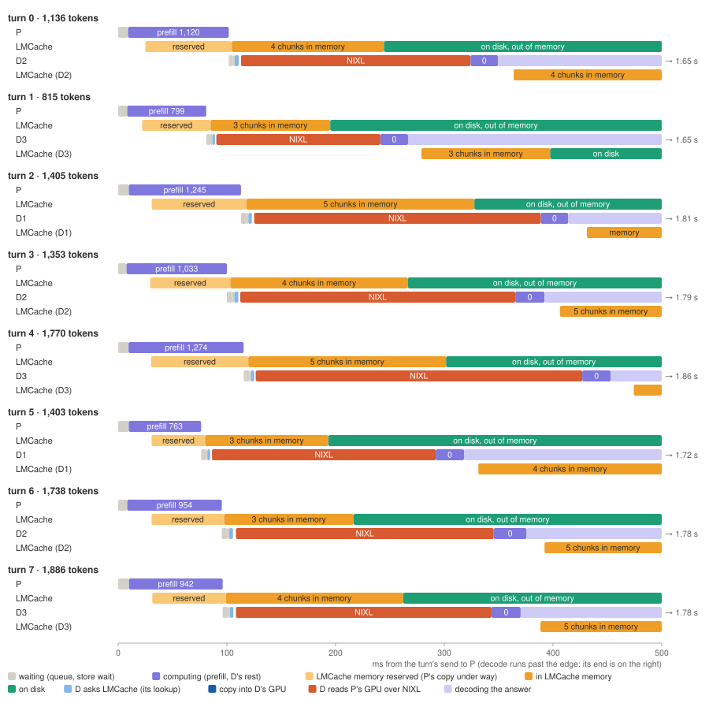

# Conversation 7: mt-rag-clapnq-elser-512-100-20240503 (disk mode, NIXL, per-engine servers, chat RAG, all passages)

P's KV reaches D over NIXL (D reads P's GPU blocks); every engine's LMCache connector stores beside it, to its own server. 8 turns on D1, D2, D3 (round-robin: each turn to the next D engine); prompts grow from 1,136 to 1,886 tokens (interleaved: each turn's prompt is the previous one, its answer, then this turn's documents and question). Chunks are 256 tokens (16 vLLM blocks of 16); a chunk's name is LMCache's hash of its tokens and everything before them, so the same prefix has the same chunks on every turn and engine.

Legend for the strips (one character a chunk): P: `=` on P's GPU from an earlier turn, `#` computed and stored now, `+` computed, not stored (a partial chunk). D: `=` on D's GPU from an earlier turn, `M` pulled from memory, `S` pulled from disk, `N` read from P's GPU over NIXL, `+` computed by D (a partial chunk), `?` missed.

GPU blocks (the chunk tables): where each engine keeps the chunk's 16 vLLM blocks in its GPU KV cache, by vLLM's block ids (vLLM's paged KV cache: a block, or page, holds 16 tokens; block 0 is its reserved null block), in the prompt's block order, a run of consecutive ids written as a range: `P 1, 138-152` is the prompt's block 0 in GPU block 1 and its blocks 1-15 in GPU blocks 138-152. An engine takes a GPU block from its free list when it first computes or loads a block, and the block keeps it while cached, so a later turn that reuses the block shows the same id. Blocks that are the same in several prompts (the same tokens and everything before them) share one GPU block once the first is cached: the system prompt's first block, the same in every conversation, is the usual one. `16/16 hashes = P's`: of the blocks D pulled, how many have the same vLLM hash on D as on P.

The prompts' text is the driver's own record of what it sent (answers included); lines over 100 characters are wrapped here for reading.

| turn | prompt | chunks + tail | P: own GPU / computed / stored | D: own GPU / loaded / computed | pulled | pull ms | D first token ms |
| ---: | ---: | --- | --- | --- | --- | ---: | ---: |
| [0](#turn-0) | 1,136 | 4 + 112 | 16 / 1,120 / 4 chunks | 16 / 1,120 / 0 | 5 chunks (NIXL 5) | 211.1 | 244.3 |
| [1](#turn-1) | 815 | 3 + 47 | 16 / 799 / 3 chunks | 16 / 799 / 0 | 4 chunks (NIXL 4) | 150.9 | 181.9 |
| [2](#turn-2) | 1,405 | 5 + 125 | 160 / 1,245 / 5 chunks | 16 / 1,389 / 0 | 6 chunks (NIXL 6) | 263.8 | 296.1 |
| [3](#turn-3) | 1,353 | 5 + 73 | 320 / 1,033 / 4 chunks | 16 / 1,337 / 0 | 6 chunks (NIXL 6) | 253.0 | 287.2 |
| [4](#turn-4) | 1,770 | 6 + 234 | 496 / 1,274 / 5 chunks | 160 / 1,610 / 0 | 7 chunks (NIXL 7) | 300.5 | 332.8 |
| [5](#turn-5) | 1,403 | 5 + 123 | 640 / 763 / 3 chunks | 320 / 1,083 / 0 | 5 chunks (NIXL 5) | 205.8 | 237.5 |
| [6](#turn-6) | 1,738 | 6 + 202 | 784 / 954 / 3 chunks | 496 / 1,242 / 0 | 6 chunks (NIXL 6) | 237.1 | 275.6 |
| [7](#turn-7) | 1,886 | 7 + 94 | 944 / 942 / 4 chunks | 640 / 1,246 / 0 | 6 chunks (NIXL 6) | 235.2 | 269.4 |

## How the prompt grows

Each turn's prompt is the previous one, token for token, and then: D's answer to the previous turn, this turn's documents, its question and the framing (the system prompt on turn 0, `Assistant:` and newlines). Only the new tokens can make new chunks: the previous prompt's partial chunk fills first. A document sent before comes again at another place, so in other chunks.

| turn | prompt | new | previous answer | documents | question | framing | whole chunks |
| ---: | ---: | ---: | ---: | --- | --- | ---: | --- |
| 0 | 1,136 | +1,136 | – | 5 docs, 1,094 | 12: which sport awards the oldest trophy in international sports | 30 | 4 (+4) |
| 1 | 815 | +-321 | – | 0 docs, 0 | 0 | 0 | 3 (+-1) |
| 2 | 1,405 | +590 | – | 3 docs, 544 | 39: Soccer is a very popular sport and watched by millions around the wor… | 2 | 5 (+2) |
| 3 | 1,353 | +-52 | – | 0 docs, 0 | 0 | 0 | 5 (+0) |
| 4 | 1,770 | +417 | – | 3 docs, 309 | 13: Do you think i can be a good soccer player? | 2 | 6 (+1) |
| 5 | 1,403 | +-367 | – | 0 docs, 0 | 0 | 0 | 5 (+-1) |
| 6 | 1,738 | +335 | – | 2 docs, 165 | 17: Are you saying that eat meat is not good for those play sports? | 2 | 6 (+1) |
| 7 | 1,886 | +148 | – | 1 doc, 116 | 22: You are right, a good diet is important for any person that wish to p… | 2 | 7 (+1) |

## Timeline

Every turn on one clock: ms from the moment the proxy sent the turn to P. P prefills it (one token out) and holds its blocks for D; the proxy sends the turn to the next D engine at once with P's reply's kv_transfer_params (no wait), D reads P's blocks over NIXL (orange-red), computes the rest and decodes the answer. Beside it every engine's LMCache connector stores its new whole chunks (P's lane, and D's own when it stored any). The lanes: P, LMCache (P's chunks), D, and LMCache (D's chunks).



| turn | P queued → done | P's chunks: in memory / on disk | D | D starts | NIXL read | D: held / from P / from LMCache / computed | D's chunks stored | first token | P freed | D done |
| ---: | --- | --- | --- | ---: | --- | --- | ---: | ---: | ---: | ---: |
| 0 | 9 → 102 | 4: 105 / 244 | D2 | 105 | 113-324 | 16 / 1,120 / 0 / 0 | 4 | 349 | 324 | 1,654 |
| 1 | 8 → 81 | 3: 85 / 195 | D3 | 85 | 90-241 | 16 / 799 / 0 / 0 | 3 | 267 | 242 | 1,646 |
| 2 | 10 → 113 | 5: 118 / 328 | D1 | 118 | 125-389 | 16 / 1,389 / 0 / 0 | 5 | 414 | 389 | 1,812 |
| 3 | 8 → 100 | 4: 103 / 267 | D2 | 105 | 112-365 | 16 / 1,337 / 0 / 0 | 5 | 392 | 365 | 1,788 |
| 4 | 10 → 116 | 5: 120 / 302 | D3 | 120 | 126-427 | 160 / 1,610 / 0 / 0 | 6 | 453 | 428 | 1,859 |
| 5 | 10 → 76 | 3: 80 / 193 | D1 | 81 | 86-292 | 320 / 1,083 / 0 / 0 | 4 | 318 | 292 | 1,716 |
| 6 | 8 → 95 | 3: 97 / 217 | D2 | 100 | 108-345 | 496 / 1,242 / 0 / 0 | 5 | 376 | 347 | 1,776 |
| 7 | 10 → 96 | 4: 99 / 262 | D3 | 101 | 108-343 | 640 / 1,246 / 0 / 0 | 5 | 370 | 345 | 1,778 |

All times in ms from the turn's send to P. NIXL read: D's worker posts the read of P's blocks to the KV in D's GPU blocks; P freed: D has read, P's blocks go back to its free queue (still cached). Each turn's section below tells it in a sentence and step by step.

### One chunk, block by block: chunk 1 of turn 0 (`ef22e6cab9b7e811`)

Tokens 256-512 (doc 804380142_446-: 57; doc 798029343_451-: 138; doc 864952571_2802: 61). P computed its blocks; D2 read them from P's GPU over NIXL, P's block into D's block, one for one:

| block | tokens | P's GPU block | vLLM hash on P | D's GPU block | same hash on D |
| ---: | --- | ---: | --- | ---: | --- |
| 16 | 256-272 | 2619 | `97249dcabf2c0f3f` | 1142 | True |
| 17 | 272-288 | 2620 | `4df4e0d02b68c371` | 1143 | True |
| 18 | 288-304 | 2621 | `0703a9955b521250` | 1144 | True |
| 19 | 304-320 | 2622 | `8bc652a7a6fec68d` | 1145 | True |
| 20 | 320-336 | 2623 | `fdaef33bf405b9d9` | 1146 | True |
| 21 | 336-352 | 2624 | `aa0dda001f67969a` | 1147 | True |
| 22 | 352-368 | 2625 | `641bf752403d7da3` | 1148 | True |
| 23 | 368-384 | 2626 | `59329f0563b38e60` | 1149 | True |
| 24 | 384-400 | 2627 | `02295926686de3ce` | 1150 | True |
| 25 | 400-416 | 2628 | `cd0eaa3ead0c0f9f` | 1151 | True |
| 26 | 416-432 | 2629 | `6c8ab163d416cdf0` | 1152 | True |
| 27 | 432-448 | 2630 | `009d28e9911a9105` | 1153 | True |
| 28 | 448-464 | 2631 | `6b925da88661249d` | 1154 | True |
| 29 | 464-480 | 2632 | `ad7d9394dd6c8e58` | 1155 | True |
| 30 | 480-496 | 2633 | `4f94cc142c2bd9ad` | 1156 | True |
| 31 | 496-512 | 2634 | `3236e13e3cc59174` | 1157 | True |

## Turn 0

**Timeline:** P queued until 9 ms, prefilled 1,120 tokens (held 16) and was done at 102 ms; its 4 new chunks were in LMCache's memory at 105 ms, on disk at 244 ms and out of memory. D2 started at 105 ms (no wait) holding 16 tokens, read 1,120 from P's GPU over NIXL (posted at 113 ms, in its GPU at 324 ms; P freed its blocks at 324 ms), computed 0 and gave its first token at 349 ms; it decoded 120 tokens until 1,654 ms; its LMCache connector stored 4 new chunks. ([all turns](#timeline))

### Step by step

Every move of this turn's KV, ms from the proxy sending the turn to P. P's KV reaches D over NIXL: D's worker reads P's GPU blocks into its own (a NIXL READ, P told when D is done); LMCache's copies (to and from each server's memory) its servers do themselves through CUDA IPC handles each engine registered at start.

| ms | where | what |
| ---: | --- | --- |
| 0.0 | proxy → P | sends the turn (1,136 prompt tokens; P is asked for one token: prefill only) |
| 2.9 | P | the request arrives |
| 8.8 | P GPU | its prefix cache holds 16 of the prompt's tokens: 1 block in GPU blocks 1 |
| 8.9 | P ↔ LMCache | LMCache has 0 of its tokens; P loads 0 and computes the rest |
| 9.1 | P GPU | 70 new GPU blocks for the 1,120 tokens it computes: 2604-2673; the prefill runs |
| 9.6 | P → LMCache | store planned: tokens 0-1,024, chunks 0-3 (64 blocks) |
| 24.2 | LMCache | the store request is in; it waits for P's forward pass to finish (a CUDA event) |
| 25.0 | LMCache memory | space reserved for 4 chunks (117 MB) |
| 97.9 | P GPU → LMCache memory | the copy starts: LMCache reads P's GPU blocks (CUDA IPC) |
| 98.0 | P GPU | the request is done: P holds its 71 blocks for D to read over NIXL, and its reply carries them (kv_transfer_params: the blocks, its NIXL agent) |
| 101.7 | P → proxy | P answers its one token: the prefill is done |
| 103.0 | P GPU → LMCache memory | copy done: 4 chunks, 117 MB in 5.1 ms |
| 104.6 | LMCache memory | 4 chunks in memory, kept for later requests (D gets this turn's KV from P over NIXL); P keeps its copy in its GPU blocks |
| 105.2 | proxy → D2 | sends the turn to D2 at once, with P's kv_transfer_params (round-robin; no wait) |
| 107.1 | D2 ↔ LMCache | asks LMCache for the prompt's chunks |
| 110.9 | LMCache memory | found 0 tokens it lacks |
| 112.2 | D2 GPU | its prefix cache holds 16 of the prompt's tokens: 1 block in GPU blocks 1 |
| 112.2 | D2 ↔ P (NIXL) | will read 1,120 prompt tokens from P's GPU (beyond the 16 its own cache holds) |
| 112.3 | D2 ↔ LMCache | LMCache has 0 of its tokens; NIXL loads it (MultiConnector: the first connector with tokens) |
| 112.5 | D2 GPU | 70 GPU blocks for the KV from P: 1127-1196 |
| 113.0 | P GPU → D2 GPU (NIXL) | D2 reads P's GPU blocks 1, 2604-2673 into its 1127-1196 (a NIXL READ) |
| 244.5 | LMCache disk | 4 chunks written to disk (one file each) |
| 245.1 | LMCache memory | 4 memory copies dropped: on disk only now |
| 324.1 | D2 | the KV from P is in its GPU blocks (1,120 tokens) |
| 324.5 | P GPU | D2 has read: P frees its blocks (they stay in its prefix cache) |
| 333.5 | D2 → LMCache | store planned: tokens 0-1,024; 4 chunks new to its server |
| 337.7 | D2 GPU | 1 new GPU block for the 1 prompt tokens it computes: 1197 |
| 349.4 | D2 → proxy | the first answer token |
| 363.8 | LMCache memory | 4 chunks from D2 in memory |
| 507.5 | LMCache disk | 4 chunks from D2 written to disk |
| 513.9 | D2 GPU | decoding: the answer's KV takes 7 new GPU blocks as it grows, one per 16 tokens: 1198-1204, until 1,566 ms |
| 1,653.5 | D2 | done: 120 tokens decoded; its blocks stay cached in its GPU for the next turn |
| 1,655.7 | proxy | the response is complete |

1,136 prompt tokens: 4 whole chunks and 112 tokens over (the partial chunk, computed by both engines and stored only when a later turn completes it). P held 16 tokens on its GPU, computed 1,120 and stored 4 new chunks; D2 held 16, read 1,120 from P over NIXL, loaded 0 from LMCache and computed 0.

### The prompt

The whole prompt, piece by piece:

- **system prompt** · tokens 0-28 (28) · chunk 0

```text
You are a helpful assistant. Answer the user's last question from the documents. If they do not hold
the answer, say so.
```

<details><summary>document <code>804380142_446-1836-0-1390</code> · tokens 28-313 (285) · chunks 0-1</summary>

```text
Document: Stanley Cup
Stanley Cup
The Stanley Cup ( French : La Coupe Stanley ) is the championship trophy awarded annually to the
National Hockey League ( NHL ) playoff winner . It is the oldest existing trophy to be awarded to a
professional sports franchise , and the International Ice Hockey Federation ( IIHF ) considers it to
be one of the `` most important championships available to the sport '' . Originally commissioned in
1892 as the Dominion Hockey Challenge Cup , the trophy is named after Lord Stanley of Preston , then
-- Governor General of Canada , who donated it as an award to Canada 's top - ranking amateur ice
hockey club , which the entire Stanley family supported , with the sons and daughters playing and
promoting the game . The first Cup was awarded in 1893 to Montreal HC , and subsequent winners from
1893 to 1914 were determined by challenge games and league play . Professional teams first became
eligible to challenge for the Stanley Cup in 1906 . In 1915 , the two professional ice hockey
organizations , the National Hockey Association ( NHA ) and the Pacific Coast Hockey Association (
PCHA ) , reached a gentlemen 's agreement in which their respective champions would face each other
annually for the Stanley Cup . After a series of league mergers and folds , it was established as
the de facto championship trophy of the NHL in 1926 and then the de jure NHL championship prize in
1947 .
```

</details>

<details><summary>document <code>798029343_451-1065-0-614</code> · tokens 313-451 (138) · chunk 1</summary>

```text
Document: America's Cup
America's Cup
The America 's Cup , affectionately known as the `` Auld Mug '' , is a trophy awarded to the winner
of the America 's Cup match races between two sailing yachts . One yacht , known as the defender ,
represents the yacht club that currently holds the America 's Cup and the second yacht , known as
the challenger , represents the yacht club that is challenging for the cup . The timing of each
match is determined by an agreement between the defender and the challenger . The America 's Cup is
the oldest international sporting trophy . It will next be raced for in the southern summer , in the
early part of 2021 .
```

</details>

<details><summary>document <code>864952571_28023-29282-0-1259</code> · tokens 451-707 (256) · chunks 1-2</summary>

```text
Document: Football
Football
One of the longest running football fixture is the Cordner - Eggleston Cup , contested between
Melbourne Grammar School and Scotch College , Melbourne every year since 1858 . It is believed by
many to also be the first match of Australian rules football , although it was played under
experimental rules in its first year . The first football trophy tournament was the Caledonian
Challenge Cup , donated by the Royal Caledonian Society of Melbourne , played in 1861 under the
Melbourne Rules . The oldest football league is a rugby football competition , the United Hospitals
Challenge Cup ( 1874 ) , while the oldest rugby trophy is the Yorkshire Cup , contested since 1878 .
The South Australian Football Association ( 30 April 1877 ) is the oldest surviving Australian rules
football competition . The oldest surviving soccer trophy is the Youdan Cup ( 1867 ) and the oldest
national football competition is the English FA Cup ( 1871 ) . The Football League ( 1888 ) is
recognised as the longest running Association Football league . The first ever international
football match took place between sides representing England and Scotland on March 5 , 1870 at the
Oval under the authority of the FA . The first Rugby international took place in 1871 . Modern
```

</details>

<details><summary>document <code>804380142_2872-4252-0-1380</code> · tokens 707-1003 (296) · chunks 2-3</summary>

```text
Document: Stanley Cup
Stanley Cup
Unlike the trophies awarded by the other major professional sports leagues of North America , a new
Stanley Cup is not made each year . Originally , the winners kept it until a new champion was
crowned . Currently , winning teams get the Stanley Cup during the summer and a limited number of
days during the season . It is unusual among trophies to include winning members ' names . Every
year since 1924 , a select portion of the winning players , coaches , management , and club staff
names are engraved on its bands . However , there is not enough room to include all the players and
non-players , so some names must be omitted . Initially a new band added each year , though this
caused the trophy to grow in size , earning the nickname `` Stovepipe Cup '' . In 1958 the modern
one - piece Cup was designed with a five - band barrel which could contain 13 winning teams per band
. To prevent the Stanley Cup from growing , when the bottom band is full , the oldest band is
removed and preserved in the Hockey Hall of Fame , and a new blank band added to the bottom . It has
been referred to as The Cup , Lord Stanley 's Cup , The Holy Grail , or facetiously ( chiefly by
sportswriters ) as Lord Stanley 's Mug . The Stanley Cup is surrounded by numerous legends and
traditions , the oldest of which is the celebratory drinking of champagne out of the cup by the
winning team .
```

</details>

<details><summary>document <code>865335038_17091-17557-0-466</code> · tokens 1003-1122 (119) · chunks 3-4</summary>

```text
Document: FIFA World Cup
FIFA World Cup
From 1930 to 1970 , the Jules Rimet Trophy was awarded to the World Cup winning team . It was
originally simply known as the World Cup or Coupe du Monde , but in 1946 it was renamed after the
FIFA president Jules Rimet who set up the first tournament . In 1970 , Brazil 's third victory in
the tournament entitled them to keep the trophy permanently . However , the trophy was stolen in
1983 and has never been recovered , apparently melted down by the thieves . The
```

</details>

- **question 0** · tokens 1122-1134 (12) · chunk 4

```text
User: which sport awards the oldest trophy in international sports
```

- `Assistant:` · tokens 1134-1136 (2) · chunk 4

### Pieces, chunks and blocks

| piece | tokens | length | chunks | |
| --- | --- | ---: | --- | --- |
| system | 0-28 | 28 | 0 |  |
| doc 804380142_446- | 28-313 | 285 | 0-1 |  |
| doc 798029343_451- | 313-451 | 138 | 1 |  |
| doc 864952571_2802 | 451-707 | 256 | 1-2 |  |
| doc 804380142_2872 | 707-1003 | 296 | 2-3 |  |
| doc 865335038_1709 | 1003-1122 | 119 | 3-4 |  |
| question 0 | 1122-1134 | 12 | 4 |  |
| `assistant:` 0 | 1134-1136 | 2 | 4 |  |

```
P  ####+
D  NNNNN
```

| chunk | tokens | pieces in it (tokens) | vLLM blocks | GPU blocks | in LMCache | P this turn | D this turn |
| ---: | --- | --- | --- | --- | --- | --- | --- |
| 0 | 0-256 | system: 28; doc 804380142_446-: 228 | 0-15 | P 1, 2604-2618; D 1, 1127-1141; 15/15 hashes = P's | `164bd412948ba57b`: LMC_P: stored on turn 0 by P, on disk, out of memory; LMC_D2: stored on turn 0 by D2, on disk, out of memory | computed (its first 16 tokens on P's GPU already), **stored now** | **read from P's GPU over NIXL** (its first 16 tokens on D's GPU already) |
| 1 | 256-512 | doc 804380142_446-: 57; doc 798029343_451-: 138; doc 864952571_2802: 61 | 16-31 | P 2619-2634; D 1142-1157; 16/16 hashes = P's | `ef22e6cab9b7e811`: LMC_P: stored on turn 0 by P, on disk, out of memory; LMC_D2: stored on turn 0 by D2, on disk, out of memory | computed, **stored now** | **read from P's GPU over NIXL** |
| 2 | 512-768 | doc 864952571_2802: 195; doc 804380142_2872: 61 | 32-47 | P 2635-2650; D 1158-1173; 16/16 hashes = P's | `d427da0baf6ce07c`: LMC_P: stored on turn 0 by P, on disk, out of memory; LMC_D2: stored on turn 0 by D2, on disk, out of memory | computed, **stored now** | **read from P's GPU over NIXL** |
| 3 | 768-1024 | doc 804380142_2872: 235; doc 865335038_1709: 21 | 48-63 | P 2651-2666; D 1174-1189; 16/16 hashes = P's | `a1d86ca2bbc3e7cb`: LMC_P: stored on turn 0 by P, on disk, out of memory; LMC_D2: stored on turn 0 by D2, on disk, out of memory | computed, **stored now** | **read from P's GPU over NIXL** |
| 4 | 1024-1136 | doc 865335038_1709: 98; question 0: 12; `assistant:` 0: 2 | 64-70 | P 2667-2673; D 1190-1196; 7/7 hashes = P's | – | computed (partial chunk: not stored) | **read from P's GPU over NIXL** (partial chunk) |

## Turn 1

**Timeline:** P queued until 8 ms, prefilled 799 tokens (held 16) and was done at 81 ms; its 3 new chunks were in LMCache's memory at 85 ms, on disk at 195 ms and out of memory. D3 started at 85 ms (no wait) holding 16 tokens, read 799 from P's GPU over NIXL (posted at 90 ms, in its GPU at 241 ms; P freed its blocks at 242 ms), computed 0 and gave its first token at 267 ms; it decoded 128 tokens until 1,646 ms; its LMCache connector stored 3 new chunks. ([all turns](#timeline))

### Step by step

Every move of this turn's KV, ms from the proxy sending the turn to P. P's KV reaches D over NIXL: D's worker reads P's GPU blocks into its own (a NIXL READ, P told when D is done); LMCache's copies (to and from each server's memory) its servers do themselves through CUDA IPC handles each engine registered at start.

| ms | where | what |
| ---: | --- | --- |
| 0.0 | proxy → P | sends the turn (815 prompt tokens; P is asked for one token: prefill only) |
| 3.2 | P | the request arrives |
| 8.1 | P GPU | its prefix cache holds 16 of the prompt's tokens: 1 block in GPU blocks 1 |
| 8.2 | P ↔ LMCache | LMCache has 0 of its tokens; P loads 0 and computes the rest |
| 8.3 | P GPU | 50 new GPU blocks for the 799 tokens it computes: 2674-2723; the prefill runs |
| 8.5 | P → LMCache | store planned: tokens 0-768, chunks 0-2 (48 blocks) |
| 20.1 | LMCache | the store request is in; it waits for P's forward pass to finish (a CUDA event) |
| 22.0 | LMCache memory | space reserved for 3 chunks (88 MB) |
| 77.7 | P GPU → LMCache memory | the copy starts: LMCache reads P's GPU blocks (CUDA IPC) |
| 77.8 | P GPU | the request is done: P holds its 51 blocks for D to read over NIXL, and its reply carries them (kv_transfer_params: the blocks, its NIXL agent) |
| 81.0 | P → proxy | P answers its one token: the prefill is done |
| 81.6 | P GPU → LMCache memory | copy done: 3 chunks, 88 MB in 3.9 ms |
| 84.8 | proxy → D3 | sends the turn to D3 at once, with P's kv_transfer_params (round-robin; no wait) |
| 85.0 | LMCache memory | 3 chunks in memory, kept for later requests (D gets this turn's KV from P over NIXL); P keeps its copy in its GPU blocks |
| 86.7 | D3 ↔ LMCache | asks LMCache for the prompt's chunks |
| 89.1 | LMCache memory | found 0 tokens it lacks |
| 89.6 | D3 GPU | its prefix cache holds 16 of the prompt's tokens: 1 block in GPU blocks 1 |
| 89.6 | D3 ↔ P (NIXL) | will read 799 prompt tokens from P's GPU (beyond the 16 its own cache holds) |
| 89.7 | D3 ↔ LMCache | LMCache has 0 of its tokens; NIXL loads it (MultiConnector: the first connector with tokens) |
| 89.9 | D3 GPU | 50 GPU blocks for the KV from P: 1158-1207 |
| 90.3 | P GPU → D3 GPU (NIXL) | D3 reads P's GPU blocks 1, 2674-2723 into its 1158-1207 (a NIXL READ) |
| 195.1 | LMCache disk | 3 chunks written to disk (one file each) |
| 195.6 | LMCache memory | 3 memory copies dropped: on disk only now |
| 241.2 | D3 | the KV from P is in its GPU blocks (799 tokens) |
| 242.0 | P GPU | D3 has read: P frees its blocks (they stay in its prefix cache) |
| 249.7 | D3 → LMCache | store planned: tokens 0-768; 3 chunks new to its server |
| 263.5 | D3 GPU | 1 new GPU block for the 1 prompt tokens it computes: 1208 |
| 266.6 | D3 → proxy | the first answer token |
| 278.9 | LMCache memory | 3 chunks from D3 in memory |
| 397.5 | LMCache disk | 3 chunks from D3 written to disk |
| 438.6 | D3 GPU | decoding: the answer's KV takes 7 new GPU blocks as it grows, one per 16 tokens: 1209-1215, until 1,483 ms |
| 1,645.9 | D3 | done: 128 tokens decoded; its blocks stay cached in its GPU for the next turn |
| 1,647.1 | proxy | the response is complete |

815 prompt tokens: 3 whole chunks and 47 tokens over (the partial chunk, computed by both engines and stored only when a later turn completes it). P held 16 tokens on its GPU, computed 799 and stored 3 new chunks; D3 held 16, read 799 from P over NIXL, loaded 0 from LMCache and computed 0.

### The prompt

Tokens 0-1,136: [turn 0](#turn-0)'s prompt, unchanged (NOT the previous prompt's ids), so chunks 0-3 are the same chunks; chunk 4 (partial then, 112 tokens) fills now. New from token 1,136:

### Pieces, chunks and blocks

| piece | tokens | length | chunks | |
| --- | --- | ---: | --- | --- |
| system | 0-28 | 28 | 0 |  |
| question 0 | 28-40 | 12 | 0 |  |
| `assistant:` 0 | 40-42 | 2 | 0 |  |
| answer 0 | 42-162 | 120 | 0 |  |
| newline 0 | 162-163 | 1 | 0 |  |
| doc 864996542_1179 | 163-280 | 117 | 0-1 |  |
| doc 803807172_2995 | 280-346 | 66 | 1 |  |
| doc 796369617_6680 | 346-466 | 120 | 1 |  |
| doc 796369617_3120 | 466-667 | 201 | 1-2 |  |
| doc 864952571_3337 | 667-779 | 112 | 2-3 |  |
| question 1 | 779-813 | 34 | 3 |  |
| `assistant:` 1 | 813-815 | 2 | 3 |  |

```
P  ###+
D  NNNN
```

| chunk | tokens | pieces in it (tokens) | vLLM blocks | GPU blocks | in LMCache | P this turn | D this turn |
| ---: | --- | --- | --- | --- | --- | --- | --- |
| 0 | 0-256 | system: 28; question 0: 12; `assistant:` 0: 2; answer 0: 120; newline 0: 1; doc 864996542_1179: 93 | 0-15 | P 1, 2674-2688; D 1, 1158-1172; 15/15 hashes = P's | `5a9fe0ac9edd6917`: LMC_P: stored on turn 1 by P, on disk, out of memory; LMC_D3: stored on turn 1 by D3, on disk, out of memory | computed (its first 16 tokens on P's GPU already), **stored now** | **read from P's GPU over NIXL** (its first 16 tokens on D's GPU already) |
| 1 | 256-512 | doc 864996542_1179: 24; doc 803807172_2995: 66; doc 796369617_6680: 120; doc 796369617_3120: 46 | 16-31 | P 2689-2704; D 1173-1188; 16/16 hashes = P's | `2e79fc80330c3da5`: LMC_P: stored on turn 1 by P, on disk, out of memory; LMC_D3: stored on turn 1 by D3, on disk, out of memory | computed, **stored now** | **read from P's GPU over NIXL** |
| 2 | 512-768 | doc 796369617_3120: 155; doc 864952571_3337: 101 | 32-47 | P 2705-2720; D 1189-1204; 16/16 hashes = P's | `50c8c309831caf22`: LMC_P: stored on turn 1 by P, on disk, out of memory; LMC_D3: stored on turn 1 by D3, on disk, out of memory | computed, **stored now** | **read from P's GPU over NIXL** |
| 3 | 768-815 | doc 864952571_3337: 11; question 1: 34; `assistant:` 1: 2 | 48-50 | P 2721-2722; D 1205-1207; 2/2 hashes = P's | – | computed (partial chunk: not stored) | **read from P's GPU over NIXL** (partial chunk) |

## Turn 2

**Timeline:** P queued until 10 ms, prefilled 1,245 tokens (held 160) and was done at 113 ms; its 5 new chunks were in LMCache's memory at 118 ms, on disk at 328 ms and out of memory. D1 started at 118 ms (no wait) holding 16 tokens, read 1,389 from P's GPU over NIXL (posted at 125 ms, in its GPU at 389 ms; P freed its blocks at 389 ms), computed 0 and gave its first token at 414 ms; it decoded 128 tokens until 1,812 ms; its LMCache connector stored 5 new chunks. ([all turns](#timeline))

### Step by step

Every move of this turn's KV, ms from the proxy sending the turn to P. P's KV reaches D over NIXL: D's worker reads P's GPU blocks into its own (a NIXL READ, P told when D is done); LMCache's copies (to and from each server's memory) its servers do themselves through CUDA IPC handles each engine registered at start.

| ms | where | what |
| ---: | --- | --- |
| 0.0 | proxy → P | sends the turn (1,405 prompt tokens; P is asked for one token: prefill only) |
| 3.0 | P | the request arrives |
| 9.5 | P GPU | its prefix cache holds 160 of the prompt's tokens: 10 blocks in GPU blocks 1, 2674-2682 |
| 9.6 | P ↔ LMCache | LMCache has 0 of its tokens; P loads 0 and computes the rest |
| 9.8 | P GPU | 78 new GPU blocks for the 1,245 tokens it computes: 2723-2800; the prefill runs |
| 10.4 | P → LMCache | store planned: tokens 0-1,280, chunks 0-4 (80 blocks) |
| 30.2 | LMCache | the store request is in; it waits for P's forward pass to finish (a CUDA event) |
| 30.9 | LMCache memory | space reserved for 5 chunks (147 MB) |
| 108.7 | P GPU → LMCache memory | the copy starts: LMCache reads P's GPU blocks (CUDA IPC) |
| 108.8 | P GPU | the request is done: P holds its 88 blocks for D to read over NIXL, and its reply carries them (kv_transfer_params: the blocks, its NIXL agent) |
| 113.0 | P → proxy | P answers its one token: the prefill is done |
| 115.0 | P GPU → LMCache memory | copy done: 5 chunks, 147 MB in 6.4 ms |
| 117.9 | proxy → D1 | sends the turn to D1 at once, with P's kv_transfer_params (round-robin; no wait) |
| 117.9 | LMCache memory | 5 chunks in memory, kept for later requests (D gets this turn's KV from P over NIXL); P keeps its copy in its GPU blocks |
| 119.8 | D1 ↔ LMCache | asks LMCache for the prompt's chunks |
| 123.0 | LMCache memory | found 0 tokens it lacks |
| 124.3 | D1 GPU | its prefix cache holds 16 of the prompt's tokens: 1 block in GPU blocks 1 |
| 124.4 | D1 ↔ P (NIXL) | will read 1,389 prompt tokens from P's GPU (beyond the 16 its own cache holds) |
| 124.4 | D1 ↔ LMCache | LMCache has 0 of its tokens; NIXL loads it (MultiConnector: the first connector with tokens) |
| 124.6 | D1 GPU | 87 GPU blocks for the KV from P: 1211-1297 |
| 125.1 | P GPU → D1 GPU (NIXL) | D1 reads P's GPU blocks 1, 2674-2682, 2723-2800 into its 1211-1297 (a NIXL READ) |
| 327.7 | LMCache disk | 5 chunks written to disk (one file each) |
| 328.4 | LMCache memory | 5 memory copies dropped: on disk only now |
| 388.8 | D1 | the KV from P is in its GPU blocks (1,389 tokens) |
| 389.2 | P GPU | D1 has read: P frees its blocks (they stay in its prefix cache) |
| 398.3 | D1 → LMCache | store planned: tokens 0-1,280; 5 chunks new to its server |
| 414.0 | D1 → proxy | the first answer token |
| 431.1 | LMCache memory | 5 chunks from D1 in memory |
| 435.8 | D1 GPU | 1 new GPU block for the 1 prompt tokens it computes: 1298 |
| 611.9 | D1 GPU | decoding: the answer's KV takes 7 new GPU blocks as it grows, one per 16 tokens: 1299-1305, until 1,669 ms |
| 635.8 | LMCache disk | 5 chunks from D1 written to disk |
| 1,811.9 | D1 | done: 128 tokens decoded; its blocks stay cached in its GPU for the next turn |
| 1,813.0 | proxy | the response is complete |

1,405 prompt tokens: 5 whole chunks and 125 tokens over (the partial chunk, computed by both engines and stored only when a later turn completes it). P held 160 tokens on its GPU, computed 1,245 and stored 5 new chunks; D1 held 16, read 1,389 from P over NIXL, loaded 0 from LMCache and computed 0.

### The prompt

Tokens 0-815: [turn 1](#turn-1)'s prompt, unchanged (NOT the previous prompt's ids), so chunks 0-2 are the same chunks; chunk 3 (partial then, 47 tokens) fills now. New from token 815:

<details><summary>document <code>864952571_491-1122-0-631</code> · tokens 820-939 (119) · chunk 3</summary>

```text
Document: Football
Football
Football is a family of team sports that involve , to varying degrees , kicking a ball to score a
goal . Unqualified , the word football is understood to refer to whichever form of football is the
most popular in the regional context in which the word appears . Sports commonly called football in
certain places include association football ( known as soccer in some countries ) ; gridiron
football ( specifically American football or Canadian football ) ; Australian rules football ; rugby
football ( either rugby league or rugby union ) ; and Gaelic football . These different variations
of football are known as football codes .
```

</details>

<details><summary>document <code>808419312_2507-3040-0-533</code> · tokens 939-1053 (114) · chunks 3-4</summary>

```text
Document: Comparison of American football and rugby league
Comparison of American football and rugby league
Both sports descend from the older game of rugby football in the 19th Century when its two offshoots
developed . British colonists and the British military in Canada brought football to North America .
It became popular in American and Canadian universities and prep schools . At the time , association
football and rugby football were not as differentiated as they are now and teams would negotiate the
rules before playing each game . The sports of American football and Canadian football evolved from
these intercollegiate games .
```

</details>

<details><summary>document <code>808419312_762-2313-0-1551</code> · tokens 1053-1364 (311) · chunks 4-5</summary>

```text
Document: Comparison of American football and rugby league
Comparison of American football and rugby league
Generally , American football games last much longer than 80 - minute rugby league matches . Because
the field is reset after each tackle in American football , it is much slower - paced than the more
hectic rugby league , in which play stops for only as long as it takes the tackled player to get
back to his feet and return the ball to play . Another major difference is that only the player with
possession of the ball may be interfered with in rugby league ; defending players interfering with
any other attacking player ( and vice versa ) will incur a penalty . Passing in the two sports also
differs : while backward passing is common to both sports , in American football players are allowed
to throw the ball forward in certain situations whereas in rugby league forward passing is always
illegal . Rugby league players have to kick the ball or run it forward to advance it downfield . To
score a try or touchdown in rugby league , the player has to push the ball directly onto the ground
once in the try zone , whereas in American football the player has to simply cross the line .
American football also requires its players to use a large amount of protective equipment ,
including helmets , gloves and padding around the body , whereas protective clothing is much more
minimal in rugby league , usually amounting to light padding ( if any ) and soft head gear ( hard
helmets being illegal ) . The major difference between rugby league and American Football ( Gridiron
) is rugby fields are 100 metres where American football is 100 yards .
```

</details>

- **question 2** · tokens 1364-1403 (39) · chunk 5

```text
User: Soccer is a very popular sport and watched by millions around the world. What is the
difference between soccer and american football that is also very popular and viewed  by thousands
around the world?
```

- `Assistant:` · tokens 1403-1405 (2) · chunk 5

### Pieces, chunks and blocks

| piece | tokens | length | chunks | |
| --- | --- | ---: | --- | --- |
| system | 0-28 | 28 | 0 |  |
| question 0 | 28-40 | 12 | 0 |  |
| `assistant:` 0 | 40-42 | 2 | 0 |  |
| answer 0 | 42-162 | 120 | 0 |  |
| newline 0 | 162-163 | 1 | 0 |  |
| question 1 | 163-197 | 34 | 0 |  |
| `assistant:` 1 | 197-199 | 2 | 0 |  |
| answer 1 | 199-327 | 128 | 0-1 |  |
| newline 1 | 327-328 | 1 | 1 |  |
| doc 856059988_1043 | 328-535 | 207 | 1-2 |  |
| doc 864952571_3921 | 535-672 | 137 | 2 |  |
| doc 856059988_5524 | 672-740 | 68 | 2 |  |
| doc 808419312_394- | 740-820 | 80 | 2-3 |  |
| doc 864952571_491- | 820-939 | 119 | 3 | new this turn |
| doc 808419312_2507 | 939-1053 | 114 | 3-4 | new this turn |
| doc 808419312_762- | 1053-1364 | 311 | 4-5 | new this turn |
| question 2 | 1364-1403 | 39 | 5 | new this turn |
| `assistant:` 2 | 1403-1405 | 2 | 5 | new this turn |

```
P  #####+
D  NNNNNN
```

| chunk | tokens | pieces in it (tokens) | vLLM blocks | GPU blocks | in LMCache | P this turn | D this turn |
| ---: | --- | --- | --- | --- | --- | --- | --- |
| 0 | 0-256 | system: 28; question 0: 12; `assistant:` 0: 2; answer 0: 120; newline 0: 1; question 1: 34; `assistant:` 1: 2; answer 1: 57 | 0-15 | P 1, 2674-2682, 2723-2728; D 1, 1211-1225; 6/6 hashes = P's | `701fe2643a33193d`: LMC_P: stored on turn 2 by P, on disk, out of memory; LMC_D1: stored on turn 2 by D1, on disk, out of memory; LMC_D2: stored on turn 3 by D2, on disk, out of memory; LMC_D3: stored on turn 4 by D3, on disk, out of memory | computed (its first 160 tokens on P's GPU already), **stored now** | **read from P's GPU over NIXL** (its first 16 tokens on D's GPU already) |
| 1 | 256-512 | answer 1: 71; newline 1: 1; doc 856059988_1043: 184 | 16-31 | P 2729-2744; D 1226-1241; 16/16 hashes = P's | `73b4dbf6da3a104f`: LMC_P: stored on turn 2 by P, on disk, out of memory; LMC_D1: stored on turn 2 by D1, on disk, out of memory | computed, **stored now** | **read from P's GPU over NIXL** |
| 2 | 512-768 | doc 856059988_1043: 23; doc 864952571_3921: 137; doc 856059988_5524: 68; doc 808419312_394-: 28 | 32-47 | P 2745-2760; D 1242-1257; 16/16 hashes = P's | `9dc5db2c338d5846`: LMC_P: stored on turn 2 by P, on disk, out of memory; LMC_D1: stored on turn 2 by D1, on disk, out of memory | computed, **stored now** | **read from P's GPU over NIXL** |
| 3 | 768-1024 | doc 808419312_394-: 52; doc 864952571_491- (new): 119; doc 808419312_2507 (new): 85 | 48-63 | P 2761-2776; D 1258-1273; 16/16 hashes = P's | `3d3db4de3cb302b7`: LMC_P: stored on turn 2 by P, on disk, out of memory; LMC_D1: stored on turn 2 by D1, on disk, out of memory | computed, **stored now** | **read from P's GPU over NIXL** |
| 4 | 1024-1280 | doc 808419312_2507 (new): 29; doc 808419312_762- (new): 227 | 64-79 | P 2777-2792; D 1274-1289; 16/16 hashes = P's | `ed421f578d992700`: LMC_P: stored on turn 2 by P, on disk, out of memory; LMC_D1: stored on turn 2 by D1, on disk, out of memory | computed, **stored now** | **read from P's GPU over NIXL** |
| 5 | 1280-1405 | doc 808419312_762- (new): 84; question 2 (new): 39; `assistant:` 2 (new): 2 | 80-87 | P 2793-2799; D 1290-1297; 7/7 hashes = P's | – | computed (partial chunk: not stored) | **read from P's GPU over NIXL** (partial chunk) |

## Turn 3

**Timeline:** P queued until 8 ms, prefilled 1,033 tokens (held 320) and was done at 100 ms; its 4 new chunks were in LMCache's memory at 103 ms, on disk at 267 ms and out of memory. D2 started at 105 ms (no wait) holding 16 tokens, read 1,337 from P's GPU over NIXL (posted at 112 ms, in its GPU at 365 ms; P freed its blocks at 365 ms), computed 0 and gave its first token at 392 ms; it decoded 128 tokens until 1,788 ms; its LMCache connector stored 5 new chunks. ([all turns](#timeline))

### Step by step

Every move of this turn's KV, ms from the proxy sending the turn to P. P's KV reaches D over NIXL: D's worker reads P's GPU blocks into its own (a NIXL READ, P told when D is done); LMCache's copies (to and from each server's memory) its servers do themselves through CUDA IPC handles each engine registered at start.

| ms | where | what |
| ---: | --- | --- |
| 0.0 | proxy → P | sends the turn (1,353 prompt tokens; P is asked for one token: prefill only) |
| 3.0 | P | the request arrives |
| 7.4 | P GPU | its prefix cache holds 320 of the prompt's tokens: 20 blocks in GPU blocks 1, 2674-2682, 2723-2732 |
| 7.5 | P ↔ LMCache | LMCache has 256 of its tokens; P loads 0 and computes the rest |
| 7.7 | P GPU | 65 new GPU blocks for the 1,033 tokens it computes: 2800-2864; the prefill runs |
| 8.2 | P → LMCache | store planned: tokens 256-1,280, chunks 1-4 (64 blocks) |
| 28.8 | LMCache | the store request is in; it waits for P's forward pass to finish (a CUDA event) |
| 29.4 | LMCache memory | space reserved for 4 chunks (117 MB) |
| 96.0 | P GPU → LMCache memory | the copy starts: LMCache reads P's GPU blocks (CUDA IPC) |
| 96.2 | P GPU | the request is done: P holds its 85 blocks for D to read over NIXL, and its reply carries them (kv_transfer_params: the blocks, its NIXL agent) |
| 100.0 | P → proxy | P answers its one token: the prefill is done |
| 101.1 | P GPU → LMCache memory | copy done: 4 chunks, 117 MB in 5.1 ms |
| 103.1 | LMCache memory | 4 chunks in memory, kept for later requests (D gets this turn's KV from P over NIXL); P keeps its copy in its GPU blocks |
| 104.9 | proxy → D2 | sends the turn to D2 at once, with P's kv_transfer_params (round-robin; no wait) |
| 106.9 | D2 ↔ LMCache | asks LMCache for the prompt's chunks |
| 110.5 | LMCache memory | found 0 tokens it lacks |
| 111.4 | D2 GPU | its prefix cache holds 16 of the prompt's tokens: 1 block in GPU blocks 1 |
| 111.5 | D2 ↔ P (NIXL) | will read 1,337 prompt tokens from P's GPU (beyond the 16 its own cache holds) |
| 111.6 | D2 ↔ LMCache | LMCache has 0 of its tokens; NIXL loads it (MultiConnector: the first connector with tokens) |
| 111.8 | D2 GPU | 84 GPU blocks for the KV from P: 1204-1287 |
| 112.3 | P GPU → D2 GPU (NIXL) | D2 reads P's GPU blocks 1 … 2800-2864 (85 blocks) into its 1204-1287 (a NIXL READ) |
| 266.6 | LMCache disk | 4 chunks written to disk (one file each) |
| 267.2 | LMCache memory | 4 memory copies dropped: on disk only now |
| 365.3 | D2 | the KV from P is in its GPU blocks (1,337 tokens) |
| 365.4 | P GPU | D2 has read: P frees its blocks (they stay in its prefix cache) |
| 375.5 | D2 → LMCache | store planned: tokens 0-1,280; 5 chunks new to its server |
| 392.1 | D2 → proxy | the first answer token |
| 406.4 | LMCache memory | 5 chunks from D2 in memory |
| 458.1 | D2 GPU | 1 new GPU block for the 1 prompt tokens it computes: 1288 |
| 619.7 | LMCache disk | 5 chunks from D2 written to disk |
| 633.7 | D2 GPU | decoding: the answer's KV takes 7 new GPU blocks as it grows, one per 16 tokens: 1289-1295, until 1,689 ms |
| 1,787.7 | D2 | done: 128 tokens decoded; its blocks stay cached in its GPU for the next turn |
| 1,788.9 | proxy | the response is complete |

1,353 prompt tokens: 5 whole chunks and 73 tokens over (the partial chunk, computed by both engines and stored only when a later turn completes it). P held 320 tokens on its GPU, computed 1,033 and stored 4 new chunks; D2 held 16, read 1,337 from P over NIXL, loaded 0 from LMCache and computed 0.

### The prompt

Tokens 0-1,405: [turn 2](#turn-2)'s prompt, unchanged (NOT the previous prompt's ids), so chunks 0-4 are the same chunks; chunk 5 (partial then, 125 tokens) fills now. New from token 1,405:

### Pieces, chunks and blocks

| piece | tokens | length | chunks | |
| --- | --- | ---: | --- | --- |
| system | 0-28 | 28 | 0 |  |
| question 0 | 28-40 | 12 | 0 |  |
| `assistant:` 0 | 40-42 | 2 | 0 |  |
| answer 0 | 42-162 | 120 | 0 |  |
| newline 0 | 162-163 | 1 | 0 |  |
| question 1 | 163-197 | 34 | 0 |  |
| `assistant:` 1 | 197-199 | 2 | 0 |  |
| answer 1 | 199-327 | 128 | 0-1 |  |
| newline 1 | 327-328 | 1 | 1 |  |
| question 2 | 328-367 | 39 | 1 |  |
| `assistant:` 2 | 367-369 | 2 | 1 |  |
| answer 2 | 369-497 | 128 | 1 |  |
| newline 2 | 497-498 | 1 | 1 |  |
| doc 850509972_112- | 498-565 | 67 | 1-2 |  |
| doc 850509972_1631 | 565-729 | 164 | 2 |  |
| doc 850509972_2307 | 729-832 | 103 | 2-3 |  |
| doc 821328353_6461 | 832-974 | 142 | 3 |  |
| doc 850509972_1400 | 974-1190 | 216 | 3-4 |  |
| doc 804941361_9523 | 1190-1261 | 71 | 4 |  |
| doc 850509972_7888 | 1261-1334 | 73 | 4-5 |  |
| question 3 | 1334-1351 | 17 | 5 |  |
| `assistant:` 3 | 1351-1353 | 2 | 5 |  |

```
P  =####+
D  NNNNNN
```

| chunk | tokens | pieces in it (tokens) | vLLM blocks | GPU blocks | in LMCache | P this turn | D this turn |
| ---: | --- | --- | --- | --- | --- | --- | --- |
| 0 | 0-256 | system: 28; question 0: 12; `assistant:` 0: 2; answer 0: 120; newline 0: 1; question 1: 34; `assistant:` 1: 2; answer 1: 57 | 0-15 | P 1, 2674-2682, 2723-2728; D 1, 1204-1218 | `701fe2643a33193d`: LMC_P: stored on turn 2 by P, on disk, out of memory; LMC_D1: stored on turn 2 by D1, on disk, out of memory; LMC_D2: stored on turn 3 by D2, on disk, out of memory; LMC_D3: stored on turn 4 by D3, on disk, out of memory | on P's GPU (earlier turn) | **read from P's GPU over NIXL** (its first 16 tokens on D's GPU already) |
| 1 | 256-512 | answer 1: 71; newline 1: 1; question 2: 39; `assistant:` 2: 2; answer 2: 128; newline 2: 1; doc 850509972_112-: 14 | 16-31 | P 2729-2732, 2800-2811; D 1219-1234; 12/12 hashes = P's | `96612a6b791ae3ca`: LMC_P: stored on turn 3 by P, on disk, out of memory; LMC_D2: stored on turn 3 by D2, on disk, out of memory | computed (its first 64 tokens on P's GPU already), **stored now** | **read from P's GPU over NIXL** |
| 2 | 512-768 | doc 850509972_112-: 53; doc 850509972_1631: 164; doc 850509972_2307: 39 | 32-47 | P 2812-2827; D 1235-1250; 16/16 hashes = P's | `18260ff2422fb2b8`: LMC_P: stored on turn 3 by P, on disk, out of memory; LMC_D2: stored on turn 3 by D2, on disk, out of memory | computed, **stored now** | **read from P's GPU over NIXL** |
| 3 | 768-1024 | doc 850509972_2307: 64; doc 821328353_6461: 142; doc 850509972_1400: 50 | 48-63 | P 2828-2843; D 1251-1266; 16/16 hashes = P's | `b6f9444d61639868`: LMC_P: stored on turn 3 by P, on disk, out of memory; LMC_D2: stored on turn 3 by D2, on disk, out of memory | computed, **stored now** | **read from P's GPU over NIXL** |
| 4 | 1024-1280 | doc 850509972_1400: 166; doc 804941361_9523: 71; doc 850509972_7888: 19 | 64-79 | P 2844-2859; D 1267-1282; 16/16 hashes = P's | `6edd2f46fd8f4de8`: LMC_P: stored on turn 3 by P, on disk, out of memory; LMC_D2: stored on turn 3 by D2, on disk, out of memory | computed, **stored now** | **read from P's GPU over NIXL** |
| 5 | 1280-1353 | doc 850509972_7888: 54; question 3: 17; `assistant:` 3: 2 | 80-84 | P 2860-2863; D 1283-1287; 4/4 hashes = P's | – | computed (partial chunk: not stored) | **read from P's GPU over NIXL** (partial chunk) |

## Turn 4

**Timeline:** P queued until 10 ms, prefilled 1,274 tokens (held 496) and was done at 116 ms; its 5 new chunks were in LMCache's memory at 120 ms, on disk at 302 ms and out of memory. D3 started at 120 ms (no wait) holding 160 tokens, read 1,610 from P's GPU over NIXL (posted at 126 ms, in its GPU at 427 ms; P freed its blocks at 428 ms), computed 0 and gave its first token at 453 ms; it decoded 128 tokens until 1,859 ms; its LMCache connector stored 6 new chunks. ([all turns](#timeline))

### Step by step

Every move of this turn's KV, ms from the proxy sending the turn to P. P's KV reaches D over NIXL: D's worker reads P's GPU blocks into its own (a NIXL READ, P told when D is done); LMCache's copies (to and from each server's memory) its servers do themselves through CUDA IPC handles each engine registered at start.

| ms | where | what |
| ---: | --- | --- |
| 0.0 | proxy → P | sends the turn (1,770 prompt tokens; P is asked for one token: prefill only) |
| 3.3 | P | the request arrives |
| 9.3 | P GPU | its prefix cache holds 496 of the prompt's tokens: GPU blocks 1 … 2800-2810 (31 blocks) |
| 9.4 | P ↔ LMCache | LMCache has 256 of its tokens; P loads 0 and computes the rest |
| 9.6 | P GPU | 80 new GPU blocks for the 1,274 tokens it computes: 2864-2943; the prefill runs |
| 10.2 | P → LMCache | store planned: tokens 256-1,536, chunks 1-5 (80 blocks) |
| 29.6 | LMCache | the store request is in; it waits for P's forward pass to finish (a CUDA event) |
| 30.3 | LMCache memory | space reserved for 5 chunks (147 MB) |
| 111.1 | P GPU → LMCache memory | the copy starts: LMCache reads P's GPU blocks (CUDA IPC) |
| 111.3 | P GPU | the request is done: P holds its 111 blocks for D to read over NIXL, and its reply carries them (kv_transfer_params: the blocks, its NIXL agent) |
| 115.5 | P → proxy | P answers its one token: the prefill is done |
| 117.4 | P GPU → LMCache memory | copy done: 5 chunks, 147 MB in 6.3 ms |
| 119.7 | LMCache memory | 5 chunks in memory, kept for later requests (D gets this turn's KV from P over NIXL); P keeps its copy in its GPU blocks |
| 120.5 | proxy → D3 | sends the turn to D3 at once, with P's kv_transfer_params (round-robin; no wait) |
| 122.2 | D3 ↔ LMCache | asks LMCache for the prompt's chunks |
| 125.2 | LMCache memory | found 0 tokens it lacks |
| 126.0 | D3 GPU | its prefix cache holds 160 of the prompt's tokens: 10 blocks in GPU blocks 1, 1158-1166 |
| 126.0 | D3 ↔ P (NIXL) | will read 1,610 prompt tokens from P's GPU (beyond the 160 its own cache holds) |
| 126.0 | D3 ↔ LMCache | LMCache has 0 of its tokens; NIXL loads it (MultiConnector: the first connector with tokens) |
| 126.2 | D3 GPU | 101 GPU blocks for the KV from P: 1215-1315 |
| 126.5 | P GPU → D3 GPU (NIXL) | D3 reads P's GPU blocks 1 … 2864-2943 (111 blocks) into its 1215-1315 (a NIXL READ) |
| 301.7 | LMCache disk | 5 chunks written to disk (one file each) |
| 302.0 | LMCache memory | 5 memory copies dropped: on disk only now |
| 426.9 | D3 | the KV from P is in its GPU blocks (1,610 tokens) |
| 428.1 | P GPU | D3 has read: P frees its blocks (they stay in its prefix cache) |
| 437.5 | D3 → LMCache | store planned: tokens 0-1,536; 6 chunks new to its server |
| 453.2 | D3 → proxy | the first answer token |
| 474.3 | LMCache memory | 6 chunks from D3 in memory |
| 508.6 | D3 GPU | 1 new GPU block for the 1 prompt tokens it computes: 1316 |
| 685.6 | D3 GPU | decoding: the answer's KV takes 7 new GPU blocks as it grows, one per 16 tokens: 1317-1323, until 1,748 ms |
| 696.9 | LMCache disk | 6 chunks from D3 written to disk |
| 1,859.0 | D3 | done: 128 tokens decoded; its blocks stay cached in its GPU for the next turn |
| 1,860.0 | proxy | the response is complete |

1,770 prompt tokens: 6 whole chunks and 234 tokens over (the partial chunk, computed by both engines and stored only when a later turn completes it). P held 496 tokens on its GPU, computed 1,274 and stored 5 new chunks; D3 held 160, read 1,610 from P over NIXL, loaded 0 from LMCache and computed 0.

### The prompt

Tokens 0-1,353: [turn 3](#turn-3)'s prompt, unchanged (NOT the previous prompt's ids), so chunks 0-4 are the same chunks; chunk 5 (partial then, 73 tokens) fills now. New from token 1,353:

<details><summary>document <code>842075902_292-549-0-257</code> · tokens 1446-1501 (55) · chunk 5</summary>

```text
Document: Football player
Football player
A football player is a sportsperson who plays one of the different types of football . The main
types of football are association football , American football , Canadian football , Australian
rules football , Gaelic football , rugby league and rugby union .
```

</details>

<details><summary>document <code>864952571_3921-4540-0-619</code> · tokens 1501-1638 (137) · chunks 5-6</summary>

```text
Document: Football
Football
Two teams of usually between 11 and 18 players ; some variations that have fewer players ( five or
more per team ) are also popular . A clearly defined area in which to play the game . Scoring goals
or points by moving the ball to an opposing team 's end of the field and either into a goal area ,
or over a line . Goals or points resulting from players putting the ball between two goalposts . The
goal or line being defended by the opposing team . Players being required to move the ball --
depending on the code -- by kicking , carrying , or hand - passing the ball . Players using only
their body to move the ball .
```

</details>

<details><summary>document <code>807219735_61699-62222-0-523</code> · tokens 1638-1755 (117) · chunk 6</summary>

```text
Document: Cristiano Ronaldo
Cristiano Ronaldo
Both players have scored in at least two UEFA Champions League finals and have regularly broken the
50 - goal barrier in a single season . Sports journalists and pundits regularly argue the individual
merits of both players in an attempt to argue who they believe is the best player in modern football
. It has been compared to sports rivalries such as the Muhammad Ali -- Joe Frazier rivalry in boxing
, the Borg -- McEnroe rivalry in tennis , and the Ayrton Senna -- Alain Prost rivalry from Formula
One motor racing . ``
```

</details>

- **question 4** · tokens 1755-1768 (13) · chunk 6

```text
User: Do you think i can be a good soccer player?
```

- `Assistant:` · tokens 1768-1770 (2) · chunk 6

### Pieces, chunks and blocks

| piece | tokens | length | chunks | |
| --- | --- | ---: | --- | --- |
| system | 0-28 | 28 | 0 |  |
| question 0 | 28-40 | 12 | 0 |  |
| `assistant:` 0 | 40-42 | 2 | 0 |  |
| answer 0 | 42-162 | 120 | 0 |  |
| newline 0 | 162-163 | 1 | 0 |  |
| question 1 | 163-197 | 34 | 0 |  |
| `assistant:` 1 | 197-199 | 2 | 0 |  |
| answer 1 | 199-327 | 128 | 0-1 |  |
| newline 1 | 327-328 | 1 | 1 |  |
| question 2 | 328-367 | 39 | 1 |  |
| `assistant:` 2 | 367-369 | 2 | 1 |  |
| answer 2 | 369-497 | 128 | 1 |  |
| newline 2 | 497-498 | 1 | 1 |  |
| question 3 | 498-515 | 17 | 1-2 |  |
| `assistant:` 3 | 515-517 | 2 | 2 |  |
| answer 3 | 517-645 | 128 | 2 |  |
| newline 3 | 645-646 | 1 | 2 |  |
| doc 842075902_1265 | 646-716 | 70 | 2 |  |
| doc 842075902_3979 | 716-780 | 64 | 2-3 |  |
| doc 833398293_3819 | 780-971 | 191 | 3 |  |
| doc 833398293_4782 | 971-1446 | 475 | 3-5 |  |
| doc 842075902_292- | 1446-1501 | 55 | 5 | new this turn |
| doc 864952571_3921 | 1501-1638 | 137 | 5-6 | new this turn |
| doc 807219735_6169 | 1638-1755 | 117 | 6 | new this turn |
| question 4 | 1755-1768 | 13 | 6 | new this turn |
| `assistant:` 4 | 1768-1770 | 2 | 6 | new this turn |

```
P  =#####+
D  NNNNNNN
```

| chunk | tokens | pieces in it (tokens) | vLLM blocks | GPU blocks | in LMCache | P this turn | D this turn |
| ---: | --- | --- | --- | --- | --- | --- | --- |
| 0 | 0-256 | system: 28; question 0: 12; `assistant:` 0: 2; answer 0: 120; newline 0: 1; question 1: 34; `assistant:` 1: 2; answer 1: 57 | 0-15 | P 1, 2674-2682, 2723-2728; D 1, 1158-1166, 1215-1220 | `701fe2643a33193d`: LMC_P: stored on turn 2 by P, on disk, out of memory; LMC_D1: stored on turn 2 by D1, on disk, out of memory; LMC_D2: stored on turn 3 by D2, on disk, out of memory; LMC_D3: stored on turn 4 by D3, on disk, out of memory | on P's GPU (earlier turn) | **read from P's GPU over NIXL** (its first 160 tokens on D's GPU already) |
| 1 | 256-512 | answer 1: 71; newline 1: 1; question 2: 39; `assistant:` 2: 2; answer 2: 128; newline 2: 1; question 3: 14 | 16-31 | P 2729-2732, 2800-2810, 2864; D 1221-1236; 1/1 hashes = P's | `7734c04bd7ca3c66`: LMC_P: stored on turn 4 by P, on disk, out of memory; LMC_D3: stored on turn 4 by D3, on disk, out of memory; LMC_D1: stored on turn 5 by D1, on disk, out of memory; LMC_D2: stored on turn 6 by D2, on disk, out of memory | computed (its first 240 tokens on P's GPU already), **stored now** | **read from P's GPU over NIXL** |
| 2 | 512-768 | question 3: 3; `assistant:` 3: 2; answer 3: 128; newline 3: 1; doc 842075902_1265: 70; doc 842075902_3979: 52 | 32-47 | P 2865-2880; D 1237-1252; 16/16 hashes = P's | `d321b4385b570fbc`: LMC_P: stored on turn 4 by P, on disk, out of memory; LMC_D3: stored on turn 4 by D3, on disk, out of memory | computed, **stored now** | **read from P's GPU over NIXL** |
| 3 | 768-1024 | doc 842075902_3979: 12; doc 833398293_3819: 191; doc 833398293_4782: 53 | 48-63 | P 2881-2896; D 1253-1268; 16/16 hashes = P's | `e2a325cf7deaa3ac`: LMC_P: stored on turn 4 by P, on disk, out of memory; LMC_D3: stored on turn 4 by D3, on disk, out of memory | computed, **stored now** | **read from P's GPU over NIXL** |
| 4 | 1024-1280 | doc 833398293_4782: 256 | 64-79 | P 2897-2912; D 1269-1284; 16/16 hashes = P's | `b98a0f7a8fd9cb06`: LMC_P: stored on turn 4 by P, on disk, out of memory; LMC_D3: stored on turn 4 by D3, on disk, out of memory | computed, **stored now** | **read from P's GPU over NIXL** |
| 5 | 1280-1536 | doc 833398293_4782: 166; doc 842075902_292- (new): 55; doc 864952571_3921 (new): 35 | 80-95 | P 2913-2928; D 1285-1300; 16/16 hashes = P's | `48c2f68d98ca741e`: LMC_P: stored on turn 4 by P, on disk, out of memory; LMC_D3: stored on turn 4 by D3, on disk, out of memory | computed, **stored now** | **read from P's GPU over NIXL** |
| 6 | 1536-1770 | doc 864952571_3921 (new): 102; doc 807219735_6169 (new): 117; question 4 (new): 13; `assistant:` 4 (new): 2 | 96-110 | P 2929-2942; D 1301-1315; 14/14 hashes = P's | – | computed (partial chunk: not stored) | **read from P's GPU over NIXL** (partial chunk) |

## Turn 5

**Timeline:** P queued until 10 ms, prefilled 763 tokens (held 640) and was done at 76 ms; its 3 new chunks were in LMCache's memory at 80 ms, on disk at 193 ms and out of memory. D1 started at 81 ms (no wait) holding 320 tokens, read 1,083 from P's GPU over NIXL (posted at 86 ms, in its GPU at 292 ms; P freed its blocks at 292 ms), computed 0 and gave its first token at 318 ms; it decoded 128 tokens until 1,716 ms; its LMCache connector stored 4 new chunks. ([all turns](#timeline))

### Step by step

Every move of this turn's KV, ms from the proxy sending the turn to P. P's KV reaches D over NIXL: D's worker reads P's GPU blocks into its own (a NIXL READ, P told when D is done); LMCache's copies (to and from each server's memory) its servers do themselves through CUDA IPC handles each engine registered at start.

| ms | where | what |
| ---: | --- | --- |
| 0.0 | proxy → P | sends the turn (1,403 prompt tokens; P is asked for one token: prefill only) |
| 3.3 | P | the request arrives |
| 9.5 | P GPU | its prefix cache holds 640 of the prompt's tokens: GPU blocks 1 … 2864-2872 (40 blocks) |
| 9.5 | P ↔ LMCache | LMCache has 512 of its tokens; P loads 0 and computes the rest |
| 9.7 | P GPU | 48 new GPU blocks for the 763 tokens it computes: 2943-2990; the prefill runs |
| 10.2 | P → LMCache | store planned: tokens 512-1,280, chunks 2-4 (48 blocks) |
| 30.2 | LMCache | the store request is in; it waits for P's forward pass to finish (a CUDA event) |
| 30.7 | LMCache memory | space reserved for 3 chunks (88 MB) |
| 72.5 | P GPU → LMCache memory | the copy starts: LMCache reads P's GPU blocks (CUDA IPC) |
| 72.7 | P GPU | the request is done: P holds its 88 blocks for D to read over NIXL, and its reply carries them (kv_transfer_params: the blocks, its NIXL agent) |
| 76.3 | P → proxy | P answers its one token: the prefill is done |
| 76.3 | P GPU → LMCache memory | copy done: 3 chunks, 88 MB in 3.8 ms |
| 80.1 | LMCache memory | 3 chunks in memory, kept for later requests (D gets this turn's KV from P over NIXL); P keeps its copy in its GPU blocks |
| 80.6 | proxy → D1 | sends the turn to D1 at once, with P's kv_transfer_params (round-robin; no wait) |
| 82.0 | D1 ↔ LMCache | asks LMCache for the prompt's chunks |
| 84.6 | LMCache memory | found 0 tokens it lacks |
| 85.7 | D1 GPU | its prefix cache holds 320 of the prompt's tokens: 20 blocks in GPU blocks 1, 1211-1229 |
| 85.8 | D1 ↔ P (NIXL) | will read 1,083 prompt tokens from P's GPU (beyond the 320 its own cache holds) |
| 85.8 | D1 ↔ LMCache | LMCache has 256 of its tokens; NIXL loads it (MultiConnector: the first connector with tokens) |
| 85.9 | D1 GPU | 68 GPU blocks for the KV from P: 1305-1372 |
| 86.3 | P GPU → D1 GPU (NIXL) | D1 reads P's GPU blocks 1 … 2943-2990 (88 blocks) into its 1305-1372 (a NIXL READ) |
| 193.3 | LMCache disk | 3 chunks written to disk (one file each) |
| 193.7 | LMCache memory | 3 memory copies dropped: on disk only now |
| 292.1 | D1 | the KV from P is in its GPU blocks (1,083 tokens) |
| 292.2 | P GPU | D1 has read: P frees its blocks (they stay in its prefix cache) |
| 301.2 | D1 → LMCache | store planned: tokens 256-1,280; 4 chunks new to its server |
| 318.1 | D1 → proxy | the first answer token |
| 331.3 | LMCache memory | 4 chunks from D1 in memory |
| 361.5 | D1 GPU | 1 new GPU block for the 1 prompt tokens it computes: 1373 |
| 502.3 | LMCache disk | 4 chunks from D1 written to disk |
| 537.7 | D1 GPU | decoding: the answer's KV takes 7 new GPU blocks as it grows, one per 16 tokens: 1374-1380, until 1,595 ms |
| 1,715.8 | D1 | done: 128 tokens decoded; its blocks stay cached in its GPU for the next turn |
| 1,717.0 | proxy | the response is complete |

1,403 prompt tokens: 5 whole chunks and 123 tokens over (the partial chunk, computed by both engines and stored only when a later turn completes it). P held 640 tokens on its GPU, computed 763 and stored 3 new chunks; D1 held 320, read 1,083 from P over NIXL, loaded 0 from LMCache and computed 0.

### The prompt

Tokens 0-1,770: [turn 4](#turn-4)'s prompt, unchanged (NOT the previous prompt's ids), so chunks 0-5 are the same chunks; chunk 6 (partial then, 234 tokens) fills now. New from token 1,770:

### Pieces, chunks and blocks

| piece | tokens | length | chunks | |
| --- | --- | ---: | --- | --- |
| system | 0-28 | 28 | 0 |  |
| question 0 | 28-40 | 12 | 0 |  |
| `assistant:` 0 | 40-42 | 2 | 0 |  |
| answer 0 | 42-162 | 120 | 0 |  |
| newline 0 | 162-163 | 1 | 0 |  |
| question 1 | 163-197 | 34 | 0 |  |
| `assistant:` 1 | 197-199 | 2 | 0 |  |
| answer 1 | 199-327 | 128 | 0-1 |  |
| newline 1 | 327-328 | 1 | 1 |  |
| question 2 | 328-367 | 39 | 1 |  |
| `assistant:` 2 | 367-369 | 2 | 1 |  |
| answer 2 | 369-497 | 128 | 1 |  |
| newline 2 | 497-498 | 1 | 1 |  |
| question 3 | 498-515 | 17 | 1-2 |  |
| `assistant:` 3 | 515-517 | 2 | 2 |  |
| answer 3 | 517-645 | 128 | 2 |  |
| newline 3 | 645-646 | 1 | 2 |  |
| question 4 | 646-659 | 13 | 2 |  |
| `assistant:` 4 | 659-661 | 2 | 2 |  |
| answer 4 | 661-789 | 128 | 2-3 |  |
| newline 4 | 789-790 | 1 | 3 |  |
| doc 863752575_2610 | 790-963 | 173 | 3 |  |
| doc 863752575_2677 | 963-1079 | 116 | 3-4 |  |
| doc 842075902_3979 | 1079-1143 | 64 | 4 |  |
| doc 856059988_2156 | 1143-1206 | 63 | 4 |  |
| doc 842075902_8738 | 1206-1241 | 35 | 4 |  |
| doc 842075902_292- | 1241-1296 | 55 | 4-5 |  |
| doc 842075902_1265 | 1296-1366 | 70 | 5 |  |
| question 5 | 1366-1401 | 35 | 5 |  |
| `assistant:` 5 | 1401-1403 | 2 | 5 |  |

```
P  ==###+
D  =NNNNN
```

| chunk | tokens | pieces in it (tokens) | vLLM blocks | GPU blocks | in LMCache | P this turn | D this turn |
| ---: | --- | --- | --- | --- | --- | --- | --- |
| 0 | 0-256 | system: 28; question 0: 12; `assistant:` 0: 2; answer 0: 120; newline 0: 1; question 1: 34; `assistant:` 1: 2; answer 1: 57 | 0-15 | P 1, 2674-2682, 2723-2728; D 1, 1211-1225 | `701fe2643a33193d`: LMC_P: stored on turn 2 by P, on disk, out of memory; LMC_D1: stored on turn 2 by D1, on disk, out of memory; LMC_D2: stored on turn 3 by D2, on disk, out of memory; LMC_D3: stored on turn 4 by D3, on disk, out of memory | on P's GPU (earlier turn) | on D's GPU (earlier turn, its own answer) |
| 1 | 256-512 | answer 1: 71; newline 1: 1; question 2: 39; `assistant:` 2: 2; answer 2: 128; newline 2: 1; question 3: 14 | 16-31 | P 2729-2732, 2800-2810, 2864; D 1226-1229, 1305-1316 | `7734c04bd7ca3c66`: LMC_P: stored on turn 4 by P, on disk, out of memory; LMC_D3: stored on turn 4 by D3, on disk, out of memory; LMC_D1: stored on turn 5 by D1, on disk, out of memory; LMC_D2: stored on turn 6 by D2, on disk, out of memory | on P's GPU (earlier turn) | **read from P's GPU over NIXL** (its first 64 tokens on D's GPU already) |
| 2 | 512-768 | question 3: 3; `assistant:` 3: 2; answer 3: 128; newline 3: 1; question 4: 13; `assistant:` 4: 2; answer 4: 107 | 32-47 | P 2865-2872, 2943-2950; D 1317-1332; 8/8 hashes = P's | `f9ecdb7a42304fb0`: LMC_P: stored on turn 5 by P, on disk, out of memory; LMC_D1: stored on turn 5 by D1, on disk, out of memory; LMC_D2: stored on turn 6 by D2, on disk, out of memory; LMC_D3: stored on turn 7 by D3, on disk, out of memory | computed (its first 128 tokens on P's GPU already), **stored now** | **read from P's GPU over NIXL** |
| 3 | 768-1024 | answer 4: 21; newline 4: 1; doc 863752575_2610: 173; doc 863752575_2677: 61 | 48-63 | P 2951-2966; D 1333-1348; 16/16 hashes = P's | `25fefa7b57b588b0`: LMC_P: stored on turn 5 by P, on disk, out of memory; LMC_D1: stored on turn 5 by D1, on disk, out of memory | computed, **stored now** | **read from P's GPU over NIXL** |
| 4 | 1024-1280 | doc 863752575_2677: 55; doc 842075902_3979: 64; doc 856059988_2156: 63; doc 842075902_8738: 35; doc 842075902_292-: 39 | 64-79 | P 2967-2982; D 1349-1364; 16/16 hashes = P's | `65fecfda704c8318`: LMC_P: stored on turn 5 by P, on disk, out of memory; LMC_D1: stored on turn 5 by D1, on disk, out of memory | computed, **stored now** | **read from P's GPU over NIXL** |
| 5 | 1280-1403 | doc 842075902_292-: 16; doc 842075902_1265: 70; question 5: 35; `assistant:` 5: 2 | 80-87 | P 2983-2989; D 1365-1372; 7/7 hashes = P's | – | computed (partial chunk: not stored) | **read from P's GPU over NIXL** (partial chunk) |

## Turn 6

**Timeline:** P queued until 8 ms, prefilled 954 tokens (held 784) and was done at 95 ms; its 3 new chunks were in LMCache's memory at 97 ms, on disk at 217 ms and out of memory. D2 started at 100 ms (no wait) holding 496 tokens, read 1,242 from P's GPU over NIXL (posted at 108 ms, in its GPU at 345 ms; P freed its blocks at 347 ms), computed 0 and gave its first token at 376 ms; it decoded 128 tokens until 1,776 ms; its LMCache connector stored 5 new chunks. ([all turns](#timeline))

### Step by step

Every move of this turn's KV, ms from the proxy sending the turn to P. P's KV reaches D over NIXL: D's worker reads P's GPU blocks into its own (a NIXL READ, P told when D is done); LMCache's copies (to and from each server's memory) its servers do themselves through CUDA IPC handles each engine registered at start.

| ms | where | what |
| ---: | --- | --- |
| 0.0 | proxy → P | sends the turn (1,738 prompt tokens; P is asked for one token: prefill only) |
| 3.4 | P | the request arrives |
| 8.0 | P GPU | its prefix cache holds 784 of the prompt's tokens: GPU blocks 1 … 2943-2951 (49 blocks) |
| 8.1 | P ↔ LMCache | LMCache has 768 of its tokens; P loads 0 and computes the rest |
| 8.3 | P GPU | 60 new GPU blocks for the 954 tokens it computes: 2990-3049; the prefill runs |
| 8.8 | P → LMCache | store planned: tokens 768-1,536, chunks 3-5 (48 blocks) |
| 30.0 | LMCache | the store request is in; it waits for P's forward pass to finish (a CUDA event) |
| 30.7 | LMCache memory | space reserved for 3 chunks (88 MB) |
| 90.9 | P GPU → LMCache memory | the copy starts: LMCache reads P's GPU blocks (CUDA IPC) |
| 91.1 | P GPU | the request is done: P holds its 109 blocks for D to read over NIXL, and its reply carries them (kv_transfer_params: the blocks, its NIXL agent) |
| 94.7 | P GPU → LMCache memory | copy done: 3 chunks, 88 MB in 3.8 ms |
| 95.3 | P → proxy | P answers its one token: the prefill is done |
| 97.4 | LMCache memory | 3 chunks in memory, kept for later requests (D gets this turn's KV from P over NIXL); P keeps its copy in its GPU blocks |
| 100.1 | proxy → D2 | sends the turn to D2 at once, with P's kv_transfer_params (round-robin; no wait) |
| 102.1 | D2 ↔ LMCache | asks LMCache for the prompt's chunks |
| 105.6 | LMCache memory | found 0 tokens it lacks |
| 107.0 | D2 GPU | its prefix cache holds 496 of the prompt's tokens: 31 blocks in GPU blocks 1, 1204-1233 |
| 107.1 | D2 ↔ P (NIXL) | will read 1,242 prompt tokens from P's GPU (beyond the 496 its own cache holds) |
| 107.2 | D2 ↔ LMCache | LMCache has 256 of its tokens; NIXL loads it (MultiConnector: the first connector with tokens) |
| 107.5 | D2 GPU | 78 GPU blocks for the KV from P: 1295-1372 |
| 108.3 | P GPU → D2 GPU (NIXL) | D2 reads P's GPU blocks 1 … 2990-3049 (109 blocks) into its 1295-1372 (a NIXL READ) |
| 216.6 | LMCache disk | 3 chunks written to disk (one file each) |
| 217.1 | LMCache memory | 3 memory copies dropped: on disk only now |
| 345.4 | D2 | the KV from P is in its GPU blocks (1,242 tokens) |
| 346.8 | P GPU | D2 has read: P frees its blocks (they stay in its prefix cache) |
| 359.1 | D2 → LMCache | store planned: tokens 256-1,536; 5 chunks new to its server |
| 375.7 | D2 → proxy | the first answer token |
| 392.2 | LMCache memory | 5 chunks from D2 in memory |
| 430.8 | D2 GPU | 1 new GPU block for the 1 prompt tokens it computes: 1373 |
| 582.1 | LMCache disk | 5 chunks from D2 written to disk |
| 607.3 | D2 GPU | decoding: the answer's KV takes 7 new GPU blocks as it grows, one per 16 tokens: 1374-1380, until 1,666 ms |
| 1,776.5 | D2 | done: 128 tokens decoded; its blocks stay cached in its GPU for the next turn |
| 1,777.6 | proxy | the response is complete |

1,738 prompt tokens: 6 whole chunks and 202 tokens over (the partial chunk, computed by both engines and stored only when a later turn completes it). P held 784 tokens on its GPU, computed 954 and stored 3 new chunks; D2 held 496, read 1,242 from P over NIXL, loaded 0 from LMCache and computed 0.

### The prompt

Tokens 0-1,403: [turn 5](#turn-5)'s prompt, unchanged (NOT the previous prompt's ids), so chunks 0-4 are the same chunks; chunk 5 (partial then, 123 tokens) fills now. New from token 1,403:

<details><summary>document <code>856894719_28795-29068-0-273</code> · tokens 1554-1630 (76) · chunk 6</summary>

```text
Document: Eating disorder
Eating disorder
Aesthetic sports ( dance , figure skating , gymnastics ) -- 35 % Weight dependent sports ( judo ,
wrestling ) -- 29 % Endurance sports ( cycling , swimming , running ) -- 20 % Technical sports (
golf , high jumping ) -- 14 % Ball game sports ( volleyball , soccer ) -- 12 %
```

</details>

<details><summary>document <code>856894719_24908-25260-0-352</code> · tokens 1630-1719 (89) · chunk 6</summary>

```text
Document: Eating disorder
Eating disorder
Elite athletes have a significantly higher rate in eating disorders . Female athletes in sports such
as gymnastics , ballet , diving , etc. are found to be at the highest risk among all athletes .
Women are more likely than men to acquire an eating disorder between the ages of 13 -- 30 . 0 -- 15
% of those with bulimia and anorexia are men . Cultural
```

</details>

- **question 6** · tokens 1719-1736 (17) · chunk 6

```text
User: Are you saying that eat meat is not good  for those play sports?
```

- `Assistant:` · tokens 1736-1738 (2) · chunk 6

### Pieces, chunks and blocks

| piece | tokens | length | chunks | |
| --- | --- | ---: | --- | --- |
| system | 0-28 | 28 | 0 |  |
| question 0 | 28-40 | 12 | 0 |  |
| `assistant:` 0 | 40-42 | 2 | 0 |  |
| answer 0 | 42-162 | 120 | 0 |  |
| newline 0 | 162-163 | 1 | 0 |  |
| question 1 | 163-197 | 34 | 0 |  |
| `assistant:` 1 | 197-199 | 2 | 0 |  |
| answer 1 | 199-327 | 128 | 0-1 |  |
| newline 1 | 327-328 | 1 | 1 |  |
| question 2 | 328-367 | 39 | 1 |  |
| `assistant:` 2 | 367-369 | 2 | 1 |  |
| answer 2 | 369-497 | 128 | 1 |  |
| newline 2 | 497-498 | 1 | 1 |  |
| question 3 | 498-515 | 17 | 1-2 |  |
| `assistant:` 3 | 515-517 | 2 | 2 |  |
| answer 3 | 517-645 | 128 | 2 |  |
| newline 3 | 645-646 | 1 | 2 |  |
| question 4 | 646-659 | 13 | 2 |  |
| `assistant:` 4 | 659-661 | 2 | 2 |  |
| answer 4 | 661-789 | 128 | 2-3 |  |
| newline 4 | 789-790 | 1 | 3 |  |
| question 5 | 790-825 | 35 | 3 |  |
| `assistant:` 5 | 825-827 | 2 | 3 |  |
| answer 5 | 827-955 | 128 | 3 |  |
| newline 5 | 955-956 | 1 | 3 |  |
| doc 839740068_9231 | 956-1044 | 88 | 3-4 |  |
| doc 863752575_2610 | 1044-1217 | 173 | 4 |  |
| doc 863752575_2677 | 1217-1333 | 116 | 4-5 |  |
| doc 856894719_2762 | 1333-1554 | 221 | 5-6 |  |
| doc 856894719_2879 | 1554-1630 | 76 | 6 | new this turn |
| doc 856894719_2490 | 1630-1719 | 89 | 6 | new this turn |
| question 6 | 1719-1736 | 17 | 6 | new this turn |
| `assistant:` 6 | 1736-1738 | 2 | 6 | new this turn |

```
P  ===###+
D  =NNNNNN
```

| chunk | tokens | pieces in it (tokens) | vLLM blocks | GPU blocks | in LMCache | P this turn | D this turn |
| ---: | --- | --- | --- | --- | --- | --- | --- |
| 0 | 0-256 | system: 28; question 0: 12; `assistant:` 0: 2; answer 0: 120; newline 0: 1; question 1: 34; `assistant:` 1: 2; answer 1: 57 | 0-15 | P 1, 2674-2682, 2723-2728; D 1, 1204-1218 | `701fe2643a33193d`: LMC_P: stored on turn 2 by P, on disk, out of memory; LMC_D1: stored on turn 2 by D1, on disk, out of memory; LMC_D2: stored on turn 3 by D2, on disk, out of memory; LMC_D3: stored on turn 4 by D3, on disk, out of memory | on P's GPU (earlier turn) | on D's GPU (earlier turn, its own answer) |
| 1 | 256-512 | answer 1: 71; newline 1: 1; question 2: 39; `assistant:` 2: 2; answer 2: 128; newline 2: 1; question 3: 14 | 16-31 | P 2729-2732, 2800-2810, 2864; D 1219-1233, 1295 | `7734c04bd7ca3c66`: LMC_P: stored on turn 4 by P, on disk, out of memory; LMC_D3: stored on turn 4 by D3, on disk, out of memory; LMC_D1: stored on turn 5 by D1, on disk, out of memory; LMC_D2: stored on turn 6 by D2, on disk, out of memory | on P's GPU (earlier turn) | **read from P's GPU over NIXL** (its first 240 tokens on D's GPU already) |
| 2 | 512-768 | question 3: 3; `assistant:` 3: 2; answer 3: 128; newline 3: 1; question 4: 13; `assistant:` 4: 2; answer 4: 107 | 32-47 | P 2865-2872, 2943-2950; D 1296-1311 | `f9ecdb7a42304fb0`: LMC_P: stored on turn 5 by P, on disk, out of memory; LMC_D1: stored on turn 5 by D1, on disk, out of memory; LMC_D2: stored on turn 6 by D2, on disk, out of memory; LMC_D3: stored on turn 7 by D3, on disk, out of memory | on P's GPU (earlier turn) | **read from P's GPU over NIXL** |
| 3 | 768-1024 | answer 4: 21; newline 4: 1; question 5: 35; `assistant:` 5: 2; answer 5: 128; newline 5: 1; doc 839740068_9231: 68 | 48-63 | P 2951, 2990-3004; D 1312-1327; 15/15 hashes = P's | `65ccdccfcc3d017a`: LMC_P: stored on turn 6 by P, on disk, out of memory; LMC_D2: stored on turn 6 by D2, on disk, out of memory | computed (its first 16 tokens on P's GPU already), **stored now** | **read from P's GPU over NIXL** |
| 4 | 1024-1280 | doc 839740068_9231: 20; doc 863752575_2610: 173; doc 863752575_2677: 63 | 64-79 | P 3005-3020; D 1328-1343; 16/16 hashes = P's | `159bd9073addf64b`: LMC_P: stored on turn 6 by P, on disk, out of memory; LMC_D2: stored on turn 6 by D2, on disk, out of memory | computed, **stored now** | **read from P's GPU over NIXL** |
| 5 | 1280-1536 | doc 863752575_2677: 53; doc 856894719_2762: 203 | 80-95 | P 3021-3036; D 1344-1359; 16/16 hashes = P's | `963b5397eb7e946a`: LMC_P: stored on turn 6 by P, on disk, out of memory; LMC_D2: stored on turn 6 by D2, on disk, out of memory | computed, **stored now** | **read from P's GPU over NIXL** |
| 6 | 1536-1738 | doc 856894719_2762: 18; doc 856894719_2879 (new): 76; doc 856894719_2490 (new): 89; question 6 (new): 17; `assistant:` 6 (new): 2 | 96-108 | P 3037-3048; D 1360-1372; 12/12 hashes = P's | – | computed (partial chunk: not stored) | **read from P's GPU over NIXL** (partial chunk) |

## Turn 7

**Timeline:** P queued until 10 ms, prefilled 942 tokens (held 944) and was done at 96 ms; its 4 new chunks were in LMCache's memory at 99 ms, on disk at 262 ms and out of memory. D3 started at 101 ms (no wait) holding 640 tokens, read 1,246 from P's GPU over NIXL (posted at 108 ms, in its GPU at 343 ms; P freed its blocks at 345 ms), computed 0 and gave its first token at 370 ms; it decoded 128 tokens until 1,778 ms; its LMCache connector stored 5 new chunks. ([all turns](#timeline))

### Step by step

Every move of this turn's KV, ms from the proxy sending the turn to P. P's KV reaches D over NIXL: D's worker reads P's GPU blocks into its own (a NIXL READ, P told when D is done); LMCache's copies (to and from each server's memory) its servers do themselves through CUDA IPC handles each engine registered at start.

| ms | where | what |
| ---: | --- | --- |
| 0.0 | proxy → P | sends the turn (1,886 prompt tokens; P is asked for one token: prefill only) |
| 3.4 | P | the request arrives |
| 9.6 | P GPU | its prefix cache holds 944 of the prompt's tokens: GPU blocks 1 … 2990-2999 (59 blocks) |
| 9.7 | P ↔ LMCache | LMCache has 768 of its tokens; P loads 0 and computes the rest |
| 9.9 | P GPU | 59 new GPU blocks for the 942 tokens it computes: 3049-3107; the prefill runs |
| 10.5 | P → LMCache | store planned: tokens 768-1,792, chunks 3-6 (64 blocks) |
| 30.8 | LMCache | the store request is in; it waits for P's forward pass to finish (a CUDA event) |
| 31.4 | LMCache memory | space reserved for 4 chunks (117 MB) |
| 91.7 | P GPU → LMCache memory | the copy starts: LMCache reads P's GPU blocks (CUDA IPC) |
| 92.0 | P GPU | the request is done: P holds its 118 blocks for D to read over NIXL, and its reply carries them (kv_transfer_params: the blocks, its NIXL agent) |
| 96.1 | P → proxy | P answers its one token: the prefill is done |
| 96.8 | P GPU → LMCache memory | copy done: 4 chunks, 117 MB in 5.1 ms |
| 98.9 | LMCache memory | 4 chunks in memory, kept for later requests (D gets this turn's KV from P over NIXL); P keeps its copy in its GPU blocks |
| 100.8 | proxy → D3 | sends the turn to D3 at once, with P's kv_transfer_params (round-robin; no wait) |
| 102.8 | D3 ↔ LMCache | asks LMCache for the prompt's chunks |
| 105.9 | LMCache memory | found 0 tokens it lacks |
| 107.2 | D3 GPU | its prefix cache holds 640 of the prompt's tokens: 40 blocks in GPU blocks 1, 1158-1166, 1215-1244 |
| 107.3 | D3 ↔ P (NIXL) | will read 1,246 prompt tokens from P's GPU (beyond the 640 its own cache holds) |
| 107.3 | D3 ↔ LMCache | LMCache has 512 of its tokens; NIXL loads it (MultiConnector: the first connector with tokens) |
| 107.6 | D3 GPU | 78 GPU blocks for the KV from P: 1323-1400 |
| 108.3 | P GPU → D3 GPU (NIXL) | D3 reads P's GPU blocks 1 … 3049-3107 (118 blocks) into its 1323-1400 (a NIXL READ) |
| 262.1 | LMCache disk | 4 chunks written to disk (one file each) |
| 262.8 | LMCache memory | 4 memory copies dropped: on disk only now |
| 343.4 | D3 | the KV from P is in its GPU blocks (1,246 tokens) |
| 344.6 | P GPU | D3 has read: P frees its blocks (they stay in its prefix cache) |
| 353.2 | D3 → LMCache | store planned: tokens 512-1,792; 5 chunks new to its server |
| 370.2 | D3 → proxy | the first answer token |
| 380.3 | D3 GPU | 1 new GPU block for the 1 prompt tokens it computes: 1401 |
| 388.4 | LMCache memory | 5 chunks from D3 in memory |
| 557.5 | D3 GPU | decoding: the answer's KV takes 7 new GPU blocks as it grows, one per 16 tokens: 1402-1408, until 1,623 ms |
| 599.4 | LMCache disk | 5 chunks from D3 written to disk |
| 1,778.2 | D3 | done: 128 tokens decoded; its blocks stay cached in its GPU for the next turn |
| 1,779.3 | proxy | the response is complete |

1,886 prompt tokens: 7 whole chunks and 94 tokens over (the partial chunk, computed by both engines and stored only when a later turn completes it). P held 944 tokens on its GPU, computed 942 and stored 4 new chunks; D3 held 640, read 1,246 from P over NIXL, loaded 0 from LMCache and computed 0.

### The prompt

Tokens 0-1,738: [turn 6](#turn-6)'s prompt, unchanged (NOT the previous prompt's ids), so chunks 0-5 are the same chunks; chunk 6 (partial then, 202 tokens) fills now. New from token 1,738:

<details><summary>document <code>863752575_26776-27222-0-446</code> · tokens 1746-1862 (116) · chunks 6-7</summary>

```text
Document: Ancient Greek cuisine
Ancient Greek cuisine
Trainers later enforced some standard diet rules : to be an Olympic victor , `` you have to eat
according to regulations , keep away from desserts ( ... ) ; you must not drink cold water nor can
you have a drink of wine whenever you want '' . It seems this diet was primarily based on meat , for
Galen ( ca . 180 AD ) accused athletes of his day of `` always gorging themselved on flesh and blood
'' . Pausanias also refers to a `` meat diet '' .
```

</details>

- **question 7** · tokens 1862-1884 (22) · chunk 7

```text
User: You are right, a good diet is important for any person that wish to play any sport.  
```

- `Assistant:` · tokens 1884-1886 (2) · chunk 7

### Pieces, chunks and blocks

| piece | tokens | length | chunks | |
| --- | --- | ---: | --- | --- |
| system | 0-28 | 28 | 0 |  |
| question 0 | 28-40 | 12 | 0 |  |
| `assistant:` 0 | 40-42 | 2 | 0 |  |
| answer 0 | 42-162 | 120 | 0 |  |
| newline 0 | 162-163 | 1 | 0 |  |
| question 1 | 163-197 | 34 | 0 |  |
| `assistant:` 1 | 197-199 | 2 | 0 |  |
| answer 1 | 199-327 | 128 | 0-1 |  |
| newline 1 | 327-328 | 1 | 1 |  |
| question 2 | 328-367 | 39 | 1 |  |
| `assistant:` 2 | 367-369 | 2 | 1 |  |
| answer 2 | 369-497 | 128 | 1 |  |
| newline 2 | 497-498 | 1 | 1 |  |
| question 3 | 498-515 | 17 | 1-2 |  |
| `assistant:` 3 | 515-517 | 2 | 2 |  |
| answer 3 | 517-645 | 128 | 2 |  |
| newline 3 | 645-646 | 1 | 2 |  |
| question 4 | 646-659 | 13 | 2 |  |
| `assistant:` 4 | 659-661 | 2 | 2 |  |
| answer 4 | 661-789 | 128 | 2-3 |  |
| newline 4 | 789-790 | 1 | 3 |  |
| question 5 | 790-825 | 35 | 3 |  |
| `assistant:` 5 | 825-827 | 2 | 3 |  |
| answer 5 | 827-955 | 128 | 3 |  |
| newline 5 | 955-956 | 1 | 3 |  |
| question 6 | 956-973 | 17 | 3 |  |
| `assistant:` 6 | 973-975 | 2 | 3 |  |
| answer 6 | 975-1103 | 128 | 3-4 |  |
| newline 6 | 1103-1104 | 1 | 4 |  |
| doc 856894719_2879 | 1104-1180 | 76 | 4 |  |
| doc 856894719_2762 | 1180-1401 | 221 | 4-5 |  |
| doc 815710723_2246 | 1401-1492 | 91 | 5 |  |
| doc 833398293_1962 | 1492-1573 | 81 | 5-6 |  |
| doc 863752575_2610 | 1573-1746 | 173 | 6 |  |
| doc 863752575_2677 | 1746-1862 | 116 | 6-7 | new this turn |
| question 7 | 1862-1884 | 22 | 7 | new this turn |
| `assistant:` 7 | 1884-1886 | 2 | 7 | new this turn |

```
P  ===####+
D  ==NNNNNN
```

| chunk | tokens | pieces in it (tokens) | vLLM blocks | GPU blocks | in LMCache | P this turn | D this turn |
| ---: | --- | --- | --- | --- | --- | --- | --- |
| 0 | 0-256 | system: 28; question 0: 12; `assistant:` 0: 2; answer 0: 120; newline 0: 1; question 1: 34; `assistant:` 1: 2; answer 1: 57 | 0-15 | P 1, 2674-2682, 2723-2728; D 1, 1158-1166, 1215-1220 | `701fe2643a33193d`: LMC_P: stored on turn 2 by P, on disk, out of memory; LMC_D1: stored on turn 2 by D1, on disk, out of memory; LMC_D2: stored on turn 3 by D2, on disk, out of memory; LMC_D3: stored on turn 4 by D3, on disk, out of memory | on P's GPU (earlier turn) | on D's GPU (earlier turn, its own answer) |
| 1 | 256-512 | answer 1: 71; newline 1: 1; question 2: 39; `assistant:` 2: 2; answer 2: 128; newline 2: 1; question 3: 14 | 16-31 | P 2729-2732, 2800-2810, 2864; D 1221-1236 | `7734c04bd7ca3c66`: LMC_P: stored on turn 4 by P, on disk, out of memory; LMC_D3: stored on turn 4 by D3, on disk, out of memory; LMC_D1: stored on turn 5 by D1, on disk, out of memory; LMC_D2: stored on turn 6 by D2, on disk, out of memory | on P's GPU (earlier turn) | on D's GPU (earlier turn, its own answer) |
| 2 | 512-768 | question 3: 3; `assistant:` 3: 2; answer 3: 128; newline 3: 1; question 4: 13; `assistant:` 4: 2; answer 4: 107 | 32-47 | P 2865-2872, 2943-2950; D 1237-1244, 1323-1330 | `f9ecdb7a42304fb0`: LMC_P: stored on turn 5 by P, on disk, out of memory; LMC_D1: stored on turn 5 by D1, on disk, out of memory; LMC_D2: stored on turn 6 by D2, on disk, out of memory; LMC_D3: stored on turn 7 by D3, on disk, out of memory | on P's GPU (earlier turn) | **read from P's GPU over NIXL** (its first 128 tokens on D's GPU already) |
| 3 | 768-1024 | answer 4: 21; newline 4: 1; question 5: 35; `assistant:` 5: 2; answer 5: 128; newline 5: 1; question 6: 17; `assistant:` 6: 2; answer 6: 49 | 48-63 | P 2951, 2990-2999, 3049-3053; D 1331-1346; 5/5 hashes = P's | `ef9bd4a3c36f0de2`: LMC_P: stored on turn 7 by P, on disk, out of memory; LMC_D3: stored on turn 7 by D3, on disk, out of memory | computed (its first 176 tokens on P's GPU already), **stored now** | **read from P's GPU over NIXL** |
| 4 | 1024-1280 | answer 6: 79; newline 6: 1; doc 856894719_2879: 76; doc 856894719_2762: 100 | 64-79 | P 3054-3069; D 1347-1362; 16/16 hashes = P's | `b514454621b0bccb`: LMC_P: stored on turn 7 by P, on disk, out of memory; LMC_D3: stored on turn 7 by D3, on disk, out of memory | computed, **stored now** | **read from P's GPU over NIXL** |
| 5 | 1280-1536 | doc 856894719_2762: 121; doc 815710723_2246: 91; doc 833398293_1962: 44 | 80-95 | P 3070-3085; D 1363-1378; 16/16 hashes = P's | `063b03f0dec68be2`: LMC_P: stored on turn 7 by P, on disk, out of memory; LMC_D3: stored on turn 7 by D3, on disk, out of memory | computed, **stored now** | **read from P's GPU over NIXL** |
| 6 | 1536-1792 | doc 833398293_1962: 37; doc 863752575_2610: 173; doc 863752575_2677 (new): 46 | 96-111 | P 3086-3101; D 1379-1394; 16/16 hashes = P's | `e797450a66cc3fe2`: LMC_P: stored on turn 7 by P, on disk, out of memory; LMC_D3: stored on turn 7 by D3, on disk, out of memory | computed, **stored now** | **read from P's GPU over NIXL** |
| 7 | 1792-1886 | doc 863752575_2677 (new): 70; question 7 (new): 22; `assistant:` 7 (new): 2 | 112-117 | P 3102-3106; D 1395-1400; 5/5 hashes = P's | – | computed (partial chunk: not stored) | **read from P's GPU over NIXL** (partial chunk) |
