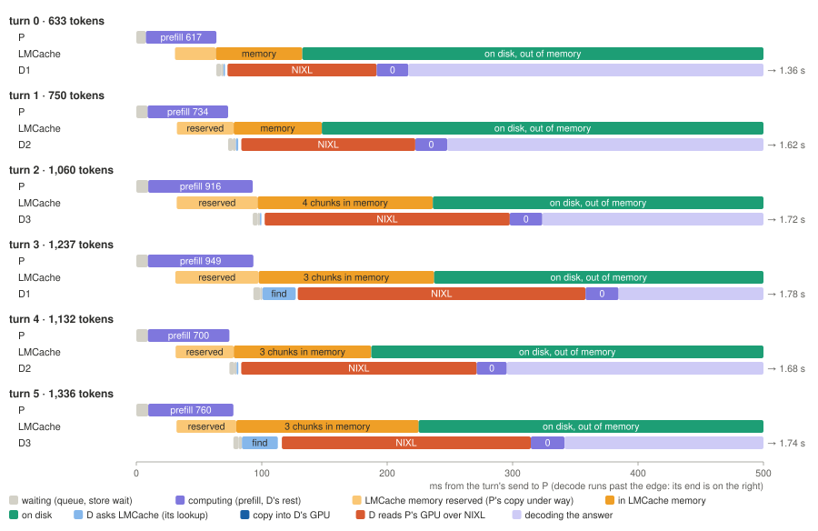

# Conversation 3: mt-rag-clapnq-elser-512-100-20240503 (disk mode, NIXL, shared servers, chat RAG, all passages)

P's KV reaches D over NIXL (D reads P's GPU blocks); every engine's LMCache connector stores beside it, to the one shared server. 6 turns on D1, D2, D3 (round-robin: each turn to the next D engine); prompts grow from 633 to 1,336 tokens (interleaved: each turn's prompt is the previous one, its answer, then this turn's documents and question). Chunks are 256 tokens (16 vLLM blocks of 16); a chunk's name is LMCache's hash of its tokens and everything before them, so the same prefix has the same chunks on every turn and engine.

Legend for the strips (one character a chunk): P: `=` on P's GPU from an earlier turn, `#` computed and stored now, `+` computed, not stored (a partial chunk). D: `=` on D's GPU from an earlier turn, `M` pulled from memory, `S` pulled from disk, `N` read from P's GPU over NIXL, `+` computed by D (a partial chunk), `?` missed.

GPU blocks (the chunk tables): where each engine keeps the chunk's 16 vLLM blocks in its GPU KV cache, by vLLM's block ids (vLLM's paged KV cache: a block, or page, holds 16 tokens; block 0 is its reserved null block), in the prompt's block order, a run of consecutive ids written as a range: `P 1, 138-152` is the prompt's block 0 in GPU block 1 and its blocks 1-15 in GPU blocks 138-152. An engine takes a GPU block from its free list when it first computes or loads a block, and the block keeps it while cached, so a later turn that reuses the block shows the same id. Blocks that are the same in several prompts (the same tokens and everything before them) share one GPU block once the first is cached: the system prompt's first block, the same in every conversation, is the usual one. `16/16 hashes = P's`: of the blocks D pulled, how many have the same vLLM hash on D as on P.

The prompts' text is the driver's own record of what it sent (answers included); lines over 100 characters are wrapped here for reading.

| turn | prompt | chunks + tail | P: own GPU / computed / stored | D: own GPU / loaded / computed | pulled | pull ms | D first token ms |
| ---: | ---: | --- | --- | --- | --- | ---: | ---: |
| [0](#turn-0) | 633 | 2 + 121 | 16 / 617 / 2 chunks | 16 / 617 / 0 | 3 chunks (NIXL 3) | 118.8 | 149.3 |
| [1](#turn-1) | 750 | 2 + 238 | 16 / 734 / 2 chunks | 16 / 734 / 0 | 3 chunks (NIXL 3) | 138.7 | 171.2 |
| [2](#turn-2) | 1,060 | 4 + 36 | 144 / 916 / 4 chunks | 16 / 1,044 / 0 | 5 chunks (NIXL 5) | 195.4 | 226.9 |
| [3](#turn-3) | 1,237 | 4 + 213 | 288 / 949 / 3 chunks | 16 / 1,221 / 0 | 5 chunks (NIXL 5) | 229.4 | 285.8 |
| [4](#turn-4) | 1,132 | 4 + 108 | 432 / 700 / 3 chunks | 144 / 988 / 0 | 5 chunks (NIXL 5) | 187.8 | 217.2 |
| [5](#turn-5) | 1,336 | 5 + 56 | 576 / 760 / 3 chunks | 288 / 1,048 / 0 | 5 chunks (NIXL 5) | 198.4 | 259.8 |

## How the prompt grows

Each turn's prompt is the previous one, token for token, and then: D's answer to the previous turn, this turn's documents, its question and the framing (the system prompt on turn 0, `Assistant:` and newlines). Only the new tokens can make new chunks: the previous prompt's partial chunk fills first. A document sent before comes again at another place, so in other chunks.

| turn | prompt | new | previous answer | documents | question | framing | whole chunks |
| ---: | ---: | ---: | ---: | --- | --- | ---: | --- |
| 0 | 633 | +633 | – | 5 docs, 589 | 14: robert louis stevenson a child's garden of verses | 30 | 2 (+2) |
| 1 | 750 | +117 | – | 1 doc, 41 | 13: is a child's garden of verses only in English? | 2 | 2 (+0) |
| 2 | 1,060 | +310 | – | 2 docs, 243 | 14: what are the contents of a child's garden of verses | 2 | 4 (+2) |
| 3 | 1,237 | +177 | – | 2 docs, 147 | 12: any other famous poets you recommend me to know? | 2 | 4 (+0) |
| 4 | 1,132 | +-105 | – | 0 docs, 0 | 0 | 0 | 4 (+0) |
| 5 | 1,336 | +204 | – | 2 docs, 143 | 25: how was E. E. Cummings's life? Was E. E. Cummings's famous poem affec… | 2 | 5 (+1) |

## Timeline

Every turn on one clock: ms from the moment the proxy sent the turn to P. P prefills it (one token out) and holds its blocks for D; the proxy sends the turn to the next D engine at once with P's reply's kv_transfer_params (no wait), D reads P's blocks over NIXL (orange-red), computes the rest and decodes the answer. Beside it every engine's LMCache connector stores its new whole chunks (P's lane, and D's own when it stored any). The lanes: P, LMCache (P's chunks), D, and LMCache (D's chunks).



| turn | P queued → done | P's chunks: in memory / on disk | D | D starts | NIXL read | D: held / from P / from LMCache / computed | D's chunks stored | first token | P freed | D done |
| ---: | --- | --- | --- | ---: | --- | --- | ---: | ---: | ---: | ---: |
| 0 | 8 → 64 | 2: 63 / 132 | D1 | 68 | 73-192 | 16 / 617 / 0 / 0 | 0 | 217 | 193 | 1,362 |
| 1 | 9 → 73 | 2: 78 / 148 | D2 | 77 | 84-222 | 16 / 734 / 0 / 0 | 0 | 248 | 224 | 1,618 |
| 2 | 10 → 93 | 4: 97 / 236 | D3 | 97 | 102-298 | 16 / 1,044 / 0 / 0 | 0 | 324 | 298 | 1,718 |
| 3 | 9 → 93 | 3: 98 / 237 | D1 | 99 | 129-358 | 16 / 1,221 / 0 / 0 | 0 | 384 | 358 | 1,777 |
| 4 | 9 → 74 | 3: 78 / 187 | D2 | 78 | 84-271 | 144 / 988 / 0 / 0 | 0 | 295 | 272 | 1,684 |
| 5 | 10 → 77 | 3: 80 / 225 | D3 | 82 | 116-314 | 288 / 1,048 / 0 / 0 | 0 | 341 | 315 | 1,741 |

All times in ms from the turn's send to P. NIXL read: D's worker posts the read of P's blocks to the KV in D's GPU blocks; P freed: D has read, P's blocks go back to its free queue (still cached). Each turn's section below tells it in a sentence and step by step.

### One chunk, block by block: chunk 1 of turn 0 (`87459d277a0228c0`)

Tokens 256-512 (doc 815546445_2827: 93; doc 815546445_1364: 62; doc 815546445_2716: 41; doc 815546445_1737: 60). P computed its blocks; D1 read them from P's GPU over NIXL, P's block into D's block, one for one:

| block | tokens | P's GPU block | vLLM hash on P | D's GPU block | same hash on D |
| ---: | --- | ---: | --- | ---: | --- |
| 16 | 256-272 | 1242 | `e129960621340dd6` | 528 | True |
| 17 | 272-288 | 1243 | `84e3d0a0591000d6` | 529 | True |
| 18 | 288-304 | 1244 | `26eebb6c1ce28218` | 530 | True |
| 19 | 304-320 | 1245 | `b60a7834bdbaf5c0` | 531 | True |
| 20 | 320-336 | 1246 | `33378f2a700eccbc` | 532 | True |
| 21 | 336-352 | 1247 | `245c146fc1c1fb46` | 533 | True |
| 22 | 352-368 | 1248 | `bf6841aac2b19dbd` | 534 | True |
| 23 | 368-384 | 1249 | `e82eda0e09e7d768` | 535 | True |
| 24 | 384-400 | 1250 | `af0d4e1650aa85e9` | 536 | True |
| 25 | 400-416 | 1251 | `eeaf8dbd7c8ad45c` | 537 | True |
| 26 | 416-432 | 1252 | `7976c989a143796f` | 538 | True |
| 27 | 432-448 | 1253 | `a6e7aa44cc5bd50f` | 539 | True |
| 28 | 448-464 | 1254 | `2a63ff96afc1ff11` | 540 | True |
| 29 | 464-480 | 1255 | `95f4b768af737370` | 541 | True |
| 30 | 480-496 | 1256 | `40e2f7103fdbf855` | 542 | True |
| 31 | 496-512 | 1257 | `6dca27fac5708aba` | 543 | True |

## Turn 0

**Timeline:** P queued until 8 ms, prefilled 617 tokens (held 16) and was done at 64 ms; its 2 new chunks were in LMCache's memory at 63 ms, on disk at 132 ms and out of memory. D1 started at 68 ms (no wait) holding 16 tokens, read 617 from P's GPU over NIXL (posted at 73 ms, in its GPU at 192 ms; P freed its blocks at 193 ms), computed 0 and gave its first token at 217 ms; it decoded 107 tokens until 1,362 ms. ([all turns](#timeline))

### Step by step

Every move of this turn's KV, ms from the proxy sending the turn to P. P's KV reaches D over NIXL: D's worker reads P's GPU blocks into its own (a NIXL READ, P told when D is done); LMCache's copies (to and from each server's memory) its servers do themselves through CUDA IPC handles each engine registered at start.

| ms | where | what |
| ---: | --- | --- |
| 0.0 | proxy → P | sends the turn (633 prompt tokens; P is asked for one token: prefill only) |
| 2.7 | P | the request arrives |
| 7.3 | P GPU | its prefix cache holds 16 of the prompt's tokens: 1 block in GPU blocks 1 |
| 7.4 | P ↔ LMCache | LMCache has 0 of its tokens; P loads 0 and computes the rest |
| 7.6 | P GPU | 39 new GPU blocks for the 617 tokens it computes: 1227-1265; the prefill runs |
| 8.0 | P → LMCache | store planned: tokens 0-512, chunks 0-1 (32 blocks) |
| 30.2 | LMCache | the store request is in; it waits for P's forward pass to finish (a CUDA event) |
| 30.8 | LMCache memory | space reserved for 2 chunks (59 MB) |
| 60.5 | P GPU → LMCache memory | the copy starts: LMCache reads P's GPU blocks (CUDA IPC) |
| 60.7 | P GPU | the request is done: P holds its 40 blocks for D to read over NIXL, and its reply carries them (kv_transfer_params: the blocks, its NIXL agent) |
| 63.1 | P GPU → LMCache memory | copy done: 2 chunks, 59 MB in 2.6 ms |
| 63.3 | LMCache memory | 2 chunks in memory, kept for later requests (D gets this turn's KV from P over NIXL); P keeps its copy in its GPU blocks |
| 63.8 | P → proxy | P answers its one token: the prefill is done |
| 67.6 | proxy → D1 | sends the turn to D1 at once, with P's kv_transfer_params (round-robin; no wait) |
| 69.5 | D1 ↔ LMCache | asks LMCache for the prompt's chunks |
| 70.7 | LMCache memory | found 512 tokens it lacks: 2 chunks in memory |
| 71.5 | D1 GPU | its prefix cache holds 16 of the prompt's tokens: 1 block in GPU blocks 1 |
| 71.6 | D1 ↔ P (NIXL) | will read 617 prompt tokens from P's GPU (beyond the 16 its own cache holds) |
| 71.6 | D1 ↔ LMCache | LMCache has 512 of its tokens; NIXL loads it (MultiConnector: the first connector with tokens) |
| 71.9 | D1 GPU | 39 GPU blocks for the KV from P: 513-551 |
| 72.7 | P GPU → D1 GPU (NIXL) | D1 reads P's GPU blocks 1, 1227-1265 into its 513-551 (a NIXL READ) |
| 132.3 | LMCache disk | 2 chunks written to disk (one file each) |
| 132.9 | LMCache memory | 2 memory copies dropped: on disk only now |
| 191.6 | D1 | the KV from P is in its GPU blocks (617 tokens) |
| 192.6 | P GPU | D1 has read: P frees its blocks (they stay in its prefix cache) |
| 216.9 | D1 → proxy | the first answer token |
| 280.1 | D1 GPU | 1 new GPU block for the 1 prompt tokens it computes: 552 |
| 453.6 | D1 GPU | decoding: the answer's KV takes 6 new GPU blocks as it grows, one per 16 tokens: 553-558, until 1,318 ms |
| 1,361.6 | D1 | done: 107 tokens decoded; its blocks stay cached in its GPU for the next turn |
| 1,363.0 | proxy | the response is complete |

633 prompt tokens: 2 whole chunks and 121 tokens over (the partial chunk, computed by both engines and stored only when a later turn completes it). P held 16 tokens on its GPU, computed 617 and stored 2 new chunks; D1 held 16, read 617 from P over NIXL, loaded 0 from LMCache and computed 0.

### The prompt

The whole prompt, piece by piece:

- **system prompt** · tokens 0-28 (28) · chunk 0

```text
You are a helpful assistant. Answer the user's last question from the documents. If they do not hold
the answer, say so.
```

<details><summary>document <code>815546445_881-1363-0-482</code> · tokens 28-147 (119) · chunk 0</summary>

```text
Document: A Child's Garden of Verses
A Child's Garden of Verses
A Child 's Garden of Verses is a collection of poetry for children about darkness and solitude by
the Scottish author Robert Louis Stevenson . The collection first appeared in 1885 under the title
Penny Whistles , but has been reprinted many times , often in illustrated versions . It contains
about 65 poems including the cherished classics `` Foreign Children , '' `` The Lamplighter , '' ``
The Land of Counterpane , '' `` Bed in Summer , '' `` My Shadow '' and `` The Swing . ''
```

</details>

<details><summary>document <code>815546445_2827-3534-0-705</code> · tokens 147-349 (202) · chunks 0-1</summary>

```text
Document: A Child's Garden of Verses
A Child's Garden of Verses
Disneyland Record released a LP record of the poems set to music . Gwyn Conger wrote the music which
was performed by Francis Archer and Beverly Gile . The Italian composer Carlo Deri composed , in
2005 , a song for voice and piano , The Unseen Playmate , on Stevenson 's poem . This song is also
included in Deri 's one - act opera Markheim ( 2008 ) . The contemporary Lithuanian composer
Giedrius Alkauskas ( b . 1978 ) arranged five poems -- `` The Wind '' ( two alternative arrangements
) , `` Rain '' , `` Singing '' , `` Marching Song '' , and `` At the Sea - side '' -- as a six -
song cycle , `` A Child 's Garden of Songs '' , for mezzo - soprano , piano , and trumpet in B ♭ ,
released in 2014 .
```

</details>

<details><summary>document <code>815546445_1364-1547-0-183</code> · tokens 349-411 (62) · chunk 1</summary>

```text
Document: A Child's Garden of Verses
A Child's Garden of Verses
The classical scholar Terrot Reaveley Glover published a translation of the poems into Latin in 1922
under the title Carmina non prius audita de ludis et hortis virginibus puerisque .
```

</details>

<details><summary>document <code>815546445_2716-2805-0-89</code> · tokens 411-452 (41) · chunk 1</summary>

```text
Document: A Child's Garden of Verses
A Child's Garden of Verses
To Willie and Henrietta To My Mother To Auntie To Minnie To My Name - child To Any Reader
```

</details>

<details><summary>document <code>815546445_1737-2410-0-673</code> · tokens 452-617 (165) · chunks 1-2</summary>

```text
Document: A Child's Garden of Verses
A Child's Garden of Verses
To Alison Cunningham Bed in Summer A Thought At the Sea - side Young Night Thought Whole Duty of
Children Rain Pirate Story ( poem ) Foreign Lands Windy Nights Travelling Singing Looking Forward A
Good Play Where Go the Boats ? Auntie 's Skirts The Land of Counterpane The Land of Nod My Shadow
System A Good Boy Escape at Bedtime Marching Song The Cow Happy Thought The Wind Keepsake Mill Good
and Bad Children Foreign Children The Sun 's Travels The Lamplighter My Bed is a Boat The Moon The
Swing Time to Rise Looking - glass River Fairy Bread From a Railway Carriage Winter - time The
Hayloft Farewell to the Farm Northwest Passage : Good Night , Shadow March , In Port
```

</details>

- **question 0** · tokens 617-631 (14) · chunk 2

```text
User: robert louis stevenson a child's garden of verses
```

- `Assistant:` · tokens 631-633 (2) · chunk 2

### Pieces, chunks and blocks

| piece | tokens | length | chunks | |
| --- | --- | ---: | --- | --- |
| system | 0-28 | 28 | 0 |  |
| doc 815546445_881- | 28-147 | 119 | 0 |  |
| doc 815546445_2827 | 147-349 | 202 | 0-1 |  |
| doc 815546445_1364 | 349-411 | 62 | 1 |  |
| doc 815546445_2716 | 411-452 | 41 | 1 |  |
| doc 815546445_1737 | 452-617 | 165 | 1-2 |  |
| question 0 | 617-631 | 14 | 2 |  |
| `assistant:` 0 | 631-633 | 2 | 2 |  |

```
P  ##+
D  NNN
```

| chunk | tokens | pieces in it (tokens) | vLLM blocks | GPU blocks | in LMCache | P this turn | D this turn |
| ---: | --- | --- | --- | --- | --- | --- | --- |
| 0 | 0-256 | system: 28; doc 815546445_881-: 119; doc 815546445_2827: 109 | 0-15 | P 1, 1227-1241; D 1, 513-527; 15/15 hashes = P's | `603db94c5cf688f6` stored on turn 0 by P, on disk, out of memory | computed (its first 16 tokens on P's GPU already), **stored now** | **read from P's GPU over NIXL** (its first 16 tokens on D's GPU already) |
| 1 | 256-512 | doc 815546445_2827: 93; doc 815546445_1364: 62; doc 815546445_2716: 41; doc 815546445_1737: 60 | 16-31 | P 1242-1257; D 528-543; 16/16 hashes = P's | `87459d277a0228c0` stored on turn 0 by P, on disk, out of memory | computed, **stored now** | **read from P's GPU over NIXL** |
| 2 | 512-633 | doc 815546445_1737: 105; question 0: 14; `assistant:` 0: 2 | 32-39 | P 1258-1264; D 544-551; 7/7 hashes = P's | – | computed (partial chunk: not stored) | **read from P's GPU over NIXL** (partial chunk) |

## Turn 1

**Timeline:** P queued until 9 ms, prefilled 734 tokens (held 16) and was done at 73 ms; its 2 new chunks were in LMCache's memory at 78 ms, on disk at 148 ms and out of memory. D2 started at 77 ms (no wait) holding 16 tokens, read 734 from P's GPU over NIXL (posted at 84 ms, in its GPU at 222 ms; P freed its blocks at 224 ms), computed 0 and gave its first token at 248 ms; it decoded 128 tokens until 1,618 ms. ([all turns](#timeline))

### Step by step

Every move of this turn's KV, ms from the proxy sending the turn to P. P's KV reaches D over NIXL: D's worker reads P's GPU blocks into its own (a NIXL READ, P told when D is done); LMCache's copies (to and from each server's memory) its servers do themselves through CUDA IPC handles each engine registered at start.

| ms | where | what |
| ---: | --- | --- |
| 0.0 | proxy → P | sends the turn (750 prompt tokens; P is asked for one token: prefill only) |
| 2.5 | P | the request arrives |
| 8.8 | P GPU | its prefix cache holds 16 of the prompt's tokens: 1 block in GPU blocks 1 |
| 8.9 | P ↔ LMCache | LMCache has 0 of its tokens; P loads 0 and computes the rest |
| 9.0 | P GPU | 46 new GPU blocks for the 734 tokens it computes: 1265-1310; the prefill runs |
| 9.5 | P → LMCache | store planned: tokens 0-512, chunks 0-1 (32 blocks) |
| 31.8 | LMCache | the store request is in; it waits for P's forward pass to finish (a CUDA event) |
| 32.3 | LMCache memory | space reserved for 2 chunks (59 MB) |
| 70.1 | P GPU → LMCache memory | the copy starts: LMCache reads P's GPU blocks (CUDA IPC) |
| 70.2 | P GPU | the request is done: P holds its 47 blocks for D to read over NIXL, and its reply carries them (kv_transfer_params: the blocks, its NIXL agent) |
| 72.6 | P GPU → LMCache memory | copy done: 2 chunks, 59 MB in 2.6 ms |
| 73.2 | P → proxy | P answers its one token: the prefill is done |
| 76.8 | proxy → D2 | sends the turn to D2 at once, with P's kv_transfer_params (round-robin; no wait) |
| 77.6 | LMCache memory | 2 chunks in memory, kept for later requests (D gets this turn's KV from P over NIXL); P keeps its copy in its GPU blocks |
| 79.4 | D2 ↔ LMCache | asks LMCache for the prompt's chunks |
| 81.2 | LMCache memory | found 512 tokens it lacks: 2 chunks in memory |
| 82.8 | D2 GPU | its prefix cache holds 16 of the prompt's tokens: 1 block in GPU blocks 1 |
| 82.9 | D2 ↔ P (NIXL) | will read 734 prompt tokens from P's GPU (beyond the 16 its own cache holds) |
| 82.9 | D2 ↔ LMCache | LMCache has 512 of its tokens; NIXL loads it (MultiConnector: the first connector with tokens) |
| 83.1 | D2 GPU | 46 GPU blocks for the KV from P: 525-570 |
| 83.7 | P GPU → D2 GPU (NIXL) | D2 reads P's GPU blocks 1, 1265-1310 into its 525-570 (a NIXL READ) |
| 147.9 | LMCache disk | 2 chunks written to disk (one file each) |
| 148.5 | LMCache memory | 2 memory copies dropped: on disk only now |
| 222.4 | D2 | the KV from P is in its GPU blocks (734 tokens) |
| 223.7 | P GPU | D2 has read: P frees its blocks (they stay in its prefix cache) |
| 247.9 | D2 → proxy | the first answer token |
| 255.2 | D2 GPU | 1 new GPU block for the 1 prompt tokens it computes: 571 |
| 428.3 | D2 GPU | decoding: the answer's KV takes 7 new GPU blocks as it grows, one per 16 tokens: 572-578, until 1,466 ms |
| 1,617.9 | D2 | done: 128 tokens decoded; its blocks stay cached in its GPU for the next turn |
| 1,619.0 | proxy | the response is complete |

750 prompt tokens: 2 whole chunks and 238 tokens over (the partial chunk, computed by both engines and stored only when a later turn completes it). P held 16 tokens on its GPU, computed 734 and stored 2 new chunks; D2 held 16, read 734 from P over NIXL, loaded 0 from LMCache and computed 0.

### The prompt

Tokens 0-633: [turn 0](#turn-0)'s prompt, unchanged (NOT the previous prompt's ids), so chunks 0-1 are the same chunks; chunk 2 (partial then, 121 tokens) fills now. New from token 633:

- document `815546445_2716-2805-0-89` · tokens 694-735 (41) · chunk 2 · **again**: sent on [turn 0](#turn-0) already (the same 41 tokens), here at another place in the prompt, so in other chunks: a prefix cache cannot reuse it

- **question 1** · tokens 735-748 (13) · chunk 2

```text
User: is a child's garden of verses only in English?
```

- `Assistant:` · tokens 748-750 (2) · chunk 2

### Pieces, chunks and blocks

| piece | tokens | length | chunks | |
| --- | --- | ---: | --- | --- |
| system | 0-28 | 28 | 0 |  |
| question 0 | 28-42 | 14 | 0 |  |
| `assistant:` 0 | 42-44 | 2 | 0 |  |
| answer 0 | 44-151 | 107 | 0 |  |
| newline 0 | 151-152 | 1 | 0 |  |
| doc 815546445_1364 | 152-214 | 62 | 0 |  |
| doc 815546445_2827 | 214-416 | 202 | 0-1 |  |
| doc 815546445_881- | 416-535 | 119 | 1-2 |  |
| doc 815546445_98-8 | 535-694 | 159 | 2 |  |
| doc 815546445_2716 | 694-735 | 41 | 2 | new this turn |
| question 1 | 735-748 | 13 | 2 | new this turn |
| `assistant:` 1 | 748-750 | 2 | 2 | new this turn |

```
P  ##+
D  NNN
```

| chunk | tokens | pieces in it (tokens) | vLLM blocks | GPU blocks | in LMCache | P this turn | D this turn |
| ---: | --- | --- | --- | --- | --- | --- | --- |
| 0 | 0-256 | system: 28; question 0: 14; `assistant:` 0: 2; answer 0: 107; newline 0: 1; doc 815546445_1364: 62; doc 815546445_2827: 42 | 0-15 | P 1, 1265-1279; D 1, 525-539; 15/15 hashes = P's | `183c15efea16b073` stored on turn 1 by P, on disk, out of memory | computed (its first 16 tokens on P's GPU already), **stored now** | **read from P's GPU over NIXL** (its first 16 tokens on D's GPU already) |
| 1 | 256-512 | doc 815546445_2827: 160; doc 815546445_881-: 96 | 16-31 | P 1280-1295; D 540-555; 16/16 hashes = P's | `b721242d303917e3` stored on turn 1 by P, on disk, out of memory | computed, **stored now** | **read from P's GPU over NIXL** |
| 2 | 512-750 | doc 815546445_881-: 23; doc 815546445_98-8: 159; doc 815546445_2716 (new): 41; question 1 (new): 13; `assistant:` 1 (new): 2 | 32-46 | P 1296-1309; D 556-570; 14/14 hashes = P's | – | computed (partial chunk: not stored) | **read from P's GPU over NIXL** (partial chunk) |

## Turn 2

**Timeline:** P queued until 10 ms, prefilled 916 tokens (held 144) and was done at 93 ms; its 4 new chunks were in LMCache's memory at 97 ms, on disk at 236 ms and out of memory. D3 started at 97 ms (no wait) holding 16 tokens, read 1,044 from P's GPU over NIXL (posted at 102 ms, in its GPU at 298 ms; P freed its blocks at 298 ms), computed 0 and gave its first token at 324 ms; it decoded 128 tokens until 1,718 ms. ([all turns](#timeline))

### Step by step

Every move of this turn's KV, ms from the proxy sending the turn to P. P's KV reaches D over NIXL: D's worker reads P's GPU blocks into its own (a NIXL READ, P told when D is done); LMCache's copies (to and from each server's memory) its servers do themselves through CUDA IPC handles each engine registered at start.

| ms | where | what |
| ---: | --- | --- |
| 0.0 | proxy → P | sends the turn (1,060 prompt tokens; P is asked for one token: prefill only) |
| 2.7 | P | the request arrives |
| 9.3 | P GPU | its prefix cache holds 144 of the prompt's tokens: 9 blocks in GPU blocks 1, 1265-1272 |
| 9.3 | P ↔ LMCache | LMCache has 0 of its tokens; P loads 0 and computes the rest |
| 9.5 | P GPU | 58 new GPU blocks for the 916 tokens it computes: 1310-1367; the prefill runs |
| 9.9 | P → LMCache | store planned: tokens 0-1,024, chunks 0-3 (64 blocks) |
| 31.5 | LMCache | the store request is in; it waits for P's forward pass to finish (a CUDA event) |
| 32.2 | LMCache memory | space reserved for 4 chunks (117 MB) |
| 88.7 | P GPU → LMCache memory | the copy starts: LMCache reads P's GPU blocks (CUDA IPC) |
| 88.8 | P GPU | the request is done: P holds its 67 blocks for D to read over NIXL, and its reply carries them (kv_transfer_params: the blocks, its NIXL agent) |
| 92.8 | P → proxy | P answers its one token: the prefill is done |
| 93.7 | P GPU → LMCache memory | copy done: 4 chunks, 117 MB in 5.1 ms |
| 96.7 | LMCache memory | 4 chunks in memory, kept for later requests (D gets this turn's KV from P over NIXL); P keeps its copy in its GPU blocks |
| 96.8 | proxy → D3 | sends the turn to D3 at once, with P's kv_transfer_params (round-robin; no wait) |
| 98.6 | D3 ↔ LMCache | asks LMCache for the prompt's chunks |
| 99.6 | LMCache memory | found 1,024 tokens it lacks: 4 chunks in memory |
| 101.3 | D3 GPU | its prefix cache holds 16 of the prompt's tokens: 1 block in GPU blocks 1 |
| 101.3 | D3 ↔ P (NIXL) | will read 1,044 prompt tokens from P's GPU (beyond the 16 its own cache holds) |
| 101.4 | D3 ↔ LMCache | LMCache has 1,024 of its tokens; NIXL loads it (MultiConnector: the first connector with tokens) |
| 101.6 | D3 GPU | 66 GPU blocks for the KV from P: 565-630 |
| 102.3 | P GPU → D3 GPU (NIXL) | D3 reads P's GPU blocks 1, 1265-1272, 1310-1367 into its 565-630 (a NIXL READ) |
| 236.4 | LMCache disk | 4 chunks written to disk (one file each) |
| 237.0 | LMCache memory | 4 memory copies dropped: on disk only now |
| 297.7 | D3 | the KV from P is in its GPU blocks (1,044 tokens) |
| 297.8 | P GPU | D3 has read: P frees its blocks (they stay in its prefix cache) |
| 323.7 | D3 → proxy | the first answer token |
| 441.9 | D3 GPU | 1 new GPU block for the 1 prompt tokens it computes: 631 |
| 617.6 | D3 GPU | decoding: the answer's KV takes 7 new GPU blocks as it grows, one per 16 tokens: 632-638, until 1,674 ms |
| 1,718.2 | D3 | done: 128 tokens decoded; its blocks stay cached in its GPU for the next turn |
| 1,719.4 | proxy | the response is complete |

1,060 prompt tokens: 4 whole chunks and 36 tokens over (the partial chunk, computed by both engines and stored only when a later turn completes it). P held 144 tokens on its GPU, computed 916 and stored 4 new chunks; D3 held 16, read 1,044 from P over NIXL, loaded 0 from LMCache and computed 0.

### The prompt

Tokens 0-750: [turn 1](#turn-1)'s prompt, unchanged (NOT the previous prompt's ids), so chunks 0-1 are the same chunks; chunk 2 (partial then, 238 tokens) fills now. New from token 750:

- document `815546445_2716-2805-0-89` · tokens 801-842 (41) · chunk 3 · **again**: sent on [turn 0](#turn-0) already (the same 41 tokens), here at another place in the prompt, so in other chunks: a prefix cache cannot reuse it

- document `815546445_2827-3534-0-705` · tokens 842-1044 (202) · chunks 3-4 · **again**: sent on [turn 0](#turn-0) already (the same 202 tokens), here at another place in the prompt, so in other chunks: a prefix cache cannot reuse it

- **question 2** · tokens 1044-1058 (14) · chunk 4

```text
User: what are the contents of a child's garden of verses
```

- `Assistant:` · tokens 1058-1060 (2) · chunk 4

### Pieces, chunks and blocks

| piece | tokens | length | chunks | |
| --- | --- | ---: | --- | --- |
| system | 0-28 | 28 | 0 |  |
| question 0 | 28-42 | 14 | 0 |  |
| `assistant:` 0 | 42-44 | 2 | 0 |  |
| answer 0 | 44-151 | 107 | 0 |  |
| newline 0 | 151-152 | 1 | 0 |  |
| question 1 | 152-165 | 13 | 0 |  |
| `assistant:` 1 | 165-167 | 2 | 0 |  |
| answer 1 | 167-295 | 128 | 0-1 |  |
| newline 1 | 295-296 | 1 | 1 |  |
| doc 815546445_881- | 296-415 | 119 | 1 |  |
| doc 815546445_1737 | 415-580 | 165 | 1-2 |  |
| doc 815546445_1364 | 580-642 | 62 | 2 |  |
| doc 815546445_98-8 | 642-801 | 159 | 2-3 |  |
| doc 815546445_2716 | 801-842 | 41 | 3 | new this turn |
| doc 815546445_2827 | 842-1044 | 202 | 3-4 | new this turn |
| question 2 | 1044-1058 | 14 | 4 | new this turn |
| `assistant:` 2 | 1058-1060 | 2 | 4 | new this turn |

```
P  ####+
D  NNNNN
```

| chunk | tokens | pieces in it (tokens) | vLLM blocks | GPU blocks | in LMCache | P this turn | D this turn |
| ---: | --- | --- | --- | --- | --- | --- | --- |
| 0 | 0-256 | system: 28; question 0: 14; `assistant:` 0: 2; answer 0: 107; newline 0: 1; question 1: 13; `assistant:` 1: 2; answer 1: 89 | 0-15 | P 1, 1265-1272, 1310-1316; D 1, 565-579; 7/7 hashes = P's | `6c6553aed540cdd7` stored on turn 2 by P, on disk, out of memory | computed (its first 144 tokens on P's GPU already), **stored now** | **read from P's GPU over NIXL** (its first 16 tokens on D's GPU already) |
| 1 | 256-512 | answer 1: 39; newline 1: 1; doc 815546445_881-: 119; doc 815546445_1737: 97 | 16-31 | P 1317-1332; D 580-595; 16/16 hashes = P's | `ba2e4b27ee7bf3c3` stored on turn 2 by P, on disk, out of memory | computed, **stored now** | **read from P's GPU over NIXL** |
| 2 | 512-768 | doc 815546445_1737: 68; doc 815546445_1364: 62; doc 815546445_98-8: 126 | 32-47 | P 1333-1348; D 596-611; 16/16 hashes = P's | `052828f3c88ff3e8` stored on turn 2 by P, on disk, out of memory | computed, **stored now** | **read from P's GPU over NIXL** |
| 3 | 768-1024 | doc 815546445_98-8: 33; doc 815546445_2716 (new): 41; doc 815546445_2827 (new): 182 | 48-63 | P 1349-1364; D 612-627; 16/16 hashes = P's | `4524f1bf9f08059e` stored on turn 2 by P, on disk, out of memory | computed, **stored now** | **read from P's GPU over NIXL** |
| 4 | 1024-1060 | doc 815546445_2827 (new): 20; question 2 (new): 14; `assistant:` 2 (new): 2 | 64-66 | P 1365-1366; D 628-630; 2/2 hashes = P's | – | computed (partial chunk: not stored) | **read from P's GPU over NIXL** (partial chunk) |

## Turn 3

**Timeline:** P queued until 9 ms, prefilled 949 tokens (held 288) and was done at 93 ms; its 3 new chunks were in LMCache's memory at 98 ms, on disk at 237 ms and out of memory. D1 started at 99 ms (no wait) holding 16 tokens, read 1,221 from P's GPU over NIXL (posted at 129 ms, in its GPU at 358 ms; P freed its blocks at 358 ms), computed 0 and gave its first token at 384 ms; it decoded 128 tokens until 1,777 ms. ([all turns](#timeline))

### Step by step

Every move of this turn's KV, ms from the proxy sending the turn to P. P's KV reaches D over NIXL: D's worker reads P's GPU blocks into its own (a NIXL READ, P told when D is done); LMCache's copies (to and from each server's memory) its servers do themselves through CUDA IPC handles each engine registered at start.

| ms | where | what |
| ---: | --- | --- |
| 0.0 | proxy → P | sends the turn (1,237 prompt tokens; P is asked for one token: prefill only) |
| 2.8 | P | the request arrives |
| 9.0 | P GPU | its prefix cache holds 288 of the prompt's tokens: 18 blocks in GPU blocks 1, 1265-1272, 1310-1318 |
| 9.1 | P ↔ LMCache | LMCache has 256 of its tokens; P loads 0 and computes the rest |
| 9.2 | P GPU | 60 new GPU blocks for the 949 tokens it computes: 1367-1426; the prefill runs |
| 9.8 | P → LMCache | store planned: tokens 256-1,024, chunks 1-3 (48 blocks) |
| 30.5 | LMCache | the store request is in; it waits for P's forward pass to finish (a CUDA event) |
| 31.1 | LMCache memory | space reserved for 3 chunks (88 MB) |
| 88.8 | P GPU → LMCache memory | the copy starts: LMCache reads P's GPU blocks (CUDA IPC) |
| 88.9 | P GPU | the request is done: P holds its 78 blocks for D to read over NIXL, and its reply carries them (kv_transfer_params: the blocks, its NIXL agent) |
| 92.6 | P GPU → LMCache memory | copy done: 3 chunks, 88 MB in 3.8 ms |
| 93.3 | P → proxy | P answers its one token: the prefill is done |
| 97.5 | LMCache memory | 3 chunks in memory, kept for later requests (D gets this turn's KV from P over NIXL); P keeps its copy in its GPU blocks |
| 98.8 | proxy → D1 | sends the turn to D1 at once, with P's kv_transfer_params (round-robin; no wait) |
| 100.5 | D1 ↔ LMCache | asks LMCache for the prompt's chunks |
| 127.1 | LMCache disk → memory | found 1,024 tokens it lacks: 1 chunk read from disk into a memory buffer |
| 127.7 | D1 GPU | its prefix cache holds 16 of the prompt's tokens: 1 block in GPU blocks 1 |
| 127.7 | D1 ↔ P (NIXL) | will read 1,221 prompt tokens from P's GPU (beyond the 16 its own cache holds) |
| 127.8 | D1 ↔ LMCache | LMCache has 1,024 of its tokens; NIXL loads it (MultiConnector: the first connector with tokens) |
| 128.0 | D1 GPU | 77 GPU blocks for the KV from P: 558-634 |
| 128.7 | P GPU → D1 GPU (NIXL) | D1 reads P's GPU blocks 1 … 1367-1426 (78 blocks) into its 558-634 (a NIXL READ) |
| 237.4 | LMCache disk | 3 chunks written to disk (one file each) |
| 238.0 | LMCache memory | 3 memory copies dropped: on disk only now |
| 358.1 | D1 | the KV from P is in its GPU blocks (1,221 tokens) |
| 358.3 | P GPU | D1 has read: P frees its blocks (they stay in its prefix cache) |
| 384.5 | D1 → proxy | the first answer token |
| 492.4 | D1 GPU | 1 new GPU block for the 1 prompt tokens it computes: 635 |
| 668.0 | D1 GPU | decoding: the answer's KV takes 7 new GPU blocks as it grows, one per 16 tokens: 636-642, until 1,722 ms |
| 1,777.3 | D1 | done: 128 tokens decoded; its blocks stay cached in its GPU for the next turn |
| 1,778.2 | proxy | the response is complete |

1,237 prompt tokens: 4 whole chunks and 213 tokens over (the partial chunk, computed by both engines and stored only when a later turn completes it). P held 288 tokens on its GPU, computed 949 and stored 3 new chunks; D1 held 16, read 1,221 from P over NIXL, loaded 0 from LMCache and computed 0.

### The prompt

Tokens 0-1,060: [turn 2](#turn-2)'s prompt, unchanged (NOT the previous prompt's ids), so chunks 0-3 are the same chunks; chunk 4 (partial then, 36 tokens) fills now. New from token 1,060:

<details><summary>document <code>818287024_15044-15245-0-201</code> · tokens 1076-1131 (55) · chunk 4</summary>

```text
Document: E. E. Cummings
E. E. Cummings
Many of Cummings ' poems are satirical and address social issues but have an equal or even stronger
bias toward romanticism : time and again his poems celebrate love , sex , and the season of rebirth
.
```

</details>

<details><summary>document <code>818287024_330-644-0-314</code> · tokens 1131-1223 (92) · chunk 4</summary>

```text
Document: E. E. Cummings
E. E. Cummings
Edward Estlin `` E.E. '' Cummings ( October 14 , 1894 -- September 3 , 1962 ) , often styled as e e
cummings , as he sometimes signed his name , was an American poet , painter , essayist , author ,
and playwright . He wrote approximately 2900 poems , two autobiographical novels , four plays , and
several essays .
```

</details>

- **question 3** · tokens 1223-1235 (12) · chunk 4

```text
User: any other famous poets you recommend me to know?
```

- `Assistant:` · tokens 1235-1237 (2) · chunk 4

### Pieces, chunks and blocks

| piece | tokens | length | chunks | |
| --- | --- | ---: | --- | --- |
| system | 0-28 | 28 | 0 |  |
| question 0 | 28-42 | 14 | 0 |  |
| `assistant:` 0 | 42-44 | 2 | 0 |  |
| answer 0 | 44-151 | 107 | 0 |  |
| newline 0 | 151-152 | 1 | 0 |  |
| question 1 | 152-165 | 13 | 0 |  |
| `assistant:` 1 | 165-167 | 2 | 0 |  |
| answer 1 | 167-295 | 128 | 0-1 |  |
| newline 1 | 295-296 | 1 | 1 |  |
| question 2 | 296-310 | 14 | 1 |  |
| `assistant:` 2 | 310-312 | 2 | 1 |  |
| answer 2 | 312-440 | 128 | 1 |  |
| newline 2 | 440-441 | 1 | 1 |  |
| doc 851649357_5734 | 441-479 | 38 | 1 |  |
| doc 818287024_1543 | 479-509 | 30 | 1 |  |
| doc 803829007_1048 | 509-853 | 344 | 1-3 |  |
| doc 806718226_3105 | 853-936 | 83 | 3 |  |
| doc 851649357_437- | 936-1025 | 89 | 3-4 |  |
| doc 818287024_1351 | 1025-1076 | 51 | 4 |  |
| doc 818287024_1504 | 1076-1131 | 55 | 4 | new this turn |
| doc 818287024_330- | 1131-1223 | 92 | 4 | new this turn |
| question 3 | 1223-1235 | 12 | 4 | new this turn |
| `assistant:` 3 | 1235-1237 | 2 | 4 | new this turn |

```
P  =###+
D  NNNNN
```

| chunk | tokens | pieces in it (tokens) | vLLM blocks | GPU blocks | in LMCache | P this turn | D this turn |
| ---: | --- | --- | --- | --- | --- | --- | --- |
| 0 | 0-256 | system: 28; question 0: 14; `assistant:` 0: 2; answer 0: 107; newline 0: 1; question 1: 13; `assistant:` 1: 2; answer 1: 89 | 0-15 | P 1, 1265-1272, 1310-1316; D 1, 558-572 | `6c6553aed540cdd7` stored on turn 2 by P, on disk, out of memory | on P's GPU (earlier turn) | **read from P's GPU over NIXL** (its first 16 tokens on D's GPU already) |
| 1 | 256-512 | answer 1: 39; newline 1: 1; question 2: 14; `assistant:` 2: 2; answer 2: 128; newline 2: 1; doc 851649357_5734: 38; doc 818287024_1543: 30; doc 803829007_1048: 3 | 16-31 | P 1317-1318, 1367-1380; D 573-588; 14/14 hashes = P's | `500861571f8b0c7a` stored on turn 3 by P, on disk, out of memory | computed (its first 32 tokens on P's GPU already), **stored now** | **read from P's GPU over NIXL** |
| 2 | 512-768 | doc 803829007_1048: 256 | 32-47 | P 1381-1396; D 589-604; 16/16 hashes = P's | `5a9cd4097627b9e5` stored on turn 3 by P, on disk, out of memory | computed, **stored now** | **read from P's GPU over NIXL** |
| 3 | 768-1024 | doc 803829007_1048: 85; doc 806718226_3105: 83; doc 851649357_437-: 88 | 48-63 | P 1397-1412; D 605-620; 16/16 hashes = P's | `4a007e21d9af1a74` stored on turn 3 by P, on disk, out of memory | computed, **stored now** | **read from P's GPU over NIXL** |
| 4 | 1024-1237 | doc 851649357_437-: 1; doc 818287024_1351: 51; doc 818287024_1504 (new): 55; doc 818287024_330- (new): 92; question 3 (new): 12; `assistant:` 3 (new): 2 | 64-77 | P 1413-1425; D 621-634; 13/13 hashes = P's | – | computed (partial chunk: not stored) | **read from P's GPU over NIXL** (partial chunk) |

## Turn 4

**Timeline:** P queued until 9 ms, prefilled 700 tokens (held 432) and was done at 74 ms; its 3 new chunks were in LMCache's memory at 78 ms, on disk at 187 ms and out of memory. D2 started at 78 ms (no wait) holding 144 tokens, read 988 from P's GPU over NIXL (posted at 84 ms, in its GPU at 271 ms; P freed its blocks at 272 ms), computed 0 and gave its first token at 295 ms; it decoded 128 tokens until 1,684 ms. ([all turns](#timeline))

### Step by step

Every move of this turn's KV, ms from the proxy sending the turn to P. P's KV reaches D over NIXL: D's worker reads P's GPU blocks into its own (a NIXL READ, P told when D is done); LMCache's copies (to and from each server's memory) its servers do themselves through CUDA IPC handles each engine registered at start.

| ms | where | what |
| ---: | --- | --- |
| 0.0 | proxy → P | sends the turn (1,132 prompt tokens; P is asked for one token: prefill only) |
| 2.7 | P | the request arrives |
| 8.9 | P GPU | its prefix cache holds 432 of the prompt's tokens: GPU blocks 1 … 1367-1375 (27 blocks) |
| 9.0 | P ↔ LMCache | LMCache has 256 of its tokens; P loads 0 and computes the rest |
| 9.2 | P GPU | 44 new GPU blocks for the 700 tokens it computes: 1426-1469; the prefill runs |
| 9.7 | P → LMCache | store planned: tokens 256-1,024, chunks 1-3 (48 blocks) |
| 30.6 | LMCache | the store request is in; it waits for P's forward pass to finish (a CUDA event) |
| 31.3 | LMCache memory | space reserved for 3 chunks (88 MB) |
| 70.7 | P GPU → LMCache memory | the copy starts: LMCache reads P's GPU blocks (CUDA IPC) |
| 70.8 | P GPU | the request is done: P holds its 71 blocks for D to read over NIXL, and its reply carries them (kv_transfer_params: the blocks, its NIXL agent) |
| 74.2 | P → proxy | P answers its one token: the prefill is done |
| 74.5 | P GPU → LMCache memory | copy done: 3 chunks, 88 MB in 3.8 ms |
| 77.7 | LMCache memory | 3 chunks in memory, kept for later requests (D gets this turn's KV from P over NIXL); P keeps its copy in its GPU blocks |
| 78.2 | proxy → D2 | sends the turn to D2 at once, with P's kv_transfer_params (round-robin; no wait) |
| 80.0 | D2 ↔ LMCache | asks LMCache for the prompt's chunks |
| 81.3 | LMCache memory | found 1,024 tokens it lacks: 4 chunks in memory |
| 82.6 | D2 GPU | its prefix cache holds 144 of the prompt's tokens: 9 blocks in GPU blocks 1, 525-532 |
| 82.7 | D2 ↔ P (NIXL) | will read 988 prompt tokens from P's GPU (beyond the 144 its own cache holds) |
| 82.7 | D2 ↔ LMCache | LMCache has 1,024 of its tokens; NIXL loads it (MultiConnector: the first connector with tokens) |
| 83.0 | D2 GPU | 62 GPU blocks for the KV from P: 578-639 |
| 83.6 | P GPU → D2 GPU (NIXL) | D2 reads P's GPU blocks 1 … 1426-1469 (71 blocks) into its 578-639 (a NIXL READ) |
| 187.3 | LMCache disk | 3 chunks written to disk (one file each) |
| 188.0 | LMCache memory | 3 memory copies dropped: on disk only now |
| 271.4 | D2 | the KV from P is in its GPU blocks (988 tokens) |
| 271.9 | P GPU | D2 has read: P frees its blocks (they stay in its prefix cache) |
| 295.4 | D2 → proxy | the first answer token |
| 325.8 | D2 GPU | 1 new GPU block for the 1 prompt tokens it computes: 640 |
| 501.0 | D2 GPU | decoding: the answer's KV takes 7 new GPU blocks as it grows, one per 16 tokens: 641-647, until 1,552 ms |
| 1,683.6 | D2 | done: 128 tokens decoded; its blocks stay cached in its GPU for the next turn |
| 1,684.7 | proxy | the response is complete |

1,132 prompt tokens: 4 whole chunks and 108 tokens over (the partial chunk, computed by both engines and stored only when a later turn completes it). P held 432 tokens on its GPU, computed 700 and stored 3 new chunks; D2 held 144, read 988 from P over NIXL, loaded 0 from LMCache and computed 0.

### The prompt

Tokens 0-1,237: [turn 3](#turn-3)'s prompt, unchanged (NOT the previous prompt's ids), so chunks 0-3 are the same chunks; chunk 4 (partial then, 213 tokens) fills now. New from token 1,237:

### Pieces, chunks and blocks

| piece | tokens | length | chunks | |
| --- | --- | ---: | --- | --- |
| system | 0-28 | 28 | 0 |  |
| question 0 | 28-42 | 14 | 0 |  |
| `assistant:` 0 | 42-44 | 2 | 0 |  |
| answer 0 | 44-151 | 107 | 0 |  |
| newline 0 | 151-152 | 1 | 0 |  |
| question 1 | 152-165 | 13 | 0 |  |
| `assistant:` 1 | 165-167 | 2 | 0 |  |
| answer 1 | 167-295 | 128 | 0-1 |  |
| newline 1 | 295-296 | 1 | 1 |  |
| question 2 | 296-310 | 14 | 1 |  |
| `assistant:` 2 | 310-312 | 2 | 1 |  |
| answer 2 | 312-440 | 128 | 1 |  |
| newline 2 | 440-441 | 1 | 1 |  |
| question 3 | 441-453 | 12 | 1 |  |
| `assistant:` 3 | 453-455 | 2 | 1 |  |
| answer 3 | 455-583 | 128 | 1-2 |  |
| newline 3 | 583-584 | 1 | 2 |  |
| doc 818287024_330- | 584-676 | 92 | 2 |  |
| doc 818287024_1504 | 676-731 | 55 | 2 |  |
| doc 818287024_1325 | 731-798 | 67 | 2-3 |  |
| doc 818287024_1524 | 798-845 | 47 | 3 |  |
| doc 818287024_9554 | 845-954 | 109 | 3 |  |
| doc 818287024_1000 | 954-1034 | 80 | 3-4 |  |
| doc 818287024_6474 | 1034-1116 | 82 | 4 |  |
| question 4 | 1116-1130 | 14 | 4 |  |
| `assistant:` 4 | 1130-1132 | 2 | 4 |  |

```
P  =###+
D  NNNNN
```

| chunk | tokens | pieces in it (tokens) | vLLM blocks | GPU blocks | in LMCache | P this turn | D this turn |
| ---: | --- | --- | --- | --- | --- | --- | --- |
| 0 | 0-256 | system: 28; question 0: 14; `assistant:` 0: 2; answer 0: 107; newline 0: 1; question 1: 13; `assistant:` 1: 2; answer 1: 89 | 0-15 | P 1, 1265-1272, 1310-1316; D 1, 525-532, 578-584 | `6c6553aed540cdd7` stored on turn 2 by P, on disk, out of memory | on P's GPU (earlier turn) | **read from P's GPU over NIXL** (its first 144 tokens on D's GPU already) |
| 1 | 256-512 | answer 1: 39; newline 1: 1; question 2: 14; `assistant:` 2: 2; answer 2: 128; newline 2: 1; question 3: 12; `assistant:` 3: 2; answer 3: 57 | 16-31 | P 1317-1318, 1367-1375, 1426-1430; D 585-600; 5/5 hashes = P's | `4ef3e840d9045886` stored on turn 4 by P, on disk, out of memory | computed (its first 176 tokens on P's GPU already), **stored now** | **read from P's GPU over NIXL** |
| 2 | 512-768 | answer 3: 71; newline 3: 1; doc 818287024_330-: 92; doc 818287024_1504: 55; doc 818287024_1325: 37 | 32-47 | P 1431-1446; D 601-616; 16/16 hashes = P's | `b71fe07ba3795f1d` stored on turn 4 by P, on disk, out of memory | computed, **stored now** | **read from P's GPU over NIXL** |
| 3 | 768-1024 | doc 818287024_1325: 30; doc 818287024_1524: 47; doc 818287024_9554: 109; doc 818287024_1000: 70 | 48-63 | P 1447-1462; D 617-632; 16/16 hashes = P's | `21246b5b6dd6b9b4` stored on turn 4 by P, on disk, out of memory | computed, **stored now** | **read from P's GPU over NIXL** |
| 4 | 1024-1132 | doc 818287024_1000: 10; doc 818287024_6474: 82; question 4: 14; `assistant:` 4: 2 | 64-70 | P 1463-1468; D 633-639; 6/6 hashes = P's | – | computed (partial chunk: not stored) | **read from P's GPU over NIXL** (partial chunk) |

## Turn 5

**Timeline:** P queued until 10 ms, prefilled 760 tokens (held 576) and was done at 77 ms; its 3 new chunks were in LMCache's memory at 80 ms, on disk at 225 ms and out of memory. D3 started at 82 ms (no wait) holding 288 tokens, read 1,048 from P's GPU over NIXL (posted at 116 ms, in its GPU at 314 ms; P freed its blocks at 315 ms), computed 0 and gave its first token at 341 ms; it decoded 128 tokens until 1,741 ms. ([all turns](#timeline))

### Step by step

Every move of this turn's KV, ms from the proxy sending the turn to P. P's KV reaches D over NIXL: D's worker reads P's GPU blocks into its own (a NIXL READ, P told when D is done); LMCache's copies (to and from each server's memory) its servers do themselves through CUDA IPC handles each engine registered at start.

| ms | where | what |
| ---: | --- | --- |
| 0.0 | proxy → P | sends the turn (1,336 prompt tokens; P is asked for one token: prefill only) |
| 2.9 | P | the request arrives |
| 9.2 | P GPU | its prefix cache holds 576 of the prompt's tokens: GPU blocks 1 … 1426-1434 (36 blocks) |
| 9.3 | P ↔ LMCache | LMCache has 512 of its tokens; P loads 0 and computes the rest |
| 9.5 | P GPU | 48 new GPU blocks for the 760 tokens it computes: 1469-1516; the prefill runs |
| 10.0 | P → LMCache | store planned: tokens 512-1,280, chunks 2-4 (48 blocks) |
| 31.1 | LMCache | the store request is in; it waits for P's forward pass to finish (a CUDA event) |
| 32.0 | LMCache memory | space reserved for 3 chunks (88 MB) |
| 73.3 | P GPU → LMCache memory | the copy starts: LMCache reads P's GPU blocks (CUDA IPC) |
| 73.5 | P GPU | the request is done: P holds its 84 blocks for D to read over NIXL, and its reply carries them (kv_transfer_params: the blocks, its NIXL agent) |
| 77.1 | P GPU → LMCache memory | copy done: 3 chunks, 88 MB in 3.8 ms |
| 77.4 | P → proxy | P answers its one token: the prefill is done |
| 79.7 | LMCache memory | 3 chunks in memory, kept for later requests (D gets this turn's KV from P over NIXL); P keeps its copy in its GPU blocks |
| 81.6 | proxy → D3 | sends the turn to D3 at once, with P's kv_transfer_params (round-robin; no wait) |
| 84.2 | D3 ↔ LMCache | asks LMCache for the prompt's chunks |
| 112.8 | LMCache disk → memory | found 1,024 tokens it lacks: 1 chunk read from disk into a memory buffer |
| 114.9 | D3 GPU | its prefix cache holds 288 of the prompt's tokens: 18 blocks in GPU blocks 1, 565-581 |
| 114.9 | D3 ↔ P (NIXL) | will read 1,048 prompt tokens from P's GPU (beyond the 288 its own cache holds) |
| 115.0 | D3 ↔ LMCache | LMCache has 1,280 of its tokens; NIXL loads it (MultiConnector: the first connector with tokens) |
| 115.3 | D3 GPU | 66 GPU blocks for the KV from P: 638-703 |
| 116.0 | P GPU → D3 GPU (NIXL) | D3 reads P's GPU blocks 1 … 1469-1516 (84 blocks) into its 638-703 (a NIXL READ) |
| 225.1 | LMCache disk | 3 chunks written to disk (one file each) |
| 225.7 | LMCache memory | 3 memory copies dropped: on disk only now |
| 314.5 | D3 | the KV from P is in its GPU blocks (1,048 tokens) |
| 314.6 | P GPU | D3 has read: P frees its blocks (they stay in its prefix cache) |
| 341.4 | D3 → proxy | the first answer token |
| 415.8 | D3 GPU | 1 new GPU block for the 1 prompt tokens it computes: 704 |
| 592.0 | D3 GPU | decoding: the answer's KV takes 7 new GPU blocks as it grows, one per 16 tokens: 705-711, until 1,652 ms |
| 1,740.8 | D3 | done: 128 tokens decoded; its blocks stay cached in its GPU for the next turn |
| 1,742.0 | proxy | the response is complete |

1,336 prompt tokens: 5 whole chunks and 56 tokens over (the partial chunk, computed by both engines and stored only when a later turn completes it). P held 576 tokens on its GPU, computed 760 and stored 3 new chunks; D3 held 288, read 1,048 from P over NIXL, loaded 0 from LMCache and computed 0.

### The prompt

Tokens 0-1,132: [turn 4](#turn-4)'s prompt, unchanged (NOT the previous prompt's ids), so chunks 0-3 are the same chunks; chunk 4 (partial then, 108 tokens) fills now. New from token 1,132:

<details><summary>document <code>818287024_13516-13713-0-197</code> · tokens 1166-1217 (51) · chunk 4</summary>

```text
Document: E. E. Cummings
E. E. Cummings
Some of Cummings ' most famous poems do not involve much , if any , odd typography or punctuation ,
but still carry his unmistakable style , particularly in unusual and impressionistic word order .
```

</details>

- document `818287024_330-644-0-314` · tokens 1217-1309 (92) · chunks 4-5 · **again**: sent on [turn 3](#turn-3) already (the same 92 tokens), here at another place in the prompt, so in other chunks: a prefix cache cannot reuse it

- **question 5** · tokens 1309-1334 (25) · chunk 5

```text
User: how was E. E. Cummings's life? Was E. E. Cummings's famous poem affected by something?
```

- `Assistant:` · tokens 1334-1336 (2) · chunk 5

### Pieces, chunks and blocks

| piece | tokens | length | chunks | |
| --- | --- | ---: | --- | --- |
| system | 0-28 | 28 | 0 |  |
| question 0 | 28-42 | 14 | 0 |  |
| `assistant:` 0 | 42-44 | 2 | 0 |  |
| answer 0 | 44-151 | 107 | 0 |  |
| newline 0 | 151-152 | 1 | 0 |  |
| question 1 | 152-165 | 13 | 0 |  |
| `assistant:` 1 | 165-167 | 2 | 0 |  |
| answer 1 | 167-295 | 128 | 0-1 |  |
| newline 1 | 295-296 | 1 | 1 |  |
| question 2 | 296-310 | 14 | 1 |  |
| `assistant:` 2 | 310-312 | 2 | 1 |  |
| answer 2 | 312-440 | 128 | 1 |  |
| newline 2 | 440-441 | 1 | 1 |  |
| question 3 | 441-453 | 12 | 1 |  |
| `assistant:` 3 | 453-455 | 2 | 1 |  |
| answer 3 | 455-583 | 128 | 1-2 |  |
| newline 3 | 583-584 | 1 | 2 |  |
| question 4 | 584-598 | 14 | 2 |  |
| `assistant:` 4 | 598-600 | 2 | 2 |  |
| answer 4 | 600-728 | 128 | 2 |  |
| newline 4 | 728-729 | 1 | 2 |  |
| doc 818287024_2912 | 729-833 | 104 | 2-3 |  |
| doc 818287024_1166 | 833-992 | 159 | 3 |  |
| doc 818287024_1034 | 992-1111 | 119 | 3-4 |  |
| doc 818287024_1504 | 1111-1166 | 55 | 4 |  |
| doc 818287024_1351 | 1166-1217 | 51 | 4 | new this turn |
| doc 818287024_330- | 1217-1309 | 92 | 4-5 | new this turn |
| question 5 | 1309-1334 | 25 | 5 | new this turn |
| `assistant:` 5 | 1334-1336 | 2 | 5 | new this turn |

```
P  ==###+
D  =NNNNN
```

| chunk | tokens | pieces in it (tokens) | vLLM blocks | GPU blocks | in LMCache | P this turn | D this turn |
| ---: | --- | --- | --- | --- | --- | --- | --- |
| 0 | 0-256 | system: 28; question 0: 14; `assistant:` 0: 2; answer 0: 107; newline 0: 1; question 1: 13; `assistant:` 1: 2; answer 1: 89 | 0-15 | P 1, 1265-1272, 1310-1316; D 1, 565-579 | `6c6553aed540cdd7` stored on turn 2 by P, on disk, out of memory | on P's GPU (earlier turn) | on D's GPU (earlier turn, its own answer) |
| 1 | 256-512 | answer 1: 39; newline 1: 1; question 2: 14; `assistant:` 2: 2; answer 2: 128; newline 2: 1; question 3: 12; `assistant:` 3: 2; answer 3: 57 | 16-31 | P 1317-1318, 1367-1375, 1426-1430; D 580-581, 638-651 | `4ef3e840d9045886` stored on turn 4 by P, on disk, out of memory | on P's GPU (earlier turn) | **read from P's GPU over NIXL** (its first 32 tokens on D's GPU already) |
| 2 | 512-768 | answer 3: 71; newline 3: 1; question 4: 14; `assistant:` 4: 2; answer 4: 128; newline 4: 1; doc 818287024_2912: 39 | 32-47 | P 1431-1434, 1469-1480; D 652-667; 12/12 hashes = P's | `c1ce0743434819e5` stored on turn 5 by P, on disk, out of memory | computed (its first 64 tokens on P's GPU already), **stored now** | **read from P's GPU over NIXL** |
| 3 | 768-1024 | doc 818287024_2912: 65; doc 818287024_1166: 159; doc 818287024_1034: 32 | 48-63 | P 1481-1496; D 668-683; 16/16 hashes = P's | `09e462d2c133fed3` stored on turn 5 by P, on disk, out of memory | computed, **stored now** | **read from P's GPU over NIXL** |
| 4 | 1024-1280 | doc 818287024_1034: 87; doc 818287024_1504: 55; doc 818287024_1351 (new): 51; doc 818287024_330- (new): 63 | 64-79 | P 1497-1512; D 684-699; 16/16 hashes = P's | `c597f3c81d375a4b` stored on turn 5 by P, on disk, out of memory | computed, **stored now** | **read from P's GPU over NIXL** |
| 5 | 1280-1336 | doc 818287024_330- (new): 29; question 5 (new): 25; `assistant:` 5 (new): 2 | 80-83 | P 1513-1515; D 700-703; 3/3 hashes = P's | – | computed (partial chunk: not stored) | **read from P's GPU over NIXL** (partial chunk) |
