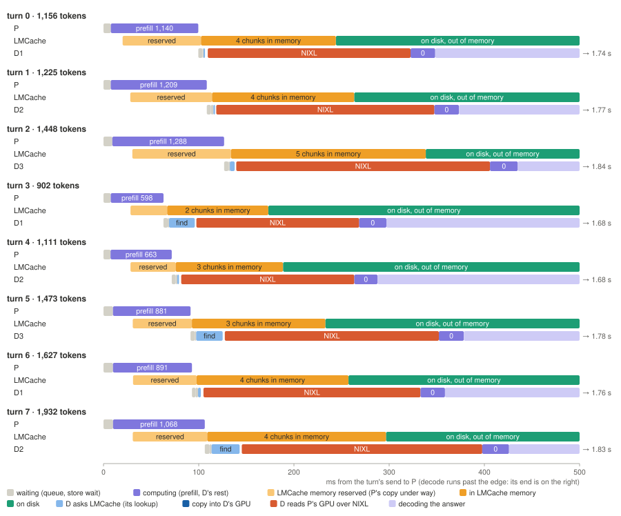

# Conversation 8: mt-rag-clapnq-elser-512-100-20240503 (disk mode, NIXL, shared servers, chat RAG, all passages)

P's KV reaches D over NIXL (D reads P's GPU blocks); every engine's LMCache connector stores beside it, to the one shared server. 8 turns on D1, D2, D3 (round-robin: each turn to the next D engine); prompts grow from 1,156 to 1,932 tokens (interleaved: each turn's prompt is the previous one, its answer, then this turn's documents and question). Chunks are 256 tokens (16 vLLM blocks of 16); a chunk's name is LMCache's hash of its tokens and everything before them, so the same prefix has the same chunks on every turn and engine.

Legend for the strips (one character a chunk): P: `=` on P's GPU from an earlier turn, `#` computed and stored now, `+` computed, not stored (a partial chunk). D: `=` on D's GPU from an earlier turn, `M` pulled from memory, `S` pulled from disk, `N` read from P's GPU over NIXL, `+` computed by D (a partial chunk), `?` missed.

GPU blocks (the chunk tables): where each engine keeps the chunk's 16 vLLM blocks in its GPU KV cache, by vLLM's block ids (vLLM's paged KV cache: a block, or page, holds 16 tokens; block 0 is its reserved null block), in the prompt's block order, a run of consecutive ids written as a range: `P 1, 138-152` is the prompt's block 0 in GPU block 1 and its blocks 1-15 in GPU blocks 138-152. An engine takes a GPU block from its free list when it first computes or loads a block, and the block keeps it while cached, so a later turn that reuses the block shows the same id. Blocks that are the same in several prompts (the same tokens and everything before them) share one GPU block once the first is cached: the system prompt's first block, the same in every conversation, is the usual one. `16/16 hashes = P's`: of the blocks D pulled, how many have the same vLLM hash on D as on P.

The prompts' text is the driver's own record of what it sent (answers included); lines over 100 characters are wrapped here for reading.

| turn | prompt | chunks + tail | P: own GPU / computed / stored | D: own GPU / loaded / computed | pulled | pull ms | D first token ms |
| ---: | ---: | --- | --- | --- | --- | ---: | ---: |
| [0](#turn-0) | 1,156 | 4 + 132 | 16 / 1,140 / 4 chunks | 16 / 1,140 / 0 | 5 chunks (NIXL 5) | 213.0 | 244.5 |
| [1](#turn-1) | 1,225 | 4 + 201 | 16 / 1,209 / 4 chunks | 16 / 1,209 / 0 | 5 chunks (NIXL 5) | 229.0 | 260.5 |
| [2](#turn-2) | 1,448 | 5 + 168 | 160 / 1,288 / 5 chunks | 16 / 1,432 / 0 | 6 chunks (NIXL 6) | 266.5 | 303.8 |
| [3](#turn-3) | 902 | 3 + 134 | 304 / 598 / 2 chunks | 16 / 886 / 0 | 4 chunks (NIXL 4) | 170.9 | 229.8 |
| [4](#turn-4) | 1,111 | 4 + 87 | 448 / 663 / 3 chunks | 160 / 951 / 0 | 5 chunks (NIXL 5) | 181.8 | 211.9 |
| [5](#turn-5) | 1,473 | 5 + 193 | 592 / 881 / 3 chunks | 304 / 1,169 / 0 | 5 chunks (NIXL 5) | 224.8 | 282.6 |
| [6](#turn-6) | 1,627 | 6 + 91 | 736 / 891 / 4 chunks | 448 / 1,179 / 0 | 6 chunks (NIXL 6) | 227.8 | 262.0 |
| [7](#turn-7) | 1,932 | 7 + 140 | 864 / 1,068 / 4 chunks | 592 / 1,340 / 0 | 6 chunks (NIXL 6) | 252.5 | 314.4 |

## How the prompt grows

Each turn's prompt is the previous one, token for token, and then: D's answer to the previous turn, this turn's documents, its question and the framing (the system prompt on turn 0, `Assistant:` and newlines). Only the new tokens can make new chunks: the previous prompt's partial chunk fills first. A document sent before comes again at another place, so in other chunks.

| turn | prompt | new | previous answer | documents | question | framing | whole chunks |
| ---: | ---: | ---: | ---: | --- | --- | ---: | --- |
| 0 | 1,156 | +1,156 | – | 6 docs, 1,113 | 13: what is the defense of marriage act 1996 | 30 | 4 (+4) |
| 1 | 1,225 | +69 | – | 0 docs, 0 | 7: How is marriage defined? | 2 | 4 (+0) |
| 2 | 1,448 | +223 | – | 1 doc, 119 | 7: How are weddings celebrated? | 2 | 5 (+1) |
| 3 | 902 | +-546 | – | 0 docs, 0 | 0 | 0 | 3 (+-2) |
| 4 | 1,111 | +209 | – | 3 docs, 176 | 10: Do all states allow same sex marriages? | 2 | 4 (+1) |
| 5 | 1,473 | +362 | – | 2 docs, 252 | 9: Can same sex couples adopt children? | 2 | 5 (+1) |
| 6 | 1,627 | +154 | – | 0 docs, 0 | 9: Legal immigration for same sex couples. | 2 | 6 (+1) |
| 7 | 1,932 | +305 | – | 2 docs, 291 | 6: Restrictions to immigration. | 2 | 7 (+1) |

## Timeline

Every turn on one clock: ms from the moment the proxy sent the turn to P. P prefills it (one token out) and holds its blocks for D; the proxy sends the turn to the next D engine at once with P's reply's kv_transfer_params (no wait), D reads P's blocks over NIXL (orange-red), computes the rest and decodes the answer. Beside it every engine's LMCache connector stores its new whole chunks (P's lane, and D's own when it stored any). The lanes: P, LMCache (P's chunks), D, and LMCache (D's chunks).



| turn | P queued → done | P's chunks: in memory / on disk | D | D starts | NIXL read | D: held / from P / from LMCache / computed | D's chunks stored | first token | P freed | D done |
| ---: | --- | --- | --- | ---: | --- | --- | ---: | ---: | ---: | ---: |
| 0 | 8 → 100 | 4: 102 / 244 | D1 | 104 | 110-322 | 16 / 1,140 / 0 / 0 | 0 | 348 | 323 | 1,742 |
| 1 | 8 → 108 | 4: 114 / 263 | D2 | 113 | 118-348 | 16 / 1,209 / 0 / 0 | 0 | 373 | 349 | 1,766 |
| 2 | 9 → 127 | 5: 134 / 338 | D3 | 131 | 139-406 | 16 / 1,432 / 0 / 0 | 0 | 435 | 407 | 1,840 |
| 3 | 8 → 63 | 2: 67 / 173 | D1 | 67 | 98-268 | 16 / 886 / 0 / 0 | 0 | 297 | 270 | 1,677 |
| 4 | 7 → 72 | 3: 76 / 189 | D2 | 76 | 82-263 | 160 / 951 / 0 / 0 | 0 | 288 | 264 | 1,678 |
| 5 | 10 → 91 | 3: 93 / 233 | D3 | 96 | 127-352 | 304 / 1,169 / 0 / 0 | 0 | 378 | 353 | 1,782 |
| 6 | 10 → 93 | 4: 98 / 257 | D1 | 97 | 105-333 | 448 / 1,179 / 0 / 0 | 0 | 359 | 334 | 1,761 |
| 7 | 10 → 106 | 4: 109 / 297 | D2 | 112 | 145-398 | 592 / 1,340 / 0 / 0 | 0 | 426 | 398 | 1,829 |

All times in ms from the turn's send to P. NIXL read: D's worker posts the read of P's blocks to the KV in D's GPU blocks; P freed: D has read, P's blocks go back to its free queue (still cached). Each turn's section below tells it in a sentence and step by step.

### One chunk, block by block: chunk 1 of turn 0 (`a73e01feeed8b90e`)

Tokens 256-512 (doc 834188205_251-: 76; doc 834188205_8571: 161; doc 834188205_1069: 19). P computed its blocks; D1 read them from P's GPU over NIXL, P's block into D's block, one for one:

| block | tokens | P's GPU block | vLLM hash on P | D's GPU block | same hash on D |
| ---: | --- | ---: | --- | ---: | --- |
| 16 | 256-272 | 3122 | `da1410bb155baf43` | 1395 | True |
| 17 | 272-288 | 3123 | `346c8aef79fb27c4` | 1396 | True |
| 18 | 288-304 | 3124 | `19b473d5c76b984f` | 1397 | True |
| 19 | 304-320 | 3125 | `958dae1c7ebf75bb` | 1398 | True |
| 20 | 320-336 | 3126 | `e00875d44853e769` | 1399 | True |
| 21 | 336-352 | 3127 | `3e8a6b3ce214773a` | 1400 | True |
| 22 | 352-368 | 3128 | `fc02ee8f71a221fe` | 1401 | True |
| 23 | 368-384 | 3129 | `59d431fb66a6b109` | 1402 | True |
| 24 | 384-400 | 3130 | `0de1990ba4ed7939` | 1403 | True |
| 25 | 400-416 | 3131 | `91dcdafd870bcbce` | 1404 | True |
| 26 | 416-432 | 3132 | `af97d4988363c5c9` | 1405 | True |
| 27 | 432-448 | 3133 | `5293a694b686cdf5` | 1406 | True |
| 28 | 448-464 | 3134 | `eb48145431ce7a84` | 1407 | True |
| 29 | 464-480 | 3135 | `8bb22929a443594a` | 1408 | True |
| 30 | 480-496 | 3136 | `c6c63374cb952423` | 1409 | True |
| 31 | 496-512 | 3137 | `b9962ea997be4ca3` | 1410 | True |

## Turn 0

**Timeline:** P queued until 8 ms, prefilled 1,140 tokens (held 16) and was done at 100 ms; its 4 new chunks were in LMCache's memory at 102 ms, on disk at 244 ms and out of memory. D1 started at 104 ms (no wait) holding 16 tokens, read 1,140 from P's GPU over NIXL (posted at 110 ms, in its GPU at 322 ms; P freed its blocks at 323 ms), computed 0 and gave its first token at 348 ms; it decoded 128 tokens until 1,742 ms. ([all turns](#timeline))

### Step by step

Every move of this turn's KV, ms from the proxy sending the turn to P. P's KV reaches D over NIXL: D's worker reads P's GPU blocks into its own (a NIXL READ, P told when D is done); LMCache's copies (to and from each server's memory) its servers do themselves through CUDA IPC handles each engine registered at start.

| ms | where | what |
| ---: | --- | --- |
| 0.0 | proxy → P | sends the turn (1,156 prompt tokens; P is asked for one token: prefill only) |
| 2.6 | P | the request arrives |
| 7.6 | P GPU | its prefix cache holds 16 of the prompt's tokens: 1 block in GPU blocks 1 |
| 7.6 | P ↔ LMCache | LMCache has 0 of its tokens; P loads 0 and computes the rest |
| 7.7 | P GPU | 72 new GPU blocks for the 1,140 tokens it computes: 3107-3178; the prefill runs |
| 8.0 | P → LMCache | store planned: tokens 0-1,024, chunks 0-3 (64 blocks) |
| 19.5 | LMCache | the store request is in; it waits for P's forward pass to finish (a CUDA event) |
| 20.1 | LMCache memory | space reserved for 4 chunks (117 MB) |
| 95.4 | P GPU → LMCache memory | the copy starts: LMCache reads P's GPU blocks (CUDA IPC) |
| 95.7 | P GPU | the request is done: P holds its 73 blocks for D to read over NIXL, and its reply carries them (kv_transfer_params: the blocks, its NIXL agent) |
| 99.6 | P → proxy | P answers its one token: the prefill is done |
| 100.5 | P GPU → LMCache memory | copy done: 4 chunks, 117 MB in 5.1 ms |
| 102.4 | LMCache memory | 4 chunks in memory, kept for later requests (D gets this turn's KV from P over NIXL); P keeps its copy in its GPU blocks |
| 103.9 | proxy → D1 | sends the turn to D1 at once, with P's kv_transfer_params (round-robin; no wait) |
| 105.1 | D1 ↔ LMCache | asks LMCache for the prompt's chunks |
| 106.6 | LMCache memory | found 1,024 tokens it lacks: 4 chunks in memory |
| 108.5 | D1 GPU | its prefix cache holds 16 of the prompt's tokens: 1 block in GPU blocks 1 |
| 108.5 | D1 ↔ P (NIXL) | will read 1,140 prompt tokens from P's GPU (beyond the 16 its own cache holds) |
| 108.6 | D1 ↔ LMCache | LMCache has 1,024 of its tokens; NIXL loads it (MultiConnector: the first connector with tokens) |
| 108.8 | D1 GPU | 72 GPU blocks for the KV from P: 1380-1451 |
| 109.5 | P GPU → D1 GPU (NIXL) | D1 reads P's GPU blocks 1, 3107-3178 into its 1380-1451 (a NIXL READ) |
| 244.1 | LMCache disk | 4 chunks written to disk (one file each) |
| 244.5 | LMCache memory | 4 memory copies dropped: on disk only now |
| 322.5 | D1 | the KV from P is in its GPU blocks (1,140 tokens) |
| 323.1 | P GPU | D1 has read: P frees its blocks (they stay in its prefix cache) |
| 348.4 | D1 → proxy | the first answer token |
| 467.0 | D1 GPU | 1 new GPU block for the 1 prompt tokens it computes: 1452 |
| 643.1 | D1 GPU | decoding: the answer's KV takes 7 new GPU blocks as it grows, one per 16 tokens: 1453-1459, until 1,698 ms |
| 1,742.3 | D1 | done: 128 tokens decoded; its blocks stay cached in its GPU for the next turn |
| 1,743.4 | proxy | the response is complete |

1,156 prompt tokens: 4 whole chunks and 132 tokens over (the partial chunk, computed by both engines and stored only when a later turn completes it). P held 16 tokens on its GPU, computed 1,140 and stored 4 new chunks; D1 held 16, read 1,140 from P over NIXL, loaded 0 from LMCache and computed 0.

### The prompt

The whole prompt, piece by piece:

- **system prompt** · tokens 0-28 (28) · chunk 0

```text
You are a helpful assistant. Answer the user's last question from the documents. If they do not hold
the answer, say so.
```

<details><summary>document <code>834188205_251-1271-0-1018</code> · tokens 28-332 (304) · chunks 0-1</summary>

```text
Document: Defense of Marriage Act
Defense of Marriage Act
Defense of Marriage Act Long title An Act to define and protect the institution of marriage Acronyms
( colloquial ) DOMA Enacted by the 104th United States Congress Effective September 21 , 1996
Citations Public law Pub. L. 104 -- 199 Statutes at Large 110 Stat. 2419 ( 1996 ) Codification
Titles amended 1 U.S.C. General Provisions 28 U.S.C. Judiciary and Judicial Procedure U.S.C.
sections created 1 U.S.C. § 7 ( Struck down , June 26 , 2013 ) Legislative history Introduced in the
House as H.R. 3396 by Bob Barr ( R -- GA ) on May 7 , 1996 Committee consideration by Committee on
the Judiciary ( Subcommittee on the Constitution ) Passed the House on July 12 , 1996 ( Yeas : 342 ;
Nays : 67 ) Passed the Senate on September 10 , 1996 ( Yeas : 85 ; Nays : 14 ) Signed into law by
President Bill Clinton on September 21 , 1996 United States Supreme Court cases United States v.
Windsor , No. 12 - 307 , 570 U.S. ___ ( 2013 ) , in which Section 3 ( 1 U.S.C. § 7 ) was struck down
by the Supreme Court on June 26 , 2013
```

</details>

<details><summary>document <code>834188205_8571-9285-0-714</code> · tokens 332-493 (161) · chunk 1</summary>

```text
Document: Defense of Marriage Act
Defense of Marriage Act
Georgia Representative Bob Barr , then a Republican , authored the Defense of Marriage Act and
introduced it in the House of Representatives on May 7 , 1996 . Senator Don Nickles , ( R ) Oklahoma
, introduced the bill in the Senate . The House Judiciary Committee stated that the Act was intended
by Congress to `` reflect and honor a collective moral judgment and to express moral disapproval of
homosexuality '' . The Act 's congressional sponsors stated , `` ( T ) he bill amends the U.S. Code
to make explicit what has been understood under federal law for over 200 years ; that a marriage is
the legal union of a man and a woman as husband and wife , and a spouse is a husband or wife of the
opposite sex . ''
```

</details>

<details><summary>document <code>834188205_10696-11590-0-894</code> · tokens 493-697 (204) · chunks 1-2</summary>

```text
Document: Defense of Marriage Act
Defense of Marriage Act
The bill moved through Congress on a legislative fast track and met with overwhelming approval in
both houses of the Republican - controlled Congress . On July 12 , 1996 , with only 65 Democrats and
then Rep. Bernie Sanders ( Independent - Vermont ) and Rep. Steve Gunderson ( Republican - Wisconsin
) , in opposition , 342 members of the U.S. House of Representatives -- 224 Republicans and 118
Democrats -- voted to pass DOMA . Then , on September 10 , 1996 , 84 Senators -- a majority of the
Democratic Senators and all of the Republicans -- voted in favor of DOMA . Democratic Senators voted
for the bill 32 to 14 ( with Pryor of Arkansas absent ) , and Democratic Representatives voted for
it 118 to 65 , with 15 not participating . All Republicans in both houses voted for the bill with
the sole exception of the one openly gay Republican Congressman , Rep. Steve Gunderson of Wisconsin
.
```

</details>

<details><summary>document <code>834188205_1272-2165-0-891</code> · tokens 697-910 (213) · chunks 2-3</summary>

```text
Document: Defense of Marriage Act
Defense of Marriage Act
The Defense of Marriage Act ( DOMA ) ( Pub. L. 104 -- 199 , 110 Stat. 2419 , enacted September 21 ,
1996 , 1 U.S.C. § 7 and 28 U.S.C. § 1738C ) was a United States federal law that , prior to being
ruled unconstitutional , defined marriage for federal purposes as the union of one man and one woman
, and allowed states to refuse to recognize same - sex marriages granted under the laws of other
states . Until Section 3 of the Act was struck down in 2013 ( United States v. Windsor ) , DOMA , in
conjunction with other statutes , had barred same - sex married couples from being recognized as ``
spouses '' for purposes of federal laws , effectively barring them from receiving federal marriage
benefits . DOMA 's passage did not prevent individual states from recognizing same - sex marriage ,
but it imposed constraints on the benefits received by all legally married same - sex couples .
```

</details>

<details><summary>document <code>834188205_2166-2927-0-760</code> · tokens 910-1069 (159) · chunks 3-4</summary>

```text
Document: Defense of Marriage Act
Defense of Marriage Act
Initially introduced in May 1996 , DOMA passed both houses of Congress by large , veto - proof
majorities and was signed into law by President Bill Clinton in September 1996 . By defining ``
spouse '' and its related terms to signify a heterosexual couple in a recognized marriage , Section
3 codified non-recognition of same - sex marriages for all federal purposes , including insurance
benefits for government employees , social security survivors ' benefits , immigration , bankruptcy
, and the filing of joint tax returns , as well as excluding same - sex spouses from the scope of
laws protecting families of federal officers ( 18 U.S.C. § 115 ) , laws evaluating financial aid
eligibility , and federal ethics laws applicable to opposite - sex spouses .
```

</details>

<details><summary>document <code>834188205_51385-51606-0-221</code> · tokens 1069-1141 (72) · chunk 4</summary>

```text
Document: Defense of Marriage Act
Defense of Marriage Act
On June 26 , 2015 the U.S. Supreme Court ruled in Obergefell v. Hodges that the 14th Amendment
requires all U.S. state laws to recognize same - sex marriages . This left Section 2 of DOMA as
superseded and unenforceable .
```

</details>

- **question 0** · tokens 1141-1154 (13) · chunk 4

```text
User: what is the defense of marriage act 1996
```

- `Assistant:` · tokens 1154-1156 (2) · chunk 4

### Pieces, chunks and blocks

| piece | tokens | length | chunks | |
| --- | --- | ---: | --- | --- |
| system | 0-28 | 28 | 0 |  |
| doc 834188205_251- | 28-332 | 304 | 0-1 |  |
| doc 834188205_8571 | 332-493 | 161 | 1 |  |
| doc 834188205_1069 | 493-697 | 204 | 1-2 |  |
| doc 834188205_1272 | 697-910 | 213 | 2-3 |  |
| doc 834188205_2166 | 910-1069 | 159 | 3-4 |  |
| doc 834188205_5138 | 1069-1141 | 72 | 4 |  |
| question 0 | 1141-1154 | 13 | 4 |  |
| `assistant:` 0 | 1154-1156 | 2 | 4 |  |

```
P  ####+
D  NNNNN
```

| chunk | tokens | pieces in it (tokens) | vLLM blocks | GPU blocks | in LMCache | P this turn | D this turn |
| ---: | --- | --- | --- | --- | --- | --- | --- |
| 0 | 0-256 | system: 28; doc 834188205_251-: 228 | 0-15 | P 1, 3107-3121; D 1, 1380-1394; 15/15 hashes = P's | `6e9e89e257326d74` stored on turn 0 by P, on disk, out of memory | computed (its first 16 tokens on P's GPU already), **stored now** | **read from P's GPU over NIXL** (its first 16 tokens on D's GPU already) |
| 1 | 256-512 | doc 834188205_251-: 76; doc 834188205_8571: 161; doc 834188205_1069: 19 | 16-31 | P 3122-3137; D 1395-1410; 16/16 hashes = P's | `a73e01feeed8b90e` stored on turn 0 by P, on disk, out of memory | computed, **stored now** | **read from P's GPU over NIXL** |
| 2 | 512-768 | doc 834188205_1069: 185; doc 834188205_1272: 71 | 32-47 | P 3138-3153; D 1411-1426; 16/16 hashes = P's | `b07dd78e5dd6bcf8` stored on turn 0 by P, on disk, out of memory | computed, **stored now** | **read from P's GPU over NIXL** |
| 3 | 768-1024 | doc 834188205_1272: 142; doc 834188205_2166: 114 | 48-63 | P 3154-3169; D 1427-1442; 16/16 hashes = P's | `0535ded48981788d` stored on turn 0 by P, on disk, out of memory | computed, **stored now** | **read from P's GPU over NIXL** |
| 4 | 1024-1156 | doc 834188205_2166: 45; doc 834188205_5138: 72; question 0: 13; `assistant:` 0: 2 | 64-72 | P 3170-3177; D 1443-1451; 8/8 hashes = P's | – | computed (partial chunk: not stored) | **read from P's GPU over NIXL** (partial chunk) |

## Turn 1

**Timeline:** P queued until 8 ms, prefilled 1,209 tokens (held 16) and was done at 108 ms; its 4 new chunks were in LMCache's memory at 114 ms, on disk at 263 ms and out of memory. D2 started at 113 ms (no wait) holding 16 tokens, read 1,209 from P's GPU over NIXL (posted at 118 ms, in its GPU at 348 ms; P freed its blocks at 349 ms), computed 0 and gave its first token at 373 ms; it decoded 128 tokens until 1,766 ms. ([all turns](#timeline))

### Step by step

Every move of this turn's KV, ms from the proxy sending the turn to P. P's KV reaches D over NIXL: D's worker reads P's GPU blocks into its own (a NIXL READ, P told when D is done); LMCache's copies (to and from each server's memory) its servers do themselves through CUDA IPC handles each engine registered at start.

| ms | where | what |
| ---: | --- | --- |
| 0.0 | proxy → P | sends the turn (1,225 prompt tokens; P is asked for one token: prefill only) |
| 2.9 | P | the request arrives |
| 7.3 | P GPU | its prefix cache holds 16 of the prompt's tokens: 1 block in GPU blocks 1 |
| 7.4 | P ↔ LMCache | LMCache has 0 of its tokens; P loads 0 and computes the rest |
| 7.6 | P GPU | 76 new GPU blocks for the 1,209 tokens it computes: 3178-3253; the prefill runs |
| 8.1 | P → LMCache | store planned: tokens 0-1,024, chunks 0-3 (64 blocks) |
| 27.4 | LMCache | the store request is in; it waits for P's forward pass to finish (a CUDA event) |
| 28.1 | LMCache memory | space reserved for 4 chunks (117 MB) |
| 104.5 | P GPU → LMCache memory | the copy starts: LMCache reads P's GPU blocks (CUDA IPC) |
| 104.6 | P GPU | the request is done: P holds its 77 blocks for D to read over NIXL, and its reply carries them (kv_transfer_params: the blocks, its NIXL agent) |
| 108.5 | P → proxy | P answers its one token: the prefill is done |
| 109.5 | P GPU → LMCache memory | copy done: 4 chunks, 117 MB in 5.0 ms |
| 112.8 | proxy → D2 | sends the turn to D2 at once, with P's kv_transfer_params (round-robin; no wait) |
| 114.0 | LMCache memory | 4 chunks in memory, kept for later requests (D gets this turn's KV from P over NIXL); P keeps its copy in its GPU blocks |
| 115.4 | D2 ↔ LMCache | asks LMCache for the prompt's chunks |
| 117.1 | LMCache memory | found 1,024 tokens it lacks: 4 chunks in memory |
| 117.5 | D2 GPU | its prefix cache holds 16 of the prompt's tokens: 1 block in GPU blocks 1 |
| 117.5 | D2 ↔ P (NIXL) | will read 1,209 prompt tokens from P's GPU (beyond the 16 its own cache holds) |
| 117.6 | D2 ↔ LMCache | LMCache has 1,024 of its tokens; NIXL loads it (MultiConnector: the first connector with tokens) |
| 117.8 | D2 GPU | 76 GPU blocks for the KV from P: 1380-1455 |
| 118.4 | P GPU → D2 GPU (NIXL) | D2 reads P's GPU blocks 1, 3178-3253 into its 1380-1455 (a NIXL READ) |
| 263.4 | LMCache disk | 4 chunks written to disk (one file each) |
| 263.8 | LMCache memory | 4 memory copies dropped: on disk only now |
| 347.5 | D2 | the KV from P is in its GPU blocks (1,209 tokens) |
| 348.7 | P GPU | D2 has read: P frees its blocks (they stay in its prefix cache) |
| 373.3 | D2 → proxy | the first answer token |
| 436.9 | D2 GPU | 1 new GPU block for the 1 prompt tokens it computes: 1456 |
| 612.6 | D2 GPU | decoding: the answer's KV takes 7 new GPU blocks as it grows, one per 16 tokens: 1457-1463, until 1,667 ms |
| 1,766.0 | D2 | done: 128 tokens decoded; its blocks stay cached in its GPU for the next turn |
| 1,767.3 | proxy | the response is complete |

1,225 prompt tokens: 4 whole chunks and 201 tokens over (the partial chunk, computed by both engines and stored only when a later turn completes it). P held 16 tokens on its GPU, computed 1,209 and stored 4 new chunks; D2 held 16, read 1,209 from P over NIXL, loaded 0 from LMCache and computed 0.

### The prompt

Tokens 0-1,156: [turn 0](#turn-0)'s prompt, unchanged (NOT the previous prompt's ids), so chunks 0-3 are the same chunks; chunk 4 (partial then, 132 tokens) fills now. New from token 1,156:

- **question 1** · tokens 1216-1223 (7) · chunk 4

```text
User: How is marriage defined?
```

- `Assistant:` · tokens 1223-1225 (2) · chunk 4

### Pieces, chunks and blocks

| piece | tokens | length | chunks | |
| --- | --- | ---: | --- | --- |
| system | 0-28 | 28 | 0 |  |
| question 0 | 28-41 | 13 | 0 |  |
| `assistant:` 0 | 41-43 | 2 | 0 |  |
| answer 0 | 43-171 | 128 | 0 |  |
| newline 0 | 171-172 | 1 | 0 |  |
| doc 834188205_2166 | 172-331 | 159 | 0-1 |  |
| doc 834188205_1272 | 331-544 | 213 | 1-2 |  |
| doc 834188205_7556 | 544-751 | 207 | 2 |  |
| doc 834188205_251- | 751-1055 | 304 | 2-4 |  |
| doc 834188205_8571 | 1055-1216 | 161 | 4 |  |
| question 1 | 1216-1223 | 7 | 4 | new this turn |
| `assistant:` 1 | 1223-1225 | 2 | 4 | new this turn |

```
P  ####+
D  NNNNN
```

| chunk | tokens | pieces in it (tokens) | vLLM blocks | GPU blocks | in LMCache | P this turn | D this turn |
| ---: | --- | --- | --- | --- | --- | --- | --- |
| 0 | 0-256 | system: 28; question 0: 13; `assistant:` 0: 2; answer 0: 128; newline 0: 1; doc 834188205_2166: 84 | 0-15 | P 1, 3178-3192; D 1, 1380-1394; 15/15 hashes = P's | `5287444b604a6d6a` stored on turn 1 by P, on disk, out of memory | computed (its first 16 tokens on P's GPU already), **stored now** | **read from P's GPU over NIXL** (its first 16 tokens on D's GPU already) |
| 1 | 256-512 | doc 834188205_2166: 75; doc 834188205_1272: 181 | 16-31 | P 3193-3208; D 1395-1410; 16/16 hashes = P's | `a60e63992c9a30b6` stored on turn 1 by P, on disk, out of memory | computed, **stored now** | **read from P's GPU over NIXL** |
| 2 | 512-768 | doc 834188205_1272: 32; doc 834188205_7556: 207; doc 834188205_251-: 17 | 32-47 | P 3209-3224; D 1411-1426; 16/16 hashes = P's | `8a5c483354e9e85a` stored on turn 1 by P, on disk, out of memory | computed, **stored now** | **read from P's GPU over NIXL** |
| 3 | 768-1024 | doc 834188205_251-: 256 | 48-63 | P 3225-3240; D 1427-1442; 16/16 hashes = P's | `e0c70478ed005233` stored on turn 1 by P, on disk, out of memory | computed, **stored now** | **read from P's GPU over NIXL** |
| 4 | 1024-1225 | doc 834188205_251-: 31; doc 834188205_8571: 161; question 1 (new): 7; `assistant:` 1 (new): 2 | 64-76 | P 3241-3252; D 1443-1455; 12/12 hashes = P's | – | computed (partial chunk: not stored) | **read from P's GPU over NIXL** (partial chunk) |

## Turn 2

**Timeline:** P queued until 9 ms, prefilled 1,288 tokens (held 160) and was done at 127 ms; its 5 new chunks were in LMCache's memory at 134 ms, on disk at 338 ms and out of memory. D3 started at 131 ms (no wait) holding 16 tokens, read 1,432 from P's GPU over NIXL (posted at 139 ms, in its GPU at 406 ms; P freed its blocks at 407 ms), computed 0 and gave its first token at 435 ms; it decoded 128 tokens until 1,840 ms. ([all turns](#timeline))

### Step by step

Every move of this turn's KV, ms from the proxy sending the turn to P. P's KV reaches D over NIXL: D's worker reads P's GPU blocks into its own (a NIXL READ, P told when D is done); LMCache's copies (to and from each server's memory) its servers do themselves through CUDA IPC handles each engine registered at start.

| ms | where | what |
| ---: | --- | --- |
| 0.0 | proxy → P | sends the turn (1,448 prompt tokens; P is asked for one token: prefill only) |
| 3.1 | P | the request arrives |
| 9.1 | P GPU | its prefix cache holds 160 of the prompt's tokens: 10 blocks in GPU blocks 1, 3178-3186 |
| 9.2 | P ↔ LMCache | LMCache has 0 of its tokens; P loads 0 and computes the rest |
| 9.3 | P GPU | 81 new GPU blocks for the 1,288 tokens it computes: 3253-3333; the prefill runs |
| 9.9 | P → LMCache | store planned: tokens 0-1,280, chunks 0-4 (80 blocks) |
| 29.3 | LMCache | the store request is in; it waits for P's forward pass to finish (a CUDA event) |
| 30.3 | LMCache memory | space reserved for 5 chunks (147 MB) |
| 122.3 | P GPU → LMCache memory | the copy starts: LMCache reads P's GPU blocks (CUDA IPC) |
| 122.5 | P GPU | the request is done: P holds its 91 blocks for D to read over NIXL, and its reply carries them (kv_transfer_params: the blocks, its NIXL agent) |
| 126.7 | P → proxy | P answers its one token: the prefill is done |
| 128.7 | P GPU → LMCache memory | copy done: 5 chunks, 147 MB in 6.3 ms |
| 131.3 | proxy → D3 | sends the turn to D3 at once, with P's kv_transfer_params (round-robin; no wait) |
| 132.7 | D3 ↔ LMCache | asks LMCache for the prompt's chunks |
| 133.9 | LMCache memory | 5 chunks in memory, kept for later requests (D gets this turn's KV from P over NIXL); P keeps its copy in its GPU blocks |
| 137.8 | LMCache memory | found 0 tokens it lacks |
| 138.9 | D3 GPU | its prefix cache holds 16 of the prompt's tokens: 1 block in GPU blocks 1 |
| 139.0 | D3 ↔ P (NIXL) | will read 1,432 prompt tokens from P's GPU (beyond the 16 its own cache holds) |
| 139.0 | D3 ↔ LMCache | LMCache has 0 of its tokens; NIXL loads it (MultiConnector: the first connector with tokens) |
| 139.1 | D3 GPU | 90 GPU blocks for the KV from P: 1408-1497 |
| 139.4 | P GPU → D3 GPU (NIXL) | D3 reads P's GPU blocks 1, 3178-3186, 3253-3333 into its 1408-1497 (a NIXL READ) |
| 338.5 | LMCache disk | 5 chunks written to disk (one file each) |
| 339.1 | LMCache memory | 5 memory copies dropped: on disk only now |
| 405.9 | D3 | the KV from P is in its GPU blocks (1,432 tokens) |
| 406.8 | P GPU | D3 has read: P frees its blocks (they stay in its prefix cache) |
| 416.5 | D3 → LMCache | store planned: tokens 0-1,280; its server has them all already |
| 435.1 | D3 → proxy | the first answer token |
| 452.8 | LMCache memory | the read buffer dropped (5 chunks) |
| 512.1 | D3 GPU | 1 new GPU block for the 1 prompt tokens it computes: 1498 |
| 688.7 | D3 GPU | decoding: the answer's KV takes 7 new GPU blocks as it grows, one per 16 tokens: 1499-1505, until 1,751 ms |
| 1,839.8 | D3 | done: 128 tokens decoded; its blocks stay cached in its GPU for the next turn |
| 1,840.9 | proxy | the response is complete |

1,448 prompt tokens: 5 whole chunks and 168 tokens over (the partial chunk, computed by both engines and stored only when a later turn completes it). P held 160 tokens on its GPU, computed 1,288 and stored 5 new chunks; D3 held 16, read 1,432 from P over NIXL, loaded 0 from LMCache and computed 0.

### The prompt

Tokens 0-1,225: [turn 1](#turn-1)'s prompt, unchanged (NOT the previous prompt's ids), so chunks 0-3 are the same chunks; chunk 4 (partial then, 201 tokens) fills now. New from token 1,225:

<details><summary>document <code>834188205_30111-30591-0-480</code> · tokens 1320-1439 (119) · chunk 5</summary>

```text
Document: Defense of Marriage Act
Defense of Marriage Act
On March 3 , 2009 , GLAD filed a federal court challenge , Gill v. Office of Personnel Management ,
based on the Equal Protection Clause and the federal government 's consistent deference to each
state 's definition of marriage prior to the enactment of DOMA . The case questioned only the DOMA
provision that the federal government defines marriage as the union of a man and a woman . On May 6
, 2010 , Judge Joseph L. Tauro heard arguments in the U.S. District Court in Boston .
```

</details>

- **question 2** · tokens 1439-1446 (7) · chunk 5

```text
User: How are weddings celebrated?
```

- `Assistant:` · tokens 1446-1448 (2) · chunk 5

### Pieces, chunks and blocks

| piece | tokens | length | chunks | |
| --- | --- | ---: | --- | --- |
| system | 0-28 | 28 | 0 |  |
| question 0 | 28-41 | 13 | 0 |  |
| `assistant:` 0 | 41-43 | 2 | 0 |  |
| answer 0 | 43-171 | 128 | 0 |  |
| newline 0 | 171-172 | 1 | 0 |  |
| question 1 | 172-179 | 7 | 0 |  |
| `assistant:` 1 | 179-181 | 2 | 0 |  |
| answer 1 | 181-309 | 128 | 0-1 |  |
| newline 1 | 309-310 | 1 | 1 |  |
| doc 853841453_3262 | 310-448 | 138 | 1 |  |
| doc 817115950_2342 | 448-747 | 299 | 1-2 |  |
| doc 834188205_5138 | 747-819 | 72 | 2-3 |  |
| doc 834188205_2928 | 819-900 | 81 | 3 |  |
| doc 834188205_7556 | 900-1107 | 207 | 3-4 |  |
| doc 834188205_1272 | 1107-1320 | 213 | 4-5 |  |
| doc 834188205_3011 | 1320-1439 | 119 | 5 | new this turn |
| question 2 | 1439-1446 | 7 | 5 | new this turn |
| `assistant:` 2 | 1446-1448 | 2 | 5 | new this turn |

```
P  #####+
D  NNNNNN
```

| chunk | tokens | pieces in it (tokens) | vLLM blocks | GPU blocks | in LMCache | P this turn | D this turn |
| ---: | --- | --- | --- | --- | --- | --- | --- |
| 0 | 0-256 | system: 28; question 0: 13; `assistant:` 0: 2; answer 0: 128; newline 0: 1; question 1: 7; `assistant:` 1: 2; answer 1: 75 | 0-15 | P 1, 3178-3186, 3253-3258; D 1, 1408-1422; 6/6 hashes = P's | `f315a89b1e0bc2f2` stored on turn 2 by P, on disk, out of memory | computed (its first 160 tokens on P's GPU already), **stored now** | **read from P's GPU over NIXL** (its first 16 tokens on D's GPU already) |
| 1 | 256-512 | answer 1: 53; newline 1: 1; doc 853841453_3262: 138; doc 817115950_2342: 64 | 16-31 | P 3259-3274; D 1423-1438; 16/16 hashes = P's | `134494c68f5a0aab` stored on turn 2 by P, on disk, out of memory | computed, **stored now** | **read from P's GPU over NIXL** |
| 2 | 512-768 | doc 817115950_2342: 235; doc 834188205_5138: 21 | 32-47 | P 3275-3290; D 1439-1454; 16/16 hashes = P's | `b0a33997c01dbc37` stored on turn 2 by P, on disk, out of memory | computed, **stored now** | **read from P's GPU over NIXL** |
| 3 | 768-1024 | doc 834188205_5138: 51; doc 834188205_2928: 81; doc 834188205_7556: 124 | 48-63 | P 3291-3306; D 1455-1470; 16/16 hashes = P's | `e88c97c760a604a7` stored on turn 2 by P, on disk, out of memory | computed, **stored now** | **read from P's GPU over NIXL** |
| 4 | 1024-1280 | doc 834188205_7556: 83; doc 834188205_1272: 173 | 64-79 | P 3307-3322; D 1471-1486; 16/16 hashes = P's | `73207c482b9dc181` stored on turn 2 by P, on disk, out of memory | computed, **stored now** | **read from P's GPU over NIXL** |
| 5 | 1280-1448 | doc 834188205_1272: 40; doc 834188205_3011 (new): 119; question 2 (new): 7; `assistant:` 2 (new): 2 | 80-90 | P 3323-3332; D 1487-1497; 10/10 hashes = P's | – | computed (partial chunk: not stored) | **read from P's GPU over NIXL** (partial chunk) |

## Turn 3

**Timeline:** P queued until 8 ms, prefilled 598 tokens (held 304) and was done at 63 ms; its 2 new chunks were in LMCache's memory at 67 ms, on disk at 173 ms and out of memory. D1 started at 67 ms (no wait) holding 16 tokens, read 886 from P's GPU over NIXL (posted at 98 ms, in its GPU at 268 ms; P freed its blocks at 270 ms), computed 0 and gave its first token at 297 ms; it decoded 128 tokens until 1,677 ms. ([all turns](#timeline))

### Step by step

Every move of this turn's KV, ms from the proxy sending the turn to P. P's KV reaches D over NIXL: D's worker reads P's GPU blocks into its own (a NIXL READ, P told when D is done); LMCache's copies (to and from each server's memory) its servers do themselves through CUDA IPC handles each engine registered at start.

| ms | where | what |
| ---: | --- | --- |
| 0.0 | proxy → P | sends the turn (902 prompt tokens; P is asked for one token: prefill only) |
| 2.8 | P | the request arrives |
| 7.3 | P GPU | its prefix cache holds 304 of the prompt's tokens: 19 blocks in GPU blocks 1, 3178-3186, 3253-3261 |
| 7.4 | P ↔ LMCache | LMCache has 256 of its tokens; P loads 0 and computes the rest |
| 7.6 | P GPU | 38 new GPU blocks for the 598 tokens it computes: 3333-3370; the prefill runs |
| 8.0 | P → LMCache | store planned: tokens 256-768, chunks 1-2 (32 blocks) |
| 27.8 | LMCache | the store request is in; it waits for P's forward pass to finish (a CUDA event) |
| 28.3 | LMCache memory | space reserved for 2 chunks (59 MB) |
| 59.7 | P GPU → LMCache memory | the copy starts: LMCache reads P's GPU blocks (CUDA IPC) |
| 59.8 | P GPU | the request is done: P holds its 57 blocks for D to read over NIXL, and its reply carries them (kv_transfer_params: the blocks, its NIXL agent) |
| 62.3 | P GPU → LMCache memory | copy done: 2 chunks, 59 MB in 2.6 ms |
| 63.0 | P → proxy | P answers its one token: the prefill is done |
| 66.9 | LMCache memory | 2 chunks in memory, kept for later requests (D gets this turn's KV from P over NIXL); P keeps its copy in its GPU blocks |
| 67.4 | proxy → D1 | sends the turn to D1 at once, with P's kv_transfer_params (round-robin; no wait) |
| 68.8 | D1 ↔ LMCache | asks LMCache for the prompt's chunks |
| 95.9 | LMCache disk → memory | found 768 tokens it lacks: 1 chunk read from disk into a memory buffer |
| 96.5 | D1 GPU | its prefix cache holds 16 of the prompt's tokens: 1 block in GPU blocks 1 |
| 96.5 | D1 ↔ P (NIXL) | will read 886 prompt tokens from P's GPU (beyond the 16 its own cache holds) |
| 96.6 | D1 ↔ LMCache | LMCache has 768 of its tokens; NIXL loads it (MultiConnector: the first connector with tokens) |
| 96.8 | D1 GPU | 56 GPU blocks for the KV from P: 1459-1514 |
| 97.5 | P GPU → D1 GPU (NIXL) | D1 reads P's GPU blocks 1 … 3333-3370 (57 blocks) into its 1459-1514 (a NIXL READ) |
| 173.1 | LMCache disk | 2 chunks written to disk (one file each) |
| 173.5 | LMCache memory | 2 memory copies dropped: on disk only now |
| 268.5 | D1 | the KV from P is in its GPU blocks (886 tokens) |
| 269.7 | P GPU | D1 has read: P frees its blocks (they stay in its prefix cache) |
| 297.1 | D1 → proxy | the first answer token |
| 393.4 | D1 GPU | 1 new GPU block for the 1 prompt tokens it computes: 1515 |
| 567.3 | D1 GPU | decoding: the answer's KV takes 7 new GPU blocks as it grows, one per 16 tokens: 1516-1522, until 1,611 ms |
| 1,677.1 | D1 | done: 128 tokens decoded; its blocks stay cached in its GPU for the next turn |
| 1,678.1 | proxy | the response is complete |

902 prompt tokens: 3 whole chunks and 134 tokens over (the partial chunk, computed by both engines and stored only when a later turn completes it). P held 304 tokens on its GPU, computed 598 and stored 2 new chunks; D1 held 16, read 886 from P over NIXL, loaded 0 from LMCache and computed 0.

### The prompt

Tokens 0-1,448: [turn 2](#turn-2)'s prompt, unchanged (NOT the previous prompt's ids), so chunks 0-4 are the same chunks; chunk 5 (partial then, 168 tokens) fills now. New from token 1,448:

### Pieces, chunks and blocks

| piece | tokens | length | chunks | |
| --- | --- | ---: | --- | --- |
| system | 0-28 | 28 | 0 |  |
| question 0 | 28-41 | 13 | 0 |  |
| `assistant:` 0 | 41-43 | 2 | 0 |  |
| answer 0 | 43-171 | 128 | 0 |  |
| newline 0 | 171-172 | 1 | 0 |  |
| question 1 | 172-179 | 7 | 0 |  |
| `assistant:` 1 | 179-181 | 2 | 0 |  |
| answer 1 | 181-309 | 128 | 0-1 |  |
| newline 1 | 309-310 | 1 | 1 |  |
| question 2 | 310-317 | 7 | 1 |  |
| `assistant:` 2 | 317-319 | 2 | 1 |  |
| answer 2 | 319-447 | 128 | 1 |  |
| newline 2 | 447-448 | 1 | 1 |  |
| doc 866379367_6324 | 448-597 | 149 | 1-2 |  |
| doc 866379367_6974 | 597-686 | 89 | 2 |  |
| doc 866379367_5928 | 686-786 | 100 | 2-3 |  |
| doc 866379367_7371 | 786-813 | 27 | 3 |  |
| doc 866379367_229- | 813-884 | 71 | 3 |  |
| question 3 | 884-900 | 16 | 3 |  |
| `assistant:` 3 | 900-902 | 2 | 3 |  |

```
P  =##+
D  NNNN
```

| chunk | tokens | pieces in it (tokens) | vLLM blocks | GPU blocks | in LMCache | P this turn | D this turn |
| ---: | --- | --- | --- | --- | --- | --- | --- |
| 0 | 0-256 | system: 28; question 0: 13; `assistant:` 0: 2; answer 0: 128; newline 0: 1; question 1: 7; `assistant:` 1: 2; answer 1: 75 | 0-15 | P 1, 3178-3186, 3253-3258; D 1, 1459-1473 | `f315a89b1e0bc2f2` stored on turn 2 by P, on disk, out of memory | on P's GPU (earlier turn) | **read from P's GPU over NIXL** (its first 16 tokens on D's GPU already) |
| 1 | 256-512 | answer 1: 53; newline 1: 1; question 2: 7; `assistant:` 2: 2; answer 2: 128; newline 2: 1; doc 866379367_6324: 64 | 16-31 | P 3259-3261, 3333-3345; D 1474-1489; 13/13 hashes = P's | `278d97f505f030af` stored on turn 3 by P, on disk, out of memory | computed (its first 48 tokens on P's GPU already), **stored now** | **read from P's GPU over NIXL** |
| 2 | 512-768 | doc 866379367_6324: 85; doc 866379367_6974: 89; doc 866379367_5928: 82 | 32-47 | P 3346-3361; D 1490-1505; 16/16 hashes = P's | `e8da14099d2ed5a1` stored on turn 3 by P, on disk, out of memory | computed, **stored now** | **read from P's GPU over NIXL** |
| 3 | 768-902 | doc 866379367_5928: 18; doc 866379367_7371: 27; doc 866379367_229-: 71; question 3: 16; `assistant:` 3: 2 | 48-56 | P 3362-3369; D 1506-1514; 8/8 hashes = P's | – | computed (partial chunk: not stored) | **read from P's GPU over NIXL** (partial chunk) |

## Turn 4

**Timeline:** P queued until 7 ms, prefilled 663 tokens (held 448) and was done at 72 ms; its 3 new chunks were in LMCache's memory at 76 ms, on disk at 189 ms and out of memory. D2 started at 76 ms (no wait) holding 160 tokens, read 951 from P's GPU over NIXL (posted at 82 ms, in its GPU at 263 ms; P freed its blocks at 264 ms), computed 0 and gave its first token at 288 ms; it decoded 128 tokens until 1,678 ms. ([all turns](#timeline))

### Step by step

Every move of this turn's KV, ms from the proxy sending the turn to P. P's KV reaches D over NIXL: D's worker reads P's GPU blocks into its own (a NIXL READ, P told when D is done); LMCache's copies (to and from each server's memory) its servers do themselves through CUDA IPC handles each engine registered at start.

| ms | where | what |
| ---: | --- | --- |
| 0.0 | proxy → P | sends the turn (1,111 prompt tokens; P is asked for one token: prefill only) |
| 2.8 | P | the request arrives |
| 7.2 | P GPU | its prefix cache holds 448 of the prompt's tokens: GPU blocks 1 … 3333-3341 (28 blocks) |
| 7.3 | P ↔ LMCache | LMCache has 256 of its tokens; P loads 0 and computes the rest |
| 7.4 | P GPU | 42 new GPU blocks for the 663 tokens it computes: 3370-3411; the prefill runs |
| 7.9 | P → LMCache | store planned: tokens 256-1,024, chunks 1-3 (48 blocks) |
| 27.7 | LMCache | the store request is in; it waits for P's forward pass to finish (a CUDA event) |
| 28.3 | LMCache memory | space reserved for 3 chunks (88 MB) |
| 68.1 | P GPU → LMCache memory | the copy starts: LMCache reads P's GPU blocks (CUDA IPC) |
| 68.3 | P GPU | the request is done: P holds its 70 blocks for D to read over NIXL, and its reply carries them (kv_transfer_params: the blocks, its NIXL agent) |
| 71.7 | P → proxy | P answers its one token: the prefill is done |
| 72.0 | P GPU → LMCache memory | copy done: 3 chunks, 88 MB in 3.8 ms |
| 75.9 | proxy → D2 | sends the turn to D2 at once, with P's kv_transfer_params (round-robin; no wait) |
| 75.9 | LMCache memory | 3 chunks in memory, kept for later requests (D gets this turn's KV from P over NIXL); P keeps its copy in its GPU blocks |
| 77.5 | D2 ↔ LMCache | asks LMCache for the prompt's chunks |
| 79.3 | LMCache memory | found 1,024 tokens it lacks: 4 chunks in memory |
| 80.5 | D2 GPU | its prefix cache holds 160 of the prompt's tokens: 10 blocks in GPU blocks 1, 1380-1388 |
| 80.6 | D2 ↔ P (NIXL) | will read 951 prompt tokens from P's GPU (beyond the 160 its own cache holds) |
| 80.6 | D2 ↔ LMCache | LMCache has 1,024 of its tokens; NIXL loads it (MultiConnector: the first connector with tokens) |
| 80.8 | D2 GPU | 60 GPU blocks for the KV from P: 1463-1522 |
| 81.6 | P GPU → D2 GPU (NIXL) | D2 reads P's GPU blocks 1 … 3370-3411 (70 blocks) into its 1463-1522 (a NIXL READ) |
| 188.6 | LMCache disk | 3 chunks written to disk (one file each) |
| 189.0 | LMCache memory | 3 memory copies dropped: on disk only now |
| 263.4 | D2 | the KV from P is in its GPU blocks (951 tokens) |
| 264.5 | P GPU | D2 has read: P frees its blocks (they stay in its prefix cache) |
| 287.8 | D2 → proxy | the first answer token |
| 373.6 | D2 GPU | 1 new GPU block for the 1 prompt tokens it computes: 1523 |
| 548.8 | D2 GPU | decoding: the answer's KV takes 7 new GPU blocks as it grows, one per 16 tokens: 1524-1530, until 1,601 ms |
| 1,677.8 | D2 | done: 128 tokens decoded; its blocks stay cached in its GPU for the next turn |
| 1,679.1 | proxy | the response is complete |

1,111 prompt tokens: 4 whole chunks and 87 tokens over (the partial chunk, computed by both engines and stored only when a later turn completes it). P held 448 tokens on its GPU, computed 663 and stored 3 new chunks; D2 held 160, read 951 from P over NIXL, loaded 0 from LMCache and computed 0.

### The prompt

Tokens 0-902: [turn 3](#turn-3)'s prompt, unchanged (NOT the previous prompt's ids), so chunks 0-2 are the same chunks; chunk 3 (partial then, 134 tokens) fills now. New from token 902:

<details><summary>document <code>800798238_29278-29507-0-229</code> · tokens 923-976 (53) · chunk 3</summary>

```text
Document: Michigan
Michigan
Michigan has recognized and performed same - sex marriages since June 26 , 2015 , following the
Supreme Court ruling in Obergefell v. Hodges . Previously , such unions were prohibited under a 2004
state constitutional amendment .
```

</details>

<details><summary>document <code>834188205_49428-49661-0-233</code> · tokens 976-1032 (56) · chunks 3-4</summary>

```text
Document: Defense of Marriage Act
Defense of Marriage Act
Section 2 of DOMA states to give legal relief to any state from recognizing same - sex marriages
performed in other jurisdictions . Various federal lawsuits , some filed alongside challenges to
Section 3 , have challenged Section 2 .
```

</details>

<details><summary>document <code>856883712_20393-20623-0-230</code> · tokens 1032-1099 (67) · chunk 4</summary>

```text
Document: Los Angeles County, California
Los Angeles County, California
On November 4 , 2008 , Los Angeles County was almost evenly split over Proposition 8 which amended
the California Constitution to ban same - sex marriages . The county voted for the amendment 50.04 %
with a margin of 2,385 votes .
```

</details>

- **question 4** · tokens 1099-1109 (10) · chunk 4

```text
User: Do all states allow same sex marriages?
```

- `Assistant:` · tokens 1109-1111 (2) · chunk 4

### Pieces, chunks and blocks

| piece | tokens | length | chunks | |
| --- | --- | ---: | --- | --- |
| system | 0-28 | 28 | 0 |  |
| question 0 | 28-41 | 13 | 0 |  |
| `assistant:` 0 | 41-43 | 2 | 0 |  |
| answer 0 | 43-171 | 128 | 0 |  |
| newline 0 | 171-172 | 1 | 0 |  |
| question 1 | 172-179 | 7 | 0 |  |
| `assistant:` 1 | 179-181 | 2 | 0 |  |
| answer 1 | 181-309 | 128 | 0-1 |  |
| newline 1 | 309-310 | 1 | 1 |  |
| question 2 | 310-317 | 7 | 1 |  |
| `assistant:` 2 | 317-319 | 2 | 1 |  |
| answer 2 | 319-447 | 128 | 1 |  |
| newline 2 | 447-448 | 1 | 1 |  |
| question 3 | 448-464 | 16 | 1 |  |
| `assistant:` 3 | 464-466 | 2 | 1 |  |
| answer 3 | 466-594 | 128 | 1-2 |  |
| newline 3 | 594-595 | 1 | 2 |  |
| doc 834188205_1272 | 595-808 | 213 | 2-3 |  |
| doc 853841453_3249 | 808-851 | 43 | 3 |  |
| doc 834188205_5138 | 851-923 | 72 | 3 |  |
| doc 800798238_2927 | 923-976 | 53 | 3 | new this turn |
| doc 834188205_4942 | 976-1032 | 56 | 3-4 | new this turn |
| doc 856883712_2039 | 1032-1099 | 67 | 4 | new this turn |
| question 4 | 1099-1109 | 10 | 4 | new this turn |
| `assistant:` 4 | 1109-1111 | 2 | 4 | new this turn |

```
P  =###+
D  NNNNN
```

| chunk | tokens | pieces in it (tokens) | vLLM blocks | GPU blocks | in LMCache | P this turn | D this turn |
| ---: | --- | --- | --- | --- | --- | --- | --- |
| 0 | 0-256 | system: 28; question 0: 13; `assistant:` 0: 2; answer 0: 128; newline 0: 1; question 1: 7; `assistant:` 1: 2; answer 1: 75 | 0-15 | P 1, 3178-3186, 3253-3258; D 1, 1380-1388, 1463-1468 | `f315a89b1e0bc2f2` stored on turn 2 by P, on disk, out of memory | on P's GPU (earlier turn) | **read from P's GPU over NIXL** (its first 160 tokens on D's GPU already) |
| 1 | 256-512 | answer 1: 53; newline 1: 1; question 2: 7; `assistant:` 2: 2; answer 2: 128; newline 2: 1; question 3: 16; `assistant:` 3: 2; answer 3: 46 | 16-31 | P 3259-3261, 3333-3341, 3370-3373; D 1469-1484; 4/4 hashes = P's | `73aa13fef8bc72f3` stored on turn 4 by P, on disk, out of memory | computed (its first 192 tokens on P's GPU already), **stored now** | **read from P's GPU over NIXL** |
| 2 | 512-768 | answer 3: 82; newline 3: 1; doc 834188205_1272: 173 | 32-47 | P 3374-3389; D 1485-1500; 16/16 hashes = P's | `41000b51c693483a` stored on turn 4 by P, on disk, out of memory | computed, **stored now** | **read from P's GPU over NIXL** |
| 3 | 768-1024 | doc 834188205_1272: 40; doc 853841453_3249: 43; doc 834188205_5138: 72; doc 800798238_2927 (new): 53; doc 834188205_4942 (new): 48 | 48-63 | P 3390-3405; D 1501-1516; 16/16 hashes = P's | `8ba7663d0dd23a44` stored on turn 4 by P, on disk, out of memory | computed, **stored now** | **read from P's GPU over NIXL** |
| 4 | 1024-1111 | doc 834188205_4942 (new): 8; doc 856883712_2039 (new): 67; question 4 (new): 10; `assistant:` 4 (new): 2 | 64-69 | P 3406-3410; D 1517-1522; 5/5 hashes = P's | – | computed (partial chunk: not stored) | **read from P's GPU over NIXL** (partial chunk) |

## Turn 5

**Timeline:** P queued until 10 ms, prefilled 881 tokens (held 592) and was done at 91 ms; its 3 new chunks were in LMCache's memory at 93 ms, on disk at 233 ms and out of memory. D3 started at 96 ms (no wait) holding 304 tokens, read 1,169 from P's GPU over NIXL (posted at 127 ms, in its GPU at 352 ms; P freed its blocks at 353 ms), computed 0 and gave its first token at 378 ms; it decoded 128 tokens until 1,782 ms. ([all turns](#timeline))

### Step by step

Every move of this turn's KV, ms from the proxy sending the turn to P. P's KV reaches D over NIXL: D's worker reads P's GPU blocks into its own (a NIXL READ, P told when D is done); LMCache's copies (to and from each server's memory) its servers do themselves through CUDA IPC handles each engine registered at start.

| ms | where | what |
| ---: | --- | --- |
| 0.0 | proxy → P | sends the turn (1,473 prompt tokens; P is asked for one token: prefill only) |
| 3.6 | P | the request arrives |
| 9.7 | P GPU | its prefix cache holds 592 of the prompt's tokens: GPU blocks 1 … 3370-3378 (37 blocks) |
| 9.7 | P ↔ LMCache | LMCache has 512 of its tokens; P loads 0 and computes the rest |
| 9.9 | P GPU | 56 new GPU blocks for the 881 tokens it computes: 3411-3466; the prefill runs |
| 10.4 | P → LMCache | store planned: tokens 512-1,280, chunks 2-4 (48 blocks) |
| 30.1 | LMCache | the store request is in; it waits for P's forward pass to finish (a CUDA event) |
| 30.7 | LMCache memory | space reserved for 3 chunks (88 MB) |
| 86.1 | P GPU → LMCache memory | the copy starts: LMCache reads P's GPU blocks (CUDA IPC) |
| 86.3 | P GPU | the request is done: P holds its 93 blocks for D to read over NIXL, and its reply carries them (kv_transfer_params: the blocks, its NIXL agent) |
| 89.9 | P GPU → LMCache memory | copy done: 3 chunks, 88 MB in 3.8 ms |
| 91.4 | P → proxy | P answers its one token: the prefill is done |
| 92.8 | LMCache memory | 3 chunks in memory, kept for later requests (D gets this turn's KV from P over NIXL); P keeps its copy in its GPU blocks |
| 95.9 | proxy → D3 | sends the turn to D3 at once, with P's kv_transfer_params (round-robin; no wait) |
| 97.3 | D3 ↔ LMCache | asks LMCache for the prompt's chunks |
| 125.1 | LMCache disk → memory | found 1,024 tokens it lacks: 1 chunk read from disk into a memory buffer |
| 126.2 | D3 GPU | its prefix cache holds 304 of the prompt's tokens: 19 blocks in GPU blocks 1, 1408-1425 |
| 126.3 | D3 ↔ P (NIXL) | will read 1,169 prompt tokens from P's GPU (beyond the 304 its own cache holds) |
| 126.4 | D3 ↔ LMCache | LMCache has 1,280 of its tokens; NIXL loads it (MultiConnector: the first connector with tokens) |
| 126.6 | D3 GPU | 74 GPU blocks for the KV from P: 1505-1578 |
| 127.4 | P GPU → D3 GPU (NIXL) | D3 reads P's GPU blocks 1 … 3411-3466 (93 blocks) into its 1505-1578 (a NIXL READ) |
| 233.1 | LMCache disk | 3 chunks written to disk (one file each) |
| 233.6 | LMCache memory | 3 memory copies dropped: on disk only now |
| 352.2 | D3 | the KV from P is in its GPU blocks (1,169 tokens) |
| 352.8 | P GPU | D3 has read: P frees its blocks (they stay in its prefix cache) |
| 378.4 | D3 → proxy | the first answer token |
| 530.3 | D3 GPU | 1 new GPU block for the 1 prompt tokens it computes: 1579 |
| 706.9 | D3 GPU | decoding: the answer's KV takes 6 new GPU blocks as it grows, one per 16 tokens: 1580-1585, until 1,593 ms |
| 1,781.6 | D3 | done: 128 tokens decoded; its blocks stay cached in its GPU for the next turn |
| 1,782.8 | proxy | the response is complete |

1,473 prompt tokens: 5 whole chunks and 193 tokens over (the partial chunk, computed by both engines and stored only when a later turn completes it). P held 592 tokens on its GPU, computed 881 and stored 3 new chunks; D3 held 304, read 1,169 from P over NIXL, loaded 0 from LMCache and computed 0.

### The prompt

Tokens 0-1,111: [turn 4](#turn-4)'s prompt, unchanged (NOT the previous prompt's ids), so chunks 0-3 are the same chunks; chunk 4 (partial then, 87 tokens) fills now. New from token 1,111:

<details><summary>document <code>857125726_80987-81993-0-1005</code> · tokens 1210-1419 (209) · chunks 4-5</summary>

```text
Document: Republic of Ireland
Republic of Ireland
Capital punishment is constitutionally banned in Ireland , while discrimination based on age ,
gender , sexual orientation , marital or familial status , religion , race or membership of the
travelling community is illegal . The legislation which outlawed homosexual acts was repealed in
1993 . In 2010 , the Dáil and the Seanad passed the Civil Partnership and Certain Rights and
Obligations of Cohabitants Act , which recognised civil partnerships between same - sex couples . It
permits same - sex couples to register their relationship before a registrar . A Sunday Times poll
carried out in March 2011 showed that 73 % of people believe that same - sex couples should be
allowed to marry , while 60 % believe that same - sex couples should be allowed to adopt children .
In April 2012 , the Constitutional Convention voted overwhelmingly in favour of extending marriage
rights to same - sex couples . On 23 May 2015 , Ireland became the first country to legalise same -
sex marriage by popular vote .
```

</details>

<details><summary>document <code>853841453_32491-32620-0-129</code> · tokens 1419-1462 (43) · chunk 5</summary>

```text
Document: Society of the United States
Society of the United States
Marriage laws are established by individual states . Same - sex marriage has been legal in the
United States since 26 June 2015 .
```

</details>

- **question 5** · tokens 1462-1471 (9) · chunk 5

```text
User: Can same sex couples adopt children?
```

- `Assistant:` · tokens 1471-1473 (2) · chunk 5

### Pieces, chunks and blocks

| piece | tokens | length | chunks | |
| --- | --- | ---: | --- | --- |
| system | 0-28 | 28 | 0 |  |
| question 0 | 28-41 | 13 | 0 |  |
| `assistant:` 0 | 41-43 | 2 | 0 |  |
| answer 0 | 43-171 | 128 | 0 |  |
| newline 0 | 171-172 | 1 | 0 |  |
| question 1 | 172-179 | 7 | 0 |  |
| `assistant:` 1 | 179-181 | 2 | 0 |  |
| answer 1 | 181-309 | 128 | 0-1 |  |
| newline 1 | 309-310 | 1 | 1 |  |
| question 2 | 310-317 | 7 | 1 |  |
| `assistant:` 2 | 317-319 | 2 | 1 |  |
| answer 2 | 319-447 | 128 | 1 |  |
| newline 2 | 447-448 | 1 | 1 |  |
| question 3 | 448-464 | 16 | 1 |  |
| `assistant:` 3 | 464-466 | 2 | 1 |  |
| answer 3 | 466-594 | 128 | 1-2 |  |
| newline 3 | 594-595 | 1 | 2 |  |
| question 4 | 595-605 | 10 | 2 |  |
| `assistant:` 4 | 605-607 | 2 | 2 |  |
| answer 4 | 607-735 | 128 | 2 |  |
| newline 4 | 735-736 | 1 | 2 |  |
| doc 866493429_6717 | 736-852 | 116 | 2-3 |  |
| doc 834188205_4438 | 852-1076 | 224 | 3-4 |  |
| doc 834188205_4687 | 1076-1210 | 134 | 4 |  |
| doc 857125726_8098 | 1210-1419 | 209 | 4-5 | new this turn |
| doc 853841453_3249 | 1419-1462 | 43 | 5 | new this turn |
| question 5 | 1462-1471 | 9 | 5 | new this turn |
| `assistant:` 5 | 1471-1473 | 2 | 5 | new this turn |

```
P  ==###+
D  =NNNNN
```

| chunk | tokens | pieces in it (tokens) | vLLM blocks | GPU blocks | in LMCache | P this turn | D this turn |
| ---: | --- | --- | --- | --- | --- | --- | --- |
| 0 | 0-256 | system: 28; question 0: 13; `assistant:` 0: 2; answer 0: 128; newline 0: 1; question 1: 7; `assistant:` 1: 2; answer 1: 75 | 0-15 | P 1, 3178-3186, 3253-3258; D 1, 1408-1422 | `f315a89b1e0bc2f2` stored on turn 2 by P, on disk, out of memory | on P's GPU (earlier turn) | on D's GPU (earlier turn, its own answer) |
| 1 | 256-512 | answer 1: 53; newline 1: 1; question 2: 7; `assistant:` 2: 2; answer 2: 128; newline 2: 1; question 3: 16; `assistant:` 3: 2; answer 3: 46 | 16-31 | P 3259-3261, 3333-3341, 3370-3373; D 1423-1425, 1505-1517 | `73aa13fef8bc72f3` stored on turn 4 by P, on disk, out of memory | on P's GPU (earlier turn) | **read from P's GPU over NIXL** (its first 48 tokens on D's GPU already) |
| 2 | 512-768 | answer 3: 82; newline 3: 1; question 4: 10; `assistant:` 4: 2; answer 4: 128; newline 4: 1; doc 866493429_6717: 32 | 32-47 | P 3374-3378, 3411-3421; D 1518-1533; 11/11 hashes = P's | `f9cdd192fc99616f` stored on turn 5 by P, on disk, out of memory | computed (its first 80 tokens on P's GPU already), **stored now** | **read from P's GPU over NIXL** |
| 3 | 768-1024 | doc 866493429_6717: 84; doc 834188205_4438: 172 | 48-63 | P 3422-3437; D 1534-1549; 16/16 hashes = P's | `0d6a1d51e679c243` stored on turn 5 by P, on disk, out of memory | computed, **stored now** | **read from P's GPU over NIXL** |
| 4 | 1024-1280 | doc 834188205_4438: 52; doc 834188205_4687: 134; doc 857125726_8098 (new): 70 | 64-79 | P 3438-3453; D 1550-1565; 16/16 hashes = P's | `fb559e653e9217cd` stored on turn 5 by P, on disk, out of memory | computed, **stored now** | **read from P's GPU over NIXL** |
| 5 | 1280-1473 | doc 857125726_8098 (new): 139; doc 853841453_3249 (new): 43; question 5 (new): 9; `assistant:` 5 (new): 2 | 80-92 | P 3454-3465; D 1566-1578; 12/12 hashes = P's | – | computed (partial chunk: not stored) | **read from P's GPU over NIXL** (partial chunk) |

## Turn 6

**Timeline:** P queued until 10 ms, prefilled 891 tokens (held 736) and was done at 93 ms; its 4 new chunks were in LMCache's memory at 98 ms, on disk at 257 ms and out of memory. D1 started at 97 ms (no wait) holding 448 tokens, read 1,179 from P's GPU over NIXL (posted at 105 ms, in its GPU at 333 ms; P freed its blocks at 334 ms), computed 0 and gave its first token at 359 ms; it decoded 128 tokens until 1,761 ms. ([all turns](#timeline))

### Step by step

Every move of this turn's KV, ms from the proxy sending the turn to P. P's KV reaches D over NIXL: D's worker reads P's GPU blocks into its own (a NIXL READ, P told when D is done); LMCache's copies (to and from each server's memory) its servers do themselves through CUDA IPC handles each engine registered at start.

| ms | where | what |
| ---: | --- | --- |
| 0.0 | proxy → P | sends the turn (1,627 prompt tokens; P is asked for one token: prefill only) |
| 3.2 | P | the request arrives |
| 9.6 | P GPU | its prefix cache holds 736 of the prompt's tokens: GPU blocks 1 … 3411-3419 (46 blocks) |
| 9.7 | P ↔ LMCache | LMCache has 512 of its tokens; P loads 0 and computes the rest |
| 9.9 | P GPU | 56 new GPU blocks for the 891 tokens it computes: 3466-3521; the prefill runs |
| 10.4 | P → LMCache | store planned: tokens 512-1,536, chunks 2-5 (64 blocks) |
| 30.4 | LMCache | the store request is in; it waits for P's forward pass to finish (a CUDA event) |
| 31.0 | LMCache memory | space reserved for 4 chunks (117 MB) |
| 87.9 | P GPU → LMCache memory | the copy starts: LMCache reads P's GPU blocks (CUDA IPC) |
| 88.1 | P GPU | the request is done: P holds its 102 blocks for D to read over NIXL, and its reply carries them (kv_transfer_params: the blocks, its NIXL agent) |
| 92.9 | P → proxy | P answers its one token: the prefill is done |
| 93.0 | P GPU → LMCache memory | copy done: 4 chunks, 117 MB in 5.1 ms |
| 96.6 | proxy → D1 | sends the turn to D1 at once, with P's kv_transfer_params (round-robin; no wait) |
| 97.8 | LMCache memory | 4 chunks in memory, kept for later requests (D gets this turn's KV from P over NIXL); P keeps its copy in its GPU blocks |
| 99.3 | D1 ↔ LMCache | asks LMCache for the prompt's chunks |
| 102.3 | LMCache memory | found 1,280 tokens it lacks: 5 chunks in memory |
| 103.6 | D1 GPU | its prefix cache holds 448 of the prompt's tokens: 28 blocks in GPU blocks 1, 1459-1485 |
| 103.6 | D1 ↔ P (NIXL) | will read 1,179 prompt tokens from P's GPU (beyond the 448 its own cache holds) |
| 103.7 | D1 ↔ LMCache | LMCache has 1,536 of its tokens; NIXL loads it (MultiConnector: the first connector with tokens) |
| 104.0 | D1 GPU | 74 GPU blocks for the KV from P: 1522-1595 |
| 105.0 | P GPU → D1 GPU (NIXL) | D1 reads P's GPU blocks 1 … 3466-3521 (102 blocks) into its 1522-1595 (a NIXL READ) |
| 257.3 | LMCache disk | 4 chunks written to disk (one file each) |
| 257.9 | LMCache memory | 4 memory copies dropped: on disk only now |
| 332.9 | D1 | the KV from P is in its GPU blocks (1,179 tokens) |
| 334.1 | P GPU | D1 has read: P frees its blocks (they stay in its prefix cache) |
| 358.6 | D1 → proxy | the first answer token |
| 400.7 | D1 GPU | 1 new GPU block for the 1 prompt tokens it computes: 1596 |
| 577.8 | D1 GPU | decoding: the answer's KV takes 7 new GPU blocks as it grows, one per 16 tokens: 1597-1603, until 1,639 ms |
| 1,760.9 | D1 | done: 128 tokens decoded; its blocks stay cached in its GPU for the next turn |
| 1,762.1 | proxy | the response is complete |

1,627 prompt tokens: 6 whole chunks and 91 tokens over (the partial chunk, computed by both engines and stored only when a later turn completes it). P held 736 tokens on its GPU, computed 891 and stored 4 new chunks; D1 held 448, read 1,179 from P over NIXL, loaded 0 from LMCache and computed 0.

### The prompt

Tokens 0-1,473: [turn 5](#turn-5)'s prompt, unchanged (NOT the previous prompt's ids), so chunks 0-4 are the same chunks; chunk 5 (partial then, 193 tokens) fills now. New from token 1,473:

- **question 6** · tokens 1616-1625 (9) · chunk 6

```text
User: Legal immigration for same sex couples.
```

- `Assistant:` · tokens 1625-1627 (2) · chunk 6

### Pieces, chunks and blocks

| piece | tokens | length | chunks | |
| --- | --- | ---: | --- | --- |
| system | 0-28 | 28 | 0 |  |
| question 0 | 28-41 | 13 | 0 |  |
| `assistant:` 0 | 41-43 | 2 | 0 |  |
| answer 0 | 43-171 | 128 | 0 |  |
| newline 0 | 171-172 | 1 | 0 |  |
| question 1 | 172-179 | 7 | 0 |  |
| `assistant:` 1 | 179-181 | 2 | 0 |  |
| answer 1 | 181-309 | 128 | 0-1 |  |
| newline 1 | 309-310 | 1 | 1 |  |
| question 2 | 310-317 | 7 | 1 |  |
| `assistant:` 2 | 317-319 | 2 | 1 |  |
| answer 2 | 319-447 | 128 | 1 |  |
| newline 2 | 447-448 | 1 | 1 |  |
| question 3 | 448-464 | 16 | 1 |  |
| `assistant:` 3 | 464-466 | 2 | 1 |  |
| answer 3 | 466-594 | 128 | 1-2 |  |
| newline 3 | 594-595 | 1 | 2 |  |
| question 4 | 595-605 | 10 | 2 |  |
| `assistant:` 4 | 605-607 | 2 | 2 |  |
| answer 4 | 607-735 | 128 | 2 |  |
| newline 4 | 735-736 | 1 | 2 |  |
| question 5 | 736-745 | 9 | 2 |  |
| `assistant:` 5 | 745-747 | 2 | 2 |  |
| answer 5 | 747-875 | 128 | 2-3 |  |
| newline 5 | 875-876 | 1 | 3 |  |
| doc 834188205_4378 | 876-999 | 123 | 3 |  |
| doc 834188205_4687 | 999-1133 | 134 | 3-4 |  |
| doc 834188205_1825 | 1133-1235 | 102 | 4 |  |
| doc 834188205_4438 | 1235-1459 | 224 | 4-5 |  |
| doc 834188205_4544 | 1459-1616 | 157 | 5-6 |  |
| question 6 | 1616-1625 | 9 | 6 | new this turn |
| `assistant:` 6 | 1625-1627 | 2 | 6 | new this turn |

```
P  ==####+
D  =NNNNNN
```

| chunk | tokens | pieces in it (tokens) | vLLM blocks | GPU blocks | in LMCache | P this turn | D this turn |
| ---: | --- | --- | --- | --- | --- | --- | --- |
| 0 | 0-256 | system: 28; question 0: 13; `assistant:` 0: 2; answer 0: 128; newline 0: 1; question 1: 7; `assistant:` 1: 2; answer 1: 75 | 0-15 | P 1, 3178-3186, 3253-3258; D 1, 1459-1473 | `f315a89b1e0bc2f2` stored on turn 2 by P, on disk, out of memory | on P's GPU (earlier turn) | on D's GPU (earlier turn, its own answer) |
| 1 | 256-512 | answer 1: 53; newline 1: 1; question 2: 7; `assistant:` 2: 2; answer 2: 128; newline 2: 1; question 3: 16; `assistant:` 3: 2; answer 3: 46 | 16-31 | P 3259-3261, 3333-3341, 3370-3373; D 1474-1485, 1522-1525 | `73aa13fef8bc72f3` stored on turn 4 by P, on disk, out of memory | on P's GPU (earlier turn) | **read from P's GPU over NIXL** (its first 192 tokens on D's GPU already) |
| 2 | 512-768 | answer 3: 82; newline 3: 1; question 4: 10; `assistant:` 4: 2; answer 4: 128; newline 4: 1; question 5: 9; `assistant:` 5: 2; answer 5: 21 | 32-47 | P 3374-3378, 3411-3419, 3466-3467; D 1526-1541; 2/2 hashes = P's | `8b5691472be1e9fd` stored on turn 6 by P, on disk, out of memory | computed (its first 224 tokens on P's GPU already), **stored now** | **read from P's GPU over NIXL** |
| 3 | 768-1024 | answer 5: 107; newline 5: 1; doc 834188205_4378: 123; doc 834188205_4687: 25 | 48-63 | P 3468-3483; D 1542-1557; 16/16 hashes = P's | `5a08a6f787d35c4c` stored on turn 6 by P, on disk, out of memory | computed, **stored now** | **read from P's GPU over NIXL** |
| 4 | 1024-1280 | doc 834188205_4687: 109; doc 834188205_1825: 102; doc 834188205_4438: 45 | 64-79 | P 3484-3499; D 1558-1573; 16/16 hashes = P's | `cde6da80a2ab3627` stored on turn 6 by P, on disk, out of memory | computed, **stored now** | **read from P's GPU over NIXL** |
| 5 | 1280-1536 | doc 834188205_4438: 179; doc 834188205_4544: 77 | 80-95 | P 3500-3515; D 1574-1589; 16/16 hashes = P's | `c685dc9b371bc4f1` stored on turn 6 by P, on disk, out of memory | computed, **stored now** | **read from P's GPU over NIXL** |
| 6 | 1536-1627 | doc 834188205_4544: 80; question 6 (new): 9; `assistant:` 6 (new): 2 | 96-101 | P 3516-3520; D 1590-1595; 5/5 hashes = P's | – | computed (partial chunk: not stored) | **read from P's GPU over NIXL** (partial chunk) |

## Turn 7

**Timeline:** P queued until 10 ms, prefilled 1,068 tokens (held 864) and was done at 106 ms; its 4 new chunks were in LMCache's memory at 109 ms, on disk at 297 ms and out of memory. D2 started at 112 ms (no wait) holding 592 tokens, read 1,340 from P's GPU over NIXL (posted at 145 ms, in its GPU at 398 ms; P freed its blocks at 398 ms), computed 0 and gave its first token at 426 ms; it decoded 128 tokens until 1,829 ms. ([all turns](#timeline))

### Step by step

Every move of this turn's KV, ms from the proxy sending the turn to P. P's KV reaches D over NIXL: D's worker reads P's GPU blocks into its own (a NIXL READ, P told when D is done); LMCache's copies (to and from each server's memory) its servers do themselves through CUDA IPC handles each engine registered at start.

| ms | where | what |
| ---: | --- | --- |
| 0.0 | proxy → P | sends the turn (1,932 prompt tokens; P is asked for one token: prefill only) |
| 3.5 | P | the request arrives |
| 9.7 | P GPU | its prefix cache holds 864 of the prompt's tokens: GPU blocks 1 … 3466-3473 (54 blocks) |
| 9.8 | P ↔ LMCache | LMCache has 768 of its tokens; P loads 0 and computes the rest |
| 10.0 | P GPU | 67 new GPU blocks for the 1,068 tokens it computes: 3521-3587; the prefill runs |
| 10.6 | P → LMCache | store planned: tokens 768-1,792, chunks 3-6 (64 blocks) |
| 30.0 | LMCache | the store request is in; it waits for P's forward pass to finish (a CUDA event) |
| 30.7 | LMCache memory | space reserved for 4 chunks (117 MB) |
| 101.5 | P GPU → LMCache memory | the copy starts: LMCache reads P's GPU blocks (CUDA IPC) |
| 101.8 | P GPU | the request is done: P holds its 121 blocks for D to read over NIXL, and its reply carries them (kv_transfer_params: the blocks, its NIXL agent) |
| 106.4 | P → proxy | P answers its one token: the prefill is done |
| 106.6 | P GPU → LMCache memory | copy done: 4 chunks, 117 MB in 5.1 ms |
| 109.0 | LMCache memory | 4 chunks in memory, kept for later requests (D gets this turn's KV from P over NIXL); P keeps its copy in its GPU blocks |
| 111.5 | proxy → D2 | sends the turn to D2 at once, with P's kv_transfer_params (round-robin; no wait) |
| 113.5 | D2 ↔ LMCache | asks LMCache for the prompt's chunks |
| 143.0 | LMCache disk → memory | found 1,280 tokens it lacks: 1 chunk read from disk into a memory buffer |
| 144.1 | D2 GPU | its prefix cache holds 592 of the prompt's tokens: 37 blocks in GPU blocks 1, 1380-1388, 1463-1489 |
| 144.1 | D2 ↔ P (NIXL) | will read 1,340 prompt tokens from P's GPU (beyond the 592 its own cache holds) |
| 144.2 | D2 ↔ LMCache | LMCache has 1,792 of its tokens; NIXL loads it (MultiConnector: the first connector with tokens) |
| 144.5 | D2 GPU | 84 GPU blocks for the KV from P: 1530-1613 |
| 145.2 | P GPU → D2 GPU (NIXL) | D2 reads P's GPU blocks 1 … 3521-3587 (121 blocks) into its 1530-1613 (a NIXL READ) |
| 296.8 | LMCache disk | 4 chunks written to disk (one file each) |
| 297.5 | LMCache memory | 4 memory copies dropped: on disk only now |
| 397.7 | D2 | the KV from P is in its GPU blocks (1,340 tokens) |
| 398.0 | P GPU | D2 has read: P frees its blocks (they stay in its prefix cache) |
| 425.9 | D2 → proxy | the first answer token |
| 456.3 | D2 GPU | 1 new GPU block for the 1 prompt tokens it computes: 1614 |
| 633.2 | D2 GPU | decoding: the answer's KV takes 7 new GPU blocks as it grows, one per 16 tokens: 1615-1621, until 1,695 ms |
| 1,828.8 | D2 | done: 128 tokens decoded; its blocks stay cached in its GPU for the next turn |
| 1,830.0 | proxy | the response is complete |

1,932 prompt tokens: 7 whole chunks and 140 tokens over (the partial chunk, computed by both engines and stored only when a later turn completes it). P held 864 tokens on its GPU, computed 1,068 and stored 4 new chunks; D2 held 592, read 1,340 from P over NIXL, loaded 0 from LMCache and computed 0.

### The prompt

Tokens 0-1,627: [turn 6](#turn-6)'s prompt, unchanged (NOT the previous prompt's ids), so chunks 0-5 are the same chunks; chunk 6 (partial then, 91 tokens) fills now. New from token 1,627:

<details><summary>document <code>834188205_46876-47454-0-578</code> · tokens 1633-1767 (134) · chunk 6</summary>

```text
Document: Defense of Marriage Act
Defense of Marriage Act
On April 2 , 2012 , five bi-national same - sex couples represented by Immigration Equality and Paul
, Weiss filed a lawsuit , Blesch v. Holder , in the District Court for the Eastern District of New
York , claiming that Section 3 of DOMA violated their equal protection rights by denying the U.S.
citizen in the relationship the same rights in the green card application process granted a U.S.
citizen who is in a relationship of partners of the opposite sex . On July 25 , Chief Judge Carol
Bagley Amon stayed the case pending the resolution of Windsor by the Second Circuit .
```

</details>

<details><summary>document <code>834188205_45449-46123-0-674</code> · tokens 1767-1924 (157) · chunks 6-7</summary>

```text
Document: Defense of Marriage Act
Defense of Marriage Act
On September 28 , 2011 , in Lui v. Holder , U.S. District Court Judge Stephen V. Wilson rejected a
challenge to DOMA , citing Adams v. Howerton ( 1982 ) . The plaintiffs in that case had
unsuccessfully challenged the denial of immediate relative status to the same - sex spouse of an
American citizen . Early in 2012 , two bi-national same - sex couples were granted `` deferred
action '' status , suspending deportation proceedings against the non-U.S. citizen for a year . A
similar Texas couple had a deportation case dismissed in March 2012 , leaving the non-citizen spouse
unable to work legally in the United States but no longer subject to the threat of deportation .
```

</details>

- **question 7** · tokens 1924-1930 (6) · chunk 7

```text
User: Restrictions to immigration.
```

- `Assistant:` · tokens 1930-1932 (2) · chunk 7

### Pieces, chunks and blocks

| piece | tokens | length | chunks | |
| --- | --- | ---: | --- | --- |
| system | 0-28 | 28 | 0 |  |
| question 0 | 28-41 | 13 | 0 |  |
| `assistant:` 0 | 41-43 | 2 | 0 |  |
| answer 0 | 43-171 | 128 | 0 |  |
| newline 0 | 171-172 | 1 | 0 |  |
| question 1 | 172-179 | 7 | 0 |  |
| `assistant:` 1 | 179-181 | 2 | 0 |  |
| answer 1 | 181-309 | 128 | 0-1 |  |
| newline 1 | 309-310 | 1 | 1 |  |
| question 2 | 310-317 | 7 | 1 |  |
| `assistant:` 2 | 317-319 | 2 | 1 |  |
| answer 2 | 319-447 | 128 | 1 |  |
| newline 2 | 447-448 | 1 | 1 |  |
| question 3 | 448-464 | 16 | 1 |  |
| `assistant:` 3 | 464-466 | 2 | 1 |  |
| answer 3 | 466-594 | 128 | 1-2 |  |
| newline 3 | 594-595 | 1 | 2 |  |
| question 4 | 595-605 | 10 | 2 |  |
| `assistant:` 4 | 605-607 | 2 | 2 |  |
| answer 4 | 607-735 | 128 | 2 |  |
| newline 4 | 735-736 | 1 | 2 |  |
| question 5 | 736-745 | 9 | 2 |  |
| `assistant:` 5 | 745-747 | 2 | 2 |  |
| answer 5 | 747-875 | 128 | 2-3 |  |
| newline 5 | 875-876 | 1 | 3 |  |
| question 6 | 876-885 | 9 | 3 |  |
| `assistant:` 6 | 885-887 | 2 | 3 |  |
| answer 6 | 887-1015 | 128 | 3 |  |
| newline 6 | 1015-1016 | 1 | 3 |  |
| doc 820778119_3345 | 1016-1184 | 168 | 3-4 |  |
| doc 834188205_4378 | 1184-1307 | 123 | 4-5 |  |
| doc 834188205_4438 | 1307-1531 | 224 | 5 |  |
| doc 834188205_1825 | 1531-1633 | 102 | 5-6 |  |
| doc 834188205_4687 | 1633-1767 | 134 | 6 | new this turn |
| doc 834188205_4544 | 1767-1924 | 157 | 6-7 | new this turn |
| question 7 | 1924-1930 | 6 | 7 | new this turn |
| `assistant:` 7 | 1930-1932 | 2 | 7 | new this turn |

```
P  ===####+
D  ==NNNNNN
```

| chunk | tokens | pieces in it (tokens) | vLLM blocks | GPU blocks | in LMCache | P this turn | D this turn |
| ---: | --- | --- | --- | --- | --- | --- | --- |
| 0 | 0-256 | system: 28; question 0: 13; `assistant:` 0: 2; answer 0: 128; newline 0: 1; question 1: 7; `assistant:` 1: 2; answer 1: 75 | 0-15 | P 1, 3178-3186, 3253-3258; D 1, 1380-1388, 1463-1468 | `f315a89b1e0bc2f2` stored on turn 2 by P, on disk, out of memory | on P's GPU (earlier turn) | on D's GPU (earlier turn, its own answer) |
| 1 | 256-512 | answer 1: 53; newline 1: 1; question 2: 7; `assistant:` 2: 2; answer 2: 128; newline 2: 1; question 3: 16; `assistant:` 3: 2; answer 3: 46 | 16-31 | P 3259-3261, 3333-3341, 3370-3373; D 1469-1484 | `73aa13fef8bc72f3` stored on turn 4 by P, on disk, out of memory | on P's GPU (earlier turn) | on D's GPU (earlier turn, its own answer) |
| 2 | 512-768 | answer 3: 82; newline 3: 1; question 4: 10; `assistant:` 4: 2; answer 4: 128; newline 4: 1; question 5: 9; `assistant:` 5: 2; answer 5: 21 | 32-47 | P 3374-3378, 3411-3419, 3466-3467; D 1485-1489, 1530-1540 | `8b5691472be1e9fd` stored on turn 6 by P, on disk, out of memory | on P's GPU (earlier turn) | **read from P's GPU over NIXL** (its first 80 tokens on D's GPU already) |
| 3 | 768-1024 | answer 5: 107; newline 5: 1; question 6: 9; `assistant:` 6: 2; answer 6: 128; newline 6: 1; doc 820778119_3345: 8 | 48-63 | P 3468-3473, 3521-3530; D 1541-1556; 10/10 hashes = P's | `c7a479c74dcf717b` stored on turn 7 by P, on disk, out of memory | computed (its first 96 tokens on P's GPU already), **stored now** | **read from P's GPU over NIXL** |
| 4 | 1024-1280 | doc 820778119_3345: 160; doc 834188205_4378: 96 | 64-79 | P 3531-3546; D 1557-1572; 16/16 hashes = P's | `9184dbb3f70460fe` stored on turn 7 by P, on disk, out of memory | computed, **stored now** | **read from P's GPU over NIXL** |
| 5 | 1280-1536 | doc 834188205_4378: 27; doc 834188205_4438: 224; doc 834188205_1825: 5 | 80-95 | P 3547-3562; D 1573-1588; 16/16 hashes = P's | `b6dc8e783e7fbe1c` stored on turn 7 by P, on disk, out of memory | computed, **stored now** | **read from P's GPU over NIXL** |
| 6 | 1536-1792 | doc 834188205_1825: 97; doc 834188205_4687 (new): 134; doc 834188205_4544 (new): 25 | 96-111 | P 3563-3578; D 1589-1604; 16/16 hashes = P's | `d35f22edca5c896f` stored on turn 7 by P, on disk, out of memory | computed, **stored now** | **read from P's GPU over NIXL** |
| 7 | 1792-1932 | doc 834188205_4544 (new): 132; question 7 (new): 6; `assistant:` 7 (new): 2 | 112-120 | P 3579-3586; D 1605-1613; 8/8 hashes = P's | – | computed (partial chunk: not stored) | **read from P's GPU over NIXL** (partial chunk) |
