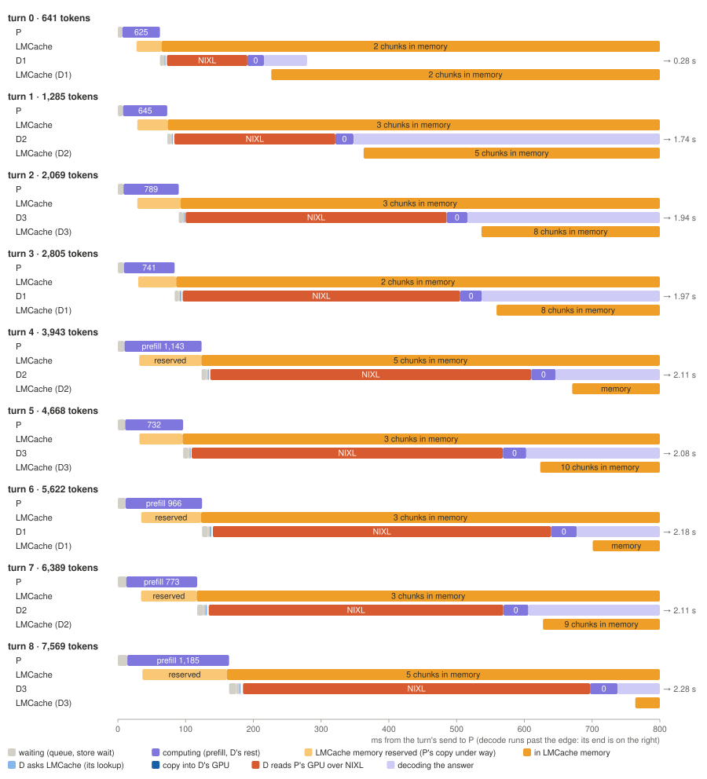

# Conversation 2: mt-rag-clapnq-elser-512-100-20240503 (memory mode, NIXL, per-engine servers, carry-forward, all passages)

P's KV reaches D over NIXL (D reads P's GPU blocks); every engine's LMCache connector stores beside it, to its own server. 9 turns on D1, D2, D3 (round-robin: each turn to the next D engine); prompts grow from 641 to 7,569 tokens (interleaved: each turn's prompt is the previous one, its answer, then this turn's documents and question). Chunks are 256 tokens (16 vLLM blocks of 16); a chunk's name is LMCache's hash of its tokens and everything before them, so the same prefix has the same chunks on every turn and engine.

Legend for the strips (one character a chunk): P: `=` on P's GPU from an earlier turn, `#` computed and stored now, `+` computed, not stored (a partial chunk). D: `=` on D's GPU from an earlier turn, `M` pulled from memory, `S` pulled from disk, `N` read from P's GPU over NIXL, `+` computed by D (a partial chunk), `?` missed.

GPU blocks (the chunk tables): where each engine keeps the chunk's 16 vLLM blocks in its GPU KV cache, by vLLM's block ids (vLLM's paged KV cache: a block, or page, holds 16 tokens; block 0 is its reserved null block), in the prompt's block order, a run of consecutive ids written as a range: `P 1, 138-152` is the prompt's block 0 in GPU block 1 and its blocks 1-15 in GPU blocks 138-152. An engine takes a GPU block from its free list when it first computes or loads a block, and the block keeps it while cached, so a later turn that reuses the block shows the same id. Blocks that are the same in several prompts (the same tokens and everything before them) share one GPU block once the first is cached: the system prompt's first block, the same in every conversation, is the usual one. `16/16 hashes = P's`: of the blocks D pulled, how many have the same vLLM hash on D as on P.

The prompts' text is the driver's own record of what it sent (answers included); lines over 100 characters are wrapped here for reading.

| turn | prompt | chunks + tail | P: own GPU / computed / stored | D: own GPU / loaded / computed | pulled | pull ms | D first token ms |
| ---: | ---: | --- | --- | --- | --- | ---: | ---: |
| [0](#turn-0) | 641 | 2 + 129 | 16 / 625 / 2 chunks | 16 / 625 / 0 | 3 chunks (NIXL 3) | 118.8 | 148.5 |
| [1](#turn-1) | 1,285 | 5 + 5 | 640 / 645 / 3 chunks | 16 / 1,269 / 0 | 6 chunks (NIXL 6) | 237.6 | 270.1 |
| [2](#turn-2) | 2,069 | 8 + 21 | 1,280 / 789 / 3 chunks | 16 / 2,053 / 0 | 9 chunks (NIXL 9) | 385.3 | 419.9 |
| [3](#turn-3) | 2,805 | 10 + 245 | 2,064 / 741 / 2 chunks | 640 / 2,165 / 0 | 9 chunks (NIXL 9) | 409.6 | 447.7 |
| [4](#turn-4) | 3,943 | 15 + 103 | 2,800 / 1,143 / 5 chunks | 1,408 / 2,535 / 0 | 11 chunks (NIXL 11) | 473.7 | 516.1 |
| [5](#turn-5) | 4,668 | 18 + 60 | 3,936 / 732 / 3 chunks | 2,192 / 2,476 / 0 | 11 chunks (NIXL 11) | 459.3 | 498.7 |
| [6](#turn-6) | 5,622 | 21 + 246 | 4,656 / 966 / 3 chunks | 2,928 / 2,694 / 0 | 11 chunks (NIXL 11) | 499.0 | 544.6 |
| [7](#turn-7) | 6,389 | 24 + 245 | 5,616 / 773 / 3 chunks | 4,064 / 2,325 / 0 | 10 chunks (NIXL 10) | 434.8 | 479.7 |
| [8](#turn-8) | 7,569 | 29 + 145 | 6,384 / 1,185 / 5 chunks | 4,784 / 2,785 / 0 | 12 chunks (NIXL 12) | 512.3 | 562.8 |

## How the prompt grows

Each turn's prompt is the previous one, token for token, and then: D's answer to the previous turn, this turn's documents, its question and the framing (the system prompt on turn 0, `Assistant:` and newlines). Only the new tokens can make new chunks: the previous prompt's partial chunk fills first. A document sent before comes again at another place, so in other chunks.

| turn | prompt | new | previous answer | documents | question | framing | whole chunks |
| ---: | ---: | ---: | ---: | --- | --- | ---: | --- |
| 0 | 641 | +641 | – | 6 docs, 598 | 13: where does water go after it enters a storm drain | 30 | 2 (+2) |
| 1 | 1,285 | +644 | 7 | 7 docs, 620 (3 sent before: 298) | 14: What is a catchbasin and how they are designed? | 3 | 5 (+3) |
| 2 | 2,069 | +784 | 128 | 7 docs, 630 (6 sent before: 514) | 23: Does the basin really capture the litter and debris from the water fr… | 3 | 8 (+3) |
| 3 | 2,805 | +736 | 128 | 5 docs, 579 (3 sent before: 338) | 26: Could be the water that enters a storm drain recycled and be used in … | 3 | 10 (+2) |
| 4 | 3,943 | +1,138 | 128 | 8 docs, 971 (3 sent before: 350) | 36: And about on the level of the Federal government, do they have guidel… | 3 | 15 (+5) |
| 5 | 4,668 | +725 | 128 | 7 docs, 578 (3 sent before: 271) | 16: How does the storm drain work in the other parts of the world. | 3 | 18 (+3) |
| 6 | 5,622 | +954 | 128 | 6 docs, 805 | 18: Do you have any information about how the ancient civilization deal w… | 3 | 21 (+3) |
| 7 | 6,389 | +767 | 128 | 6 docs, 613 | 23: Chaging the subject a little a bit, are there many people worldwide w… | 3 | 24 (+3) |
| 8 | 7,569 | +1,180 | 128 | 7 docs, 1,027 | 22: That is really surprised me. Do you have information when the first s… | 3 | 29 (+5) |

## Timeline

Every turn on one clock: ms from the moment the proxy sent the turn to P. P prefills it (one token out) and holds its blocks for D; the proxy sends the turn to the next D engine at once with P's reply's kv_transfer_params (no wait), D reads P's blocks over NIXL (orange-red), computes the rest and decodes the answer. Beside it every engine's LMCache connector stores its new whole chunks (P's lane, and D's own when it stored any). The lanes: P, LMCache (P's chunks), D, and LMCache (D's chunks).



| turn | P queued → done | P's chunks: in memory / on disk | D | D starts | NIXL read | D: held / from P / from LMCache / computed | D's chunks stored | first token | P freed | D done |
| ---: | --- | --- | --- | ---: | --- | --- | ---: | ---: | ---: | ---: |
| 0 | 7 → 62 | 2: 64 / – | D1 | 67 | 72-191 | 16 / 625 / 0 / 0 | 2 | 216 | 192 | 279 |
| 1 | 8 → 73 | 3: 74 / – | D2 | 78 | 83-321 | 16 / 1,269 / 0 / 0 | 5 | 348 | 322 | 1,739 |
| 2 | 8 → 90 | 3: 92 / – | D3 | 96 | 100-485 | 16 / 2,053 / 0 / 0 | 8 | 516 | 486 | 1,940 |
| 3 | 9 → 84 | 2: 86 / – | D1 | 90 | 96-505 | 640 / 2,165 / 0 / 0 | 8 | 537 | 506 | 1,967 |
| 4 | 10 → 124 | 5: 123 / – | D2 | 130 | 136-610 | 1,408 / 2,535 / 0 / 0 | 10 | 646 | 611 | 2,108 |
| 5 | 11 → 96 | 3: 96 / – | D3 | 104 | 109-568 | 2,192 / 2,476 / 0 / 0 | 10 | 603 | 570 | 2,079 |
| 6 | 12 → 124 | 3: 123 / – | D1 | 133 | 140-639 | 2,928 / 2,694 / 0 / 0 | 10 | 677 | 639 | 2,178 |
| 7 | 12 → 117 | 3: 116 / – | D2 | 126 | 134-569 | 4,064 / 2,325 / 0 / 0 | 9 | 606 | 570 | 2,112 |
| 8 | 14 → 164 | 5: 161 / – | D3 | 175 | 185-697 | 4,784 / 2,785 / 0 / 0 | 11 | 738 | 697 | 2,285 |

All times in ms from the turn's send to P. NIXL read: D's worker posts the read of P's blocks to the KV in D's GPU blocks; P freed: D has read, P's blocks go back to its free queue (still cached). Each turn's section below tells it in a sentence and step by step.

### One chunk, block by block: chunk 1 of turn 0 (`8950c18ab6f86296`)

Tokens 256-512 (doc 834226571_1148: 70; doc 834226571_364-: 90; doc 834226571_8587: 96). P computed its blocks; D1 read them from P's GPU over NIXL, P's block into D's block, one for one:

| block | tokens | P's GPU block | vLLM hash on P | D's GPU block | same hash on D |
| ---: | --- | ---: | --- | ---: | --- |
| 16 | 256-272 | 755 | `fa7a6c33921defdc` | 571 | True |
| 17 | 272-288 | 756 | `3a19022b13ad6c9a` | 572 | True |
| 18 | 288-304 | 757 | `75ab5d092a981ddc` | 573 | True |
| 19 | 304-320 | 758 | `7977f5c58132ca4a` | 574 | True |
| 20 | 320-336 | 759 | `d91b9e8b41a404d2` | 575 | True |
| 21 | 336-352 | 760 | `a955d070d128c32f` | 576 | True |
| 22 | 352-368 | 761 | `5197dbbb38f2ff79` | 577 | True |
| 23 | 368-384 | 762 | `72bcb130229c22b3` | 578 | True |
| 24 | 384-400 | 763 | `8cd78f6f52fd2d81` | 579 | True |
| 25 | 400-416 | 764 | `9203ec672aac8bf3` | 580 | True |
| 26 | 416-432 | 765 | `7d38412c70ed5231` | 581 | True |
| 27 | 432-448 | 766 | `75771b84adc1cc39` | 582 | True |
| 28 | 448-464 | 767 | `1c27dc440f9e8eb5` | 583 | True |
| 29 | 464-480 | 768 | `e006bdeb73fffb66` | 584 | True |
| 30 | 480-496 | 769 | `1c30f1c4a1a9502e` | 585 | True |
| 31 | 496-512 | 770 | `a030d42c28596f94` | 586 | True |

## Turn 0

**Timeline:** P queued until 7 ms, prefilled 625 tokens (held 16) and was done at 62 ms; its 2 new chunks were in LMCache's memory at 64 ms. D1 started at 67 ms (no wait) holding 16 tokens, read 625 from P's GPU over NIXL (posted at 72 ms, in its GPU at 191 ms; P freed its blocks at 192 ms), computed 0 and gave its first token at 216 ms; it decoded 7 tokens until 279 ms; its LMCache connector stored 2 new chunks. ([all turns](#timeline))

### Step by step

Every move of this turn's KV, ms from the proxy sending the turn to P. P's KV reaches D over NIXL: D's worker reads P's GPU blocks into its own (a NIXL READ, P told when D is done); LMCache's copies (to and from each server's memory) its servers do themselves through CUDA IPC handles each engine registered at start.

| ms | where | what |
| ---: | --- | --- |
| 0.0 | proxy → P | sends the turn (641 prompt tokens; P is asked for one token: prefill only) |
| 2.4 | P | the request arrives |
| 6.5 | P GPU | its prefix cache holds 16 of the prompt's tokens: 1 block in GPU blocks 1 |
| 6.6 | P ↔ LMCache | LMCache has 0 of its tokens; P loads 0 and computes the rest |
| 6.7 | P GPU | 40 new GPU blocks for the 625 tokens it computes: 740-779; the prefill runs |
| 6.9 | P → LMCache | store planned: tokens 0-512, chunks 0-1 (32 blocks) |
| 27.3 | LMCache | the store request is in; it waits for P's forward pass to finish (a CUDA event) |
| 27.6 | LMCache memory | space reserved for 2 chunks (59 MB) |
| 58.5 | P GPU → LMCache memory | the copy starts: LMCache reads P's GPU blocks (CUDA IPC) |
| 58.6 | P GPU | the request is done: P holds its 41 blocks for D to read over NIXL, and its reply carries them (kv_transfer_params: the blocks, its NIXL agent) |
| 61.2 | P GPU → LMCache memory | copy done: 2 chunks, 59 MB in 2.6 ms |
| 62.1 | P → proxy | P answers its one token: the prefill is done |
| 64.3 | LMCache memory | 2 chunks in memory, kept for later requests (D gets this turn's KV from P over NIXL); P keeps its copy in its GPU blocks |
| 67.2 | proxy → D1 | sends the turn to D1 at once, with P's kv_transfer_params (round-robin; no wait) |
| 68.8 | D1 ↔ LMCache | asks LMCache for the prompt's chunks |
| 69.9 | LMCache memory | found 0 tokens it lacks |
| 71.6 | D1 GPU | its prefix cache holds 16 of the prompt's tokens: 1 block in GPU blocks 1 |
| 71.7 | D1 ↔ P (NIXL) | will read 625 prompt tokens from P's GPU (beyond the 16 its own cache holds) |
| 71.8 | D1 ↔ LMCache | LMCache has 0 of its tokens; NIXL loads it (MultiConnector: the first connector with tokens) |
| 72.0 | D1 GPU | 40 GPU blocks for the KV from P: 556-595 |
| 72.4 | P GPU → D1 GPU (NIXL) | D1 reads P's GPU blocks 1, 740-779 into its 556-595 (a NIXL READ) |
| 191.2 | D1 | the KV from P is in its GPU blocks (625 tokens) |
| 191.7 | P GPU | D1 has read: P frees its blocks (they stay in its prefix cache) |
| 199.4 | D1 → LMCache | store planned: tokens 0-512; 2 chunks new to its server |
| 215.7 | D1 → proxy | the first answer token |
| 226.4 | LMCache memory | 2 chunks from D1 in memory |
| 279.4 | D1 | done: 7 tokens decoded; its blocks stay cached in its GPU for the next turn |
| 281.3 | proxy | the response is complete |

641 prompt tokens: 2 whole chunks and 129 tokens over (the partial chunk, computed by both engines and stored only when a later turn completes it). P held 16 tokens on its GPU, computed 625 and stored 2 new chunks; D1 held 16, read 625 from P over NIXL, loaded 0 from LMCache and computed 0.

### The prompt

The whole prompt, piece by piece:

- **system prompt** · tokens 0-28 (28) · chunk 0

```text
You are a helpful assistant. Answer the user's last question from the documents. If they do not hold
the answer, say so.
```

<details><summary>document <code>834226571_4749-5081-0-332</code> · tokens 28-103 (75) · chunk 0</summary>

```text
Document: Storm drain
Storm drain
Some of the heavier sediment and small objects may settle in a catchbasin , or sump , which lies
immediately below the outlet , where water from the top of the catchbasin reservoir overflows into
the sewer proper . The catchbasin serves much the same function as the `` trap '' in household
wastewater plumbing in trapping objects .
```

</details>

<details><summary>document <code>834226571_7232-7729-0-497</code> · tokens 103-209 (106) · chunk 0</summary>

```text
Document: Storm drain
Storm drain
Most drains have a single large exit at their point of discharge ( often covered by a grating ) into
a canal , river , lake , reservoir , sea or ocean . Other than catchbasins , typically there are no
treatment facilities in the piping system . Small storm drains may discharge into individual dry
wells . Storm drains may be interconnected using slotted pipe , to make a larger dry well system .
Storm drains may discharge into man - made excavations known as recharge basins or retention ponds .
```

</details>

<details><summary>document <code>834226571_11488-12059-0-571</code> · tokens 209-326 (117) · chunks 0-1</summary>

```text
Document: Storm drain
Storm drain
Catch basins are commonly designed with a sump area below the outlet pipe level which is a reservoir
for water and debris to help prevent the pipe from clogging . Unless they are constructed with
permeable bottoms to allow water to infiltrate into the underlying soil , this subterranean basin
can become a perfect mosquito breeding area because it is cool , dark , and retains stagnant water
for long periods of time . Combined with standard grates which have holes large enough for
mosquitoes to enter and leave the basin , this is a major problem in mosquito control .
```

</details>

<details><summary>document <code>834226571_364-764-0-400</code> · tokens 326-416 (90) · chunk 1</summary>

```text
Document: Storm drain
Storm drain
A storm drain , storm sewer ( U.S. and Canada ) , surface water drain / sewer ( United Kingdom ) ,
or stormwater drain ( Australia and New Zealand ) is designed to drain excess rain and ground water
from impervious surfaces such as paved streets , car parks , parking lots , footpaths , sidewalks ,
and roofs . Storm drains vary in design from small residential dry wells to large municipal systems
.
```

</details>

<details><summary>document <code>834226571_8587-9336-0-749</code> · tokens 416-575 (159) · chunks 1-2</summary>

```text
Document: Storm drain
Storm drain
Runoff into storm sewers can be minimized by including sustainable urban drainage systems ( UK term
) or low impact development or green infrastructure practices ( US terms ) into municipal plans . To
reduce stormwater from rooftops , flows from eaves troughs ( rain gutters and downspouts ) may be
infiltrated into adjacent soil , rather than discharged into the storm sewer system . Storm water
runoff from paved surfaces can be directed to unlined ditches ( sometimes called swales or bioswales
) before flowing into the storm sewers , again to allow the runoff to soak into the ground .
Permeable paving materials can be used in building sidewalks , driveways and in some cases , parking
lots , to infiltrate a portion of the stormwater volume .
```

</details>

<details><summary>document <code>834226571_10005-10224-0-219</code> · tokens 575-626 (51) · chunk 2</summary>

```text
Document: Storm drain
Storm drain
The first flush from urban runoff can be extremely dirty . Storm water may become contaminated while
running down the road or other impervious surface , or from lawn chemical run - off , before
entering the drain . Lack
```

</details>

- **question 0** · tokens 626-639 (13) · chunk 2

```text
User: where does water go after it enters a storm drain
```

- `Assistant:` · tokens 639-641 (2) · chunk 2

### Pieces, chunks and blocks

| piece | tokens | length | chunks | |
| --- | --- | ---: | --- | --- |
| system | 0-28 | 28 | 0 |  |
| doc 834226571_4749 | 28-103 | 75 | 0 |  |
| doc 834226571_7232 | 103-209 | 106 | 0 |  |
| doc 834226571_1148 | 209-326 | 117 | 0-1 |  |
| doc 834226571_364- | 326-416 | 90 | 1 |  |
| doc 834226571_8587 | 416-575 | 159 | 1-2 |  |
| doc 834226571_1000 | 575-626 | 51 | 2 |  |
| question 0 | 626-639 | 13 | 2 |  |
| `assistant:` 0 | 639-641 | 2 | 2 |  |

```
P  ##+
D  NNN
```

| chunk | tokens | pieces in it (tokens) | vLLM blocks | GPU blocks | in LMCache | P this turn | D this turn |
| ---: | --- | --- | --- | --- | --- | --- | --- |
| 0 | 0-256 | system: 28; doc 834226571_4749: 75; doc 834226571_7232: 106; doc 834226571_1148: 47 | 0-15 | P 1, 740-754; D 1, 556-570; 15/15 hashes = P's | `b62d5d8072b22be0`: LMC_P: stored on turn 0 by P; LMC_D1: stored on turn 0 by D1; LMC_D2: stored on turn 1 by D2; LMC_D3: stored on turn 2 by D3 | computed (its first 16 tokens on P's GPU already), **stored now** | **read from P's GPU over NIXL** (its first 16 tokens on D's GPU already) |
| 1 | 256-512 | doc 834226571_1148: 70; doc 834226571_364-: 90; doc 834226571_8587: 96 | 16-31 | P 755-770; D 571-586; 16/16 hashes = P's | `8950c18ab6f86296`: LMC_P: stored on turn 0 by P; LMC_D1: stored on turn 0 by D1; LMC_D2: stored on turn 1 by D2; LMC_D3: stored on turn 2 by D3 | computed, **stored now** | **read from P's GPU over NIXL** |
| 2 | 512-641 | doc 834226571_8587: 63; doc 834226571_1000: 51; question 0: 13; `assistant:` 0: 2 | 32-40 | P 771-778; D 587-595; 8/8 hashes = P's | – | computed (partial chunk: not stored) | **read from P's GPU over NIXL** (partial chunk) |

## Turn 1

**Timeline:** P queued until 8 ms, prefilled 645 tokens (held 640) and was done at 73 ms; its 3 new chunks were in LMCache's memory at 74 ms. D2 started at 78 ms (no wait) holding 16 tokens, read 1,269 from P's GPU over NIXL (posted at 83 ms, in its GPU at 321 ms; P freed its blocks at 322 ms), computed 0 and gave its first token at 348 ms; it decoded 128 tokens until 1,739 ms; its LMCache connector stored 5 new chunks. ([all turns](#timeline))

### Step by step

Every move of this turn's KV, ms from the proxy sending the turn to P. P's KV reaches D over NIXL: D's worker reads P's GPU blocks into its own (a NIXL READ, P told when D is done); LMCache's copies (to and from each server's memory) its servers do themselves through CUDA IPC handles each engine registered at start.

| ms | where | what |
| ---: | --- | --- |
| 0.0 | proxy → P | sends the turn (1,285 prompt tokens; P is asked for one token: prefill only) |
| 2.9 | P | the request arrives |
| 7.4 | P GPU | its prefix cache holds 640 of the prompt's tokens: 40 blocks in GPU blocks 1, 740-778 |
| 7.5 | P ↔ LMCache | LMCache has 512 of its tokens; P loads 0 and computes the rest |
| 7.7 | P GPU | 41 new GPU blocks for the 645 tokens it computes: 779-819; the prefill runs |
| 8.1 | P → LMCache | store planned: tokens 512-1,280, chunks 2-4 (48 blocks) |
| 28.3 | LMCache | the store request is in; it waits for P's forward pass to finish (a CUDA event) |
| 28.7 | LMCache memory | space reserved for 3 chunks (88 MB) |
| 68.6 | P GPU → LMCache memory | the copy starts: LMCache reads P's GPU blocks (CUDA IPC) |
| 68.8 | P GPU | the request is done: P holds its 81 blocks for D to read over NIXL, and its reply carries them (kv_transfer_params: the blocks, its NIXL agent) |
| 72.5 | P GPU → LMCache memory | copy done: 3 chunks, 88 MB in 3.8 ms |
| 73.0 | P → proxy | P answers its one token: the prefill is done |
| 73.5 | LMCache memory | 3 chunks in memory, kept for later requests (D gets this turn's KV from P over NIXL); P keeps its copy in its GPU blocks |
| 77.8 | proxy → D2 | sends the turn to D2 at once, with P's kv_transfer_params (round-robin; no wait) |
| 79.6 | D2 ↔ LMCache | asks LMCache for the prompt's chunks |
| 81.3 | LMCache memory | found 0 tokens it lacks |
| 82.6 | D2 GPU | its prefix cache holds 16 of the prompt's tokens: 1 block in GPU blocks 1 |
| 82.7 | D2 ↔ P (NIXL) | will read 1,269 prompt tokens from P's GPU (beyond the 16 its own cache holds) |
| 82.7 | D2 ↔ LMCache | LMCache has 0 of its tokens; NIXL loads it (MultiConnector: the first connector with tokens) |
| 83.0 | D2 GPU | 80 GPU blocks for the KV from P: 676-755 |
| 83.4 | P GPU → D2 GPU (NIXL) | D2 reads P's GPU blocks 1, 740-819 into its 676-755 (a NIXL READ) |
| 321.1 | D2 | the KV from P is in its GPU blocks (1,269 tokens) |
| 321.9 | P GPU | D2 has read: P frees its blocks (they stay in its prefix cache) |
| 331.0 | D2 → LMCache | store planned: tokens 0-1,280; 5 chunks new to its server |
| 347.9 | D2 → proxy | the first answer token |
| 362.8 | LMCache memory | 5 chunks from D2 in memory |
| 457.3 | D2 GPU | 1 new GPU block for the 1 prompt tokens it computes: 756 |
| 632.4 | D2 GPU | decoding: the answer's KV takes 7 new GPU blocks as it grows, one per 16 tokens: 757-763, until 1,684 ms |
| 1,739.1 | D2 | done: 128 tokens decoded; its blocks stay cached in its GPU for the next turn |
| 1,740.4 | proxy | the response is complete |

1,285 prompt tokens: 5 whole chunks and 5 tokens over (the partial chunk, computed by both engines and stored only when a later turn completes it). P held 640 tokens on its GPU, computed 645 and stored 3 new chunks; D2 held 16, read 1,269 from P over NIXL, loaded 0 from LMCache and computed 0.

### The prompt

Tokens 0-641: [turn 0](#turn-0)'s prompt, unchanged (checked: its first 641 token ids are the previous prompt's), so chunks 0-1 are the same chunks; chunk 2 (partial then, 129 tokens) fills now. New from token 641:

- **D's answer to turn 0** · tokens 641-648 (7) · chunk 2

```text
 It goes to the ocean.
```

- `\n` · tokens 648-649 (1) · chunk 2

- document `834226571_4749-5081-0-332` · tokens 649-724 (75) · chunk 2 · **again**: sent on [turn 0](#turn-0) already (the same 75 tokens), here at another place in the prompt, so in other chunks: a prefix cache cannot reuse it

- document `834226571_7232-7729-0-497` · tokens 724-830 (106) · chunks 2-3 · **again**: sent on [turn 0](#turn-0) already (the same 106 tokens), here at another place in the prompt, so in other chunks: a prefix cache cannot reuse it

<details><summary>document <code>834226571_6342-6558-0-216</code> · tokens 830-881 (51) · chunk 3</summary>

```text
Document: Storm drain
Storm drain
Catchbasins act as a first - line pretreatment for other treatment practices , such as retention
basins , by capturing large sediments and street litter from urban runoff before it enters the storm
drainage pipes . A
```

</details>

<details><summary>document <code>834226571_5082-5403-0-321</code> · tokens 881-954 (73) · chunk 3</summary>

```text
Document: Storm drain
Storm drain
In the United States , unlike the plumbing trap , the catchbasin does not necessarily prevent sewer
gases such as hydrogen sulfide and methane from escaping . However , in the United Kingdom , where
they are called gully pots , they are designed as true water - filled traps and do block the egress
of gases and rodents .
```

</details>

<details><summary>document <code>834226571_6020-6341-0-321</code> · tokens 954-1024 (70) · chunk 3</summary>

```text
Document: Storm drain
Storm drain
The performance of catchbasins at removing sediment and other pollutants depends on the design of
the catchbasin ( for example , the size of the sump ) , and on routine maintenance to retain the
storage available in the sump to capture sediment . Municipalities typically have large vacuum
trucks that perform this task .
```

</details>

- document `834226571_11488-12059-0-571` · tokens 1024-1141 (117) · chunk 4 · **again**: sent on [turn 0](#turn-0) already (the same 117 tokens), here at another place in the prompt, so in other chunks: a prefix cache cannot reuse it

<details><summary>document <code>834226571_5404-6019-0-615</code> · tokens 1141-1269 (128) · chunk 4</summary>

```text
Document: Storm drain
Storm drain
Most catchbasins will contain stagnant water during the drier parts of the year , and can , in warm
countries , be used by mosquitos for breeding . Larvicides or disruptive larval hormones , sometimes
released from `` mosquito biscuits '' , have been used to control mosquito breeding in catchbasins .
Mosquitoes may be physically prevented from reaching the standing water or migrating into the sewer
proper by the use of an `` inverted cone filter '' . Another method of mosquito control is to spread
a thin layer of oil on the surface of stagnant water , interfering with the breathing tubes of
mosquito larvae .
```

</details>

- **question 1** · tokens 1269-1283 (14) · chunks 4-5

```text
User: What is a catchbasin and how they are designed?
```

- `Assistant:` · tokens 1283-1285 (2) · chunk 5

### Pieces, chunks and blocks

| piece | tokens | length | chunks | |
| --- | --- | ---: | --- | --- |
| system | 0-28 | 28 | 0 |  |
| doc 834226571_4749 | 28-103 | 75 | 0 |  |
| doc 834226571_7232 | 103-209 | 106 | 0 |  |
| doc 834226571_1148 | 209-326 | 117 | 0-1 |  |
| doc 834226571_364- | 326-416 | 90 | 1 |  |
| doc 834226571_8587 | 416-575 | 159 | 1-2 |  |
| doc 834226571_1000 | 575-626 | 51 | 2 |  |
| question 0 | 626-639 | 13 | 2 |  |
| `assistant:` 0 | 639-641 | 2 | 2 |  |
| answer 0 | 641-648 | 7 | 2 | new this turn |
| newline 0 | 648-649 | 1 | 2 | new this turn |
| doc 834226571_4749 | 649-724 | 75 | 2 | new this turn |
| doc 834226571_7232 | 724-830 | 106 | 2-3 | new this turn |
| doc 834226571_6342 | 830-881 | 51 | 3 | new this turn |
| doc 834226571_5082 | 881-954 | 73 | 3 | new this turn |
| doc 834226571_6020 | 954-1024 | 70 | 3 | new this turn |
| doc 834226571_1148 | 1024-1141 | 117 | 4 | new this turn |
| doc 834226571_5404 | 1141-1269 | 128 | 4 | new this turn |
| question 1 | 1269-1283 | 14 | 4-5 | new this turn |
| `assistant:` 1 | 1283-1285 | 2 | 5 | new this turn |

```
P  ==###+
D  NNNNNN
```

| chunk | tokens | pieces in it (tokens) | vLLM blocks | GPU blocks | in LMCache | P this turn | D this turn |
| ---: | --- | --- | --- | --- | --- | --- | --- |
| 0 | 0-256 | system: 28; doc 834226571_4749: 75; doc 834226571_7232: 106; doc 834226571_1148: 47 | 0-15 | P 1, 740-754; D 1, 676-690 | `b62d5d8072b22be0`: LMC_P: stored on turn 0 by P; LMC_D1: stored on turn 0 by D1; LMC_D2: stored on turn 1 by D2; LMC_D3: stored on turn 2 by D3 | on P's GPU (earlier turn) | **read from P's GPU over NIXL** (its first 16 tokens on D's GPU already) |
| 1 | 256-512 | doc 834226571_1148: 70; doc 834226571_364-: 90; doc 834226571_8587: 96 | 16-31 | P 755-770; D 691-706 | `8950c18ab6f86296`: LMC_P: stored on turn 0 by P; LMC_D1: stored on turn 0 by D1; LMC_D2: stored on turn 1 by D2; LMC_D3: stored on turn 2 by D3 | on P's GPU (earlier turn) | **read from P's GPU over NIXL** |
| 2 | 512-768 | doc 834226571_8587: 63; doc 834226571_1000: 51; question 0: 13; `assistant:` 0: 2; answer 0 (new): 7; newline 0 (new): 1; doc 834226571_4749 (new): 75; doc 834226571_7232 (new): 44 | 32-47 | P 771-786; D 707-722; 8/8 hashes = P's | `255e05a0b9cc70a6`: LMC_P: stored on turn 1 by P; LMC_D2: stored on turn 1 by D2; LMC_D3: stored on turn 2 by D3; LMC_D1: stored on turn 3 by D1 | computed (its first 128 tokens on P's GPU already), **stored now** | **read from P's GPU over NIXL** |
| 3 | 768-1024 | doc 834226571_7232 (new): 62; doc 834226571_6342 (new): 51; doc 834226571_5082 (new): 73; doc 834226571_6020 (new): 70 | 48-63 | P 787-802; D 723-738; 16/16 hashes = P's | `552925187513cda5`: LMC_P: stored on turn 1 by P; LMC_D2: stored on turn 1 by D2; LMC_D3: stored on turn 2 by D3; LMC_D1: stored on turn 3 by D1 | computed, **stored now** | **read from P's GPU over NIXL** |
| 4 | 1024-1280 | doc 834226571_1148 (new): 117; doc 834226571_5404 (new): 128; question 1 (new): 11 | 64-79 | P 803-818; D 739-754; 16/16 hashes = P's | `3c32f70f281de177`: LMC_P: stored on turn 1 by P; LMC_D2: stored on turn 1 by D2; LMC_D3: stored on turn 2 by D3; LMC_D1: stored on turn 3 by D1 | computed, **stored now** | **read from P's GPU over NIXL** |
| 5 | 1280-1285 | question 1 (new): 3; `assistant:` 1 (new): 2 | 80 | P –; D 755 | – | computed (partial chunk: not stored) | **read from P's GPU over NIXL** (partial chunk) |

## Turn 2

**Timeline:** P queued until 8 ms, prefilled 789 tokens (held 1,280) and was done at 90 ms; its 3 new chunks were in LMCache's memory at 92 ms. D3 started at 96 ms (no wait) holding 16 tokens, read 2,053 from P's GPU over NIXL (posted at 100 ms, in its GPU at 485 ms; P freed its blocks at 486 ms), computed 0 and gave its first token at 516 ms; it decoded 128 tokens until 1,940 ms; its LMCache connector stored 8 new chunks. ([all turns](#timeline))

### Step by step

Every move of this turn's KV, ms from the proxy sending the turn to P. P's KV reaches D over NIXL: D's worker reads P's GPU blocks into its own (a NIXL READ, P told when D is done); LMCache's copies (to and from each server's memory) its servers do themselves through CUDA IPC handles each engine registered at start.

| ms | where | what |
| ---: | --- | --- |
| 0.0 | proxy → P | sends the turn (2,069 prompt tokens; P is asked for one token: prefill only) |
| 3.1 | P | the request arrives |
| 8.0 | P GPU | its prefix cache holds 1,280 of the prompt's tokens: 80 blocks in GPU blocks 1, 740-818 |
| 8.1 | P ↔ LMCache | LMCache has 1,280 of its tokens; P loads 0 and computes the rest |
| 8.3 | P GPU | 50 new GPU blocks for the 789 tokens it computes: 819-868; the prefill runs |
| 8.8 | P → LMCache | store planned: tokens 1,280-2,048, chunks 5-7 (48 blocks) |
| 28.3 | LMCache | the store request is in; it waits for P's forward pass to finish (a CUDA event) |
| 28.7 | LMCache memory | space reserved for 3 chunks (88 MB) |
| 85.2 | P GPU → LMCache memory | the copy starts: LMCache reads P's GPU blocks (CUDA IPC) |
| 85.4 | P GPU | the request is done: P holds its 130 blocks for D to read over NIXL, and its reply carries them (kv_transfer_params: the blocks, its NIXL agent) |
| 89.0 | P GPU → LMCache memory | copy done: 3 chunks, 88 MB in 3.8 ms |
| 89.8 | P → proxy | P answers its one token: the prefill is done |
| 92.4 | LMCache memory | 3 chunks in memory, kept for later requests (D gets this turn's KV from P over NIXL); P keeps its copy in its GPU blocks |
| 96.2 | proxy → D3 | sends the turn to D3 at once, with P's kv_transfer_params (round-robin; no wait) |
| 97.8 | D3 ↔ LMCache | asks LMCache for the prompt's chunks |
| 98.9 | LMCache memory | found 0 tokens it lacks |
| 99.6 | D3 GPU | its prefix cache holds 16 of the prompt's tokens: 1 block in GPU blocks 1 |
| 99.6 | D3 ↔ P (NIXL) | will read 2,053 prompt tokens from P's GPU (beyond the 16 its own cache holds) |
| 99.6 | D3 ↔ LMCache | LMCache has 0 of its tokens; NIXL loads it (MultiConnector: the first connector with tokens) |
| 99.8 | D3 GPU | 129 GPU blocks for the KV from P: 671-799 |
| 100.1 | P GPU → D3 GPU (NIXL) | D3 reads P's GPU blocks 1, 740-868 into its 671-799 (a NIXL READ) |
| 485.4 | D3 | the KV from P is in its GPU blocks (2,053 tokens) |
| 486.4 | P GPU | D3 has read: P frees its blocks (they stay in its prefix cache) |
| 497.7 | D3 → LMCache | store planned: tokens 0-2,048; 8 chunks new to its server |
| 516.0 | D3 → proxy | the first answer token |
| 536.7 | LMCache memory | 8 chunks from D3 in memory |
| 626.2 | D3 GPU | 1 new GPU block for the 1 prompt tokens it computes: 800 |
| 805.1 | D3 GPU | decoding: the answer's KV takes 7 new GPU blocks as it grows, one per 16 tokens: 801-807, until 1,883 ms |
| 1,939.7 | D3 | done: 128 tokens decoded; its blocks stay cached in its GPU for the next turn |
| 1,940.9 | proxy | the response is complete |

2,069 prompt tokens: 8 whole chunks and 21 tokens over (the partial chunk, computed by both engines and stored only when a later turn completes it). P held 1,280 tokens on its GPU, computed 789 and stored 3 new chunks; D3 held 16, read 2,053 from P over NIXL, loaded 0 from LMCache and computed 0.

### The prompt

Tokens 0-1,285: [turn 1](#turn-1)'s prompt, unchanged (checked: its first 1,285 token ids are the previous prompt's), so chunks 0-4 are the same chunks; chunk 5 (partial then, 5 tokens) fills now. New from token 1,285:

- **D's answer to turn 1** · tokens 1285-1413 (128) · chunk 5

```text
 A catchbasin is a small reservoir that collects water and debris from the street and prevents it
from entering the sewer system . It is designed to prevent the sewer system from clogging . The
catchbasin is usually located at the end of a storm drain . The catchbasin is usually designed with
a sump area below the outlet pipe level which is a reservoir for water and debris to help prevent
the pipe from clogging . Unless they are constructed with permeable bottoms to allow water to
infiltrate into the underlying soil , this subterranean basin can become a perfect mosquito breeding
area because it is cool , dark , and retains stagnant water
```

- `\n` · tokens 1413-1414 (1) · chunk 5

- document `834226571_6342-6558-0-216` · tokens 1414-1465 (51) · chunk 5 · **again**: sent on [turn 1](#turn-1) already (the same 51 tokens), here at another place in the prompt, so in other chunks: a prefix cache cannot reuse it

- document `834226571_11488-12059-0-571` · tokens 1465-1582 (117) · chunks 5-6 · **again**: sent on [turn 0](#turn-0) already (the same 117 tokens), here at another place in the prompt, so in other chunks: a prefix cache cannot reuse it

<details><summary>document <code>834226571_12060-12659-0-599</code> · tokens 1582-1698 (116) · chunk 6</summary>

```text
Document: Storm drain
Storm drain
Basins can be filled with concrete up to the pipe level to prevent this reservoir from forming .
Without proper maintenance , the functionality of the basin is questionable , as these catch basins
are most commonly not cleaned annually as is needed to make them perform as designed . The trapping
of debris serves no purpose because once filled they operate as if no basins were present , but
continue to allow a shallow area of water retention for the breeding of mosquito . Moreover , even
if cleaned and maintained , the water reservoir remains filled , accommodating the breeding of
mosquitoes .
```

</details>

- document `834226571_6020-6341-0-321` · tokens 1698-1768 (70) · chunk 6 · **again**: sent on [turn 1](#turn-1) already (the same 70 tokens), here at another place in the prompt, so in other chunks: a prefix cache cannot reuse it

- document `834226571_4749-5081-0-332` · tokens 1768-1843 (75) · chunks 6-7 · **again**: sent on [turn 0](#turn-0) already (the same 75 tokens), here at another place in the prompt, so in other chunks: a prefix cache cannot reuse it

- document `834226571_5082-5403-0-321` · tokens 1843-1916 (73) · chunk 7 · **again**: sent on [turn 1](#turn-1) already (the same 73 tokens), here at another place in the prompt, so in other chunks: a prefix cache cannot reuse it

- document `834226571_5404-6019-0-615` · tokens 1916-2044 (128) · chunk 7 · **again**: sent on [turn 1](#turn-1) already (the same 128 tokens), here at another place in the prompt, so in other chunks: a prefix cache cannot reuse it

- **question 2** · tokens 2044-2067 (23) · chunks 7-8

```text
User: Does the basin really capture the litter  and debris from the water from the streets, roads,
roofs?
```

- `Assistant:` · tokens 2067-2069 (2) · chunk 8

### Pieces, chunks and blocks

| piece | tokens | length | chunks | |
| --- | --- | ---: | --- | --- |
| system | 0-28 | 28 | 0 |  |
| doc 834226571_4749 | 28-103 | 75 | 0 |  |
| doc 834226571_7232 | 103-209 | 106 | 0 |  |
| doc 834226571_1148 | 209-326 | 117 | 0-1 |  |
| doc 834226571_364- | 326-416 | 90 | 1 |  |
| doc 834226571_8587 | 416-575 | 159 | 1-2 |  |
| doc 834226571_1000 | 575-626 | 51 | 2 |  |
| question 0 | 626-639 | 13 | 2 |  |
| `assistant:` 0 | 639-641 | 2 | 2 |  |
| answer 0 | 641-648 | 7 | 2 |  |
| newline 0 | 648-649 | 1 | 2 |  |
| doc 834226571_4749 | 649-724 | 75 | 2 |  |
| doc 834226571_7232 | 724-830 | 106 | 2-3 |  |
| doc 834226571_6342 | 830-881 | 51 | 3 |  |
| doc 834226571_5082 | 881-954 | 73 | 3 |  |
| doc 834226571_6020 | 954-1024 | 70 | 3 |  |
| doc 834226571_1148 | 1024-1141 | 117 | 4 |  |
| doc 834226571_5404 | 1141-1269 | 128 | 4 |  |
| question 1 | 1269-1283 | 14 | 4-5 |  |
| `assistant:` 1 | 1283-1285 | 2 | 5 |  |
| answer 1 | 1285-1413 | 128 | 5 | new this turn |
| newline 1 | 1413-1414 | 1 | 5 | new this turn |
| doc 834226571_6342 | 1414-1465 | 51 | 5 | new this turn |
| doc 834226571_1148 | 1465-1582 | 117 | 5-6 | new this turn |
| doc 834226571_1206 | 1582-1698 | 116 | 6 | new this turn |
| doc 834226571_6020 | 1698-1768 | 70 | 6 | new this turn |
| doc 834226571_4749 | 1768-1843 | 75 | 6-7 | new this turn |
| doc 834226571_5082 | 1843-1916 | 73 | 7 | new this turn |
| doc 834226571_5404 | 1916-2044 | 128 | 7 | new this turn |
| question 2 | 2044-2067 | 23 | 7-8 | new this turn |
| `assistant:` 2 | 2067-2069 | 2 | 8 | new this turn |

```
P  =====###+
D  NNNNNNNNN
```

| chunk | tokens | pieces in it (tokens) | vLLM blocks | GPU blocks | in LMCache | P this turn | D this turn |
| ---: | --- | --- | --- | --- | --- | --- | --- |
| 0 | 0-256 | system: 28; doc 834226571_4749: 75; doc 834226571_7232: 106; doc 834226571_1148: 47 | 0-15 | P 1, 740-754; D 1, 671-685 | `b62d5d8072b22be0`: LMC_P: stored on turn 0 by P; LMC_D1: stored on turn 0 by D1; LMC_D2: stored on turn 1 by D2; LMC_D3: stored on turn 2 by D3 | on P's GPU (earlier turn) | **read from P's GPU over NIXL** (its first 16 tokens on D's GPU already) |
| 1 | 256-512 | doc 834226571_1148: 70; doc 834226571_364-: 90; doc 834226571_8587: 96 | 16-31 | P 755-770; D 686-701 | `8950c18ab6f86296`: LMC_P: stored on turn 0 by P; LMC_D1: stored on turn 0 by D1; LMC_D2: stored on turn 1 by D2; LMC_D3: stored on turn 2 by D3 | on P's GPU (earlier turn) | **read from P's GPU over NIXL** |
| 2 | 512-768 | doc 834226571_8587: 63; doc 834226571_1000: 51; question 0: 13; `assistant:` 0: 2; answer 0: 7; newline 0: 1; doc 834226571_4749: 75; doc 834226571_7232: 44 | 32-47 | P 771-786; D 702-717 | `255e05a0b9cc70a6`: LMC_P: stored on turn 1 by P; LMC_D2: stored on turn 1 by D2; LMC_D3: stored on turn 2 by D3; LMC_D1: stored on turn 3 by D1 | on P's GPU (earlier turn) | **read from P's GPU over NIXL** |
| 3 | 768-1024 | doc 834226571_7232: 62; doc 834226571_6342: 51; doc 834226571_5082: 73; doc 834226571_6020: 70 | 48-63 | P 787-802; D 718-733 | `552925187513cda5`: LMC_P: stored on turn 1 by P; LMC_D2: stored on turn 1 by D2; LMC_D3: stored on turn 2 by D3; LMC_D1: stored on turn 3 by D1 | on P's GPU (earlier turn) | **read from P's GPU over NIXL** |
| 4 | 1024-1280 | doc 834226571_1148: 117; doc 834226571_5404: 128; question 1: 11 | 64-79 | P 803-818; D 734-749 | `3c32f70f281de177`: LMC_P: stored on turn 1 by P; LMC_D2: stored on turn 1 by D2; LMC_D3: stored on turn 2 by D3; LMC_D1: stored on turn 3 by D1 | on P's GPU (earlier turn) | **read from P's GPU over NIXL** |
| 5 | 1280-1536 | question 1: 3; `assistant:` 1: 2; answer 1 (new): 128; newline 1 (new): 1; doc 834226571_6342 (new): 51; doc 834226571_1148 (new): 71 | 80-95 | P 819-834; D 750-765; 16/16 hashes = P's | `78fecc54896b8348`: LMC_P: stored on turn 2 by P; LMC_D3: stored on turn 2 by D3; LMC_D1: stored on turn 3 by D1; LMC_D2: stored on turn 4 by D2 | computed, **stored now** | **read from P's GPU over NIXL** |
| 6 | 1536-1792 | doc 834226571_1148 (new): 46; doc 834226571_1206 (new): 116; doc 834226571_6020 (new): 70; doc 834226571_4749 (new): 24 | 96-111 | P 835-850; D 766-781; 16/16 hashes = P's | `0fb3a3776af8b2f2`: LMC_P: stored on turn 2 by P; LMC_D3: stored on turn 2 by D3; LMC_D1: stored on turn 3 by D1; LMC_D2: stored on turn 4 by D2 | computed, **stored now** | **read from P's GPU over NIXL** |
| 7 | 1792-2048 | doc 834226571_4749 (new): 51; doc 834226571_5082 (new): 73; doc 834226571_5404 (new): 128; question 2 (new): 4 | 112-127 | P 851-866; D 782-797; 16/16 hashes = P's | `51287ca411bd04d9`: LMC_P: stored on turn 2 by P; LMC_D3: stored on turn 2 by D3; LMC_D1: stored on turn 3 by D1; LMC_D2: stored on turn 4 by D2 | computed, **stored now** | **read from P's GPU over NIXL** |
| 8 | 2048-2069 | question 2 (new): 19; `assistant:` 2 (new): 2 | 128-129 | P 867; D 798-799; 1/1 hashes = P's | – | computed (partial chunk: not stored) | **read from P's GPU over NIXL** (partial chunk) |

## Turn 3

**Timeline:** P queued until 9 ms, prefilled 741 tokens (held 2,064) and was done at 84 ms; its 2 new chunks were in LMCache's memory at 86 ms. D1 started at 90 ms (no wait) holding 640 tokens, read 2,165 from P's GPU over NIXL (posted at 96 ms, in its GPU at 505 ms; P freed its blocks at 506 ms), computed 0 and gave its first token at 537 ms; it decoded 128 tokens until 1,967 ms; its LMCache connector stored 8 new chunks. ([all turns](#timeline))

### Step by step

Every move of this turn's KV, ms from the proxy sending the turn to P. P's KV reaches D over NIXL: D's worker reads P's GPU blocks into its own (a NIXL READ, P told when D is done); LMCache's copies (to and from each server's memory) its servers do themselves through CUDA IPC handles each engine registered at start.

| ms | where | what |
| ---: | --- | --- |
| 0.0 | proxy → P | sends the turn (2,805 prompt tokens; P is asked for one token: prefill only) |
| 3.6 | P | the request arrives |
| 8.7 | P GPU | its prefix cache holds 2,064 of the prompt's tokens: 129 blocks in GPU blocks 1, 740-867 |
| 8.8 | P ↔ LMCache | LMCache has 2,048 of its tokens; P loads 0 and computes the rest |
| 9.0 | P GPU | 47 new GPU blocks for the 741 tokens it computes: 868-914; the prefill runs |
| 9.5 | P → LMCache | store planned: tokens 2,048-2,560, chunks 8-9 (32 blocks) |
| 29.7 | LMCache | the store request is in; it waits for P's forward pass to finish (a CUDA event) |
| 30.0 | LMCache memory | space reserved for 2 chunks (59 MB) |
| 78.4 | P GPU → LMCache memory | the copy starts: LMCache reads P's GPU blocks (CUDA IPC) |
| 78.6 | P GPU | the request is done: P holds its 176 blocks for D to read over NIXL, and its reply carries them (kv_transfer_params: the blocks, its NIXL agent) |
| 81.1 | P GPU → LMCache memory | copy done: 2 chunks, 59 MB in 2.7 ms |
| 83.8 | P → proxy | P answers its one token: the prefill is done |
| 86.2 | LMCache memory | 2 chunks in memory, kept for later requests (D gets this turn's KV from P over NIXL); P keeps its copy in its GPU blocks |
| 89.7 | proxy → D1 | sends the turn to D1 at once, with P's kv_transfer_params (round-robin; no wait) |
| 91.6 | D1 ↔ LMCache | asks LMCache for the prompt's chunks |
| 93.8 | LMCache memory | found 0 tokens it lacks |
| 94.4 | D1 GPU | its prefix cache holds 640 of the prompt's tokens: 40 blocks in GPU blocks 1, 556-594 |
| 94.5 | D1 ↔ P (NIXL) | will read 2,165 prompt tokens from P's GPU (beyond the 640 its own cache holds) |
| 94.5 | D1 ↔ LMCache | LMCache has 512 of its tokens; NIXL loads it (MultiConnector: the first connector with tokens) |
| 94.8 | D1 GPU | 136 GPU blocks for the KV from P: 595-730 |
| 95.7 | P GPU → D1 GPU (NIXL) | D1 reads P's GPU blocks 1, 740-914 into its 595-730 (a NIXL READ) |
| 505.3 | D1 | the KV from P is in its GPU blocks (2,165 tokens) |
| 506.1 | P GPU | D1 has read: P frees its blocks (they stay in its prefix cache) |
| 518.9 | D1 → LMCache | store planned: tokens 512-2,560; 8 chunks new to its server |
| 537.4 | D1 → proxy | the first answer token |
| 558.9 | LMCache memory | 8 chunks from D1 in memory |
| 650.0 | D1 GPU | 1 new GPU block for the 1 prompt tokens it computes: 731 |
| 830.3 | D1 GPU | decoding: the answer's KV takes 7 new GPU blocks as it grows, one per 16 tokens: 732-738, until 1,911 ms |
| 1,967.0 | D1 | done: 128 tokens decoded; its blocks stay cached in its GPU for the next turn |
| 1,968.3 | proxy | the response is complete |

2,805 prompt tokens: 10 whole chunks and 245 tokens over (the partial chunk, computed by both engines and stored only when a later turn completes it). P held 2,064 tokens on its GPU, computed 741 and stored 2 new chunks; D1 held 640, read 2,165 from P over NIXL, loaded 0 from LMCache and computed 0.

### The prompt

Tokens 0-2,069: [turn 2](#turn-2)'s prompt, unchanged (checked: its first 2,069 token ids are the previous prompt's), so chunks 0-7 are the same chunks; chunk 8 (partial then, 21 tokens) fills now. New from token 2,069:

- **D's answer to turn 2** · tokens 2069-2197 (128) · chunk 8

```text
 Yes, the basin captures the litter and debris from the water from the streets, roads, roofs. The
basin is designed to prevent the sewer system from clogging . The catchbasin is usually located at
the end of a storm drain . The catchbasin is usually designed with a sump area below the outlet pipe
level which is a reservoir for water and debris to help prevent the pipe from clogging . Unless they
are constructed with permeable bottoms to allow water to infiltrate into the underlying soil , this
subterranean basin can become a perfect mosquito breeding area because it is cool , dark , and
retains stagnant water for long periods of
```

- `\n` · tokens 2197-2198 (1) · chunk 8

- document `834226571_10005-10224-0-219` · tokens 2198-2249 (51) · chunk 8 · **again**: sent on [turn 0](#turn-0) already (the same 51 tokens), here at another place in the prompt, so in other chunks: a prefix cache cannot reuse it

<details><summary>document <code>834226571_10375-11016-0-641</code> · tokens 2249-2389 (140) · chunks 8-9</summary>

```text
Document: Storm drain
Storm drain
Water running off these impervious surfaces tends to pick up gasoline , motor oil , heavy metals ,
trash and other pollutants from roadways and parking lots , as well as fertilizers and pesticides
from lawns . Roads and parking lots are major sources of nickel , copper , zinc , cadmium , lead and
polycyclic aromatic hydrocarbons ( PAHs ) , which are created as combustion byproducts of gasoline
and other fossil fuels . Roof runoff contributes high levels of synthetic organic compounds and zinc
( from galvanized gutters ) . Fertilizer use on residential lawns , parks and golf courses is a
significant source of nitrates and phosphorus .
```

</details>

<details><summary>document <code>834226571_13168-13671-0-503</code> · tokens 2389-2490 (101) · chunk 9</summary>

```text
Document: Storm drain
Storm drain
Many storm drainage systems are designed to drain the storm water , untreated , into rivers or
streams . Many local governments conduct public awareness campaigns about this , lest waste be
dumped into the storm drain system . In the city of Cleveland , Ohio , for example , all new catch
basins installed have inscriptions on them not to dump any waste , and usually include a fish
imprint as well . Trout Unlimited Canada recommends that a yellow fish symbol be painted next to
existing storm drains .
```

</details>

- document `834226571_8587-9336-0-749` · tokens 2490-2649 (159) · chunks 9-10 · **again**: sent on [turn 0](#turn-0) already (the same 159 tokens), here at another place in the prompt, so in other chunks: a prefix cache cannot reuse it

- document `834226571_5404-6019-0-615` · tokens 2649-2777 (128) · chunk 10 · **again**: sent on [turn 1](#turn-1) already (the same 128 tokens), here at another place in the prompt, so in other chunks: a prefix cache cannot reuse it

- **question 3** · tokens 2777-2803 (26) · chunk 10

```text
User: Could be the water that enters a storm drain recycled and be used in the house chores like
cleaning, gardening , etc?
```

- `Assistant:` · tokens 2803-2805 (2) · chunk 10

### Pieces, chunks and blocks

| piece | tokens | length | chunks | |
| --- | --- | ---: | --- | --- |
| system | 0-28 | 28 | 0 |  |
| doc 834226571_4749 | 28-103 | 75 | 0 |  |
| doc 834226571_7232 | 103-209 | 106 | 0 |  |
| doc 834226571_1148 | 209-326 | 117 | 0-1 |  |
| doc 834226571_364- | 326-416 | 90 | 1 |  |
| doc 834226571_8587 | 416-575 | 159 | 1-2 |  |
| doc 834226571_1000 | 575-626 | 51 | 2 |  |
| question 0 | 626-639 | 13 | 2 |  |
| `assistant:` 0 | 639-641 | 2 | 2 |  |
| answer 0 | 641-648 | 7 | 2 |  |
| newline 0 | 648-649 | 1 | 2 |  |
| doc 834226571_4749 | 649-724 | 75 | 2 |  |
| doc 834226571_7232 | 724-830 | 106 | 2-3 |  |
| doc 834226571_6342 | 830-881 | 51 | 3 |  |
| doc 834226571_5082 | 881-954 | 73 | 3 |  |
| doc 834226571_6020 | 954-1024 | 70 | 3 |  |
| doc 834226571_1148 | 1024-1141 | 117 | 4 |  |
| doc 834226571_5404 | 1141-1269 | 128 | 4 |  |
| question 1 | 1269-1283 | 14 | 4-5 |  |
| `assistant:` 1 | 1283-1285 | 2 | 5 |  |
| answer 1 | 1285-1413 | 128 | 5 |  |
| newline 1 | 1413-1414 | 1 | 5 |  |
| doc 834226571_6342 | 1414-1465 | 51 | 5 |  |
| doc 834226571_1148 | 1465-1582 | 117 | 5-6 |  |
| doc 834226571_1206 | 1582-1698 | 116 | 6 |  |
| doc 834226571_6020 | 1698-1768 | 70 | 6 |  |
| doc 834226571_4749 | 1768-1843 | 75 | 6-7 |  |
| doc 834226571_5082 | 1843-1916 | 73 | 7 |  |
| doc 834226571_5404 | 1916-2044 | 128 | 7 |  |
| question 2 | 2044-2067 | 23 | 7-8 |  |
| `assistant:` 2 | 2067-2069 | 2 | 8 |  |
| answer 2 | 2069-2197 | 128 | 8 | new this turn |
| newline 2 | 2197-2198 | 1 | 8 | new this turn |
| doc 834226571_1000 | 2198-2249 | 51 | 8 | new this turn |
| doc 834226571_1037 | 2249-2389 | 140 | 8-9 | new this turn |
| doc 834226571_1316 | 2389-2490 | 101 | 9 | new this turn |
| doc 834226571_8587 | 2490-2649 | 159 | 9-10 | new this turn |
| doc 834226571_5404 | 2649-2777 | 128 | 10 | new this turn |
| question 3 | 2777-2803 | 26 | 10 | new this turn |
| `assistant:` 3 | 2803-2805 | 2 | 10 | new this turn |

```
P  ========##+
D  ==NNNNNNNNN
```

| chunk | tokens | pieces in it (tokens) | vLLM blocks | GPU blocks | in LMCache | P this turn | D this turn |
| ---: | --- | --- | --- | --- | --- | --- | --- |
| 0 | 0-256 | system: 28; doc 834226571_4749: 75; doc 834226571_7232: 106; doc 834226571_1148: 47 | 0-15 | P 1, 740-754; D 1, 556-570 | `b62d5d8072b22be0`: LMC_P: stored on turn 0 by P; LMC_D1: stored on turn 0 by D1; LMC_D2: stored on turn 1 by D2; LMC_D3: stored on turn 2 by D3 | on P's GPU (earlier turn) | on D's GPU (earlier turn) |
| 1 | 256-512 | doc 834226571_1148: 70; doc 834226571_364-: 90; doc 834226571_8587: 96 | 16-31 | P 755-770; D 571-586 | `8950c18ab6f86296`: LMC_P: stored on turn 0 by P; LMC_D1: stored on turn 0 by D1; LMC_D2: stored on turn 1 by D2; LMC_D3: stored on turn 2 by D3 | on P's GPU (earlier turn) | on D's GPU (earlier turn) |
| 2 | 512-768 | doc 834226571_8587: 63; doc 834226571_1000: 51; question 0: 13; `assistant:` 0: 2; answer 0: 7; newline 0: 1; doc 834226571_4749: 75; doc 834226571_7232: 44 | 32-47 | P 771-786; D 587-602 | `255e05a0b9cc70a6`: LMC_P: stored on turn 1 by P; LMC_D2: stored on turn 1 by D2; LMC_D3: stored on turn 2 by D3; LMC_D1: stored on turn 3 by D1 | on P's GPU (earlier turn) | **read from P's GPU over NIXL** (its first 128 tokens on D's GPU already) |
| 3 | 768-1024 | doc 834226571_7232: 62; doc 834226571_6342: 51; doc 834226571_5082: 73; doc 834226571_6020: 70 | 48-63 | P 787-802; D 603-618 | `552925187513cda5`: LMC_P: stored on turn 1 by P; LMC_D2: stored on turn 1 by D2; LMC_D3: stored on turn 2 by D3; LMC_D1: stored on turn 3 by D1 | on P's GPU (earlier turn) | **read from P's GPU over NIXL** |
| 4 | 1024-1280 | doc 834226571_1148: 117; doc 834226571_5404: 128; question 1: 11 | 64-79 | P 803-818; D 619-634 | `3c32f70f281de177`: LMC_P: stored on turn 1 by P; LMC_D2: stored on turn 1 by D2; LMC_D3: stored on turn 2 by D3; LMC_D1: stored on turn 3 by D1 | on P's GPU (earlier turn) | **read from P's GPU over NIXL** |
| 5 | 1280-1536 | question 1: 3; `assistant:` 1: 2; answer 1: 128; newline 1: 1; doc 834226571_6342: 51; doc 834226571_1148: 71 | 80-95 | P 819-834; D 635-650 | `78fecc54896b8348`: LMC_P: stored on turn 2 by P; LMC_D3: stored on turn 2 by D3; LMC_D1: stored on turn 3 by D1; LMC_D2: stored on turn 4 by D2 | on P's GPU (earlier turn) | **read from P's GPU over NIXL** |
| 6 | 1536-1792 | doc 834226571_1148: 46; doc 834226571_1206: 116; doc 834226571_6020: 70; doc 834226571_4749: 24 | 96-111 | P 835-850; D 651-666 | `0fb3a3776af8b2f2`: LMC_P: stored on turn 2 by P; LMC_D3: stored on turn 2 by D3; LMC_D1: stored on turn 3 by D1; LMC_D2: stored on turn 4 by D2 | on P's GPU (earlier turn) | **read from P's GPU over NIXL** |
| 7 | 1792-2048 | doc 834226571_4749: 51; doc 834226571_5082: 73; doc 834226571_5404: 128; question 2: 4 | 112-127 | P 851-866; D 667-682 | `51287ca411bd04d9`: LMC_P: stored on turn 2 by P; LMC_D3: stored on turn 2 by D3; LMC_D1: stored on turn 3 by D1; LMC_D2: stored on turn 4 by D2 | on P's GPU (earlier turn) | **read from P's GPU over NIXL** |
| 8 | 2048-2304 | question 2: 19; `assistant:` 2: 2; answer 2 (new): 128; newline 2 (new): 1; doc 834226571_1000 (new): 51; doc 834226571_1037 (new): 55 | 128-143 | P 867-882; D 683-698; 15/15 hashes = P's | `3747a681d30c8bae`: LMC_P: stored on turn 3 by P; LMC_D1: stored on turn 3 by D1; LMC_D2: stored on turn 4 by D2; LMC_D3: stored on turn 5 by D3 | computed (its first 16 tokens on P's GPU already), **stored now** | **read from P's GPU over NIXL** |
| 9 | 2304-2560 | doc 834226571_1037 (new): 85; doc 834226571_1316 (new): 101; doc 834226571_8587 (new): 70 | 144-159 | P 883-898; D 699-714; 16/16 hashes = P's | `085c2510a5590cbe`: LMC_P: stored on turn 3 by P; LMC_D1: stored on turn 3 by D1; LMC_D2: stored on turn 4 by D2; LMC_D3: stored on turn 5 by D3 | computed, **stored now** | **read from P's GPU over NIXL** |
| 10 | 2560-2805 | doc 834226571_8587 (new): 89; doc 834226571_5404 (new): 128; question 3 (new): 26; `assistant:` 3 (new): 2 | 160-175 | P 899-913; D 715-730; 15/15 hashes = P's | – | computed (partial chunk: not stored) | **read from P's GPU over NIXL** (partial chunk) |

## Turn 4

**Timeline:** P queued until 10 ms, prefilled 1,143 tokens (held 2,800) and was done at 124 ms; its 5 new chunks were in LMCache's memory at 123 ms. D2 started at 130 ms (no wait) holding 1,408 tokens, read 2,535 from P's GPU over NIXL (posted at 136 ms, in its GPU at 610 ms; P freed its blocks at 611 ms), computed 0 and gave its first token at 646 ms; it decoded 128 tokens until 2,108 ms; its LMCache connector stored 10 new chunks. ([all turns](#timeline))

### Step by step

Every move of this turn's KV, ms from the proxy sending the turn to P. P's KV reaches D over NIXL: D's worker reads P's GPU blocks into its own (a NIXL READ, P told when D is done); LMCache's copies (to and from each server's memory) its servers do themselves through CUDA IPC handles each engine registered at start.

| ms | where | what |
| ---: | --- | --- |
| 0.0 | proxy → P | sends the turn (3,943 prompt tokens; P is asked for one token: prefill only) |
| 4.3 | P | the request arrives |
| 9.6 | P GPU | its prefix cache holds 2,800 of the prompt's tokens: 175 blocks in GPU blocks 1, 740-913 |
| 9.7 | P ↔ LMCache | LMCache has 2,560 of its tokens; P loads 0 and computes the rest |
| 9.9 | P GPU | 72 new GPU blocks for the 1,143 tokens it computes: 914-985; the prefill runs |
| 10.5 | P → LMCache | store planned: tokens 2,560-3,840, chunks 10-14 (80 blocks) |
| 31.0 | LMCache | the store request is in; it waits for P's forward pass to finish (a CUDA event) |
| 31.5 | LMCache memory | space reserved for 5 chunks (147 MB) |
| 115.8 | P GPU → LMCache memory | the copy starts: LMCache reads P's GPU blocks (CUDA IPC) |
| 116.1 | P GPU | the request is done: P holds its 247 blocks for D to read over NIXL, and its reply carries them (kv_transfer_params: the blocks, its NIXL agent) |
| 122.1 | P GPU → LMCache memory | copy done: 5 chunks, 147 MB in 6.3 ms |
| 123.2 | LMCache memory | 5 chunks in memory, kept for later requests (D gets this turn's KV from P over NIXL); P keeps its copy in its GPU blocks |
| 123.6 | P → proxy | P answers its one token: the prefill is done |
| 130.2 | proxy → D2 | sends the turn to D2 at once, with P's kv_transfer_params (round-robin; no wait) |
| 132.9 | D2 ↔ LMCache | asks LMCache for the prompt's chunks |
| 134.5 | LMCache memory | found 0 tokens it lacks |
| 135.3 | D2 GPU | its prefix cache holds 1,408 of the prompt's tokens: 88 blocks in GPU blocks 1, 676-762 |
| 135.4 | D2 ↔ P (NIXL) | will read 2,535 prompt tokens from P's GPU (beyond the 1,408 its own cache holds) |
| 135.4 | D2 ↔ LMCache | LMCache has 1,280 of its tokens; NIXL loads it (MultiConnector: the first connector with tokens) |
| 135.8 | D2 GPU | 159 GPU blocks for the KV from P: 763-921 |
| 136.5 | P GPU → D2 GPU (NIXL) | D2 reads P's GPU blocks 1, 740-985 into its 763-921 (a NIXL READ) |
| 610.2 | D2 | the KV from P is in its GPU blocks (2,535 tokens) |
| 610.7 | P GPU | D2 has read: P frees its blocks (they stay in its prefix cache) |
| 626.3 | D2 → LMCache | store planned: tokens 1,280-3,840; 10 chunks new to its server |
| 646.3 | D2 → proxy | the first answer token |
| 670.6 | LMCache memory | 10 chunks from D2 in memory |
| 738.3 | D2 GPU | 1 new GPU block for the 1 prompt tokens it computes: 922 |
| 922.4 | D2 GPU | decoding: the answer's KV takes 7 new GPU blocks as it grows, one per 16 tokens: 923-929, until 2,027 ms |
| 2,107.5 | D2 | done: 128 tokens decoded; its blocks stay cached in its GPU for the next turn |
| 2,108.8 | proxy | the response is complete |

3,943 prompt tokens: 15 whole chunks and 103 tokens over (the partial chunk, computed by both engines and stored only when a later turn completes it). P held 2,800 tokens on its GPU, computed 1,143 and stored 5 new chunks; D2 held 1,408, read 2,535 from P over NIXL, loaded 0 from LMCache and computed 0.

### The prompt

Tokens 0-2,805: [turn 3](#turn-3)'s prompt, unchanged (checked: its first 2,805 token ids are the previous prompt's), so chunks 0-9 are the same chunks; chunk 10 (partial then, 245 tokens) fills now. New from token 2,805:

- **D's answer to turn 3** · tokens 2805-2933 (128) · chunks 10-11

```text
 No, the water that enters a storm drain cannot be recycled and be used in the house chores like
cleaning, gardening , etc. The water that enters a storm drain is not clean and it is not safe to
use it for house chores like cleaning, gardening , etc. The water that enters a storm drain is not
clean and it is not safe to use it for house chores like cleaning, gardening , etc. The water that
enters a storm drain is not clean and it is not safe to use it for house chores like cleaning,
gardening , etc. The water that enters a storm drain is not clean and it is not safe to use it
```

- `\n` · tokens 2933-2934 (1) · chunk 11

<details><summary>document <code>834226571_15954-16896-0-942</code> · tokens 2934-3097 (163) · chunks 11-12</summary>

```text
Document: Storm drain
Storm drain
In the United States , cities , suburban communities and towns with over 10,000 population are
required to obtain discharge permits for their storm sewer systems , under the Clean Water Act . The
Environmental Protection Agency ( EPA ) issued stormwater regulations for large cities in 1990 and
for other communities in 1999 . The permits require local governments to operate stormwater
management programs , covering both construction of new buildings and facilities , and maintenance
of their existing municipal drainage networks . Many municipalities have revised their local
ordinances covering management of runoff . State government facilities , such as roads and highways
, are also subject to the stormwater management regulations . Many local municipalities have placed
ordinances for both commercial and residential stormwater management practices to be designed ,
implemented , and approved before an occupancy permit is released .
```

</details>

<details><summary>document <code>834226571_15633-15953-0-320</code> · tokens 3097-3158 (61) · chunk 12</summary>

```text
Document: Storm drain
Storm drain
Building codes and local government ordinances vary greatly on the handling of storm drain runoff .
New developments might be required to construct their own storm drain processing capacity for
returning the runoff to the water table and bioswales may be required in sensitive ecological areas
to protect the watershed .
```

</details>

<details><summary>document <code>799262937_4587-5000-0-413</code> · tokens 3158-3241 (83) · chunk 12</summary>

```text
Document: Environmental policy of the United States
Environmental policy of the United States
Governmental authority on environmental issues in the United States is highly fragmented . While the
EPA is the most comprehensive environmental agency , its authority on these matters is not absolute
. Virtually all of the executive branch 's departments have some area of environmental authority .
This contributes somewhat to the cost and questionable efficacy of the United States ' environmental
regulation .
```

</details>

<details><summary>document <code>848480323_34054-34448-0-394</code> · tokens 3241-3324 (83) · chunk 12</summary>

```text
Document: Air pollution in the United States
Air pollution in the United States
Before 2017 , the EPA have spent more than $8.7 million on environmental education annually to
increase public knowledge and awareness about the current environmental issues and the consequences
. They aim to promote the popularization of the necessary skills and knowledge for the public to
make decisions and participate in activities that lead to the resolution of environmental challenges
.
```

</details>

<details><summary>document <code>799262937_14460-15670-0-1210</code> · tokens 3324-3555 (231) · chunks 12-13</summary>

```text
Document: Environmental policy of the United States
Environmental policy of the United States
On January 1 , 1970 , President Richard Nixon signed the National Environmental Policy Act ( NEPA )
, beginning the 1970s as the environmental decade . NEPA created the Council on Environmental
Quality which oversaw the environmental impact of federal actions . Later in the year , Nixon
created the Environmental Protection Agency ( EPA ) , which consolidated environmental programs from
other agencies into a single entity . The legislation during this period concerned primarily first -
generation pollutants in the air , surface water , groundwater , and solid waste disposal . Air
pollutants such as particulates , sulfur dioxide , nitrogen dioxide , carbon monoxide , and ozone
were put under regulation , and issues such as acid rain , visibility , and global warming were also
concerns . In surface water , the contaminants of concern were dissolved oxygen , bacteria ,
suspended and dissolved solids , nutrients , and toxic substances such as metals . For groundwater ,
the pollutants included biological contaminants , inorganic and organic substances , and
radionuclides . Finally , solid waste contaminants from agriculture , industry , mining ,
municipalities , and others were put under control .
```

</details>

- document `834226571_13168-13671-0-503` · tokens 3555-3656 (101) · chunks 13-14 · **again**: sent on [turn 3](#turn-3) already (the same 101 tokens), here at another place in the prompt, so in other chunks: a prefix cache cannot reuse it

- document `834226571_8587-9336-0-749` · tokens 3656-3815 (159) · chunk 14 · **again**: sent on [turn 0](#turn-0) already (the same 159 tokens), here at another place in the prompt, so in other chunks: a prefix cache cannot reuse it

- document `834226571_364-764-0-400` · tokens 3815-3905 (90) · chunks 14-15 · **again**: sent on [turn 0](#turn-0) already (the same 90 tokens), here at another place in the prompt, so in other chunks: a prefix cache cannot reuse it

- **question 4** · tokens 3905-3941 (36) · chunk 15

```text
User: And about on the level of the Federal government, do  they have guidelines or even a law to
how to build more sustainable storm drain so the water could be recycled ?
```

- `Assistant:` · tokens 3941-3943 (2) · chunk 15

### Pieces, chunks and blocks

| piece | tokens | length | chunks | |
| --- | --- | ---: | --- | --- |
| system | 0-28 | 28 | 0 |  |
| doc 834226571_4749 | 28-103 | 75 | 0 |  |
| doc 834226571_7232 | 103-209 | 106 | 0 |  |
| doc 834226571_1148 | 209-326 | 117 | 0-1 |  |
| doc 834226571_364- | 326-416 | 90 | 1 |  |
| doc 834226571_8587 | 416-575 | 159 | 1-2 |  |
| doc 834226571_1000 | 575-626 | 51 | 2 |  |
| question 0 | 626-639 | 13 | 2 |  |
| `assistant:` 0 | 639-641 | 2 | 2 |  |
| answer 0 | 641-648 | 7 | 2 |  |
| newline 0 | 648-649 | 1 | 2 |  |
| doc 834226571_4749 | 649-724 | 75 | 2 |  |
| doc 834226571_7232 | 724-830 | 106 | 2-3 |  |
| doc 834226571_6342 | 830-881 | 51 | 3 |  |
| doc 834226571_5082 | 881-954 | 73 | 3 |  |
| doc 834226571_6020 | 954-1024 | 70 | 3 |  |
| doc 834226571_1148 | 1024-1141 | 117 | 4 |  |
| doc 834226571_5404 | 1141-1269 | 128 | 4 |  |
| question 1 | 1269-1283 | 14 | 4-5 |  |
| `assistant:` 1 | 1283-1285 | 2 | 5 |  |
| answer 1 | 1285-1413 | 128 | 5 |  |
| newline 1 | 1413-1414 | 1 | 5 |  |
| doc 834226571_6342 | 1414-1465 | 51 | 5 |  |
| doc 834226571_1148 | 1465-1582 | 117 | 5-6 |  |
| doc 834226571_1206 | 1582-1698 | 116 | 6 |  |
| doc 834226571_6020 | 1698-1768 | 70 | 6 |  |
| doc 834226571_4749 | 1768-1843 | 75 | 6-7 |  |
| doc 834226571_5082 | 1843-1916 | 73 | 7 |  |
| doc 834226571_5404 | 1916-2044 | 128 | 7 |  |
| question 2 | 2044-2067 | 23 | 7-8 |  |
| `assistant:` 2 | 2067-2069 | 2 | 8 |  |
| answer 2 | 2069-2197 | 128 | 8 |  |
| newline 2 | 2197-2198 | 1 | 8 |  |
| doc 834226571_1000 | 2198-2249 | 51 | 8 |  |
| doc 834226571_1037 | 2249-2389 | 140 | 8-9 |  |
| doc 834226571_1316 | 2389-2490 | 101 | 9 |  |
| doc 834226571_8587 | 2490-2649 | 159 | 9-10 |  |
| doc 834226571_5404 | 2649-2777 | 128 | 10 |  |
| question 3 | 2777-2803 | 26 | 10 |  |
| `assistant:` 3 | 2803-2805 | 2 | 10 |  |
| answer 3 | 2805-2933 | 128 | 10-11 | new this turn |
| newline 3 | 2933-2934 | 1 | 11 | new this turn |
| doc 834226571_1595 | 2934-3097 | 163 | 11-12 | new this turn |
| doc 834226571_1563 | 3097-3158 | 61 | 12 | new this turn |
| doc 799262937_4587 | 3158-3241 | 83 | 12 | new this turn |
| doc 848480323_3405 | 3241-3324 | 83 | 12 | new this turn |
| doc 799262937_1446 | 3324-3555 | 231 | 12-13 | new this turn |
| doc 834226571_1316 | 3555-3656 | 101 | 13-14 | new this turn |
| doc 834226571_8587 | 3656-3815 | 159 | 14 | new this turn |
| doc 834226571_364- | 3815-3905 | 90 | 14-15 | new this turn |
| question 4 | 3905-3941 | 36 | 15 | new this turn |
| `assistant:` 4 | 3941-3943 | 2 | 15 | new this turn |

```
P  ==========#####+
D  =====NNNNNNNNNNN
```

| chunk | tokens | pieces in it (tokens) | vLLM blocks | GPU blocks | in LMCache | P this turn | D this turn |
| ---: | --- | --- | --- | --- | --- | --- | --- |
| 0 | 0-256 | system: 28; doc 834226571_4749: 75; doc 834226571_7232: 106; doc 834226571_1148: 47 | 0-15 | P 1, 740-754; D 1, 676-690 | `b62d5d8072b22be0`: LMC_P: stored on turn 0 by P; LMC_D1: stored on turn 0 by D1; LMC_D2: stored on turn 1 by D2; LMC_D3: stored on turn 2 by D3 | on P's GPU (earlier turn) | on D's GPU (earlier turn) |
| 1 | 256-512 | doc 834226571_1148: 70; doc 834226571_364-: 90; doc 834226571_8587: 96 | 16-31 | P 755-770; D 691-706 | `8950c18ab6f86296`: LMC_P: stored on turn 0 by P; LMC_D1: stored on turn 0 by D1; LMC_D2: stored on turn 1 by D2; LMC_D3: stored on turn 2 by D3 | on P's GPU (earlier turn) | on D's GPU (earlier turn) |
| 2 | 512-768 | doc 834226571_8587: 63; doc 834226571_1000: 51; question 0: 13; `assistant:` 0: 2; answer 0: 7; newline 0: 1; doc 834226571_4749: 75; doc 834226571_7232: 44 | 32-47 | P 771-786; D 707-722 | `255e05a0b9cc70a6`: LMC_P: stored on turn 1 by P; LMC_D2: stored on turn 1 by D2; LMC_D3: stored on turn 2 by D3; LMC_D1: stored on turn 3 by D1 | on P's GPU (earlier turn) | on D's GPU (earlier turn, its own answer) |
| 3 | 768-1024 | doc 834226571_7232: 62; doc 834226571_6342: 51; doc 834226571_5082: 73; doc 834226571_6020: 70 | 48-63 | P 787-802; D 723-738 | `552925187513cda5`: LMC_P: stored on turn 1 by P; LMC_D2: stored on turn 1 by D2; LMC_D3: stored on turn 2 by D3; LMC_D1: stored on turn 3 by D1 | on P's GPU (earlier turn) | on D's GPU (earlier turn) |
| 4 | 1024-1280 | doc 834226571_1148: 117; doc 834226571_5404: 128; question 1: 11 | 64-79 | P 803-818; D 739-754 | `3c32f70f281de177`: LMC_P: stored on turn 1 by P; LMC_D2: stored on turn 1 by D2; LMC_D3: stored on turn 2 by D3; LMC_D1: stored on turn 3 by D1 | on P's GPU (earlier turn) | on D's GPU (earlier turn) |
| 5 | 1280-1536 | question 1: 3; `assistant:` 1: 2; answer 1: 128; newline 1: 1; doc 834226571_6342: 51; doc 834226571_1148: 71 | 80-95 | P 819-834; D 755-770 | `78fecc54896b8348`: LMC_P: stored on turn 2 by P; LMC_D3: stored on turn 2 by D3; LMC_D1: stored on turn 3 by D1; LMC_D2: stored on turn 4 by D2 | on P's GPU (earlier turn) | **read from P's GPU over NIXL** (its first 128 tokens on D's GPU already) |
| 6 | 1536-1792 | doc 834226571_1148: 46; doc 834226571_1206: 116; doc 834226571_6020: 70; doc 834226571_4749: 24 | 96-111 | P 835-850; D 771-786 | `0fb3a3776af8b2f2`: LMC_P: stored on turn 2 by P; LMC_D3: stored on turn 2 by D3; LMC_D1: stored on turn 3 by D1; LMC_D2: stored on turn 4 by D2 | on P's GPU (earlier turn) | **read from P's GPU over NIXL** |
| 7 | 1792-2048 | doc 834226571_4749: 51; doc 834226571_5082: 73; doc 834226571_5404: 128; question 2: 4 | 112-127 | P 851-866; D 787-802 | `51287ca411bd04d9`: LMC_P: stored on turn 2 by P; LMC_D3: stored on turn 2 by D3; LMC_D1: stored on turn 3 by D1; LMC_D2: stored on turn 4 by D2 | on P's GPU (earlier turn) | **read from P's GPU over NIXL** |
| 8 | 2048-2304 | question 2: 19; `assistant:` 2: 2; answer 2: 128; newline 2: 1; doc 834226571_1000: 51; doc 834226571_1037: 55 | 128-143 | P 867-882; D 803-818 | `3747a681d30c8bae`: LMC_P: stored on turn 3 by P; LMC_D1: stored on turn 3 by D1; LMC_D2: stored on turn 4 by D2; LMC_D3: stored on turn 5 by D3 | on P's GPU (earlier turn) | **read from P's GPU over NIXL** |
| 9 | 2304-2560 | doc 834226571_1037: 85; doc 834226571_1316: 101; doc 834226571_8587: 70 | 144-159 | P 883-898; D 819-834 | `085c2510a5590cbe`: LMC_P: stored on turn 3 by P; LMC_D1: stored on turn 3 by D1; LMC_D2: stored on turn 4 by D2; LMC_D3: stored on turn 5 by D3 | on P's GPU (earlier turn) | **read from P's GPU over NIXL** |
| 10 | 2560-2816 | doc 834226571_8587: 89; doc 834226571_5404: 128; question 3: 26; `assistant:` 3: 2; answer 3 (new): 11 | 160-175 | P 899-914; D 835-850; 1/1 hashes = P's | `e6bb7f6975e56c33`: LMC_P: stored on turn 4 by P; LMC_D2: stored on turn 4 by D2; LMC_D3: stored on turn 5 by D3 | computed (its first 240 tokens on P's GPU already), **stored now** | **read from P's GPU over NIXL** |
| 11 | 2816-3072 | answer 3 (new): 117; newline 3 (new): 1; doc 834226571_1595 (new): 138 | 176-191 | P 915-930; D 851-866; 16/16 hashes = P's | `def69dfbdca28a7b`: LMC_P: stored on turn 4 by P; LMC_D2: stored on turn 4 by D2; LMC_D3: stored on turn 5 by D3; LMC_D1: stored on turn 6 by D1 | computed, **stored now** | **read from P's GPU over NIXL** |
| 12 | 3072-3328 | doc 834226571_1595 (new): 25; doc 834226571_1563 (new): 61; doc 799262937_4587 (new): 83; doc 848480323_3405 (new): 83; doc 799262937_1446 (new): 4 | 192-207 | P 931-946; D 867-882; 16/16 hashes = P's | `032e1cf58cc9e1ba`: LMC_P: stored on turn 4 by P; LMC_D2: stored on turn 4 by D2; LMC_D3: stored on turn 5 by D3; LMC_D1: stored on turn 6 by D1 | computed, **stored now** | **read from P's GPU over NIXL** |
| 13 | 3328-3584 | doc 799262937_1446 (new): 227; doc 834226571_1316 (new): 29 | 208-223 | P 947-962; D 883-898; 16/16 hashes = P's | `57a36eb94a5d1079`: LMC_P: stored on turn 4 by P; LMC_D2: stored on turn 4 by D2; LMC_D3: stored on turn 5 by D3; LMC_D1: stored on turn 6 by D1 | computed, **stored now** | **read from P's GPU over NIXL** |
| 14 | 3584-3840 | doc 834226571_1316 (new): 72; doc 834226571_8587 (new): 159; doc 834226571_364- (new): 25 | 224-239 | P 963-978; D 899-914; 16/16 hashes = P's | `df6202da1f7e0db1`: LMC_P: stored on turn 4 by P; LMC_D2: stored on turn 4 by D2; LMC_D3: stored on turn 5 by D3; LMC_D1: stored on turn 6 by D1 | computed, **stored now** | **read from P's GPU over NIXL** |
| 15 | 3840-3943 | doc 834226571_364- (new): 65; question 4 (new): 36; `assistant:` 4 (new): 2 | 240-246 | P 979-984; D 915-921; 6/6 hashes = P's | – | computed (partial chunk: not stored) | **read from P's GPU over NIXL** (partial chunk) |

## Turn 5

**Timeline:** P queued until 11 ms, prefilled 732 tokens (held 3,936) and was done at 96 ms; its 3 new chunks were in LMCache's memory at 96 ms. D3 started at 104 ms (no wait) holding 2,192 tokens, read 2,476 from P's GPU over NIXL (posted at 109 ms, in its GPU at 568 ms; P freed its blocks at 570 ms), computed 0 and gave its first token at 603 ms; it decoded 128 tokens until 2,079 ms; its LMCache connector stored 10 new chunks. ([all turns](#timeline))

### Step by step

Every move of this turn's KV, ms from the proxy sending the turn to P. P's KV reaches D over NIXL: D's worker reads P's GPU blocks into its own (a NIXL READ, P told when D is done); LMCache's copies (to and from each server's memory) its servers do themselves through CUDA IPC handles each engine registered at start.

| ms | where | what |
| ---: | --- | --- |
| 0.0 | proxy → P | sends the turn (4,668 prompt tokens; P is asked for one token: prefill only) |
| 4.8 | P | the request arrives |
| 10.5 | P GPU | its prefix cache holds 3,936 of the prompt's tokens: 246 blocks in GPU blocks 1, 740-984 |
| 10.6 | P ↔ LMCache | LMCache has 3,840 of its tokens; P loads 0 and computes the rest |
| 10.9 | P GPU | 46 new GPU blocks for the 732 tokens it computes: 985-1030; the prefill runs |
| 11.4 | P → LMCache | store planned: tokens 3,840-4,608, chunks 15-17 (48 blocks) |
| 31.4 | LMCache | the store request is in; it waits for P's forward pass to finish (a CUDA event) |
| 31.8 | LMCache memory | space reserved for 3 chunks (88 MB) |
| 88.3 | P GPU → LMCache memory | the copy starts: LMCache reads P's GPU blocks (CUDA IPC) |
| 88.7 | P GPU | the request is done: P holds its 292 blocks for D to read over NIXL, and its reply carries them (kv_transfer_params: the blocks, its NIXL agent) |
| 92.2 | P GPU → LMCache memory | copy done: 3 chunks, 88 MB in 3.8 ms |
| 95.5 | LMCache memory | 3 chunks in memory, kept for later requests (D gets this turn's KV from P over NIXL); P keeps its copy in its GPU blocks |
| 96.3 | P → proxy | P answers its one token: the prefill is done |
| 104.0 | proxy → D3 | sends the turn to D3 at once, with P's kv_transfer_params (round-robin; no wait) |
| 106.0 | D3 ↔ LMCache | asks LMCache for the prompt's chunks |
| 107.4 | LMCache memory | found 0 tokens it lacks |
| 108.2 | D3 GPU | its prefix cache holds 2,192 of the prompt's tokens: 137 blocks in GPU blocks 1, 671-806 |
| 108.2 | D3 ↔ P (NIXL) | will read 2,476 prompt tokens from P's GPU (beyond the 2,192 its own cache holds) |
| 108.2 | D3 ↔ LMCache | LMCache has 2,048 of its tokens; NIXL loads it (MultiConnector: the first connector with tokens) |
| 108.4 | D3 GPU | 155 GPU blocks for the KV from P: 807-961 |
| 109.0 | P GPU → D3 GPU (NIXL) | D3 reads P's GPU blocks 1, 740-1030 into its 807-961 (a NIXL READ) |
| 568.3 | D3 | the KV from P is in its GPU blocks (2,476 tokens) |
| 569.5 | P GPU | D3 has read: P frees its blocks (they stay in its prefix cache) |
| 582.2 | D3 → LMCache | store planned: tokens 2,048-4,608; 10 chunks new to its server |
| 602.7 | D3 → proxy | the first answer token |
| 623.4 | LMCache memory | 10 chunks from D3 in memory |
| 635.0 | D3 GPU | 1 new GPU block for the 1 prompt tokens it computes: 962 |
| 821.0 | D3 GPU | decoding: the answer's KV takes 7 new GPU blocks as it grows, one per 16 tokens: 963-969, until 1,939 ms |
| 2,078.6 | D3 | done: 128 tokens decoded; its blocks stay cached in its GPU for the next turn |
| 2,079.9 | proxy | the response is complete |

4,668 prompt tokens: 18 whole chunks and 60 tokens over (the partial chunk, computed by both engines and stored only when a later turn completes it). P held 3,936 tokens on its GPU, computed 732 and stored 3 new chunks; D3 held 2,192, read 2,476 from P over NIXL, loaded 0 from LMCache and computed 0.

### The prompt

Tokens 0-3,943: [turn 4](#turn-4)'s prompt, unchanged (checked: its first 3,943 token ids are the previous prompt's), so chunks 0-14 are the same chunks; chunk 15 (partial then, 103 tokens) fills now. New from token 3,943:

- **D's answer to turn 4** · tokens 3943-4071 (128) · chunk 15

```text
 Yes, the Federal government has guidelines or even a law to how to build more sustainable storm
drain so the water could be recycled . The Federal government has guidelines or even a law to how to
build more sustainable storm drain so the water could be recycled . The Federal government has
guidelines or even a law to how to build more sustainable storm drain so the water could be recycled
. The Federal government has guidelines or even a law to how to build more sustainable storm drain
so the water could be recycled . The Federal government has guidelines or even a law to how to build
more sustainable storm drain so the water could be recycled . The Federal government has guidelines
or
```

- `\n` · tokens 4071-4072 (1) · chunk 15

- document `834226571_364-764-0-400` · tokens 4072-4162 (90) · chunks 15-16 · **again**: sent on [turn 0](#turn-0) already (the same 90 tokens), here at another place in the prompt, so in other chunks: a prefix cache cannot reuse it

<details><summary>document <code>834226571_17102-17395-0-293</code> · tokens 4162-4223 (61) · chunk 16</summary>

```text
Document: Storm drain
Storm drain
An international subculture has grown up around the exploration of stormwater drains . Societies
such as the Cave Clan regularly explore the drains underneath cities . This is commonly known as ``
urban exploration '' , but is also known as draining when in specific relation to storm drains .
```

</details>

<details><summary>document <code>834226571_3561-3915-0-354</code> · tokens 4223-4309 (86) · chunk 16</summary>

```text
Document: Storm drain
Storm drain
There are two main types of stormwater drain ( highway drain or road gully in the UK ) inlets : side
inlets and grated inlets . Side inlets are located adjacent to the curb ( kerb ) and rely on the
ability of the opening under the backstone or lintel to capture flow . They are usually depressed at
the invert of the channel to improve capture capacity .
```

</details>

- document `834226571_7232-7729-0-497` · tokens 4309-4415 (106) · chunks 16-17 · **again**: sent on [turn 0](#turn-0) already (the same 106 tokens), here at another place in the prompt, so in other chunks: a prefix cache cannot reuse it

<details><summary>document <code>834226571_765-1254-0-489</code> · tokens 4415-4516 (101) · chunk 17</summary>

```text
Document: Storm drain
Storm drain
Drains are fed by street gutters on most motorways , freeways and other busy roads , as well as
towns in areas which experience heavy rainfall , flooding and coastal towns which experience regular
storms . Even the gutters from houses and buildings can be connected to the storm drain . Many storm
drainage systems are designed as gravity sewers draining untreated storm water into rivers or
streams . As a result , it is not acceptable to pour certain types of chemicals into the drains .
```

</details>

<details><summary>document <code>834226571_12862-13167-0-305</code> · tokens 4516-4575 (59) · chunk 17</summary>

```text
Document: Storm drain
Storm drain
Storm drains are separate and distinct from sanitary sewer systems . The separation of storm sewers
from sanitary sewers helps to prevent sewage treatment plants becoming overwhelmed by infiltration /
inflow during a rainstorm , which can result in untreated sewage being discharged into the
environment .
```

</details>

- document `834226571_4749-5081-0-332` · tokens 4575-4650 (75) · chunks 17-18 · **again**: sent on [turn 0](#turn-0) already (the same 75 tokens), here at another place in the prompt, so in other chunks: a prefix cache cannot reuse it

- **question 5** · tokens 4650-4666 (16) · chunk 18

```text
User: How does the storm drain work in the other parts of the world.
```

- `Assistant:` · tokens 4666-4668 (2) · chunk 18

### Pieces, chunks and blocks

| piece | tokens | length | chunks | |
| --- | --- | ---: | --- | --- |
| system | 0-28 | 28 | 0 |  |
| doc 834226571_4749 | 28-103 | 75 | 0 |  |
| doc 834226571_7232 | 103-209 | 106 | 0 |  |
| doc 834226571_1148 | 209-326 | 117 | 0-1 |  |
| doc 834226571_364- | 326-416 | 90 | 1 |  |
| doc 834226571_8587 | 416-575 | 159 | 1-2 |  |
| doc 834226571_1000 | 575-626 | 51 | 2 |  |
| question 0 | 626-639 | 13 | 2 |  |
| `assistant:` 0 | 639-641 | 2 | 2 |  |
| answer 0 | 641-648 | 7 | 2 |  |
| newline 0 | 648-649 | 1 | 2 |  |
| doc 834226571_4749 | 649-724 | 75 | 2 |  |
| doc 834226571_7232 | 724-830 | 106 | 2-3 |  |
| doc 834226571_6342 | 830-881 | 51 | 3 |  |
| doc 834226571_5082 | 881-954 | 73 | 3 |  |
| doc 834226571_6020 | 954-1024 | 70 | 3 |  |
| doc 834226571_1148 | 1024-1141 | 117 | 4 |  |
| doc 834226571_5404 | 1141-1269 | 128 | 4 |  |
| question 1 | 1269-1283 | 14 | 4-5 |  |
| `assistant:` 1 | 1283-1285 | 2 | 5 |  |
| answer 1 | 1285-1413 | 128 | 5 |  |
| newline 1 | 1413-1414 | 1 | 5 |  |
| doc 834226571_6342 | 1414-1465 | 51 | 5 |  |
| doc 834226571_1148 | 1465-1582 | 117 | 5-6 |  |
| doc 834226571_1206 | 1582-1698 | 116 | 6 |  |
| doc 834226571_6020 | 1698-1768 | 70 | 6 |  |
| doc 834226571_4749 | 1768-1843 | 75 | 6-7 |  |
| doc 834226571_5082 | 1843-1916 | 73 | 7 |  |
| doc 834226571_5404 | 1916-2044 | 128 | 7 |  |
| question 2 | 2044-2067 | 23 | 7-8 |  |
| `assistant:` 2 | 2067-2069 | 2 | 8 |  |
| answer 2 | 2069-2197 | 128 | 8 |  |
| newline 2 | 2197-2198 | 1 | 8 |  |
| doc 834226571_1000 | 2198-2249 | 51 | 8 |  |
| doc 834226571_1037 | 2249-2389 | 140 | 8-9 |  |
| doc 834226571_1316 | 2389-2490 | 101 | 9 |  |
| doc 834226571_8587 | 2490-2649 | 159 | 9-10 |  |
| doc 834226571_5404 | 2649-2777 | 128 | 10 |  |
| question 3 | 2777-2803 | 26 | 10 |  |
| `assistant:` 3 | 2803-2805 | 2 | 10 |  |
| answer 3 | 2805-2933 | 128 | 10-11 |  |
| newline 3 | 2933-2934 | 1 | 11 |  |
| doc 834226571_1595 | 2934-3097 | 163 | 11-12 |  |
| doc 834226571_1563 | 3097-3158 | 61 | 12 |  |
| doc 799262937_4587 | 3158-3241 | 83 | 12 |  |
| doc 848480323_3405 | 3241-3324 | 83 | 12 |  |
| doc 799262937_1446 | 3324-3555 | 231 | 12-13 |  |
| doc 834226571_1316 | 3555-3656 | 101 | 13-14 |  |
| doc 834226571_8587 | 3656-3815 | 159 | 14 |  |
| doc 834226571_364- | 3815-3905 | 90 | 14-15 |  |
| question 4 | 3905-3941 | 36 | 15 |  |
| `assistant:` 4 | 3941-3943 | 2 | 15 |  |
| answer 4 | 3943-4071 | 128 | 15 | new this turn |
| newline 4 | 4071-4072 | 1 | 15 | new this turn |
| doc 834226571_364- | 4072-4162 | 90 | 15-16 | new this turn |
| doc 834226571_1710 | 4162-4223 | 61 | 16 | new this turn |
| doc 834226571_3561 | 4223-4309 | 86 | 16 | new this turn |
| doc 834226571_7232 | 4309-4415 | 106 | 16-17 | new this turn |
| doc 834226571_765- | 4415-4516 | 101 | 17 | new this turn |
| doc 834226571_1286 | 4516-4575 | 59 | 17 | new this turn |
| doc 834226571_4749 | 4575-4650 | 75 | 17-18 | new this turn |
| question 5 | 4650-4666 | 16 | 18 | new this turn |
| `assistant:` 5 | 4666-4668 | 2 | 18 | new this turn |

```
P  ===============###+
D  ========NNNNNNNNNNN
```

| chunk | tokens | pieces in it (tokens) | vLLM blocks | GPU blocks | in LMCache | P this turn | D this turn |
| ---: | --- | --- | --- | --- | --- | --- | --- |
| 0 | 0-256 | system: 28; doc 834226571_4749: 75; doc 834226571_7232: 106; doc 834226571_1148: 47 | 0-15 | P 1, 740-754; D 1, 671-685 | `b62d5d8072b22be0`: LMC_P: stored on turn 0 by P; LMC_D1: stored on turn 0 by D1; LMC_D2: stored on turn 1 by D2; LMC_D3: stored on turn 2 by D3 | on P's GPU (earlier turn) | on D's GPU (earlier turn) |
| 1 | 256-512 | doc 834226571_1148: 70; doc 834226571_364-: 90; doc 834226571_8587: 96 | 16-31 | P 755-770; D 686-701 | `8950c18ab6f86296`: LMC_P: stored on turn 0 by P; LMC_D1: stored on turn 0 by D1; LMC_D2: stored on turn 1 by D2; LMC_D3: stored on turn 2 by D3 | on P's GPU (earlier turn) | on D's GPU (earlier turn) |
| 2 | 512-768 | doc 834226571_8587: 63; doc 834226571_1000: 51; question 0: 13; `assistant:` 0: 2; answer 0: 7; newline 0: 1; doc 834226571_4749: 75; doc 834226571_7232: 44 | 32-47 | P 771-786; D 702-717 | `255e05a0b9cc70a6`: LMC_P: stored on turn 1 by P; LMC_D2: stored on turn 1 by D2; LMC_D3: stored on turn 2 by D3; LMC_D1: stored on turn 3 by D1 | on P's GPU (earlier turn) | on D's GPU (earlier turn, its own answer) |
| 3 | 768-1024 | doc 834226571_7232: 62; doc 834226571_6342: 51; doc 834226571_5082: 73; doc 834226571_6020: 70 | 48-63 | P 787-802; D 718-733 | `552925187513cda5`: LMC_P: stored on turn 1 by P; LMC_D2: stored on turn 1 by D2; LMC_D3: stored on turn 2 by D3; LMC_D1: stored on turn 3 by D1 | on P's GPU (earlier turn) | on D's GPU (earlier turn) |
| 4 | 1024-1280 | doc 834226571_1148: 117; doc 834226571_5404: 128; question 1: 11 | 64-79 | P 803-818; D 734-749 | `3c32f70f281de177`: LMC_P: stored on turn 1 by P; LMC_D2: stored on turn 1 by D2; LMC_D3: stored on turn 2 by D3; LMC_D1: stored on turn 3 by D1 | on P's GPU (earlier turn) | on D's GPU (earlier turn) |
| 5 | 1280-1536 | question 1: 3; `assistant:` 1: 2; answer 1: 128; newline 1: 1; doc 834226571_6342: 51; doc 834226571_1148: 71 | 80-95 | P 819-834; D 750-765 | `78fecc54896b8348`: LMC_P: stored on turn 2 by P; LMC_D3: stored on turn 2 by D3; LMC_D1: stored on turn 3 by D1; LMC_D2: stored on turn 4 by D2 | on P's GPU (earlier turn) | on D's GPU (earlier turn, its own answer) |
| 6 | 1536-1792 | doc 834226571_1148: 46; doc 834226571_1206: 116; doc 834226571_6020: 70; doc 834226571_4749: 24 | 96-111 | P 835-850; D 766-781 | `0fb3a3776af8b2f2`: LMC_P: stored on turn 2 by P; LMC_D3: stored on turn 2 by D3; LMC_D1: stored on turn 3 by D1; LMC_D2: stored on turn 4 by D2 | on P's GPU (earlier turn) | on D's GPU (earlier turn) |
| 7 | 1792-2048 | doc 834226571_4749: 51; doc 834226571_5082: 73; doc 834226571_5404: 128; question 2: 4 | 112-127 | P 851-866; D 782-797 | `51287ca411bd04d9`: LMC_P: stored on turn 2 by P; LMC_D3: stored on turn 2 by D3; LMC_D1: stored on turn 3 by D1; LMC_D2: stored on turn 4 by D2 | on P's GPU (earlier turn) | on D's GPU (earlier turn) |
| 8 | 2048-2304 | question 2: 19; `assistant:` 2: 2; answer 2: 128; newline 2: 1; doc 834226571_1000: 51; doc 834226571_1037: 55 | 128-143 | P 867-882; D 798-813 | `3747a681d30c8bae`: LMC_P: stored on turn 3 by P; LMC_D1: stored on turn 3 by D1; LMC_D2: stored on turn 4 by D2; LMC_D3: stored on turn 5 by D3 | on P's GPU (earlier turn) | **read from P's GPU over NIXL** (its first 144 tokens on D's GPU already) |
| 9 | 2304-2560 | doc 834226571_1037: 85; doc 834226571_1316: 101; doc 834226571_8587: 70 | 144-159 | P 883-898; D 814-829 | `085c2510a5590cbe`: LMC_P: stored on turn 3 by P; LMC_D1: stored on turn 3 by D1; LMC_D2: stored on turn 4 by D2; LMC_D3: stored on turn 5 by D3 | on P's GPU (earlier turn) | **read from P's GPU over NIXL** |
| 10 | 2560-2816 | doc 834226571_8587: 89; doc 834226571_5404: 128; question 3: 26; `assistant:` 3: 2; answer 3: 11 | 160-175 | P 899-914; D 830-845 | `e6bb7f6975e56c33`: LMC_P: stored on turn 4 by P; LMC_D2: stored on turn 4 by D2; LMC_D3: stored on turn 5 by D3 | on P's GPU (earlier turn) | **read from P's GPU over NIXL** |
| 11 | 2816-3072 | answer 3: 117; newline 3: 1; doc 834226571_1595: 138 | 176-191 | P 915-930; D 846-861 | `def69dfbdca28a7b`: LMC_P: stored on turn 4 by P; LMC_D2: stored on turn 4 by D2; LMC_D3: stored on turn 5 by D3; LMC_D1: stored on turn 6 by D1 | on P's GPU (earlier turn) | **read from P's GPU over NIXL** |
| 12 | 3072-3328 | doc 834226571_1595: 25; doc 834226571_1563: 61; doc 799262937_4587: 83; doc 848480323_3405: 83; doc 799262937_1446: 4 | 192-207 | P 931-946; D 862-877 | `032e1cf58cc9e1ba`: LMC_P: stored on turn 4 by P; LMC_D2: stored on turn 4 by D2; LMC_D3: stored on turn 5 by D3; LMC_D1: stored on turn 6 by D1 | on P's GPU (earlier turn) | **read from P's GPU over NIXL** |
| 13 | 3328-3584 | doc 799262937_1446: 227; doc 834226571_1316: 29 | 208-223 | P 947-962; D 878-893 | `57a36eb94a5d1079`: LMC_P: stored on turn 4 by P; LMC_D2: stored on turn 4 by D2; LMC_D3: stored on turn 5 by D3; LMC_D1: stored on turn 6 by D1 | on P's GPU (earlier turn) | **read from P's GPU over NIXL** |
| 14 | 3584-3840 | doc 834226571_1316: 72; doc 834226571_8587: 159; doc 834226571_364-: 25 | 224-239 | P 963-978; D 894-909 | `df6202da1f7e0db1`: LMC_P: stored on turn 4 by P; LMC_D2: stored on turn 4 by D2; LMC_D3: stored on turn 5 by D3; LMC_D1: stored on turn 6 by D1 | on P's GPU (earlier turn) | **read from P's GPU over NIXL** |
| 15 | 3840-4096 | doc 834226571_364-: 65; question 4: 36; `assistant:` 4: 2; answer 4 (new): 128; newline 4 (new): 1; doc 834226571_364- (new): 24 | 240-255 | P 979-994; D 910-925; 10/10 hashes = P's | `d1e0e5c69b260f97`: LMC_P: stored on turn 5 by P; LMC_D3: stored on turn 5 by D3; LMC_D1: stored on turn 6 by D1; LMC_D2: stored on turn 7 by D2 | computed (its first 96 tokens on P's GPU already), **stored now** | **read from P's GPU over NIXL** |
| 16 | 4096-4352 | doc 834226571_364- (new): 66; doc 834226571_1710 (new): 61; doc 834226571_3561 (new): 86; doc 834226571_7232 (new): 43 | 256-271 | P 995-1010; D 926-941; 16/16 hashes = P's | `6d1a62dacbe7499e`: LMC_P: stored on turn 5 by P; LMC_D3: stored on turn 5 by D3; LMC_D1: stored on turn 6 by D1; LMC_D2: stored on turn 7 by D2 | computed, **stored now** | **read from P's GPU over NIXL** |
| 17 | 4352-4608 | doc 834226571_7232 (new): 63; doc 834226571_765- (new): 101; doc 834226571_1286 (new): 59; doc 834226571_4749 (new): 33 | 272-287 | P 1011-1026; D 942-957; 16/16 hashes = P's | `25b59846f90e21e1`: LMC_P: stored on turn 5 by P; LMC_D3: stored on turn 5 by D3; LMC_D1: stored on turn 6 by D1; LMC_D2: stored on turn 7 by D2 | computed, **stored now** | **read from P's GPU over NIXL** |
| 18 | 4608-4668 | doc 834226571_4749 (new): 42; question 5 (new): 16; `assistant:` 5 (new): 2 | 288-291 | P 1027-1029; D 958-961; 3/3 hashes = P's | – | computed (partial chunk: not stored) | **read from P's GPU over NIXL** (partial chunk) |

## Turn 6

**Timeline:** P queued until 12 ms, prefilled 966 tokens (held 4,656) and was done at 124 ms; its 3 new chunks were in LMCache's memory at 123 ms. D1 started at 133 ms (no wait) holding 2,928 tokens, read 2,694 from P's GPU over NIXL (posted at 140 ms, in its GPU at 639 ms; P freed its blocks at 639 ms), computed 0 and gave its first token at 677 ms; it decoded 128 tokens until 2,178 ms; its LMCache connector stored 10 new chunks. ([all turns](#timeline))

### Step by step

Every move of this turn's KV, ms from the proxy sending the turn to P. P's KV reaches D over NIXL: D's worker reads P's GPU blocks into its own (a NIXL READ, P told when D is done); LMCache's copies (to and from each server's memory) its servers do themselves through CUDA IPC handles each engine registered at start.

| ms | where | what |
| ---: | --- | --- |
| 0.0 | proxy → P | sends the turn (5,622 prompt tokens; P is asked for one token: prefill only) |
| 5.3 | P | the request arrives |
| 11.1 | P GPU | its prefix cache holds 4,656 of the prompt's tokens: 291 blocks in GPU blocks 1, 740-1029 |
| 11.2 | P ↔ LMCache | LMCache has 4,608 of its tokens; P loads 0 and computes the rest |
| 11.5 | P GPU | 61 new GPU blocks for the 966 tokens it computes: 1030-1090; the prefill runs |
| 12.1 | P → LMCache | store planned: tokens 4,608-5,376, chunks 18-20 (48 blocks) |
| 34.1 | LMCache | the store request is in; it waits for P's forward pass to finish (a CUDA event) |
| 34.5 | LMCache memory | space reserved for 3 chunks (88 MB) |
| 115.8 | P GPU → LMCache memory | the copy starts: LMCache reads P's GPU blocks (CUDA IPC) |
| 116.1 | P GPU | the request is done: P holds its 352 blocks for D to read over NIXL, and its reply carries them (kv_transfer_params: the blocks, its NIXL agent) |
| 119.7 | P GPU → LMCache memory | copy done: 3 chunks, 88 MB in 3.9 ms |
| 122.9 | LMCache memory | 3 chunks in memory, kept for later requests (D gets this turn's KV from P over NIXL); P keeps its copy in its GPU blocks |
| 124.3 | P → proxy | P answers its one token: the prefill is done |
| 132.8 | proxy → D1 | sends the turn to D1 at once, with P's kv_transfer_params (round-robin; no wait) |
| 135.6 | D1 ↔ LMCache | asks LMCache for the prompt's chunks |
| 137.9 | LMCache memory | found 0 tokens it lacks |
| 138.7 | D1 GPU | its prefix cache holds 2,928 of the prompt's tokens: 183 blocks in GPU blocks 1, 556-737 |
| 138.8 | D1 ↔ P (NIXL) | will read 2,694 prompt tokens from P's GPU (beyond the 2,928 its own cache holds) |
| 138.9 | D1 ↔ LMCache | LMCache has 2,816 of its tokens; NIXL loads it (MultiConnector: the first connector with tokens) |
| 139.3 | D1 GPU | 169 GPU blocks for the KV from P: 738-906 |
| 140.3 | P GPU → D1 GPU (NIXL) | D1 reads P's GPU blocks 1, 740-1090 into its 738-906 (a NIXL READ) |
| 639.3 | D1 | the KV from P is in its GPU blocks (2,694 tokens) |
| 639.4 | P GPU | D1 has read: P frees its blocks (they stay in its prefix cache) |
| 655.1 | D1 → LMCache | store planned: tokens 2,816-5,376; 10 chunks new to its server |
| 677.4 | D1 → proxy | the first answer token |
| 700.9 | LMCache memory | 10 chunks from D1 in memory |
| 781.8 | D1 GPU | 1 new GPU block for the 1 prompt tokens it computes: 907 |
| 971.4 | D1 GPU | decoding: the answer's KV takes 7 new GPU blocks as it grows, one per 16 tokens: 908-914, until 2,107 ms |
| 2,177.7 | D1 | done: 128 tokens decoded; its blocks stay cached in its GPU for the next turn |
| 2,178.8 | proxy | the response is complete |

5,622 prompt tokens: 21 whole chunks and 246 tokens over (the partial chunk, computed by both engines and stored only when a later turn completes it). P held 4,656 tokens on its GPU, computed 966 and stored 3 new chunks; D1 held 2,928, read 2,694 from P over NIXL, loaded 0 from LMCache and computed 0.

### The prompt

Tokens 0-4,668: [turn 5](#turn-5)'s prompt, unchanged (checked: its first 4,668 token ids are the previous prompt's), so chunks 0-17 are the same chunks; chunk 18 (partial then, 60 tokens) fills now. New from token 4,668:

- **D's answer to turn 5** · tokens 4668-4796 (128) · chunk 18

```text
 The storm drain works in the other parts of the world by collecting the rainwater and directing it
to the nearest river or lake . The storm drain works in the other parts of the world by collecting
the rainwater and directing it to the nearest river or lake . The storm drain works in the other
parts of the world by collecting the rainwater and directing it to the nearest river or lake . The
storm drain works in the other parts of the world by collecting the rainwater and directing it to
the nearest river or lake . The storm drain works in the other parts of the world by collecting the
rainwater and directing it to the nearest river or
```

- `\n` · tokens 4796-4797 (1) · chunk 18

<details><summary>document <code>834226571_18029-18605-0-576</code> · tokens 4797-4921 (124) · chunks 18-19</summary>

```text
Document: Storm drain
Storm drain
Archaeological studies have revealed use of rather sophisticated stormwater runoff systems in
ancient cultures . For example , in Minoan Crete approximately 4000 years before present , cities
such as Phaistos were designed to have storm drains and channels to collect precipitation runoff .
At Cretan Knossos , storm drains include stone - lined structures large enough for a person to crawl
through . Other examples of early civilizations with elements of stormwater drain systems include
early people of Mainland Orkney such as Gurness and the Brough of Birsay in Scotland .
```

</details>

<details><summary>document <code>804150900_3742-4703-0-961</code> · tokens 4921-5083 (162) · chunk 19</summary>

```text
Document: Ancient Egypt
Ancient Egypt
The success of ancient Egyptian civilization came partly from its ability to adapt to the conditions
of the Nile River valley for agriculture . The predictable flooding and controlled irrigation of the
fertile valley produced surplus crops , which supported a more dense population , and social
development and culture . With resources to spare , the administration sponsored mineral
exploitation of the valley and surrounding desert regions , the early development of an independent
writing system , the organization of collective construction and agricultural projects , trade with
surrounding regions , and a military intended to defeat foreign enemies and assert Egyptian
dominance . Motivating and organizing these activities was a bureaucracy of elite scribes ,
religious leaders , and administrators under the control of a pharaoh , who ensured the cooperation
and unity of the Egyptian people in the context of an elaborate system of religious beliefs .
```

</details>

<details><summary>document <code>810295079_8252-8818-0-566</code> · tokens 5083-5185 (102) · chunks 19-20</summary>

```text
Document: Rainwater harvesting
Rainwater harvesting
Traditionally , stormwater management using detention basins served a single purpose . However ,
optimized real - time control lets this infrastructure double as a source of rainwater harvesting
without compromising the existing detention capacity . This has been used in the EPA headquarters to
evacuate stored water prior to storm events , thus reducing wet weather flow while ensuring water
availability for later reuse . This has the benefit of increasing water quality released and
decreasing the volume of water released during combined sewer overflow events .
```

</details>

<details><summary>document <code>810295079_13807-14246-0-439</code> · tokens 5185-5272 (87) · chunk 20</summary>

```text
Document: Rainwater harvesting
Rainwater harvesting
A number of Canadians have started implementing rainwater harvesting systems for use in stormwater
reduction , irrigation , laundry , and lavatory plumbing . Substantial reform to Canadian law since
the mid-2000s has increased the use of this technology in agricultural , industrial , and
residential use , but ambiguity remains amongst legislation in many provinces . Bylaws and local
municipal codes often regulate rainwater harvesting .
```

</details>

<details><summary>document <code>810295079_1378-2155-0-777</code> · tokens 5272-5418 (146) · chunks 20-21</summary>

```text
Document: Rainwater harvesting
Rainwater harvesting
Rainwater harvesting provides an independent water supply during regional water restrictions , and
in developed countries , is often used to supplement the main supply . It provides water when a
drought occurs , can help mitigate flooding of low - lying areas , and reduces demand on wells which
may enable groundwater levels to be sustained . It also helps in the availability of potable water ,
as rainwater is substantially free of salinity and other salts . Application of rainwater harvesting
in urban water system provides a substantial benefit for both water supply and wastewater subsystems
by reducing the need for clean water in water distribution system , less generated stormwater in
sewer system , and a reduction in stormwater runoff polluting freshwater bodies .
```

</details>

<details><summary>document <code>810295079_9286-9973-0-683</code> · tokens 5418-5602 (184) · chunk 21</summary>

```text
Document: Rainwater harvesting
Rainwater harvesting
Around the third century BCE , the farming communities in Balochistan ( now located in Pakistan ,
Afghanistan , and Iran ) , and Kutch , India , used rainwater harvesting for agriculture and many
other uses . In ancient Tamil Nadu , rainwater harvesting was done by Chola kings . Rainwater from
the Brihadeeswarar temple ( located in Balaganpathy Nagar , Thanjavur , India ) was collected in
Shivaganga tank . During the later Chola period , the Vīrānam tank was built ( 1011 to 1037 CE ) in
Cuddalore district of Tamil Nadu state to store water for drinking and irrigation purposes . Vīrānam
is a 16 - km - long tank with a storage capacity of 1,465,000,000 cu ft ( 41,500,000 m ) .
```

</details>

- **question 6** · tokens 5602-5620 (18) · chunk 21

```text
User: Do you have any information about how the ancient civilization deal with the stormwater?
```

- `Assistant:` · tokens 5620-5622 (2) · chunk 21

### Pieces, chunks and blocks

| piece | tokens | length | chunks | |
| --- | --- | ---: | --- | --- |
| system | 0-28 | 28 | 0 |  |
| doc 834226571_4749 | 28-103 | 75 | 0 |  |
| doc 834226571_7232 | 103-209 | 106 | 0 |  |
| doc 834226571_1148 | 209-326 | 117 | 0-1 |  |
| doc 834226571_364- | 326-416 | 90 | 1 |  |
| doc 834226571_8587 | 416-575 | 159 | 1-2 |  |
| doc 834226571_1000 | 575-626 | 51 | 2 |  |
| question 0 | 626-639 | 13 | 2 |  |
| `assistant:` 0 | 639-641 | 2 | 2 |  |
| answer 0 | 641-648 | 7 | 2 |  |
| newline 0 | 648-649 | 1 | 2 |  |
| doc 834226571_4749 | 649-724 | 75 | 2 |  |
| doc 834226571_7232 | 724-830 | 106 | 2-3 |  |
| doc 834226571_6342 | 830-881 | 51 | 3 |  |
| doc 834226571_5082 | 881-954 | 73 | 3 |  |
| doc 834226571_6020 | 954-1024 | 70 | 3 |  |
| doc 834226571_1148 | 1024-1141 | 117 | 4 |  |
| doc 834226571_5404 | 1141-1269 | 128 | 4 |  |
| question 1 | 1269-1283 | 14 | 4-5 |  |
| `assistant:` 1 | 1283-1285 | 2 | 5 |  |
| answer 1 | 1285-1413 | 128 | 5 |  |
| newline 1 | 1413-1414 | 1 | 5 |  |
| doc 834226571_6342 | 1414-1465 | 51 | 5 |  |
| doc 834226571_1148 | 1465-1582 | 117 | 5-6 |  |
| doc 834226571_1206 | 1582-1698 | 116 | 6 |  |
| doc 834226571_6020 | 1698-1768 | 70 | 6 |  |
| doc 834226571_4749 | 1768-1843 | 75 | 6-7 |  |
| doc 834226571_5082 | 1843-1916 | 73 | 7 |  |
| doc 834226571_5404 | 1916-2044 | 128 | 7 |  |
| question 2 | 2044-2067 | 23 | 7-8 |  |
| `assistant:` 2 | 2067-2069 | 2 | 8 |  |
| answer 2 | 2069-2197 | 128 | 8 |  |
| newline 2 | 2197-2198 | 1 | 8 |  |
| doc 834226571_1000 | 2198-2249 | 51 | 8 |  |
| doc 834226571_1037 | 2249-2389 | 140 | 8-9 |  |
| doc 834226571_1316 | 2389-2490 | 101 | 9 |  |
| doc 834226571_8587 | 2490-2649 | 159 | 9-10 |  |
| doc 834226571_5404 | 2649-2777 | 128 | 10 |  |
| question 3 | 2777-2803 | 26 | 10 |  |
| `assistant:` 3 | 2803-2805 | 2 | 10 |  |
| answer 3 | 2805-2933 | 128 | 10-11 |  |
| newline 3 | 2933-2934 | 1 | 11 |  |
| doc 834226571_1595 | 2934-3097 | 163 | 11-12 |  |
| doc 834226571_1563 | 3097-3158 | 61 | 12 |  |
| doc 799262937_4587 | 3158-3241 | 83 | 12 |  |
| doc 848480323_3405 | 3241-3324 | 83 | 12 |  |
| doc 799262937_1446 | 3324-3555 | 231 | 12-13 |  |
| doc 834226571_1316 | 3555-3656 | 101 | 13-14 |  |
| doc 834226571_8587 | 3656-3815 | 159 | 14 |  |
| doc 834226571_364- | 3815-3905 | 90 | 14-15 |  |
| question 4 | 3905-3941 | 36 | 15 |  |
| `assistant:` 4 | 3941-3943 | 2 | 15 |  |
| answer 4 | 3943-4071 | 128 | 15 |  |
| newline 4 | 4071-4072 | 1 | 15 |  |
| doc 834226571_364- | 4072-4162 | 90 | 15-16 |  |
| doc 834226571_1710 | 4162-4223 | 61 | 16 |  |
| doc 834226571_3561 | 4223-4309 | 86 | 16 |  |
| doc 834226571_7232 | 4309-4415 | 106 | 16-17 |  |
| doc 834226571_765- | 4415-4516 | 101 | 17 |  |
| doc 834226571_1286 | 4516-4575 | 59 | 17 |  |
| doc 834226571_4749 | 4575-4650 | 75 | 17-18 |  |
| question 5 | 4650-4666 | 16 | 18 |  |
| `assistant:` 5 | 4666-4668 | 2 | 18 |  |
| answer 5 | 4668-4796 | 128 | 18 | new this turn |
| newline 5 | 4796-4797 | 1 | 18 | new this turn |
| doc 834226571_1802 | 4797-4921 | 124 | 18-19 | new this turn |
| doc 804150900_3742 | 4921-5083 | 162 | 19 | new this turn |
| doc 810295079_8252 | 5083-5185 | 102 | 19-20 | new this turn |
| doc 810295079_1380 | 5185-5272 | 87 | 20 | new this turn |
| doc 810295079_1378 | 5272-5418 | 146 | 20-21 | new this turn |
| doc 810295079_9286 | 5418-5602 | 184 | 21 | new this turn |
| question 6 | 5602-5620 | 18 | 21 | new this turn |
| `assistant:` 6 | 5620-5622 | 2 | 21 | new this turn |

```
P  ==================###+
D  ===========NNNNNNNNNNN
```

| chunk | tokens | pieces in it (tokens) | vLLM blocks | GPU blocks | in LMCache | P this turn | D this turn |
| ---: | --- | --- | --- | --- | --- | --- | --- |
| 0 | 0-256 | system: 28; doc 834226571_4749: 75; doc 834226571_7232: 106; doc 834226571_1148: 47 | 0-15 | P 1, 740-754; D 1, 556-570 | `b62d5d8072b22be0`: LMC_P: stored on turn 0 by P; LMC_D1: stored on turn 0 by D1; LMC_D2: stored on turn 1 by D2; LMC_D3: stored on turn 2 by D3 | on P's GPU (earlier turn) | on D's GPU (earlier turn) |
| 1 | 256-512 | doc 834226571_1148: 70; doc 834226571_364-: 90; doc 834226571_8587: 96 | 16-31 | P 755-770; D 571-586 | `8950c18ab6f86296`: LMC_P: stored on turn 0 by P; LMC_D1: stored on turn 0 by D1; LMC_D2: stored on turn 1 by D2; LMC_D3: stored on turn 2 by D3 | on P's GPU (earlier turn) | on D's GPU (earlier turn) |
| 2 | 512-768 | doc 834226571_8587: 63; doc 834226571_1000: 51; question 0: 13; `assistant:` 0: 2; answer 0: 7; newline 0: 1; doc 834226571_4749: 75; doc 834226571_7232: 44 | 32-47 | P 771-786; D 587-602 | `255e05a0b9cc70a6`: LMC_P: stored on turn 1 by P; LMC_D2: stored on turn 1 by D2; LMC_D3: stored on turn 2 by D3; LMC_D1: stored on turn 3 by D1 | on P's GPU (earlier turn) | on D's GPU (earlier turn, its own answer) |
| 3 | 768-1024 | doc 834226571_7232: 62; doc 834226571_6342: 51; doc 834226571_5082: 73; doc 834226571_6020: 70 | 48-63 | P 787-802; D 603-618 | `552925187513cda5`: LMC_P: stored on turn 1 by P; LMC_D2: stored on turn 1 by D2; LMC_D3: stored on turn 2 by D3; LMC_D1: stored on turn 3 by D1 | on P's GPU (earlier turn) | on D's GPU (earlier turn) |
| 4 | 1024-1280 | doc 834226571_1148: 117; doc 834226571_5404: 128; question 1: 11 | 64-79 | P 803-818; D 619-634 | `3c32f70f281de177`: LMC_P: stored on turn 1 by P; LMC_D2: stored on turn 1 by D2; LMC_D3: stored on turn 2 by D3; LMC_D1: stored on turn 3 by D1 | on P's GPU (earlier turn) | on D's GPU (earlier turn) |
| 5 | 1280-1536 | question 1: 3; `assistant:` 1: 2; answer 1: 128; newline 1: 1; doc 834226571_6342: 51; doc 834226571_1148: 71 | 80-95 | P 819-834; D 635-650 | `78fecc54896b8348`: LMC_P: stored on turn 2 by P; LMC_D3: stored on turn 2 by D3; LMC_D1: stored on turn 3 by D1; LMC_D2: stored on turn 4 by D2 | on P's GPU (earlier turn) | on D's GPU (earlier turn, its own answer) |
| 6 | 1536-1792 | doc 834226571_1148: 46; doc 834226571_1206: 116; doc 834226571_6020: 70; doc 834226571_4749: 24 | 96-111 | P 835-850; D 651-666 | `0fb3a3776af8b2f2`: LMC_P: stored on turn 2 by P; LMC_D3: stored on turn 2 by D3; LMC_D1: stored on turn 3 by D1; LMC_D2: stored on turn 4 by D2 | on P's GPU (earlier turn) | on D's GPU (earlier turn) |
| 7 | 1792-2048 | doc 834226571_4749: 51; doc 834226571_5082: 73; doc 834226571_5404: 128; question 2: 4 | 112-127 | P 851-866; D 667-682 | `51287ca411bd04d9`: LMC_P: stored on turn 2 by P; LMC_D3: stored on turn 2 by D3; LMC_D1: stored on turn 3 by D1; LMC_D2: stored on turn 4 by D2 | on P's GPU (earlier turn) | on D's GPU (earlier turn) |
| 8 | 2048-2304 | question 2: 19; `assistant:` 2: 2; answer 2: 128; newline 2: 1; doc 834226571_1000: 51; doc 834226571_1037: 55 | 128-143 | P 867-882; D 683-698 | `3747a681d30c8bae`: LMC_P: stored on turn 3 by P; LMC_D1: stored on turn 3 by D1; LMC_D2: stored on turn 4 by D2; LMC_D3: stored on turn 5 by D3 | on P's GPU (earlier turn) | on D's GPU (earlier turn, its own answer) |
| 9 | 2304-2560 | doc 834226571_1037: 85; doc 834226571_1316: 101; doc 834226571_8587: 70 | 144-159 | P 883-898; D 699-714 | `085c2510a5590cbe`: LMC_P: stored on turn 3 by P; LMC_D1: stored on turn 3 by D1; LMC_D2: stored on turn 4 by D2; LMC_D3: stored on turn 5 by D3 | on P's GPU (earlier turn) | on D's GPU (earlier turn) |
| 10 | 2560-2816 | doc 834226571_8587: 89; doc 834226571_5404: 128; question 3: 26; `assistant:` 3: 2; answer 3: 11 | 160-175 | P 899-914; D 715-730 | `e6bb7f6975e56c33`: LMC_P: stored on turn 4 by P; LMC_D2: stored on turn 4 by D2; LMC_D3: stored on turn 5 by D3 | on P's GPU (earlier turn) | on D's GPU (earlier turn, its own answer) |
| 11 | 2816-3072 | answer 3: 117; newline 3: 1; doc 834226571_1595: 138 | 176-191 | P 915-930; D 731-746 | `def69dfbdca28a7b`: LMC_P: stored on turn 4 by P; LMC_D2: stored on turn 4 by D2; LMC_D3: stored on turn 5 by D3; LMC_D1: stored on turn 6 by D1 | on P's GPU (earlier turn) | **read from P's GPU over NIXL** (its first 112 tokens on D's GPU already) |
| 12 | 3072-3328 | doc 834226571_1595: 25; doc 834226571_1563: 61; doc 799262937_4587: 83; doc 848480323_3405: 83; doc 799262937_1446: 4 | 192-207 | P 931-946; D 747-762 | `032e1cf58cc9e1ba`: LMC_P: stored on turn 4 by P; LMC_D2: stored on turn 4 by D2; LMC_D3: stored on turn 5 by D3; LMC_D1: stored on turn 6 by D1 | on P's GPU (earlier turn) | **read from P's GPU over NIXL** |
| 13 | 3328-3584 | doc 799262937_1446: 227; doc 834226571_1316: 29 | 208-223 | P 947-962; D 763-778 | `57a36eb94a5d1079`: LMC_P: stored on turn 4 by P; LMC_D2: stored on turn 4 by D2; LMC_D3: stored on turn 5 by D3; LMC_D1: stored on turn 6 by D1 | on P's GPU (earlier turn) | **read from P's GPU over NIXL** |
| 14 | 3584-3840 | doc 834226571_1316: 72; doc 834226571_8587: 159; doc 834226571_364-: 25 | 224-239 | P 963-978; D 779-794 | `df6202da1f7e0db1`: LMC_P: stored on turn 4 by P; LMC_D2: stored on turn 4 by D2; LMC_D3: stored on turn 5 by D3; LMC_D1: stored on turn 6 by D1 | on P's GPU (earlier turn) | **read from P's GPU over NIXL** |
| 15 | 3840-4096 | doc 834226571_364-: 65; question 4: 36; `assistant:` 4: 2; answer 4: 128; newline 4: 1; doc 834226571_364-: 24 | 240-255 | P 979-994; D 795-810 | `d1e0e5c69b260f97`: LMC_P: stored on turn 5 by P; LMC_D3: stored on turn 5 by D3; LMC_D1: stored on turn 6 by D1; LMC_D2: stored on turn 7 by D2 | on P's GPU (earlier turn) | **read from P's GPU over NIXL** |
| 16 | 4096-4352 | doc 834226571_364-: 66; doc 834226571_1710: 61; doc 834226571_3561: 86; doc 834226571_7232: 43 | 256-271 | P 995-1010; D 811-826 | `6d1a62dacbe7499e`: LMC_P: stored on turn 5 by P; LMC_D3: stored on turn 5 by D3; LMC_D1: stored on turn 6 by D1; LMC_D2: stored on turn 7 by D2 | on P's GPU (earlier turn) | **read from P's GPU over NIXL** |
| 17 | 4352-4608 | doc 834226571_7232: 63; doc 834226571_765-: 101; doc 834226571_1286: 59; doc 834226571_4749: 33 | 272-287 | P 1011-1026; D 827-842 | `25b59846f90e21e1`: LMC_P: stored on turn 5 by P; LMC_D3: stored on turn 5 by D3; LMC_D1: stored on turn 6 by D1; LMC_D2: stored on turn 7 by D2 | on P's GPU (earlier turn) | **read from P's GPU over NIXL** |
| 18 | 4608-4864 | doc 834226571_4749: 42; question 5: 16; `assistant:` 5: 2; answer 5 (new): 128; newline 5 (new): 1; doc 834226571_1802 (new): 67 | 288-303 | P 1027-1042; D 843-858; 13/13 hashes = P's | `2492071ee5a60ac4`: LMC_P: stored on turn 6 by P; LMC_D1: stored on turn 6 by D1; LMC_D2: stored on turn 7 by D2; LMC_D3: stored on turn 8 by D3 | computed (its first 48 tokens on P's GPU already), **stored now** | **read from P's GPU over NIXL** |
| 19 | 4864-5120 | doc 834226571_1802 (new): 57; doc 804150900_3742 (new): 162; doc 810295079_8252 (new): 37 | 304-319 | P 1043-1058; D 859-874; 16/16 hashes = P's | `2d135b8157b8255e`: LMC_P: stored on turn 6 by P; LMC_D1: stored on turn 6 by D1; LMC_D2: stored on turn 7 by D2; LMC_D3: stored on turn 8 by D3 | computed, **stored now** | **read from P's GPU over NIXL** |
| 20 | 5120-5376 | doc 810295079_8252 (new): 65; doc 810295079_1380 (new): 87; doc 810295079_1378 (new): 104 | 320-335 | P 1059-1074; D 875-890; 16/16 hashes = P's | `82130a39fc2cc195`: LMC_P: stored on turn 6 by P; LMC_D1: stored on turn 6 by D1; LMC_D2: stored on turn 7 by D2; LMC_D3: stored on turn 8 by D3 | computed, **stored now** | **read from P's GPU over NIXL** |
| 21 | 5376-5622 | doc 810295079_1378 (new): 42; doc 810295079_9286 (new): 184; question 6 (new): 18; `assistant:` 6 (new): 2 | 336-351 | P 1075-1089; D 891-906; 15/15 hashes = P's | – | computed (partial chunk: not stored) | **read from P's GPU over NIXL** (partial chunk) |

## Turn 7

**Timeline:** P queued until 12 ms, prefilled 773 tokens (held 5,616) and was done at 117 ms; its 3 new chunks were in LMCache's memory at 116 ms. D2 started at 126 ms (no wait) holding 4,064 tokens, read 2,325 from P's GPU over NIXL (posted at 134 ms, in its GPU at 569 ms; P freed its blocks at 570 ms), computed 0 and gave its first token at 606 ms; it decoded 128 tokens until 2,112 ms; its LMCache connector stored 9 new chunks. ([all turns](#timeline))

### Step by step

Every move of this turn's KV, ms from the proxy sending the turn to P. P's KV reaches D over NIXL: D's worker reads P's GPU blocks into its own (a NIXL READ, P told when D is done); LMCache's copies (to and from each server's memory) its servers do themselves through CUDA IPC handles each engine registered at start.

| ms | where | what |
| ---: | --- | --- |
| 0.0 | proxy → P | sends the turn (6,389 prompt tokens; P is asked for one token: prefill only) |
| 5.8 | P | the request arrives |
| 11.9 | P GPU | its prefix cache holds 5,616 of the prompt's tokens: 351 blocks in GPU blocks 1, 740-1089 |
| 12.0 | P ↔ LMCache | LMCache has 5,376 of its tokens; P loads 0 and computes the rest |
| 12.4 | P GPU | 49 new GPU blocks for the 773 tokens it computes: 1090-1138; the prefill runs |
| 12.9 | P → LMCache | store planned: tokens 5,376-6,144, chunks 21-23 (48 blocks) |
| 33.7 | LMCache | the store request is in; it waits for P's forward pass to finish (a CUDA event) |
| 34.2 | LMCache memory | space reserved for 3 chunks (88 MB) |
| 108.0 | P GPU → LMCache memory | the copy starts: LMCache reads P's GPU blocks (CUDA IPC) |
| 108.3 | P GPU | the request is done: P holds its 400 blocks for D to read over NIXL, and its reply carries them (kv_transfer_params: the blocks, its NIXL agent) |
| 111.8 | P GPU → LMCache memory | copy done: 3 chunks, 88 MB in 3.9 ms |
| 116.4 | LMCache memory | 3 chunks in memory, kept for later requests (D gets this turn's KV from P over NIXL); P keeps its copy in its GPU blocks |
| 117.1 | P → proxy | P answers its one token: the prefill is done |
| 126.2 | proxy → D2 | sends the turn to D2 at once, with P's kv_transfer_params (round-robin; no wait) |
| 129.1 | D2 ↔ LMCache | asks LMCache for the prompt's chunks |
| 131.6 | LMCache memory | found 0 tokens it lacks |
| 132.5 | D2 GPU | its prefix cache holds 4,064 of the prompt's tokens: 254 blocks in GPU blocks 1, 676-928 |
| 132.6 | D2 ↔ P (NIXL) | will read 2,325 prompt tokens from P's GPU (beyond the 4,064 its own cache holds) |
| 132.7 | D2 ↔ LMCache | LMCache has 3,840 of its tokens; NIXL loads it (MultiConnector: the first connector with tokens) |
| 133.2 | D2 GPU | 146 GPU blocks for the KV from P: 929-1074 |
| 134.2 | P GPU → D2 GPU (NIXL) | D2 reads P's GPU blocks 1, 740-1138 into its 929-1074 (a NIXL READ) |
| 569.0 | D2 | the KV from P is in its GPU blocks (2,325 tokens) |
| 569.5 | P GPU | D2 has read: P frees its blocks (they stay in its prefix cache) |
| 583.3 | D2 → LMCache | store planned: tokens 3,840-6,144; 9 chunks new to its server |
| 605.9 | D2 → proxy | the first answer token |
| 627.5 | LMCache memory | 9 chunks from D2 in memory |
| 722.1 | D2 GPU | 1 new GPU block for the 1 prompt tokens it computes: 1075 |
| 912.1 | D2 GPU | decoding: the answer's KV takes 7 new GPU blocks as it grows, one per 16 tokens: 1076-1082, until 2,052 ms |
| 2,111.8 | D2 | done: 128 tokens decoded; its blocks stay cached in its GPU for the next turn |
| 2,113.0 | proxy | the response is complete |

6,389 prompt tokens: 24 whole chunks and 245 tokens over (the partial chunk, computed by both engines and stored only when a later turn completes it). P held 5,616 tokens on its GPU, computed 773 and stored 3 new chunks; D2 held 4,064, read 2,325 from P over NIXL, loaded 0 from LMCache and computed 0.

### The prompt

Tokens 0-5,622: [turn 6](#turn-6)'s prompt, unchanged (checked: its first 5,622 token ids are the previous prompt's), so chunks 0-20 are the same chunks; chunk 21 (partial then, 246 tokens) fills now. New from token 5,622:

- **D's answer to turn 6** · tokens 5622-5750 (128) · chunks 21-22

```text
 Yes, I have some information about how the ancient civilization deal with the stormwater. The
ancient civilization used to build dams and reservoirs to store the rainwater. They also used to
build canals and ditches to divert the rainwater to the fields. The ancient civilization also used
to build underground cisterns to store the rainwater. The ancient civilization also used to build
underground cisterns to store the rainwater. The ancient civilization also used to build underground
cisterns to store the rainwater. The ancient civilization also used to build underground cisterns to
store the rainwater. The ancient civilization also
```

- `\n` · tokens 5750-5751 (1) · chunk 22

<details><summary>document <code>865341845_2494-3230-0-736</code> · tokens 5751-5910 (159) · chunks 22-23</summary>

```text
Document: Environmental issues in the Philippines
Environmental issues in the Philippines
Only 5 % of the total population is connected to a sewer network . The vast majority uses flush
toilets connected to septic tanks . Since sludge treatment and disposal facilities are rare , most
effluents are discharged without treatment . According to the Asian Development Bank , the Pasig
River is one of the world 's most polluted rivers . In March 2008 , Manila Water announced that a
wastewater treatment plant will be constructed in Taguig . The first Philippine constructed wetland
serving about 700 households was completed in 2006 in a peri-urban area of Bayawan City which has
been used to resettle families that lived along the coast in informal settlements and had no access
to safe water supply and sanitation facilities .
```

</details>

<details><summary>document <code>865292047_10908-11347-0-439</code> · tokens 5910-6011 (101) · chunk 23</summary>

```text
Document: Environmental issues in India
Environmental issues in India
According to a World Health Organization study , out of India 's 3,119 towns and cities , just 209
have partial sewage treatment facilities , and only 8 have full wastewater treatment facilities .
Over 100 Indian cities dump untreated sewage directly into the Ganges River . Investment is needed
to bridge the gap between 29000 million litre per day of sewage India generates , and a treatment
capacity of mere 6000 million litre per day .
```

</details>

<details><summary>document <code>843324743_98752-98913-0-161</code> · tokens 6011-6054 (43) · chunk 23</summary>

```text
Document: Venezuela
Venezuela
Venezuela had a total of 150 plants for sewage treatment . However , 13 % of the population lacked
access to drinking water , but this number had been dropping .
```

</details>

<details><summary>document <code>848935469_40050-40571-0-521</code> · tokens 6054-6179 (125) · chunks 23-24</summary>

```text
Document: Drinking water supply and sanitation in the United States
Drinking water supply and sanitation in the United States
However , more than 1.6 million people in the United States , in 630,000 households , still lack
basic plumbing facilities . More than a third of them have household incomes below the federal
poverty level . They are spread across all racial and ethnic categories , but they are more
prominent in the minority groups . Most of the people who lacked plumbing services were elderly ,
poor , and living in rural areas . Alaska has the highest percentage of households without plumbing
-- 6.32 percent of all its households .
```

</details>

<details><summary>document <code>865719407_11474-11661-0-187</code> · tokens 6179-6223 (44) · chunk 24</summary>

```text
Document: Fresh water
Fresh water
One in eight people in the world do not having access to safe water Innapropriate use of water may
contribute to this problem . The following tables provide some indicators of water use .
```

</details>

<details><summary>document <code>848935469_15296-15832-0-536</code> · tokens 6223-6364 (141) · chunk 24</summary>

```text
Document: Drinking water supply and sanitation in the United States
Drinking water supply and sanitation in the United States
The centralized sanitation infrastructure in the U.S. consists of 1.2 million miles of sewers --
including both sanitary sewers and combined sewers , sewage pumping stations and publicly owned
treatment works ( POTW ) . EPA estimated that there were at least 16,583 POTWs operating in 2004 ,
serving a population of 222.8 million . About 772 communities in the U.S. have combined sewer
systems , serving about 40 million people . In addition , at least 17 % of Americans are served by
on - site sanitation systems such as septic tanks .
```

</details>

- **question 7** · tokens 6364-6387 (23) · chunk 24

```text
User: Chaging the subject a little a bit,  are there many people worldwide without  proper sewage
treatment?
```

- `Assistant:` · tokens 6387-6389 (2) · chunk 24

### Pieces, chunks and blocks

| piece | tokens | length | chunks | |
| --- | --- | ---: | --- | --- |
| system | 0-28 | 28 | 0 |  |
| doc 834226571_4749 | 28-103 | 75 | 0 |  |
| doc 834226571_7232 | 103-209 | 106 | 0 |  |
| doc 834226571_1148 | 209-326 | 117 | 0-1 |  |
| doc 834226571_364- | 326-416 | 90 | 1 |  |
| doc 834226571_8587 | 416-575 | 159 | 1-2 |  |
| doc 834226571_1000 | 575-626 | 51 | 2 |  |
| question 0 | 626-639 | 13 | 2 |  |
| `assistant:` 0 | 639-641 | 2 | 2 |  |
| answer 0 | 641-648 | 7 | 2 |  |
| newline 0 | 648-649 | 1 | 2 |  |
| doc 834226571_4749 | 649-724 | 75 | 2 |  |
| doc 834226571_7232 | 724-830 | 106 | 2-3 |  |
| doc 834226571_6342 | 830-881 | 51 | 3 |  |
| doc 834226571_5082 | 881-954 | 73 | 3 |  |
| doc 834226571_6020 | 954-1024 | 70 | 3 |  |
| doc 834226571_1148 | 1024-1141 | 117 | 4 |  |
| doc 834226571_5404 | 1141-1269 | 128 | 4 |  |
| question 1 | 1269-1283 | 14 | 4-5 |  |
| `assistant:` 1 | 1283-1285 | 2 | 5 |  |
| answer 1 | 1285-1413 | 128 | 5 |  |
| newline 1 | 1413-1414 | 1 | 5 |  |
| doc 834226571_6342 | 1414-1465 | 51 | 5 |  |
| doc 834226571_1148 | 1465-1582 | 117 | 5-6 |  |
| doc 834226571_1206 | 1582-1698 | 116 | 6 |  |
| doc 834226571_6020 | 1698-1768 | 70 | 6 |  |
| doc 834226571_4749 | 1768-1843 | 75 | 6-7 |  |
| doc 834226571_5082 | 1843-1916 | 73 | 7 |  |
| doc 834226571_5404 | 1916-2044 | 128 | 7 |  |
| question 2 | 2044-2067 | 23 | 7-8 |  |
| `assistant:` 2 | 2067-2069 | 2 | 8 |  |
| answer 2 | 2069-2197 | 128 | 8 |  |
| newline 2 | 2197-2198 | 1 | 8 |  |
| doc 834226571_1000 | 2198-2249 | 51 | 8 |  |
| doc 834226571_1037 | 2249-2389 | 140 | 8-9 |  |
| doc 834226571_1316 | 2389-2490 | 101 | 9 |  |
| doc 834226571_8587 | 2490-2649 | 159 | 9-10 |  |
| doc 834226571_5404 | 2649-2777 | 128 | 10 |  |
| question 3 | 2777-2803 | 26 | 10 |  |
| `assistant:` 3 | 2803-2805 | 2 | 10 |  |
| answer 3 | 2805-2933 | 128 | 10-11 |  |
| newline 3 | 2933-2934 | 1 | 11 |  |
| doc 834226571_1595 | 2934-3097 | 163 | 11-12 |  |
| doc 834226571_1563 | 3097-3158 | 61 | 12 |  |
| doc 799262937_4587 | 3158-3241 | 83 | 12 |  |
| doc 848480323_3405 | 3241-3324 | 83 | 12 |  |
| doc 799262937_1446 | 3324-3555 | 231 | 12-13 |  |
| doc 834226571_1316 | 3555-3656 | 101 | 13-14 |  |
| doc 834226571_8587 | 3656-3815 | 159 | 14 |  |
| doc 834226571_364- | 3815-3905 | 90 | 14-15 |  |
| question 4 | 3905-3941 | 36 | 15 |  |
| `assistant:` 4 | 3941-3943 | 2 | 15 |  |
| answer 4 | 3943-4071 | 128 | 15 |  |
| newline 4 | 4071-4072 | 1 | 15 |  |
| doc 834226571_364- | 4072-4162 | 90 | 15-16 |  |
| doc 834226571_1710 | 4162-4223 | 61 | 16 |  |
| doc 834226571_3561 | 4223-4309 | 86 | 16 |  |
| doc 834226571_7232 | 4309-4415 | 106 | 16-17 |  |
| doc 834226571_765- | 4415-4516 | 101 | 17 |  |
| doc 834226571_1286 | 4516-4575 | 59 | 17 |  |
| doc 834226571_4749 | 4575-4650 | 75 | 17-18 |  |
| question 5 | 4650-4666 | 16 | 18 |  |
| `assistant:` 5 | 4666-4668 | 2 | 18 |  |
| answer 5 | 4668-4796 | 128 | 18 |  |
| newline 5 | 4796-4797 | 1 | 18 |  |
| doc 834226571_1802 | 4797-4921 | 124 | 18-19 |  |
| doc 804150900_3742 | 4921-5083 | 162 | 19 |  |
| doc 810295079_8252 | 5083-5185 | 102 | 19-20 |  |
| doc 810295079_1380 | 5185-5272 | 87 | 20 |  |
| doc 810295079_1378 | 5272-5418 | 146 | 20-21 |  |
| doc 810295079_9286 | 5418-5602 | 184 | 21 |  |
| question 6 | 5602-5620 | 18 | 21 |  |
| `assistant:` 6 | 5620-5622 | 2 | 21 |  |
| answer 6 | 5622-5750 | 128 | 21-22 | new this turn |
| newline 6 | 5750-5751 | 1 | 22 | new this turn |
| doc 865341845_2494 | 5751-5910 | 159 | 22-23 | new this turn |
| doc 865292047_1090 | 5910-6011 | 101 | 23 | new this turn |
| doc 843324743_9875 | 6011-6054 | 43 | 23 | new this turn |
| doc 848935469_4005 | 6054-6179 | 125 | 23-24 | new this turn |
| doc 865719407_1147 | 6179-6223 | 44 | 24 | new this turn |
| doc 848935469_1529 | 6223-6364 | 141 | 24 | new this turn |
| question 7 | 6364-6387 | 23 | 24 | new this turn |
| `assistant:` 7 | 6387-6389 | 2 | 24 | new this turn |

```
P  =====================###+
D  ===============NNNNNNNNNN
```

| chunk | tokens | pieces in it (tokens) | vLLM blocks | GPU blocks | in LMCache | P this turn | D this turn |
| ---: | --- | --- | --- | --- | --- | --- | --- |
| 0 | 0-256 | system: 28; doc 834226571_4749: 75; doc 834226571_7232: 106; doc 834226571_1148: 47 | 0-15 | P 1, 740-754; D 1, 676-690 | `b62d5d8072b22be0`: LMC_P: stored on turn 0 by P; LMC_D1: stored on turn 0 by D1; LMC_D2: stored on turn 1 by D2; LMC_D3: stored on turn 2 by D3 | on P's GPU (earlier turn) | on D's GPU (earlier turn) |
| 1 | 256-512 | doc 834226571_1148: 70; doc 834226571_364-: 90; doc 834226571_8587: 96 | 16-31 | P 755-770; D 691-706 | `8950c18ab6f86296`: LMC_P: stored on turn 0 by P; LMC_D1: stored on turn 0 by D1; LMC_D2: stored on turn 1 by D2; LMC_D3: stored on turn 2 by D3 | on P's GPU (earlier turn) | on D's GPU (earlier turn) |
| 2 | 512-768 | doc 834226571_8587: 63; doc 834226571_1000: 51; question 0: 13; `assistant:` 0: 2; answer 0: 7; newline 0: 1; doc 834226571_4749: 75; doc 834226571_7232: 44 | 32-47 | P 771-786; D 707-722 | `255e05a0b9cc70a6`: LMC_P: stored on turn 1 by P; LMC_D2: stored on turn 1 by D2; LMC_D3: stored on turn 2 by D3; LMC_D1: stored on turn 3 by D1 | on P's GPU (earlier turn) | on D's GPU (earlier turn, its own answer) |
| 3 | 768-1024 | doc 834226571_7232: 62; doc 834226571_6342: 51; doc 834226571_5082: 73; doc 834226571_6020: 70 | 48-63 | P 787-802; D 723-738 | `552925187513cda5`: LMC_P: stored on turn 1 by P; LMC_D2: stored on turn 1 by D2; LMC_D3: stored on turn 2 by D3; LMC_D1: stored on turn 3 by D1 | on P's GPU (earlier turn) | on D's GPU (earlier turn) |
| 4 | 1024-1280 | doc 834226571_1148: 117; doc 834226571_5404: 128; question 1: 11 | 64-79 | P 803-818; D 739-754 | `3c32f70f281de177`: LMC_P: stored on turn 1 by P; LMC_D2: stored on turn 1 by D2; LMC_D3: stored on turn 2 by D3; LMC_D1: stored on turn 3 by D1 | on P's GPU (earlier turn) | on D's GPU (earlier turn) |
| 5 | 1280-1536 | question 1: 3; `assistant:` 1: 2; answer 1: 128; newline 1: 1; doc 834226571_6342: 51; doc 834226571_1148: 71 | 80-95 | P 819-834; D 755-770 | `78fecc54896b8348`: LMC_P: stored on turn 2 by P; LMC_D3: stored on turn 2 by D3; LMC_D1: stored on turn 3 by D1; LMC_D2: stored on turn 4 by D2 | on P's GPU (earlier turn) | on D's GPU (earlier turn, its own answer) |
| 6 | 1536-1792 | doc 834226571_1148: 46; doc 834226571_1206: 116; doc 834226571_6020: 70; doc 834226571_4749: 24 | 96-111 | P 835-850; D 771-786 | `0fb3a3776af8b2f2`: LMC_P: stored on turn 2 by P; LMC_D3: stored on turn 2 by D3; LMC_D1: stored on turn 3 by D1; LMC_D2: stored on turn 4 by D2 | on P's GPU (earlier turn) | on D's GPU (earlier turn) |
| 7 | 1792-2048 | doc 834226571_4749: 51; doc 834226571_5082: 73; doc 834226571_5404: 128; question 2: 4 | 112-127 | P 851-866; D 787-802 | `51287ca411bd04d9`: LMC_P: stored on turn 2 by P; LMC_D3: stored on turn 2 by D3; LMC_D1: stored on turn 3 by D1; LMC_D2: stored on turn 4 by D2 | on P's GPU (earlier turn) | on D's GPU (earlier turn) |
| 8 | 2048-2304 | question 2: 19; `assistant:` 2: 2; answer 2: 128; newline 2: 1; doc 834226571_1000: 51; doc 834226571_1037: 55 | 128-143 | P 867-882; D 803-818 | `3747a681d30c8bae`: LMC_P: stored on turn 3 by P; LMC_D1: stored on turn 3 by D1; LMC_D2: stored on turn 4 by D2; LMC_D3: stored on turn 5 by D3 | on P's GPU (earlier turn) | on D's GPU (earlier turn, its own answer) |
| 9 | 2304-2560 | doc 834226571_1037: 85; doc 834226571_1316: 101; doc 834226571_8587: 70 | 144-159 | P 883-898; D 819-834 | `085c2510a5590cbe`: LMC_P: stored on turn 3 by P; LMC_D1: stored on turn 3 by D1; LMC_D2: stored on turn 4 by D2; LMC_D3: stored on turn 5 by D3 | on P's GPU (earlier turn) | on D's GPU (earlier turn) |
| 10 | 2560-2816 | doc 834226571_8587: 89; doc 834226571_5404: 128; question 3: 26; `assistant:` 3: 2; answer 3: 11 | 160-175 | P 899-914; D 835-850 | `e6bb7f6975e56c33`: LMC_P: stored on turn 4 by P; LMC_D2: stored on turn 4 by D2; LMC_D3: stored on turn 5 by D3 | on P's GPU (earlier turn) | on D's GPU (earlier turn, its own answer) |
| 11 | 2816-3072 | answer 3: 117; newline 3: 1; doc 834226571_1595: 138 | 176-191 | P 915-930; D 851-866 | `def69dfbdca28a7b`: LMC_P: stored on turn 4 by P; LMC_D2: stored on turn 4 by D2; LMC_D3: stored on turn 5 by D3; LMC_D1: stored on turn 6 by D1 | on P's GPU (earlier turn) | on D's GPU (earlier turn, its own answer) |
| 12 | 3072-3328 | doc 834226571_1595: 25; doc 834226571_1563: 61; doc 799262937_4587: 83; doc 848480323_3405: 83; doc 799262937_1446: 4 | 192-207 | P 931-946; D 867-882 | `032e1cf58cc9e1ba`: LMC_P: stored on turn 4 by P; LMC_D2: stored on turn 4 by D2; LMC_D3: stored on turn 5 by D3; LMC_D1: stored on turn 6 by D1 | on P's GPU (earlier turn) | on D's GPU (earlier turn) |
| 13 | 3328-3584 | doc 799262937_1446: 227; doc 834226571_1316: 29 | 208-223 | P 947-962; D 883-898 | `57a36eb94a5d1079`: LMC_P: stored on turn 4 by P; LMC_D2: stored on turn 4 by D2; LMC_D3: stored on turn 5 by D3; LMC_D1: stored on turn 6 by D1 | on P's GPU (earlier turn) | on D's GPU (earlier turn) |
| 14 | 3584-3840 | doc 834226571_1316: 72; doc 834226571_8587: 159; doc 834226571_364-: 25 | 224-239 | P 963-978; D 899-914 | `df6202da1f7e0db1`: LMC_P: stored on turn 4 by P; LMC_D2: stored on turn 4 by D2; LMC_D3: stored on turn 5 by D3; LMC_D1: stored on turn 6 by D1 | on P's GPU (earlier turn) | on D's GPU (earlier turn) |
| 15 | 3840-4096 | doc 834226571_364-: 65; question 4: 36; `assistant:` 4: 2; answer 4: 128; newline 4: 1; doc 834226571_364-: 24 | 240-255 | P 979-994; D 915-930 | `d1e0e5c69b260f97`: LMC_P: stored on turn 5 by P; LMC_D3: stored on turn 5 by D3; LMC_D1: stored on turn 6 by D1; LMC_D2: stored on turn 7 by D2 | on P's GPU (earlier turn) | **read from P's GPU over NIXL** (its first 224 tokens on D's GPU already) |
| 16 | 4096-4352 | doc 834226571_364-: 66; doc 834226571_1710: 61; doc 834226571_3561: 86; doc 834226571_7232: 43 | 256-271 | P 995-1010; D 931-946 | `6d1a62dacbe7499e`: LMC_P: stored on turn 5 by P; LMC_D3: stored on turn 5 by D3; LMC_D1: stored on turn 6 by D1; LMC_D2: stored on turn 7 by D2 | on P's GPU (earlier turn) | **read from P's GPU over NIXL** |
| 17 | 4352-4608 | doc 834226571_7232: 63; doc 834226571_765-: 101; doc 834226571_1286: 59; doc 834226571_4749: 33 | 272-287 | P 1011-1026; D 947-962 | `25b59846f90e21e1`: LMC_P: stored on turn 5 by P; LMC_D3: stored on turn 5 by D3; LMC_D1: stored on turn 6 by D1; LMC_D2: stored on turn 7 by D2 | on P's GPU (earlier turn) | **read from P's GPU over NIXL** |
| 18 | 4608-4864 | doc 834226571_4749: 42; question 5: 16; `assistant:` 5: 2; answer 5: 128; newline 5: 1; doc 834226571_1802: 67 | 288-303 | P 1027-1042; D 963-978 | `2492071ee5a60ac4`: LMC_P: stored on turn 6 by P; LMC_D1: stored on turn 6 by D1; LMC_D2: stored on turn 7 by D2; LMC_D3: stored on turn 8 by D3 | on P's GPU (earlier turn) | **read from P's GPU over NIXL** |
| 19 | 4864-5120 | doc 834226571_1802: 57; doc 804150900_3742: 162; doc 810295079_8252: 37 | 304-319 | P 1043-1058; D 979-994 | `2d135b8157b8255e`: LMC_P: stored on turn 6 by P; LMC_D1: stored on turn 6 by D1; LMC_D2: stored on turn 7 by D2; LMC_D3: stored on turn 8 by D3 | on P's GPU (earlier turn) | **read from P's GPU over NIXL** |
| 20 | 5120-5376 | doc 810295079_8252: 65; doc 810295079_1380: 87; doc 810295079_1378: 104 | 320-335 | P 1059-1074; D 995-1010 | `82130a39fc2cc195`: LMC_P: stored on turn 6 by P; LMC_D1: stored on turn 6 by D1; LMC_D2: stored on turn 7 by D2; LMC_D3: stored on turn 8 by D3 | on P's GPU (earlier turn) | **read from P's GPU over NIXL** |
| 21 | 5376-5632 | doc 810295079_1378: 42; doc 810295079_9286: 184; question 6: 18; `assistant:` 6: 2; answer 6 (new): 10 | 336-351 | P 1075-1090; D 1011-1026; 1/1 hashes = P's | `6d4591d14225713e`: LMC_P: stored on turn 7 by P; LMC_D2: stored on turn 7 by D2; LMC_D3: stored on turn 8 by D3 | computed (its first 240 tokens on P's GPU already), **stored now** | **read from P's GPU over NIXL** |
| 22 | 5632-5888 | answer 6 (new): 118; newline 6 (new): 1; doc 865341845_2494 (new): 137 | 352-367 | P 1091-1106; D 1027-1042; 16/16 hashes = P's | `4c869cfcd068c9cd`: LMC_P: stored on turn 7 by P; LMC_D2: stored on turn 7 by D2; LMC_D3: stored on turn 8 by D3 | computed, **stored now** | **read from P's GPU over NIXL** |
| 23 | 5888-6144 | doc 865341845_2494 (new): 22; doc 865292047_1090 (new): 101; doc 843324743_9875 (new): 43; doc 848935469_4005 (new): 90 | 368-383 | P 1107-1122; D 1043-1058; 16/16 hashes = P's | `50e77015e8e7f6eb`: LMC_P: stored on turn 7 by P; LMC_D2: stored on turn 7 by D2; LMC_D3: stored on turn 8 by D3 | computed, **stored now** | **read from P's GPU over NIXL** |
| 24 | 6144-6389 | doc 848935469_4005 (new): 35; doc 865719407_1147 (new): 44; doc 848935469_1529 (new): 141; question 7 (new): 23; `assistant:` 7 (new): 2 | 384-399 | P 1123-1137; D 1059-1074; 15/15 hashes = P's | – | computed (partial chunk: not stored) | **read from P's GPU over NIXL** (partial chunk) |

## Turn 8

**Timeline:** P queued until 14 ms, prefilled 1,185 tokens (held 6,384) and was done at 164 ms; its 5 new chunks were in LMCache's memory at 161 ms. D3 started at 175 ms (no wait) holding 4,784 tokens, read 2,785 from P's GPU over NIXL (posted at 185 ms, in its GPU at 697 ms; P freed its blocks at 697 ms), computed 0 and gave its first token at 738 ms; it decoded 128 tokens until 2,285 ms; its LMCache connector stored 11 new chunks. ([all turns](#timeline))

### Step by step

Every move of this turn's KV, ms from the proxy sending the turn to P. P's KV reaches D over NIXL: D's worker reads P's GPU blocks into its own (a NIXL READ, P told when D is done); LMCache's copies (to and from each server's memory) its servers do themselves through CUDA IPC handles each engine registered at start.

| ms | where | what |
| ---: | --- | --- |
| 0.0 | proxy → P | sends the turn (7,569 prompt tokens; P is asked for one token: prefill only) |
| 7.2 | P | the request arrives |
| 13.5 | P GPU | its prefix cache holds 6,384 of the prompt's tokens: 399 blocks in GPU blocks 1, 740-1137 |
| 13.7 | P ↔ LMCache | LMCache has 6,144 of its tokens; P loads 0 and computes the rest |
| 14.0 | P GPU | 75 new GPU blocks for the 1,185 tokens it computes: 1138-1212; the prefill runs |
| 14.7 | P → LMCache | store planned: tokens 6,144-7,424, chunks 24-28 (80 blocks) |
| 35.4 | LMCache | the store request is in; it waits for P's forward pass to finish (a CUDA event) |
| 36.3 | LMCache memory | space reserved for 5 chunks (147 MB) |
| 153.3 | P GPU → LMCache memory | the copy starts: LMCache reads P's GPU blocks (CUDA IPC) |
| 153.8 | P GPU | the request is done: P holds its 474 blocks for D to read over NIXL, and its reply carries them (kv_transfer_params: the blocks, its NIXL agent) |
| 159.7 | P GPU → LMCache memory | copy done: 5 chunks, 147 MB in 6.3 ms |
| 160.8 | LMCache memory | 5 chunks in memory, kept for later requests (D gets this turn's KV from P over NIXL); P keeps its copy in its GPU blocks |
| 164.2 | P → proxy | P answers its one token: the prefill is done |
| 174.9 | proxy → D3 | sends the turn to D3 at once, with P's kv_transfer_params (round-robin; no wait) |
| 179.1 | D3 ↔ LMCache | asks LMCache for the prompt's chunks |
| 181.3 | LMCache memory | found 0 tokens it lacks |
| 182.9 | D3 GPU | its prefix cache holds 4,784 of the prompt's tokens: 299 blocks in GPU blocks 1, 671-968 |
| 183.1 | D3 ↔ P (NIXL) | will read 2,785 prompt tokens from P's GPU (beyond the 4,784 its own cache holds) |
| 183.1 | D3 ↔ LMCache | LMCache has 4,608 of its tokens; NIXL loads it (MultiConnector: the first connector with tokens) |
| 183.7 | D3 GPU | 175 GPU blocks for the KV from P: 969-1143 |
| 184.7 | P GPU → D3 GPU (NIXL) | D3 reads P's GPU blocks 1, 740-1212 into its 969-1143 (a NIXL READ) |
| 696.9 | P GPU | D3 has read: P frees its blocks (they stay in its prefix cache) |
| 696.9 | D3 | the KV from P is in its GPU blocks (2,785 tokens) |
| 714.1 | D3 → LMCache | store planned: tokens 4,608-7,424; 11 chunks new to its server |
| 737.7 | D3 → proxy | the first answer token |
| 763.7 | LMCache memory | 11 chunks from D3 in memory |
| 905.2 | D3 GPU | 1 new GPU block for the 1 prompt tokens it computes: 1144 |
| 1,099.9 | D3 GPU | decoding: the answer's KV takes 6 new GPU blocks as it grows, one per 16 tokens: 1145-1150, until 2,077 ms |
| 2,284.8 | D3 | done: 128 tokens decoded; its blocks stay cached in its GPU for the next turn |
| 2,286.2 | proxy | the response is complete |

7,569 prompt tokens: 29 whole chunks and 145 tokens over (the partial chunk, computed by both engines and stored only when a later turn completes it). P held 6,384 tokens on its GPU, computed 1,185 and stored 5 new chunks; D3 held 4,784, read 2,785 from P over NIXL, loaded 0 from LMCache and computed 0.

### The prompt

Tokens 0-6,389: [turn 7](#turn-7)'s prompt, unchanged (checked: its first 6,389 token ids are the previous prompt's), so chunks 0-23 are the same chunks; chunk 24 (partial then, 245 tokens) fills now. New from token 6,389:

- **D's answer to turn 7** · tokens 6389-6517 (128) · chunks 24-25

```text
 Yes, there are many people worldwide without proper sewage treatment. There are many people
worldwide without proper sewage treatment. There are many people worldwide without proper sewage
treatment. There are many people worldwide without proper sewage treatment. There are many people
worldwide without proper sewage treatment. There are many people worldwide without proper sewage
treatment. There are many people worldwide without proper sewage treatment. There are many people
worldwide without proper sewage treatment. There are many people worldwide without proper sewage
treatment. There are many people worldwide without proper sewage treatment. There are many people
worldwide without proper sewage treatment. There are many people worldwide without proper sewage
treatment. There are many people worldwide without
```

- `\n` · tokens 6517-6518 (1) · chunk 25

<details><summary>document <code>848935469_8724-9774-0-1050</code> · tokens 6518-6729 (211) · chunks 25-26</summary>

```text
Document: Drinking water supply and sanitation in the United States
Drinking water supply and sanitation in the United States
Few sewage treatment facilities were constructed in the late 19th century to treat combined
wastewater because of the associated difficulties . There were only 27 U.S. cities with wastewater
treatment works by 1892 , most of them `` treating '' wastewater through land application . Of these
27 cities , 26 had separate sanitary and storm water sewer systems , thus facilitating wastewater
treatment , because there was no need for large capacitites to accommodate wet weather flows .
Furthermore , there was a belief that the diluted combined wastewater was not harmful to receiving
waters , due to the natural dilution and self - purifying capacity of rivers , lakes and the sea .
In the early 20th century a debate evolved between those who thought it was in the best interest of
public health to construct wastewater treatment facilities and those who believed building them was
unnecessary . Nevertheless , many cities began to opt for separate sewer systems , creating
favorable conditions for adding wastewater treatment plants in the future .
```

</details>

<details><summary>document <code>848935469_9775-10037-0-262</code> · tokens 6729-6803 (74) · chunk 26</summary>

```text
Document: Drinking water supply and sanitation in the United States
Drinking water supply and sanitation in the United States
Where wastewater was being treated it was typically discharged into rivers or lakes . However , in
1932 , the first reclaimed water facility in the U.S. was built in Golden Gate Park , San Francisco
, for the reuse of treated wastewater in landscape irrigation .
```

</details>

<details><summary>document <code>848935469_8066-8723-0-657</code> · tokens 6803-6951 (148) · chunks 26-27</summary>

```text
Document: Drinking water supply and sanitation in the United States
Drinking water supply and sanitation in the United States
Most of the first sewer systems in the United States were built as combined sewers ( carrying both
storm water and sewerage ) . They discharged into rivers , lakes and the sea without any treatment .
The main reason for choosing combined sewers over separate systems ( separating sanitary sewers from
storm water drains ) was a belief that combined sewer systems were cheaper to build than separate
systems . Also , there was no European precedent for successful separate sewer systems at the time .
The first large - scale sewer systems in the United States were constructed in Chicago and Brooklyn
in the late 1850s , followed by other major U.S. cities .
```

</details>

<details><summary>document <code>848935469_56375-56973-0-598</code> · tokens 6951-7106 (155) · chunk 27</summary>

```text
Document: Drinking water supply and sanitation in the United States
Drinking water supply and sanitation in the United States
In July 2014 , the city of Wichita Falls , Texas ( USA ) , became one of the first in the United
States to use treated wastewater directly in its drinking water supply ( production of 45,000 --
60,000 m per day ) . Treated wastewater is disinfected and pumped to the Cypress Water Treatment
Plant where it goes through clarification , microfiltration ( MF ) , reverse osmosis ( RO ) , and
ultraviolet light disinfection before being released into a holding lagoon where it is blended with
lake water ( 50 : 50 ) . The blended water goes through a seven - step conventional surface water
treatment .
```

</details>

<details><summary>document <code>848935469_4492-5386-0-894</code> · tokens 7106-7312 (206) · chunks 27-28</summary>

```text
Document: Drinking water supply and sanitation in the United States
Drinking water supply and sanitation in the United States
In the 19th century numerous American cities were afflicted with major outbreaks of disease ,
including cholera in 1832 , 1849 and 1866 and typhoid in 1848 . The fast - growing cities did not
have sewers and relied on contaminated wells within the city confines for drinking water supply . In
the mid-19th century many cities built centralized water supply systems . However , initially these
systems provided raw river water without any treatment . Only after John Snow established the link
between contaminated water and disease in 1854 and after authorities became gradually convinced of
that link , water treatment plants were added and public health improved . Sewers were built since
the 1850s , initially based on the erroneous belief that bad air ( miasma theory ) caused cholera
and typhoid . It took until the 1890s for the now universally accepted germ theory of disease to
prevail .
```

</details>

<details><summary>document <code>848935469_50383-50882-0-499</code> · tokens 7312-7425 (113) · chunks 28-29</summary>

```text
Document: Drinking water supply and sanitation in the United States
Drinking water supply and sanitation in the United States
There are examples of communities that have safely used recycled water for many years . Los Angeles
County 's sanitation districts have provided treated wastewater for landscape irrigation in parks
and golf courses since 1929 . The first reclaimed water facility in California was built at San
Francisco 's Golden Gate Park in 1932 . The Water Replenishment District of Southern California was
the first groundwater agency to obtain permitted use of recycled water for groundwater recharge in
1962 .
```

</details>

<details><summary>document <code>848935469_7129-7655-0-526</code> · tokens 7425-7545 (120) · chunk 29</summary>

```text
Document: Drinking water supply and sanitation in the United States
Drinking water supply and sanitation in the United States
In 1854 , the British physician John Snow found that cholera was spread through contaminated water .
As a result of his findings , several cities began to treat all water with sand filters and chlorine
before distributing it to the public . Cities also began to construct sewers . As a result of water
treatment and sanitation , the incidence of cholera and typhoid rapidly decreased . Slow sand
filtration was initially the technology of choice for water treatment , later being gradually
displaced by rapid sand filtration .
```

</details>

- **question 8** · tokens 7545-7567 (22) · chunk 29

```text
User: That is really surprised me. Do you have information when the first sewage treatment
facilities  were built?
```

- `Assistant:` · tokens 7567-7569 (2) · chunk 29

### Pieces, chunks and blocks

| piece | tokens | length | chunks | |
| --- | --- | ---: | --- | --- |
| system | 0-28 | 28 | 0 |  |
| doc 834226571_4749 | 28-103 | 75 | 0 |  |
| doc 834226571_7232 | 103-209 | 106 | 0 |  |
| doc 834226571_1148 | 209-326 | 117 | 0-1 |  |
| doc 834226571_364- | 326-416 | 90 | 1 |  |
| doc 834226571_8587 | 416-575 | 159 | 1-2 |  |
| doc 834226571_1000 | 575-626 | 51 | 2 |  |
| question 0 | 626-639 | 13 | 2 |  |
| `assistant:` 0 | 639-641 | 2 | 2 |  |
| answer 0 | 641-648 | 7 | 2 |  |
| newline 0 | 648-649 | 1 | 2 |  |
| doc 834226571_4749 | 649-724 | 75 | 2 |  |
| doc 834226571_7232 | 724-830 | 106 | 2-3 |  |
| doc 834226571_6342 | 830-881 | 51 | 3 |  |
| doc 834226571_5082 | 881-954 | 73 | 3 |  |
| doc 834226571_6020 | 954-1024 | 70 | 3 |  |
| doc 834226571_1148 | 1024-1141 | 117 | 4 |  |
| doc 834226571_5404 | 1141-1269 | 128 | 4 |  |
| question 1 | 1269-1283 | 14 | 4-5 |  |
| `assistant:` 1 | 1283-1285 | 2 | 5 |  |
| answer 1 | 1285-1413 | 128 | 5 |  |
| newline 1 | 1413-1414 | 1 | 5 |  |
| doc 834226571_6342 | 1414-1465 | 51 | 5 |  |
| doc 834226571_1148 | 1465-1582 | 117 | 5-6 |  |
| doc 834226571_1206 | 1582-1698 | 116 | 6 |  |
| doc 834226571_6020 | 1698-1768 | 70 | 6 |  |
| doc 834226571_4749 | 1768-1843 | 75 | 6-7 |  |
| doc 834226571_5082 | 1843-1916 | 73 | 7 |  |
| doc 834226571_5404 | 1916-2044 | 128 | 7 |  |
| question 2 | 2044-2067 | 23 | 7-8 |  |
| `assistant:` 2 | 2067-2069 | 2 | 8 |  |
| answer 2 | 2069-2197 | 128 | 8 |  |
| newline 2 | 2197-2198 | 1 | 8 |  |
| doc 834226571_1000 | 2198-2249 | 51 | 8 |  |
| doc 834226571_1037 | 2249-2389 | 140 | 8-9 |  |
| doc 834226571_1316 | 2389-2490 | 101 | 9 |  |
| doc 834226571_8587 | 2490-2649 | 159 | 9-10 |  |
| doc 834226571_5404 | 2649-2777 | 128 | 10 |  |
| question 3 | 2777-2803 | 26 | 10 |  |
| `assistant:` 3 | 2803-2805 | 2 | 10 |  |
| answer 3 | 2805-2933 | 128 | 10-11 |  |
| newline 3 | 2933-2934 | 1 | 11 |  |
| doc 834226571_1595 | 2934-3097 | 163 | 11-12 |  |
| doc 834226571_1563 | 3097-3158 | 61 | 12 |  |
| doc 799262937_4587 | 3158-3241 | 83 | 12 |  |
| doc 848480323_3405 | 3241-3324 | 83 | 12 |  |
| doc 799262937_1446 | 3324-3555 | 231 | 12-13 |  |
| doc 834226571_1316 | 3555-3656 | 101 | 13-14 |  |
| doc 834226571_8587 | 3656-3815 | 159 | 14 |  |
| doc 834226571_364- | 3815-3905 | 90 | 14-15 |  |
| question 4 | 3905-3941 | 36 | 15 |  |
| `assistant:` 4 | 3941-3943 | 2 | 15 |  |
| answer 4 | 3943-4071 | 128 | 15 |  |
| newline 4 | 4071-4072 | 1 | 15 |  |
| doc 834226571_364- | 4072-4162 | 90 | 15-16 |  |
| doc 834226571_1710 | 4162-4223 | 61 | 16 |  |
| doc 834226571_3561 | 4223-4309 | 86 | 16 |  |
| doc 834226571_7232 | 4309-4415 | 106 | 16-17 |  |
| doc 834226571_765- | 4415-4516 | 101 | 17 |  |
| doc 834226571_1286 | 4516-4575 | 59 | 17 |  |
| doc 834226571_4749 | 4575-4650 | 75 | 17-18 |  |
| question 5 | 4650-4666 | 16 | 18 |  |
| `assistant:` 5 | 4666-4668 | 2 | 18 |  |
| answer 5 | 4668-4796 | 128 | 18 |  |
| newline 5 | 4796-4797 | 1 | 18 |  |
| doc 834226571_1802 | 4797-4921 | 124 | 18-19 |  |
| doc 804150900_3742 | 4921-5083 | 162 | 19 |  |
| doc 810295079_8252 | 5083-5185 | 102 | 19-20 |  |
| doc 810295079_1380 | 5185-5272 | 87 | 20 |  |
| doc 810295079_1378 | 5272-5418 | 146 | 20-21 |  |
| doc 810295079_9286 | 5418-5602 | 184 | 21 |  |
| question 6 | 5602-5620 | 18 | 21 |  |
| `assistant:` 6 | 5620-5622 | 2 | 21 |  |
| answer 6 | 5622-5750 | 128 | 21-22 |  |
| newline 6 | 5750-5751 | 1 | 22 |  |
| doc 865341845_2494 | 5751-5910 | 159 | 22-23 |  |
| doc 865292047_1090 | 5910-6011 | 101 | 23 |  |
| doc 843324743_9875 | 6011-6054 | 43 | 23 |  |
| doc 848935469_4005 | 6054-6179 | 125 | 23-24 |  |
| doc 865719407_1147 | 6179-6223 | 44 | 24 |  |
| doc 848935469_1529 | 6223-6364 | 141 | 24 |  |
| question 7 | 6364-6387 | 23 | 24 |  |
| `assistant:` 7 | 6387-6389 | 2 | 24 |  |
| answer 7 | 6389-6517 | 128 | 24-25 | new this turn |
| newline 7 | 6517-6518 | 1 | 25 | new this turn |
| doc 848935469_8724 | 6518-6729 | 211 | 25-26 | new this turn |
| doc 848935469_9775 | 6729-6803 | 74 | 26 | new this turn |
| doc 848935469_8066 | 6803-6951 | 148 | 26-27 | new this turn |
| doc 848935469_5637 | 6951-7106 | 155 | 27 | new this turn |
| doc 848935469_4492 | 7106-7312 | 206 | 27-28 | new this turn |
| doc 848935469_5038 | 7312-7425 | 113 | 28-29 | new this turn |
| doc 848935469_7129 | 7425-7545 | 120 | 29 | new this turn |
| question 8 | 7545-7567 | 22 | 29 | new this turn |
| `assistant:` 8 | 7567-7569 | 2 | 29 | new this turn |

```
P  ========================#####+
D  ==================NNNNNNNNNNNN
```

| chunk | tokens | pieces in it (tokens) | vLLM blocks | GPU blocks | in LMCache | P this turn | D this turn |
| ---: | --- | --- | --- | --- | --- | --- | --- |
| 0 | 0-256 | system: 28; doc 834226571_4749: 75; doc 834226571_7232: 106; doc 834226571_1148: 47 | 0-15 | P 1, 740-754; D 1, 671-685 | `b62d5d8072b22be0`: LMC_P: stored on turn 0 by P; LMC_D1: stored on turn 0 by D1; LMC_D2: stored on turn 1 by D2; LMC_D3: stored on turn 2 by D3 | on P's GPU (earlier turn) | on D's GPU (earlier turn) |
| 1 | 256-512 | doc 834226571_1148: 70; doc 834226571_364-: 90; doc 834226571_8587: 96 | 16-31 | P 755-770; D 686-701 | `8950c18ab6f86296`: LMC_P: stored on turn 0 by P; LMC_D1: stored on turn 0 by D1; LMC_D2: stored on turn 1 by D2; LMC_D3: stored on turn 2 by D3 | on P's GPU (earlier turn) | on D's GPU (earlier turn) |
| 2 | 512-768 | doc 834226571_8587: 63; doc 834226571_1000: 51; question 0: 13; `assistant:` 0: 2; answer 0: 7; newline 0: 1; doc 834226571_4749: 75; doc 834226571_7232: 44 | 32-47 | P 771-786; D 702-717 | `255e05a0b9cc70a6`: LMC_P: stored on turn 1 by P; LMC_D2: stored on turn 1 by D2; LMC_D3: stored on turn 2 by D3; LMC_D1: stored on turn 3 by D1 | on P's GPU (earlier turn) | on D's GPU (earlier turn, its own answer) |
| 3 | 768-1024 | doc 834226571_7232: 62; doc 834226571_6342: 51; doc 834226571_5082: 73; doc 834226571_6020: 70 | 48-63 | P 787-802; D 718-733 | `552925187513cda5`: LMC_P: stored on turn 1 by P; LMC_D2: stored on turn 1 by D2; LMC_D3: stored on turn 2 by D3; LMC_D1: stored on turn 3 by D1 | on P's GPU (earlier turn) | on D's GPU (earlier turn) |
| 4 | 1024-1280 | doc 834226571_1148: 117; doc 834226571_5404: 128; question 1: 11 | 64-79 | P 803-818; D 734-749 | `3c32f70f281de177`: LMC_P: stored on turn 1 by P; LMC_D2: stored on turn 1 by D2; LMC_D3: stored on turn 2 by D3; LMC_D1: stored on turn 3 by D1 | on P's GPU (earlier turn) | on D's GPU (earlier turn) |
| 5 | 1280-1536 | question 1: 3; `assistant:` 1: 2; answer 1: 128; newline 1: 1; doc 834226571_6342: 51; doc 834226571_1148: 71 | 80-95 | P 819-834; D 750-765 | `78fecc54896b8348`: LMC_P: stored on turn 2 by P; LMC_D3: stored on turn 2 by D3; LMC_D1: stored on turn 3 by D1; LMC_D2: stored on turn 4 by D2 | on P's GPU (earlier turn) | on D's GPU (earlier turn, its own answer) |
| 6 | 1536-1792 | doc 834226571_1148: 46; doc 834226571_1206: 116; doc 834226571_6020: 70; doc 834226571_4749: 24 | 96-111 | P 835-850; D 766-781 | `0fb3a3776af8b2f2`: LMC_P: stored on turn 2 by P; LMC_D3: stored on turn 2 by D3; LMC_D1: stored on turn 3 by D1; LMC_D2: stored on turn 4 by D2 | on P's GPU (earlier turn) | on D's GPU (earlier turn) |
| 7 | 1792-2048 | doc 834226571_4749: 51; doc 834226571_5082: 73; doc 834226571_5404: 128; question 2: 4 | 112-127 | P 851-866; D 782-797 | `51287ca411bd04d9`: LMC_P: stored on turn 2 by P; LMC_D3: stored on turn 2 by D3; LMC_D1: stored on turn 3 by D1; LMC_D2: stored on turn 4 by D2 | on P's GPU (earlier turn) | on D's GPU (earlier turn) |
| 8 | 2048-2304 | question 2: 19; `assistant:` 2: 2; answer 2: 128; newline 2: 1; doc 834226571_1000: 51; doc 834226571_1037: 55 | 128-143 | P 867-882; D 798-813 | `3747a681d30c8bae`: LMC_P: stored on turn 3 by P; LMC_D1: stored on turn 3 by D1; LMC_D2: stored on turn 4 by D2; LMC_D3: stored on turn 5 by D3 | on P's GPU (earlier turn) | on D's GPU (earlier turn, its own answer) |
| 9 | 2304-2560 | doc 834226571_1037: 85; doc 834226571_1316: 101; doc 834226571_8587: 70 | 144-159 | P 883-898; D 814-829 | `085c2510a5590cbe`: LMC_P: stored on turn 3 by P; LMC_D1: stored on turn 3 by D1; LMC_D2: stored on turn 4 by D2; LMC_D3: stored on turn 5 by D3 | on P's GPU (earlier turn) | on D's GPU (earlier turn) |
| 10 | 2560-2816 | doc 834226571_8587: 89; doc 834226571_5404: 128; question 3: 26; `assistant:` 3: 2; answer 3: 11 | 160-175 | P 899-914; D 830-845 | `e6bb7f6975e56c33`: LMC_P: stored on turn 4 by P; LMC_D2: stored on turn 4 by D2; LMC_D3: stored on turn 5 by D3 | on P's GPU (earlier turn) | on D's GPU (earlier turn, its own answer) |
| 11 | 2816-3072 | answer 3: 117; newline 3: 1; doc 834226571_1595: 138 | 176-191 | P 915-930; D 846-861 | `def69dfbdca28a7b`: LMC_P: stored on turn 4 by P; LMC_D2: stored on turn 4 by D2; LMC_D3: stored on turn 5 by D3; LMC_D1: stored on turn 6 by D1 | on P's GPU (earlier turn) | on D's GPU (earlier turn, its own answer) |
| 12 | 3072-3328 | doc 834226571_1595: 25; doc 834226571_1563: 61; doc 799262937_4587: 83; doc 848480323_3405: 83; doc 799262937_1446: 4 | 192-207 | P 931-946; D 862-877 | `032e1cf58cc9e1ba`: LMC_P: stored on turn 4 by P; LMC_D2: stored on turn 4 by D2; LMC_D3: stored on turn 5 by D3; LMC_D1: stored on turn 6 by D1 | on P's GPU (earlier turn) | on D's GPU (earlier turn) |
| 13 | 3328-3584 | doc 799262937_1446: 227; doc 834226571_1316: 29 | 208-223 | P 947-962; D 878-893 | `57a36eb94a5d1079`: LMC_P: stored on turn 4 by P; LMC_D2: stored on turn 4 by D2; LMC_D3: stored on turn 5 by D3; LMC_D1: stored on turn 6 by D1 | on P's GPU (earlier turn) | on D's GPU (earlier turn) |
| 14 | 3584-3840 | doc 834226571_1316: 72; doc 834226571_8587: 159; doc 834226571_364-: 25 | 224-239 | P 963-978; D 894-909 | `df6202da1f7e0db1`: LMC_P: stored on turn 4 by P; LMC_D2: stored on turn 4 by D2; LMC_D3: stored on turn 5 by D3; LMC_D1: stored on turn 6 by D1 | on P's GPU (earlier turn) | on D's GPU (earlier turn) |
| 15 | 3840-4096 | doc 834226571_364-: 65; question 4: 36; `assistant:` 4: 2; answer 4: 128; newline 4: 1; doc 834226571_364-: 24 | 240-255 | P 979-994; D 910-925 | `d1e0e5c69b260f97`: LMC_P: stored on turn 5 by P; LMC_D3: stored on turn 5 by D3; LMC_D1: stored on turn 6 by D1; LMC_D2: stored on turn 7 by D2 | on P's GPU (earlier turn) | on D's GPU (earlier turn, its own answer) |
| 16 | 4096-4352 | doc 834226571_364-: 66; doc 834226571_1710: 61; doc 834226571_3561: 86; doc 834226571_7232: 43 | 256-271 | P 995-1010; D 926-941 | `6d1a62dacbe7499e`: LMC_P: stored on turn 5 by P; LMC_D3: stored on turn 5 by D3; LMC_D1: stored on turn 6 by D1; LMC_D2: stored on turn 7 by D2 | on P's GPU (earlier turn) | on D's GPU (earlier turn) |
| 17 | 4352-4608 | doc 834226571_7232: 63; doc 834226571_765-: 101; doc 834226571_1286: 59; doc 834226571_4749: 33 | 272-287 | P 1011-1026; D 942-957 | `25b59846f90e21e1`: LMC_P: stored on turn 5 by P; LMC_D3: stored on turn 5 by D3; LMC_D1: stored on turn 6 by D1; LMC_D2: stored on turn 7 by D2 | on P's GPU (earlier turn) | on D's GPU (earlier turn) |
| 18 | 4608-4864 | doc 834226571_4749: 42; question 5: 16; `assistant:` 5: 2; answer 5: 128; newline 5: 1; doc 834226571_1802: 67 | 288-303 | P 1027-1042; D 958-973 | `2492071ee5a60ac4`: LMC_P: stored on turn 6 by P; LMC_D1: stored on turn 6 by D1; LMC_D2: stored on turn 7 by D2; LMC_D3: stored on turn 8 by D3 | on P's GPU (earlier turn) | **read from P's GPU over NIXL** (its first 176 tokens on D's GPU already) |
| 19 | 4864-5120 | doc 834226571_1802: 57; doc 804150900_3742: 162; doc 810295079_8252: 37 | 304-319 | P 1043-1058; D 974-989 | `2d135b8157b8255e`: LMC_P: stored on turn 6 by P; LMC_D1: stored on turn 6 by D1; LMC_D2: stored on turn 7 by D2; LMC_D3: stored on turn 8 by D3 | on P's GPU (earlier turn) | **read from P's GPU over NIXL** |
| 20 | 5120-5376 | doc 810295079_8252: 65; doc 810295079_1380: 87; doc 810295079_1378: 104 | 320-335 | P 1059-1074; D 990-1005 | `82130a39fc2cc195`: LMC_P: stored on turn 6 by P; LMC_D1: stored on turn 6 by D1; LMC_D2: stored on turn 7 by D2; LMC_D3: stored on turn 8 by D3 | on P's GPU (earlier turn) | **read from P's GPU over NIXL** |
| 21 | 5376-5632 | doc 810295079_1378: 42; doc 810295079_9286: 184; question 6: 18; `assistant:` 6: 2; answer 6: 10 | 336-351 | P 1075-1090; D 1006-1021 | `6d4591d14225713e`: LMC_P: stored on turn 7 by P; LMC_D2: stored on turn 7 by D2; LMC_D3: stored on turn 8 by D3 | on P's GPU (earlier turn) | **read from P's GPU over NIXL** |
| 22 | 5632-5888 | answer 6: 118; newline 6: 1; doc 865341845_2494: 137 | 352-367 | P 1091-1106; D 1022-1037 | `4c869cfcd068c9cd`: LMC_P: stored on turn 7 by P; LMC_D2: stored on turn 7 by D2; LMC_D3: stored on turn 8 by D3 | on P's GPU (earlier turn) | **read from P's GPU over NIXL** |
| 23 | 5888-6144 | doc 865341845_2494: 22; doc 865292047_1090: 101; doc 843324743_9875: 43; doc 848935469_4005: 90 | 368-383 | P 1107-1122; D 1038-1053 | `50e77015e8e7f6eb`: LMC_P: stored on turn 7 by P; LMC_D2: stored on turn 7 by D2; LMC_D3: stored on turn 8 by D3 | on P's GPU (earlier turn) | **read from P's GPU over NIXL** |
| 24 | 6144-6400 | doc 848935469_4005: 35; doc 865719407_1147: 44; doc 848935469_1529: 141; question 7: 23; `assistant:` 7: 2; answer 7 (new): 11 | 384-399 | P 1123-1138; D 1054-1069; 1/1 hashes = P's | `81ab39c6bfc826f9`: LMC_P: stored on turn 8 by P; LMC_D3: stored on turn 8 by D3 | computed (its first 240 tokens on P's GPU already), **stored now** | **read from P's GPU over NIXL** |
| 25 | 6400-6656 | answer 7 (new): 117; newline 7 (new): 1; doc 848935469_8724 (new): 138 | 400-415 | P 1139-1154; D 1070-1085; 16/16 hashes = P's | `86850129963e5705`: LMC_P: stored on turn 8 by P; LMC_D3: stored on turn 8 by D3 | computed, **stored now** | **read from P's GPU over NIXL** |
| 26 | 6656-6912 | doc 848935469_8724 (new): 73; doc 848935469_9775 (new): 74; doc 848935469_8066 (new): 109 | 416-431 | P 1155-1170; D 1086-1101; 16/16 hashes = P's | `a0ceaf4777c56981`: LMC_P: stored on turn 8 by P; LMC_D3: stored on turn 8 by D3 | computed, **stored now** | **read from P's GPU over NIXL** |
| 27 | 6912-7168 | doc 848935469_8066 (new): 39; doc 848935469_5637 (new): 155; doc 848935469_4492 (new): 62 | 432-447 | P 1171-1186; D 1102-1117; 16/16 hashes = P's | `4dab8c959f822b67`: LMC_P: stored on turn 8 by P; LMC_D3: stored on turn 8 by D3 | computed, **stored now** | **read from P's GPU over NIXL** |
| 28 | 7168-7424 | doc 848935469_4492 (new): 144; doc 848935469_5038 (new): 112 | 448-463 | P 1187-1202; D 1118-1133; 16/16 hashes = P's | `b430a11aab07e435`: LMC_P: stored on turn 8 by P; LMC_D3: stored on turn 8 by D3 | computed, **stored now** | **read from P's GPU over NIXL** |
| 29 | 7424-7569 | doc 848935469_5038 (new): 1; doc 848935469_7129 (new): 120; question 8 (new): 22; `assistant:` 8 (new): 2 | 464-473 | P 1203-1211; D 1134-1143; 9/9 hashes = P's | – | computed (partial chunk: not stored) | **read from P's GPU over NIXL** (partial chunk) |
