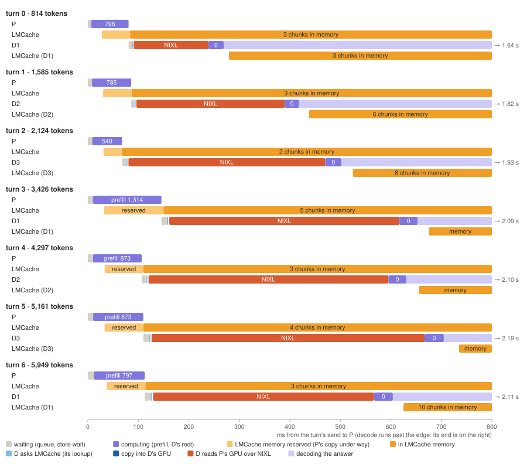

# Conversation 6: mt-rag-clapnq-elser-512-100-20240503 (memory mode, NIXL, per-engine servers, carry-forward, all passages)

P's KV reaches D over NIXL (D reads P's GPU blocks); every engine's LMCache connector stores beside it, to its own server. 7 turns on D1, D2, D3 (round-robin: each turn to the next D engine); prompts grow from 814 to 5,949 tokens (interleaved: each turn's prompt is the previous one, its answer, then this turn's documents and question). Chunks are 256 tokens (16 vLLM blocks of 16); a chunk's name is LMCache's hash of its tokens and everything before them, so the same prefix has the same chunks on every turn and engine.

Legend for the strips (one character a chunk): P: `=` on P's GPU from an earlier turn, `#` computed and stored now, `+` computed, not stored (a partial chunk). D: `=` on D's GPU from an earlier turn, `M` pulled from memory, `S` pulled from disk, `N` read from P's GPU over NIXL, `+` computed by D (a partial chunk), `?` missed.

GPU blocks (the chunk tables): where each engine keeps the chunk's 16 vLLM blocks in its GPU KV cache, by vLLM's block ids (vLLM's paged KV cache: a block, or page, holds 16 tokens; block 0 is its reserved null block), in the prompt's block order, a run of consecutive ids written as a range: `P 1, 138-152` is the prompt's block 0 in GPU block 1 and its blocks 1-15 in GPU blocks 138-152. An engine takes a GPU block from its free list when it first computes or loads a block, and the block keeps it while cached, so a later turn that reuses the block shows the same id. Blocks that are the same in several prompts (the same tokens and everything before them) share one GPU block once the first is cached: the system prompt's first block, the same in every conversation, is the usual one. `16/16 hashes = P's`: of the blocks D pulled, how many have the same vLLM hash on D as on P.

The prompts' text is the driver's own record of what it sent (answers included); lines over 100 characters are wrapped here for reading.

| turn | prompt | chunks + tail | P: own GPU / computed / stored | D: own GPU / loaded / computed | pulled | pull ms | D first token ms |
| ---: | ---: | --- | --- | --- | --- | ---: | ---: |
| [0](#turn-0) | 814 | 3 + 46 | 16 / 798 / 3 chunks | 16 / 798 / 0 | 4 chunks (NIXL 4) | 148.1 | 184.2 |
| [1](#turn-1) | 1,585 | 6 + 49 | 800 / 785 / 3 chunks | 16 / 1,569 / 0 | 7 chunks (NIXL 7) | 293.9 | 327.7 |
| [2](#turn-2) | 2,124 | 8 + 76 | 1,584 / 540 / 2 chunks | 16 / 2,108 / 0 | 9 chunks (NIXL 9) | 389.5 | 428.8 |
| [3](#turn-3) | 3,426 | 13 + 98 | 2,112 / 1,314 / 5 chunks | 928 / 2,498 / 0 | 11 chunks (NIXL 11) | 455.9 | 498.7 |
| [4](#turn-4) | 4,297 | 16 + 201 | 3,424 / 873 / 3 chunks | 1,712 / 2,585 / 0 | 11 chunks (NIXL 11) | 475.0 | 517.0 |
| [5](#turn-5) | 5,161 | 20 + 41 | 4,288 / 873 / 4 chunks | 2,240 / 2,921 / 0 | 13 chunks (NIXL 13) | 540.6 | 586.4 |
| [6](#turn-6) | 5,949 | 23 + 61 | 5,152 / 797 / 3 chunks | 3,552 / 2,397 / 0 | 11 chunks (NIXL 11) | 437.7 | 482.3 |

## How the prompt grows

Each turn's prompt is the previous one, token for token, and then: D's answer to the previous turn, this turn's documents, its question and the framing (the system prompt on turn 0, `Assistant:` and newlines). Only the new tokens can make new chunks: the previous prompt's partial chunk fills first. A document sent before comes again at another place, so in other chunks.

| turn | prompt | new | previous answer | documents | question | framing | whole chunks |
| ---: | ---: | ---: | ---: | --- | --- | ---: | --- |
| 0 | 814 | +814 | – | 5 docs, 769 | 15: where is bone marrow found what does it do for the body | 30 | 3 (+3) |
| 1 | 1,585 | +771 | 128 | 6 docs, 629 (1 sent before: 89) | 11: What happens if it does not work well? | 3 | 6 (+3) |
| 2 | 2,124 | +539 | 128 | 5 docs, 399 | 9: How is Sickle cell treated? | 3 | 8 (+2) |
| 3 | 3,426 | +1,302 | 128 | 9 docs, 1,164 (2 sent before: 168) | 7: Will it kill me? | 3 | 13 (+5) |
| 4 | 4,297 | +871 | 128 | 8 docs, 734 (3 sent before: 345) | 6: How about transplant? | 3 | 16 (+3) |
| 5 | 5,161 | +864 | 128 | 5 docs, 724 | 9: Is Huntington's disease also inherited? | 3 | 20 (+4) |
| 6 | 5,949 | +788 | 128 | 6 docs, 649 | 8: Any cures for it? | 3 | 23 (+3) |

## Timeline

Every turn on one clock: ms from the moment the proxy sent the turn to P. P prefills it (one token out) and holds its blocks for D; the proxy sends the turn to the next D engine at once with P's reply's kv_transfer_params (no wait), D reads P's blocks over NIXL (orange-red), computes the rest and decodes the answer. Beside it every engine's LMCache connector stores its new whole chunks (P's lane, and D's own when it stored any). The lanes: P, LMCache (P's chunks), D, and LMCache (D's chunks).



| turn | P queued → done | P's chunks: in memory / on disk | D | D starts | NIXL read | D: held / from P / from LMCache / computed | D's chunks stored | first token | P freed | D done |
| ---: | --- | --- | --- | ---: | --- | --- | ---: | ---: | ---: | ---: |
| 0 | 7 → 81 | 3: 84 / – | D1 | 85 | 91-239 | 16 / 798 / 0 / 0 | 3 | 269 | 240 | 1,645 |
| 1 | 8 → 86 | 3: 87 / – | D2 | 91 | 96-390 | 16 / 1,569 / 0 / 0 | 6 | 418 | 391 | 1,818 |
| 2 | 9 → 68 | 2: 67 / – | D3 | 74 | 80-470 | 16 / 2,108 / 0 / 0 | 8 | 502 | 471 | 1,932 |
| 3 | 10 → 146 | 5: 150 / – | D1 | 154 | 161-617 | 928 / 2,498 / 0 / 0 | 10 | 653 | 618 | 2,092 |
| 4 | 10 → 107 | 3: 110 / – | D2 | 114 | 120-595 | 1,712 / 2,585 / 0 / 0 | 10 | 631 | 596 | 2,098 |
| 5 | 11 → 110 | 4: 110 / – | D3 | 118 | 126-667 | 2,240 / 2,921 / 0 / 0 | 12 | 705 | 668 | 2,192 |
| 6 | 12 → 113 | 3: 114 / – | D1 | 122 | 129-567 | 3,552 / 2,397 / 0 / 0 | 10 | 604 | 567 | 2,110 |

All times in ms from the turn's send to P. NIXL read: D's worker posts the read of P's blocks to the KV in D's GPU blocks; P freed: D has read, P's blocks go back to its free queue (still cached). Each turn's section below tells it in a sentence and step by step.

### One chunk, block by block: chunk 1 of turn 0 (`447043c4e0839a1c`)

Tokens 256-512 (doc 825171915_3242: 71; doc 837756901_3845: 144; doc 825171915_1986: 41). P computed its blocks; D1 read them from P's GPU over NIXL, P's block into D's block, one for one:

| block | tokens | P's GPU block | vLLM hash on P | D's GPU block | same hash on D |
| ---: | --- | ---: | --- | ---: | --- |
| 16 | 256-272 | 2215 | `7bb602f0881e5a76` | 1598 | True |
| 17 | 272-288 | 2216 | `3bb8c141bc92bda9` | 1599 | True |
| 18 | 288-304 | 2217 | `3a93ce0f28ae79d3` | 1600 | True |
| 19 | 304-320 | 2218 | `5789389724fadefd` | 1601 | True |
| 20 | 320-336 | 2219 | `1aa7e79e18b1d48d` | 1602 | True |
| 21 | 336-352 | 2220 | `884f2a9468ece4fd` | 1603 | True |
| 22 | 352-368 | 2221 | `634961b39eb3a3c5` | 1604 | True |
| 23 | 368-384 | 2222 | `56b369efec5fd1e5` | 1605 | True |
| 24 | 384-400 | 2223 | `05d035ce0fa25d1c` | 1606 | True |
| 25 | 400-416 | 2224 | `f1ca3d1b70b2cb84` | 1607 | True |
| 26 | 416-432 | 2225 | `a9011f49b51f6993` | 1608 | True |
| 27 | 432-448 | 2226 | `3dee2f58a124bac4` | 1609 | True |
| 28 | 448-464 | 2227 | `45563bca5efadda9` | 1610 | True |
| 29 | 464-480 | 2228 | `98561d676f7b3575` | 1611 | True |
| 30 | 480-496 | 2229 | `c00e38c7eb4c66e6` | 1612 | True |
| 31 | 496-512 | 2230 | `86ab120d7b70e11d` | 1613 | True |

## Turn 0

**Timeline:** P queued until 7 ms, prefilled 798 tokens (held 16) and was done at 81 ms; its 3 new chunks were in LMCache's memory at 84 ms. D1 started at 85 ms (no wait) holding 16 tokens, read 798 from P's GPU over NIXL (posted at 91 ms, in its GPU at 239 ms; P freed its blocks at 240 ms), computed 0 and gave its first token at 269 ms; it decoded 128 tokens until 1,645 ms; its LMCache connector stored 3 new chunks. ([all turns](#timeline))

### Step by step

Every move of this turn's KV, ms from the proxy sending the turn to P. P's KV reaches D over NIXL: D's worker reads P's GPU blocks into its own (a NIXL READ, P told when D is done); LMCache's copies (to and from each server's memory) its servers do themselves through CUDA IPC handles each engine registered at start.

| ms | where | what |
| ---: | --- | --- |
| 0.0 | proxy → P | sends the turn (814 prompt tokens; P is asked for one token: prefill only) |
| 2.1 | P | the request arrives |
| 6.5 | P GPU | its prefix cache holds 16 of the prompt's tokens: 1 block in GPU blocks 1 |
| 6.6 | P ↔ LMCache | LMCache has 0 of its tokens; P loads 0 and computes the rest |
| 6.7 | P GPU | 50 new GPU blocks for the 798 tokens it computes: 2200-2249; the prefill runs |
| 7.1 | P → LMCache | store planned: tokens 0-768, chunks 0-2 (48 blocks) |
| 27.0 | LMCache | the store request is in; it waits for P's forward pass to finish (a CUDA event) |
| 27.6 | LMCache memory | space reserved for 3 chunks (88 MB) |
| 78.0 | P GPU → LMCache memory | the copy starts: LMCache reads P's GPU blocks (CUDA IPC) |
| 78.2 | P GPU | the request is done: P holds its 51 blocks for D to read over NIXL, and its reply carries them (kv_transfer_params: the blocks, its NIXL agent) |
| 80.7 | P → proxy | P answers its one token: the prefill is done |
| 81.9 | P GPU → LMCache memory | copy done: 3 chunks, 88 MB in 3.9 ms |
| 83.7 | LMCache memory | 3 chunks in memory, kept for later requests (D gets this turn's KV from P over NIXL); P keeps its copy in its GPU blocks |
| 84.7 | proxy → D1 | sends the turn to D1 at once, with P's kv_transfer_params (round-robin; no wait) |
| 87.1 | D1 ↔ LMCache | asks LMCache for the prompt's chunks |
| 89.2 | LMCache memory | found 0 tokens it lacks |
| 89.8 | D1 GPU | its prefix cache holds 16 of the prompt's tokens: 1 block in GPU blocks 1 |
| 89.9 | D1 ↔ P (NIXL) | will read 798 prompt tokens from P's GPU (beyond the 16 its own cache holds) |
| 90.0 | D1 ↔ LMCache | LMCache has 0 of its tokens; NIXL loads it (MultiConnector: the first connector with tokens) |
| 90.2 | D1 GPU | 50 GPU blocks for the KV from P: 1583-1632 |
| 90.7 | P GPU → D1 GPU (NIXL) | D1 reads P's GPU blocks 1, 2200-2249 into its 1583-1632 (a NIXL READ) |
| 238.8 | D1 | the KV from P is in its GPU blocks (798 tokens) |
| 240.5 | P GPU | D1 has read: P frees its blocks (they stay in its prefix cache) |
| 252.2 | D1 → LMCache | store planned: tokens 0-768; 3 chunks new to its server |
| 268.9 | D1 → proxy | the first answer token |
| 279.1 | D1 GPU | 1 new GPU block for the 1 prompt tokens it computes: 1633 |
| 279.4 | LMCache memory | 3 chunks from D1 in memory |
| 452.7 | D1 GPU | decoding: the answer's KV takes 7 new GPU blocks as it grows, one per 16 tokens: 1634-1640, until 1,493 ms |
| 1,644.8 | D1 | done: 128 tokens decoded; its blocks stay cached in its GPU for the next turn |
| 1,646.0 | proxy | the response is complete |

814 prompt tokens: 3 whole chunks and 46 tokens over (the partial chunk, computed by both engines and stored only when a later turn completes it). P held 16 tokens on its GPU, computed 798 and stored 3 new chunks; D1 held 16, read 798 from P over NIXL, loaded 0 from LMCache and computed 0.

### The prompt

The whole prompt, piece by piece:

- **system prompt** · tokens 0-28 (28) · chunk 0

```text
You are a helpful assistant. Answer the user's last question from the documents. If they do not hold
the answer, say so.
```

<details><summary>document <code>825171915_343-1247-0-904</code> · tokens 28-238 (210) · chunk 0</summary>

```text
Document: Bone marrow
Bone marrow
Bone marrow is a semi-solid tissue which may be found within the spongy or cancellous portions of
bones . In birds and mammals , bone marrow is the primary site of new blood cell production or
hematopoiesis . It is composed of hematopoietic cells , marrow adipose tissue , and supportive
stromal cells . On average , bone marrow constitutes 4 % of the total body mass of humans ; in an
adult having 65 kilograms of mass ( 143 lb ) , bone marrow typically accounts for approximately 2.6
kilograms ( 5.7 lb ) . Human marrow produces approximately 500 billion blood cells per day , which
join the systemic circulation via permeable vasculature sinusoids within the medullary cavity . All
types of hematopoietic cells , including both myeloid and lymphoid lineages , are created in bone
marrow ; however , lymphoid cells must migrate to other lymphoid organs ( e.g. thymus ) in order to
complete maturation .
```

</details>

<details><summary>document <code>825171915_3242-3629-0-387</code> · tokens 238-327 (89) · chunks 0-1</summary>

```text
Document: Bone marrow
Bone marrow
At the cellular level , the main functional component of bone marrow includes the progenitor cells
which are destined to mature into blood and lymphoid cells . Marrow contains hematopoietic stem
cells which give rise to the three classes of blood cells that are found in circulation : white
blood cells ( leukocytes ) , red blood cells ( erythrocytes ) , and platelets ( thrombocytes ) .
```

</details>

<details><summary>document <code>837756901_3845-4469-0-624</code> · tokens 327-471 (144) · chunk 1</summary>

```text
Document: Human musculoskeletal system
Human musculoskeletal system
Located in long bones are two distinctions of bone marrow ( yellow and red ) . The yellow marrow has
fatty connective tissue and is found in the marrow cavity . During starvation , the body uses the
fat in yellow marrow for energy . The red marrow of some bones is an important site for blood cell
production , approximately 2.6 million red blood cells per second in order to replace existing cells
that have been destroyed by the liver . Here all erythrocytes , platelets , and most leukocytes form
in adults . From the red marrow , erythrocytes , platelets , and leukocytes migrate to the blood to
do their special tasks .
```

</details>

<details><summary>document <code>825171915_1986-3071-0-1085</code> · tokens 471-704 (233) · chunks 1-2</summary>

```text
Document: Bone marrow
Bone marrow
The composition of marrow is dynamic , as the mixture of cellular and non-cellular components (
connective tissue ) shifts with age and in response to systemic factors . In humans , marrow is
colloquially characterized as `` red '' or `` yellow '' marrow ( Latin : medulla ossium rubra ,
Latin : medulla ossium flava , respectively ) depending on the prevalence of hematopoetic cells vs
fat cells . While the precise mechanisms underlying marrow regulation are not understood ,
compositional changes occur according to stereotypical patterns . For example , a newborn baby 's
bones exclusively contain hematopoietically active `` red '' marrow , and there is a progressive
conversion towards `` yellow '' marrow with age . In adults , red marrow is found mainly in the
central skeleton , such as the pelvis , sternum , cranium , ribs , vertebrae and scapulae , and
variably found in the proximal epiphyseal ends of long bones such as the femur and humerus . In
circumstances of chronic hypoxia , the body can convert yellow marrow back to red marrow to increase
blood cell production .
```

</details>

<details><summary>document <code>825171915_6292-6727-0-435</code> · tokens 704-797 (93) · chunks 2-3</summary>

```text
Document: Bone marrow
Bone marrow
The red bone marrow is a key element of the lymphatic system , being one of the primary lymphoid
organs that generate lymphocytes from immature hematopoietic progenitor cells . The bone marrow and
thymus constitute the primary lymphoid tissues involved in the production and early selection of
lymphocytes . Furthermore , bone marrow performs a valve - like function to prevent the backflow of
lymphatic fluid in the lymphatic system .
```

</details>

- **question 0** · tokens 797-812 (15) · chunk 3

```text
User: where is bone marrow found what does it do for the body
```

- `Assistant:` · tokens 812-814 (2) · chunk 3

### Pieces, chunks and blocks

| piece | tokens | length | chunks | |
| --- | --- | ---: | --- | --- |
| system | 0-28 | 28 | 0 |  |
| doc 825171915_343- | 28-238 | 210 | 0 |  |
| doc 825171915_3242 | 238-327 | 89 | 0-1 |  |
| doc 837756901_3845 | 327-471 | 144 | 1 |  |
| doc 825171915_1986 | 471-704 | 233 | 1-2 |  |
| doc 825171915_6292 | 704-797 | 93 | 2-3 |  |
| question 0 | 797-812 | 15 | 3 |  |
| `assistant:` 0 | 812-814 | 2 | 3 |  |

```
P  ###+
D  NNNN
```

| chunk | tokens | pieces in it (tokens) | vLLM blocks | GPU blocks | in LMCache | P this turn | D this turn |
| ---: | --- | --- | --- | --- | --- | --- | --- |
| 0 | 0-256 | system: 28; doc 825171915_343-: 210; doc 825171915_3242: 18 | 0-15 | P 1, 2200-2214; D 1, 1583-1597; 15/15 hashes = P's | `57c5e2a7d5e5b8af`: LMC_P: stored on turn 0 by P; LMC_D1: stored on turn 0 by D1; LMC_D2: stored on turn 1 by D2; LMC_D3: stored on turn 2 by D3 | computed (its first 16 tokens on P's GPU already), **stored now** | **read from P's GPU over NIXL** (its first 16 tokens on D's GPU already) |
| 1 | 256-512 | doc 825171915_3242: 71; doc 837756901_3845: 144; doc 825171915_1986: 41 | 16-31 | P 2215-2230; D 1598-1613; 16/16 hashes = P's | `447043c4e0839a1c`: LMC_P: stored on turn 0 by P; LMC_D1: stored on turn 0 by D1; LMC_D2: stored on turn 1 by D2; LMC_D3: stored on turn 2 by D3 | computed, **stored now** | **read from P's GPU over NIXL** |
| 2 | 512-768 | doc 825171915_1986: 192; doc 825171915_6292: 64 | 32-47 | P 2231-2246; D 1614-1629; 16/16 hashes = P's | `174ece32127556ac`: LMC_P: stored on turn 0 by P; LMC_D1: stored on turn 0 by D1; LMC_D2: stored on turn 1 by D2; LMC_D3: stored on turn 2 by D3 | computed, **stored now** | **read from P's GPU over NIXL** |
| 3 | 768-814 | doc 825171915_6292: 29; question 0: 15; `assistant:` 0: 2 | 48-50 | P 2247-2248; D 1630-1632; 2/2 hashes = P's | – | computed (partial chunk: not stored) | **read from P's GPU over NIXL** (partial chunk) |

## Turn 1

**Timeline:** P queued until 8 ms, prefilled 785 tokens (held 800) and was done at 86 ms; its 3 new chunks were in LMCache's memory at 87 ms. D2 started at 91 ms (no wait) holding 16 tokens, read 1,569 from P's GPU over NIXL (posted at 96 ms, in its GPU at 390 ms; P freed its blocks at 391 ms), computed 0 and gave its first token at 418 ms; it decoded 128 tokens until 1,818 ms; its LMCache connector stored 6 new chunks. ([all turns](#timeline))

### Step by step

Every move of this turn's KV, ms from the proxy sending the turn to P. P's KV reaches D over NIXL: D's worker reads P's GPU blocks into its own (a NIXL READ, P told when D is done); LMCache's copies (to and from each server's memory) its servers do themselves through CUDA IPC handles each engine registered at start.

| ms | where | what |
| ---: | --- | --- |
| 0.0 | proxy → P | sends the turn (1,585 prompt tokens; P is asked for one token: prefill only) |
| 3.1 | P | the request arrives |
| 7.9 | P GPU | its prefix cache holds 800 of the prompt's tokens: 50 blocks in GPU blocks 1, 2200-2248 |
| 8.0 | P ↔ LMCache | LMCache has 768 of its tokens; P loads 0 and computes the rest |
| 8.2 | P GPU | 50 new GPU blocks for the 785 tokens it computes: 2249-2298; the prefill runs |
| 8.7 | P → LMCache | store planned: tokens 768-1,536, chunks 3-5 (48 blocks) |
| 29.4 | LMCache | the store request is in; it waits for P's forward pass to finish (a CUDA event) |
| 30.3 | LMCache memory | space reserved for 3 chunks (88 MB) |
| 82.5 | P GPU → LMCache memory | the copy starts: LMCache reads P's GPU blocks (CUDA IPC) |
| 82.7 | P GPU | the request is done: P holds its 100 blocks for D to read over NIXL, and its reply carries them (kv_transfer_params: the blocks, its NIXL agent) |
| 85.9 | P → proxy | P answers its one token: the prefill is done |
| 86.4 | P GPU → LMCache memory | copy done: 3 chunks, 88 MB in 3.9 ms |
| 86.9 | LMCache memory | 3 chunks in memory, kept for later requests (D gets this turn's KV from P over NIXL); P keeps its copy in its GPU blocks |
| 90.6 | proxy → D2 | sends the turn to D2 at once, with P's kv_transfer_params (round-robin; no wait) |
| 92.4 | D2 ↔ LMCache | asks LMCache for the prompt's chunks |
| 94.5 | LMCache memory | found 0 tokens it lacks |
| 95.2 | D2 GPU | its prefix cache holds 16 of the prompt's tokens: 1 block in GPU blocks 1 |
| 95.3 | D2 ↔ P (NIXL) | will read 1,569 prompt tokens from P's GPU (beyond the 16 its own cache holds) |
| 95.3 | D2 ↔ LMCache | LMCache has 0 of its tokens; NIXL loads it (MultiConnector: the first connector with tokens) |
| 95.6 | D2 GPU | 99 GPU blocks for the KV from P: 1932-2030 |
| 96.1 | P GPU → D2 GPU (NIXL) | D2 reads P's GPU blocks 1, 2200-2298 into its 1932-2030 (a NIXL READ) |
| 390.1 | D2 | the KV from P is in its GPU blocks (1,569 tokens) |
| 390.7 | P GPU | D2 has read: P frees its blocks (they stay in its prefix cache) |
| 401.2 | D2 → LMCache | store planned: tokens 0-1,536; 6 chunks new to its server |
| 418.2 | D2 → proxy | the first answer token |
| 437.9 | LMCache memory | 6 chunks from D2 in memory |
| 572.4 | D2 GPU | 1 new GPU block for the 1 prompt tokens it computes: 2031 |
| 748.3 | D2 GPU | decoding: the answer's KV takes 6 new GPU blocks as it grows, one per 16 tokens: 2032-2037, until 1,630 ms |
| 1,817.5 | D2 | done: 128 tokens decoded; its blocks stay cached in its GPU for the next turn |
| 1,819.0 | proxy | the response is complete |

1,585 prompt tokens: 6 whole chunks and 49 tokens over (the partial chunk, computed by both engines and stored only when a later turn completes it). P held 800 tokens on its GPU, computed 785 and stored 3 new chunks; D2 held 16, read 1,569 from P over NIXL, loaded 0 from LMCache and computed 0.

### The prompt

Tokens 0-814: [turn 0](#turn-0)'s prompt, unchanged (checked: its first 814 token ids are the previous prompt's), so chunks 0-2 are the same chunks; chunk 3 (partial then, 46 tokens) fills now. New from token 814:

- **D's answer to turn 0** · tokens 814-942 (128) · chunk 3

```text
 Bone marrow is found in the spongy or cancellous portions of bones. It is the primary site of new
blood cell production or hematopoiesis. It is composed of hematopoietic cells, marrow adipose
tissue, and supportive stromal cells. On average, bone marrow constitutes 4% of the total body mass
of humans; in an adult having 65 kilograms of mass (143 lb), bone marrow typically accounts for
approximately 2.6 kilograms (5.7 lb). Human marrow produces approximately 500 billion blood cells
per day, which join the systemic circulation via permeable vasculature sinusoids within the med
```

- `\n` · tokens 942-943 (1) · chunk 3

<details><summary>document <code>825171915_11920-12748-0-828</code> · tokens 943-1112 (169) · chunks 3-4</summary>

```text
Document: Bone marrow
Bone marrow
In a bone marrow transplant , hematopoietic stem cells are removed from a person and infused into
another person ( allogenic ) or into the same person at a later time ( autologous ) . If the donor
and recipient are compatible , these infused cells will then travel to the bone marrow and initiate
blood cell production . Transplantation from one person to another is conducted for the treatment of
severe bone marrow diseases , such as congenital defects , autoimmune diseases or malignancies . The
patient 's own marrow is first killed off with drugs or radiation , and then the new stem cells are
introduced . Before radiation therapy or chemotherapy in cases of cancer , some of the patient 's
hematopoietic stem cells are sometimes harvested and later infused back when the therapy is finished
to restore the immune system .
```

</details>

<details><summary>document <code>853377429_16511-16858-0-347</code> · tokens 1112-1200 (88) · chunk 4</summary>

```text
Document: Sickle cell disease
Sickle cell disease
The actual anaemia of the illness is caused by haemolysis , the destruction of the red cells ,
because of their shape . Although the bone marrow attempts to compensate by creating new red cells ,
it does not match the rate of destruction . Healthy red blood cells typically function for 90 -- 120
days , but sickled cells only last 10 -- 20 days .
```

</details>

<details><summary>document <code>825171915_7241-7870-0-629</code> · tokens 1200-1324 (124) · chunks 4-5</summary>

```text
Document: Bone marrow
Bone marrow
The normal bone marrow architecture can be damaged or displaced by aplastic anemia , malignancies
such as multiple myeloma , or infections such as tuberculosis , leading to a decrease in the
production of blood cells and blood platelets . The bone marrow can also be affected by various
forms of leukemia , which attacks its hematologic progenitor cells . Furthermore , exposure to
radiation or chemotherapy will kill many of the rapidly dividing cells of the bone marrow , and will
therefore result in a depressed immune system . Many of the symptoms of radiation poisoning are due
to damage sustained by the bone marrow cells .
```

</details>

<details><summary>document <code>825171915_1248-1580-0-332</code> · tokens 1324-1387 (63) · chunk 5</summary>

```text
Document: Bone marrow
Bone marrow
Bone marrow transplants can be conducted to treat severe diseases of the bone marrow , including
certain forms of cancer such as leukemia . Additionally , bone marrow stem cells have been
successfully transformed into functional neural cells , and can also potentially be used to treat
illnesses such as inflammatory bowel disease .
```

</details>

- document `825171915_3242-3629-0-387` · tokens 1387-1476 (89) · chunk 5 · **again**: sent on [turn 0](#turn-0) already (the same 89 tokens), here at another place in the prompt, so in other chunks: a prefix cache cannot reuse it

<details><summary>document <code>825171915_4571-5028-0-457</code> · tokens 1476-1572 (96) · chunks 5-6</summary>

```text
Document: Bone marrow
Bone marrow
The stroma of the bone marrow includes all tissue not directly involved in the marrow 's primary
function of hematopoiesis . Stromal cells may be indirectly involved in hematopoiesis , providing a
microenvironment that influences the function and differentiation of hematopoeietic cells . For
instance , they generate colony stimulating factors , which have a significant effect on
hematopoiesis . Cell types that constitute the bone marrow stroma include :
```

</details>

- **question 1** · tokens 1572-1583 (11) · chunk 6

```text
User: What happens if it does not work well?
```

- `Assistant:` · tokens 1583-1585 (2) · chunk 6

### Pieces, chunks and blocks

| piece | tokens | length | chunks | |
| --- | --- | ---: | --- | --- |
| system | 0-28 | 28 | 0 |  |
| doc 825171915_343- | 28-238 | 210 | 0 |  |
| doc 825171915_3242 | 238-327 | 89 | 0-1 |  |
| doc 837756901_3845 | 327-471 | 144 | 1 |  |
| doc 825171915_1986 | 471-704 | 233 | 1-2 |  |
| doc 825171915_6292 | 704-797 | 93 | 2-3 |  |
| question 0 | 797-812 | 15 | 3 |  |
| `assistant:` 0 | 812-814 | 2 | 3 |  |
| answer 0 | 814-942 | 128 | 3 | new this turn |
| newline 0 | 942-943 | 1 | 3 | new this turn |
| doc 825171915_1192 | 943-1112 | 169 | 3-4 | new this turn |
| doc 853377429_1651 | 1112-1200 | 88 | 4 | new this turn |
| doc 825171915_7241 | 1200-1324 | 124 | 4-5 | new this turn |
| doc 825171915_1248 | 1324-1387 | 63 | 5 | new this turn |
| doc 825171915_3242 | 1387-1476 | 89 | 5 | new this turn |
| doc 825171915_4571 | 1476-1572 | 96 | 5-6 | new this turn |
| question 1 | 1572-1583 | 11 | 6 | new this turn |
| `assistant:` 1 | 1583-1585 | 2 | 6 | new this turn |

```
P  ===###+
D  NNNNNNN
```

| chunk | tokens | pieces in it (tokens) | vLLM blocks | GPU blocks | in LMCache | P this turn | D this turn |
| ---: | --- | --- | --- | --- | --- | --- | --- |
| 0 | 0-256 | system: 28; doc 825171915_343-: 210; doc 825171915_3242: 18 | 0-15 | P 1, 2200-2214; D 1, 1932-1946 | `57c5e2a7d5e5b8af`: LMC_P: stored on turn 0 by P; LMC_D1: stored on turn 0 by D1; LMC_D2: stored on turn 1 by D2; LMC_D3: stored on turn 2 by D3 | on P's GPU (earlier turn) | **read from P's GPU over NIXL** (its first 16 tokens on D's GPU already) |
| 1 | 256-512 | doc 825171915_3242: 71; doc 837756901_3845: 144; doc 825171915_1986: 41 | 16-31 | P 2215-2230; D 1947-1962 | `447043c4e0839a1c`: LMC_P: stored on turn 0 by P; LMC_D1: stored on turn 0 by D1; LMC_D2: stored on turn 1 by D2; LMC_D3: stored on turn 2 by D3 | on P's GPU (earlier turn) | **read from P's GPU over NIXL** |
| 2 | 512-768 | doc 825171915_1986: 192; doc 825171915_6292: 64 | 32-47 | P 2231-2246; D 1963-1978 | `174ece32127556ac`: LMC_P: stored on turn 0 by P; LMC_D1: stored on turn 0 by D1; LMC_D2: stored on turn 1 by D2; LMC_D3: stored on turn 2 by D3 | on P's GPU (earlier turn) | **read from P's GPU over NIXL** |
| 3 | 768-1024 | doc 825171915_6292: 29; question 0: 15; `assistant:` 0: 2; answer 0 (new): 128; newline 0 (new): 1; doc 825171915_1192 (new): 81 | 48-63 | P 2247-2262; D 1979-1994; 14/14 hashes = P's | `74eb5d79ee9be5b5`: LMC_P: stored on turn 1 by P; LMC_D2: stored on turn 1 by D2; LMC_D3: stored on turn 2 by D3; LMC_D1: stored on turn 3 by D1 | computed (its first 32 tokens on P's GPU already), **stored now** | **read from P's GPU over NIXL** |
| 4 | 1024-1280 | doc 825171915_1192 (new): 88; doc 853377429_1651 (new): 88; doc 825171915_7241 (new): 80 | 64-79 | P 2263-2278; D 1995-2010; 16/16 hashes = P's | `c9cd4adf1929024e`: LMC_P: stored on turn 1 by P; LMC_D2: stored on turn 1 by D2; LMC_D3: stored on turn 2 by D3; LMC_D1: stored on turn 3 by D1 | computed, **stored now** | **read from P's GPU over NIXL** |
| 5 | 1280-1536 | doc 825171915_7241 (new): 44; doc 825171915_1248 (new): 63; doc 825171915_3242 (new): 89; doc 825171915_4571 (new): 60 | 80-95 | P 2279-2294; D 2011-2026; 16/16 hashes = P's | `de2e3510e2e005f3`: LMC_P: stored on turn 1 by P; LMC_D2: stored on turn 1 by D2; LMC_D3: stored on turn 2 by D3; LMC_D1: stored on turn 3 by D1 | computed, **stored now** | **read from P's GPU over NIXL** |
| 6 | 1536-1585 | doc 825171915_4571 (new): 36; question 1 (new): 11; `assistant:` 1 (new): 2 | 96-99 | P 2295-2297; D 2027-2030; 3/3 hashes = P's | – | computed (partial chunk: not stored) | **read from P's GPU over NIXL** (partial chunk) |

## Turn 2

**Timeline:** P queued until 9 ms, prefilled 540 tokens (held 1,584) and was done at 68 ms; its 2 new chunks were in LMCache's memory at 67 ms. D3 started at 74 ms (no wait) holding 16 tokens, read 2,108 from P's GPU over NIXL (posted at 80 ms, in its GPU at 470 ms; P freed its blocks at 471 ms), computed 0 and gave its first token at 502 ms; it decoded 128 tokens until 1,932 ms; its LMCache connector stored 8 new chunks. ([all turns](#timeline))

### Step by step

Every move of this turn's KV, ms from the proxy sending the turn to P. P's KV reaches D over NIXL: D's worker reads P's GPU blocks into its own (a NIXL READ, P told when D is done); LMCache's copies (to and from each server's memory) its servers do themselves through CUDA IPC handles each engine registered at start.

| ms | where | what |
| ---: | --- | --- |
| 0.0 | proxy → P | sends the turn (2,124 prompt tokens; P is asked for one token: prefill only) |
| 3.3 | P | the request arrives |
| 8.4 | P GPU | its prefix cache holds 1,584 of the prompt's tokens: 99 blocks in GPU blocks 1, 2200-2297 |
| 8.5 | P ↔ LMCache | LMCache has 1,536 of its tokens; P loads 0 and computes the rest |
| 8.7 | P GPU | 34 new GPU blocks for the 540 tokens it computes: 2298-2331; the prefill runs |
| 9.2 | P → LMCache | store planned: tokens 1,536-2,048, chunks 6-7 (32 blocks) |
| 30.5 | LMCache | the store request is in; it waits for P's forward pass to finish (a CUDA event) |
| 31.0 | LMCache memory | space reserved for 2 chunks (59 MB) |
| 64.3 | P GPU → LMCache memory | the copy starts: LMCache reads P's GPU blocks (CUDA IPC) |
| 64.5 | P GPU | the request is done: P holds its 133 blocks for D to read over NIXL, and its reply carries them (kv_transfer_params: the blocks, its NIXL agent) |
| 67.0 | P GPU → LMCache memory | copy done: 2 chunks, 59 MB in 2.6 ms |
| 67.2 | LMCache memory | 2 chunks in memory, kept for later requests (D gets this turn's KV from P over NIXL); P keeps its copy in its GPU blocks |
| 67.9 | P → proxy | P answers its one token: the prefill is done |
| 73.6 | proxy → D3 | sends the turn to D3 at once, with P's kv_transfer_params (round-robin; no wait) |
| 76.7 | D3 ↔ LMCache | asks LMCache for the prompt's chunks |
| 78.2 | LMCache memory | found 0 tokens it lacks |
| 79.5 | D3 GPU | its prefix cache holds 16 of the prompt's tokens: 1 block in GPU blocks 1 |
| 79.5 | D3 ↔ P (NIXL) | will read 2,108 prompt tokens from P's GPU (beyond the 16 its own cache holds) |
| 79.6 | D3 ↔ LMCache | LMCache has 0 of its tokens; NIXL loads it (MultiConnector: the first connector with tokens) |
| 79.9 | D3 GPU | 132 GPU blocks for the KV from P: 2163-2294 |
| 80.5 | P GPU → D3 GPU (NIXL) | D3 reads P's GPU blocks 1, 2200-2331 into its 2163-2294 (a NIXL READ) |
| 470.0 | D3 | the KV from P is in its GPU blocks (2,108 tokens) |
| 470.9 | P GPU | D3 has read: P frees its blocks (they stay in its prefix cache) |
| 484.2 | D3 → LMCache | store planned: tokens 0-2,048; 8 chunks new to its server |
| 502.4 | D3 → proxy | the first answer token |
| 524.7 | LMCache memory | 8 chunks from D3 in memory |
| 536.1 | D3 GPU | 1 new GPU block for the 1 prompt tokens it computes: 2295 |
| 715.4 | D3 GPU | decoding: the answer's KV takes 7 new GPU blocks as it grows, one per 16 tokens: 2296-2302, until 1,796 ms |
| 1,931.6 | D3 | done: 128 tokens decoded; its blocks stay cached in its GPU for the next turn |
| 1,933.0 | proxy | the response is complete |

2,124 prompt tokens: 8 whole chunks and 76 tokens over (the partial chunk, computed by both engines and stored only when a later turn completes it). P held 1,584 tokens on its GPU, computed 540 and stored 2 new chunks; D3 held 16, read 2,108 from P over NIXL, loaded 0 from LMCache and computed 0.

### The prompt

Tokens 0-1,585: [turn 1](#turn-1)'s prompt, unchanged (checked: its first 1,585 token ids are the previous prompt's), so chunks 0-5 are the same chunks; chunk 6 (partial then, 49 tokens) fills now. New from token 1,585:

- **D's answer to turn 1** · tokens 1585-1713 (128) · chunk 6

```text
 If it does not work well, the body will not be able to produce enough blood cells to keep the body
healthy. This can lead to anemia, which is a condition where the body does not have enough red blood
cells to carry oxygen to the body's tissues. Anemia can cause fatigue, shortness of breath, and
other symptoms. If left untreated, anemia can be life-threatening.

Document: Bone marrow
Bone marrow
The normal bone marrow architecture can be damaged or displaced by aplastic anemia, malignancies
such as multiple myeloma, or infections such as tuberculosis, leading to a decrease in the
production of blood
```

- `\n` · tokens 1713-1714 (1) · chunk 6

<details><summary>document <code>853377429_2317-2677-0-360</code> · tokens 1714-1794 (80) · chunks 6-7</summary>

```text
Document: Sickle cell disease
Sickle cell disease
The care of people with sickle cell disease may include infection prevention with vaccination and
antibiotics , high fluid intake , folic acid supplementation and pain medication . Other measures
may include blood transfusion and the medication hydroxycarbamide ( hydroxyurea ) . A small
percentage of people can be cured by a transplant of bone marrow cells .
```

</details>

<details><summary>document <code>853377429_23150-23662-0-512</code> · tokens 1794-1896 (102) · chunk 7</summary>

```text
Document: Sickle cell disease
Sickle cell disease
When treating avascular necrosis of the bone in people with sickle cell disease , the aim of
treatment is to reduce or stop the pain and maintain joint mobility . Current treatment options are
to rest the joint , physical therapy , pain relief medicine , joint replacement surgery , or bone
grafting . High quality randomized controlled trials are needed to assess the most effective
treatment option and determine if a combination of physical therapy and surgery are more effective
than physical therapy alone .
```

</details>

<details><summary>document <code>853377429_18938-19079-0-141</code> · tokens 1896-1937 (41) · chunk 7</summary>

```text
Document: Sickle cell disease
Sickle cell disease
Treatment involves a number of measures . L - glutamine use was supported by the FDA starting at the
age of 5 as it decreases complications .
```

</details>

<details><summary>document <code>853377429_22796-23121-0-325</code> · tokens 1937-2011 (74) · chunk 7</summary>

```text
Document: Sickle cell disease
Sickle cell disease
Bone marrow transplants have proven effective in children . Bone marrow transplants are the only
known cure for SCD . However , bone marrow transplants are difficult to obtain because of the
specific HLA typing necessary . Ideally , a close relative ( allogeneic ) would donate the bone
marrow necessary for transplantation .
```

</details>

<details><summary>document <code>853377429_37780-38219-0-439</code> · tokens 2011-2113 (102) · chunks 7-8</summary>

```text
Document: Sickle cell disease
Sickle cell disease
Phase 1 clinical trials of gene therapy for sickle cell disease in humans were started in 2014 . The
clinical trials will assess the safety and initial evidence for efficacy of an autologous transplant
of lentiviral vector - modified bone marrow for adults with severe sickle cell disease . As of 2016
, however , no randomized controlled trials have been reported . A case report for the first person
treated was published in March 2017 .
```

</details>

- **question 2** · tokens 2113-2122 (9) · chunk 8

```text
User: How is Sickle cell treated?
```

- `Assistant:` · tokens 2122-2124 (2) · chunk 8

### Pieces, chunks and blocks

| piece | tokens | length | chunks | |
| --- | --- | ---: | --- | --- |
| system | 0-28 | 28 | 0 |  |
| doc 825171915_343- | 28-238 | 210 | 0 |  |
| doc 825171915_3242 | 238-327 | 89 | 0-1 |  |
| doc 837756901_3845 | 327-471 | 144 | 1 |  |
| doc 825171915_1986 | 471-704 | 233 | 1-2 |  |
| doc 825171915_6292 | 704-797 | 93 | 2-3 |  |
| question 0 | 797-812 | 15 | 3 |  |
| `assistant:` 0 | 812-814 | 2 | 3 |  |
| answer 0 | 814-942 | 128 | 3 |  |
| newline 0 | 942-943 | 1 | 3 |  |
| doc 825171915_1192 | 943-1112 | 169 | 3-4 |  |
| doc 853377429_1651 | 1112-1200 | 88 | 4 |  |
| doc 825171915_7241 | 1200-1324 | 124 | 4-5 |  |
| doc 825171915_1248 | 1324-1387 | 63 | 5 |  |
| doc 825171915_3242 | 1387-1476 | 89 | 5 |  |
| doc 825171915_4571 | 1476-1572 | 96 | 5-6 |  |
| question 1 | 1572-1583 | 11 | 6 |  |
| `assistant:` 1 | 1583-1585 | 2 | 6 |  |
| answer 1 | 1585-1713 | 128 | 6 | new this turn |
| newline 1 | 1713-1714 | 1 | 6 | new this turn |
| doc 853377429_2317 | 1714-1794 | 80 | 6-7 | new this turn |
| doc 853377429_2315 | 1794-1896 | 102 | 7 | new this turn |
| doc 853377429_1893 | 1896-1937 | 41 | 7 | new this turn |
| doc 853377429_2279 | 1937-2011 | 74 | 7 | new this turn |
| doc 853377429_3778 | 2011-2113 | 102 | 7-8 | new this turn |
| question 2 | 2113-2122 | 9 | 8 | new this turn |
| `assistant:` 2 | 2122-2124 | 2 | 8 | new this turn |

```
P  ======##+
D  NNNNNNNNN
```

| chunk | tokens | pieces in it (tokens) | vLLM blocks | GPU blocks | in LMCache | P this turn | D this turn |
| ---: | --- | --- | --- | --- | --- | --- | --- |
| 0 | 0-256 | system: 28; doc 825171915_343-: 210; doc 825171915_3242: 18 | 0-15 | P 1, 2200-2214; D 1, 2163-2177 | `57c5e2a7d5e5b8af`: LMC_P: stored on turn 0 by P; LMC_D1: stored on turn 0 by D1; LMC_D2: stored on turn 1 by D2; LMC_D3: stored on turn 2 by D3 | on P's GPU (earlier turn) | **read from P's GPU over NIXL** (its first 16 tokens on D's GPU already) |
| 1 | 256-512 | doc 825171915_3242: 71; doc 837756901_3845: 144; doc 825171915_1986: 41 | 16-31 | P 2215-2230; D 2178-2193 | `447043c4e0839a1c`: LMC_P: stored on turn 0 by P; LMC_D1: stored on turn 0 by D1; LMC_D2: stored on turn 1 by D2; LMC_D3: stored on turn 2 by D3 | on P's GPU (earlier turn) | **read from P's GPU over NIXL** |
| 2 | 512-768 | doc 825171915_1986: 192; doc 825171915_6292: 64 | 32-47 | P 2231-2246; D 2194-2209 | `174ece32127556ac`: LMC_P: stored on turn 0 by P; LMC_D1: stored on turn 0 by D1; LMC_D2: stored on turn 1 by D2; LMC_D3: stored on turn 2 by D3 | on P's GPU (earlier turn) | **read from P's GPU over NIXL** |
| 3 | 768-1024 | doc 825171915_6292: 29; question 0: 15; `assistant:` 0: 2; answer 0: 128; newline 0: 1; doc 825171915_1192: 81 | 48-63 | P 2247-2262; D 2210-2225 | `74eb5d79ee9be5b5`: LMC_P: stored on turn 1 by P; LMC_D2: stored on turn 1 by D2; LMC_D3: stored on turn 2 by D3; LMC_D1: stored on turn 3 by D1 | on P's GPU (earlier turn) | **read from P's GPU over NIXL** |
| 4 | 1024-1280 | doc 825171915_1192: 88; doc 853377429_1651: 88; doc 825171915_7241: 80 | 64-79 | P 2263-2278; D 2226-2241 | `c9cd4adf1929024e`: LMC_P: stored on turn 1 by P; LMC_D2: stored on turn 1 by D2; LMC_D3: stored on turn 2 by D3; LMC_D1: stored on turn 3 by D1 | on P's GPU (earlier turn) | **read from P's GPU over NIXL** |
| 5 | 1280-1536 | doc 825171915_7241: 44; doc 825171915_1248: 63; doc 825171915_3242: 89; doc 825171915_4571: 60 | 80-95 | P 2279-2294; D 2242-2257 | `de2e3510e2e005f3`: LMC_P: stored on turn 1 by P; LMC_D2: stored on turn 1 by D2; LMC_D3: stored on turn 2 by D3; LMC_D1: stored on turn 3 by D1 | on P's GPU (earlier turn) | **read from P's GPU over NIXL** |
| 6 | 1536-1792 | doc 825171915_4571: 36; question 1: 11; `assistant:` 1: 2; answer 1 (new): 128; newline 1 (new): 1; doc 853377429_2317 (new): 78 | 96-111 | P 2295-2310; D 2258-2273; 13/13 hashes = P's | `a7d53922f0f360e1`: LMC_P: stored on turn 2 by P; LMC_D3: stored on turn 2 by D3; LMC_D1: stored on turn 3 by D1; LMC_D2: stored on turn 4 by D2 | computed (its first 48 tokens on P's GPU already), **stored now** | **read from P's GPU over NIXL** |
| 7 | 1792-2048 | doc 853377429_2317 (new): 2; doc 853377429_2315 (new): 102; doc 853377429_1893 (new): 41; doc 853377429_2279 (new): 74; doc 853377429_3778 (new): 37 | 112-127 | P 2311-2326; D 2274-2289; 16/16 hashes = P's | `75dd376ed3ca227b`: LMC_P: stored on turn 2 by P; LMC_D3: stored on turn 2 by D3; LMC_D1: stored on turn 3 by D1; LMC_D2: stored on turn 4 by D2 | computed, **stored now** | **read from P's GPU over NIXL** |
| 8 | 2048-2124 | doc 853377429_3778 (new): 65; question 2 (new): 9; `assistant:` 2 (new): 2 | 128-132 | P 2327-2330; D 2290-2294; 4/4 hashes = P's | – | computed (partial chunk: not stored) | **read from P's GPU over NIXL** (partial chunk) |

## Turn 3

**Timeline:** P queued until 10 ms, prefilled 1,314 tokens (held 2,112) and was done at 146 ms; its 5 new chunks were in LMCache's memory at 150 ms. D1 started at 154 ms (no wait) holding 928 tokens, read 2,498 from P's GPU over NIXL (posted at 161 ms, in its GPU at 617 ms; P freed its blocks at 618 ms), computed 0 and gave its first token at 653 ms; it decoded 128 tokens until 2,092 ms; its LMCache connector stored 10 new chunks. ([all turns](#timeline))

### Step by step

Every move of this turn's KV, ms from the proxy sending the turn to P. P's KV reaches D over NIXL: D's worker reads P's GPU blocks into its own (a NIXL READ, P told when D is done); LMCache's copies (to and from each server's memory) its servers do themselves through CUDA IPC handles each engine registered at start.

| ms | where | what |
| ---: | --- | --- |
| 0.0 | proxy → P | sends the turn (3,426 prompt tokens; P is asked for one token: prefill only) |
| 4.5 | P | the request arrives |
| 9.8 | P GPU | its prefix cache holds 2,112 of the prompt's tokens: 132 blocks in GPU blocks 1, 2200-2330 |
| 9.9 | P ↔ LMCache | LMCache has 2,048 of its tokens; P loads 0 and computes the rest |
| 10.1 | P GPU | 83 new GPU blocks for the 1,314 tokens it computes: 2331-2413; the prefill runs |
| 10.8 | P → LMCache | store planned: tokens 2,048-3,328, chunks 8-12 (80 blocks) |
| 31.1 | LMCache | the store request is in; it waits for P's forward pass to finish (a CUDA event) |
| 31.8 | LMCache memory | space reserved for 5 chunks (147 MB) |
| 139.0 | P GPU → LMCache memory | the copy starts: LMCache reads P's GPU blocks (CUDA IPC) |
| 139.3 | P GPU | the request is done: P holds its 215 blocks for D to read over NIXL, and its reply carries them (kv_transfer_params: the blocks, its NIXL agent) |
| 145.4 | P GPU → LMCache memory | copy done: 5 chunks, 147 MB in 6.4 ms |
| 145.8 | P → proxy | P answers its one token: the prefill is done |
| 149.8 | LMCache memory | 5 chunks in memory, kept for later requests (D gets this turn's KV from P over NIXL); P keeps its copy in its GPU blocks |
| 154.2 | proxy → D1 | sends the turn to D1 at once, with P's kv_transfer_params (round-robin; no wait) |
| 156.8 | D1 ↔ LMCache | asks LMCache for the prompt's chunks |
| 158.9 | LMCache memory | found 0 tokens it lacks |
| 159.7 | D1 GPU | its prefix cache holds 928 of the prompt's tokens: 58 blocks in GPU blocks 1, 1583-1639 |
| 159.8 | D1 ↔ P (NIXL) | will read 2,498 prompt tokens from P's GPU (beyond the 928 its own cache holds) |
| 159.9 | D1 ↔ LMCache | LMCache has 768 of its tokens; NIXL loads it (MultiConnector: the first connector with tokens) |
| 160.3 | D1 GPU | 157 GPU blocks for the KV from P: 1640-1796 |
| 161.2 | P GPU → D1 GPU (NIXL) | D1 reads P's GPU blocks 1, 2200-2413 into its 1640-1796 (a NIXL READ) |
| 617.1 | D1 | the KV from P is in its GPU blocks (2,498 tokens) |
| 617.7 | P GPU | D1 has read: P frees its blocks (they stay in its prefix cache) |
| 632.5 | D1 → LMCache | store planned: tokens 768-3,328; 10 chunks new to its server |
| 652.9 | D1 → proxy | the first answer token |
| 675.3 | LMCache memory | 10 chunks from D1 in memory |
| 799.2 | D1 GPU | 1 new GPU block for the 1 prompt tokens it computes: 1797 |
| 980.6 | D1 GPU | decoding: the answer's KV takes 7 new GPU blocks as it grows, one per 16 tokens: 1798-1804, until 2,069 ms |
| 2,092.1 | D1 | done: 128 tokens decoded; its blocks stay cached in its GPU for the next turn |
| 2,093.3 | proxy | the response is complete |

3,426 prompt tokens: 13 whole chunks and 98 tokens over (the partial chunk, computed by both engines and stored only when a later turn completes it). P held 2,112 tokens on its GPU, computed 1,314 and stored 5 new chunks; D1 held 928, read 2,498 from P over NIXL, loaded 0 from LMCache and computed 0.

### The prompt

Tokens 0-2,124: [turn 2](#turn-2)'s prompt, unchanged (checked: its first 2,124 token ids are the previous prompt's), so chunks 0-7 are the same chunks; chunk 8 (partial then, 76 tokens) fills now. New from token 2,124:

- **D's answer to turn 2** · tokens 2124-2252 (128) · chunk 8

```text
 Sickle cell disease is a genetic disorder that affects the red blood cells. The red blood cells are
shaped like a sickle, which can cause them to get stuck in small blood vessels and block blood flow.
This can lead to pain, organ damage, and other complications. Treatment for sickle cell disease
typically involves managing symptoms and preventing complications. This may include pain medication,
blood transfusions, and oxygen therapy. In some cases, a bone marrow transplant may be necessary. It
is important to work with a healthcare provider to develop a treatment plan that is tailored to your
individual needs.

Document: Sickle cell disease
Sickle cell disease
```

- `\n` · tokens 2252-2253 (1) · chunk 8

- document `853377429_2317-2677-0-360` · tokens 2253-2333 (80) · chunks 8-9 · **again**: sent on [turn 2](#turn-2) already (the same 80 tokens), here at another place in the prompt, so in other chunks: a prefix cache cannot reuse it

<details><summary>document <code>853377429_23953-24295-0-342</code> · tokens 2333-2427 (94) · chunk 9</summary>

```text
Document: Sickle cell disease
Sickle cell disease
About 90 % of people survive to age 20 , and close to 50 % survive beyond age 50 . In 2001 ,
according to one study performed in Jamaica , the estimated mean survival for people with sickle
cell was 53 years old for men and 58 years old for women with homozygous SCD . The specific life
expectancy in much of the developing world is unknown .
```

</details>

<details><summary>document <code>853377429_977-1692-0-715</code> · tokens 2427-2597 (170) · chunks 9-10</summary>

```text
Document: Sickle cell disease
Sickle cell disease
Sickle cell disease ( SCD ) is a group of blood disorders typically inherited from a person 's
parents . The most common type is known as sickle cell anaemia ( SCA ) . It results in an
abnormality in the oxygen - carrying protein haemoglobin found in red blood cells . This leads to a
rigid , sickle - like shape under certain circumstances . Problems in sickle cell disease typically
begin around 5 to 6 months of age . A number of health problems may develop , such as attacks of
pain ( `` sickle cell crisis '' ) , anemia , swelling in the hands and feet , bacterial infections
and stroke . Long - term pain may develop as people get older . The average life expectancy in the
developed world is 40 to 60 years .
```

</details>

<details><summary>document <code>853377429_52-976-0-924</code> · tokens 2597-2807 (210) · chunk 10</summary>

```text
Document: Sickle cell disease
Sickle cell disease
Sickle cell disease Synonyms Sickle cell disorder Figure ( A ) shows normal red blood cells flowing
freely through veins . The inset shows a cross section of a normal red blood cell with normal
haemoglobin . Figure ( B ) shows abnormal , sickled red blood cells sticking at the branching point
in a vein . The inset image shows a cross-section of a sickle cell with long polymerized sickle
haemoglobin ( HbS ) strands stretching and distorting the cell shape . Specialty Hematology Symptoms
Attacks of pain , anemia , swelling in the hands and feet , bacterial infections , stroke
Complications Chronic pain Usual onset 5 -- 6 months of age Causes Genetic Diagnostic method Blood
test Treatment Vaccination , antibiotics , high fluid intake , folic acid supplementation . pain
medication , blood transfusions Prognosis Life expectancy 40 -- 60 years ( developed world )
Frequency 4.4 million ( 2015 ) Deaths 114,800 ( 2015 )
```

</details>

<details><summary>document <code>853377429_6753-7259-0-506</code> · tokens 2807-2928 (121) · chunks 10-11</summary>

```text
Document: Sickle cell disease
Sickle cell disease
Splenic sequestration crises are acute , painful enlargements of the spleen , caused by intrasplenic
trapping of red cells and resulting in a precipitous fall in haemoglobin levels with the potential
for hypovolemic shock . Sequestration crises are considered an emergency . If not treated , patients
may die within 1 -- 2 hours due to circulatory failure . Management is supportive , sometimes with
blood transfusion . These crises are transient , they continue for 3 -- 4 hours and may last for one
day .
```

</details>

<details><summary>document <code>853377429_7776-8635-0-859</code> · tokens 2928-3115 (187) · chunks 11-12</summary>

```text
Document: Sickle cell disease
Sickle cell disease
Aplastic crises are acute worsenings of the patient 's baseline anaemia , producing pale appearance
, fast heart rate , and fatigue . This crisis is normally triggered by parvovirus B19 , which
directly affects production of red blood cells by invading the red cell precursors and multiplying
in and destroying them . Parvovirus infection almost completely prevents red blood cell production
for two to three days . In normal individuals , this is of little consequence , but the shortened
red cell life of SCD patients results in an abrupt , life - threatening situation . Reticulocyte
counts drop dramatically during the disease ( causing reticulocytopenia ) , and the rapid turnover
of red cells leads to the drop in haemoglobin . This crisis takes 4 days to one week to disappear .
Most patients can be managed supportively ; some need blood transfusion .
```

</details>

- document `853377429_16511-16858-0-347` · tokens 3115-3203 (88) · chunk 12 · **again**: sent on [turn 1](#turn-1) already (the same 88 tokens), here at another place in the prompt, so in other chunks: a prefix cache cannot reuse it

<details><summary>document <code>853377429_27276-27776-0-500</code> · tokens 3203-3307 (104) · chunk 12</summary>

```text
Document: Sickle cell disease
Sickle cell disease
The highest frequency of sickle cell disease is found in tropical regions , particularly sub-Saharan
Africa , tribal regions of India and the Middle East . Migration of substantial populations from
these high prevalence areas to low prevalence countries in Europe has dramatically increased in
recent decades and in some European countries sickle cell disease has now overtaken more familiar
genetic conditions such as haemophilia and cystic fibrosis . In 2015 , it resulted in about 114,800
deaths .
```

</details>

<details><summary>document <code>853377429_7290-7750-0-460</code> · tokens 3307-3417 (110) · chunks 12-13</summary>

```text
Document: Sickle cell disease
Sickle cell disease
Acute chest syndrome ( ACS ) is defined by at least two of the following signs or symptoms : chest
pain , fever , pulmonary infiltrate or focal abnormality , respiratory symptoms , or hypoxemia . It
is the second-most common complication and it accounts for about 25 % of deaths in patients with SCD
, majority of cases present with vaso - occlusive crises then they develop ACS . Nevertheless ,
about 80 % of patients have vaso - occlusive crises during ACS .
```

</details>

- **question 3** · tokens 3417-3424 (7) · chunk 13

```text
User: Will it kill me?
```

- `Assistant:` · tokens 3424-3426 (2) · chunk 13

### Pieces, chunks and blocks

| piece | tokens | length | chunks | |
| --- | --- | ---: | --- | --- |
| system | 0-28 | 28 | 0 |  |
| doc 825171915_343- | 28-238 | 210 | 0 |  |
| doc 825171915_3242 | 238-327 | 89 | 0-1 |  |
| doc 837756901_3845 | 327-471 | 144 | 1 |  |
| doc 825171915_1986 | 471-704 | 233 | 1-2 |  |
| doc 825171915_6292 | 704-797 | 93 | 2-3 |  |
| question 0 | 797-812 | 15 | 3 |  |
| `assistant:` 0 | 812-814 | 2 | 3 |  |
| answer 0 | 814-942 | 128 | 3 |  |
| newline 0 | 942-943 | 1 | 3 |  |
| doc 825171915_1192 | 943-1112 | 169 | 3-4 |  |
| doc 853377429_1651 | 1112-1200 | 88 | 4 |  |
| doc 825171915_7241 | 1200-1324 | 124 | 4-5 |  |
| doc 825171915_1248 | 1324-1387 | 63 | 5 |  |
| doc 825171915_3242 | 1387-1476 | 89 | 5 |  |
| doc 825171915_4571 | 1476-1572 | 96 | 5-6 |  |
| question 1 | 1572-1583 | 11 | 6 |  |
| `assistant:` 1 | 1583-1585 | 2 | 6 |  |
| answer 1 | 1585-1713 | 128 | 6 |  |
| newline 1 | 1713-1714 | 1 | 6 |  |
| doc 853377429_2317 | 1714-1794 | 80 | 6-7 |  |
| doc 853377429_2315 | 1794-1896 | 102 | 7 |  |
| doc 853377429_1893 | 1896-1937 | 41 | 7 |  |
| doc 853377429_2279 | 1937-2011 | 74 | 7 |  |
| doc 853377429_3778 | 2011-2113 | 102 | 7-8 |  |
| question 2 | 2113-2122 | 9 | 8 |  |
| `assistant:` 2 | 2122-2124 | 2 | 8 |  |
| answer 2 | 2124-2252 | 128 | 8 | new this turn |
| newline 2 | 2252-2253 | 1 | 8 | new this turn |
| doc 853377429_2317 | 2253-2333 | 80 | 8-9 | new this turn |
| doc 853377429_2395 | 2333-2427 | 94 | 9 | new this turn |
| doc 853377429_977- | 2427-2597 | 170 | 9-10 | new this turn |
| doc 853377429_52-9 | 2597-2807 | 210 | 10 | new this turn |
| doc 853377429_6753 | 2807-2928 | 121 | 10-11 | new this turn |
| doc 853377429_7776 | 2928-3115 | 187 | 11-12 | new this turn |
| doc 853377429_1651 | 3115-3203 | 88 | 12 | new this turn |
| doc 853377429_2727 | 3203-3307 | 104 | 12 | new this turn |
| doc 853377429_7290 | 3307-3417 | 110 | 12-13 | new this turn |
| question 3 | 3417-3424 | 7 | 13 | new this turn |
| `assistant:` 3 | 3424-3426 | 2 | 13 | new this turn |

```
P  ========#####+
D  ===NNNNNNNNNNN
```

| chunk | tokens | pieces in it (tokens) | vLLM blocks | GPU blocks | in LMCache | P this turn | D this turn |
| ---: | --- | --- | --- | --- | --- | --- | --- |
| 0 | 0-256 | system: 28; doc 825171915_343-: 210; doc 825171915_3242: 18 | 0-15 | P 1, 2200-2214; D 1, 1583-1597 | `57c5e2a7d5e5b8af`: LMC_P: stored on turn 0 by P; LMC_D1: stored on turn 0 by D1; LMC_D2: stored on turn 1 by D2; LMC_D3: stored on turn 2 by D3 | on P's GPU (earlier turn) | on D's GPU (earlier turn) |
| 1 | 256-512 | doc 825171915_3242: 71; doc 837756901_3845: 144; doc 825171915_1986: 41 | 16-31 | P 2215-2230; D 1598-1613 | `447043c4e0839a1c`: LMC_P: stored on turn 0 by P; LMC_D1: stored on turn 0 by D1; LMC_D2: stored on turn 1 by D2; LMC_D3: stored on turn 2 by D3 | on P's GPU (earlier turn) | on D's GPU (earlier turn) |
| 2 | 512-768 | doc 825171915_1986: 192; doc 825171915_6292: 64 | 32-47 | P 2231-2246; D 1614-1629 | `174ece32127556ac`: LMC_P: stored on turn 0 by P; LMC_D1: stored on turn 0 by D1; LMC_D2: stored on turn 1 by D2; LMC_D3: stored on turn 2 by D3 | on P's GPU (earlier turn) | on D's GPU (earlier turn) |
| 3 | 768-1024 | doc 825171915_6292: 29; question 0: 15; `assistant:` 0: 2; answer 0: 128; newline 0: 1; doc 825171915_1192: 81 | 48-63 | P 2247-2262; D 1630-1645 | `74eb5d79ee9be5b5`: LMC_P: stored on turn 1 by P; LMC_D2: stored on turn 1 by D2; LMC_D3: stored on turn 2 by D3; LMC_D1: stored on turn 3 by D1 | on P's GPU (earlier turn) | **read from P's GPU over NIXL** (its first 160 tokens on D's GPU already) |
| 4 | 1024-1280 | doc 825171915_1192: 88; doc 853377429_1651: 88; doc 825171915_7241: 80 | 64-79 | P 2263-2278; D 1646-1661 | `c9cd4adf1929024e`: LMC_P: stored on turn 1 by P; LMC_D2: stored on turn 1 by D2; LMC_D3: stored on turn 2 by D3; LMC_D1: stored on turn 3 by D1 | on P's GPU (earlier turn) | **read from P's GPU over NIXL** |
| 5 | 1280-1536 | doc 825171915_7241: 44; doc 825171915_1248: 63; doc 825171915_3242: 89; doc 825171915_4571: 60 | 80-95 | P 2279-2294; D 1662-1677 | `de2e3510e2e005f3`: LMC_P: stored on turn 1 by P; LMC_D2: stored on turn 1 by D2; LMC_D3: stored on turn 2 by D3; LMC_D1: stored on turn 3 by D1 | on P's GPU (earlier turn) | **read from P's GPU over NIXL** |
| 6 | 1536-1792 | doc 825171915_4571: 36; question 1: 11; `assistant:` 1: 2; answer 1: 128; newline 1: 1; doc 853377429_2317: 78 | 96-111 | P 2295-2310; D 1678-1693 | `a7d53922f0f360e1`: LMC_P: stored on turn 2 by P; LMC_D3: stored on turn 2 by D3; LMC_D1: stored on turn 3 by D1; LMC_D2: stored on turn 4 by D2 | on P's GPU (earlier turn) | **read from P's GPU over NIXL** |
| 7 | 1792-2048 | doc 853377429_2317: 2; doc 853377429_2315: 102; doc 853377429_1893: 41; doc 853377429_2279: 74; doc 853377429_3778: 37 | 112-127 | P 2311-2326; D 1694-1709 | `75dd376ed3ca227b`: LMC_P: stored on turn 2 by P; LMC_D3: stored on turn 2 by D3; LMC_D1: stored on turn 3 by D1; LMC_D2: stored on turn 4 by D2 | on P's GPU (earlier turn) | **read from P's GPU over NIXL** |
| 8 | 2048-2304 | doc 853377429_3778: 65; question 2: 9; `assistant:` 2: 2; answer 2 (new): 128; newline 2 (new): 1; doc 853377429_2317 (new): 51 | 128-143 | P 2327-2342; D 1710-1725; 12/12 hashes = P's | `45694b2cdc5dc2c5`: LMC_P: stored on turn 3 by P; LMC_D1: stored on turn 3 by D1; LMC_D2: stored on turn 4 by D2; LMC_D3: stored on turn 5 by D3 | computed (its first 64 tokens on P's GPU already), **stored now** | **read from P's GPU over NIXL** |
| 9 | 2304-2560 | doc 853377429_2317 (new): 29; doc 853377429_2395 (new): 94; doc 853377429_977- (new): 133 | 144-159 | P 2343-2358; D 1726-1741; 16/16 hashes = P's | `7dffeb5e56a6cc64`: LMC_P: stored on turn 3 by P; LMC_D1: stored on turn 3 by D1; LMC_D2: stored on turn 4 by D2; LMC_D3: stored on turn 5 by D3 | computed, **stored now** | **read from P's GPU over NIXL** |
| 10 | 2560-2816 | doc 853377429_977- (new): 37; doc 853377429_52-9 (new): 210; doc 853377429_6753 (new): 9 | 160-175 | P 2359-2374; D 1742-1757; 16/16 hashes = P's | `0fcb9b3c25cb8d5b`: LMC_P: stored on turn 3 by P; LMC_D1: stored on turn 3 by D1; LMC_D2: stored on turn 4 by D2; LMC_D3: stored on turn 5 by D3 | computed, **stored now** | **read from P's GPU over NIXL** |
| 11 | 2816-3072 | doc 853377429_6753 (new): 112; doc 853377429_7776 (new): 144 | 176-191 | P 2375-2390; D 1758-1773; 16/16 hashes = P's | `0cfb80c2c8e96359`: LMC_P: stored on turn 3 by P; LMC_D1: stored on turn 3 by D1; LMC_D2: stored on turn 4 by D2; LMC_D3: stored on turn 5 by D3 | computed, **stored now** | **read from P's GPU over NIXL** |
| 12 | 3072-3328 | doc 853377429_7776 (new): 43; doc 853377429_1651 (new): 88; doc 853377429_2727 (new): 104; doc 853377429_7290 (new): 21 | 192-207 | P 2391-2406; D 1774-1789; 16/16 hashes = P's | `90c5c33af45d9b5b`: LMC_P: stored on turn 3 by P; LMC_D1: stored on turn 3 by D1; LMC_D2: stored on turn 4 by D2; LMC_D3: stored on turn 5 by D3 | computed, **stored now** | **read from P's GPU over NIXL** |
| 13 | 3328-3426 | doc 853377429_7290 (new): 89; question 3 (new): 7; `assistant:` 3 (new): 2 | 208-214 | P 2407-2412; D 1790-1796; 6/6 hashes = P's | – | computed (partial chunk: not stored) | **read from P's GPU over NIXL** (partial chunk) |

## Turn 4

**Timeline:** P queued until 10 ms, prefilled 873 tokens (held 3,424) and was done at 107 ms; its 3 new chunks were in LMCache's memory at 110 ms. D2 started at 114 ms (no wait) holding 1,712 tokens, read 2,585 from P's GPU over NIXL (posted at 120 ms, in its GPU at 595 ms; P freed its blocks at 596 ms), computed 0 and gave its first token at 631 ms; it decoded 128 tokens until 2,098 ms; its LMCache connector stored 10 new chunks. ([all turns](#timeline))

### Step by step

Every move of this turn's KV, ms from the proxy sending the turn to P. P's KV reaches D over NIXL: D's worker reads P's GPU blocks into its own (a NIXL READ, P told when D is done); LMCache's copies (to and from each server's memory) its servers do themselves through CUDA IPC handles each engine registered at start.

| ms | where | what |
| ---: | --- | --- |
| 0.0 | proxy → P | sends the turn (4,297 prompt tokens; P is asked for one token: prefill only) |
| 4.1 | P | the request arrives |
| 9.9 | P GPU | its prefix cache holds 3,424 of the prompt's tokens: 214 blocks in GPU blocks 1, 2200-2412 |
| 10.1 | P ↔ LMCache | LMCache has 3,328 of its tokens; P loads 0 and computes the rest |
| 10.3 | P GPU | 55 new GPU blocks for the 873 tokens it computes: 2413-2467; the prefill runs |
| 10.9 | P → LMCache | store planned: tokens 3,328-4,096, chunks 13-15 (48 blocks) |
| 32.6 | LMCache | the store request is in; it waits for P's forward pass to finish (a CUDA event) |
| 33.3 | LMCache memory | space reserved for 3 chunks (88 MB) |
| 101.4 | P GPU → LMCache memory | the copy starts: LMCache reads P's GPU blocks (CUDA IPC) |
| 101.6 | P GPU | the request is done: P holds its 269 blocks for D to read over NIXL, and its reply carries them (kv_transfer_params: the blocks, its NIXL agent) |
| 105.2 | P GPU → LMCache memory | copy done: 3 chunks, 88 MB in 3.8 ms |
| 106.7 | P → proxy | P answers its one token: the prefill is done |
| 109.7 | LMCache memory | 3 chunks in memory, kept for later requests (D gets this turn's KV from P over NIXL); P keeps its copy in its GPU blocks |
| 113.7 | proxy → D2 | sends the turn to D2 at once, with P's kv_transfer_params (round-robin; no wait) |
| 116.3 | D2 ↔ LMCache | asks LMCache for the prompt's chunks |
| 118.0 | LMCache memory | found 0 tokens it lacks |
| 118.8 | D2 GPU | its prefix cache holds 1,712 of the prompt's tokens: 107 blocks in GPU blocks 1, 1932-2037 |
| 118.9 | D2 ↔ P (NIXL) | will read 2,585 prompt tokens from P's GPU (beyond the 1,712 its own cache holds) |
| 119.0 | D2 ↔ LMCache | LMCache has 1,536 of its tokens; NIXL loads it (MultiConnector: the first connector with tokens) |
| 119.4 | D2 GPU | 162 GPU blocks for the KV from P: 2038-2199 |
| 120.2 | P GPU → D2 GPU (NIXL) | D2 reads P's GPU blocks 1, 2200-2467 into its 2038-2199 (a NIXL READ) |
| 595.2 | D2 | the KV from P is in its GPU blocks (2,585 tokens) |
| 596.2 | P GPU | D2 has read: P frees its blocks (they stay in its prefix cache) |
| 610.6 | D2 → LMCache | store planned: tokens 1,536-4,096; 10 chunks new to its server |
| 630.6 | D2 → proxy | the first answer token |
| 655.7 | LMCache memory | 10 chunks from D2 in memory |
| 699.5 | D2 GPU | 1 new GPU block for the 1 prompt tokens it computes: 2200 |
| 884.6 | D2 GPU | decoding: the answer's KV takes 7 new GPU blocks as it grows, one per 16 tokens: 2201-2207, until 1,993 ms |
| 2,097.6 | D2 | done: 128 tokens decoded; its blocks stay cached in its GPU for the next turn |
| 2,098.9 | proxy | the response is complete |

4,297 prompt tokens: 16 whole chunks and 201 tokens over (the partial chunk, computed by both engines and stored only when a later turn completes it). P held 3,424 tokens on its GPU, computed 873 and stored 3 new chunks; D2 held 1,712, read 2,585 from P over NIXL, loaded 0 from LMCache and computed 0.

### The prompt

Tokens 0-3,426: [turn 3](#turn-3)'s prompt, unchanged (checked: its first 3,426 token ids are the previous prompt's), so chunks 0-12 are the same chunks; chunk 13 (partial then, 98 tokens) fills now. New from token 3,426:

- **D's answer to turn 3** · tokens 3426-3554 (128) · chunk 13

```text
 No, it will not kill you. However, it can cause serious health problems if left untreated. It is
important to seek medical attention if you think you may have sickle cell disease.

Document: Sickle cell disease
Sickle cell disease
The highest frequency of sickle cell disease is found in tropical regions , particularly sub-Saharan
Africa , tribal regions of India and the Middle East . Migration of substantial populations from
these high prevalence areas to low prevalence countries in Europe has dramatically increased in
recent decades and in some European countries sickle cell disease has now overtaken more familiar
genetic conditions such as haemophilia and cystic fibrosis . In
```

- `\n` · tokens 3554-3555 (1) · chunk 13

- document `853377429_22796-23121-0-325` · tokens 3555-3629 (74) · chunks 13-14 · **again**: sent on [turn 2](#turn-2) already (the same 74 tokens), here at another place in the prompt, so in other chunks: a prefix cache cannot reuse it

- document `853377429_37780-38219-0-439` · tokens 3629-3731 (102) · chunk 14 · **again**: sent on [turn 2](#turn-2) already (the same 102 tokens), here at another place in the prompt, so in other chunks: a prefix cache cannot reuse it

<details><summary>document <code>853377429_36903-37132-0-229</code> · tokens 3731-3791 (60) · chunk 14</summary>

```text
Document: Sickle cell disease
Sickle cell disease
While umbilical cord blood transplant can potentially cure the condition , a suitable donor is
available in only 10 % of people . About 7 % of people also die as a result of the procedure and
graft versus host disease may occur .
```

</details>

<details><summary>document <code>857095139_64072-64873-0-801</code> · tokens 3791-3954 (163) · chunks 14-15</summary>

```text
Document: Heart
Heart
The first successful heart transplantation was performed in 1967 by the South African surgeon
Christiaan Barnard at Groote Schuur Hospital in Cape Town . This marked an important milestone in
cardiac surgery , capturing the attention of both the medical profession and the world at large .
However , long - term survival rates of patients were initially very low . Louis Washkansky , the
first recipient of a donated heart , died 18 days after the operation while other patients did not
survive for more than a few weeks . The American surgeon Norman Shumway has been credited for his
efforts to improve transplantation techniques , along with pioneers Richard Lower , Vladimir
Demikhov and Adrian Kantrowitz . As of March 2000 , more than 55,000 heart transplantations have
been performed worldwide .
```

</details>

- document `825171915_11920-12748-0-828` · tokens 3954-4123 (169) · chunks 15-16 · **again**: sent on [turn 1](#turn-1) already (the same 169 tokens), here at another place in the prompt, so in other chunks: a prefix cache cannot reuse it

<details><summary>document <code>842629338_3606-3996-0-390</code> · tokens 4123-4209 (86) · chunk 16</summary>

```text
Document: Somatic cell nuclear transfer
Somatic cell nuclear transfer
Somatic cell nuclear transplantation has become a focus of study in stem cell research . The aim of
carrying out this procedure is to obtain pluripotent cells from a cloned embryo . These cells
genetically matched the donor organism from which they came . This gives them the ability to create
patient specific pluripotent cells , which could then be used in therapies or disease research .
```

</details>

<details><summary>document <code>833718643_6145-6287-0-142</code> · tokens 4209-4252 (43) · chunk 16</summary>

```text
Document: Brigham and Women's Hospital
Brigham and Women's Hospital
In 1954 , the hospital became the location for the first ever successful kidney transplant ,
performed by Joseph Murray , on Richard Herrick .
```

</details>

<details><summary>document <code>837000521_21095-21229-0-134</code> · tokens 4252-4289 (37) · chunk 16</summary>

```text
Document: Thymus
Thymus
A thymus may be transplanted , however , this approach is problematic due to donor requirements and
matching tissue with the patient .
```

</details>

- **question 4** · tokens 4289-4295 (6) · chunk 16

```text
User: How about transplant?
```

- `Assistant:` · tokens 4295-4297 (2) · chunk 16

### Pieces, chunks and blocks

| piece | tokens | length | chunks | |
| --- | --- | ---: | --- | --- |
| system | 0-28 | 28 | 0 |  |
| doc 825171915_343- | 28-238 | 210 | 0 |  |
| doc 825171915_3242 | 238-327 | 89 | 0-1 |  |
| doc 837756901_3845 | 327-471 | 144 | 1 |  |
| doc 825171915_1986 | 471-704 | 233 | 1-2 |  |
| doc 825171915_6292 | 704-797 | 93 | 2-3 |  |
| question 0 | 797-812 | 15 | 3 |  |
| `assistant:` 0 | 812-814 | 2 | 3 |  |
| answer 0 | 814-942 | 128 | 3 |  |
| newline 0 | 942-943 | 1 | 3 |  |
| doc 825171915_1192 | 943-1112 | 169 | 3-4 |  |
| doc 853377429_1651 | 1112-1200 | 88 | 4 |  |
| doc 825171915_7241 | 1200-1324 | 124 | 4-5 |  |
| doc 825171915_1248 | 1324-1387 | 63 | 5 |  |
| doc 825171915_3242 | 1387-1476 | 89 | 5 |  |
| doc 825171915_4571 | 1476-1572 | 96 | 5-6 |  |
| question 1 | 1572-1583 | 11 | 6 |  |
| `assistant:` 1 | 1583-1585 | 2 | 6 |  |
| answer 1 | 1585-1713 | 128 | 6 |  |
| newline 1 | 1713-1714 | 1 | 6 |  |
| doc 853377429_2317 | 1714-1794 | 80 | 6-7 |  |
| doc 853377429_2315 | 1794-1896 | 102 | 7 |  |
| doc 853377429_1893 | 1896-1937 | 41 | 7 |  |
| doc 853377429_2279 | 1937-2011 | 74 | 7 |  |
| doc 853377429_3778 | 2011-2113 | 102 | 7-8 |  |
| question 2 | 2113-2122 | 9 | 8 |  |
| `assistant:` 2 | 2122-2124 | 2 | 8 |  |
| answer 2 | 2124-2252 | 128 | 8 |  |
| newline 2 | 2252-2253 | 1 | 8 |  |
| doc 853377429_2317 | 2253-2333 | 80 | 8-9 |  |
| doc 853377429_2395 | 2333-2427 | 94 | 9 |  |
| doc 853377429_977- | 2427-2597 | 170 | 9-10 |  |
| doc 853377429_52-9 | 2597-2807 | 210 | 10 |  |
| doc 853377429_6753 | 2807-2928 | 121 | 10-11 |  |
| doc 853377429_7776 | 2928-3115 | 187 | 11-12 |  |
| doc 853377429_1651 | 3115-3203 | 88 | 12 |  |
| doc 853377429_2727 | 3203-3307 | 104 | 12 |  |
| doc 853377429_7290 | 3307-3417 | 110 | 12-13 |  |
| question 3 | 3417-3424 | 7 | 13 |  |
| `assistant:` 3 | 3424-3426 | 2 | 13 |  |
| answer 3 | 3426-3554 | 128 | 13 | new this turn |
| newline 3 | 3554-3555 | 1 | 13 | new this turn |
| doc 853377429_2279 | 3555-3629 | 74 | 13-14 | new this turn |
| doc 853377429_3778 | 3629-3731 | 102 | 14 | new this turn |
| doc 853377429_3690 | 3731-3791 | 60 | 14 | new this turn |
| doc 857095139_6407 | 3791-3954 | 163 | 14-15 | new this turn |
| doc 825171915_1192 | 3954-4123 | 169 | 15-16 | new this turn |
| doc 842629338_3606 | 4123-4209 | 86 | 16 | new this turn |
| doc 833718643_6145 | 4209-4252 | 43 | 16 | new this turn |
| doc 837000521_2109 | 4252-4289 | 37 | 16 | new this turn |
| question 4 | 4289-4295 | 6 | 16 | new this turn |
| `assistant:` 4 | 4295-4297 | 2 | 16 | new this turn |

```
P  =============###+
D  ======NNNNNNNNNNN
```

| chunk | tokens | pieces in it (tokens) | vLLM blocks | GPU blocks | in LMCache | P this turn | D this turn |
| ---: | --- | --- | --- | --- | --- | --- | --- |
| 0 | 0-256 | system: 28; doc 825171915_343-: 210; doc 825171915_3242: 18 | 0-15 | P 1, 2200-2214; D 1, 1932-1946 | `57c5e2a7d5e5b8af`: LMC_P: stored on turn 0 by P; LMC_D1: stored on turn 0 by D1; LMC_D2: stored on turn 1 by D2; LMC_D3: stored on turn 2 by D3 | on P's GPU (earlier turn) | on D's GPU (earlier turn) |
| 1 | 256-512 | doc 825171915_3242: 71; doc 837756901_3845: 144; doc 825171915_1986: 41 | 16-31 | P 2215-2230; D 1947-1962 | `447043c4e0839a1c`: LMC_P: stored on turn 0 by P; LMC_D1: stored on turn 0 by D1; LMC_D2: stored on turn 1 by D2; LMC_D3: stored on turn 2 by D3 | on P's GPU (earlier turn) | on D's GPU (earlier turn) |
| 2 | 512-768 | doc 825171915_1986: 192; doc 825171915_6292: 64 | 32-47 | P 2231-2246; D 1963-1978 | `174ece32127556ac`: LMC_P: stored on turn 0 by P; LMC_D1: stored on turn 0 by D1; LMC_D2: stored on turn 1 by D2; LMC_D3: stored on turn 2 by D3 | on P's GPU (earlier turn) | on D's GPU (earlier turn) |
| 3 | 768-1024 | doc 825171915_6292: 29; question 0: 15; `assistant:` 0: 2; answer 0: 128; newline 0: 1; doc 825171915_1192: 81 | 48-63 | P 2247-2262; D 1979-1994 | `74eb5d79ee9be5b5`: LMC_P: stored on turn 1 by P; LMC_D2: stored on turn 1 by D2; LMC_D3: stored on turn 2 by D3; LMC_D1: stored on turn 3 by D1 | on P's GPU (earlier turn) | on D's GPU (earlier turn, its own answer) |
| 4 | 1024-1280 | doc 825171915_1192: 88; doc 853377429_1651: 88; doc 825171915_7241: 80 | 64-79 | P 2263-2278; D 1995-2010 | `c9cd4adf1929024e`: LMC_P: stored on turn 1 by P; LMC_D2: stored on turn 1 by D2; LMC_D3: stored on turn 2 by D3; LMC_D1: stored on turn 3 by D1 | on P's GPU (earlier turn) | on D's GPU (earlier turn) |
| 5 | 1280-1536 | doc 825171915_7241: 44; doc 825171915_1248: 63; doc 825171915_3242: 89; doc 825171915_4571: 60 | 80-95 | P 2279-2294; D 2011-2026 | `de2e3510e2e005f3`: LMC_P: stored on turn 1 by P; LMC_D2: stored on turn 1 by D2; LMC_D3: stored on turn 2 by D3; LMC_D1: stored on turn 3 by D1 | on P's GPU (earlier turn) | on D's GPU (earlier turn) |
| 6 | 1536-1792 | doc 825171915_4571: 36; question 1: 11; `assistant:` 1: 2; answer 1: 128; newline 1: 1; doc 853377429_2317: 78 | 96-111 | P 2295-2310; D 2027-2042 | `a7d53922f0f360e1`: LMC_P: stored on turn 2 by P; LMC_D3: stored on turn 2 by D3; LMC_D1: stored on turn 3 by D1; LMC_D2: stored on turn 4 by D2 | on P's GPU (earlier turn) | **read from P's GPU over NIXL** (its first 176 tokens on D's GPU already) |
| 7 | 1792-2048 | doc 853377429_2317: 2; doc 853377429_2315: 102; doc 853377429_1893: 41; doc 853377429_2279: 74; doc 853377429_3778: 37 | 112-127 | P 2311-2326; D 2043-2058 | `75dd376ed3ca227b`: LMC_P: stored on turn 2 by P; LMC_D3: stored on turn 2 by D3; LMC_D1: stored on turn 3 by D1; LMC_D2: stored on turn 4 by D2 | on P's GPU (earlier turn) | **read from P's GPU over NIXL** |
| 8 | 2048-2304 | doc 853377429_3778: 65; question 2: 9; `assistant:` 2: 2; answer 2: 128; newline 2: 1; doc 853377429_2317: 51 | 128-143 | P 2327-2342; D 2059-2074 | `45694b2cdc5dc2c5`: LMC_P: stored on turn 3 by P; LMC_D1: stored on turn 3 by D1; LMC_D2: stored on turn 4 by D2; LMC_D3: stored on turn 5 by D3 | on P's GPU (earlier turn) | **read from P's GPU over NIXL** |
| 9 | 2304-2560 | doc 853377429_2317: 29; doc 853377429_2395: 94; doc 853377429_977-: 133 | 144-159 | P 2343-2358; D 2075-2090 | `7dffeb5e56a6cc64`: LMC_P: stored on turn 3 by P; LMC_D1: stored on turn 3 by D1; LMC_D2: stored on turn 4 by D2; LMC_D3: stored on turn 5 by D3 | on P's GPU (earlier turn) | **read from P's GPU over NIXL** |
| 10 | 2560-2816 | doc 853377429_977-: 37; doc 853377429_52-9: 210; doc 853377429_6753: 9 | 160-175 | P 2359-2374; D 2091-2106 | `0fcb9b3c25cb8d5b`: LMC_P: stored on turn 3 by P; LMC_D1: stored on turn 3 by D1; LMC_D2: stored on turn 4 by D2; LMC_D3: stored on turn 5 by D3 | on P's GPU (earlier turn) | **read from P's GPU over NIXL** |
| 11 | 2816-3072 | doc 853377429_6753: 112; doc 853377429_7776: 144 | 176-191 | P 2375-2390; D 2107-2122 | `0cfb80c2c8e96359`: LMC_P: stored on turn 3 by P; LMC_D1: stored on turn 3 by D1; LMC_D2: stored on turn 4 by D2; LMC_D3: stored on turn 5 by D3 | on P's GPU (earlier turn) | **read from P's GPU over NIXL** |
| 12 | 3072-3328 | doc 853377429_7776: 43; doc 853377429_1651: 88; doc 853377429_2727: 104; doc 853377429_7290: 21 | 192-207 | P 2391-2406; D 2123-2138 | `90c5c33af45d9b5b`: LMC_P: stored on turn 3 by P; LMC_D1: stored on turn 3 by D1; LMC_D2: stored on turn 4 by D2; LMC_D3: stored on turn 5 by D3 | on P's GPU (earlier turn) | **read from P's GPU over NIXL** |
| 13 | 3328-3584 | doc 853377429_7290: 89; question 3: 7; `assistant:` 3: 2; answer 3 (new): 128; newline 3 (new): 1; doc 853377429_2279 (new): 29 | 208-223 | P 2407-2422; D 2139-2154; 10/10 hashes = P's | `f081f2e8e087e2b5`: LMC_P: stored on turn 4 by P; LMC_D2: stored on turn 4 by D2; LMC_D3: stored on turn 5 by D3; LMC_D1: stored on turn 6 by D1 | computed (its first 96 tokens on P's GPU already), **stored now** | **read from P's GPU over NIXL** |
| 14 | 3584-3840 | doc 853377429_2279 (new): 45; doc 853377429_3778 (new): 102; doc 853377429_3690 (new): 60; doc 857095139_6407 (new): 49 | 224-239 | P 2423-2438; D 2155-2170; 16/16 hashes = P's | `8a0cf23c32d18937`: LMC_P: stored on turn 4 by P; LMC_D2: stored on turn 4 by D2; LMC_D3: stored on turn 5 by D3; LMC_D1: stored on turn 6 by D1 | computed, **stored now** | **read from P's GPU over NIXL** |
| 15 | 3840-4096 | doc 857095139_6407 (new): 114; doc 825171915_1192 (new): 142 | 240-255 | P 2439-2454; D 2171-2186; 16/16 hashes = P's | `7d91de13ee007321`: LMC_P: stored on turn 4 by P; LMC_D2: stored on turn 4 by D2; LMC_D3: stored on turn 5 by D3; LMC_D1: stored on turn 6 by D1 | computed, **stored now** | **read from P's GPU over NIXL** |
| 16 | 4096-4297 | doc 825171915_1192 (new): 27; doc 842629338_3606 (new): 86; doc 833718643_6145 (new): 43; doc 837000521_2109 (new): 37; question 4 (new): 6; `assistant:` 4 (new): 2 | 256-268 | P 2455-2466; D 2187-2199; 12/12 hashes = P's | – | computed (partial chunk: not stored) | **read from P's GPU over NIXL** (partial chunk) |

## Turn 5

**Timeline:** P queued until 11 ms, prefilled 873 tokens (held 4,288) and was done at 110 ms; its 4 new chunks were in LMCache's memory at 110 ms. D3 started at 118 ms (no wait) holding 2,240 tokens, read 2,921 from P's GPU over NIXL (posted at 126 ms, in its GPU at 667 ms; P freed its blocks at 668 ms), computed 0 and gave its first token at 705 ms; it decoded 128 tokens until 2,192 ms; its LMCache connector stored 12 new chunks. ([all turns](#timeline))

### Step by step

Every move of this turn's KV, ms from the proxy sending the turn to P. P's KV reaches D over NIXL: D's worker reads P's GPU blocks into its own (a NIXL READ, P told when D is done); LMCache's copies (to and from each server's memory) its servers do themselves through CUDA IPC handles each engine registered at start.

| ms | where | what |
| ---: | --- | --- |
| 0.0 | proxy → P | sends the turn (5,161 prompt tokens; P is asked for one token: prefill only) |
| 4.5 | P | the request arrives |
| 10.2 | P GPU | its prefix cache holds 4,288 of the prompt's tokens: 268 blocks in GPU blocks 1, 2200-2466 |
| 10.3 | P ↔ LMCache | LMCache has 4,096 of its tokens; P loads 0 and computes the rest |
| 10.6 | P GPU | 55 new GPU blocks for the 873 tokens it computes: 2467-2521; the prefill runs |
| 11.2 | P → LMCache | store planned: tokens 4,096-5,120, chunks 16-19 (64 blocks) |
| 32.5 | LMCache | the store request is in; it waits for P's forward pass to finish (a CUDA event) |
| 33.2 | LMCache memory | space reserved for 4 chunks (117 MB) |
| 104.1 | P GPU → LMCache memory | the copy starts: LMCache reads P's GPU blocks (CUDA IPC) |
| 104.4 | P GPU | the request is done: P holds its 323 blocks for D to read over NIXL, and its reply carries them (kv_transfer_params: the blocks, its NIXL agent) |
| 109.2 | P GPU → LMCache memory | copy done: 4 chunks, 117 MB in 5.1 ms |
| 109.9 | P → proxy | P answers its one token: the prefill is done |
| 110.0 | LMCache memory | 4 chunks in memory, kept for later requests (D gets this turn's KV from P over NIXL); P keeps its copy in its GPU blocks |
| 118.4 | proxy → D3 | sends the turn to D3 at once, with P's kv_transfer_params (round-robin; no wait) |
| 121.5 | D3 ↔ LMCache | asks LMCache for the prompt's chunks |
| 123.8 | LMCache memory | found 0 tokens it lacks |
| 124.6 | D3 GPU | its prefix cache holds 2,240 of the prompt's tokens: 140 blocks in GPU blocks 1, 2163-2301 |
| 124.7 | D3 ↔ P (NIXL) | will read 2,921 prompt tokens from P's GPU (beyond the 2,240 its own cache holds) |
| 124.7 | D3 ↔ LMCache | LMCache has 2,048 of its tokens; NIXL loads it (MultiConnector: the first connector with tokens) |
| 125.2 | D3 GPU | 183 GPU blocks for the KV from P: 2302-2484 |
| 126.1 | P GPU → D3 GPU (NIXL) | D3 reads P's GPU blocks 1, 2200-2521 into its 2302-2484 (a NIXL READ) |
| 666.7 | D3 | the KV from P is in its GPU blocks (2,921 tokens) |
| 668.1 | P GPU | D3 has read: P frees its blocks (they stay in its prefix cache) |
| 683.8 | D3 → LMCache | store planned: tokens 2,048-5,120; 12 chunks new to its server |
| 704.8 | D3 → proxy | the first answer token |
| 735.0 | LMCache memory | 12 chunks from D3 in memory |
| 774.1 | D3 GPU | 1 new GPU block for the 1 prompt tokens it computes: 2485 |
| 961.1 | D3 GPU | decoding: the answer's KV takes 7 new GPU blocks as it grows, one per 16 tokens: 2486-2492, until 2,087 ms |
| 2,192.4 | D3 | done: 128 tokens decoded; its blocks stay cached in its GPU for the next turn |
| 2,193.7 | proxy | the response is complete |

5,161 prompt tokens: 20 whole chunks and 41 tokens over (the partial chunk, computed by both engines and stored only when a later turn completes it). P held 4,288 tokens on its GPU, computed 873 and stored 4 new chunks; D3 held 2,240, read 2,921 from P over NIXL, loaded 0 from LMCache and computed 0.

### The prompt

Tokens 0-4,297: [turn 4](#turn-4)'s prompt, unchanged (checked: its first 4,297 token ids are the previous prompt's), so chunks 0-15 are the same chunks; chunk 16 (partial then, 201 tokens) fills now. New from token 4,297:

- **D's answer to turn 4** · tokens 4297-4425 (128) · chunks 16-17

```text
 Transplanting a thymus is a complex procedure that requires a donor organ and a skilled surgeon.
The success rate of a thymus transplant is low, and it is not a common treatment option. If you are
interested in learning more about thymus transplants, you should speak with a medical professional
who can provide you with more information and determine if it is the right treatment option for you.

Document: Thymus
Thymus
A thymus may be transplanted , however , this approach is problematic due to donor requirements and
matching tissue with the patient .

Document: Thymus
Thymus
```

- `\n` · tokens 4425-4426 (1) · chunk 17

<details><summary>document <code>834242094_1823-2875-0-1052</code> · tokens 4426-4644 (218) · chunks 17-18</summary>

```text
Document: Huntington's disease
Huntington's disease
HD is typically inherited from a person 's parents , although up to 10 % of cases are due to a new
mutation . The disease is caused by an autosomal dominant mutation in either of an individual 's two
copies of a gene called Huntingtin . This means a child of an affected person typically has a 50 %
chance of inheriting the disease . The Huntingtin gene provides the genetic information for a
protein that is also called `` huntingtin '' . Expansion of CAG ( cytosine - adenine - guanine )
triplet repeats in the gene coding for the Huntingtin protein results in an abnormal protein , which
gradually damages cells in the brain , through mechanisms that are not fully understood . Diagnosis
is by genetic testing , which can be carried out at any time , regardless of whether or not symptoms
are present . This fact raises several ethical debates : the age at which an individual is
considered mature enough to choose testing ; whether parents have the right to have their children
tested ; and managing confidentiality and disclosure of test results .
```

</details>

<details><summary>document <code>834242094_12806-13371-0-565</code> · tokens 4644-4766 (122) · chunk 18</summary>

```text
Document: Huntington's disease
Huntington's disease
Huntington 's disease has autosomal dominant inheritance , meaning that an affected individual
typically inherits one copy of the gene with an expanded trinucleotide repeat ( the mutant allele )
from an affected parent . Since penetrance of the mutation is very high , those who have a mutated
copy of the gene will have the disease . In this type of inheritance pattern , each offspring of an
affected individual has a 50 % risk of inheriting the mutant allele and therefore being affected
with the disorder ( see figure ) . This probability is sex - independent .
```

</details>

<details><summary>document <code>834242094_880-1822-0-942</code> · tokens 4766-4955 (189) · chunks 18-19</summary>

```text
Document: Huntington's disease
Huntington's disease
Huntington 's disease ( HD ) , also known as Huntington 's chorea , is an inherited disorder that
results in death of brain cells . The earliest symptoms are often subtle problems with mood or
mental abilities . A general lack of coordination and an unsteady gait often follow . As the disease
advances , uncoordinated , jerky body movements become more apparent . Physical abilities gradually
worsen until coordinated movement becomes difficult and the person is unable to talk . Mental
abilities generally decline into dementia . The specific symptoms vary somewhat between people .
Symptoms usually begin between 30 and 50 years of age , but can start at any age . The disease may
develop earlier in life in each successive generation . About eight percent of cases start before
the age of 20 years and typically present with symptoms more similar to Parkinson 's disease .
People with HD often underestimate the degree of their problems .
```

</details>

<details><summary>document <code>834242094_36536-37078-0-542</code> · tokens 4955-5059 (104) · chunk 19</summary>

```text
Document: Huntington's disease
Huntington's disease
The families of individuals who have inherited or are at risk of inheriting HD have generations of
experience of HD , but may be unaware of recent breakthroughs in understanding the disease , and of
the availability of genetic testing . Genetic counseling benefits these individuals by updating
their knowledge , seeking to dispel any unfounded beliefs that they may have , and helping them
consider their future options and plans . Also covered is information concerning family planning
choices , care management , and other considerations .
```

</details>

<details><summary>document <code>834242094_42214-42684-0-470</code> · tokens 5059-5150 (91) · chunks 19-20</summary>

```text
Document: Huntington's disease
Huntington's disease
The first thorough description of the disease was by George Huntington in 1872 . Examining the
combined medical history of several generations of a family exhibiting similar symptoms , he
realized their conditions must be linked ; he presented his detailed and accurate definition of the
disease as his first paper . Huntington described the exact pattern of inheritance of autosomal
dominant disease years before the rediscovery by scientists of Mendelian inheritance .
```

</details>

- **question 5** · tokens 5150-5159 (9) · chunk 20

```text
User: Is Huntington's disease also inherited?
```

- `Assistant:` · tokens 5159-5161 (2) · chunk 20

### Pieces, chunks and blocks

| piece | tokens | length | chunks | |
| --- | --- | ---: | --- | --- |
| system | 0-28 | 28 | 0 |  |
| doc 825171915_343- | 28-238 | 210 | 0 |  |
| doc 825171915_3242 | 238-327 | 89 | 0-1 |  |
| doc 837756901_3845 | 327-471 | 144 | 1 |  |
| doc 825171915_1986 | 471-704 | 233 | 1-2 |  |
| doc 825171915_6292 | 704-797 | 93 | 2-3 |  |
| question 0 | 797-812 | 15 | 3 |  |
| `assistant:` 0 | 812-814 | 2 | 3 |  |
| answer 0 | 814-942 | 128 | 3 |  |
| newline 0 | 942-943 | 1 | 3 |  |
| doc 825171915_1192 | 943-1112 | 169 | 3-4 |  |
| doc 853377429_1651 | 1112-1200 | 88 | 4 |  |
| doc 825171915_7241 | 1200-1324 | 124 | 4-5 |  |
| doc 825171915_1248 | 1324-1387 | 63 | 5 |  |
| doc 825171915_3242 | 1387-1476 | 89 | 5 |  |
| doc 825171915_4571 | 1476-1572 | 96 | 5-6 |  |
| question 1 | 1572-1583 | 11 | 6 |  |
| `assistant:` 1 | 1583-1585 | 2 | 6 |  |
| answer 1 | 1585-1713 | 128 | 6 |  |
| newline 1 | 1713-1714 | 1 | 6 |  |
| doc 853377429_2317 | 1714-1794 | 80 | 6-7 |  |
| doc 853377429_2315 | 1794-1896 | 102 | 7 |  |
| doc 853377429_1893 | 1896-1937 | 41 | 7 |  |
| doc 853377429_2279 | 1937-2011 | 74 | 7 |  |
| doc 853377429_3778 | 2011-2113 | 102 | 7-8 |  |
| question 2 | 2113-2122 | 9 | 8 |  |
| `assistant:` 2 | 2122-2124 | 2 | 8 |  |
| answer 2 | 2124-2252 | 128 | 8 |  |
| newline 2 | 2252-2253 | 1 | 8 |  |
| doc 853377429_2317 | 2253-2333 | 80 | 8-9 |  |
| doc 853377429_2395 | 2333-2427 | 94 | 9 |  |
| doc 853377429_977- | 2427-2597 | 170 | 9-10 |  |
| doc 853377429_52-9 | 2597-2807 | 210 | 10 |  |
| doc 853377429_6753 | 2807-2928 | 121 | 10-11 |  |
| doc 853377429_7776 | 2928-3115 | 187 | 11-12 |  |
| doc 853377429_1651 | 3115-3203 | 88 | 12 |  |
| doc 853377429_2727 | 3203-3307 | 104 | 12 |  |
| doc 853377429_7290 | 3307-3417 | 110 | 12-13 |  |
| question 3 | 3417-3424 | 7 | 13 |  |
| `assistant:` 3 | 3424-3426 | 2 | 13 |  |
| answer 3 | 3426-3554 | 128 | 13 |  |
| newline 3 | 3554-3555 | 1 | 13 |  |
| doc 853377429_2279 | 3555-3629 | 74 | 13-14 |  |
| doc 853377429_3778 | 3629-3731 | 102 | 14 |  |
| doc 853377429_3690 | 3731-3791 | 60 | 14 |  |
| doc 857095139_6407 | 3791-3954 | 163 | 14-15 |  |
| doc 825171915_1192 | 3954-4123 | 169 | 15-16 |  |
| doc 842629338_3606 | 4123-4209 | 86 | 16 |  |
| doc 833718643_6145 | 4209-4252 | 43 | 16 |  |
| doc 837000521_2109 | 4252-4289 | 37 | 16 |  |
| question 4 | 4289-4295 | 6 | 16 |  |
| `assistant:` 4 | 4295-4297 | 2 | 16 |  |
| answer 4 | 4297-4425 | 128 | 16-17 | new this turn |
| newline 4 | 4425-4426 | 1 | 17 | new this turn |
| doc 834242094_1823 | 4426-4644 | 218 | 17-18 | new this turn |
| doc 834242094_1280 | 4644-4766 | 122 | 18 | new this turn |
| doc 834242094_880- | 4766-4955 | 189 | 18-19 | new this turn |
| doc 834242094_3653 | 4955-5059 | 104 | 19 | new this turn |
| doc 834242094_4221 | 5059-5150 | 91 | 19-20 | new this turn |
| question 5 | 5150-5159 | 9 | 20 | new this turn |
| `assistant:` 5 | 5159-5161 | 2 | 20 | new this turn |

```
P  ================####+
D  ========NNNNNNNNNNNNN
```

| chunk | tokens | pieces in it (tokens) | vLLM blocks | GPU blocks | in LMCache | P this turn | D this turn |
| ---: | --- | --- | --- | --- | --- | --- | --- |
| 0 | 0-256 | system: 28; doc 825171915_343-: 210; doc 825171915_3242: 18 | 0-15 | P 1, 2200-2214; D 1, 2163-2177 | `57c5e2a7d5e5b8af`: LMC_P: stored on turn 0 by P; LMC_D1: stored on turn 0 by D1; LMC_D2: stored on turn 1 by D2; LMC_D3: stored on turn 2 by D3 | on P's GPU (earlier turn) | on D's GPU (earlier turn) |
| 1 | 256-512 | doc 825171915_3242: 71; doc 837756901_3845: 144; doc 825171915_1986: 41 | 16-31 | P 2215-2230; D 2178-2193 | `447043c4e0839a1c`: LMC_P: stored on turn 0 by P; LMC_D1: stored on turn 0 by D1; LMC_D2: stored on turn 1 by D2; LMC_D3: stored on turn 2 by D3 | on P's GPU (earlier turn) | on D's GPU (earlier turn) |
| 2 | 512-768 | doc 825171915_1986: 192; doc 825171915_6292: 64 | 32-47 | P 2231-2246; D 2194-2209 | `174ece32127556ac`: LMC_P: stored on turn 0 by P; LMC_D1: stored on turn 0 by D1; LMC_D2: stored on turn 1 by D2; LMC_D3: stored on turn 2 by D3 | on P's GPU (earlier turn) | on D's GPU (earlier turn) |
| 3 | 768-1024 | doc 825171915_6292: 29; question 0: 15; `assistant:` 0: 2; answer 0: 128; newline 0: 1; doc 825171915_1192: 81 | 48-63 | P 2247-2262; D 2210-2225 | `74eb5d79ee9be5b5`: LMC_P: stored on turn 1 by P; LMC_D2: stored on turn 1 by D2; LMC_D3: stored on turn 2 by D3; LMC_D1: stored on turn 3 by D1 | on P's GPU (earlier turn) | on D's GPU (earlier turn, its own answer) |
| 4 | 1024-1280 | doc 825171915_1192: 88; doc 853377429_1651: 88; doc 825171915_7241: 80 | 64-79 | P 2263-2278; D 2226-2241 | `c9cd4adf1929024e`: LMC_P: stored on turn 1 by P; LMC_D2: stored on turn 1 by D2; LMC_D3: stored on turn 2 by D3; LMC_D1: stored on turn 3 by D1 | on P's GPU (earlier turn) | on D's GPU (earlier turn) |
| 5 | 1280-1536 | doc 825171915_7241: 44; doc 825171915_1248: 63; doc 825171915_3242: 89; doc 825171915_4571: 60 | 80-95 | P 2279-2294; D 2242-2257 | `de2e3510e2e005f3`: LMC_P: stored on turn 1 by P; LMC_D2: stored on turn 1 by D2; LMC_D3: stored on turn 2 by D3; LMC_D1: stored on turn 3 by D1 | on P's GPU (earlier turn) | on D's GPU (earlier turn) |
| 6 | 1536-1792 | doc 825171915_4571: 36; question 1: 11; `assistant:` 1: 2; answer 1: 128; newline 1: 1; doc 853377429_2317: 78 | 96-111 | P 2295-2310; D 2258-2273 | `a7d53922f0f360e1`: LMC_P: stored on turn 2 by P; LMC_D3: stored on turn 2 by D3; LMC_D1: stored on turn 3 by D1; LMC_D2: stored on turn 4 by D2 | on P's GPU (earlier turn) | on D's GPU (earlier turn, its own answer) |
| 7 | 1792-2048 | doc 853377429_2317: 2; doc 853377429_2315: 102; doc 853377429_1893: 41; doc 853377429_2279: 74; doc 853377429_3778: 37 | 112-127 | P 2311-2326; D 2274-2289 | `75dd376ed3ca227b`: LMC_P: stored on turn 2 by P; LMC_D3: stored on turn 2 by D3; LMC_D1: stored on turn 3 by D1; LMC_D2: stored on turn 4 by D2 | on P's GPU (earlier turn) | on D's GPU (earlier turn) |
| 8 | 2048-2304 | doc 853377429_3778: 65; question 2: 9; `assistant:` 2: 2; answer 2: 128; newline 2: 1; doc 853377429_2317: 51 | 128-143 | P 2327-2342; D 2290-2305 | `45694b2cdc5dc2c5`: LMC_P: stored on turn 3 by P; LMC_D1: stored on turn 3 by D1; LMC_D2: stored on turn 4 by D2; LMC_D3: stored on turn 5 by D3 | on P's GPU (earlier turn) | **read from P's GPU over NIXL** (its first 192 tokens on D's GPU already) |
| 9 | 2304-2560 | doc 853377429_2317: 29; doc 853377429_2395: 94; doc 853377429_977-: 133 | 144-159 | P 2343-2358; D 2306-2321 | `7dffeb5e56a6cc64`: LMC_P: stored on turn 3 by P; LMC_D1: stored on turn 3 by D1; LMC_D2: stored on turn 4 by D2; LMC_D3: stored on turn 5 by D3 | on P's GPU (earlier turn) | **read from P's GPU over NIXL** |
| 10 | 2560-2816 | doc 853377429_977-: 37; doc 853377429_52-9: 210; doc 853377429_6753: 9 | 160-175 | P 2359-2374; D 2322-2337 | `0fcb9b3c25cb8d5b`: LMC_P: stored on turn 3 by P; LMC_D1: stored on turn 3 by D1; LMC_D2: stored on turn 4 by D2; LMC_D3: stored on turn 5 by D3 | on P's GPU (earlier turn) | **read from P's GPU over NIXL** |
| 11 | 2816-3072 | doc 853377429_6753: 112; doc 853377429_7776: 144 | 176-191 | P 2375-2390; D 2338-2353 | `0cfb80c2c8e96359`: LMC_P: stored on turn 3 by P; LMC_D1: stored on turn 3 by D1; LMC_D2: stored on turn 4 by D2; LMC_D3: stored on turn 5 by D3 | on P's GPU (earlier turn) | **read from P's GPU over NIXL** |
| 12 | 3072-3328 | doc 853377429_7776: 43; doc 853377429_1651: 88; doc 853377429_2727: 104; doc 853377429_7290: 21 | 192-207 | P 2391-2406; D 2354-2369 | `90c5c33af45d9b5b`: LMC_P: stored on turn 3 by P; LMC_D1: stored on turn 3 by D1; LMC_D2: stored on turn 4 by D2; LMC_D3: stored on turn 5 by D3 | on P's GPU (earlier turn) | **read from P's GPU over NIXL** |
| 13 | 3328-3584 | doc 853377429_7290: 89; question 3: 7; `assistant:` 3: 2; answer 3: 128; newline 3: 1; doc 853377429_2279: 29 | 208-223 | P 2407-2422; D 2370-2385 | `f081f2e8e087e2b5`: LMC_P: stored on turn 4 by P; LMC_D2: stored on turn 4 by D2; LMC_D3: stored on turn 5 by D3; LMC_D1: stored on turn 6 by D1 | on P's GPU (earlier turn) | **read from P's GPU over NIXL** |
| 14 | 3584-3840 | doc 853377429_2279: 45; doc 853377429_3778: 102; doc 853377429_3690: 60; doc 857095139_6407: 49 | 224-239 | P 2423-2438; D 2386-2401 | `8a0cf23c32d18937`: LMC_P: stored on turn 4 by P; LMC_D2: stored on turn 4 by D2; LMC_D3: stored on turn 5 by D3; LMC_D1: stored on turn 6 by D1 | on P's GPU (earlier turn) | **read from P's GPU over NIXL** |
| 15 | 3840-4096 | doc 857095139_6407: 114; doc 825171915_1192: 142 | 240-255 | P 2439-2454; D 2402-2417 | `7d91de13ee007321`: LMC_P: stored on turn 4 by P; LMC_D2: stored on turn 4 by D2; LMC_D3: stored on turn 5 by D3; LMC_D1: stored on turn 6 by D1 | on P's GPU (earlier turn) | **read from P's GPU over NIXL** |
| 16 | 4096-4352 | doc 825171915_1192: 27; doc 842629338_3606: 86; doc 833718643_6145: 43; doc 837000521_2109: 37; question 4: 6; `assistant:` 4: 2; answer 4 (new): 55 | 256-271 | P 2455-2470; D 2418-2433; 4/4 hashes = P's | `df0f9c4c842e52c7`: LMC_P: stored on turn 5 by P; LMC_D3: stored on turn 5 by D3; LMC_D1: stored on turn 6 by D1 | computed (its first 192 tokens on P's GPU already), **stored now** | **read from P's GPU over NIXL** |
| 17 | 4352-4608 | answer 4 (new): 73; newline 4 (new): 1; doc 834242094_1823 (new): 182 | 272-287 | P 2471-2486; D 2434-2449; 16/16 hashes = P's | `001f63a51fbe1ef4`: LMC_P: stored on turn 5 by P; LMC_D3: stored on turn 5 by D3; LMC_D1: stored on turn 6 by D1 | computed, **stored now** | **read from P's GPU over NIXL** |
| 18 | 4608-4864 | doc 834242094_1823 (new): 36; doc 834242094_1280 (new): 122; doc 834242094_880- (new): 98 | 288-303 | P 2487-2502; D 2450-2465; 16/16 hashes = P's | `3a12350ccb071f14`: LMC_P: stored on turn 5 by P; LMC_D3: stored on turn 5 by D3; LMC_D1: stored on turn 6 by D1 | computed, **stored now** | **read from P's GPU over NIXL** |
| 19 | 4864-5120 | doc 834242094_880- (new): 91; doc 834242094_3653 (new): 104; doc 834242094_4221 (new): 61 | 304-319 | P 2503-2518; D 2466-2481; 16/16 hashes = P's | `69319555c9d37d4d`: LMC_P: stored on turn 5 by P; LMC_D3: stored on turn 5 by D3; LMC_D1: stored on turn 6 by D1 | computed, **stored now** | **read from P's GPU over NIXL** |
| 20 | 5120-5161 | doc 834242094_4221 (new): 30; question 5 (new): 9; `assistant:` 5 (new): 2 | 320-322 | P 2519-2520; D 2482-2484; 2/2 hashes = P's | – | computed (partial chunk: not stored) | **read from P's GPU over NIXL** (partial chunk) |

## Turn 6

**Timeline:** P queued until 12 ms, prefilled 797 tokens (held 5,152) and was done at 113 ms; its 3 new chunks were in LMCache's memory at 114 ms. D1 started at 122 ms (no wait) holding 3,552 tokens, read 2,397 from P's GPU over NIXL (posted at 129 ms, in its GPU at 567 ms; P freed its blocks at 567 ms), computed 0 and gave its first token at 604 ms; it decoded 128 tokens until 2,110 ms; its LMCache connector stored 10 new chunks. ([all turns](#timeline))

### Step by step

Every move of this turn's KV, ms from the proxy sending the turn to P. P's KV reaches D over NIXL: D's worker reads P's GPU blocks into its own (a NIXL READ, P told when D is done); LMCache's copies (to and from each server's memory) its servers do themselves through CUDA IPC handles each engine registered at start.

| ms | where | what |
| ---: | --- | --- |
| 0.0 | proxy → P | sends the turn (5,949 prompt tokens; P is asked for one token: prefill only) |
| 5.0 | P | the request arrives |
| 11.5 | P GPU | its prefix cache holds 5,152 of the prompt's tokens: 322 blocks in GPU blocks 1, 2200-2520 |
| 11.6 | P ↔ LMCache | LMCache has 5,120 of its tokens; P loads 0 and computes the rest |
| 11.9 | P GPU | 50 new GPU blocks for the 797 tokens it computes: 2521-2570; the prefill runs |
| 12.5 | P → LMCache | store planned: tokens 5,120-5,888, chunks 20-22 (48 blocks) |
| 36.9 | LMCache | the store request is in; it waits for P's forward pass to finish (a CUDA event) |
| 37.6 | LMCache memory | space reserved for 3 chunks (88 MB) |
| 106.6 | P GPU → LMCache memory | the copy starts: LMCache reads P's GPU blocks (CUDA IPC) |
| 107.0 | P GPU | the request is done: P holds its 372 blocks for D to read over NIXL, and its reply carries them (kv_transfer_params: the blocks, its NIXL agent) |
| 110.5 | P GPU → LMCache memory | copy done: 3 chunks, 88 MB in 3.9 ms |
| 112.7 | P → proxy | P answers its one token: the prefill is done |
| 114.1 | LMCache memory | 3 chunks in memory, kept for later requests (D gets this turn's KV from P over NIXL); P keeps its copy in its GPU blocks |
| 121.6 | proxy → D1 | sends the turn to D1 at once, with P's kv_transfer_params (round-robin; no wait) |
| 124.4 | D1 ↔ LMCache | asks LMCache for the prompt's chunks |
| 126.6 | LMCache memory | found 0 tokens it lacks |
| 127.6 | D1 GPU | its prefix cache holds 3,552 of the prompt's tokens: 222 blocks in GPU blocks 1, 1583-1803 |
| 127.7 | D1 ↔ P (NIXL) | will read 2,397 prompt tokens from P's GPU (beyond the 3,552 its own cache holds) |
| 127.8 | D1 ↔ LMCache | LMCache has 3,328 of its tokens; NIXL loads it (MultiConnector: the first connector with tokens) |
| 128.3 | D1 GPU | 150 GPU blocks for the KV from P: 1804-1953 |
| 129.2 | P GPU → D1 GPU (NIXL) | D1 reads P's GPU blocks 1, 2200-2570 into its 1804-1953 (a NIXL READ) |
| 566.8 | D1 | the KV from P is in its GPU blocks (2,397 tokens) |
| 566.8 | P GPU | D1 has read: P frees its blocks (they stay in its prefix cache) |
| 581.5 | D1 → LMCache | store planned: tokens 3,328-5,888; 10 chunks new to its server |
| 603.9 | D1 → proxy | the first answer token |
| 625.1 | LMCache memory | 10 chunks from D1 in memory |
| 625.3 | D1 GPU | 1 new GPU block for the 1 prompt tokens it computes: 1954 |
| 815.1 | D1 GPU | decoding: the answer's KV takes 7 new GPU blocks as it grows, one per 16 tokens: 1955-1961, until 1,955 ms |
| 2,110.0 | D1 | done: 128 tokens decoded; its blocks stay cached in its GPU for the next turn |
| 2,111.3 | proxy | the response is complete |

5,949 prompt tokens: 23 whole chunks and 61 tokens over (the partial chunk, computed by both engines and stored only when a later turn completes it). P held 5,152 tokens on its GPU, computed 797 and stored 3 new chunks; D1 held 3,552, read 2,397 from P over NIXL, loaded 0 from LMCache and computed 0.

### The prompt

Tokens 0-5,161: [turn 5](#turn-5)'s prompt, unchanged (checked: its first 5,161 token ids are the previous prompt's), so chunks 0-19 are the same chunks; chunk 20 (partial then, 41 tokens) fills now. New from token 5,161:

- **D's answer to turn 5** · tokens 5161-5289 (128) · chunk 20

```text
 Yes, Huntington's disease is an inherited disorder that is passed down through families. It is
caused by a mutation in a gene that is responsible for producing a protein called huntingtin. This
mutation leads to the production of an abnormal huntingtin protein, which can damage cells in the
brain and cause the symptoms of the disease. Huntington's disease is an autosomal dominant disorder,
which means that a person only needs to inherit one copy of the mutated gene to develop the disease.
The risk of inheriting Huntington's disease is 50% for each child of an affected parent, regardless
of the child's gender. However, the age at which symptoms
```

- `\n` · tokens 5289-5290 (1) · chunk 20

<details><summary>document <code>834242094_2876-3559-0-683</code> · tokens 5290-5441 (151) · chunks 20-21</summary>

```text
Document: Huntington's disease
Huntington's disease
There is no cure for HD . Full - time care is required in the later stages of the disease .
Treatments can relieve some symptoms and in some improve quality of life . The best evidence for
treatment of the movement problems is with tetrabenazine . HD affects about 4 to 15 in 100,000
people of European descent . It is rare among Japanese , while the occurrence rate in Africa is
unknown . The disease affects men and women equally . Complications such as pneumonia , heart
disease , and physical injury from falls reduce life expectancy . Suicide is the cause of death in
about 9 % of cases . Death typically occurs fifteen to twenty years from when the disease was first
detected .
```

</details>

<details><summary>document <code>834242094_32538-33463-0-925</code> · tokens 5441-5610 (169) · chunk 21</summary>

```text
Document: Huntington's disease
Huntington's disease
There is no cure for HD , but there are treatments available to reduce the severity of some of its
symptoms . For many of these treatments , evidence to confirm their effectiveness in treating
symptoms of HD specifically are incomplete . As the disease progresses the ability to care for
oneself declines , and carefully managed multidisciplinary caregiving becomes increasingly necessary
. Although there have been relatively few studies of exercises and therapies that help rehabilitate
cognitive symptoms of HD , there is some evidence for the usefulness of physical therapy ,
occupational therapy , and speech therapy . An association between caffeine intake and earlier age
of onset in Huntington 's disease has been found but , since this finding was based on retrospective
questionnaire data rather than a blinded , randomized trial or case - control study , this work is a
poor basis for guiding lifestyle decisions .
```

</details>

<details><summary>document <code>834242094_56618-56724-0-106</code> · tokens 5610-5639 (29) · chunks 21-22</summary>

```text
Document: Huntington's disease
Huntington's disease
Several clinical trials of new experimental treatments are underway and planned in Huntington 's
disease .
```

</details>

<details><summary>document <code>834242094_36092-36516-0-424</code> · tokens 5639-5724 (85) · chunk 22</summary>

```text
Document: Huntington's disease
Huntington's disease
Psychiatric symptoms can be treated with medications similar to those used in the general population
. Selective serotonin reuptake inhibitors and mirtazapine have been recommended for depression ,
while atypical antipsychotic drugs are recommended for psychosis and behavioral problems .
Specialist neuropsychiatric input is recommended as people may require long - term treatment with
multiple medications in combination .
```

</details>

<details><summary>document <code>834242094_53723-54469-0-746</code> · tokens 5724-5864 (140) · chunk 22</summary>

```text
Document: Huntington's disease
Huntington's disease
Research is being conducted on many different approaches to prevent Huntington 's disease or slow
its progression . Disease - modifying strategies can be broadly grouped into three categories :
reducing the level of the mutant huntingtin protein ( including gene splicing and gene silencing ) ;
approaches aimed at improving neuronal survival by reducing the harm caused by the protein to
specific cellular pathways and mechanisms ( including protein homeostasis and histone deacetylase
inhibition ) ; and strategies to replace lost neurons . In addition , novel therapies to improve
brain functioning are under development ; these seek to produce symptomatic rather than disease -
modifying therapies , and include phosphodiesterase inhibitors .
```

</details>

<details><summary>document <code>834242094_56210-56592-0-382</code> · tokens 5864-5939 (75) · chunks 22-23</summary>

```text
Document: Huntington's disease
Huntington's disease
Stem cell therapy is the replacement of damaged neurons by transplantation of stem cells into
affected regions of the brain . Experiments have yielded mixed results using this technique in
animal models and preliminary human clinical trials . Whatever their future therapeutic potential ,
stem cells are already a valuable tool for studying Huntington 's disease in the laboratory .
```

</details>

- **question 6** · tokens 5939-5947 (8) · chunk 23

```text
User: Any cures for it?
```

- `Assistant:` · tokens 5947-5949 (2) · chunk 23

### Pieces, chunks and blocks

| piece | tokens | length | chunks | |
| --- | --- | ---: | --- | --- |
| system | 0-28 | 28 | 0 |  |
| doc 825171915_343- | 28-238 | 210 | 0 |  |
| doc 825171915_3242 | 238-327 | 89 | 0-1 |  |
| doc 837756901_3845 | 327-471 | 144 | 1 |  |
| doc 825171915_1986 | 471-704 | 233 | 1-2 |  |
| doc 825171915_6292 | 704-797 | 93 | 2-3 |  |
| question 0 | 797-812 | 15 | 3 |  |
| `assistant:` 0 | 812-814 | 2 | 3 |  |
| answer 0 | 814-942 | 128 | 3 |  |
| newline 0 | 942-943 | 1 | 3 |  |
| doc 825171915_1192 | 943-1112 | 169 | 3-4 |  |
| doc 853377429_1651 | 1112-1200 | 88 | 4 |  |
| doc 825171915_7241 | 1200-1324 | 124 | 4-5 |  |
| doc 825171915_1248 | 1324-1387 | 63 | 5 |  |
| doc 825171915_3242 | 1387-1476 | 89 | 5 |  |
| doc 825171915_4571 | 1476-1572 | 96 | 5-6 |  |
| question 1 | 1572-1583 | 11 | 6 |  |
| `assistant:` 1 | 1583-1585 | 2 | 6 |  |
| answer 1 | 1585-1713 | 128 | 6 |  |
| newline 1 | 1713-1714 | 1 | 6 |  |
| doc 853377429_2317 | 1714-1794 | 80 | 6-7 |  |
| doc 853377429_2315 | 1794-1896 | 102 | 7 |  |
| doc 853377429_1893 | 1896-1937 | 41 | 7 |  |
| doc 853377429_2279 | 1937-2011 | 74 | 7 |  |
| doc 853377429_3778 | 2011-2113 | 102 | 7-8 |  |
| question 2 | 2113-2122 | 9 | 8 |  |
| `assistant:` 2 | 2122-2124 | 2 | 8 |  |
| answer 2 | 2124-2252 | 128 | 8 |  |
| newline 2 | 2252-2253 | 1 | 8 |  |
| doc 853377429_2317 | 2253-2333 | 80 | 8-9 |  |
| doc 853377429_2395 | 2333-2427 | 94 | 9 |  |
| doc 853377429_977- | 2427-2597 | 170 | 9-10 |  |
| doc 853377429_52-9 | 2597-2807 | 210 | 10 |  |
| doc 853377429_6753 | 2807-2928 | 121 | 10-11 |  |
| doc 853377429_7776 | 2928-3115 | 187 | 11-12 |  |
| doc 853377429_1651 | 3115-3203 | 88 | 12 |  |
| doc 853377429_2727 | 3203-3307 | 104 | 12 |  |
| doc 853377429_7290 | 3307-3417 | 110 | 12-13 |  |
| question 3 | 3417-3424 | 7 | 13 |  |
| `assistant:` 3 | 3424-3426 | 2 | 13 |  |
| answer 3 | 3426-3554 | 128 | 13 |  |
| newline 3 | 3554-3555 | 1 | 13 |  |
| doc 853377429_2279 | 3555-3629 | 74 | 13-14 |  |
| doc 853377429_3778 | 3629-3731 | 102 | 14 |  |
| doc 853377429_3690 | 3731-3791 | 60 | 14 |  |
| doc 857095139_6407 | 3791-3954 | 163 | 14-15 |  |
| doc 825171915_1192 | 3954-4123 | 169 | 15-16 |  |
| doc 842629338_3606 | 4123-4209 | 86 | 16 |  |
| doc 833718643_6145 | 4209-4252 | 43 | 16 |  |
| doc 837000521_2109 | 4252-4289 | 37 | 16 |  |
| question 4 | 4289-4295 | 6 | 16 |  |
| `assistant:` 4 | 4295-4297 | 2 | 16 |  |
| answer 4 | 4297-4425 | 128 | 16-17 |  |
| newline 4 | 4425-4426 | 1 | 17 |  |
| doc 834242094_1823 | 4426-4644 | 218 | 17-18 |  |
| doc 834242094_1280 | 4644-4766 | 122 | 18 |  |
| doc 834242094_880- | 4766-4955 | 189 | 18-19 |  |
| doc 834242094_3653 | 4955-5059 | 104 | 19 |  |
| doc 834242094_4221 | 5059-5150 | 91 | 19-20 |  |
| question 5 | 5150-5159 | 9 | 20 |  |
| `assistant:` 5 | 5159-5161 | 2 | 20 |  |
| answer 5 | 5161-5289 | 128 | 20 | new this turn |
| newline 5 | 5289-5290 | 1 | 20 | new this turn |
| doc 834242094_2876 | 5290-5441 | 151 | 20-21 | new this turn |
| doc 834242094_3253 | 5441-5610 | 169 | 21 | new this turn |
| doc 834242094_5661 | 5610-5639 | 29 | 21-22 | new this turn |
| doc 834242094_3609 | 5639-5724 | 85 | 22 | new this turn |
| doc 834242094_5372 | 5724-5864 | 140 | 22 | new this turn |
| doc 834242094_5621 | 5864-5939 | 75 | 22-23 | new this turn |
| question 6 | 5939-5947 | 8 | 23 | new this turn |
| `assistant:` 6 | 5947-5949 | 2 | 23 | new this turn |

```
P  ====================###+
D  =============NNNNNNNNNNN
```

| chunk | tokens | pieces in it (tokens) | vLLM blocks | GPU blocks | in LMCache | P this turn | D this turn |
| ---: | --- | --- | --- | --- | --- | --- | --- |
| 0 | 0-256 | system: 28; doc 825171915_343-: 210; doc 825171915_3242: 18 | 0-15 | P 1, 2200-2214; D 1, 1583-1597 | `57c5e2a7d5e5b8af`: LMC_P: stored on turn 0 by P; LMC_D1: stored on turn 0 by D1; LMC_D2: stored on turn 1 by D2; LMC_D3: stored on turn 2 by D3 | on P's GPU (earlier turn) | on D's GPU (earlier turn) |
| 1 | 256-512 | doc 825171915_3242: 71; doc 837756901_3845: 144; doc 825171915_1986: 41 | 16-31 | P 2215-2230; D 1598-1613 | `447043c4e0839a1c`: LMC_P: stored on turn 0 by P; LMC_D1: stored on turn 0 by D1; LMC_D2: stored on turn 1 by D2; LMC_D3: stored on turn 2 by D3 | on P's GPU (earlier turn) | on D's GPU (earlier turn) |
| 2 | 512-768 | doc 825171915_1986: 192; doc 825171915_6292: 64 | 32-47 | P 2231-2246; D 1614-1629 | `174ece32127556ac`: LMC_P: stored on turn 0 by P; LMC_D1: stored on turn 0 by D1; LMC_D2: stored on turn 1 by D2; LMC_D3: stored on turn 2 by D3 | on P's GPU (earlier turn) | on D's GPU (earlier turn) |
| 3 | 768-1024 | doc 825171915_6292: 29; question 0: 15; `assistant:` 0: 2; answer 0: 128; newline 0: 1; doc 825171915_1192: 81 | 48-63 | P 2247-2262; D 1630-1645 | `74eb5d79ee9be5b5`: LMC_P: stored on turn 1 by P; LMC_D2: stored on turn 1 by D2; LMC_D3: stored on turn 2 by D3; LMC_D1: stored on turn 3 by D1 | on P's GPU (earlier turn) | on D's GPU (earlier turn, its own answer) |
| 4 | 1024-1280 | doc 825171915_1192: 88; doc 853377429_1651: 88; doc 825171915_7241: 80 | 64-79 | P 2263-2278; D 1646-1661 | `c9cd4adf1929024e`: LMC_P: stored on turn 1 by P; LMC_D2: stored on turn 1 by D2; LMC_D3: stored on turn 2 by D3; LMC_D1: stored on turn 3 by D1 | on P's GPU (earlier turn) | on D's GPU (earlier turn) |
| 5 | 1280-1536 | doc 825171915_7241: 44; doc 825171915_1248: 63; doc 825171915_3242: 89; doc 825171915_4571: 60 | 80-95 | P 2279-2294; D 1662-1677 | `de2e3510e2e005f3`: LMC_P: stored on turn 1 by P; LMC_D2: stored on turn 1 by D2; LMC_D3: stored on turn 2 by D3; LMC_D1: stored on turn 3 by D1 | on P's GPU (earlier turn) | on D's GPU (earlier turn) |
| 6 | 1536-1792 | doc 825171915_4571: 36; question 1: 11; `assistant:` 1: 2; answer 1: 128; newline 1: 1; doc 853377429_2317: 78 | 96-111 | P 2295-2310; D 1678-1693 | `a7d53922f0f360e1`: LMC_P: stored on turn 2 by P; LMC_D3: stored on turn 2 by D3; LMC_D1: stored on turn 3 by D1; LMC_D2: stored on turn 4 by D2 | on P's GPU (earlier turn) | on D's GPU (earlier turn, its own answer) |
| 7 | 1792-2048 | doc 853377429_2317: 2; doc 853377429_2315: 102; doc 853377429_1893: 41; doc 853377429_2279: 74; doc 853377429_3778: 37 | 112-127 | P 2311-2326; D 1694-1709 | `75dd376ed3ca227b`: LMC_P: stored on turn 2 by P; LMC_D3: stored on turn 2 by D3; LMC_D1: stored on turn 3 by D1; LMC_D2: stored on turn 4 by D2 | on P's GPU (earlier turn) | on D's GPU (earlier turn) |
| 8 | 2048-2304 | doc 853377429_3778: 65; question 2: 9; `assistant:` 2: 2; answer 2: 128; newline 2: 1; doc 853377429_2317: 51 | 128-143 | P 2327-2342; D 1710-1725 | `45694b2cdc5dc2c5`: LMC_P: stored on turn 3 by P; LMC_D1: stored on turn 3 by D1; LMC_D2: stored on turn 4 by D2; LMC_D3: stored on turn 5 by D3 | on P's GPU (earlier turn) | on D's GPU (earlier turn, its own answer) |
| 9 | 2304-2560 | doc 853377429_2317: 29; doc 853377429_2395: 94; doc 853377429_977-: 133 | 144-159 | P 2343-2358; D 1726-1741 | `7dffeb5e56a6cc64`: LMC_P: stored on turn 3 by P; LMC_D1: stored on turn 3 by D1; LMC_D2: stored on turn 4 by D2; LMC_D3: stored on turn 5 by D3 | on P's GPU (earlier turn) | on D's GPU (earlier turn) |
| 10 | 2560-2816 | doc 853377429_977-: 37; doc 853377429_52-9: 210; doc 853377429_6753: 9 | 160-175 | P 2359-2374; D 1742-1757 | `0fcb9b3c25cb8d5b`: LMC_P: stored on turn 3 by P; LMC_D1: stored on turn 3 by D1; LMC_D2: stored on turn 4 by D2; LMC_D3: stored on turn 5 by D3 | on P's GPU (earlier turn) | on D's GPU (earlier turn) |
| 11 | 2816-3072 | doc 853377429_6753: 112; doc 853377429_7776: 144 | 176-191 | P 2375-2390; D 1758-1773 | `0cfb80c2c8e96359`: LMC_P: stored on turn 3 by P; LMC_D1: stored on turn 3 by D1; LMC_D2: stored on turn 4 by D2; LMC_D3: stored on turn 5 by D3 | on P's GPU (earlier turn) | on D's GPU (earlier turn) |
| 12 | 3072-3328 | doc 853377429_7776: 43; doc 853377429_1651: 88; doc 853377429_2727: 104; doc 853377429_7290: 21 | 192-207 | P 2391-2406; D 1774-1789 | `90c5c33af45d9b5b`: LMC_P: stored on turn 3 by P; LMC_D1: stored on turn 3 by D1; LMC_D2: stored on turn 4 by D2; LMC_D3: stored on turn 5 by D3 | on P's GPU (earlier turn) | on D's GPU (earlier turn) |
| 13 | 3328-3584 | doc 853377429_7290: 89; question 3: 7; `assistant:` 3: 2; answer 3: 128; newline 3: 1; doc 853377429_2279: 29 | 208-223 | P 2407-2422; D 1790-1805 | `f081f2e8e087e2b5`: LMC_P: stored on turn 4 by P; LMC_D2: stored on turn 4 by D2; LMC_D3: stored on turn 5 by D3; LMC_D1: stored on turn 6 by D1 | on P's GPU (earlier turn) | **read from P's GPU over NIXL** (its first 224 tokens on D's GPU already) |
| 14 | 3584-3840 | doc 853377429_2279: 45; doc 853377429_3778: 102; doc 853377429_3690: 60; doc 857095139_6407: 49 | 224-239 | P 2423-2438; D 1806-1821 | `8a0cf23c32d18937`: LMC_P: stored on turn 4 by P; LMC_D2: stored on turn 4 by D2; LMC_D3: stored on turn 5 by D3; LMC_D1: stored on turn 6 by D1 | on P's GPU (earlier turn) | **read from P's GPU over NIXL** |
| 15 | 3840-4096 | doc 857095139_6407: 114; doc 825171915_1192: 142 | 240-255 | P 2439-2454; D 1822-1837 | `7d91de13ee007321`: LMC_P: stored on turn 4 by P; LMC_D2: stored on turn 4 by D2; LMC_D3: stored on turn 5 by D3; LMC_D1: stored on turn 6 by D1 | on P's GPU (earlier turn) | **read from P's GPU over NIXL** |
| 16 | 4096-4352 | doc 825171915_1192: 27; doc 842629338_3606: 86; doc 833718643_6145: 43; doc 837000521_2109: 37; question 4: 6; `assistant:` 4: 2; answer 4: 55 | 256-271 | P 2455-2470; D 1838-1853 | `df0f9c4c842e52c7`: LMC_P: stored on turn 5 by P; LMC_D3: stored on turn 5 by D3; LMC_D1: stored on turn 6 by D1 | on P's GPU (earlier turn) | **read from P's GPU over NIXL** |
| 17 | 4352-4608 | answer 4: 73; newline 4: 1; doc 834242094_1823: 182 | 272-287 | P 2471-2486; D 1854-1869 | `001f63a51fbe1ef4`: LMC_P: stored on turn 5 by P; LMC_D3: stored on turn 5 by D3; LMC_D1: stored on turn 6 by D1 | on P's GPU (earlier turn) | **read from P's GPU over NIXL** |
| 18 | 4608-4864 | doc 834242094_1823: 36; doc 834242094_1280: 122; doc 834242094_880-: 98 | 288-303 | P 2487-2502; D 1870-1885 | `3a12350ccb071f14`: LMC_P: stored on turn 5 by P; LMC_D3: stored on turn 5 by D3; LMC_D1: stored on turn 6 by D1 | on P's GPU (earlier turn) | **read from P's GPU over NIXL** |
| 19 | 4864-5120 | doc 834242094_880-: 91; doc 834242094_3653: 104; doc 834242094_4221: 61 | 304-319 | P 2503-2518; D 1886-1901 | `69319555c9d37d4d`: LMC_P: stored on turn 5 by P; LMC_D3: stored on turn 5 by D3; LMC_D1: stored on turn 6 by D1 | on P's GPU (earlier turn) | **read from P's GPU over NIXL** |
| 20 | 5120-5376 | doc 834242094_4221: 30; question 5: 9; `assistant:` 5: 2; answer 5 (new): 128; newline 5 (new): 1; doc 834242094_2876 (new): 86 | 320-335 | P 2519-2534; D 1902-1917; 14/14 hashes = P's | `6c908396daebeca4`: LMC_P: stored on turn 6 by P; LMC_D1: stored on turn 6 by D1 | computed (its first 32 tokens on P's GPU already), **stored now** | **read from P's GPU over NIXL** |
| 21 | 5376-5632 | doc 834242094_2876 (new): 65; doc 834242094_3253 (new): 169; doc 834242094_5661 (new): 22 | 336-351 | P 2535-2550; D 1918-1933; 16/16 hashes = P's | `482ae2fbe83d4444`: LMC_P: stored on turn 6 by P; LMC_D1: stored on turn 6 by D1 | computed, **stored now** | **read from P's GPU over NIXL** |
| 22 | 5632-5888 | doc 834242094_5661 (new): 7; doc 834242094_3609 (new): 85; doc 834242094_5372 (new): 140; doc 834242094_5621 (new): 24 | 352-367 | P 2551-2566; D 1934-1949; 16/16 hashes = P's | `4d48817b073ed3fb`: LMC_P: stored on turn 6 by P; LMC_D1: stored on turn 6 by D1 | computed, **stored now** | **read from P's GPU over NIXL** |
| 23 | 5888-5949 | doc 834242094_5621 (new): 51; question 6 (new): 8; `assistant:` 6 (new): 2 | 368-371 | P 2567-2569; D 1950-1953; 3/3 hashes = P's | – | computed (partial chunk: not stored) | **read from P's GPU over NIXL** (partial chunk) |
