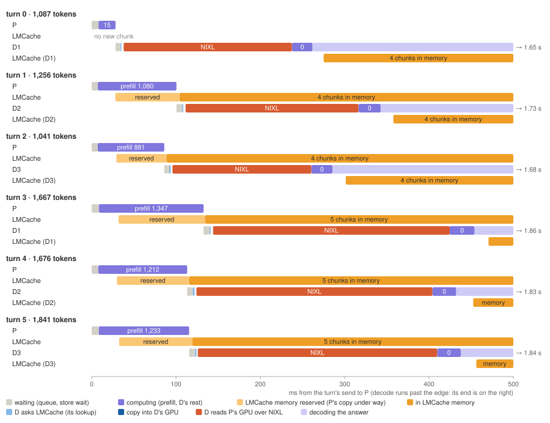

# Conversation 4: mt-rag-clapnq-elser-512-100-20240503 (memory mode, NIXL, per-engine servers, chat RAG, all passages)

P's KV reaches D over NIXL (D reads P's GPU blocks); every engine's LMCache connector stores beside it, to its own server. 6 turns on D1, D2, D3 (round-robin: each turn to the next D engine); prompts grow from 1,087 to 1,841 tokens (interleaved: each turn's prompt is the previous one, its answer, then this turn's documents and question). Chunks are 256 tokens (16 vLLM blocks of 16); a chunk's name is LMCache's hash of its tokens and everything before them, so the same prefix has the same chunks on every turn and engine.

Legend for the strips (one character a chunk): P: `=` on P's GPU from an earlier turn, `#` computed and stored now, `+` computed, not stored (a partial chunk). D: `=` on D's GPU from an earlier turn, `M` pulled from memory, `S` pulled from disk, `N` read from P's GPU over NIXL, `+` computed by D (a partial chunk), `?` missed.

GPU blocks (the chunk tables): where each engine keeps the chunk's 16 vLLM blocks in its GPU KV cache, by vLLM's block ids (vLLM's paged KV cache: a block, or page, holds 16 tokens; block 0 is its reserved null block), in the prompt's block order, a run of consecutive ids written as a range: `P 1, 138-152` is the prompt's block 0 in GPU block 1 and its blocks 1-15 in GPU blocks 138-152. An engine takes a GPU block from its free list when it first computes or loads a block, and the block keeps it while cached, so a later turn that reuses the block shows the same id. Blocks that are the same in several prompts (the same tokens and everything before them) share one GPU block once the first is cached: the system prompt's first block, the same in every conversation, is the usual one. `16/16 hashes = P's`: of the blocks D pulled, how many have the same vLLM hash on D as on P.

The prompts' text is the driver's own record of what it sent (answers included); lines over 100 characters are wrapped here for reading.

| turn | prompt | chunks + tail | P: own GPU / computed / stored | D: own GPU / loaded / computed | pulled | pull ms | D first token ms |
| ---: | ---: | --- | --- | --- | --- | ---: | ---: |
| [0](#turn-0) | 1,087 | 4 + 63 | 1,072 / 15 / 0 chunks | 16 / 1,071 / 0 | 5 chunks (NIXL 5) | 199.7 | 229.3 |
| [1](#turn-1) | 1,256 | 4 + 232 | 176 / 1,080 / 4 chunks | 160 / 1,096 / 0 | 5 chunks (NIXL 5) | 205.1 | 237.7 |
| [2](#turn-2) | 1,041 | 4 + 17 | 160 / 881 / 4 chunks | 160 / 881 / 0 | 5 chunks (NIXL 5) | 164.8 | 195.3 |
| [3](#turn-3) | 1,667 | 6 + 131 | 320 / 1,347 / 5 chunks | 160 / 1,507 / 0 | 7 chunks (NIXL 7) | 280.7 | 316.5 |
| [4](#turn-4) | 1,676 | 6 + 140 | 464 / 1,212 / 5 chunks | 160 / 1,516 / 0 | 7 chunks (NIXL 7) | 279.9 | 314.3 |
| [5](#turn-5) | 1,841 | 7 + 49 | 608 / 1,233 / 5 chunks | 320 / 1,521 / 0 | 7 chunks (NIXL 7) | 284.0 | 317.3 |

## How the prompt grows

Each turn's prompt is the previous one, token for token, and then: D's answer to the previous turn, this turn's documents, its question and the framing (the system prompt on turn 0, `Assistant:` and newlines). Only the new tokens can make new chunks: the previous prompt's partial chunk fills first. A document sent before comes again at another place, so in other chunks.

| turn | prompt | new | previous answer | documents | question | framing | whole chunks |
| ---: | ---: | ---: | ---: | --- | --- | ---: | --- |
| 0 | 1,087 | +1,087 | – | 5 docs, 1,045 | 12: Where do guinea pigs sleep in the wild? | 30 | 4 (+4) |
| 1 | 1,256 | +169 | – | 0 docs, 0 | 20: where does Domestic guinea pigs live and what does Domestic guinea pi… | 2 | 4 (+0) |
| 2 | 1,041 | +-215 | – | 0 docs, 0 | 0 | 0 | 4 (+0) |
| 3 | 1,667 | +626 | – | 3 docs, 572 | 24: can you clarify the breed here? is there different species of Guinea … | 2 | 6 (+2) |
| 4 | 1,676 | +9 | – | 0 docs, 0 | 0 | 2 | 6 (+0) |
| 5 | 1,841 | +165 | – | 0 docs, 0 | 15: do you think I can have guinea pig as my pet? | 2 | 7 (+1) |

## Timeline

Every turn on one clock: ms from the moment the proxy sent the turn to P. P prefills it (one token out) and holds its blocks for D; the proxy sends the turn to the next D engine at once with P's reply's kv_transfer_params (no wait), D reads P's blocks over NIXL (orange-red), computes the rest and decodes the answer. Beside it every engine's LMCache connector stores its new whole chunks (P's lane, and D's own when it stored any). The lanes: P, LMCache (P's chunks), D, and LMCache (D's chunks).



| turn | P queued → done | P's chunks: in memory / on disk | D | D starts | NIXL read | D: held / from P / from LMCache / computed | D's chunks stored | first token | P freed | D done |
| ---: | --- | --- | --- | ---: | --- | --- | ---: | ---: | ---: | ---: |
| 0 | 8 → 28 | 0: – / – | D1 | 33 | 38-238 | 16 / 1,071 / 0 / 0 | 4 | 262 | 239 | 1,652 |
| 1 | 7 → 100 | 4: 104 / – | D2 | 105 | 111-316 | 160 / 1,096 / 0 / 0 | 4 | 343 | 316 | 1,734 |
| 2 | 7 → 86 | 4: 89 / – | D3 | 90 | 96-261 | 160 / 881 / 0 / 0 | 4 | 286 | 261 | 1,680 |
| 3 | 9 → 133 | 5: 134 / – | D1 | 138 | 144-425 | 160 / 1,507 / 0 / 0 | 6 | 454 | 425 | 1,856 |
| 4 | 8 → 113 | 5: 115 / – | D2 | 118 | 124-404 | 160 / 1,516 / 0 / 0 | 6 | 432 | 405 | 1,832 |
| 5 | 8 → 116 | 5: 119 / – | D3 | 120 | 126-410 | 320 / 1,521 / 0 / 0 | 6 | 438 | 411 | 1,843 |

All times in ms from the turn's send to P. NIXL read: D's worker posts the read of P's blocks to the KV in D's GPU blocks; P freed: D has read, P's blocks go back to its free queue (still cached). Each turn's section below tells it in a sentence and step by step.

### One chunk, block by block: chunk 1 of turn 0 (`8511e0c6bcaee97a`)

Tokens 256-512 (doc 850931827_1108: 89; doc 850931827_1243: 167). P computed its blocks; D1 read them from P's GPU over NIXL, P's block into D's block, one for one:

| block | tokens | P's GPU block | vLLM hash on P | D's GPU block | same hash on D |
| ---: | --- | ---: | --- | ---: | --- |
| 16 | 256-272 | 222 | `–` | 657 | – |
| 17 | 272-288 | 223 | `–` | 658 | – |
| 18 | 288-304 | 224 | `–` | 659 | – |
| 19 | 304-320 | 225 | `–` | 660 | – |
| 20 | 320-336 | 226 | `–` | 661 | – |
| 21 | 336-352 | 227 | `–` | 662 | – |
| 22 | 352-368 | 228 | `–` | 663 | – |
| 23 | 368-384 | 229 | `–` | 664 | – |
| 24 | 384-400 | 230 | `–` | 665 | – |
| 25 | 400-416 | 231 | `–` | 666 | – |
| 26 | 416-432 | 232 | `–` | 667 | – |
| 27 | 432-448 | 233 | `–` | 668 | – |
| 28 | 448-464 | 234 | `–` | 669 | – |
| 29 | 464-480 | 235 | `–` | 670 | – |
| 30 | 480-496 | 236 | `–` | 671 | – |
| 31 | 496-512 | 237 | `–` | 672 | – |

## Turn 0

**Timeline:** P queued until 8 ms, prefilled 15 tokens (held 1,072) and was done at 28 ms; no new chunk to store. D1 started at 33 ms (no wait) holding 16 tokens, read 1,071 from P's GPU over NIXL (posted at 38 ms, in its GPU at 238 ms; P freed its blocks at 239 ms), computed 0 and gave its first token at 262 ms; it decoded 128 tokens until 1,652 ms; its LMCache connector stored 4 new chunks. ([all turns](#timeline))

### Step by step

Every move of this turn's KV, ms from the proxy sending the turn to P. P's KV reaches D over NIXL: D's worker reads P's GPU blocks into its own (a NIXL READ, P told when D is done); LMCache's copies (to and from each server's memory) its servers do themselves through CUDA IPC handles each engine registered at start.

| ms | where | what |
| ---: | --- | --- |
| 0.0 | proxy → P | sends the turn (1,087 prompt tokens; P is asked for one token: prefill only) |
| 3.3 | P | the request arrives |
| 7.9 | P GPU | its prefix cache holds 1,072 of the prompt's tokens: 67 blocks in GPU blocks 1, 207-272 |
| 7.9 | P ↔ LMCache | LMCache has 1,024 of its tokens; P loads 0 and computes the rest |
| 8.1 | P GPU | 1 new GPU block for the 15 tokens it computes: 1516; the prefill runs |
| 23.7 | P GPU | the request is done: P holds its 68 blocks for D to read over NIXL, and its reply carries them (kv_transfer_params: the blocks, its NIXL agent) |
| 28.3 | P → proxy | P answers its one token: the prefill is done |
| 32.6 | proxy → D1 | sends the turn to D1 at once, with P's kv_transfer_params (round-robin; no wait) |
| 34.2 | D1 ↔ LMCache | asks LMCache for the prompt's chunks |
| 35.3 | LMCache memory | found 0 tokens it lacks |
| 37.1 | D1 GPU | its prefix cache holds 16 of the prompt's tokens: 1 block in GPU blocks 1 |
| 37.1 | D1 ↔ P (NIXL) | will read 1,071 prompt tokens from P's GPU (beyond the 16 its own cache holds) |
| 37.2 | D1 ↔ LMCache | LMCache has 0 of its tokens; NIXL loads it (MultiConnector: the first connector with tokens) |
| 37.4 | D1 GPU | 67 GPU blocks for the KV from P: 642-708 |
| 37.9 | P GPU → D1 GPU (NIXL) | D1 reads P's GPU blocks 1, 207-272, 1516 into its 642-708 (a NIXL READ) |
| 237.5 | D1 | the KV from P is in its GPU blocks (1,071 tokens) |
| 238.6 | P GPU | D1 has read: P frees its blocks (they stay in its prefix cache) |
| 245.6 | D1 → LMCache | store planned: tokens 0-1,024; 4 chunks new to its server |
| 259.0 | D1 GPU | 1 new GPU block for the 1 prompt tokens it computes: 709 |
| 261.9 | D1 → proxy | the first answer token |
| 275.0 | LMCache memory | 4 chunks from D1 in memory |
| 436.5 | D1 GPU | decoding: the answer's KV takes 7 new GPU blocks as it grows, one per 16 tokens: 710-716, until 1,487 ms |
| 1,651.8 | D1 | done: 128 tokens decoded; its blocks stay cached in its GPU for the next turn |
| 1,653.2 | proxy | the response is complete |

1,087 prompt tokens: 4 whole chunks and 63 tokens over (the partial chunk, computed by both engines and stored only when a later turn completes it). P held 1,072 tokens on its GPU, computed 15 and stored 0 new chunks; D1 held 16, read 1,071 from P over NIXL, loaded 0 from LMCache and computed 0.

### The prompt

The whole prompt, piece by piece:

- **system prompt** · tokens 0-28 (28) · chunk 0

```text
You are a helpful assistant. Answer the user's last question from the documents. If they do not hold
the answer, say so.
```

<details><summary>document <code>850931827_11086-12414-0-1328</code> · tokens 28-345 (317) · chunks 0-1</summary>

```text
Document: Guinea pig
Guinea pig
C. porcellus is not found naturally in the wild ; it is likely descended from closely related
species of cavies , such as C. aperea , C. fulgida , and C. tschudii , which are still commonly
found in various regions of South America . Studies from 2007 -- 2010 applied molecular markers and
studied the skull and skeletal morphology of current and mummified animals , thereby revealing the
ancestor to most likely be Cavia tschudii . Some species of cavy identified in the 20th century ,
such as C. anolaimae and C. guianae , may be domestic guinea pigs that have become feral by
reintroduction into the wild . Wild cavies are found on grassy plains and occupy an ecological niche
similar to that of cattle . They are social , living in the wild in small groups that consist of
several females ( sows ) , a male ( boar ) , and the young ( which , in a break with the preceding
porcine nomenclature , are called `` pups '' not `` piglets '' ) . They move together in groups (
herds ) eating grass or other vegetation , and do not store food . While they do not burrow
themselves or build nests , they frequently seek shelter in the burrows of other animals , as well
as in crevices and tunnels formed by vegetation . They tend to be most active during dawn and dusk (
crepuscular ) , when it is harder for predators to spot them .
```

</details>

<details><summary>document <code>850931827_12432-13339-0-907</code> · tokens 345-528 (183) · chunks 1-2</summary>

```text
Document: Guinea pig
Guinea pig
Domesticated guinea pigs thrive in groups of two or more ; groups of sows , or groups of one or more
sows and a neutered boar are common combinations , but boars can sometimes live together . Guinea
pigs learn to recognize and bond with other individual pigs , and testing of boars shows their
neuroendocrine stress response is significantly lowered in the presence of a bonded female when
compared to the presence of unfamiliar females . Groups of boars may also get along , provided their
cage has enough space , they are introduced at an early age , and no females are present . Domestic
guinea pigs have developed a different biological rhythm from their wild counterparts , and have
longer periods of activity followed by short periods of sleep in between . Activity is scattered
randomly throughout the day ; aside from an avoidance of intense light , no regular circadian
patterns are apparent . This
```

</details>

<details><summary>document <code>850931827_13486-14754-0-1268</code> · tokens 528-803 (275) · chunks 2-3</summary>

```text
Document: Guinea pig
Guinea pig
Domestic guinea pigs generally live in cages , although some owners of large numbers of guinea pigs
dedicate entire rooms to their pets . Cages with solid or wire mesh floors are used , although wire
mesh floors can cause injury and may be associated with an infection commonly known as bumblefoot (
ulcerative pododermatitis ) . `` Cubes and Coroplast '' ( C&C ) style cages are now a common choice
. Cages are often lined with wood shavings or a similar material . Bedding made from red cedar (
Eastern or Western ) and pine , both softwoods , were commonly used in the past , but these
materials are now believed to contain harmful phenols ( aromatic hydrocarbons ) and oils . Safer
bedding materials made from hardwoods ( such as aspen ) , paper products , and corn cob materials
are other alternatives . Guinea pigs tend to be messy within their cages ; they often jump into
their food bowls or kick bedding and feces into them , and their urine sometimes crystallizes on
cage surfaces , making it difficult to remove . After its cage has been cleaned , a guinea pig
typically urinates and drags its lower body across the floor of the cage to mark its territory .
Male guinea pigs may also mark their territory in this way when they are taken out of their cages .
```

</details>

<details><summary>document <code>850931827_588-1089-0-501</code> · tokens 803-928 (125) · chunk 3</summary>

```text
Document: Guinea pig
Guinea pig
The guinea pig or domestic guinea pig ( Cavia porcellus ) , also known as cavy or domestic cavy , is
a species of rodent belonging to the family Caviidae and the genus Cavia . Despite their common name
, these animals are not in the pig family Suidae , nor do they come from Guinea in Africa ; they
originated in the Andes of South America and studies based on biochemistry and hybridization suggest
they are domestic , not wild , descendants of a closely related species of cavy such as C. tschudii
.
```

</details>

<details><summary>document <code>850931827_30008-30728-0-720</code> · tokens 928-1073 (145) · chunks 3-4</summary>

```text
Document: Guinea pig
Guinea pig
If handled correctly early in life , guinea pigs become amenable to being picked up and carried ,
and seldom bite or scratch . They are timid explorers and often hesitate to attempt an escape from
their cage even when an opportunity presents itself . Still , they show considerable curiosity when
allowed to walk freely , especially in familiar and safe terrain . Guinea pigs that become familiar
with their owner will whistle on the owner 's approach ; they will also learn to whistle in response
to the rustling of plastic bags or the opening of refrigerator doors , where their food is most
commonly stored . In Switzerland , owning a single guinea pig is considered harmful to its well -
being and forbidden by law .
```

</details>

- **question 0** · tokens 1073-1085 (12) · chunk 4

```text
User: Where do guinea pigs sleep in the wild?
```

- `Assistant:` · tokens 1085-1087 (2) · chunk 4

### Pieces, chunks and blocks

| piece | tokens | length | chunks | |
| --- | --- | ---: | --- | --- |
| system | 0-28 | 28 | 0 |  |
| doc 850931827_1108 | 28-345 | 317 | 0-1 |  |
| doc 850931827_1243 | 345-528 | 183 | 1-2 |  |
| doc 850931827_1348 | 528-803 | 275 | 2-3 |  |
| doc 850931827_588- | 803-928 | 125 | 3 |  |
| doc 850931827_3000 | 928-1073 | 145 | 3-4 |  |
| question 0 | 1073-1085 | 12 | 4 |  |
| `assistant:` 0 | 1085-1087 | 2 | 4 |  |

```
P  ====+
D  NNNNN
```

| chunk | tokens | pieces in it (tokens) | vLLM blocks | GPU blocks | in LMCache | P this turn | D this turn |
| ---: | --- | --- | --- | --- | --- | --- | --- |
| 0 | 0-256 | system: 28; doc 850931827_1108: 228 | 0-15 | P 1, 207-221; D 1, 642-656 | `5e868214004923dc`: LMC_P: stored on turn 0 by P; LMC_D3: stored on turn 0 by D3; LMC_D1: stored on turn 0 by D1 | on P's GPU (earlier turn) | **read from P's GPU over NIXL** (its first 16 tokens on D's GPU already) |
| 1 | 256-512 | doc 850931827_1108: 89; doc 850931827_1243: 167 | 16-31 | P 222-237; D 657-672 | `8511e0c6bcaee97a`: LMC_P: stored on turn 0 by P; LMC_D3: stored on turn 0 by D3; LMC_D1: stored on turn 0 by D1 | on P's GPU (earlier turn) | **read from P's GPU over NIXL** |
| 2 | 512-768 | doc 850931827_1243: 16; doc 850931827_1348: 240 | 32-47 | P 238-253; D 673-688 | `5b7d0f205cab2dd1`: LMC_P: stored on turn 0 by P; LMC_D3: stored on turn 0 by D3; LMC_D1: stored on turn 0 by D1 | on P's GPU (earlier turn) | **read from P's GPU over NIXL** |
| 3 | 768-1024 | doc 850931827_1348: 35; doc 850931827_588-: 125; doc 850931827_3000: 96 | 48-63 | P 254-269; D 689-704 | `cdf6026e22fae037`: LMC_P: stored on turn 0 by P; LMC_D3: stored on turn 0 by D3; LMC_D1: stored on turn 0 by D1 | on P's GPU (earlier turn) | **read from P's GPU over NIXL** |
| 4 | 1024-1087 | doc 850931827_3000: 49; question 0: 12; `assistant:` 0: 2 | 64-67 | P 270-272; D 705-708 | – | computed (partial chunk: not stored) | **read from P's GPU over NIXL** (partial chunk) |

## Turn 1

**Timeline:** P queued until 7 ms, prefilled 1,080 tokens (held 176) and was done at 100 ms; its 4 new chunks were in LMCache's memory at 104 ms. D2 started at 105 ms (no wait) holding 160 tokens, read 1,096 from P's GPU over NIXL (posted at 111 ms, in its GPU at 316 ms; P freed its blocks at 316 ms), computed 0 and gave its first token at 343 ms; it decoded 128 tokens until 1,734 ms; its LMCache connector stored 4 new chunks. ([all turns](#timeline))

### Step by step

Every move of this turn's KV, ms from the proxy sending the turn to P. P's KV reaches D over NIXL: D's worker reads P's GPU blocks into its own (a NIXL READ, P told when D is done); LMCache's copies (to and from each server's memory) its servers do themselves through CUDA IPC handles each engine registered at start.

| ms | where | what |
| ---: | --- | --- |
| 0.0 | proxy → P | sends the turn (1,256 prompt tokens; P is asked for one token: prefill only) |
| 2.8 | P | the request arrives |
| 7.1 | P GPU | its prefix cache holds 176 of the prompt's tokens: 11 blocks in GPU blocks 1, 273-282 |
| 7.1 | P ↔ LMCache | LMCache has 0 of its tokens; P loads 0 and computes the rest |
| 7.3 | P GPU | 68 new GPU blocks for the 1,080 tokens it computes: 1516-1583; the prefill runs |
| 7.8 | P → LMCache | store planned: tokens 0-1,024, chunks 0-3 (64 blocks) |
| 27.3 | LMCache | the store request is in; it waits for P's forward pass to finish (a CUDA event) |
| 28.1 | LMCache memory | space reserved for 4 chunks (117 MB) |
| 95.3 | P GPU → LMCache memory | the copy starts: LMCache reads P's GPU blocks (CUDA IPC) |
| 95.5 | P GPU | the request is done: P holds its 79 blocks for D to read over NIXL, and its reply carries them (kv_transfer_params: the blocks, its NIXL agent) |
| 100.4 | P GPU → LMCache memory | copy done: 4 chunks, 117 MB in 5.1 ms |
| 100.5 | P → proxy | P answers its one token: the prefill is done |
| 104.2 | LMCache memory | 4 chunks in memory, kept for later requests (D gets this turn's KV from P over NIXL); P keeps its copy in its GPU blocks |
| 105.0 | proxy → D2 | sends the turn to D2 at once, with P's kv_transfer_params (round-robin; no wait) |
| 107.3 | D2 ↔ LMCache | asks LMCache for the prompt's chunks |
| 108.6 | LMCache memory | found 0 tokens it lacks |
| 110.4 | D2 GPU | its prefix cache holds 160 of the prompt's tokens: 10 blocks in GPU blocks 1, 119-127 |
| 110.4 | D2 ↔ P (NIXL) | will read 1,096 prompt tokens from P's GPU (beyond the 160 its own cache holds) |
| 110.5 | D2 ↔ LMCache | LMCache has 0 of its tokens; NIXL loads it (MultiConnector: the first connector with tokens) |
| 110.7 | D2 GPU | 69 GPU blocks for the KV from P: 647-715 |
| 111.3 | P GPU → D2 GPU (NIXL) | D2 reads P's GPU blocks 1, 273-282, 1516-1583 into its 647-715 (a NIXL READ) |
| 316.3 | P GPU | D2 has read: P frees its blocks (they stay in its prefix cache) |
| 316.4 | D2 | the KV from P is in its GPU blocks (1,096 tokens) |
| 325.6 | D2 → LMCache | store planned: tokens 0-1,024; 4 chunks new to its server |
| 342.7 | D2 → proxy | the first answer token |
| 357.7 | LMCache memory | 4 chunks from D2 in memory |
| 418.9 | D2 GPU | 1 new GPU block for the 1 prompt tokens it computes: 716 |
| 594.4 | D2 GPU | decoding: the answer's KV takes 7 new GPU blocks as it grows, one per 16 tokens: 717-723, until 1,647 ms |
| 1,734.4 | D2 | done: 128 tokens decoded; its blocks stay cached in its GPU for the next turn |
| 1,735.5 | proxy | the response is complete |

1,256 prompt tokens: 4 whole chunks and 232 tokens over (the partial chunk, computed by both engines and stored only when a later turn completes it). P held 176 tokens on its GPU, computed 1,080 and stored 4 new chunks; D2 held 160, read 1,096 from P over NIXL, loaded 0 from LMCache and computed 0.

### The prompt

Tokens 0-1,087: [turn 0](#turn-0)'s prompt, unchanged (NOT the previous prompt's ids), so chunks 0-3 are the same chunks; chunk 4 (partial then, 63 tokens) fills now. New from token 1,087:

- **question 1** · tokens 1234-1254 (20) · chunk 4

```text
User: where does Domestic guinea pigs live and what does Domestic guinea pigs activity look like?
```

- `Assistant:` · tokens 1254-1256 (2) · chunk 4

### Pieces, chunks and blocks

| piece | tokens | length | chunks | |
| --- | --- | ---: | --- | --- |
| system | 0-28 | 28 | 0 |  |
| question 0 | 28-40 | 12 | 0 |  |
| `assistant:` 0 | 40-42 | 2 | 0 |  |
| answer 0 | 42-170 | 128 | 0 |  |
| newline 0 | 170-171 | 1 | 0 |  |
| doc 850931827_1243 | 171-354 | 183 | 0-1 |  |
| doc 850931827_1348 | 354-629 | 275 | 1-2 |  |
| doc 850931827_1108 | 629-946 | 317 | 2-3 |  |
| doc 850931827_588- | 946-1071 | 125 | 3-4 |  |
| doc 850931827_3079 | 1071-1234 | 163 | 4 |  |
| question 1 | 1234-1254 | 20 | 4 | new this turn |
| `assistant:` 1 | 1254-1256 | 2 | 4 | new this turn |

```
P  ####+
D  NNNNN
```

| chunk | tokens | pieces in it (tokens) | vLLM blocks | GPU blocks | in LMCache | P this turn | D this turn |
| ---: | --- | --- | --- | --- | --- | --- | --- |
| 0 | 0-256 | system: 28; question 0: 12; `assistant:` 0: 2; answer 0: 128; newline 0: 1; doc 850931827_1243: 85 | 0-15 | P 1, 273-282, 1516-1520; D 1, 119-127, 647-652; 5/5 hashes = P's | `991056d00f9f233f`: LMC_P: stored on turn 1 by P; LMC_D2: stored on turn 1 by D2 | computed (its first 176 tokens on P's GPU already), **stored now** | **read from P's GPU over NIXL** (its first 160 tokens on D's GPU already) |
| 1 | 256-512 | doc 850931827_1243: 98; doc 850931827_1348: 158 | 16-31 | P 1521-1536; D 653-668; 16/16 hashes = P's | `892f771b8a84f154`: LMC_P: stored on turn 1 by P; LMC_D2: stored on turn 1 by D2 | computed, **stored now** | **read from P's GPU over NIXL** |
| 2 | 512-768 | doc 850931827_1348: 117; doc 850931827_1108: 139 | 32-47 | P 1537-1552; D 669-684; 16/16 hashes = P's | `245834f3e799c925`: LMC_P: stored on turn 1 by P; LMC_D2: stored on turn 1 by D2 | computed, **stored now** | **read from P's GPU over NIXL** |
| 3 | 768-1024 | doc 850931827_1108: 178; doc 850931827_588-: 78 | 48-63 | P 1553-1568; D 685-700; 16/16 hashes = P's | `e6c555ecbb043192`: LMC_P: stored on turn 1 by P; LMC_D2: stored on turn 1 by D2 | computed, **stored now** | **read from P's GPU over NIXL** |
| 4 | 1024-1256 | doc 850931827_588-: 47; doc 850931827_3079: 163; question 1 (new): 20; `assistant:` 1 (new): 2 | 64-78 | P 1569-1582; D 701-715; 14/14 hashes = P's | – | computed (partial chunk: not stored) | **read from P's GPU over NIXL** (partial chunk) |

## Turn 2

**Timeline:** P queued until 7 ms, prefilled 881 tokens (held 160) and was done at 86 ms; its 4 new chunks were in LMCache's memory at 89 ms. D3 started at 90 ms (no wait) holding 160 tokens, read 881 from P's GPU over NIXL (posted at 96 ms, in its GPU at 261 ms; P freed its blocks at 261 ms), computed 0 and gave its first token at 286 ms; it decoded 128 tokens until 1,680 ms; its LMCache connector stored 4 new chunks. ([all turns](#timeline))

### Step by step

Every move of this turn's KV, ms from the proxy sending the turn to P. P's KV reaches D over NIXL: D's worker reads P's GPU blocks into its own (a NIXL READ, P told when D is done); LMCache's copies (to and from each server's memory) its servers do themselves through CUDA IPC handles each engine registered at start.

| ms | where | what |
| ---: | --- | --- |
| 0.0 | proxy → P | sends the turn (1,041 prompt tokens; P is asked for one token: prefill only) |
| 2.4 | P | the request arrives |
| 6.9 | P GPU | its prefix cache holds 160 of the prompt's tokens: 10 blocks in GPU blocks 1, 273-281 |
| 7.0 | P ↔ LMCache | LMCache has 0 of its tokens; P loads 0 and computes the rest |
| 7.2 | P GPU | 56 new GPU blocks for the 881 tokens it computes: 1583-1638; the prefill runs |
| 7.6 | P → LMCache | store planned: tokens 0-1,024, chunks 0-3 (64 blocks) |
| 28.6 | LMCache | the store request is in; it waits for P's forward pass to finish (a CUDA event) |
| 29.3 | LMCache memory | space reserved for 4 chunks (117 MB) |
| 81.8 | P GPU → LMCache memory | the copy starts: LMCache reads P's GPU blocks (CUDA IPC) |
| 82.0 | P GPU | the request is done: P holds its 66 blocks for D to read over NIXL, and its reply carries them (kv_transfer_params: the blocks, its NIXL agent) |
| 86.1 | P → proxy | P answers its one token: the prefill is done |
| 86.9 | P GPU → LMCache memory | copy done: 4 chunks, 117 MB in 5.1 ms |
| 88.6 | LMCache memory | 4 chunks in memory, kept for later requests (D gets this turn's KV from P over NIXL); P keeps its copy in its GPU blocks |
| 90.4 | proxy → D3 | sends the turn to D3 at once, with P's kv_transfer_params (round-robin; no wait) |
| 92.0 | D3 ↔ LMCache | asks LMCache for the prompt's chunks |
| 93.8 | LMCache memory | found 0 tokens it lacks |
| 95.0 | D3 GPU | its prefix cache holds 160 of the prompt's tokens: 10 blocks in GPU blocks 1, 139-147 |
| 95.0 | D3 ↔ P (NIXL) | will read 881 prompt tokens from P's GPU (beyond the 160 its own cache holds) |
| 95.1 | D3 ↔ LMCache | LMCache has 0 of its tokens; NIXL loads it (MultiConnector: the first connector with tokens) |
| 95.3 | D3 GPU | 56 GPU blocks for the KV from P: 711-766 |
| 95.8 | P GPU → D3 GPU (NIXL) | D3 reads P's GPU blocks 1, 273-281, 1583-1638 into its 711-766 (a NIXL READ) |
| 260.6 | D3 | the KV from P is in its GPU blocks (881 tokens) |
| 261.2 | P GPU | D3 has read: P frees its blocks (they stay in its prefix cache) |
| 269.2 | D3 → LMCache | store planned: tokens 0-1,024; 4 chunks new to its server |
| 285.7 | D3 → proxy | the first answer token |
| 301.3 | LMCache memory | 4 chunks from D3 in memory |
| 438.7 | D3 GPU | 1 new GPU block for the 1 prompt tokens it computes: 767 |
| 614.2 | D3 GPU | decoding: the answer's KV takes 6 new GPU blocks as it grows, one per 16 tokens: 768-773, until 1,493 ms |
| 1,680.2 | D3 | done: 128 tokens decoded; its blocks stay cached in its GPU for the next turn |
| 1,681.4 | proxy | the response is complete |

1,041 prompt tokens: 4 whole chunks and 17 tokens over (the partial chunk, computed by both engines and stored only when a later turn completes it). P held 160 tokens on its GPU, computed 881 and stored 4 new chunks; D3 held 160, read 881 from P over NIXL, loaded 0 from LMCache and computed 0.

### The prompt

Tokens 0-1,256: [turn 1](#turn-1)'s prompt, unchanged (NOT the previous prompt's ids), so chunks 0-3 are the same chunks; chunk 4 (partial then, 232 tokens) fills now. New from token 1,256:

### Pieces, chunks and blocks

| piece | tokens | length | chunks | |
| --- | --- | ---: | --- | --- |
| system | 0-28 | 28 | 0 |  |
| question 0 | 28-40 | 12 | 0 |  |
| `assistant:` 0 | 40-42 | 2 | 0 |  |
| answer 0 | 42-170 | 128 | 0 |  |
| newline 0 | 170-171 | 1 | 0 |  |
| question 1 | 171-191 | 20 | 0 |  |
| `assistant:` 1 | 191-193 | 2 | 0 |  |
| answer 1 | 193-321 | 128 | 0-1 |  |
| newline 1 | 321-322 | 1 | 1 |  |
| doc 850931827_2841 | 322-476 | 154 | 1 |  |
| doc 850931827_3079 | 476-639 | 163 | 1-2 |  |
| doc 850931827_2215 | 639-754 | 115 | 2 |  |
| doc 850931827_3899 | 754-860 | 106 | 2-3 |  |
| doc 850931827_1916 | 860-1028 | 168 | 3-4 |  |
| question 2 | 1028-1039 | 11 | 4 |  |
| `assistant:` 2 | 1039-1041 | 2 | 4 |  |

```
P  ####+
D  NNNNN
```

| chunk | tokens | pieces in it (tokens) | vLLM blocks | GPU blocks | in LMCache | P this turn | D this turn |
| ---: | --- | --- | --- | --- | --- | --- | --- |
| 0 | 0-256 | system: 28; question 0: 12; `assistant:` 0: 2; answer 0: 128; newline 0: 1; question 1: 20; `assistant:` 1: 2; answer 1: 63 | 0-15 | P 1, 273-281, 1583-1588; D 1, 139-147, 711-716; 6/6 hashes = P's | `2a5644297040c340`: LMC_P: stored on turn 2 by P; LMC_D3: stored on turn 2 by D3; LMC_D1: stored on turn 3 by D1; LMC_D2: stored on turn 4 by D2 | computed (its first 160 tokens on P's GPU already), **stored now** | **read from P's GPU over NIXL** (its first 160 tokens on D's GPU already) |
| 1 | 256-512 | answer 1: 65; newline 1: 1; doc 850931827_2841: 154; doc 850931827_3079: 36 | 16-31 | P 1589-1604; D 717-732; 16/16 hashes = P's | `b7621e7bbc90d7b3`: LMC_P: stored on turn 2 by P; LMC_D3: stored on turn 2 by D3 | computed, **stored now** | **read from P's GPU over NIXL** |
| 2 | 512-768 | doc 850931827_3079: 127; doc 850931827_2215: 115; doc 850931827_3899: 14 | 32-47 | P 1605-1620; D 733-748; 16/16 hashes = P's | `a962768b45839df0`: LMC_P: stored on turn 2 by P; LMC_D3: stored on turn 2 by D3 | computed, **stored now** | **read from P's GPU over NIXL** |
| 3 | 768-1024 | doc 850931827_3899: 92; doc 850931827_1916: 164 | 48-63 | P 1621-1636; D 749-764; 16/16 hashes = P's | `81951968651e59bd`: LMC_P: stored on turn 2 by P; LMC_D3: stored on turn 2 by D3 | computed, **stored now** | **read from P's GPU over NIXL** |
| 4 | 1024-1041 | doc 850931827_1916: 4; question 2: 11; `assistant:` 2: 2 | 64-65 | P 1637; D 765-766; 1/1 hashes = P's | – | computed (partial chunk: not stored) | **read from P's GPU over NIXL** (partial chunk) |

## Turn 3

**Timeline:** P queued until 9 ms, prefilled 1,347 tokens (held 320) and was done at 133 ms; its 5 new chunks were in LMCache's memory at 134 ms. D1 started at 138 ms (no wait) holding 160 tokens, read 1,507 from P's GPU over NIXL (posted at 144 ms, in its GPU at 425 ms; P freed its blocks at 425 ms), computed 0 and gave its first token at 454 ms; it decoded 128 tokens until 1,856 ms; its LMCache connector stored 6 new chunks. ([all turns](#timeline))

### Step by step

Every move of this turn's KV, ms from the proxy sending the turn to P. P's KV reaches D over NIXL: D's worker reads P's GPU blocks into its own (a NIXL READ, P told when D is done); LMCache's copies (to and from each server's memory) its servers do themselves through CUDA IPC handles each engine registered at start.

| ms | where | what |
| ---: | --- | --- |
| 0.0 | proxy → P | sends the turn (1,667 prompt tokens; P is asked for one token: prefill only) |
| 3.1 | P | the request arrives |
| 8.3 | P GPU | its prefix cache holds 320 of the prompt's tokens: 20 blocks in GPU blocks 1, 273-281, 1583-1592 |
| 8.4 | P ↔ LMCache | LMCache has 256 of its tokens; P loads 0 and computes the rest |
| 8.6 | P GPU | 85 new GPU blocks for the 1,347 tokens it computes: 1638-1722; the prefill runs |
| 9.2 | P → LMCache | store planned: tokens 256-1,536, chunks 1-5 (80 blocks) |
| 30.9 | LMCache | the store request is in; it waits for P's forward pass to finish (a CUDA event) |
| 31.9 | LMCache memory | space reserved for 5 chunks (147 MB) |
| 127.0 | P GPU → LMCache memory | the copy starts: LMCache reads P's GPU blocks (CUDA IPC) |
| 127.3 | P GPU | the request is done: P holds its 105 blocks for D to read over NIXL, and its reply carries them (kv_transfer_params: the blocks, its NIXL agent) |
| 132.7 | P → proxy | P answers its one token: the prefill is done |
| 133.3 | P GPU → LMCache memory | copy done: 5 chunks, 147 MB in 6.3 ms |
| 134.3 | LMCache memory | 5 chunks in memory, kept for later requests (D gets this turn's KV from P over NIXL); P keeps its copy in its GPU blocks |
| 137.6 | proxy → D1 | sends the turn to D1 at once, with P's kv_transfer_params (round-robin; no wait) |
| 139.9 | D1 ↔ LMCache | asks LMCache for the prompt's chunks |
| 141.1 | LMCache memory | found 0 tokens it lacks |
| 143.0 | D1 GPU | its prefix cache holds 160 of the prompt's tokens: 10 blocks in GPU blocks 1, 111-119 |
| 143.0 | D1 ↔ P (NIXL) | will read 1,507 prompt tokens from P's GPU (beyond the 160 its own cache holds) |
| 143.1 | D1 ↔ LMCache | LMCache has 0 of its tokens; NIXL loads it (MultiConnector: the first connector with tokens) |
| 143.4 | D1 GPU | 95 GPU blocks for the KV from P: 716-810 |
| 143.9 | P GPU → D1 GPU (NIXL) | D1 reads P's GPU blocks 1 … 1638-1722 (105 blocks) into its 716-810 (a NIXL READ) |
| 424.6 | D1 | the KV from P is in its GPU blocks (1,507 tokens) |
| 425.2 | P GPU | D1 has read: P frees its blocks (they stay in its prefix cache) |
| 436.2 | D1 → LMCache | store planned: tokens 0-1,536; 6 chunks new to its server |
| 454.1 | D1 → proxy | the first answer token |
| 470.6 | LMCache memory | 6 chunks from D1 in memory |
| 586.5 | D1 GPU | 1 new GPU block for the 1 prompt tokens it computes: 811 |
| 762.8 | D1 GPU | decoding: the answer's KV takes 7 new GPU blocks as it grows, one per 16 tokens: 812-818, until 1,822 ms |
| 1,855.5 | D1 | done: 128 tokens decoded; its blocks stay cached in its GPU for the next turn |
| 1,856.8 | proxy | the response is complete |

1,667 prompt tokens: 6 whole chunks and 131 tokens over (the partial chunk, computed by both engines and stored only when a later turn completes it). P held 320 tokens on its GPU, computed 1,347 and stored 5 new chunks; D1 held 160, read 1,507 from P over NIXL, loaded 0 from LMCache and computed 0.

### The prompt

Tokens 0-1,041: [turn 2](#turn-2)'s prompt, unchanged (NOT the previous prompt's ids), so chunks 0-3 are the same chunks; chunk 4 (partial then, 17 tokens) fills now. New from token 1,041:

<details><summary>document <code>850931827_212-587-0-375</code> · tokens 1069-1179 (110) · chunk 4</summary>

```text
Document: Guinea pig
Guinea pig
Domestic guinea pig Two adult guinea pigs Conservation status Domesticated Scientific classification
Kingdom : Animalia Phylum : Chordata Class : Mammalia Order : Rodentia Family : Caviidae Genus :
Cavia Species : C. porcellus Binomial name Cavia porcellus ( Linnaeus , 1758 ) Synonyms Mus
porcellus Cavia cobaya Cavia anolaimae Cavia cutleri Cavia leucopyga Cavia longipilis
```

</details>

<details><summary>document <code>850931827_6950-8562-0-1612</code> · tokens 1179-1517 (338) · chunks 4-5</summary>

```text
Document: Guinea pig
Guinea pig
The guinea pig was first domesticated as early as 5000 BC for food by tribes in the Andean region of
South America ( the present - day southern part of Colombia , Ecuador , Peru , and Bolivia ) , some
thousands of years after the domestication of the South American camelids . Statues dating from
circa 500 BC to 500 AD that depict guinea pigs have been unearthed in archaeological digs in Peru
and Ecuador . The Moche people of ancient Peru worshipped animals and often depicted the guinea pig
in their art . From about 1200 AD to the Spanish conquest in 1532 , selective breeding resulted in
many varieties of domestic guinea pigs , which form the basis for some of the modern domestic breeds
. They continue to be a food source in the region ; many households in the Andean highlands raise
the animal , which subsists on the family 's vegetable scraps . Folklore traditions involving guinea
pigs are numerous ; they are exchanged as gifts , used in customary social and religious ceremonies
, and frequently referenced in spoken metaphors . They also play a role in traditional healing
rituals by folk doctors , or curanderos , who use the animals to diagnose diseases such as jaundice
, rheumatism , arthritis , and typhus . They are rubbed against the bodies of the sick , and are
seen as a supernatural medium . Black guinea pigs are considered especially useful for diagnoses .
The animal also may be cut open and its entrails examined to determine whether the cure was
effective . These methods are widely accepted in many parts of the Andes , where Western medicine is
either unavailable or distrusted .
```

</details>

<details><summary>document <code>850931827_45829-46429-0-600</code> · tokens 1517-1641 (124) · chunks 5-6</summary>

```text
Document: Guinea pig
Guinea pig
Many efforts have also been made to promote guinea pig husbandry in developing countries of West
Africa , where they occur more widely than generally known because they are usually not covered by
livestock statistics . However , it has not been known when and where the animals have been
introduced to Africa . In Cameroon , they are widely distributed . In the Democratic Republic of the
Congo , they can be found both in peri-urban environments as well as in rural regions , for example
, in South Kivu . They are also frequently held in rural households in Iringa Region of southwestern
Tanzania .
```

</details>

- **question 3** · tokens 1641-1665 (24) · chunk 6

```text
User: can you clarify the breed here? is there different species of Guinea pig? maybe they are from
different origin?
```

- `Assistant:` · tokens 1665-1667 (2) · chunk 6

### Pieces, chunks and blocks

| piece | tokens | length | chunks | |
| --- | --- | ---: | --- | --- |
| system | 0-28 | 28 | 0 |  |
| question 0 | 28-40 | 12 | 0 |  |
| `assistant:` 0 | 40-42 | 2 | 0 |  |
| answer 0 | 42-170 | 128 | 0 |  |
| newline 0 | 170-171 | 1 | 0 |  |
| question 1 | 171-191 | 20 | 0 |  |
| `assistant:` 1 | 191-193 | 2 | 0 |  |
| answer 1 | 193-321 | 128 | 0-1 |  |
| newline 1 | 321-322 | 1 | 1 |  |
| question 2 | 322-333 | 11 | 1 |  |
| `assistant:` 2 | 333-335 | 2 | 1 |  |
| answer 2 | 335-463 | 128 | 1 |  |
| newline 2 | 463-464 | 1 | 1 |  |
| doc 850931827_3079 | 464-627 | 163 | 1-2 |  |
| doc 850931827_588- | 627-752 | 125 | 2 |  |
| doc 850931827_1108 | 752-1069 | 317 | 2-4 |  |
| doc 850931827_212- | 1069-1179 | 110 | 4 | new this turn |
| doc 850931827_6950 | 1179-1517 | 338 | 4-5 | new this turn |
| doc 850931827_4582 | 1517-1641 | 124 | 5-6 | new this turn |
| question 3 | 1641-1665 | 24 | 6 | new this turn |
| `assistant:` 3 | 1665-1667 | 2 | 6 | new this turn |

```
P  =#####+
D  NNNNNNN
```

| chunk | tokens | pieces in it (tokens) | vLLM blocks | GPU blocks | in LMCache | P this turn | D this turn |
| ---: | --- | --- | --- | --- | --- | --- | --- |
| 0 | 0-256 | system: 28; question 0: 12; `assistant:` 0: 2; answer 0: 128; newline 0: 1; question 1: 20; `assistant:` 1: 2; answer 1: 63 | 0-15 | P 1, 273-281, 1583-1588; D 1, 111-119, 716-721 | `2a5644297040c340`: LMC_P: stored on turn 2 by P; LMC_D3: stored on turn 2 by D3; LMC_D1: stored on turn 3 by D1; LMC_D2: stored on turn 4 by D2 | on P's GPU (earlier turn) | **read from P's GPU over NIXL** (its first 160 tokens on D's GPU already) |
| 1 | 256-512 | answer 1: 65; newline 1: 1; question 2: 11; `assistant:` 2: 2; answer 2: 128; newline 2: 1; doc 850931827_3079: 48 | 16-31 | P 1589-1592, 1638-1649; D 722-737; 12/12 hashes = P's | `505c81edf5d1111c`: LMC_P: stored on turn 3 by P; LMC_D1: stored on turn 3 by D1 | computed (its first 64 tokens on P's GPU already), **stored now** | **read from P's GPU over NIXL** |
| 2 | 512-768 | doc 850931827_3079: 115; doc 850931827_588-: 125; doc 850931827_1108: 16 | 32-47 | P 1650-1665; D 738-753; 16/16 hashes = P's | `b987b6d133696c17`: LMC_P: stored on turn 3 by P; LMC_D1: stored on turn 3 by D1 | computed, **stored now** | **read from P's GPU over NIXL** |
| 3 | 768-1024 | doc 850931827_1108: 256 | 48-63 | P 1666-1681; D 754-769; 16/16 hashes = P's | `8585392fa25ad89c`: LMC_P: stored on turn 3 by P; LMC_D1: stored on turn 3 by D1 | computed, **stored now** | **read from P's GPU over NIXL** |
| 4 | 1024-1280 | doc 850931827_1108: 45; doc 850931827_212- (new): 110; doc 850931827_6950 (new): 101 | 64-79 | P 1682-1697; D 770-785; 16/16 hashes = P's | `013b353645d92559`: LMC_P: stored on turn 3 by P; LMC_D1: stored on turn 3 by D1 | computed, **stored now** | **read from P's GPU over NIXL** |
| 5 | 1280-1536 | doc 850931827_6950 (new): 237; doc 850931827_4582 (new): 19 | 80-95 | P 1698-1713; D 786-801; 16/16 hashes = P's | `870989b4db2121f1`: LMC_P: stored on turn 3 by P; LMC_D1: stored on turn 3 by D1 | computed, **stored now** | **read from P's GPU over NIXL** |
| 6 | 1536-1667 | doc 850931827_4582 (new): 105; question 3 (new): 24; `assistant:` 3 (new): 2 | 96-104 | P 1714-1721; D 802-810; 8/8 hashes = P's | – | computed (partial chunk: not stored) | **read from P's GPU over NIXL** (partial chunk) |

## Turn 4

**Timeline:** P queued until 8 ms, prefilled 1,212 tokens (held 464) and was done at 113 ms; its 5 new chunks were in LMCache's memory at 115 ms. D2 started at 118 ms (no wait) holding 160 tokens, read 1,516 from P's GPU over NIXL (posted at 124 ms, in its GPU at 404 ms; P freed its blocks at 405 ms), computed 0 and gave its first token at 432 ms; it decoded 128 tokens until 1,832 ms; its LMCache connector stored 6 new chunks. ([all turns](#timeline))

### Step by step

Every move of this turn's KV, ms from the proxy sending the turn to P. P's KV reaches D over NIXL: D's worker reads P's GPU blocks into its own (a NIXL READ, P told when D is done); LMCache's copies (to and from each server's memory) its servers do themselves through CUDA IPC handles each engine registered at start.

| ms | where | what |
| ---: | --- | --- |
| 0.0 | proxy → P | sends the turn (1,676 prompt tokens; P is asked for one token: prefill only) |
| 3.0 | P | the request arrives |
| 7.6 | P GPU | its prefix cache holds 464 of the prompt's tokens: GPU blocks 1 … 1638-1646 (29 blocks) |
| 7.7 | P ↔ LMCache | LMCache has 256 of its tokens; P loads 0 and computes the rest |
| 7.8 | P GPU | 76 new GPU blocks for the 1,212 tokens it computes: 1722-1797; the prefill runs |
| 8.4 | P → LMCache | store planned: tokens 256-1,536, chunks 1-5 (80 blocks) |
| 29.2 | LMCache | the store request is in; it waits for P's forward pass to finish (a CUDA event) |
| 29.9 | LMCache memory | space reserved for 5 chunks (147 MB) |
| 107.9 | P GPU → LMCache memory | the copy starts: LMCache reads P's GPU blocks (CUDA IPC) |
| 108.1 | P GPU | the request is done: P holds its 105 blocks for D to read over NIXL, and its reply carries them (kv_transfer_params: the blocks, its NIXL agent) |
| 113.2 | P → proxy | P answers its one token: the prefill is done |
| 114.2 | P GPU → LMCache memory | copy done: 5 chunks, 147 MB in 6.3 ms |
| 115.4 | LMCache memory | 5 chunks in memory, kept for later requests (D gets this turn's KV from P over NIXL); P keeps its copy in its GPU blocks |
| 118.0 | proxy → D2 | sends the turn to D2 at once, with P's kv_transfer_params (round-robin; no wait) |
| 120.0 | D2 ↔ LMCache | asks LMCache for the prompt's chunks |
| 122.0 | LMCache memory | found 0 tokens it lacks |
| 123.2 | D2 GPU | its prefix cache holds 160 of the prompt's tokens: 10 blocks in GPU blocks 1, 119-127 |
| 123.3 | D2 ↔ P (NIXL) | will read 1,516 prompt tokens from P's GPU (beyond the 160 its own cache holds) |
| 123.4 | D2 ↔ LMCache | LMCache has 0 of its tokens; NIXL loads it (MultiConnector: the first connector with tokens) |
| 123.7 | D2 GPU | 95 GPU blocks for the KV from P: 723-817 |
| 124.2 | P GPU → D2 GPU (NIXL) | D2 reads P's GPU blocks 1 … 1722-1797 (105 blocks) into its 723-817 (a NIXL READ) |
| 404.1 | D2 | the KV from P is in its GPU blocks (1,516 tokens) |
| 404.9 | P GPU | D2 has read: P frees its blocks (they stay in its prefix cache) |
| 415.3 | D2 → LMCache | store planned: tokens 0-1,536; 6 chunks new to its server |
| 432.3 | D2 → proxy | the first answer token |
| 452.4 | LMCache memory | 6 chunks from D2 in memory |
| 465.2 | D2 GPU | 1 new GPU block for the 1 prompt tokens it computes: 818 |
| 641.8 | D2 GPU | decoding: the answer's KV takes 7 new GPU blocks as it grows, one per 16 tokens: 819-825, until 1,700 ms |
| 1,832.2 | D2 | done: 128 tokens decoded; its blocks stay cached in its GPU for the next turn |
| 1,833.5 | proxy | the response is complete |

1,676 prompt tokens: 6 whole chunks and 140 tokens over (the partial chunk, computed by both engines and stored only when a later turn completes it). P held 464 tokens on its GPU, computed 1,212 and stored 5 new chunks; D2 held 160, read 1,516 from P over NIXL, loaded 0 from LMCache and computed 0.

### The prompt

Tokens 0-1,667: [turn 3](#turn-3)'s prompt, unchanged (NOT the previous prompt's ids), so chunks 0-5 are the same chunks; chunk 6 (partial then, 131 tokens) fills now. New from token 1,667:

- `Assistant:` · tokens 1674-1676 (2) · chunk 6

### Pieces, chunks and blocks

| piece | tokens | length | chunks | |
| --- | --- | ---: | --- | --- |
| system | 0-28 | 28 | 0 |  |
| question 0 | 28-40 | 12 | 0 |  |
| `assistant:` 0 | 40-42 | 2 | 0 |  |
| answer 0 | 42-170 | 128 | 0 |  |
| newline 0 | 170-171 | 1 | 0 |  |
| question 1 | 171-191 | 20 | 0 |  |
| `assistant:` 1 | 191-193 | 2 | 0 |  |
| answer 1 | 193-321 | 128 | 0-1 |  |
| newline 1 | 321-322 | 1 | 1 |  |
| question 2 | 322-333 | 11 | 1 |  |
| `assistant:` 2 | 333-335 | 2 | 1 |  |
| answer 2 | 335-463 | 128 | 1 |  |
| newline 2 | 463-464 | 1 | 1 |  |
| question 3 | 464-488 | 24 | 1 |  |
| `assistant:` 3 | 488-490 | 2 | 1 |  |
| answer 3 | 490-618 | 128 | 1-2 |  |
| newline 3 | 618-619 | 1 | 2 |  |
| doc 850931827_3168 | 619-807 | 188 | 2-3 |  |
| doc 850931827_3899 | 807-913 | 106 | 3 |  |
| doc 850931827_4356 | 913-1317 | 404 | 3-5 |  |
| doc 850931827_5986 | 1317-1540 | 223 | 5-6 |  |
| doc 850931827_588- | 1540-1665 | 125 | 6 |  |
| question 4 | 1665-1674 | 9 | 6 |  |
| `assistant:` 4 | 1674-1676 | 2 | 6 | new this turn |

```
P  =#####+
D  NNNNNNN
```

| chunk | tokens | pieces in it (tokens) | vLLM blocks | GPU blocks | in LMCache | P this turn | D this turn |
| ---: | --- | --- | --- | --- | --- | --- | --- |
| 0 | 0-256 | system: 28; question 0: 12; `assistant:` 0: 2; answer 0: 128; newline 0: 1; question 1: 20; `assistant:` 1: 2; answer 1: 63 | 0-15 | P 1, 273-281, 1583-1588; D 1, 119-127, 723-728 | `2a5644297040c340`: LMC_P: stored on turn 2 by P; LMC_D3: stored on turn 2 by D3; LMC_D1: stored on turn 3 by D1; LMC_D2: stored on turn 4 by D2 | on P's GPU (earlier turn) | **read from P's GPU over NIXL** (its first 160 tokens on D's GPU already) |
| 1 | 256-512 | answer 1: 65; newline 1: 1; question 2: 11; `assistant:` 2: 2; answer 2: 128; newline 2: 1; question 3: 24; `assistant:` 3: 2; answer 3: 22 | 16-31 | P 1589-1592, 1638-1646, 1722-1724; D 729-744; 3/3 hashes = P's | `a0a21992a57772a1`: LMC_P: stored on turn 4 by P; LMC_D2: stored on turn 4 by D2; LMC_D3: stored on turn 5 by D3 | computed (its first 208 tokens on P's GPU already), **stored now** | **read from P's GPU over NIXL** |
| 2 | 512-768 | answer 3: 106; newline 3: 1; doc 850931827_3168: 149 | 32-47 | P 1725-1740; D 745-760; 16/16 hashes = P's | `9ae72e899e9cfcb8`: LMC_P: stored on turn 4 by P; LMC_D2: stored on turn 4 by D2 | computed, **stored now** | **read from P's GPU over NIXL** |
| 3 | 768-1024 | doc 850931827_3168: 39; doc 850931827_3899: 106; doc 850931827_4356: 111 | 48-63 | P 1741-1756; D 761-776; 16/16 hashes = P's | `af08b55bd25e9e21`: LMC_P: stored on turn 4 by P; LMC_D2: stored on turn 4 by D2 | computed, **stored now** | **read from P's GPU over NIXL** |
| 4 | 1024-1280 | doc 850931827_4356: 256 | 64-79 | P 1757-1772; D 777-792; 16/16 hashes = P's | `9dcfcdd3da4ce72a`: LMC_P: stored on turn 4 by P; LMC_D2: stored on turn 4 by D2 | computed, **stored now** | **read from P's GPU over NIXL** |
| 5 | 1280-1536 | doc 850931827_4356: 37; doc 850931827_5986: 219 | 80-95 | P 1773-1788; D 793-808; 16/16 hashes = P's | `9d06533d333d4629`: LMC_P: stored on turn 4 by P; LMC_D2: stored on turn 4 by D2 | computed, **stored now** | **read from P's GPU over NIXL** |
| 6 | 1536-1676 | doc 850931827_5986: 4; doc 850931827_588-: 125; question 4: 9; `assistant:` 4 (new): 2 | 96-104 | P 1789-1796; D 809-817; 8/8 hashes = P's | – | computed (partial chunk: not stored) | **read from P's GPU over NIXL** (partial chunk) |

## Turn 5

**Timeline:** P queued until 8 ms, prefilled 1,233 tokens (held 608) and was done at 116 ms; its 5 new chunks were in LMCache's memory at 119 ms. D3 started at 120 ms (no wait) holding 320 tokens, read 1,521 from P's GPU over NIXL (posted at 126 ms, in its GPU at 410 ms; P freed its blocks at 411 ms), computed 0 and gave its first token at 438 ms; it decoded 128 tokens until 1,843 ms; its LMCache connector stored 6 new chunks. ([all turns](#timeline))

### Step by step

Every move of this turn's KV, ms from the proxy sending the turn to P. P's KV reaches D over NIXL: D's worker reads P's GPU blocks into its own (a NIXL READ, P told when D is done); LMCache's copies (to and from each server's memory) its servers do themselves through CUDA IPC handles each engine registered at start.

| ms | where | what |
| ---: | --- | --- |
| 0.0 | proxy → P | sends the turn (1,841 prompt tokens; P is asked for one token: prefill only) |
| 3.1 | P | the request arrives |
| 8.1 | P GPU | its prefix cache holds 608 of the prompt's tokens: GPU blocks 1 … 1722-1730 (38 blocks) |
| 8.2 | P ↔ LMCache | LMCache has 512 of its tokens; P loads 0 and computes the rest |
| 8.4 | P GPU | 78 new GPU blocks for the 1,233 tokens it computes: 1797-1874; the prefill runs |
| 9.0 | P → LMCache | store planned: tokens 512-1,792, chunks 2-6 (80 blocks) |
| 32.0 | LMCache | the store request is in; it waits for P's forward pass to finish (a CUDA event) |
| 32.6 | LMCache memory | space reserved for 5 chunks (147 MB) |
| 109.7 | P GPU → LMCache memory | the copy starts: LMCache reads P's GPU blocks (CUDA IPC) |
| 109.9 | P GPU | the request is done: P holds its 116 blocks for D to read over NIXL, and its reply carries them (kv_transfer_params: the blocks, its NIXL agent) |
| 115.6 | P → proxy | P answers its one token: the prefill is done |
| 116.1 | P GPU → LMCache memory | copy done: 5 chunks, 147 MB in 6.4 ms |
| 119.3 | LMCache memory | 5 chunks in memory, kept for later requests (D gets this turn's KV from P over NIXL); P keeps its copy in its GPU blocks |
| 120.4 | proxy → D3 | sends the turn to D3 at once, with P's kv_transfer_params (round-robin; no wait) |
| 122.7 | D3 ↔ LMCache | asks LMCache for the prompt's chunks |
| 124.3 | LMCache memory | found 0 tokens it lacks |
| 124.8 | D3 GPU | its prefix cache holds 320 of the prompt's tokens: 20 blocks in GPU blocks 1, 139-147, 711-720 |
| 124.8 | D3 ↔ P (NIXL) | will read 1,521 prompt tokens from P's GPU (beyond the 320 its own cache holds) |
| 124.9 | D3 ↔ LMCache | LMCache has 256 of its tokens; NIXL loads it (MultiConnector: the first connector with tokens) |
| 125.1 | D3 GPU | 96 GPU blocks for the KV from P: 774-869 |
| 125.8 | P GPU → D3 GPU (NIXL) | D3 reads P's GPU blocks 1 … 1797-1874 (116 blocks) into its 774-869 (a NIXL READ) |
| 409.7 | D3 | the KV from P is in its GPU blocks (1,521 tokens) |
| 410.7 | P GPU | D3 has read: P frees its blocks (they stay in its prefix cache) |
| 420.7 | D3 → LMCache | store planned: tokens 256-1,792; 6 chunks new to its server |
| 437.7 | D3 → proxy | the first answer token |
| 456.1 | LMCache memory | 6 chunks from D3 in memory |
| 592.1 | D3 GPU | 1 new GPU block for the 1 prompt tokens it computes: 870 |
| 768.9 | D3 GPU | decoding: the answer's KV takes 6 new GPU blocks as it grows, one per 16 tokens: 871-876, until 1,655 ms |
| 1,843.2 | D3 | done: 128 tokens decoded; its blocks stay cached in its GPU for the next turn |
| 1,844.2 | proxy | the response is complete |

1,841 prompt tokens: 7 whole chunks and 49 tokens over (the partial chunk, computed by both engines and stored only when a later turn completes it). P held 608 tokens on its GPU, computed 1,233 and stored 5 new chunks; D3 held 320, read 1,521 from P over NIXL, loaded 0 from LMCache and computed 0.

### The prompt

Tokens 0-1,676: [turn 4](#turn-4)'s prompt, unchanged (NOT the previous prompt's ids), so chunks 0-5 are the same chunks; chunk 6 (partial then, 140 tokens) fills now. New from token 1,676:

- **question 5** · tokens 1824-1839 (15) · chunk 7

```text
User: do you think I can have guinea pig as my pet?
```

- `Assistant:` · tokens 1839-1841 (2) · chunk 7

### Pieces, chunks and blocks

| piece | tokens | length | chunks | |
| --- | --- | ---: | --- | --- |
| system | 0-28 | 28 | 0 |  |
| question 0 | 28-40 | 12 | 0 |  |
| `assistant:` 0 | 40-42 | 2 | 0 |  |
| answer 0 | 42-170 | 128 | 0 |  |
| newline 0 | 170-171 | 1 | 0 |  |
| question 1 | 171-191 | 20 | 0 |  |
| `assistant:` 1 | 191-193 | 2 | 0 |  |
| answer 1 | 193-321 | 128 | 0-1 |  |
| newline 1 | 321-322 | 1 | 1 |  |
| question 2 | 322-333 | 11 | 1 |  |
| `assistant:` 2 | 333-335 | 2 | 1 |  |
| answer 2 | 335-463 | 128 | 1 |  |
| newline 2 | 463-464 | 1 | 1 |  |
| question 3 | 464-488 | 24 | 1 |  |
| `assistant:` 3 | 488-490 | 2 | 1 |  |
| answer 3 | 490-618 | 128 | 1-2 |  |
| newline 3 | 618-619 | 1 | 2 |  |
| question 4 | 619-628 | 9 | 2 |  |
| `assistant:` 4 | 628-630 | 2 | 2 |  |
| answer 4 | 630-758 | 128 | 2 |  |
| newline 4 | 758-759 | 1 | 2 |  |
| doc 850931827_1589 | 759-872 | 113 | 2-3 |  |
| doc 850931827_8563 | 872-1223 | 351 | 3-4 |  |
| doc 850931827_3000 | 1223-1368 | 145 | 4-5 |  |
| doc 850931827_3079 | 1368-1531 | 163 | 5 |  |
| doc 850931827_588- | 1531-1656 | 125 | 5-6 |  |
| doc 850931827_1916 | 1656-1824 | 168 | 6-7 |  |
| question 5 | 1824-1839 | 15 | 7 | new this turn |
| `assistant:` 5 | 1839-1841 | 2 | 7 | new this turn |

```
P  ==#####+
D  =NNNNNNN
```

| chunk | tokens | pieces in it (tokens) | vLLM blocks | GPU blocks | in LMCache | P this turn | D this turn |
| ---: | --- | --- | --- | --- | --- | --- | --- |
| 0 | 0-256 | system: 28; question 0: 12; `assistant:` 0: 2; answer 0: 128; newline 0: 1; question 1: 20; `assistant:` 1: 2; answer 1: 63 | 0-15 | P 1, 273-281, 1583-1588; D 1, 139-147, 711-716 | `2a5644297040c340`: LMC_P: stored on turn 2 by P; LMC_D3: stored on turn 2 by D3; LMC_D1: stored on turn 3 by D1; LMC_D2: stored on turn 4 by D2 | on P's GPU (earlier turn) | on D's GPU (earlier turn, its own answer) |
| 1 | 256-512 | answer 1: 65; newline 1: 1; question 2: 11; `assistant:` 2: 2; answer 2: 128; newline 2: 1; question 3: 24; `assistant:` 3: 2; answer 3: 22 | 16-31 | P 1589-1592, 1638-1646, 1722-1724; D 717-720, 774-785 | `a0a21992a57772a1`: LMC_P: stored on turn 4 by P; LMC_D2: stored on turn 4 by D2; LMC_D3: stored on turn 5 by D3 | on P's GPU (earlier turn) | **read from P's GPU over NIXL** (its first 64 tokens on D's GPU already) |
| 2 | 512-768 | answer 3: 106; newline 3: 1; question 4: 9; `assistant:` 4: 2; answer 4: 128; newline 4: 1; doc 850931827_1589: 9 | 32-47 | P 1725-1730, 1797-1806; D 786-801; 10/10 hashes = P's | `885de653575e91c7`: LMC_P: stored on turn 5 by P; LMC_D3: stored on turn 5 by D3 | computed (its first 96 tokens on P's GPU already), **stored now** | **read from P's GPU over NIXL** |
| 3 | 768-1024 | doc 850931827_1589: 104; doc 850931827_8563: 152 | 48-63 | P 1807-1822; D 802-817; 16/16 hashes = P's | `79332d77b8fef0ce`: LMC_P: stored on turn 5 by P; LMC_D3: stored on turn 5 by D3 | computed, **stored now** | **read from P's GPU over NIXL** |
| 4 | 1024-1280 | doc 850931827_8563: 199; doc 850931827_3000: 57 | 64-79 | P 1823-1838; D 818-833; 16/16 hashes = P's | `94d1083ae768c30f`: LMC_P: stored on turn 5 by P; LMC_D3: stored on turn 5 by D3 | computed, **stored now** | **read from P's GPU over NIXL** |
| 5 | 1280-1536 | doc 850931827_3000: 88; doc 850931827_3079: 163; doc 850931827_588-: 5 | 80-95 | P 1839-1854; D 834-849; 16/16 hashes = P's | `30f4fdb9ca0134c9`: LMC_P: stored on turn 5 by P; LMC_D3: stored on turn 5 by D3 | computed, **stored now** | **read from P's GPU over NIXL** |
| 6 | 1536-1792 | doc 850931827_588-: 120; doc 850931827_1916: 136 | 96-111 | P 1855-1870; D 850-865; 16/16 hashes = P's | `5e8167b374cdbe96`: LMC_P: stored on turn 5 by P; LMC_D3: stored on turn 5 by D3 | computed, **stored now** | **read from P's GPU over NIXL** |
| 7 | 1792-1841 | doc 850931827_1916: 32; question 5 (new): 15; `assistant:` 5 (new): 2 | 112-115 | P 1871-1873; D 866-869; 3/3 hashes = P's | – | computed (partial chunk: not stored) | **read from P's GPU over NIXL** (partial chunk) |
