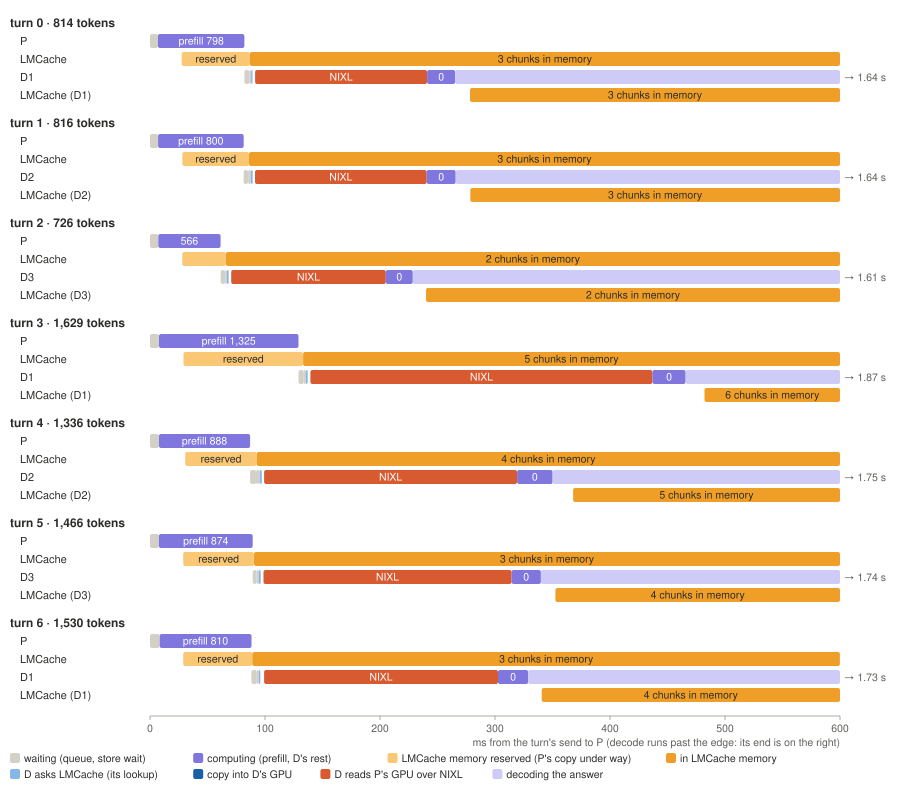

# Conversation 6: mt-rag-clapnq-elser-512-100-20240503 (memory mode, NIXL, per-engine servers, chat RAG, all passages)

P's KV reaches D over NIXL (D reads P's GPU blocks); every engine's LMCache connector stores beside it, to its own server. 7 turns on D1, D2, D3 (round-robin: each turn to the next D engine); prompts grow from 814 to 1,530 tokens (interleaved: each turn's prompt is the previous one, its answer, then this turn's documents and question). Chunks are 256 tokens (16 vLLM blocks of 16); a chunk's name is LMCache's hash of its tokens and everything before them, so the same prefix has the same chunks on every turn and engine.

Legend for the strips (one character a chunk): P: `=` on P's GPU from an earlier turn, `#` computed and stored now, `+` computed, not stored (a partial chunk). D: `=` on D's GPU from an earlier turn, `M` pulled from memory, `S` pulled from disk, `N` read from P's GPU over NIXL, `+` computed by D (a partial chunk), `?` missed.

GPU blocks (the chunk tables): where each engine keeps the chunk's 16 vLLM blocks in its GPU KV cache, by vLLM's block ids (vLLM's paged KV cache: a block, or page, holds 16 tokens; block 0 is its reserved null block), in the prompt's block order, a run of consecutive ids written as a range: `P 1, 138-152` is the prompt's block 0 in GPU block 1 and its blocks 1-15 in GPU blocks 138-152. An engine takes a GPU block from its free list when it first computes or loads a block, and the block keeps it while cached, so a later turn that reuses the block shows the same id. Blocks that are the same in several prompts (the same tokens and everything before them) share one GPU block once the first is cached: the system prompt's first block, the same in every conversation, is the usual one. `16/16 hashes = P's`: of the blocks D pulled, how many have the same vLLM hash on D as on P.

The prompts' text is the driver's own record of what it sent (answers included); lines over 100 characters are wrapped here for reading.

| turn | prompt | chunks + tail | P: own GPU / computed / stored | D: own GPU / loaded / computed | pulled | pull ms | D first token ms |
| ---: | ---: | --- | --- | --- | --- | ---: | ---: |
| [0](#turn-0) | 814 | 3 + 46 | 16 / 798 / 3 chunks | 16 / 798 / 0 | 4 chunks (NIXL 4) | 149.6 | 179.1 |
| [1](#turn-1) | 816 | 3 + 48 | 16 / 800 / 3 chunks | 16 / 800 / 0 | 4 chunks (NIXL 4) | 149.3 | 180.5 |
| [2](#turn-2) | 726 | 2 + 214 | 160 / 566 / 2 chunks | 16 / 710 / 0 | 3 chunks (NIXL 3) | 134.3 | 163.2 |
| [3](#turn-3) | 1,629 | 6 + 93 | 304 / 1,325 / 5 chunks | 16 / 1,613 / 0 | 7 chunks (NIXL 7) | 297.5 | 332.2 |
| [4](#turn-4) | 1,336 | 5 + 56 | 448 / 888 / 4 chunks | 160 / 1,176 / 0 | 6 chunks (NIXL 6) | 220.0 | 257.9 |
| [5](#turn-5) | 1,466 | 5 + 186 | 592 / 874 / 3 chunks | 304 / 1,162 / 0 | 5 chunks (NIXL 5) | 215.7 | 247.1 |
| [6](#turn-6) | 1,530 | 5 + 250 | 720 / 810 / 3 chunks | 448 / 1,082 / 0 | 5 chunks (NIXL 5) | 203.4 | 236.0 |

## How the prompt grows

Each turn's prompt is the previous one, token for token, and then: D's answer to the previous turn, this turn's documents, its question and the framing (the system prompt on turn 0, `Assistant:` and newlines). Only the new tokens can make new chunks: the previous prompt's partial chunk fills first. A document sent before comes again at another place, so in other chunks.

| turn | prompt | new | previous answer | documents | question | framing | whole chunks |
| ---: | ---: | ---: | ---: | --- | --- | ---: | --- |
| 0 | 814 | +814 | – | 5 docs, 769 | 15: where is bone marrow found what does it do for the body | 30 | 3 (+3) |
| 1 | 816 | +2 | – | 0 docs, 0 | 0 | 2 | 3 (+0) |
| 2 | 726 | +-90 | – | 0 docs, 0 | 0 | 0 | 2 (+-1) |
| 3 | 1,629 | +903 | – | 6 docs, 820 | 7: Will it kill me? | 2 | 6 (+4) |
| 4 | 1,336 | +-293 | – | 0 docs, 0 | 0 | 0 | 5 (+-1) |
| 5 | 1,466 | +130 | – | 1 doc, 91 | 9: Is Huntington's disease also inherited? | 2 | 5 (+0) |
| 6 | 1,530 | +64 | – | 0 docs, 0 | 8: Any cures for it? | 2 | 5 (+0) |

## Timeline

Every turn on one clock: ms from the moment the proxy sent the turn to P. P prefills it (one token out) and holds its blocks for D; the proxy sends the turn to the next D engine at once with P's reply's kv_transfer_params (no wait), D reads P's blocks over NIXL (orange-red), computes the rest and decodes the answer. Beside it every engine's LMCache connector stores its new whole chunks (P's lane, and D's own when it stored any). The lanes: P, LMCache (P's chunks), D, and LMCache (D's chunks).



| turn | P queued → done | P's chunks: in memory / on disk | D | D starts | NIXL read | D: held / from P / from LMCache / computed | D's chunks stored | first token | P freed | D done |
| ---: | --- | --- | --- | ---: | --- | --- | ---: | ---: | ---: | ---: |
| 0 | 7 → 82 | 3: 87 / – | D1 | 86 | 91-241 | 16 / 798 / 0 / 0 | 3 | 265 | 241 | 1,641 |
| 1 | 7 → 81 | 3: 86 / – | D2 | 85 | 91-241 | 16 / 800 / 0 / 0 | 3 | 266 | 241 | 1,641 |
| 2 | 7 → 61 | 2: 66 / – | D3 | 65 | 71-205 | 16 / 710 / 0 / 0 | 2 | 228 | 205 | 1,607 |
| 3 | 8 → 129 | 5: 133 / – | D1 | 134 | 140-437 | 16 / 1,613 / 0 / 0 | 6 | 466 | 438 | 1,867 |
| 4 | 8 → 87 | 4: 93 / – | D2 | 92 | 99-319 | 160 / 1,176 / 0 / 0 | 5 | 350 | 320 | 1,746 |
| 5 | 8 → 89 | 3: 90 / – | D3 | 93 | 99-314 | 304 / 1,162 / 0 / 0 | 4 | 340 | 315 | 1,743 |
| 6 | 8 → 88 | 3: 89 / – | D1 | 93 | 99-303 | 448 / 1,082 / 0 / 0 | 4 | 329 | 303 | 1,728 |

All times in ms from the turn's send to P. NIXL read: D's worker posts the read of P's blocks to the KV in D's GPU blocks; P freed: D has read, P's blocks go back to its free queue (still cached). Each turn's section below tells it in a sentence and step by step.

### One chunk, block by block: chunk 1 of turn 0 (`447043c4e0839a1c`)

Tokens 256-512 (doc 825171915_3242: 71; doc 837756901_3845: 144; doc 825171915_1986: 41). P computed its blocks; D1 read them from P's GPU over NIXL, P's block into D's block, one for one:

| block | tokens | P's GPU block | vLLM hash on P | D's GPU block | same hash on D |
| ---: | --- | ---: | --- | ---: | --- |
| 16 | 256-272 | 2244 | `7bb602f0881e5a76` | 986 | True |
| 17 | 272-288 | 2245 | `3bb8c141bc92bda9` | 987 | True |
| 18 | 288-304 | 2246 | `3a93ce0f28ae79d3` | 988 | True |
| 19 | 304-320 | 2247 | `5789389724fadefd` | 989 | True |
| 20 | 320-336 | 2248 | `1aa7e79e18b1d48d` | 990 | True |
| 21 | 336-352 | 2249 | `884f2a9468ece4fd` | 991 | True |
| 22 | 352-368 | 2250 | `634961b39eb3a3c5` | 992 | True |
| 23 | 368-384 | 2251 | `56b369efec5fd1e5` | 993 | True |
| 24 | 384-400 | 2252 | `05d035ce0fa25d1c` | 994 | True |
| 25 | 400-416 | 2253 | `f1ca3d1b70b2cb84` | 995 | True |
| 26 | 416-432 | 2254 | `a9011f49b51f6993` | 996 | True |
| 27 | 432-448 | 2255 | `3dee2f58a124bac4` | 997 | True |
| 28 | 448-464 | 2256 | `45563bca5efadda9` | 998 | True |
| 29 | 464-480 | 2257 | `98561d676f7b3575` | 999 | True |
| 30 | 480-496 | 2258 | `c00e38c7eb4c66e6` | 1000 | True |
| 31 | 496-512 | 2259 | `86ab120d7b70e11d` | 1001 | True |

## Turn 0

**Timeline:** P queued until 7 ms, prefilled 798 tokens (held 16) and was done at 82 ms; its 3 new chunks were in LMCache's memory at 87 ms. D1 started at 86 ms (no wait) holding 16 tokens, read 798 from P's GPU over NIXL (posted at 91 ms, in its GPU at 241 ms; P freed its blocks at 241 ms), computed 0 and gave its first token at 265 ms; it decoded 128 tokens until 1,641 ms; its LMCache connector stored 3 new chunks. ([all turns](#timeline))

### Step by step

Every move of this turn's KV, ms from the proxy sending the turn to P. P's KV reaches D over NIXL: D's worker reads P's GPU blocks into its own (a NIXL READ, P told when D is done); LMCache's copies (to and from each server's memory) its servers do themselves through CUDA IPC handles each engine registered at start.

| ms | where | what |
| ---: | --- | --- |
| 0.0 | proxy → P | sends the turn (814 prompt tokens; P is asked for one token: prefill only) |
| 2.4 | P | the request arrives |
| 6.7 | P GPU | its prefix cache holds 16 of the prompt's tokens: 1 block in GPU blocks 1 |
| 6.7 | P ↔ LMCache | LMCache has 0 of its tokens; P loads 0 and computes the rest |
| 6.9 | P GPU | 50 new GPU blocks for the 798 tokens it computes: 2229-2278; the prefill runs |
| 7.3 | P → LMCache | store planned: tokens 0-768, chunks 0-2 (48 blocks) |
| 27.1 | LMCache | the store request is in; it waits for P's forward pass to finish (a CUDA event) |
| 27.6 | LMCache memory | space reserved for 3 chunks (88 MB) |
| 78.7 | P GPU → LMCache memory | the copy starts: LMCache reads P's GPU blocks (CUDA IPC) |
| 78.9 | P GPU | the request is done: P holds its 51 blocks for D to read over NIXL, and its reply carries them (kv_transfer_params: the blocks, its NIXL agent) |
| 82.1 | P → proxy | P answers its one token: the prefill is done |
| 82.6 | P GPU → LMCache memory | copy done: 3 chunks, 88 MB in 3.9 ms |
| 86.3 | proxy → D1 | sends the turn to D1 at once, with P's kv_transfer_params (round-robin; no wait) |
| 86.8 | LMCache memory | 3 chunks in memory, kept for later requests (D gets this turn's KV from P over NIXL); P keeps its copy in its GPU blocks |
| 87.9 | D1 ↔ LMCache | asks LMCache for the prompt's chunks |
| 89.1 | LMCache memory | found 0 tokens it lacks |
| 90.7 | D1 GPU | its prefix cache holds 16 of the prompt's tokens: 1 block in GPU blocks 1 |
| 90.7 | D1 ↔ P (NIXL) | will read 798 prompt tokens from P's GPU (beyond the 16 its own cache holds) |
| 90.8 | D1 ↔ LMCache | LMCache has 0 of its tokens; NIXL loads it (MultiConnector: the first connector with tokens) |
| 91.0 | D1 GPU | 50 GPU blocks for the KV from P: 971-1020 |
| 91.4 | P GPU → D1 GPU (NIXL) | D1 reads P's GPU blocks 1, 2229-2278 into its 971-1020 (a NIXL READ) |
| 241.0 | D1 | the KV from P is in its GPU blocks (798 tokens) |
| 241.4 | P GPU | D1 has read: P frees its blocks (they stay in its prefix cache) |
| 249.3 | D1 → LMCache | store planned: tokens 0-768; 3 chunks new to its server |
| 265.4 | D1 → proxy | the first answer token |
| 275.8 | D1 GPU | 1 new GPU block for the 1 prompt tokens it computes: 1021 |
| 278.3 | LMCache memory | 3 chunks from D1 in memory |
| 449.2 | D1 GPU | decoding: the answer's KV takes 7 new GPU blocks as it grows, one per 16 tokens: 1022-1028, until 1,489 ms |
| 1,641.3 | D1 | done: 128 tokens decoded; its blocks stay cached in its GPU for the next turn |
| 1,642.5 | proxy | the response is complete |

814 prompt tokens: 3 whole chunks and 46 tokens over (the partial chunk, computed by both engines and stored only when a later turn completes it). P held 16 tokens on its GPU, computed 798 and stored 3 new chunks; D1 held 16, read 798 from P over NIXL, loaded 0 from LMCache and computed 0.

### The prompt

The whole prompt, piece by piece:

- **system prompt** · tokens 0-28 (28) · chunk 0

```text
You are a helpful assistant. Answer the user's last question from the documents. If they do not hold
the answer, say so.
```

<details><summary>document <code>825171915_343-1247-0-904</code> · tokens 28-238 (210) · chunk 0</summary>

```text
Document: Bone marrow
Bone marrow
Bone marrow is a semi-solid tissue which may be found within the spongy or cancellous portions of
bones . In birds and mammals , bone marrow is the primary site of new blood cell production or
hematopoiesis . It is composed of hematopoietic cells , marrow adipose tissue , and supportive
stromal cells . On average , bone marrow constitutes 4 % of the total body mass of humans ; in an
adult having 65 kilograms of mass ( 143 lb ) , bone marrow typically accounts for approximately 2.6
kilograms ( 5.7 lb ) . Human marrow produces approximately 500 billion blood cells per day , which
join the systemic circulation via permeable vasculature sinusoids within the medullary cavity . All
types of hematopoietic cells , including both myeloid and lymphoid lineages , are created in bone
marrow ; however , lymphoid cells must migrate to other lymphoid organs ( e.g. thymus ) in order to
complete maturation .
```

</details>

<details><summary>document <code>825171915_3242-3629-0-387</code> · tokens 238-327 (89) · chunks 0-1</summary>

```text
Document: Bone marrow
Bone marrow
At the cellular level , the main functional component of bone marrow includes the progenitor cells
which are destined to mature into blood and lymphoid cells . Marrow contains hematopoietic stem
cells which give rise to the three classes of blood cells that are found in circulation : white
blood cells ( leukocytes ) , red blood cells ( erythrocytes ) , and platelets ( thrombocytes ) .
```

</details>

<details><summary>document <code>837756901_3845-4469-0-624</code> · tokens 327-471 (144) · chunk 1</summary>

```text
Document: Human musculoskeletal system
Human musculoskeletal system
Located in long bones are two distinctions of bone marrow ( yellow and red ) . The yellow marrow has
fatty connective tissue and is found in the marrow cavity . During starvation , the body uses the
fat in yellow marrow for energy . The red marrow of some bones is an important site for blood cell
production , approximately 2.6 million red blood cells per second in order to replace existing cells
that have been destroyed by the liver . Here all erythrocytes , platelets , and most leukocytes form
in adults . From the red marrow , erythrocytes , platelets , and leukocytes migrate to the blood to
do their special tasks .
```

</details>

<details><summary>document <code>825171915_1986-3071-0-1085</code> · tokens 471-704 (233) · chunks 1-2</summary>

```text
Document: Bone marrow
Bone marrow
The composition of marrow is dynamic , as the mixture of cellular and non-cellular components (
connective tissue ) shifts with age and in response to systemic factors . In humans , marrow is
colloquially characterized as `` red '' or `` yellow '' marrow ( Latin : medulla ossium rubra ,
Latin : medulla ossium flava , respectively ) depending on the prevalence of hematopoetic cells vs
fat cells . While the precise mechanisms underlying marrow regulation are not understood ,
compositional changes occur according to stereotypical patterns . For example , a newborn baby 's
bones exclusively contain hematopoietically active `` red '' marrow , and there is a progressive
conversion towards `` yellow '' marrow with age . In adults , red marrow is found mainly in the
central skeleton , such as the pelvis , sternum , cranium , ribs , vertebrae and scapulae , and
variably found in the proximal epiphyseal ends of long bones such as the femur and humerus . In
circumstances of chronic hypoxia , the body can convert yellow marrow back to red marrow to increase
blood cell production .
```

</details>

<details><summary>document <code>825171915_6292-6727-0-435</code> · tokens 704-797 (93) · chunks 2-3</summary>

```text
Document: Bone marrow
Bone marrow
The red bone marrow is a key element of the lymphatic system , being one of the primary lymphoid
organs that generate lymphocytes from immature hematopoietic progenitor cells . The bone marrow and
thymus constitute the primary lymphoid tissues involved in the production and early selection of
lymphocytes . Furthermore , bone marrow performs a valve - like function to prevent the backflow of
lymphatic fluid in the lymphatic system .
```

</details>

- **question 0** · tokens 797-812 (15) · chunk 3

```text
User: where is bone marrow found what does it do for the body
```

- `Assistant:` · tokens 812-814 (2) · chunk 3

### Pieces, chunks and blocks

| piece | tokens | length | chunks | |
| --- | --- | ---: | --- | --- |
| system | 0-28 | 28 | 0 |  |
| doc 825171915_343- | 28-238 | 210 | 0 |  |
| doc 825171915_3242 | 238-327 | 89 | 0-1 |  |
| doc 837756901_3845 | 327-471 | 144 | 1 |  |
| doc 825171915_1986 | 471-704 | 233 | 1-2 |  |
| doc 825171915_6292 | 704-797 | 93 | 2-3 |  |
| question 0 | 797-812 | 15 | 3 |  |
| `assistant:` 0 | 812-814 | 2 | 3 |  |

```
P  ###+
D  NNNN
```

| chunk | tokens | pieces in it (tokens) | vLLM blocks | GPU blocks | in LMCache | P this turn | D this turn |
| ---: | --- | --- | --- | --- | --- | --- | --- |
| 0 | 0-256 | system: 28; doc 825171915_343-: 210; doc 825171915_3242: 18 | 0-15 | P 1, 2229-2243; D 1, 971-985; 15/15 hashes = P's | `57c5e2a7d5e5b8af`: LMC_P: stored on turn 0 by P; LMC_D1: stored on turn 0 by D1 | computed (its first 16 tokens on P's GPU already), **stored now** | **read from P's GPU over NIXL** (its first 16 tokens on D's GPU already) |
| 1 | 256-512 | doc 825171915_3242: 71; doc 837756901_3845: 144; doc 825171915_1986: 41 | 16-31 | P 2244-2259; D 986-1001; 16/16 hashes = P's | `447043c4e0839a1c`: LMC_P: stored on turn 0 by P; LMC_D1: stored on turn 0 by D1 | computed, **stored now** | **read from P's GPU over NIXL** |
| 2 | 512-768 | doc 825171915_1986: 192; doc 825171915_6292: 64 | 32-47 | P 2260-2275; D 1002-1017; 16/16 hashes = P's | `174ece32127556ac`: LMC_P: stored on turn 0 by P; LMC_D1: stored on turn 0 by D1 | computed, **stored now** | **read from P's GPU over NIXL** |
| 3 | 768-814 | doc 825171915_6292: 29; question 0: 15; `assistant:` 0: 2 | 48-50 | P 2276-2277; D 1018-1020; 2/2 hashes = P's | – | computed (partial chunk: not stored) | **read from P's GPU over NIXL** (partial chunk) |

## Turn 1

**Timeline:** P queued until 7 ms, prefilled 800 tokens (held 16) and was done at 81 ms; its 3 new chunks were in LMCache's memory at 86 ms. D2 started at 85 ms (no wait) holding 16 tokens, read 800 from P's GPU over NIXL (posted at 91 ms, in its GPU at 241 ms; P freed its blocks at 241 ms), computed 0 and gave its first token at 266 ms; it decoded 128 tokens until 1,641 ms; its LMCache connector stored 3 new chunks. ([all turns](#timeline))

### Step by step

Every move of this turn's KV, ms from the proxy sending the turn to P. P's KV reaches D over NIXL: D's worker reads P's GPU blocks into its own (a NIXL READ, P told when D is done); LMCache's copies (to and from each server's memory) its servers do themselves through CUDA IPC handles each engine registered at start.

| ms | where | what |
| ---: | --- | --- |
| 0.0 | proxy → P | sends the turn (816 prompt tokens; P is asked for one token: prefill only) |
| 2.4 | P | the request arrives |
| 6.8 | P GPU | its prefix cache holds 16 of the prompt's tokens: 1 block in GPU blocks 1 |
| 6.9 | P ↔ LMCache | LMCache has 0 of its tokens; P loads 0 and computes the rest |
| 7.0 | P GPU | 50 new GPU blocks for the 800 tokens it computes: 2278-2327; the prefill runs |
| 7.5 | P → LMCache | store planned: tokens 0-768, chunks 0-2 (48 blocks) |
| 27.5 | LMCache | the store request is in; it waits for P's forward pass to finish (a CUDA event) |
| 28.1 | LMCache memory | space reserved for 3 chunks (88 MB) |
| 78.0 | P GPU → LMCache memory | the copy starts: LMCache reads P's GPU blocks (CUDA IPC) |
| 78.1 | P GPU | the request is done: P holds its 51 blocks for D to read over NIXL, and its reply carries them (kv_transfer_params: the blocks, its NIXL agent) |
| 81.4 | P → proxy | P answers its one token: the prefill is done |
| 81.9 | P GPU → LMCache memory | copy done: 3 chunks, 88 MB in 3.9 ms |
| 85.3 | proxy → D2 | sends the turn to D2 at once, with P's kv_transfer_params (round-robin; no wait) |
| 86.1 | LMCache memory | 3 chunks in memory, kept for later requests (D gets this turn's KV from P over NIXL); P keeps its copy in its GPU blocks |
| 87.7 | D2 ↔ LMCache | asks LMCache for the prompt's chunks |
| 89.3 | LMCache memory | found 0 tokens it lacks |
| 90.5 | D2 GPU | its prefix cache holds 16 of the prompt's tokens: 1 block in GPU blocks 1 |
| 90.6 | D2 ↔ P (NIXL) | will read 800 prompt tokens from P's GPU (beyond the 16 its own cache holds) |
| 90.6 | D2 ↔ LMCache | LMCache has 0 of its tokens; NIXL loads it (MultiConnector: the first connector with tokens) |
| 90.8 | D2 GPU | 50 GPU blocks for the KV from P: 989-1038 |
| 91.3 | P GPU → D2 GPU (NIXL) | D2 reads P's GPU blocks 1, 2278-2327 into its 989-1038 (a NIXL READ) |
| 240.6 | D2 | the KV from P is in its GPU blocks (800 tokens) |
| 241.3 | P GPU | D2 has read: P frees its blocks (they stay in its prefix cache) |
| 249.5 | D2 → LMCache | store planned: tokens 0-768; 3 chunks new to its server |
| 254.4 | D2 GPU | 1 new GPU block for the 1 prompt tokens it computes: 1039 |
| 265.8 | D2 → proxy | the first answer token |
| 278.5 | LMCache memory | 3 chunks from D2 in memory |
| 427.7 | D2 GPU | decoding: the answer's KV takes 7 new GPU blocks as it grows, one per 16 tokens: 1040-1046, until 1,467 ms |
| 1,641.0 | D2 | done: 128 tokens decoded; its blocks stay cached in its GPU for the next turn |
| 1,642.3 | proxy | the response is complete |

816 prompt tokens: 3 whole chunks and 48 tokens over (the partial chunk, computed by both engines and stored only when a later turn completes it). P held 16 tokens on its GPU, computed 800 and stored 3 new chunks; D2 held 16, read 800 from P over NIXL, loaded 0 from LMCache and computed 0.

### The prompt

Tokens 0-814: [turn 0](#turn-0)'s prompt, unchanged (NOT the previous prompt's ids), so chunks 0-2 are the same chunks; chunk 3 (partial then, 46 tokens) fills now. New from token 814:

- `Assistant:` · tokens 814-816 (2) · chunk 3

### Pieces, chunks and blocks

| piece | tokens | length | chunks | |
| --- | --- | ---: | --- | --- |
| system | 0-28 | 28 | 0 |  |
| question 0 | 28-43 | 15 | 0 |  |
| `assistant:` 0 | 43-45 | 2 | 0 |  |
| answer 0 | 45-173 | 128 | 0 |  |
| newline 0 | 173-174 | 1 | 0 |  |
| doc 825171915_1192 | 174-343 | 169 | 0-1 |  |
| doc 853377429_1651 | 343-431 | 88 | 1 |  |
| doc 825171915_7241 | 431-555 | 124 | 1-2 |  |
| doc 825171915_1248 | 555-618 | 63 | 2 |  |
| doc 825171915_3242 | 618-707 | 89 | 2 |  |
| doc 825171915_4571 | 707-803 | 96 | 2-3 |  |
| question 1 | 803-814 | 11 | 3 |  |
| `assistant:` 1 | 814-816 | 2 | 3 | new this turn |

```
P  ###+
D  NNNN
```

| chunk | tokens | pieces in it (tokens) | vLLM blocks | GPU blocks | in LMCache | P this turn | D this turn |
| ---: | --- | --- | --- | --- | --- | --- | --- |
| 0 | 0-256 | system: 28; question 0: 15; `assistant:` 0: 2; answer 0: 128; newline 0: 1; doc 825171915_1192: 82 | 0-15 | P 1, 2278-2292; D 1, 989-1003; 15/15 hashes = P's | `dcec36e1490ac422`: LMC_P: stored on turn 1 by P; LMC_D2: stored on turn 1 by D2 | computed (its first 16 tokens on P's GPU already), **stored now** | **read from P's GPU over NIXL** (its first 16 tokens on D's GPU already) |
| 1 | 256-512 | doc 825171915_1192: 87; doc 853377429_1651: 88; doc 825171915_7241: 81 | 16-31 | P 2293-2308; D 1004-1019; 16/16 hashes = P's | `86b8121522361256`: LMC_P: stored on turn 1 by P; LMC_D2: stored on turn 1 by D2 | computed, **stored now** | **read from P's GPU over NIXL** |
| 2 | 512-768 | doc 825171915_7241: 43; doc 825171915_1248: 63; doc 825171915_3242: 89; doc 825171915_4571: 61 | 32-47 | P 2309-2324; D 1020-1035; 16/16 hashes = P's | `10b90e65573856dd`: LMC_P: stored on turn 1 by P; LMC_D2: stored on turn 1 by D2 | computed, **stored now** | **read from P's GPU over NIXL** |
| 3 | 768-816 | doc 825171915_4571: 35; question 1: 11; `assistant:` 1 (new): 2 | 48-50 | P 2325-2327; D 1036-1038; 3/3 hashes = P's | – | computed (partial chunk: not stored) | **read from P's GPU over NIXL** (partial chunk) |

## Turn 2

**Timeline:** P queued until 7 ms, prefilled 566 tokens (held 160) and was done at 61 ms; its 2 new chunks were in LMCache's memory at 66 ms. D3 started at 65 ms (no wait) holding 16 tokens, read 710 from P's GPU over NIXL (posted at 71 ms, in its GPU at 205 ms; P freed its blocks at 205 ms), computed 0 and gave its first token at 228 ms; it decoded 128 tokens until 1,607 ms; its LMCache connector stored 2 new chunks. ([all turns](#timeline))

### Step by step

Every move of this turn's KV, ms from the proxy sending the turn to P. P's KV reaches D over NIXL: D's worker reads P's GPU blocks into its own (a NIXL READ, P told when D is done); LMCache's copies (to and from each server's memory) its servers do themselves through CUDA IPC handles each engine registered at start.

| ms | where | what |
| ---: | --- | --- |
| 0.0 | proxy → P | sends the turn (726 prompt tokens; P is asked for one token: prefill only) |
| 2.4 | P | the request arrives |
| 7.0 | P GPU | its prefix cache holds 160 of the prompt's tokens: 10 blocks in GPU blocks 1, 2278-2286 |
| 7.0 | P ↔ LMCache | LMCache has 0 of its tokens; P loads 0 and computes the rest |
| 7.2 | P GPU | 36 new GPU blocks for the 566 tokens it computes: 2328-2363; the prefill runs |
| 7.6 | P → LMCache | store planned: tokens 0-512, chunks 0-1 (32 blocks) |
| 27.6 | LMCache | the store request is in; it waits for P's forward pass to finish (a CUDA event) |
| 28.1 | LMCache memory | space reserved for 2 chunks (59 MB) |
| 58.2 | P GPU → LMCache memory | the copy starts: LMCache reads P's GPU blocks (CUDA IPC) |
| 58.3 | P GPU | the request is done: P holds its 46 blocks for D to read over NIXL, and its reply carries them (kv_transfer_params: the blocks, its NIXL agent) |
| 60.8 | P GPU → LMCache memory | copy done: 2 chunks, 59 MB in 2.6 ms |
| 61.4 | P → proxy | P answers its one token: the prefill is done |
| 65.3 | proxy → D3 | sends the turn to D3 at once, with P's kv_transfer_params (round-robin; no wait) |
| 65.9 | LMCache memory | 2 chunks in memory, kept for later requests (D gets this turn's KV from P over NIXL); P keeps its copy in its GPU blocks |
| 66.9 | D3 ↔ LMCache | asks LMCache for the prompt's chunks |
| 68.5 | LMCache memory | found 0 tokens it lacks |
| 69.9 | D3 GPU | its prefix cache holds 16 of the prompt's tokens: 1 block in GPU blocks 1 |
| 69.9 | D3 ↔ P (NIXL) | will read 710 prompt tokens from P's GPU (beyond the 16 its own cache holds) |
| 70.0 | D3 ↔ LMCache | LMCache has 0 of its tokens; NIXL loads it (MultiConnector: the first connector with tokens) |
| 70.2 | D3 GPU | 45 GPU blocks for the KV from P: 1026-1070 |
| 70.6 | P GPU → D3 GPU (NIXL) | D3 reads P's GPU blocks 1, 2278-2286, 2328-2363 into its 1026-1070 (a NIXL READ) |
| 205.0 | D3 | the KV from P is in its GPU blocks (710 tokens) |
| 205.3 | P GPU | D3 has read: P frees its blocks (they stay in its prefix cache) |
| 213.2 | D3 → LMCache | store planned: tokens 0-512; 2 chunks new to its server |
| 228.5 | D3 → proxy | the first answer token |
| 240.0 | LMCache memory | 2 chunks from D3 in memory |
| 325.7 | D3 GPU | 1 new GPU block for the 1 prompt tokens it computes: 1071 |
| 499.0 | D3 GPU | decoding: the answer's KV takes 7 new GPU blocks as it grows, one per 16 tokens: 1072-1078, until 1,542 ms |
| 1,607.2 | D3 | done: 128 tokens decoded; its blocks stay cached in its GPU for the next turn |
| 1,608.2 | proxy | the response is complete |

726 prompt tokens: 2 whole chunks and 214 tokens over (the partial chunk, computed by both engines and stored only when a later turn completes it). P held 160 tokens on its GPU, computed 566 and stored 2 new chunks; D3 held 16, read 710 from P over NIXL, loaded 0 from LMCache and computed 0.

### The prompt

Tokens 0-816: [turn 1](#turn-1)'s prompt, unchanged (NOT the previous prompt's ids), so chunks 0-2 are the same chunks; chunk 3 (partial then, 48 tokens) fills now. New from token 816:

### Pieces, chunks and blocks

| piece | tokens | length | chunks | |
| --- | --- | ---: | --- | --- |
| system | 0-28 | 28 | 0 |  |
| question 0 | 28-43 | 15 | 0 |  |
| `assistant:` 0 | 43-45 | 2 | 0 |  |
| answer 0 | 45-173 | 128 | 0 |  |
| newline 0 | 173-174 | 1 | 0 |  |
| question 1 | 174-185 | 11 | 0 |  |
| `assistant:` 1 | 185-187 | 2 | 0 |  |
| answer 1 | 187-315 | 128 | 0-1 |  |
| newline 1 | 315-316 | 1 | 1 |  |
| doc 853377429_2317 | 316-396 | 80 | 1 |  |
| doc 853377429_2315 | 396-498 | 102 | 1 |  |
| doc 853377429_1893 | 498-539 | 41 | 1-2 |  |
| doc 853377429_2279 | 539-613 | 74 | 2 |  |
| doc 853377429_3778 | 613-715 | 102 | 2 |  |
| question 2 | 715-724 | 9 | 2 |  |
| `assistant:` 2 | 724-726 | 2 | 2 |  |

```
P  ##+
D  NNN
```

| chunk | tokens | pieces in it (tokens) | vLLM blocks | GPU blocks | in LMCache | P this turn | D this turn |
| ---: | --- | --- | --- | --- | --- | --- | --- |
| 0 | 0-256 | system: 28; question 0: 15; `assistant:` 0: 2; answer 0: 128; newline 0: 1; question 1: 11; `assistant:` 1: 2; answer 1: 69 | 0-15 | P 1, 2278-2286, 2328-2333; D 1, 1026-1040; 6/6 hashes = P's | `f2e574d7208151de`: LMC_P: stored on turn 2 by P; LMC_D3: stored on turn 2 by D3; LMC_D1: stored on turn 3 by D1; LMC_D2: stored on turn 4 by D2 | computed (its first 160 tokens on P's GPU already), **stored now** | **read from P's GPU over NIXL** (its first 16 tokens on D's GPU already) |
| 1 | 256-512 | answer 1: 59; newline 1: 1; doc 853377429_2317: 80; doc 853377429_2315: 102; doc 853377429_1893: 14 | 16-31 | P 2334-2349; D 1041-1056; 16/16 hashes = P's | `45e61ee8a78cbc98`: LMC_P: stored on turn 2 by P; LMC_D3: stored on turn 2 by D3 | computed, **stored now** | **read from P's GPU over NIXL** |
| 2 | 512-726 | doc 853377429_1893: 27; doc 853377429_2279: 74; doc 853377429_3778: 102; question 2: 9; `assistant:` 2: 2 | 32-45 | P 2350-2362; D 1057-1070; 13/13 hashes = P's | – | computed (partial chunk: not stored) | **read from P's GPU over NIXL** (partial chunk) |

## Turn 3

**Timeline:** P queued until 8 ms, prefilled 1,325 tokens (held 304) and was done at 129 ms; its 5 new chunks were in LMCache's memory at 133 ms. D1 started at 134 ms (no wait) holding 16 tokens, read 1,613 from P's GPU over NIXL (posted at 140 ms, in its GPU at 437 ms; P freed its blocks at 438 ms), computed 0 and gave its first token at 466 ms; it decoded 128 tokens until 1,867 ms; its LMCache connector stored 6 new chunks. ([all turns](#timeline))

### Step by step

Every move of this turn's KV, ms from the proxy sending the turn to P. P's KV reaches D over NIXL: D's worker reads P's GPU blocks into its own (a NIXL READ, P told when D is done); LMCache's copies (to and from each server's memory) its servers do themselves through CUDA IPC handles each engine registered at start.

| ms | where | what |
| ---: | --- | --- |
| 0.0 | proxy → P | sends the turn (1,629 prompt tokens; P is asked for one token: prefill only) |
| 3.0 | P | the request arrives |
| 7.5 | P GPU | its prefix cache holds 304 of the prompt's tokens: 19 blocks in GPU blocks 1, 2278-2286, 2328-2336 |
| 7.6 | P ↔ LMCache | LMCache has 256 of its tokens; P loads 0 and computes the rest |
| 7.8 | P GPU | 83 new GPU blocks for the 1,325 tokens it computes: 2363-2445; the prefill runs |
| 8.4 | P → LMCache | store planned: tokens 256-1,536, chunks 1-5 (80 blocks) |
| 28.4 | LMCache | the store request is in; it waits for P's forward pass to finish (a CUDA event) |
| 29.1 | LMCache memory | space reserved for 5 chunks (147 MB) |
| 124.4 | P GPU → LMCache memory | the copy starts: LMCache reads P's GPU blocks (CUDA IPC) |
| 124.6 | P GPU | the request is done: P holds its 102 blocks for D to read over NIXL, and its reply carries them (kv_transfer_params: the blocks, its NIXL agent) |
| 129.1 | P → proxy | P answers its one token: the prefill is done |
| 130.7 | P GPU → LMCache memory | copy done: 5 chunks, 147 MB in 6.3 ms |
| 133.1 | LMCache memory | 5 chunks in memory, kept for later requests (D gets this turn's KV from P over NIXL); P keeps its copy in its GPU blocks |
| 133.6 | proxy → D1 | sends the turn to D1 at once, with P's kv_transfer_params (round-robin; no wait) |
| 135.6 | D1 ↔ LMCache | asks LMCache for the prompt's chunks |
| 137.2 | LMCache memory | found 0 tokens it lacks |
| 138.6 | D1 GPU | its prefix cache holds 16 of the prompt's tokens: 1 block in GPU blocks 1 |
| 138.6 | D1 ↔ P (NIXL) | will read 1,613 prompt tokens from P's GPU (beyond the 16 its own cache holds) |
| 138.7 | D1 ↔ LMCache | LMCache has 0 of its tokens; NIXL loads it (MultiConnector: the first connector with tokens) |
| 139.0 | D1 GPU | 101 GPU blocks for the KV from P: 1028-1128 |
| 139.5 | P GPU → D1 GPU (NIXL) | D1 reads P's GPU blocks 1 … 2363-2445 (102 blocks) into its 1028-1128 (a NIXL READ) |
| 437.0 | D1 | the KV from P is in its GPU blocks (1,613 tokens) |
| 438.1 | P GPU | D1 has read: P frees its blocks (they stay in its prefix cache) |
| 448.5 | D1 → LMCache | store planned: tokens 0-1,536; 6 chunks new to its server |
| 465.8 | D1 → proxy | the first answer token |
| 482.2 | LMCache memory | 6 chunks from D1 in memory |
| 487.7 | D1 GPU | 1 new GPU block for the 1 prompt tokens it computes: 1129 |
| 664.6 | D1 GPU | decoding: the answer's KV takes 7 new GPU blocks as it grows, one per 16 tokens: 1130-1136, until 1,724 ms |
| 1,867.2 | D1 | done: 128 tokens decoded; its blocks stay cached in its GPU for the next turn |
| 1,868.5 | proxy | the response is complete |

1,629 prompt tokens: 6 whole chunks and 93 tokens over (the partial chunk, computed by both engines and stored only when a later turn completes it). P held 304 tokens on its GPU, computed 1,325 and stored 5 new chunks; D1 held 16, read 1,613 from P over NIXL, loaded 0 from LMCache and computed 0.

### The prompt

Tokens 0-726: [turn 2](#turn-2)'s prompt, unchanged (NOT the previous prompt's ids), so chunks 0-1 are the same chunks; chunk 2 (partial then, 214 tokens) fills now. New from token 726:

<details><summary>document <code>853377429_52-976-0-924</code> · tokens 800-1010 (210) · chunk 3</summary>

```text
Document: Sickle cell disease
Sickle cell disease
Sickle cell disease Synonyms Sickle cell disorder Figure ( A ) shows normal red blood cells flowing
freely through veins . The inset shows a cross section of a normal red blood cell with normal
haemoglobin . Figure ( B ) shows abnormal , sickled red blood cells sticking at the branching point
in a vein . The inset image shows a cross-section of a sickle cell with long polymerized sickle
haemoglobin ( HbS ) strands stretching and distorting the cell shape . Specialty Hematology Symptoms
Attacks of pain , anemia , swelling in the hands and feet , bacterial infections , stroke
Complications Chronic pain Usual onset 5 -- 6 months of age Causes Genetic Diagnostic method Blood
test Treatment Vaccination , antibiotics , high fluid intake , folic acid supplementation . pain
medication , blood transfusions Prognosis Life expectancy 40 -- 60 years ( developed world )
Frequency 4.4 million ( 2015 ) Deaths 114,800 ( 2015 )
```

</details>

<details><summary>document <code>853377429_6753-7259-0-506</code> · tokens 1010-1131 (121) · chunks 3-4</summary>

```text
Document: Sickle cell disease
Sickle cell disease
Splenic sequestration crises are acute , painful enlargements of the spleen , caused by intrasplenic
trapping of red cells and resulting in a precipitous fall in haemoglobin levels with the potential
for hypovolemic shock . Sequestration crises are considered an emergency . If not treated , patients
may die within 1 -- 2 hours due to circulatory failure . Management is supportive , sometimes with
blood transfusion . These crises are transient , they continue for 3 -- 4 hours and may last for one
day .
```

</details>

<details><summary>document <code>853377429_7776-8635-0-859</code> · tokens 1131-1318 (187) · chunks 4-5</summary>

```text
Document: Sickle cell disease
Sickle cell disease
Aplastic crises are acute worsenings of the patient 's baseline anaemia , producing pale appearance
, fast heart rate , and fatigue . This crisis is normally triggered by parvovirus B19 , which
directly affects production of red blood cells by invading the red cell precursors and multiplying
in and destroying them . Parvovirus infection almost completely prevents red blood cell production
for two to three days . In normal individuals , this is of little consequence , but the shortened
red cell life of SCD patients results in an abrupt , life - threatening situation . Reticulocyte
counts drop dramatically during the disease ( causing reticulocytopenia ) , and the rapid turnover
of red cells leads to the drop in haemoglobin . This crisis takes 4 days to one week to disappear .
Most patients can be managed supportively ; some need blood transfusion .
```

</details>

<details><summary>document <code>853377429_16511-16858-0-347</code> · tokens 1318-1406 (88) · chunk 5</summary>

```text
Document: Sickle cell disease
Sickle cell disease
The actual anaemia of the illness is caused by haemolysis , the destruction of the red cells ,
because of their shape . Although the bone marrow attempts to compensate by creating new red cells ,
it does not match the rate of destruction . Healthy red blood cells typically function for 90 -- 120
days , but sickled cells only last 10 -- 20 days .
```

</details>

<details><summary>document <code>853377429_27276-27776-0-500</code> · tokens 1406-1510 (104) · chunk 5</summary>

```text
Document: Sickle cell disease
Sickle cell disease
The highest frequency of sickle cell disease is found in tropical regions , particularly sub-Saharan
Africa , tribal regions of India and the Middle East . Migration of substantial populations from
these high prevalence areas to low prevalence countries in Europe has dramatically increased in
recent decades and in some European countries sickle cell disease has now overtaken more familiar
genetic conditions such as haemophilia and cystic fibrosis . In 2015 , it resulted in about 114,800
deaths .
```

</details>

<details><summary>document <code>853377429_7290-7750-0-460</code> · tokens 1510-1620 (110) · chunks 5-6</summary>

```text
Document: Sickle cell disease
Sickle cell disease
Acute chest syndrome ( ACS ) is defined by at least two of the following signs or symptoms : chest
pain , fever , pulmonary infiltrate or focal abnormality , respiratory symptoms , or hypoxemia . It
is the second-most common complication and it accounts for about 25 % of deaths in patients with SCD
, majority of cases present with vaso - occlusive crises then they develop ACS . Nevertheless ,
about 80 % of patients have vaso - occlusive crises during ACS .
```

</details>

- **question 3** · tokens 1620-1627 (7) · chunk 6

```text
User: Will it kill me?
```

- `Assistant:` · tokens 1627-1629 (2) · chunk 6

### Pieces, chunks and blocks

| piece | tokens | length | chunks | |
| --- | --- | ---: | --- | --- |
| system | 0-28 | 28 | 0 |  |
| question 0 | 28-43 | 15 | 0 |  |
| `assistant:` 0 | 43-45 | 2 | 0 |  |
| answer 0 | 45-173 | 128 | 0 |  |
| newline 0 | 173-174 | 1 | 0 |  |
| question 1 | 174-185 | 11 | 0 |  |
| `assistant:` 1 | 185-187 | 2 | 0 |  |
| answer 1 | 187-315 | 128 | 0-1 |  |
| newline 1 | 315-316 | 1 | 1 |  |
| question 2 | 316-325 | 9 | 1 |  |
| `assistant:` 2 | 325-327 | 2 | 1 |  |
| answer 2 | 327-455 | 128 | 1 |  |
| newline 2 | 455-456 | 1 | 1 |  |
| doc 853377429_2317 | 456-536 | 80 | 1-2 |  |
| doc 853377429_2395 | 536-630 | 94 | 2 |  |
| doc 853377429_977- | 630-800 | 170 | 2-3 |  |
| doc 853377429_52-9 | 800-1010 | 210 | 3 | new this turn |
| doc 853377429_6753 | 1010-1131 | 121 | 3-4 | new this turn |
| doc 853377429_7776 | 1131-1318 | 187 | 4-5 | new this turn |
| doc 853377429_1651 | 1318-1406 | 88 | 5 | new this turn |
| doc 853377429_2727 | 1406-1510 | 104 | 5 | new this turn |
| doc 853377429_7290 | 1510-1620 | 110 | 5-6 | new this turn |
| question 3 | 1620-1627 | 7 | 6 | new this turn |
| `assistant:` 3 | 1627-1629 | 2 | 6 | new this turn |

```
P  =#####+
D  NNNNNNN
```

| chunk | tokens | pieces in it (tokens) | vLLM blocks | GPU blocks | in LMCache | P this turn | D this turn |
| ---: | --- | --- | --- | --- | --- | --- | --- |
| 0 | 0-256 | system: 28; question 0: 15; `assistant:` 0: 2; answer 0: 128; newline 0: 1; question 1: 11; `assistant:` 1: 2; answer 1: 69 | 0-15 | P 1, 2278-2286, 2328-2333; D 1, 1028-1042 | `f2e574d7208151de`: LMC_P: stored on turn 2 by P; LMC_D3: stored on turn 2 by D3; LMC_D1: stored on turn 3 by D1; LMC_D2: stored on turn 4 by D2 | on P's GPU (earlier turn) | **read from P's GPU over NIXL** (its first 16 tokens on D's GPU already) |
| 1 | 256-512 | answer 1: 59; newline 1: 1; question 2: 9; `assistant:` 2: 2; answer 2: 128; newline 2: 1; doc 853377429_2317: 56 | 16-31 | P 2334-2336, 2363-2375; D 1043-1058; 13/13 hashes = P's | `bb0106996ad350ad`: LMC_P: stored on turn 3 by P; LMC_D1: stored on turn 3 by D1 | computed (its first 48 tokens on P's GPU already), **stored now** | **read from P's GPU over NIXL** |
| 2 | 512-768 | doc 853377429_2317: 24; doc 853377429_2395: 94; doc 853377429_977-: 138 | 32-47 | P 2376-2391; D 1059-1074; 16/16 hashes = P's | `ff7dba6ccfdd926b`: LMC_P: stored on turn 3 by P; LMC_D1: stored on turn 3 by D1 | computed, **stored now** | **read from P's GPU over NIXL** |
| 3 | 768-1024 | doc 853377429_977-: 32; doc 853377429_52-9 (new): 210; doc 853377429_6753 (new): 14 | 48-63 | P 2392-2407; D 1075-1090; 16/16 hashes = P's | `3b19e52a7c55d2a0`: LMC_P: stored on turn 3 by P; LMC_D1: stored on turn 3 by D1 | computed, **stored now** | **read from P's GPU over NIXL** |
| 4 | 1024-1280 | doc 853377429_6753 (new): 107; doc 853377429_7776 (new): 149 | 64-79 | P 2408-2423; D 1091-1106; 16/16 hashes = P's | `b35a37c643c194ee`: LMC_P: stored on turn 3 by P; LMC_D1: stored on turn 3 by D1 | computed, **stored now** | **read from P's GPU over NIXL** |
| 5 | 1280-1536 | doc 853377429_7776 (new): 38; doc 853377429_1651 (new): 88; doc 853377429_2727 (new): 104; doc 853377429_7290 (new): 26 | 80-95 | P 2424-2439; D 1107-1122; 16/16 hashes = P's | `e962492933afe621`: LMC_P: stored on turn 3 by P; LMC_D1: stored on turn 3 by D1 | computed, **stored now** | **read from P's GPU over NIXL** |
| 6 | 1536-1629 | doc 853377429_7290 (new): 84; question 3 (new): 7; `assistant:` 3 (new): 2 | 96-101 | P 2440-2444; D 1123-1128; 5/5 hashes = P's | – | computed (partial chunk: not stored) | **read from P's GPU over NIXL** (partial chunk) |

## Turn 4

**Timeline:** P queued until 8 ms, prefilled 888 tokens (held 448) and was done at 87 ms; its 4 new chunks were in LMCache's memory at 93 ms. D2 started at 92 ms (no wait) holding 160 tokens, read 1,176 from P's GPU over NIXL (posted at 99 ms, in its GPU at 319 ms; P freed its blocks at 320 ms), computed 0 and gave its first token at 350 ms; it decoded 128 tokens until 1,746 ms; its LMCache connector stored 5 new chunks. ([all turns](#timeline))

### Step by step

Every move of this turn's KV, ms from the proxy sending the turn to P. P's KV reaches D over NIXL: D's worker reads P's GPU blocks into its own (a NIXL READ, P told when D is done); LMCache's copies (to and from each server's memory) its servers do themselves through CUDA IPC handles each engine registered at start.

| ms | where | what |
| ---: | --- | --- |
| 0.0 | proxy → P | sends the turn (1,336 prompt tokens; P is asked for one token: prefill only) |
| 2.8 | P | the request arrives |
| 7.5 | P GPU | its prefix cache holds 448 of the prompt's tokens: GPU blocks 1 … 2363-2371 (28 blocks) |
| 7.6 | P ↔ LMCache | LMCache has 256 of its tokens; P loads 0 and computes the rest |
| 7.8 | P GPU | 56 new GPU blocks for the 888 tokens it computes: 2445-2500; the prefill runs |
| 8.3 | P → LMCache | store planned: tokens 256-1,280, chunks 1-4 (64 blocks) |
| 30.0 | LMCache | the store request is in; it waits for P's forward pass to finish (a CUDA event) |
| 30.6 | LMCache memory | space reserved for 4 chunks (117 MB) |
| 83.1 | P GPU → LMCache memory | the copy starts: LMCache reads P's GPU blocks (CUDA IPC) |
| 83.3 | P GPU | the request is done: P holds its 84 blocks for D to read over NIXL, and its reply carries them (kv_transfer_params: the blocks, its NIXL agent) |
| 87.0 | P → proxy | P answers its one token: the prefill is done |
| 88.2 | P GPU → LMCache memory | copy done: 4 chunks, 117 MB in 5.1 ms |
| 92.2 | proxy → D2 | sends the turn to D2 at once, with P's kv_transfer_params (round-robin; no wait) |
| 92.8 | LMCache memory | 4 chunks in memory, kept for later requests (D gets this turn's KV from P over NIXL); P keeps its copy in its GPU blocks |
| 95.5 | D2 ↔ LMCache | asks LMCache for the prompt's chunks |
| 97.2 | LMCache memory | found 0 tokens it lacks |
| 98.0 | D2 GPU | its prefix cache holds 160 of the prompt's tokens: 10 blocks in GPU blocks 1, 989-997 |
| 98.0 | D2 ↔ P (NIXL) | will read 1,176 prompt tokens from P's GPU (beyond the 160 its own cache holds) |
| 98.1 | D2 ↔ LMCache | LMCache has 0 of its tokens; NIXL loads it (MultiConnector: the first connector with tokens) |
| 98.5 | D2 GPU | 74 GPU blocks for the KV from P: 1046-1119 |
| 99.2 | P GPU → D2 GPU (NIXL) | D2 reads P's GPU blocks 1 … 2445-2500 (84 blocks) into its 1046-1119 (a NIXL READ) |
| 319.2 | D2 | the KV from P is in its GPU blocks (1,176 tokens) |
| 320.5 | P GPU | D2 has read: P frees its blocks (they stay in its prefix cache) |
| 333.4 | D2 → LMCache | store planned: tokens 0-1,280; 5 chunks new to its server |
| 350.1 | D2 → proxy | the first answer token |
| 367.9 | LMCache memory | 5 chunks from D2 in memory |
| 427.2 | D2 GPU | 1 new GPU block for the 1 prompt tokens it computes: 1120 |
| 603.2 | D2 GPU | decoding: the answer's KV takes 7 new GPU blocks as it grows, one per 16 tokens: 1121-1127, until 1,658 ms |
| 1,745.6 | D2 | done: 128 tokens decoded; its blocks stay cached in its GPU for the next turn |
| 1,746.8 | proxy | the response is complete |

1,336 prompt tokens: 5 whole chunks and 56 tokens over (the partial chunk, computed by both engines and stored only when a later turn completes it). P held 448 tokens on its GPU, computed 888 and stored 4 new chunks; D2 held 160, read 1,176 from P over NIXL, loaded 0 from LMCache and computed 0.

### The prompt

Tokens 0-1,629: [turn 3](#turn-3)'s prompt, unchanged (NOT the previous prompt's ids), so chunks 0-5 are the same chunks; chunk 6 (partial then, 93 tokens) fills now. New from token 1,629:

### Pieces, chunks and blocks

| piece | tokens | length | chunks | |
| --- | --- | ---: | --- | --- |
| system | 0-28 | 28 | 0 |  |
| question 0 | 28-43 | 15 | 0 |  |
| `assistant:` 0 | 43-45 | 2 | 0 |  |
| answer 0 | 45-173 | 128 | 0 |  |
| newline 0 | 173-174 | 1 | 0 |  |
| question 1 | 174-185 | 11 | 0 |  |
| `assistant:` 1 | 185-187 | 2 | 0 |  |
| answer 1 | 187-315 | 128 | 0-1 |  |
| newline 1 | 315-316 | 1 | 1 |  |
| question 2 | 316-325 | 9 | 1 |  |
| `assistant:` 2 | 325-327 | 2 | 1 |  |
| answer 2 | 327-455 | 128 | 1 |  |
| newline 2 | 455-456 | 1 | 1 |  |
| question 3 | 456-463 | 7 | 1 |  |
| `assistant:` 3 | 463-465 | 2 | 1 |  |
| answer 3 | 465-593 | 128 | 1-2 |  |
| newline 3 | 593-594 | 1 | 2 |  |
| doc 853377429_2279 | 594-668 | 74 | 2 |  |
| doc 853377429_3778 | 668-770 | 102 | 2-3 |  |
| doc 853377429_3690 | 770-830 | 60 | 3 |  |
| doc 857095139_6407 | 830-993 | 163 | 3 |  |
| doc 825171915_1192 | 993-1162 | 169 | 3-4 |  |
| doc 842629338_3606 | 1162-1248 | 86 | 4 |  |
| doc 833718643_6145 | 1248-1291 | 43 | 4-5 |  |
| doc 837000521_2109 | 1291-1328 | 37 | 5 |  |
| question 4 | 1328-1334 | 6 | 5 |  |
| `assistant:` 4 | 1334-1336 | 2 | 5 |  |

```
P  =####+
D  NNNNNN
```

| chunk | tokens | pieces in it (tokens) | vLLM blocks | GPU blocks | in LMCache | P this turn | D this turn |
| ---: | --- | --- | --- | --- | --- | --- | --- |
| 0 | 0-256 | system: 28; question 0: 15; `assistant:` 0: 2; answer 0: 128; newline 0: 1; question 1: 11; `assistant:` 1: 2; answer 1: 69 | 0-15 | P 1, 2278-2286, 2328-2333; D 1, 989-997, 1046-1051 | `f2e574d7208151de`: LMC_P: stored on turn 2 by P; LMC_D3: stored on turn 2 by D3; LMC_D1: stored on turn 3 by D1; LMC_D2: stored on turn 4 by D2 | on P's GPU (earlier turn) | **read from P's GPU over NIXL** (its first 160 tokens on D's GPU already) |
| 1 | 256-512 | answer 1: 59; newline 1: 1; question 2: 9; `assistant:` 2: 2; answer 2: 128; newline 2: 1; question 3: 7; `assistant:` 3: 2; answer 3: 47 | 16-31 | P 2334-2336, 2363-2371, 2445-2448; D 1052-1067; 4/4 hashes = P's | `65bdfdc913fd75b6`: LMC_P: stored on turn 4 by P; LMC_D2: stored on turn 4 by D2; LMC_D3: stored on turn 5 by D3; LMC_D1: stored on turn 6 by D1 | computed (its first 192 tokens on P's GPU already), **stored now** | **read from P's GPU over NIXL** |
| 2 | 512-768 | answer 3: 81; newline 3: 1; doc 853377429_2279: 74; doc 853377429_3778: 100 | 32-47 | P 2449-2464; D 1068-1083; 16/16 hashes = P's | `17c0d5df999ca92d`: LMC_P: stored on turn 4 by P; LMC_D2: stored on turn 4 by D2 | computed, **stored now** | **read from P's GPU over NIXL** |
| 3 | 768-1024 | doc 853377429_3778: 2; doc 853377429_3690: 60; doc 857095139_6407: 163; doc 825171915_1192: 31 | 48-63 | P 2465-2480; D 1084-1099; 16/16 hashes = P's | `f99a7783269794ce`: LMC_P: stored on turn 4 by P; LMC_D2: stored on turn 4 by D2 | computed, **stored now** | **read from P's GPU over NIXL** |
| 4 | 1024-1280 | doc 825171915_1192: 138; doc 842629338_3606: 86; doc 833718643_6145: 32 | 64-79 | P 2481-2496; D 1100-1115; 16/16 hashes = P's | `6968d8ee7cf95929`: LMC_P: stored on turn 4 by P; LMC_D2: stored on turn 4 by D2 | computed, **stored now** | **read from P's GPU over NIXL** |
| 5 | 1280-1336 | doc 833718643_6145: 11; doc 837000521_2109: 37; question 4: 6; `assistant:` 4: 2 | 80-83 | P 2497-2499; D 1116-1119; 3/3 hashes = P's | – | computed (partial chunk: not stored) | **read from P's GPU over NIXL** (partial chunk) |

## Turn 5

**Timeline:** P queued until 8 ms, prefilled 874 tokens (held 592) and was done at 89 ms; its 3 new chunks were in LMCache's memory at 90 ms. D3 started at 93 ms (no wait) holding 304 tokens, read 1,162 from P's GPU over NIXL (posted at 99 ms, in its GPU at 314 ms; P freed its blocks at 315 ms), computed 0 and gave its first token at 340 ms; it decoded 128 tokens until 1,743 ms; its LMCache connector stored 4 new chunks. ([all turns](#timeline))

### Step by step

Every move of this turn's KV, ms from the proxy sending the turn to P. P's KV reaches D over NIXL: D's worker reads P's GPU blocks into its own (a NIXL READ, P told when D is done); LMCache's copies (to and from each server's memory) its servers do themselves through CUDA IPC handles each engine registered at start.

| ms | where | what |
| ---: | --- | --- |
| 0.0 | proxy → P | sends the turn (1,466 prompt tokens; P is asked for one token: prefill only) |
| 2.9 | P | the request arrives |
| 7.5 | P GPU | its prefix cache holds 592 of the prompt's tokens: GPU blocks 1 … 2445-2453 (37 blocks) |
| 7.6 | P ↔ LMCache | LMCache has 512 of its tokens; P loads 0 and computes the rest |
| 7.7 | P GPU | 55 new GPU blocks for the 874 tokens it computes: 2500-2554; the prefill runs |
| 8.3 | P → LMCache | store planned: tokens 512-1,280, chunks 2-4 (48 blocks) |
| 28.3 | LMCache | the store request is in; it waits for P's forward pass to finish (a CUDA event) |
| 28.9 | LMCache memory | space reserved for 3 chunks (88 MB) |
| 85.0 | P GPU → LMCache memory | the copy starts: LMCache reads P's GPU blocks (CUDA IPC) |
| 85.3 | P GPU | the request is done: P holds its 92 blocks for D to read over NIXL, and its reply carries them (kv_transfer_params: the blocks, its NIXL agent) |
| 88.9 | P GPU → LMCache memory | copy done: 3 chunks, 88 MB in 3.8 ms |
| 89.3 | P → proxy | P answers its one token: the prefill is done |
| 90.4 | LMCache memory | 3 chunks in memory, kept for later requests (D gets this turn's KV from P over NIXL); P keeps its copy in its GPU blocks |
| 92.7 | proxy → D3 | sends the turn to D3 at once, with P's kv_transfer_params (round-robin; no wait) |
| 94.5 | D3 ↔ LMCache | asks LMCache for the prompt's chunks |
| 96.2 | LMCache memory | found 0 tokens it lacks |
| 97.6 | D3 GPU | its prefix cache holds 304 of the prompt's tokens: 19 blocks in GPU blocks 1, 1026-1043 |
| 97.6 | D3 ↔ P (NIXL) | will read 1,162 prompt tokens from P's GPU (beyond the 304 its own cache holds) |
| 97.7 | D3 ↔ LMCache | LMCache has 256 of its tokens; NIXL loads it (MultiConnector: the first connector with tokens) |
| 97.9 | D3 GPU | 73 GPU blocks for the KV from P: 1078-1150 |
| 98.7 | P GPU → D3 GPU (NIXL) | D3 reads P's GPU blocks 1 … 2500-2554 (92 blocks) into its 1078-1150 (a NIXL READ) |
| 314.4 | D3 | the KV from P is in its GPU blocks (1,162 tokens) |
| 314.7 | P GPU | D3 has read: P frees its blocks (they stay in its prefix cache) |
| 323.8 | D3 → LMCache | store planned: tokens 256-1,280; 4 chunks new to its server |
| 339.9 | D3 → proxy | the first answer token |
| 352.5 | LMCache memory | 4 chunks from D3 in memory |
| 395.1 | D3 GPU | 1 new GPU block for the 1 prompt tokens it computes: 1151 |
| 571.5 | D3 GPU | decoding: the answer's KV takes 7 new GPU blocks as it grows, one per 16 tokens: 1152-1158, until 1,633 ms |
| 1,743.3 | D3 | done: 128 tokens decoded; its blocks stay cached in its GPU for the next turn |
| 1,744.8 | proxy | the response is complete |

1,466 prompt tokens: 5 whole chunks and 186 tokens over (the partial chunk, computed by both engines and stored only when a later turn completes it). P held 592 tokens on its GPU, computed 874 and stored 3 new chunks; D3 held 304, read 1,162 from P over NIXL, loaded 0 from LMCache and computed 0.

### The prompt

Tokens 0-1,336: [turn 4](#turn-4)'s prompt, unchanged (NOT the previous prompt's ids), so chunks 0-4 are the same chunks; chunk 5 (partial then, 56 tokens) fills now. New from token 1,336:

<details><summary>document <code>834242094_42214-42684-0-470</code> · tokens 1364-1455 (91) · chunk 5</summary>

```text
Document: Huntington's disease
Huntington's disease
The first thorough description of the disease was by George Huntington in 1872 . Examining the
combined medical history of several generations of a family exhibiting similar symptoms , he
realized their conditions must be linked ; he presented his detailed and accurate definition of the
disease as his first paper . Huntington described the exact pattern of inheritance of autosomal
dominant disease years before the rediscovery by scientists of Mendelian inheritance .
```

</details>

- **question 5** · tokens 1455-1464 (9) · chunk 5

```text
User: Is Huntington's disease also inherited?
```

- `Assistant:` · tokens 1464-1466 (2) · chunk 5

### Pieces, chunks and blocks

| piece | tokens | length | chunks | |
| --- | --- | ---: | --- | --- |
| system | 0-28 | 28 | 0 |  |
| question 0 | 28-43 | 15 | 0 |  |
| `assistant:` 0 | 43-45 | 2 | 0 |  |
| answer 0 | 45-173 | 128 | 0 |  |
| newline 0 | 173-174 | 1 | 0 |  |
| question 1 | 174-185 | 11 | 0 |  |
| `assistant:` 1 | 185-187 | 2 | 0 |  |
| answer 1 | 187-315 | 128 | 0-1 |  |
| newline 1 | 315-316 | 1 | 1 |  |
| question 2 | 316-325 | 9 | 1 |  |
| `assistant:` 2 | 325-327 | 2 | 1 |  |
| answer 2 | 327-455 | 128 | 1 |  |
| newline 2 | 455-456 | 1 | 1 |  |
| question 3 | 456-463 | 7 | 1 |  |
| `assistant:` 3 | 463-465 | 2 | 1 |  |
| answer 3 | 465-593 | 128 | 1-2 |  |
| newline 3 | 593-594 | 1 | 2 |  |
| question 4 | 594-600 | 6 | 2 |  |
| `assistant:` 4 | 600-602 | 2 | 2 |  |
| answer 4 | 602-730 | 128 | 2 |  |
| newline 4 | 730-731 | 1 | 2 |  |
| doc 834242094_1823 | 731-949 | 218 | 2-3 |  |
| doc 834242094_1280 | 949-1071 | 122 | 3-4 |  |
| doc 834242094_880- | 1071-1260 | 189 | 4 |  |
| doc 834242094_3653 | 1260-1364 | 104 | 4-5 |  |
| doc 834242094_4221 | 1364-1455 | 91 | 5 | new this turn |
| question 5 | 1455-1464 | 9 | 5 | new this turn |
| `assistant:` 5 | 1464-1466 | 2 | 5 | new this turn |

```
P  ==###+
D  =NNNNN
```

| chunk | tokens | pieces in it (tokens) | vLLM blocks | GPU blocks | in LMCache | P this turn | D this turn |
| ---: | --- | --- | --- | --- | --- | --- | --- |
| 0 | 0-256 | system: 28; question 0: 15; `assistant:` 0: 2; answer 0: 128; newline 0: 1; question 1: 11; `assistant:` 1: 2; answer 1: 69 | 0-15 | P 1, 2278-2286, 2328-2333; D 1, 1026-1040 | `f2e574d7208151de`: LMC_P: stored on turn 2 by P; LMC_D3: stored on turn 2 by D3; LMC_D1: stored on turn 3 by D1; LMC_D2: stored on turn 4 by D2 | on P's GPU (earlier turn) | on D's GPU (earlier turn, its own answer) |
| 1 | 256-512 | answer 1: 59; newline 1: 1; question 2: 9; `assistant:` 2: 2; answer 2: 128; newline 2: 1; question 3: 7; `assistant:` 3: 2; answer 3: 47 | 16-31 | P 2334-2336, 2363-2371, 2445-2448; D 1041-1043, 1078-1090 | `65bdfdc913fd75b6`: LMC_P: stored on turn 4 by P; LMC_D2: stored on turn 4 by D2; LMC_D3: stored on turn 5 by D3; LMC_D1: stored on turn 6 by D1 | on P's GPU (earlier turn) | **read from P's GPU over NIXL** (its first 48 tokens on D's GPU already) |
| 2 | 512-768 | answer 3: 81; newline 3: 1; question 4: 6; `assistant:` 4: 2; answer 4: 128; newline 4: 1; doc 834242094_1823: 37 | 32-47 | P 2449-2453, 2500-2510; D 1091-1106; 11/11 hashes = P's | `faaf64c74f91c6f1`: LMC_P: stored on turn 5 by P; LMC_D3: stored on turn 5 by D3 | computed (its first 80 tokens on P's GPU already), **stored now** | **read from P's GPU over NIXL** |
| 3 | 768-1024 | doc 834242094_1823: 181; doc 834242094_1280: 75 | 48-63 | P 2511-2526; D 1107-1122; 16/16 hashes = P's | `2dee87358967e142`: LMC_P: stored on turn 5 by P; LMC_D3: stored on turn 5 by D3 | computed, **stored now** | **read from P's GPU over NIXL** |
| 4 | 1024-1280 | doc 834242094_1280: 47; doc 834242094_880-: 189; doc 834242094_3653: 20 | 64-79 | P 2527-2542; D 1123-1138; 16/16 hashes = P's | `c7e589234aea224f`: LMC_P: stored on turn 5 by P; LMC_D3: stored on turn 5 by D3 | computed, **stored now** | **read from P's GPU over NIXL** |
| 5 | 1280-1466 | doc 834242094_3653: 84; doc 834242094_4221 (new): 91; question 5 (new): 9; `assistant:` 5 (new): 2 | 80-91 | P 2543-2553; D 1139-1150; 11/11 hashes = P's | – | computed (partial chunk: not stored) | **read from P's GPU over NIXL** (partial chunk) |

## Turn 6

**Timeline:** P queued until 8 ms, prefilled 810 tokens (held 720) and was done at 88 ms; its 3 new chunks were in LMCache's memory at 89 ms. D1 started at 93 ms (no wait) holding 448 tokens, read 1,082 from P's GPU over NIXL (posted at 99 ms, in its GPU at 303 ms; P freed its blocks at 303 ms), computed 0 and gave its first token at 329 ms; it decoded 128 tokens until 1,728 ms; its LMCache connector stored 4 new chunks. ([all turns](#timeline))

### Step by step

Every move of this turn's KV, ms from the proxy sending the turn to P. P's KV reaches D over NIXL: D's worker reads P's GPU blocks into its own (a NIXL READ, P told when D is done); LMCache's copies (to and from each server's memory) its servers do themselves through CUDA IPC handles each engine registered at start.

| ms | where | what |
| ---: | --- | --- |
| 0.0 | proxy → P | sends the turn (1,530 prompt tokens; P is asked for one token: prefill only) |
| 3.4 | P | the request arrives |
| 8.1 | P GPU | its prefix cache holds 720 of the prompt's tokens: GPU blocks 1 … 2500-2507 (45 blocks) |
| 8.2 | P ↔ LMCache | LMCache has 512 of its tokens; P loads 0 and computes the rest |
| 8.4 | P GPU | 51 new GPU blocks for the 810 tokens it computes: 2554-2604; the prefill runs |
| 8.9 | P → LMCache | store planned: tokens 512-1,280, chunks 2-4 (48 blocks) |
| 28.4 | LMCache | the store request is in; it waits for P's forward pass to finish (a CUDA event) |
| 28.9 | LMCache memory | space reserved for 3 chunks (88 MB) |
| 83.8 | P GPU → LMCache memory | the copy starts: LMCache reads P's GPU blocks (CUDA IPC) |
| 84.0 | P GPU | the request is done: P holds its 96 blocks for D to read over NIXL, and its reply carries them (kv_transfer_params: the blocks, its NIXL agent) |
| 87.6 | P GPU → LMCache memory | copy done: 3 chunks, 88 MB in 3.9 ms |
| 88.2 | P → proxy | P answers its one token: the prefill is done |
| 89.0 | LMCache memory | 3 chunks in memory, kept for later requests (D gets this turn's KV from P over NIXL); P keeps its copy in its GPU blocks |
| 92.9 | proxy → D1 | sends the turn to D1 at once, with P's kv_transfer_params (round-robin; no wait) |
| 94.6 | D1 ↔ LMCache | asks LMCache for the prompt's chunks |
| 95.8 | LMCache memory | found 0 tokens it lacks |
| 97.7 | D1 GPU | its prefix cache holds 448 of the prompt's tokens: 28 blocks in GPU blocks 1, 1028-1054 |
| 97.8 | D1 ↔ P (NIXL) | will read 1,082 prompt tokens from P's GPU (beyond the 448 its own cache holds) |
| 97.9 | D1 ↔ LMCache | LMCache has 256 of its tokens; NIXL loads it (MultiConnector: the first connector with tokens) |
| 98.1 | D1 GPU | 68 GPU blocks for the KV from P: 1136-1203 |
| 99.2 | P GPU → D1 GPU (NIXL) | D1 reads P's GPU blocks 1 … 2554-2604 (96 blocks) into its 1136-1203 (a NIXL READ) |
| 302.6 | P GPU | D1 has read: P frees its blocks (they stay in its prefix cache) |
| 302.6 | D1 | the KV from P is in its GPU blocks (1,082 tokens) |
| 311.7 | D1 → LMCache | store planned: tokens 256-1,280; 4 chunks new to its server |
| 328.8 | D1 → proxy | the first answer token |
| 340.6 | LMCache memory | 4 chunks from D1 in memory |
| 383.2 | D1 GPU | 1 new GPU block for the 1 prompt tokens it computes: 1204 |
| 559.5 | D1 GPU | decoding: the answer's KV takes 7 new GPU blocks as it grows, one per 16 tokens: 1205-1211, until 1,618 ms |
| 1,728.1 | D1 | done: 128 tokens decoded; its blocks stay cached in its GPU for the next turn |
| 1,729.4 | proxy | the response is complete |

1,530 prompt tokens: 5 whole chunks and 250 tokens over (the partial chunk, computed by both engines and stored only when a later turn completes it). P held 720 tokens on its GPU, computed 810 and stored 3 new chunks; D1 held 448, read 1,082 from P over NIXL, loaded 0 from LMCache and computed 0.

### The prompt

Tokens 0-1,466: [turn 5](#turn-5)'s prompt, unchanged (NOT the previous prompt's ids), so chunks 0-4 are the same chunks; chunk 5 (partial then, 186 tokens) fills now. New from token 1,466:

- **question 6** · tokens 1520-1528 (8) · chunk 5

```text
User: Any cures for it?
```

- `Assistant:` · tokens 1528-1530 (2) · chunk 5

### Pieces, chunks and blocks

| piece | tokens | length | chunks | |
| --- | --- | ---: | --- | --- |
| system | 0-28 | 28 | 0 |  |
| question 0 | 28-43 | 15 | 0 |  |
| `assistant:` 0 | 43-45 | 2 | 0 |  |
| answer 0 | 45-173 | 128 | 0 |  |
| newline 0 | 173-174 | 1 | 0 |  |
| question 1 | 174-185 | 11 | 0 |  |
| `assistant:` 1 | 185-187 | 2 | 0 |  |
| answer 1 | 187-315 | 128 | 0-1 |  |
| newline 1 | 315-316 | 1 | 1 |  |
| question 2 | 316-325 | 9 | 1 |  |
| `assistant:` 2 | 325-327 | 2 | 1 |  |
| answer 2 | 327-455 | 128 | 1 |  |
| newline 2 | 455-456 | 1 | 1 |  |
| question 3 | 456-463 | 7 | 1 |  |
| `assistant:` 3 | 463-465 | 2 | 1 |  |
| answer 3 | 465-593 | 128 | 1-2 |  |
| newline 3 | 593-594 | 1 | 2 |  |
| question 4 | 594-600 | 6 | 2 |  |
| `assistant:` 4 | 600-602 | 2 | 2 |  |
| answer 4 | 602-730 | 128 | 2 |  |
| newline 4 | 730-731 | 1 | 2 |  |
| question 5 | 731-740 | 9 | 2 |  |
| `assistant:` 5 | 740-742 | 2 | 2 |  |
| answer 5 | 742-870 | 128 | 2-3 |  |
| newline 5 | 870-871 | 1 | 3 |  |
| doc 834242094_2876 | 871-1022 | 151 | 3 |  |
| doc 834242094_3253 | 1022-1191 | 169 | 3-4 |  |
| doc 834242094_5661 | 1191-1220 | 29 | 4 |  |
| doc 834242094_3609 | 1220-1305 | 85 | 4-5 |  |
| doc 834242094_5372 | 1305-1445 | 140 | 5 |  |
| doc 834242094_5621 | 1445-1520 | 75 | 5 |  |
| question 6 | 1520-1528 | 8 | 5 | new this turn |
| `assistant:` 6 | 1528-1530 | 2 | 5 | new this turn |

```
P  ==###+
D  =NNNNN
```

| chunk | tokens | pieces in it (tokens) | vLLM blocks | GPU blocks | in LMCache | P this turn | D this turn |
| ---: | --- | --- | --- | --- | --- | --- | --- |
| 0 | 0-256 | system: 28; question 0: 15; `assistant:` 0: 2; answer 0: 128; newline 0: 1; question 1: 11; `assistant:` 1: 2; answer 1: 69 | 0-15 | P 1, 2278-2286, 2328-2333; D 1, 1028-1042 | `f2e574d7208151de`: LMC_P: stored on turn 2 by P; LMC_D3: stored on turn 2 by D3; LMC_D1: stored on turn 3 by D1; LMC_D2: stored on turn 4 by D2 | on P's GPU (earlier turn) | on D's GPU (earlier turn, its own answer) |
| 1 | 256-512 | answer 1: 59; newline 1: 1; question 2: 9; `assistant:` 2: 2; answer 2: 128; newline 2: 1; question 3: 7; `assistant:` 3: 2; answer 3: 47 | 16-31 | P 2334-2336, 2363-2371, 2445-2448; D 1043-1054, 1136-1139 | `65bdfdc913fd75b6`: LMC_P: stored on turn 4 by P; LMC_D2: stored on turn 4 by D2; LMC_D3: stored on turn 5 by D3; LMC_D1: stored on turn 6 by D1 | on P's GPU (earlier turn) | **read from P's GPU over NIXL** (its first 192 tokens on D's GPU already) |
| 2 | 512-768 | answer 3: 81; newline 3: 1; question 4: 6; `assistant:` 4: 2; answer 4: 128; newline 4: 1; question 5: 9; `assistant:` 5: 2; answer 5: 26 | 32-47 | P 2449-2453, 2500-2507, 2554-2556; D 1140-1155; 3/3 hashes = P's | `46a71f035fab03e1`: LMC_P: stored on turn 6 by P; LMC_D1: stored on turn 6 by D1 | computed (its first 208 tokens on P's GPU already), **stored now** | **read from P's GPU over NIXL** |
| 3 | 768-1024 | answer 5: 102; newline 5: 1; doc 834242094_2876: 151; doc 834242094_3253: 2 | 48-63 | P 2557-2572; D 1156-1171; 16/16 hashes = P's | `1847d3d139739391`: LMC_P: stored on turn 6 by P; LMC_D1: stored on turn 6 by D1 | computed, **stored now** | **read from P's GPU over NIXL** |
| 4 | 1024-1280 | doc 834242094_3253: 167; doc 834242094_5661: 29; doc 834242094_3609: 60 | 64-79 | P 2573-2588; D 1172-1187; 16/16 hashes = P's | `8f789e7aa351f1a5`: LMC_P: stored on turn 6 by P; LMC_D1: stored on turn 6 by D1 | computed, **stored now** | **read from P's GPU over NIXL** |
| 5 | 1280-1530 | doc 834242094_3609: 25; doc 834242094_5372: 140; doc 834242094_5621: 75; question 6 (new): 8; `assistant:` 6 (new): 2 | 80-95 | P 2589-2603; D 1188-1203; 15/15 hashes = P's | – | computed (partial chunk: not stored) | **read from P's GPU over NIXL** (partial chunk) |
