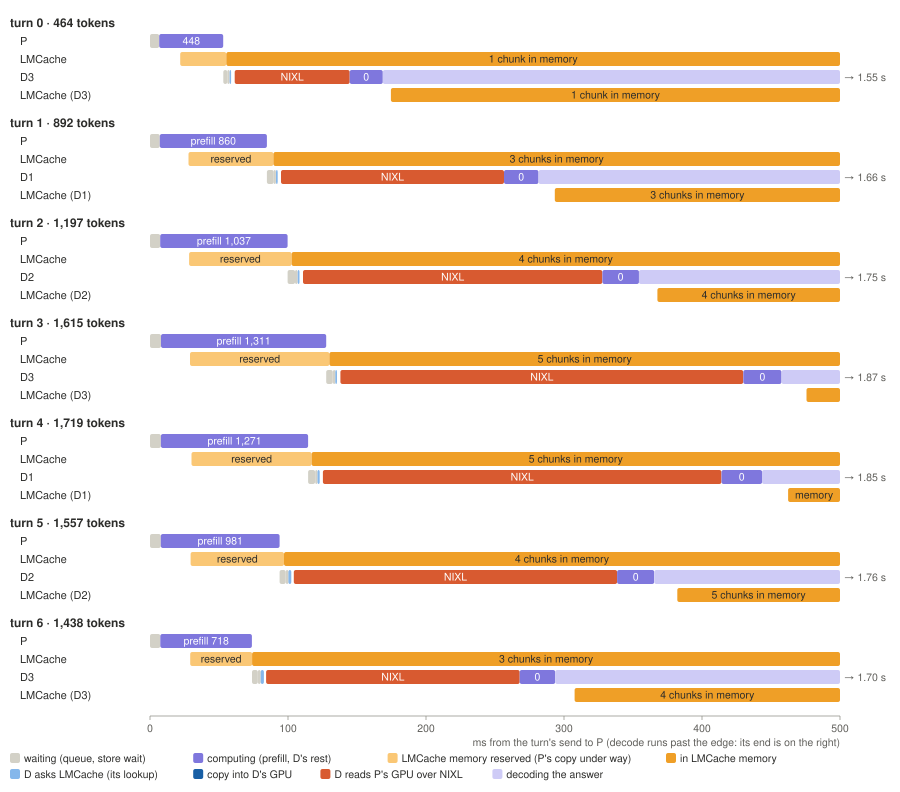

# Conversation 9: mt-rag-clapnq-elser-512-100-20240503 (memory mode, NIXL, per-engine servers, chat RAG, all passages)

P's KV reaches D over NIXL (D reads P's GPU blocks); every engine's LMCache connector stores beside it, to its own server. 7 turns on D1, D2, D3 (round-robin: each turn to the next D engine); prompts grow from 464 to 1,438 tokens (interleaved: each turn's prompt is the previous one, its answer, then this turn's documents and question). Chunks are 256 tokens (16 vLLM blocks of 16); a chunk's name is LMCache's hash of its tokens and everything before them, so the same prefix has the same chunks on every turn and engine.

Legend for the strips (one character a chunk): P: `=` on P's GPU from an earlier turn, `#` computed and stored now, `+` computed, not stored (a partial chunk). D: `=` on D's GPU from an earlier turn, `M` pulled from memory, `S` pulled from disk, `N` read from P's GPU over NIXL, `+` computed by D (a partial chunk), `?` missed.

GPU blocks (the chunk tables): where each engine keeps the chunk's 16 vLLM blocks in its GPU KV cache, by vLLM's block ids (vLLM's paged KV cache: a block, or page, holds 16 tokens; block 0 is its reserved null block), in the prompt's block order, a run of consecutive ids written as a range: `P 1, 138-152` is the prompt's block 0 in GPU block 1 and its blocks 1-15 in GPU blocks 138-152. An engine takes a GPU block from its free list when it first computes or loads a block, and the block keeps it while cached, so a later turn that reuses the block shows the same id. Blocks that are the same in several prompts (the same tokens and everything before them) share one GPU block once the first is cached: the system prompt's first block, the same in every conversation, is the usual one. `16/16 hashes = P's`: of the blocks D pulled, how many have the same vLLM hash on D as on P.

The prompts' text is the driver's own record of what it sent (answers included); lines over 100 characters are wrapped here for reading.

| turn | prompt | chunks + tail | P: own GPU / computed / stored | D: own GPU / loaded / computed | pulled | pull ms | D first token ms |
| ---: | ---: | --- | --- | --- | --- | ---: | ---: |
| [0](#turn-0) | 464 | 1 + 208 | 16 / 448 / 1 chunk | 16 / 448 / 0 | 2 chunks (NIXL 2) | 83.2 | 112.7 |
| [1](#turn-1) | 892 | 3 + 124 | 32 / 860 / 3 chunks | 32 / 860 / 0 | 4 chunks (NIXL 4) | 161.6 | 191.9 |
| [2](#turn-2) | 1,197 | 4 + 173 | 160 / 1,037 / 4 chunks | 32 / 1,165 / 0 | 5 chunks (NIXL 5) | 216.9 | 249.2 |
| [3](#turn-3) | 1,615 | 6 + 79 | 304 / 1,311 / 5 chunks | 32 / 1,583 / 0 | 7 chunks (NIXL 7) | 291.9 | 325.1 |
| [4](#turn-4) | 1,719 | 6 + 183 | 448 / 1,271 / 5 chunks | 160 / 1,559 / 0 | 7 chunks (NIXL 7) | 288.9 | 323.8 |
| [5](#turn-5) | 1,557 | 6 + 21 | 576 / 981 / 4 chunks | 304 / 1,253 / 0 | 6 chunks (NIXL 6) | 234.3 | 267.1 |
| [6](#turn-6) | 1,438 | 5 + 158 | 720 / 718 / 3 chunks | 448 / 990 / 0 | 5 chunks (NIXL 5) | 183.7 | 215.5 |

## How the prompt grows

Each turn's prompt is the previous one, token for token, and then: D's answer to the previous turn, this turn's documents, its question and the framing (the system prompt on turn 0, `Assistant:` and newlines). Only the new tokens can make new chunks: the previous prompt's partial chunk fills first. A document sent before comes again at another place, so in other chunks.

| turn | prompt | new | previous answer | documents | question | framing | whole chunks |
| ---: | ---: | ---: | ---: | --- | --- | ---: | --- |
| 0 | 464 | +464 | – | 5 docs, 422 | 12: what is the difference between primary and archaeological sources | 30 | 1 (+1) |
| 1 | 892 | +428 | – | 4 docs, 383 | 7: primary sources in history | 2 | 3 (+2) |
| 2 | 1,197 | +305 | – | 2 docs, 195 | 8: archaeological discoveries and colonialists | 2 | 4 (+1) |
| 3 | 1,615 | +418 | – | 1 doc, 328 | 5: Celts | 2 | 6 (+2) |
| 4 | 1,719 | +104 | – | 1 doc, 58 | 17: Talking about the Celts, what is the importance of them in history? | 2 | 6 (+0) |
| 5 | 1,557 | +-162 | – | 0 docs, 0 | 0 | 0 | 6 (+0) |
| 6 | 1,438 | +-119 | – | 0 docs, 0 | 0 | 0 | 5 (+-1) |

## Timeline

Every turn on one clock: ms from the moment the proxy sent the turn to P. P prefills it (one token out) and holds its blocks for D; the proxy sends the turn to the next D engine at once with P's reply's kv_transfer_params (no wait), D reads P's blocks over NIXL (orange-red), computes the rest and decodes the answer. Beside it every engine's LMCache connector stores its new whole chunks (P's lane, and D's own when it stored any). The lanes: P, LMCache (P's chunks), D, and LMCache (D's chunks).



| turn | P queued → done | P's chunks: in memory / on disk | D | D starts | NIXL read | D: held / from P / from LMCache / computed | D's chunks stored | first token | P freed | D done |
| ---: | --- | --- | --- | ---: | --- | --- | ---: | ---: | ---: | ---: |
| 0 | 7 → 53 | 1: 55 / – | D3 | 56 | 61-145 | 16 / 448 / 0 / 0 | 1 | 169 | 146 | 1,545 |
| 1 | 7 → 85 | 3: 89 / – | D1 | 90 | 95-256 | 32 / 860 / 0 / 0 | 3 | 282 | 258 | 1,659 |
| 2 | 7 → 100 | 4: 103 / – | D2 | 105 | 111-328 | 32 / 1,165 / 0 / 0 | 4 | 354 | 329 | 1,748 |
| 3 | 8 → 128 | 5: 130 / – | D3 | 132 | 138-430 | 32 / 1,583 / 0 / 0 | 6 | 458 | 430 | 1,867 |
| 4 | 8 → 115 | 5: 117 / – | D1 | 120 | 125-414 | 160 / 1,559 / 0 / 0 | 6 | 444 | 415 | 1,845 |
| 5 | 8 → 94 | 4: 97 / – | D2 | 98 | 104-338 | 304 / 1,253 / 0 / 0 | 5 | 365 | 339 | 1,764 |
| 6 | 8 → 74 | 3: 74 / – | D3 | 78 | 84-268 | 448 / 990 / 0 / 0 | 4 | 294 | 269 | 1,699 |

All times in ms from the turn's send to P. NIXL read: D's worker posts the read of P's blocks to the KV in D's GPU blocks; P freed: D has read, P's blocks go back to its free queue (still cached). Each turn's section below tells it in a sentence and step by step.

### One chunk, block by block: chunk 1 of turn 1 (`4a74e97b8e0b7939`)

Tokens 256-512 (doc 806502664_349-: 36; doc 806502664_3901: 73; doc 806502664_3126: 135; doc 806502664_8262 (new): 12). P computed its blocks; D1 read them from P's GPU over NIXL, P's block into D's block, one for one:

| block | tokens | P's GPU block | vLLM hash on P | D's GPU block | same hash on D |
| ---: | --- | ---: | --- | ---: | --- |
| 16 | 256-272 | 3629 | `49c43ec4423b913a` | 1617 | True |
| 17 | 272-288 | 3630 | `c4b7c8d0748f268c` | 1618 | True |
| 18 | 288-304 | 3631 | `5839466d925d49bf` | 1619 | True |
| 19 | 304-320 | 3632 | `482c24c05c972b4b` | 1620 | True |
| 20 | 320-336 | 3633 | `1e9cc38c01c9fe5b` | 1621 | True |
| 21 | 336-352 | 3634 | `23193680d0938ac7` | 1622 | True |
| 22 | 352-368 | 3635 | `e54262760beb5227` | 1623 | True |
| 23 | 368-384 | 3636 | `261307409df55ddd` | 1624 | True |
| 24 | 384-400 | 3637 | `83bf1f7ca9dd7c9f` | 1625 | True |
| 25 | 400-416 | 3638 | `c49d96f2e445ed41` | 1626 | True |
| 26 | 416-432 | 3639 | `ffdbbebfbd85892e` | 1627 | True |
| 27 | 432-448 | 3640 | `7010857409c345b9` | 1628 | True |
| 28 | 448-464 | 3641 | `5563f4639a84f63e` | 1629 | True |
| 29 | 464-480 | 3642 | `6219b55baccbb274` | 1630 | True |
| 30 | 480-496 | 3643 | `35df4b9bef2ff201` | 1631 | True |
| 31 | 496-512 | 3644 | `826f809b2fa66889` | 1632 | True |

## Turn 0

**Timeline:** P queued until 7 ms, prefilled 448 tokens (held 16) and was done at 53 ms; its 1 new chunk were in LMCache's memory at 55 ms. D3 started at 56 ms (no wait) holding 16 tokens, read 448 from P's GPU over NIXL (posted at 61 ms, in its GPU at 145 ms; P freed its blocks at 146 ms), computed 0 and gave its first token at 169 ms; it decoded 128 tokens until 1,545 ms; its LMCache connector stored 1 new chunk. ([all turns](#timeline))

### Step by step

Every move of this turn's KV, ms from the proxy sending the turn to P. P's KV reaches D over NIXL: D's worker reads P's GPU blocks into its own (a NIXL READ, P told when D is done); LMCache's copies (to and from each server's memory) its servers do themselves through CUDA IPC handles each engine registered at start.

| ms | where | what |
| ---: | --- | --- |
| 0.0 | proxy → P | sends the turn (464 prompt tokens; P is asked for one token: prefill only) |
| 2.3 | P | the request arrives |
| 6.5 | P GPU | its prefix cache holds 16 of the prompt's tokens: 1 block in GPU blocks 1 |
| 6.5 | P ↔ LMCache | LMCache has 0 of its tokens; P loads 0 and computes the rest |
| 6.7 | P GPU | 28 new GPU blocks for the 448 tokens it computes: 3587-3614; the prefill runs |
| 7.0 | P → LMCache | store planned: tokens 0-256, chunks 0-0 (16 blocks) |
| 21.6 | LMCache | the store request is in; it waits for P's forward pass to finish (a CUDA event) |
| 21.9 | LMCache memory | space reserved for 1 chunk (29 MB) |
| 50.4 | P GPU → LMCache memory | the copy starts: LMCache reads P's GPU blocks (CUDA IPC) |
| 50.5 | P GPU | the request is done: P holds its 29 blocks for D to read over NIXL, and its reply carries them (kv_transfer_params: the blocks, its NIXL agent) |
| 51.8 | P GPU → LMCache memory | copy done: 1 chunk, 29 MB in 1.4 ms |
| 53.1 | P → proxy | P answers its one token: the prefill is done |
| 55.3 | LMCache memory | 1 chunk in memory, kept for later requests (D gets this turn's KV from P over NIXL); P keeps its copy in its GPU blocks |
| 56.0 | proxy → D3 | sends the turn to D3 at once, with P's kv_transfer_params (round-robin; no wait) |
| 57.7 | D3 ↔ LMCache | asks LMCache for the prompt's chunks |
| 58.8 | LMCache memory | found 0 tokens it lacks |
| 60.6 | D3 GPU | its prefix cache holds 16 of the prompt's tokens: 1 block in GPU blocks 1 |
| 60.7 | D3 ↔ P (NIXL) | will read 448 prompt tokens from P's GPU (beyond the 16 its own cache holds) |
| 60.8 | D3 ↔ LMCache | LMCache has 0 of its tokens; NIXL loads it (MultiConnector: the first connector with tokens) |
| 61.0 | D3 GPU | 28 GPU blocks for the KV from P: 1586-1613 |
| 61.4 | P GPU → D3 GPU (NIXL) | D3 reads P's GPU blocks 1, 3587-3614 into its 1586-1613 (a NIXL READ) |
| 144.7 | D3 | the KV from P is in its GPU blocks (448 tokens) |
| 146.0 | P GPU | D3 has read: P frees its blocks (they stay in its prefix cache) |
| 153.2 | D3 → LMCache | store planned: tokens 0-256; 1 chunk new to its server |
| 157.7 | D3 GPU | 1 new GPU block for the 1 prompt tokens it computes: 1614 |
| 168.7 | D3 → proxy | the first answer token |
| 174.6 | LMCache memory | 1 chunk from D3 in memory |
| 330.1 | D3 GPU | decoding: the answer's KV takes 7 new GPU blocks as it grows, one per 16 tokens: 1615-1621, until 1,372 ms |
| 1,545.4 | D3 | done: 128 tokens decoded; its blocks stay cached in its GPU for the next turn |
| 1,546.3 | proxy | the response is complete |

464 prompt tokens: 1 whole chunk and 208 tokens over (the partial chunk, computed by both engines and stored only when a later turn completes it). P held 16 tokens on its GPU, computed 448 and stored 1 new chunk; D3 held 16, read 448 from P over NIXL, loaded 0 from LMCache and computed 0.

### The prompt

The whole prompt, piece by piece:

- **system prompt** · tokens 0-28 (28) · chunk 0

```text
You are a helpful assistant. Answer the user's last question from the documents. If they do not hold
the answer, say so.
```

<details><summary>document <code>806502664_349-964-0-615</code> · tokens 28-149 (121) · chunk 0</summary>

```text
Document: Primary source
Primary source
In the study of history as an academic discipline , a primary source ( also called original source
or evidence ) is an artifact , a document , diary , manuscript , autobiography , a recording , or
any other source of information that was created at the time under study . It serves as an original
source of information about the topic . Similar definitions can be used in library science , and
other areas of scholarship , although different fields have somewhat different definitions . In
journalism , a primary source can be a person with direct knowledge of a situation , or a document
written by such a person .
```

</details>

<details><summary>document <code>806502664_5333-5957-0-624</code> · tokens 149-266 (117) · chunks 0-1</summary>

```text
Document: Primary source
Primary source
In the humanities , a primary source could be defined as something that was created either during
the time period being studied or afterward by individuals reflecting on their involvement in the
events of that time . In the social sciences , the definition of a primary source would be expanded
to include numerical data that has been gathered to analyze relationships between people , events ,
and their environment . In the natural sciences , a primary source could be defined as a report of
original findings or ideas . These sources often appear in the form of research articles with
sections on methods and results . ''
```

</details>

<details><summary>document <code>806502664_3901-4281-0-380</code> · tokens 266-339 (73) · chunk 1</summary>

```text
Document: Primary source
Primary source
A study of cultural history could include fictional sources such as novels or plays . In a broader
sense primary sources also include artifacts like photographs , newsreels , coins , paintings or
buildings created at the time . Historians may also take archaeological artifacts and oral reports
and interviews into consideration . Written sources may be divided into three types .
```

</details>

<details><summary>document <code>806502664_13762-14092-0-330</code> · tokens 339-409 (70) · chunk 1</summary>

```text
Document: Primary source
Primary source
If a historical text discusses old documents to derive a new historical conclusion , it is
considered to be a primary source for the new conclusion . Examples in which a source can be both
primary and secondary include an obituary or a survey of several volumes of a journal counting the
frequency of articles on a certain topic .
```

</details>

<details><summary>document <code>806502664_11610-11795-0-185</code> · tokens 409-450 (41) · chunk 1</summary>

```text
Document: Primary source
Primary source
However , a primary source is not necessarily more of an authority or better than a secondary source
. There can be bias and tacit unconscious views which twist historical information .
```

</details>

- **question 0** · tokens 450-462 (12) · chunk 1

```text
User: what is the difference between primary and archaeological sources
```

- `Assistant:` · tokens 462-464 (2) · chunk 1

### Pieces, chunks and blocks

| piece | tokens | length | chunks | |
| --- | --- | ---: | --- | --- |
| system | 0-28 | 28 | 0 |  |
| doc 806502664_349- | 28-149 | 121 | 0 |  |
| doc 806502664_5333 | 149-266 | 117 | 0-1 |  |
| doc 806502664_3901 | 266-339 | 73 | 1 |  |
| doc 806502664_1376 | 339-409 | 70 | 1 |  |
| doc 806502664_1161 | 409-450 | 41 | 1 |  |
| question 0 | 450-462 | 12 | 1 |  |
| `assistant:` 0 | 462-464 | 2 | 1 |  |

```
P  #+
D  NN
```

| chunk | tokens | pieces in it (tokens) | vLLM blocks | GPU blocks | in LMCache | P this turn | D this turn |
| ---: | --- | --- | --- | --- | --- | --- | --- |
| 0 | 0-256 | system: 28; doc 806502664_349-: 121; doc 806502664_5333: 107 | 0-15 | P 1, 3587-3601; D 1, 1586-1600; 15/15 hashes = P's | `cff6ed6d1e4c68de`: LMC_P: stored on turn 0 by P; LMC_D3: stored on turn 0 by D3 | computed (its first 16 tokens on P's GPU already), **stored now** | **read from P's GPU over NIXL** (its first 16 tokens on D's GPU already) |
| 1 | 256-464 | doc 806502664_5333: 10; doc 806502664_3901: 73; doc 806502664_1376: 70; doc 806502664_1161: 41; question 0: 12; `assistant:` 0: 2 | 16-28 | P 3602-3614; D 1601-1613; 13/13 hashes = P's | – | computed (partial chunk: not stored) | **read from P's GPU over NIXL** (partial chunk) |

## Turn 1

**Timeline:** P queued until 7 ms, prefilled 860 tokens (held 32) and was done at 85 ms; its 3 new chunks were in LMCache's memory at 89 ms. D1 started at 90 ms (no wait) holding 32 tokens, read 860 from P's GPU over NIXL (posted at 95 ms, in its GPU at 256 ms; P freed its blocks at 258 ms), computed 0 and gave its first token at 282 ms; it decoded 128 tokens until 1,659 ms; its LMCache connector stored 3 new chunks. ([all turns](#timeline))

### Step by step

Every move of this turn's KV, ms from the proxy sending the turn to P. P's KV reaches D over NIXL: D's worker reads P's GPU blocks into its own (a NIXL READ, P told when D is done); LMCache's copies (to and from each server's memory) its servers do themselves through CUDA IPC handles each engine registered at start.

| ms | where | what |
| ---: | --- | --- |
| 0.0 | proxy → P | sends the turn (892 prompt tokens; P is asked for one token: prefill only) |
| 2.4 | P | the request arrives |
| 6.8 | P GPU | its prefix cache holds 32 of the prompt's tokens: 2 blocks in GPU blocks 1, 3178 |
| 6.9 | P ↔ LMCache | LMCache has 0 of its tokens; P loads 0 and computes the rest |
| 7.1 | P GPU | 54 new GPU blocks for the 860 tokens it computes: 3615-3668; the prefill runs |
| 7.5 | P → LMCache | store planned: tokens 0-768, chunks 0-2 (48 blocks) |
| 27.6 | LMCache | the store request is in; it waits for P's forward pass to finish (a CUDA event) |
| 27.9 | LMCache memory | space reserved for 3 chunks (88 MB) |
| 81.0 | P GPU → LMCache memory | the copy starts: LMCache reads P's GPU blocks (CUDA IPC) |
| 81.3 | P GPU | the request is done: P holds its 56 blocks for D to read over NIXL, and its reply carries them (kv_transfer_params: the blocks, its NIXL agent) |
| 84.7 | P → proxy | P answers its one token: the prefill is done |
| 84.9 | P GPU → LMCache memory | copy done: 3 chunks, 88 MB in 3.9 ms |
| 89.4 | LMCache memory | 3 chunks in memory, kept for later requests (D gets this turn's KV from P over NIXL); P keeps its copy in its GPU blocks |
| 89.6 | proxy → D1 | sends the turn to D1 at once, with P's kv_transfer_params (round-robin; no wait) |
| 91.3 | D1 ↔ LMCache | asks LMCache for the prompt's chunks |
| 92.5 | LMCache memory | found 0 tokens it lacks |
| 94.1 | D1 GPU | its prefix cache holds 32 of the prompt's tokens: 2 blocks in GPU blocks 1, 1459 |
| 94.1 | D1 ↔ P (NIXL) | will read 860 prompt tokens from P's GPU (beyond the 32 its own cache holds) |
| 94.2 | D1 ↔ LMCache | LMCache has 0 of its tokens; NIXL loads it (MultiConnector: the first connector with tokens) |
| 94.4 | D1 GPU | 54 GPU blocks for the KV from P: 1603-1656 |
| 94.9 | P GPU → D1 GPU (NIXL) | D1 reads P's GPU blocks 1, 3178, 3615-3668 into its 1603-1656 (a NIXL READ) |
| 256.5 | D1 | the KV from P is in its GPU blocks (860 tokens) |
| 257.5 | P GPU | D1 has read: P frees its blocks (they stay in its prefix cache) |
| 264.8 | D1 → LMCache | store planned: tokens 0-768; 3 chunks new to its server |
| 281.5 | D1 → proxy | the first answer token |
| 293.3 | LMCache memory | 3 chunks from D1 in memory |
| 312.7 | D1 GPU | 1 new GPU block for the 1 prompt tokens it computes: 1657 |
| 486.6 | D1 GPU | decoding: the answer's KV takes 7 new GPU blocks as it grows, one per 16 tokens: 1658-1664, until 1,529 ms |
| 1,659.4 | D1 | done: 128 tokens decoded; its blocks stay cached in its GPU for the next turn |
| 1,660.7 | proxy | the response is complete |

892 prompt tokens: 3 whole chunks and 124 tokens over (the partial chunk, computed by both engines and stored only when a later turn completes it). P held 32 tokens on its GPU, computed 860 and stored 3 new chunks; D1 held 32, read 860 from P over NIXL, loaded 0 from LMCache and computed 0.

### The prompt

Tokens 0-464: [turn 0](#turn-0)'s prompt, unchanged (NOT the previous prompt's ids), so chunk 0 is the same chunk; chunk 1 (partial then, 208 tokens) fills now. New from token 464:

<details><summary>document <code>806502664_8262-9343-0-1081</code> · tokens 500-699 (199) · chunks 1-2</summary>

```text
Document: Primary source
Primary source
History as an academic discipline is based on primary sources , as evaluated by the community of
scholars , who report their findings in books , articles and papers . Arthur Marwick says `` Primary
sources are absolutely fundamental to history . '' Ideally , a historian will use all available
primary sources that were created by the people involved at the time being studied . In practice
some sources have been destroyed , while others are not available for research . Perhaps the only
eyewitness reports of an event may be memoirs , autobiographies , or oral interviews taken years
later . Sometimes the only evidence relating to an event or person in the distant past was written
or copied decades or centuries later . Manuscripts that are sources for classical texts can be
copies of documents , or fragments of copies of documents . This is a common problem in classical
studies , where sometimes only a summary of a book or letter has survived . Potential difficulties
with primary sources have the result that history is usually taught in schools using secondary
sources .
```

</details>

<details><summary>document <code>806502664_11404-11594-0-190</code> · tokens 699-741 (42) · chunk 2</summary>

```text
Document: Primary source
Primary source
`` A history , whose author draws conclusions from other than primary sources or secondary sources
actually based on primary sources , is by definition fiction and not history at all . '' --
```

</details>

- document `806502664_13762-14092-0-330` · tokens 741-811 (70) · chunks 2-3 · **again**: sent on [turn 0](#turn-0) already (the same 70 tokens), here at another place in the prompt, so in other chunks: a prefix cache cannot reuse it

<details><summary>document <code>806502664_4750-5111-0-361</code> · tokens 811-883 (72) · chunk 3</summary>

```text
Document: Primary source
Primary source
In historiography , when the study of history is subject to historical scrutiny , a secondary source
becomes a primary source . For a biography of a historian , that historian 's publications would be
primary sources . Documentary films can be considered a secondary source or primary source ,
depending on how much the filmmaker modifies the original sources .
```

</details>

- **question 1** · tokens 883-890 (7) · chunk 3

```text
User: primary sources in history
```

- `Assistant:` · tokens 890-892 (2) · chunk 3

### Pieces, chunks and blocks

| piece | tokens | length | chunks | |
| --- | --- | ---: | --- | --- |
| system | 0-28 | 28 | 0 |  |
| question 0 | 28-40 | 12 | 0 |  |
| `assistant:` 0 | 40-42 | 2 | 0 |  |
| answer 0 | 42-170 | 128 | 0 |  |
| newline 0 | 170-171 | 1 | 0 |  |
| doc 806502664_349- | 171-292 | 121 | 0-1 |  |
| doc 806502664_3901 | 292-365 | 73 | 1 |  |
| doc 806502664_3126 | 365-500 | 135 | 1 |  |
| doc 806502664_8262 | 500-699 | 199 | 1-2 | new this turn |
| doc 806502664_1140 | 699-741 | 42 | 2 | new this turn |
| doc 806502664_1376 | 741-811 | 70 | 2-3 | new this turn |
| doc 806502664_4750 | 811-883 | 72 | 3 | new this turn |
| question 1 | 883-890 | 7 | 3 | new this turn |
| `assistant:` 1 | 890-892 | 2 | 3 | new this turn |

```
P  ###+
D  NNNN
```

| chunk | tokens | pieces in it (tokens) | vLLM blocks | GPU blocks | in LMCache | P this turn | D this turn |
| ---: | --- | --- | --- | --- | --- | --- | --- |
| 0 | 0-256 | system: 28; question 0: 12; `assistant:` 0: 2; answer 0: 128; newline 0: 1; doc 806502664_349-: 85 | 0-15 | P 1, 3178, 3615-3628; D 1, 1459, 1603-1616; 14/14 hashes = P's | `60baa49ca8d8a6cd`: LMC_P: stored on turn 1 by P; LMC_D1: stored on turn 1 by D1 | computed (its first 32 tokens on P's GPU already), **stored now** | **read from P's GPU over NIXL** (its first 32 tokens on D's GPU already) |
| 1 | 256-512 | doc 806502664_349-: 36; doc 806502664_3901: 73; doc 806502664_3126: 135; doc 806502664_8262 (new): 12 | 16-31 | P 3629-3644; D 1617-1632; 16/16 hashes = P's | `4a74e97b8e0b7939`: LMC_P: stored on turn 1 by P; LMC_D1: stored on turn 1 by D1 | computed, **stored now** | **read from P's GPU over NIXL** |
| 2 | 512-768 | doc 806502664_8262 (new): 187; doc 806502664_1140 (new): 42; doc 806502664_1376 (new): 27 | 32-47 | P 3645-3660; D 1633-1648; 16/16 hashes = P's | `3704659028bcb339`: LMC_P: stored on turn 1 by P; LMC_D1: stored on turn 1 by D1 | computed, **stored now** | **read from P's GPU over NIXL** |
| 3 | 768-892 | doc 806502664_1376 (new): 43; doc 806502664_4750 (new): 72; question 1 (new): 7; `assistant:` 1 (new): 2 | 48-55 | P 3661-3667; D 1649-1656; 7/7 hashes = P's | – | computed (partial chunk: not stored) | **read from P's GPU over NIXL** (partial chunk) |

## Turn 2

**Timeline:** P queued until 7 ms, prefilled 1,037 tokens (held 160) and was done at 100 ms; its 4 new chunks were in LMCache's memory at 103 ms. D2 started at 105 ms (no wait) holding 32 tokens, read 1,165 from P's GPU over NIXL (posted at 111 ms, in its GPU at 328 ms; P freed its blocks at 329 ms), computed 0 and gave its first token at 354 ms; it decoded 128 tokens until 1,748 ms; its LMCache connector stored 4 new chunks. ([all turns](#timeline))

### Step by step

Every move of this turn's KV, ms from the proxy sending the turn to P. P's KV reaches D over NIXL: D's worker reads P's GPU blocks into its own (a NIXL READ, P told when D is done); LMCache's copies (to and from each server's memory) its servers do themselves through CUDA IPC handles each engine registered at start.

| ms | where | what |
| ---: | --- | --- |
| 0.0 | proxy → P | sends the turn (1,197 prompt tokens; P is asked for one token: prefill only) |
| 2.7 | P | the request arrives |
| 7.1 | P GPU | its prefix cache holds 160 of the prompt's tokens: 10 blocks in GPU blocks 1, 3178, 3615-3622 |
| 7.2 | P ↔ LMCache | LMCache has 0 of its tokens; P loads 0 and computes the rest |
| 7.4 | P GPU | 65 new GPU blocks for the 1,037 tokens it computes: 3668-3732; the prefill runs |
| 7.8 | P → LMCache | store planned: tokens 0-1,024, chunks 0-3 (64 blocks) |
| 28.0 | LMCache | the store request is in; it waits for P's forward pass to finish (a CUDA event) |
| 28.3 | LMCache memory | space reserved for 4 chunks (117 MB) |
| 95.6 | P GPU → LMCache memory | the copy starts: LMCache reads P's GPU blocks (CUDA IPC) |
| 95.8 | P GPU | the request is done: P holds its 75 blocks for D to read over NIXL, and its reply carries them (kv_transfer_params: the blocks, its NIXL agent) |
| 99.7 | P → proxy | P answers its one token: the prefill is done |
| 100.7 | P GPU → LMCache memory | copy done: 4 chunks, 117 MB in 5.1 ms |
| 102.6 | LMCache memory | 4 chunks in memory, kept for later requests (D gets this turn's KV from P over NIXL); P keeps its copy in its GPU blocks |
| 105.1 | proxy → D2 | sends the turn to D2 at once, with P's kv_transfer_params (round-robin; no wait) |
| 107.0 | D2 ↔ LMCache | asks LMCache for the prompt's chunks |
| 108.3 | LMCache memory | found 0 tokens it lacks |
| 110.0 | D2 GPU | its prefix cache holds 32 of the prompt's tokens: 2 blocks in GPU blocks 1, 1380 |
| 110.0 | D2 ↔ P (NIXL) | will read 1,165 prompt tokens from P's GPU (beyond the 32 its own cache holds) |
| 110.1 | D2 ↔ LMCache | LMCache has 0 of its tokens; NIXL loads it (MultiConnector: the first connector with tokens) |
| 110.3 | D2 GPU | 73 GPU blocks for the KV from P: 1621-1693 |
| 110.9 | P GPU → D2 GPU (NIXL) | D2 reads P's GPU blocks 1 … 3668-3732 (75 blocks) into its 1621-1693 (a NIXL READ) |
| 327.8 | D2 | the KV from P is in its GPU blocks (1,165 tokens) |
| 328.8 | P GPU | D2 has read: P frees its blocks (they stay in its prefix cache) |
| 337.5 | D2 → LMCache | store planned: tokens 0-1,024; 4 chunks new to its server |
| 354.3 | D2 → proxy | the first answer token |
| 367.7 | LMCache memory | 4 chunks from D2 in memory |
| 375.8 | D2 GPU | 1 new GPU block for the 1 prompt tokens it computes: 1694 |
| 551.4 | D2 GPU | decoding: the answer's KV takes 7 new GPU blocks as it grows, one per 16 tokens: 1695-1701, until 1,605 ms |
| 1,747.5 | D2 | done: 128 tokens decoded; its blocks stay cached in its GPU for the next turn |
| 1,748.9 | proxy | the response is complete |

1,197 prompt tokens: 4 whole chunks and 173 tokens over (the partial chunk, computed by both engines and stored only when a later turn completes it). P held 160 tokens on its GPU, computed 1,037 and stored 4 new chunks; D2 held 32, read 1,165 from P over NIXL, loaded 0 from LMCache and computed 0.

### The prompt

Tokens 0-892: [turn 1](#turn-1)'s prompt, unchanged (NOT the previous prompt's ids), so chunks 0-2 are the same chunks; chunk 3 (partial then, 124 tokens) fills now. New from token 892:

<details><summary>document <code>818823851_21091-21444-0-353</code> · tokens 992-1080 (88) · chunks 3-4</summary>

```text
Document: Repatriation (cultural heritage)
Repatriation (cultural heritage)
As a direct reaction and resistance to colonial oppression , archaeology was also used for the
purpose of legitimating the existence of an independent nation - state . For example , Egyptian
Nationalists utilized its ancient history to invent the political and expressive culture of ``
Pharaonism '' as a response to Europe 's `` Egyptomania '' . Masada
```

</details>

<details><summary>document <code>805804224_2121-2660-0-539</code> · tokens 1080-1187 (107) · chunk 4</summary>

```text
Document: Exploitation colonialism
Exploitation colonialism
Geographers such as Friedrich Ratzel suggested that the survival of empire relied on its ability to
expand its control and influence around the world . By implying a correlation between colonial
expansion and national success , geographers were able to produce a sense of nationalism within many
European nations . Their influence created a sense of pride that was able to reassure subjects that
their nation 's activity abroad was beneficial to not only them , but that their presence was
necessary within the territories being occupied .
```

</details>

- **question 2** · tokens 1187-1195 (8) · chunk 4

```text
User: archaeological discoveries and colonialists
```

- `Assistant:` · tokens 1195-1197 (2) · chunk 4

### Pieces, chunks and blocks

| piece | tokens | length | chunks | |
| --- | --- | ---: | --- | --- |
| system | 0-28 | 28 | 0 |  |
| question 0 | 28-40 | 12 | 0 |  |
| `assistant:` 0 | 40-42 | 2 | 0 |  |
| answer 0 | 42-170 | 128 | 0 |  |
| newline 0 | 170-171 | 1 | 0 |  |
| question 1 | 171-178 | 7 | 0 |  |
| `assistant:` 1 | 178-180 | 2 | 0 |  |
| answer 1 | 180-308 | 128 | 0-1 |  |
| newline 1 | 308-309 | 1 | 1 |  |
| doc 818823851_1820 | 309-564 | 255 | 1-2 |  |
| doc 837717284_3608 | 564-706 | 142 | 2 |  |
| doc 818823851_2146 | 706-864 | 158 | 2-3 |  |
| doc 818823851_1754 | 864-992 | 128 | 3 |  |
| doc 818823851_2109 | 992-1080 | 88 | 3-4 | new this turn |
| doc 805804224_2121 | 1080-1187 | 107 | 4 | new this turn |
| question 2 | 1187-1195 | 8 | 4 | new this turn |
| `assistant:` 2 | 1195-1197 | 2 | 4 | new this turn |

```
P  ####+
D  NNNNN
```

| chunk | tokens | pieces in it (tokens) | vLLM blocks | GPU blocks | in LMCache | P this turn | D this turn |
| ---: | --- | --- | --- | --- | --- | --- | --- |
| 0 | 0-256 | system: 28; question 0: 12; `assistant:` 0: 2; answer 0: 128; newline 0: 1; question 1: 7; `assistant:` 1: 2; answer 1: 76 | 0-15 | P 1 … 3668-3673 (16 blocks); D 1, 1380, 1621-1634; 6/6 hashes = P's | `a1289b985ce456ea`: LMC_P: stored on turn 2 by P; LMC_D2: stored on turn 2 by D2; LMC_D3: stored on turn 3 by D3; LMC_D1: stored on turn 4 by D1 | computed (its first 160 tokens on P's GPU already), **stored now** | **read from P's GPU over NIXL** (its first 32 tokens on D's GPU already) |
| 1 | 256-512 | answer 1: 52; newline 1: 1; doc 818823851_1820: 203 | 16-31 | P 3674-3689; D 1635-1650; 16/16 hashes = P's | `387920067189b9b6`: LMC_P: stored on turn 2 by P; LMC_D2: stored on turn 2 by D2 | computed, **stored now** | **read from P's GPU over NIXL** |
| 2 | 512-768 | doc 818823851_1820: 52; doc 837717284_3608: 142; doc 818823851_2146: 62 | 32-47 | P 3690-3705; D 1651-1666; 16/16 hashes = P's | `8792c252041e2367`: LMC_P: stored on turn 2 by P; LMC_D2: stored on turn 2 by D2 | computed, **stored now** | **read from P's GPU over NIXL** |
| 3 | 768-1024 | doc 818823851_2146: 96; doc 818823851_1754: 128; doc 818823851_2109 (new): 32 | 48-63 | P 3706-3721; D 1667-1682; 16/16 hashes = P's | `6c1a89a6fa857b1e`: LMC_P: stored on turn 2 by P; LMC_D2: stored on turn 2 by D2 | computed, **stored now** | **read from P's GPU over NIXL** |
| 4 | 1024-1197 | doc 818823851_2109 (new): 56; doc 805804224_2121 (new): 107; question 2 (new): 8; `assistant:` 2 (new): 2 | 64-74 | P 3722-3731; D 1683-1693; 10/10 hashes = P's | – | computed (partial chunk: not stored) | **read from P's GPU over NIXL** (partial chunk) |

## Turn 3

**Timeline:** P queued until 8 ms, prefilled 1,311 tokens (held 304) and was done at 128 ms; its 5 new chunks were in LMCache's memory at 130 ms. D3 started at 132 ms (no wait) holding 32 tokens, read 1,583 from P's GPU over NIXL (posted at 138 ms, in its GPU at 430 ms; P freed its blocks at 430 ms), computed 0 and gave its first token at 458 ms; it decoded 128 tokens until 1,867 ms; its LMCache connector stored 6 new chunks. ([all turns](#timeline))

### Step by step

Every move of this turn's KV, ms from the proxy sending the turn to P. P's KV reaches D over NIXL: D's worker reads P's GPU blocks into its own (a NIXL READ, P told when D is done); LMCache's copies (to and from each server's memory) its servers do themselves through CUDA IPC handles each engine registered at start.

| ms | where | what |
| ---: | --- | --- |
| 0.0 | proxy → P | sends the turn (1,615 prompt tokens; P is asked for one token: prefill only) |
| 3.0 | P | the request arrives |
| 7.8 | P GPU | its prefix cache holds 304 of the prompt's tokens: GPU blocks 1 … 3668-3676 (19 blocks) |
| 7.9 | P ↔ LMCache | LMCache has 256 of its tokens; P loads 0 and computes the rest |
| 8.0 | P GPU | 82 new GPU blocks for the 1,311 tokens it computes: 3732-3813; the prefill runs |
| 8.7 | P → LMCache | store planned: tokens 256-1,536, chunks 1-5 (80 blocks) |
| 28.6 | LMCache | the store request is in; it waits for P's forward pass to finish (a CUDA event) |
| 29.0 | LMCache memory | space reserved for 5 chunks (147 MB) |
| 123.0 | P GPU → LMCache memory | the copy starts: LMCache reads P's GPU blocks (CUDA IPC) |
| 123.3 | P GPU | the request is done: P holds its 101 blocks for D to read over NIXL, and its reply carries them (kv_transfer_params: the blocks, its NIXL agent) |
| 127.7 | P → proxy | P answers its one token: the prefill is done |
| 129.3 | P GPU → LMCache memory | copy done: 5 chunks, 147 MB in 6.3 ms |
| 130.0 | LMCache memory | 5 chunks in memory, kept for later requests (D gets this turn's KV from P over NIXL); P keeps its copy in its GPU blocks |
| 132.5 | proxy → D3 | sends the turn to D3 at once, with P's kv_transfer_params (round-robin; no wait) |
| 134.3 | D3 ↔ LMCache | asks LMCache for the prompt's chunks |
| 135.5 | LMCache memory | found 0 tokens it lacks |
| 137.1 | D3 GPU | its prefix cache holds 32 of the prompt's tokens: 2 blocks in GPU blocks 1, 1408 |
| 137.2 | D3 ↔ P (NIXL) | will read 1,583 prompt tokens from P's GPU (beyond the 32 its own cache holds) |
| 137.2 | D3 ↔ LMCache | LMCache has 0 of its tokens; NIXL loads it (MultiConnector: the first connector with tokens) |
| 137.5 | D3 GPU | 99 GPU blocks for the KV from P: 1621-1719 |
| 138.0 | P GPU → D3 GPU (NIXL) | D3 reads P's GPU blocks 1 … 3732-3813 (101 blocks) into its 1621-1719 (a NIXL READ) |
| 429.9 | D3 | the KV from P is in its GPU blocks (1,583 tokens) |
| 430.0 | P GPU | D3 has read: P frees its blocks (they stay in its prefix cache) |
| 441.2 | D3 → LMCache | store planned: tokens 0-1,536; 6 chunks new to its server |
| 455.4 | D3 GPU | 1 new GPU block for the 1 prompt tokens it computes: 1720 |
| 457.6 | D3 → proxy | the first answer token |
| 475.7 | LMCache memory | 6 chunks from D3 in memory |
| 634.9 | D3 GPU | decoding: the answer's KV takes 7 new GPU blocks as it grows, one per 16 tokens: 1721-1727, until 1,701 ms |
| 1,867.4 | D3 | done: 128 tokens decoded; its blocks stay cached in its GPU for the next turn |
| 1,868.5 | proxy | the response is complete |

1,615 prompt tokens: 6 whole chunks and 79 tokens over (the partial chunk, computed by both engines and stored only when a later turn completes it). P held 304 tokens on its GPU, computed 1,311 and stored 5 new chunks; D3 held 32, read 1,583 from P over NIXL, loaded 0 from LMCache and computed 0.

### The prompt

Tokens 0-1,197: [turn 2](#turn-2)'s prompt, unchanged (NOT the previous prompt's ids), so chunks 0-3 are the same chunks; chunk 4 (partial then, 173 tokens) fills now. New from token 1,197:

<details><summary>document <code>852484941_4164-5668-0-1503</code> · tokens 1280-1608 (328) · chunks 5-6</summary>

```text
Document: Celts
Celts
The history of pre-Celtic Europe and the exact relationship between ethnic , linguistic and cultural
factors in the Celtic world remains uncertain and controversial . The exact geographic spread of the
ancient Celts is disputed ; in particular , the ways in which the Iron Age inhabitants of Great
Britain and Ireland should be regarded as Celts have become a subject of controversy . According to
one theory , the common root of the Celtic languages , the Proto - Celtic language , arose in the
Late Bronze Age Urnfield culture of Central Europe , which flourished from around 1200 BC .
According to a theory proposed in the 19th century , the first people to adopt cultural
characteristics regarded as Celtic were the people of the Iron Age Hallstatt culture in central
Europe ( c. 800 -- 450 BC ) , named for the rich grave finds in Hallstatt , Austria . Thus this area
is sometimes called the `` Celtic homeland '' . By or during the later La Tène period ( c. 450 BC to
the Roman conquest ) , this Celtic culture was supposed to have expanded by trans - cultural
diffusion or migration to the British Isles ( Insular Celts ) , France and the Low Countries ( Gauls
) , Bohemia , Poland and much of Central Europe , the Iberian Peninsula ( Celtiberians , Celtici ,
Lusitanians and Gallaeci ) and northern Italy ( Golasecca culture and Cisalpine Gauls ) and ,
following the Celtic settlement of Eastern Europe beginning in 279 BC , as far east as central
Anatolia ( Galatians ) in modern - day Turkey .
```

</details>

- **question 3** · tokens 1608-1613 (5) · chunk 6

```text
User: Celts
```

- `Assistant:` · tokens 1613-1615 (2) · chunk 6

### Pieces, chunks and blocks

| piece | tokens | length | chunks | |
| --- | --- | ---: | --- | --- |
| system | 0-28 | 28 | 0 |  |
| question 0 | 28-40 | 12 | 0 |  |
| `assistant:` 0 | 40-42 | 2 | 0 |  |
| answer 0 | 42-170 | 128 | 0 |  |
| newline 0 | 170-171 | 1 | 0 |  |
| question 1 | 171-178 | 7 | 0 |  |
| `assistant:` 1 | 178-180 | 2 | 0 |  |
| answer 1 | 180-308 | 128 | 0-1 |  |
| newline 1 | 308-309 | 1 | 1 |  |
| question 2 | 309-317 | 8 | 1 |  |
| `assistant:` 2 | 317-319 | 2 | 1 |  |
| answer 2 | 319-447 | 128 | 1 |  |
| newline 2 | 447-448 | 1 | 1 |  |
| doc 852484941_4271 | 448-566 | 118 | 1-2 |  |
| doc 852484941_2078 | 566-750 | 184 | 2 |  |
| doc 852484941_1775 | 750-1030 | 280 | 2-4 |  |
| doc 852484941_2250 | 1030-1185 | 155 | 4 |  |
| doc 852484941_5932 | 1185-1280 | 95 | 4 |  |
| doc 852484941_4164 | 1280-1608 | 328 | 5-6 | new this turn |
| question 3 | 1608-1613 | 5 | 6 | new this turn |
| `assistant:` 3 | 1613-1615 | 2 | 6 | new this turn |

```
P  =#####+
D  NNNNNNN
```

| chunk | tokens | pieces in it (tokens) | vLLM blocks | GPU blocks | in LMCache | P this turn | D this turn |
| ---: | --- | --- | --- | --- | --- | --- | --- |
| 0 | 0-256 | system: 28; question 0: 12; `assistant:` 0: 2; answer 0: 128; newline 0: 1; question 1: 7; `assistant:` 1: 2; answer 1: 76 | 0-15 | P 1 … 3668-3673 (16 blocks); D 1, 1408, 1621-1634 | `a1289b985ce456ea`: LMC_P: stored on turn 2 by P; LMC_D2: stored on turn 2 by D2; LMC_D3: stored on turn 3 by D3; LMC_D1: stored on turn 4 by D1 | on P's GPU (earlier turn) | **read from P's GPU over NIXL** (its first 32 tokens on D's GPU already) |
| 1 | 256-512 | answer 1: 52; newline 1: 1; question 2: 8; `assistant:` 2: 2; answer 2: 128; newline 2: 1; doc 852484941_4271: 64 | 16-31 | P 3674-3676, 3732-3744; D 1635-1650; 13/13 hashes = P's | `7b43888129aa30aa`: LMC_P: stored on turn 3 by P; LMC_D3: stored on turn 3 by D3 | computed (its first 48 tokens on P's GPU already), **stored now** | **read from P's GPU over NIXL** |
| 2 | 512-768 | doc 852484941_4271: 54; doc 852484941_2078: 184; doc 852484941_1775: 18 | 32-47 | P 3745-3760; D 1651-1666; 16/16 hashes = P's | `167dc759aa17367f`: LMC_P: stored on turn 3 by P; LMC_D3: stored on turn 3 by D3 | computed, **stored now** | **read from P's GPU over NIXL** |
| 3 | 768-1024 | doc 852484941_1775: 256 | 48-63 | P 3761-3776; D 1667-1682; 16/16 hashes = P's | `2e66be26bf052ef9`: LMC_P: stored on turn 3 by P; LMC_D3: stored on turn 3 by D3 | computed, **stored now** | **read from P's GPU over NIXL** |
| 4 | 1024-1280 | doc 852484941_1775: 6; doc 852484941_2250: 155; doc 852484941_5932: 95 | 64-79 | P 3777-3792; D 1683-1698; 16/16 hashes = P's | `721bc72477f58ab2`: LMC_P: stored on turn 3 by P; LMC_D3: stored on turn 3 by D3 | computed, **stored now** | **read from P's GPU over NIXL** |
| 5 | 1280-1536 | doc 852484941_4164 (new): 256 | 80-95 | P 3793-3808; D 1699-1714; 16/16 hashes = P's | `ae5a03ef85dc4484`: LMC_P: stored on turn 3 by P; LMC_D3: stored on turn 3 by D3 | computed, **stored now** | **read from P's GPU over NIXL** |
| 6 | 1536-1615 | doc 852484941_4164 (new): 72; question 3 (new): 5; `assistant:` 3 (new): 2 | 96-100 | P 3809-3812; D 1715-1719; 4/4 hashes = P's | – | computed (partial chunk: not stored) | **read from P's GPU over NIXL** (partial chunk) |

## Turn 4

**Timeline:** P queued until 8 ms, prefilled 1,271 tokens (held 448) and was done at 115 ms; its 5 new chunks were in LMCache's memory at 117 ms. D1 started at 120 ms (no wait) holding 160 tokens, read 1,559 from P's GPU over NIXL (posted at 125 ms, in its GPU at 414 ms; P freed its blocks at 415 ms), computed 0 and gave its first token at 444 ms; it decoded 128 tokens until 1,845 ms; its LMCache connector stored 6 new chunks. ([all turns](#timeline))

### Step by step

Every move of this turn's KV, ms from the proxy sending the turn to P. P's KV reaches D over NIXL: D's worker reads P's GPU blocks into its own (a NIXL READ, P told when D is done); LMCache's copies (to and from each server's memory) its servers do themselves through CUDA IPC handles each engine registered at start.

| ms | where | what |
| ---: | --- | --- |
| 0.0 | proxy → P | sends the turn (1,719 prompt tokens; P is asked for one token: prefill only) |
| 3.0 | P | the request arrives |
| 7.7 | P GPU | its prefix cache holds 448 of the prompt's tokens: GPU blocks 1 … 3732-3740 (28 blocks) |
| 7.8 | P ↔ LMCache | LMCache has 256 of its tokens; P loads 0 and computes the rest |
| 7.9 | P GPU | 80 new GPU blocks for the 1,271 tokens it computes: 3813-3892; the prefill runs |
| 8.5 | P → LMCache | store planned: tokens 256-1,536, chunks 1-5 (80 blocks) |
| 29.7 | LMCache | the store request is in; it waits for P's forward pass to finish (a CUDA event) |
| 30.1 | LMCache memory | space reserved for 5 chunks (147 MB) |
| 109.8 | P GPU → LMCache memory | the copy starts: LMCache reads P's GPU blocks (CUDA IPC) |
| 110.0 | P GPU | the request is done: P holds its 108 blocks for D to read over NIXL, and its reply carries them (kv_transfer_params: the blocks, its NIXL agent) |
| 114.6 | P → proxy | P answers its one token: the prefill is done |
| 116.2 | P GPU → LMCache memory | copy done: 5 chunks, 147 MB in 6.4 ms |
| 117.1 | LMCache memory | 5 chunks in memory, kept for later requests (D gets this turn's KV from P over NIXL); P keeps its copy in its GPU blocks |
| 119.7 | proxy → D1 | sends the turn to D1 at once, with P's kv_transfer_params (round-robin; no wait) |
| 121.4 | D1 ↔ LMCache | asks LMCache for the prompt's chunks |
| 123.0 | LMCache memory | found 0 tokens it lacks |
| 124.3 | D1 GPU | its prefix cache holds 160 of the prompt's tokens: 10 blocks in GPU blocks 1, 1459, 1603-1610 |
| 124.4 | D1 ↔ P (NIXL) | will read 1,559 prompt tokens from P's GPU (beyond the 160 its own cache holds) |
| 124.5 | D1 ↔ LMCache | LMCache has 0 of its tokens; NIXL loads it (MultiConnector: the first connector with tokens) |
| 124.7 | D1 GPU | 98 GPU blocks for the KV from P: 1664-1761 |
| 125.3 | P GPU → D1 GPU (NIXL) | D1 reads P's GPU blocks 1 … 3813-3892 (108 blocks) into its 1664-1761 (a NIXL READ) |
| 414.1 | D1 | the KV from P is in its GPU blocks (1,559 tokens) |
| 414.9 | P GPU | D1 has read: P frees its blocks (they stay in its prefix cache) |
| 425.5 | D1 → LMCache | store planned: tokens 0-1,536; 6 chunks new to its server |
| 443.5 | D1 → proxy | the first answer token |
| 462.4 | LMCache memory | 6 chunks from D1 in memory |
| 530.9 | D1 GPU | 1 new GPU block for the 1 prompt tokens it computes: 1762 |
| 707.7 | D1 GPU | decoding: the answer's KV takes 7 new GPU blocks as it grows, one per 16 tokens: 1763-1769, until 1,768 ms |
| 1,845.4 | D1 | done: 128 tokens decoded; its blocks stay cached in its GPU for the next turn |
| 1,846.7 | proxy | the response is complete |

1,719 prompt tokens: 6 whole chunks and 183 tokens over (the partial chunk, computed by both engines and stored only when a later turn completes it). P held 448 tokens on its GPU, computed 1,271 and stored 5 new chunks; D1 held 160, read 1,559 from P over NIXL, loaded 0 from LMCache and computed 0.

### The prompt

Tokens 0-1,615: [turn 3](#turn-3)'s prompt, unchanged (NOT the previous prompt's ids), so chunks 0-5 are the same chunks; chunk 6 (partial then, 79 tokens) fills now. New from token 1,615:

<details><summary>document <code>852484941_3954-4163-0-207</code> · tokens 1642-1700 (58) · chunk 6</summary>

```text
Document: Celts
Celts
The Celts ( / kɛlts , sɛlts / , see pronunciation of Celt for different usages ) are an Indo -
European ethnolinguistic group of Europe identified by their use of Celtic languages and cultural
similarities .
```

</details>

- **question 4** · tokens 1700-1717 (17) · chunk 6

```text
User: Talking about the Celts, what is the importance of them in history?
```

- `Assistant:` · tokens 1717-1719 (2) · chunk 6

### Pieces, chunks and blocks

| piece | tokens | length | chunks | |
| --- | --- | ---: | --- | --- |
| system | 0-28 | 28 | 0 |  |
| question 0 | 28-40 | 12 | 0 |  |
| `assistant:` 0 | 40-42 | 2 | 0 |  |
| answer 0 | 42-170 | 128 | 0 |  |
| newline 0 | 170-171 | 1 | 0 |  |
| question 1 | 171-178 | 7 | 0 |  |
| `assistant:` 1 | 178-180 | 2 | 0 |  |
| answer 1 | 180-308 | 128 | 0-1 |  |
| newline 1 | 308-309 | 1 | 1 |  |
| question 2 | 309-317 | 8 | 1 |  |
| `assistant:` 2 | 317-319 | 2 | 1 |  |
| answer 2 | 319-447 | 128 | 1 |  |
| newline 2 | 447-448 | 1 | 1 |  |
| question 3 | 448-453 | 5 | 1 |  |
| `assistant:` 3 | 453-455 | 2 | 1 |  |
| answer 3 | 455-583 | 128 | 1-2 |  |
| newline 3 | 583-584 | 1 | 2 |  |
| doc 852484941_2250 | 584-739 | 155 | 2 |  |
| doc 852484941_5932 | 739-834 | 95 | 2-3 |  |
| doc 852484941_1478 | 834-956 | 122 | 3 |  |
| doc 852484941_4026 | 956-1034 | 78 | 3-4 |  |
| doc 852484941_4164 | 1034-1362 | 328 | 4-5 |  |
| doc 852484941_1775 | 1362-1642 | 280 | 5-6 |  |
| doc 852484941_3954 | 1642-1700 | 58 | 6 | new this turn |
| question 4 | 1700-1717 | 17 | 6 | new this turn |
| `assistant:` 4 | 1717-1719 | 2 | 6 | new this turn |

```
P  =#####+
D  NNNNNNN
```

| chunk | tokens | pieces in it (tokens) | vLLM blocks | GPU blocks | in LMCache | P this turn | D this turn |
| ---: | --- | --- | --- | --- | --- | --- | --- |
| 0 | 0-256 | system: 28; question 0: 12; `assistant:` 0: 2; answer 0: 128; newline 0: 1; question 1: 7; `assistant:` 1: 2; answer 1: 76 | 0-15 | P 1 … 3668-3673 (16 blocks); D 1 … 1664-1669 (16 blocks) | `a1289b985ce456ea`: LMC_P: stored on turn 2 by P; LMC_D2: stored on turn 2 by D2; LMC_D3: stored on turn 3 by D3; LMC_D1: stored on turn 4 by D1 | on P's GPU (earlier turn) | **read from P's GPU over NIXL** (its first 160 tokens on D's GPU already) |
| 1 | 256-512 | answer 1: 52; newline 1: 1; question 2: 8; `assistant:` 2: 2; answer 2: 128; newline 2: 1; question 3: 5; `assistant:` 3: 2; answer 3: 57 | 16-31 | P 3674-3676, 3732-3740, 3813-3816; D 1670-1685; 4/4 hashes = P's | `5f59c50c953d2ebc`: LMC_P: stored on turn 4 by P; LMC_D1: stored on turn 4 by D1; LMC_D2: stored on turn 5 by D2; LMC_D3: stored on turn 6 by D3 | computed (its first 192 tokens on P's GPU already), **stored now** | **read from P's GPU over NIXL** |
| 2 | 512-768 | answer 3: 71; newline 3: 1; doc 852484941_2250: 155; doc 852484941_5932: 29 | 32-47 | P 3817-3832; D 1686-1701; 16/16 hashes = P's | `461677ab947cef8d`: LMC_P: stored on turn 4 by P; LMC_D1: stored on turn 4 by D1 | computed, **stored now** | **read from P's GPU over NIXL** |
| 3 | 768-1024 | doc 852484941_5932: 66; doc 852484941_1478: 122; doc 852484941_4026: 68 | 48-63 | P 3833-3848; D 1702-1717; 16/16 hashes = P's | `0bc0ed0a00e796f9`: LMC_P: stored on turn 4 by P; LMC_D1: stored on turn 4 by D1 | computed, **stored now** | **read from P's GPU over NIXL** |
| 4 | 1024-1280 | doc 852484941_4026: 10; doc 852484941_4164: 246 | 64-79 | P 3849-3864; D 1718-1733; 16/16 hashes = P's | `4ac737a2ce7ed656`: LMC_P: stored on turn 4 by P; LMC_D1: stored on turn 4 by D1 | computed, **stored now** | **read from P's GPU over NIXL** |
| 5 | 1280-1536 | doc 852484941_4164: 82; doc 852484941_1775: 174 | 80-95 | P 3865-3880; D 1734-1749; 16/16 hashes = P's | `bd463251ce6f9999`: LMC_P: stored on turn 4 by P; LMC_D1: stored on turn 4 by D1 | computed, **stored now** | **read from P's GPU over NIXL** |
| 6 | 1536-1719 | doc 852484941_1775: 106; doc 852484941_3954 (new): 58; question 4 (new): 17; `assistant:` 4 (new): 2 | 96-107 | P 3881-3891; D 1750-1761; 11/11 hashes = P's | – | computed (partial chunk: not stored) | **read from P's GPU over NIXL** (partial chunk) |

## Turn 5

**Timeline:** P queued until 8 ms, prefilled 981 tokens (held 576) and was done at 94 ms; its 4 new chunks were in LMCache's memory at 97 ms. D2 started at 98 ms (no wait) holding 304 tokens, read 1,253 from P's GPU over NIXL (posted at 104 ms, in its GPU at 338 ms; P freed its blocks at 339 ms), computed 0 and gave its first token at 365 ms; it decoded 128 tokens until 1,764 ms; its LMCache connector stored 5 new chunks. ([all turns](#timeline))

### Step by step

Every move of this turn's KV, ms from the proxy sending the turn to P. P's KV reaches D over NIXL: D's worker reads P's GPU blocks into its own (a NIXL READ, P told when D is done); LMCache's copies (to and from each server's memory) its servers do themselves through CUDA IPC handles each engine registered at start.

| ms | where | what |
| ---: | --- | --- |
| 0.0 | proxy → P | sends the turn (1,557 prompt tokens; P is asked for one token: prefill only) |
| 2.9 | P | the request arrives |
| 7.5 | P GPU | its prefix cache holds 576 of the prompt's tokens: GPU blocks 1 … 3813-3820 (36 blocks) |
| 7.6 | P ↔ LMCache | LMCache has 512 of its tokens; P loads 0 and computes the rest |
| 7.8 | P GPU | 62 new GPU blocks for the 981 tokens it computes: 3892-3953; the prefill runs |
| 8.4 | P → LMCache | store planned: tokens 512-1,536, chunks 2-5 (64 blocks) |
| 29.0 | LMCache | the store request is in; it waits for P's forward pass to finish (a CUDA event) |
| 29.4 | LMCache memory | space reserved for 4 chunks (117 MB) |
| 89.3 | P GPU → LMCache memory | the copy starts: LMCache reads P's GPU blocks (CUDA IPC) |
| 89.5 | P GPU | the request is done: P holds its 98 blocks for D to read over NIXL, and its reply carries them (kv_transfer_params: the blocks, its NIXL agent) |
| 93.9 | P → proxy | P answers its one token: the prefill is done |
| 94.3 | P GPU → LMCache memory | copy done: 4 chunks, 117 MB in 5.1 ms |
| 97.1 | LMCache memory | 4 chunks in memory, kept for later requests (D gets this turn's KV from P over NIXL); P keeps its copy in its GPU blocks |
| 98.3 | proxy → D2 | sends the turn to D2 at once, with P's kv_transfer_params (round-robin; no wait) |
| 100.3 | D2 ↔ LMCache | asks LMCache for the prompt's chunks |
| 102.4 | LMCache memory | found 0 tokens it lacks |
| 103.1 | D2 GPU | its prefix cache holds 304 of the prompt's tokens: 19 blocks in GPU blocks 1, 1380, 1621-1637 |
| 103.1 | D2 ↔ P (NIXL) | will read 1,253 prompt tokens from P's GPU (beyond the 304 its own cache holds) |
| 103.2 | D2 ↔ LMCache | LMCache has 256 of its tokens; NIXL loads it (MultiConnector: the first connector with tokens) |
| 103.5 | D2 GPU | 79 GPU blocks for the KV from P: 1701-1779 |
| 104.2 | P GPU → D2 GPU (NIXL) | D2 reads P's GPU blocks 1 … 3892-3953 (98 blocks) into its 1701-1779 (a NIXL READ) |
| 338.5 | D2 | the KV from P is in its GPU blocks (1,253 tokens) |
| 338.8 | P GPU | D2 has read: P frees its blocks (they stay in its prefix cache) |
| 348.4 | D2 → LMCache | store planned: tokens 256-1,536; 5 chunks new to its server |
| 365.4 | D2 → proxy | the first answer token |
| 382.1 | LMCache memory | 5 chunks from D2 in memory |
| 475.4 | D2 GPU | 1 new GPU block for the 1 prompt tokens it computes: 1780 |
| 651.8 | D2 GPU | decoding: the answer's KV takes 7 new GPU blocks as it grows, one per 16 tokens: 1781-1787, until 1,709 ms |
| 1,764.3 | D2 | done: 128 tokens decoded; its blocks stay cached in its GPU for the next turn |
| 1,765.6 | proxy | the response is complete |

1,557 prompt tokens: 6 whole chunks and 21 tokens over (the partial chunk, computed by both engines and stored only when a later turn completes it). P held 576 tokens on its GPU, computed 981 and stored 4 new chunks; D2 held 304, read 1,253 from P over NIXL, loaded 0 from LMCache and computed 0.

### The prompt

Tokens 0-1,719: [turn 4](#turn-4)'s prompt, unchanged (NOT the previous prompt's ids), so chunks 0-5 are the same chunks; chunk 6 (partial then, 183 tokens) fills now. New from token 1,719:

### Pieces, chunks and blocks

| piece | tokens | length | chunks | |
| --- | --- | ---: | --- | --- |
| system | 0-28 | 28 | 0 |  |
| question 0 | 28-40 | 12 | 0 |  |
| `assistant:` 0 | 40-42 | 2 | 0 |  |
| answer 0 | 42-170 | 128 | 0 |  |
| newline 0 | 170-171 | 1 | 0 |  |
| question 1 | 171-178 | 7 | 0 |  |
| `assistant:` 1 | 178-180 | 2 | 0 |  |
| answer 1 | 180-308 | 128 | 0-1 |  |
| newline 1 | 308-309 | 1 | 1 |  |
| question 2 | 309-317 | 8 | 1 |  |
| `assistant:` 2 | 317-319 | 2 | 1 |  |
| answer 2 | 319-447 | 128 | 1 |  |
| newline 2 | 447-448 | 1 | 1 |  |
| question 3 | 448-453 | 5 | 1 |  |
| `assistant:` 3 | 453-455 | 2 | 1 |  |
| answer 3 | 455-583 | 128 | 1-2 |  |
| newline 3 | 583-584 | 1 | 2 |  |
| question 4 | 584-601 | 17 | 2 |  |
| `assistant:` 4 | 601-603 | 2 | 2 |  |
| answer 4 | 603-731 | 128 | 2 |  |
| newline 4 | 731-732 | 1 | 2 |  |
| doc 806502664_349- | 732-853 | 121 | 2-3 |  |
| doc 806502664_3901 | 853-926 | 73 | 3 |  |
| doc 806502664_3126 | 926-1061 | 135 | 3-4 |  |
| doc 806502664_2656 | 1061-1152 | 91 | 4 |  |
| doc 806502664_5333 | 1152-1269 | 117 | 4 |  |
| doc 806502664_1097 | 1269-1360 | 91 | 4-5 |  |
| doc 806502664_2081 | 1360-1470 | 110 | 5 |  |
| doc 806502664_1376 | 1470-1540 | 70 | 5-6 |  |
| question 5 | 1540-1555 | 15 | 6 |  |
| `assistant:` 5 | 1555-1557 | 2 | 6 |  |

```
P  ==####+
D  =NNNNNN
```

| chunk | tokens | pieces in it (tokens) | vLLM blocks | GPU blocks | in LMCache | P this turn | D this turn |
| ---: | --- | --- | --- | --- | --- | --- | --- |
| 0 | 0-256 | system: 28; question 0: 12; `assistant:` 0: 2; answer 0: 128; newline 0: 1; question 1: 7; `assistant:` 1: 2; answer 1: 76 | 0-15 | P 1 … 3668-3673 (16 blocks); D 1, 1380, 1621-1634 | `a1289b985ce456ea`: LMC_P: stored on turn 2 by P; LMC_D2: stored on turn 2 by D2; LMC_D3: stored on turn 3 by D3; LMC_D1: stored on turn 4 by D1 | on P's GPU (earlier turn) | on D's GPU (earlier turn, its own answer) |
| 1 | 256-512 | answer 1: 52; newline 1: 1; question 2: 8; `assistant:` 2: 2; answer 2: 128; newline 2: 1; question 3: 5; `assistant:` 3: 2; answer 3: 57 | 16-31 | P 3674-3676, 3732-3740, 3813-3816; D 1635-1637, 1701-1713 | `5f59c50c953d2ebc`: LMC_P: stored on turn 4 by P; LMC_D1: stored on turn 4 by D1; LMC_D2: stored on turn 5 by D2; LMC_D3: stored on turn 6 by D3 | on P's GPU (earlier turn) | **read from P's GPU over NIXL** (its first 48 tokens on D's GPU already) |
| 2 | 512-768 | answer 3: 71; newline 3: 1; question 4: 17; `assistant:` 4: 2; answer 4: 128; newline 4: 1; doc 806502664_349-: 36 | 32-47 | P 3817-3820, 3892-3903; D 1714-1729; 12/12 hashes = P's | `d864873aab84021f`: LMC_P: stored on turn 5 by P; LMC_D2: stored on turn 5 by D2 | computed (its first 64 tokens on P's GPU already), **stored now** | **read from P's GPU over NIXL** |
| 3 | 768-1024 | doc 806502664_349-: 85; doc 806502664_3901: 73; doc 806502664_3126: 98 | 48-63 | P 3904-3919; D 1730-1745; 16/16 hashes = P's | `05bd665362265cd1`: LMC_P: stored on turn 5 by P; LMC_D2: stored on turn 5 by D2 | computed, **stored now** | **read from P's GPU over NIXL** |
| 4 | 1024-1280 | doc 806502664_3126: 37; doc 806502664_2656: 91; doc 806502664_5333: 117; doc 806502664_1097: 11 | 64-79 | P 3920-3935; D 1746-1761; 16/16 hashes = P's | `a32c2dbcee0c5921`: LMC_P: stored on turn 5 by P; LMC_D2: stored on turn 5 by D2 | computed, **stored now** | **read from P's GPU over NIXL** |
| 5 | 1280-1536 | doc 806502664_1097: 80; doc 806502664_2081: 110; doc 806502664_1376: 66 | 80-95 | P 3936-3951; D 1762-1777; 16/16 hashes = P's | `52a9b6b1e98d55c9`: LMC_P: stored on turn 5 by P; LMC_D2: stored on turn 5 by D2 | computed, **stored now** | **read from P's GPU over NIXL** |
| 6 | 1536-1557 | doc 806502664_1376: 4; question 5: 15; `assistant:` 5: 2 | 96-97 | P 3952; D 1778-1779; 1/1 hashes = P's | – | computed (partial chunk: not stored) | **read from P's GPU over NIXL** (partial chunk) |

## Turn 6

**Timeline:** P queued until 8 ms, prefilled 718 tokens (held 720) and was done at 74 ms; its 3 new chunks were in LMCache's memory at 74 ms. D3 started at 78 ms (no wait) holding 448 tokens, read 990 from P's GPU over NIXL (posted at 84 ms, in its GPU at 268 ms; P freed its blocks at 269 ms), computed 0 and gave its first token at 294 ms; it decoded 128 tokens until 1,699 ms; its LMCache connector stored 4 new chunks. ([all turns](#timeline))

### Step by step

Every move of this turn's KV, ms from the proxy sending the turn to P. P's KV reaches D over NIXL: D's worker reads P's GPU blocks into its own (a NIXL READ, P told when D is done); LMCache's copies (to and from each server's memory) its servers do themselves through CUDA IPC handles each engine registered at start.

| ms | where | what |
| ---: | --- | --- |
| 0.0 | proxy → P | sends the turn (1,438 prompt tokens; P is asked for one token: prefill only) |
| 2.6 | P | the request arrives |
| 7.2 | P GPU | its prefix cache holds 720 of the prompt's tokens: GPU blocks 1 … 3892-3900 (45 blocks) |
| 7.3 | P ↔ LMCache | LMCache has 512 of its tokens; P loads 0 and computes the rest |
| 7.5 | P GPU | 45 new GPU blocks for the 718 tokens it computes: 3953-3997; the prefill runs |
| 8.0 | P → LMCache | store planned: tokens 512-1,280, chunks 2-4 (48 blocks) |
| 28.8 | LMCache | the store request is in; it waits for P's forward pass to finish (a CUDA event) |
| 29.1 | LMCache memory | space reserved for 3 chunks (88 MB) |
| 69.9 | P GPU → LMCache memory | the copy starts: LMCache reads P's GPU blocks (CUDA IPC) |
| 70.1 | P GPU | the request is done: P holds its 90 blocks for D to read over NIXL, and its reply carries them (kv_transfer_params: the blocks, its NIXL agent) |
| 73.8 | P GPU → LMCache memory | copy done: 3 chunks, 88 MB in 3.9 ms |
| 73.9 | P → proxy | P answers its one token: the prefill is done |
| 74.0 | LMCache memory | 3 chunks in memory, kept for later requests (D gets this turn's KV from P over NIXL); P keeps its copy in its GPU blocks |
| 78.1 | proxy → D3 | sends the turn to D3 at once, with P's kv_transfer_params (round-robin; no wait) |
| 80.2 | D3 ↔ LMCache | asks LMCache for the prompt's chunks |
| 82.5 | LMCache memory | found 0 tokens it lacks |
| 82.9 | D3 GPU | its prefix cache holds 448 of the prompt's tokens: 28 blocks in GPU blocks 1, 1408, 1621-1646 |
| 83.0 | D3 ↔ P (NIXL) | will read 990 prompt tokens from P's GPU (beyond the 448 its own cache holds) |
| 83.1 | D3 ↔ LMCache | LMCache has 256 of its tokens; NIXL loads it (MultiConnector: the first connector with tokens) |
| 83.3 | D3 GPU | 62 GPU blocks for the KV from P: 1727-1788 |
| 84.1 | P GPU → D3 GPU (NIXL) | D3 reads P's GPU blocks 1 … 3953-3997 (90 blocks) into its 1727-1788 (a NIXL READ) |
| 267.9 | D3 | the KV from P is in its GPU blocks (990 tokens) |
| 268.9 | P GPU | D3 has read: P frees its blocks (they stay in its prefix cache) |
| 276.5 | D3 → LMCache | store planned: tokens 256-1,280; 4 chunks new to its server |
| 293.6 | D3 → proxy | the first answer token |
| 304.0 | D3 GPU | 1 new GPU block for the 1 prompt tokens it computes: 1789 |
| 307.7 | LMCache memory | 4 chunks from D3 in memory |
| 480.3 | D3 GPU | decoding: the answer's KV takes 7 new GPU blocks as it grows, one per 16 tokens: 1790-1796, until 1,544 ms |
| 1,698.7 | D3 | done: 128 tokens decoded; its blocks stay cached in its GPU for the next turn |
| 1,699.8 | proxy | the response is complete |

1,438 prompt tokens: 5 whole chunks and 158 tokens over (the partial chunk, computed by both engines and stored only when a later turn completes it). P held 720 tokens on its GPU, computed 718 and stored 3 new chunks; D3 held 448, read 990 from P over NIXL, loaded 0 from LMCache and computed 0.

### The prompt

Tokens 0-1,557: [turn 5](#turn-5)'s prompt, unchanged (NOT the previous prompt's ids), so chunks 0-5 are the same chunks; chunk 6 (partial then, 21 tokens) fills now. New from token 1,557:

### Pieces, chunks and blocks

| piece | tokens | length | chunks | |
| --- | --- | ---: | --- | --- |
| system | 0-28 | 28 | 0 |  |
| question 0 | 28-40 | 12 | 0 |  |
| `assistant:` 0 | 40-42 | 2 | 0 |  |
| answer 0 | 42-170 | 128 | 0 |  |
| newline 0 | 170-171 | 1 | 0 |  |
| question 1 | 171-178 | 7 | 0 |  |
| `assistant:` 1 | 178-180 | 2 | 0 |  |
| answer 1 | 180-308 | 128 | 0-1 |  |
| newline 1 | 308-309 | 1 | 1 |  |
| question 2 | 309-317 | 8 | 1 |  |
| `assistant:` 2 | 317-319 | 2 | 1 |  |
| answer 2 | 319-447 | 128 | 1 |  |
| newline 2 | 447-448 | 1 | 1 |  |
| question 3 | 448-453 | 5 | 1 |  |
| `assistant:` 3 | 453-455 | 2 | 1 |  |
| answer 3 | 455-583 | 128 | 1-2 |  |
| newline 3 | 583-584 | 1 | 2 |  |
| question 4 | 584-601 | 17 | 2 |  |
| `assistant:` 4 | 601-603 | 2 | 2 |  |
| answer 4 | 603-731 | 128 | 2 |  |
| newline 4 | 731-732 | 1 | 2 |  |
| question 5 | 732-747 | 15 | 2 |  |
| `assistant:` 5 | 747-749 | 2 | 2 |  |
| answer 5 | 749-877 | 128 | 2-3 |  |
| newline 5 | 877-878 | 1 | 3 |  |
| doc 806502664_965- | 878-1020 | 142 | 3 |  |
| doc 806502664_4750 | 1020-1092 | 72 | 3-4 |  |
| doc 806502664_1409 | 1092-1182 | 90 | 4 |  |
| doc 806502664_1161 | 1182-1223 | 41 | 4 |  |
| doc 806502664_5333 | 1223-1340 | 117 | 4-5 |  |
| doc 806502664_2656 | 1340-1431 | 91 | 5 |  |
| question 6 | 1431-1436 | 5 | 5 |  |
| `assistant:` 6 | 1436-1438 | 2 | 5 |  |

```
P  ==###+
D  =NNNNN
```

| chunk | tokens | pieces in it (tokens) | vLLM blocks | GPU blocks | in LMCache | P this turn | D this turn |
| ---: | --- | --- | --- | --- | --- | --- | --- |
| 0 | 0-256 | system: 28; question 0: 12; `assistant:` 0: 2; answer 0: 128; newline 0: 1; question 1: 7; `assistant:` 1: 2; answer 1: 76 | 0-15 | P 1 … 3668-3673 (16 blocks); D 1, 1408, 1621-1634 | `a1289b985ce456ea`: LMC_P: stored on turn 2 by P; LMC_D2: stored on turn 2 by D2; LMC_D3: stored on turn 3 by D3; LMC_D1: stored on turn 4 by D1 | on P's GPU (earlier turn) | on D's GPU (earlier turn, its own answer) |
| 1 | 256-512 | answer 1: 52; newline 1: 1; question 2: 8; `assistant:` 2: 2; answer 2: 128; newline 2: 1; question 3: 5; `assistant:` 3: 2; answer 3: 57 | 16-31 | P 3674-3676, 3732-3740, 3813-3816; D 1635-1646, 1727-1730 | `5f59c50c953d2ebc`: LMC_P: stored on turn 4 by P; LMC_D1: stored on turn 4 by D1; LMC_D2: stored on turn 5 by D2; LMC_D3: stored on turn 6 by D3 | on P's GPU (earlier turn) | **read from P's GPU over NIXL** (its first 192 tokens on D's GPU already) |
| 2 | 512-768 | answer 3: 71; newline 3: 1; question 4: 17; `assistant:` 4: 2; answer 4: 128; newline 4: 1; question 5: 15; `assistant:` 5: 2; answer 5: 19 | 32-47 | P 3817-3820, 3892-3900, 3953-3955; D 1731-1746; 3/3 hashes = P's | `48cb447b51e28765`: LMC_P: stored on turn 6 by P; LMC_D3: stored on turn 6 by D3 | computed (its first 208 tokens on P's GPU already), **stored now** | **read from P's GPU over NIXL** |
| 3 | 768-1024 | answer 5: 109; newline 5: 1; doc 806502664_965-: 142; doc 806502664_4750: 4 | 48-63 | P 3956-3971; D 1747-1762; 16/16 hashes = P's | `94f42c3bb18ef714`: LMC_P: stored on turn 6 by P; LMC_D3: stored on turn 6 by D3 | computed, **stored now** | **read from P's GPU over NIXL** |
| 4 | 1024-1280 | doc 806502664_4750: 68; doc 806502664_1409: 90; doc 806502664_1161: 41; doc 806502664_5333: 57 | 64-79 | P 3972-3987; D 1763-1778; 16/16 hashes = P's | `ef3f9d310e60a653`: LMC_P: stored on turn 6 by P; LMC_D3: stored on turn 6 by D3 | computed, **stored now** | **read from P's GPU over NIXL** |
| 5 | 1280-1438 | doc 806502664_5333: 60; doc 806502664_2656: 91; question 6: 5; `assistant:` 6: 2 | 80-89 | P 3988-3996; D 1779-1788; 9/9 hashes = P's | – | computed (partial chunk: not stored) | **read from P's GPU over NIXL** (partial chunk) |
