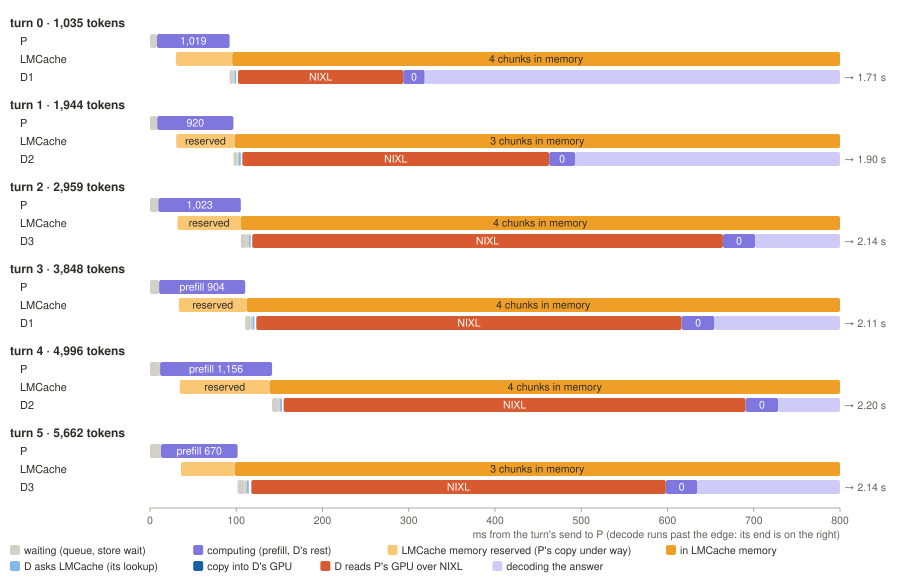

# Conversation 5: mt-rag-clapnq-elser-512-100-20240503 (memory mode, NIXL, shared servers, carry-forward, all passages)

P's KV reaches D over NIXL (D reads P's GPU blocks); every engine's LMCache connector stores beside it, to the one shared server. 6 turns on D1, D2, D3 (round-robin: each turn to the next D engine); prompts grow from 1,035 to 5,662 tokens (interleaved: each turn's prompt is the previous one, its answer, then this turn's documents and question). Chunks are 256 tokens (16 vLLM blocks of 16); a chunk's name is LMCache's hash of its tokens and everything before them, so the same prefix has the same chunks on every turn and engine.

Legend for the strips (one character a chunk): P: `=` on P's GPU from an earlier turn, `#` computed and stored now, `+` computed, not stored (a partial chunk). D: `=` on D's GPU from an earlier turn, `M` pulled from memory, `S` pulled from disk, `N` read from P's GPU over NIXL, `+` computed by D (a partial chunk), `?` missed.

GPU blocks (the chunk tables): where each engine keeps the chunk's 16 vLLM blocks in its GPU KV cache, by vLLM's block ids (vLLM's paged KV cache: a block, or page, holds 16 tokens; block 0 is its reserved null block), in the prompt's block order, a run of consecutive ids written as a range: `P 1, 138-152` is the prompt's block 0 in GPU block 1 and its blocks 1-15 in GPU blocks 138-152. An engine takes a GPU block from its free list when it first computes or loads a block, and the block keeps it while cached, so a later turn that reuses the block shows the same id. Blocks that are the same in several prompts (the same tokens and everything before them) share one GPU block once the first is cached: the system prompt's first block, the same in every conversation, is the usual one. `16/16 hashes = P's`: of the blocks D pulled, how many have the same vLLM hash on D as on P.

The prompts' text is the driver's own record of what it sent (answers included); lines over 100 characters are wrapped here for reading.

| turn | prompt | chunks + tail | P: own GPU / computed / stored | D: own GPU / loaded / computed | pulled | pull ms | D first token ms |
| ---: | ---: | --- | --- | --- | --- | ---: | ---: |
| [0](#turn-0) | 1,035 | 4 + 11 | 16 / 1,019 / 4 chunks | 16 / 1,019 / 0 | 5 chunks (NIXL 5) | 191.6 | 221.9 |
| [1](#turn-1) | 1,944 | 7 + 152 | 1,024 / 920 / 3 chunks | 16 / 1,928 / 0 | 8 chunks (NIXL 8) | 355.8 | 391.4 |
| [2](#turn-2) | 2,959 | 11 + 143 | 1,936 / 1,023 / 4 chunks | 16 / 2,943 / 0 | 12 chunks (NIXL 12) | 545.7 | 590.2 |
| [3](#turn-3) | 3,848 | 15 + 8 | 2,944 / 904 / 4 chunks | 1,152 / 2,696 / 0 | 12 chunks (NIXL 12) | 493.1 | 537.7 |
| [4](#turn-4) | 4,996 | 19 + 132 | 3,840 / 1,156 / 4 chunks | 2,064 / 2,932 / 0 | 12 chunks (NIXL 12) | 535.6 | 579.7 |
| [5](#turn-5) | 5,662 | 22 + 30 | 4,992 / 670 / 3 chunks | 3,072 / 2,590 / 0 | 11 chunks (NIXL 11) | 480.6 | 524.8 |

## How the prompt grows

Each turn's prompt is the previous one, token for token, and then: D's answer to the previous turn, this turn's documents, its question and the framing (the system prompt on turn 0, `Assistant:` and newlines). Only the new tokens can make new chunks: the previous prompt's partial chunk fills first. A document sent before comes again at another place, so in other chunks.

| turn | prompt | new | previous answer | documents | question | framing | whole chunks |
| ---: | ---: | ---: | ---: | --- | --- | ---: | --- |
| 0 | 1,035 | +1,035 | – | 5 docs, 994 | 11: what makes the different shapes of the moon | 30 | 4 (+4) |
| 1 | 1,944 | +909 | 128 | 6 docs, 766 | 12: What is the distance between the moon and earth? | 3 | 7 (+3) |
| 2 | 2,959 | +1,015 | 128 | 5 docs, 876 | 8: How old is the moon? | 3 | 11 (+4) |
| 3 | 3,848 | +889 | 128 | 5 docs, 747 | 11: What was the longest mission to the moon? | 3 | 15 (+4) |
| 4 | 4,996 | +1,148 | 128 | 5 docs, 1,007 | 10: what makes monkeys suitable for space travel? | 3 | 19 (+4) |
| 5 | 5,662 | +666 | 128 | 6 docs, 523 | 12: What was collected from the surface of the moon? | 3 | 22 (+3) |

## Timeline

Every turn on one clock: ms from the moment the proxy sent the turn to P. P prefills it (one token out) and holds its blocks for D; the proxy sends the turn to the next D engine at once with P's reply's kv_transfer_params (no wait), D reads P's blocks over NIXL (orange-red), computes the rest and decodes the answer. Beside it every engine's LMCache connector stores its new whole chunks (P's lane, and D's own when it stored any). The lanes: P, LMCache (P's chunks), D, and LMCache (D's chunks).



| turn | P queued → done | P's chunks: in memory / on disk | D | D starts | NIXL read | D: held / from P / from LMCache / computed | D's chunks stored | first token | P freed | D done |
| ---: | --- | --- | --- | ---: | --- | --- | ---: | ---: | ---: | ---: |
| 0 | 8 → 92 | 4: 95 / – | D1 | 97 | 102-294 | 16 / 1,019 / 0 / 0 | 0 | 318 | 295 | 1,708 |
| 1 | 8 → 97 | 3: 98 / – | D2 | 101 | 107-463 | 16 / 1,928 / 0 / 0 | 0 | 493 | 464 | 1,896 |
| 2 | 10 → 105 | 4: 105 / – | D3 | 111 | 118-664 | 16 / 2,943 / 0 / 0 | 0 | 702 | 665 | 2,136 |
| 3 | 10 → 110 | 4: 112 / – | D1 | 117 | 123-616 | 1,152 / 2,696 / 0 / 0 | 0 | 655 | 617 | 2,113 |
| 4 | 12 → 142 | 4: 139 / – | D2 | 149 | 155-690 | 2,064 / 2,932 / 0 / 0 | 0 | 728 | 691 | 2,202 |
| 5 | 13 → 102 | 3: 98 / – | D3 | 110 | 117-598 | 3,072 / 2,590 / 0 / 0 | 0 | 635 | 598 | 2,139 |

All times in ms from the turn's send to P. NIXL read: D's worker posts the read of P's blocks to the KV in D's GPU blocks; P freed: D has read, P's blocks go back to its free queue (still cached). Each turn's section below tells it in a sentence and step by step.

### One chunk, block by block: chunk 1 of turn 0 (`b916db0f1b67829b`)

Tokens 256-512 (doc 800869209_855-: 201; doc 800869209_2267: 55). P computed its blocks; D1 read them from P's GPU over NIXL, P's block into D's block, one for one:

| block | tokens | P's GPU block | vLLM hash on P | D's GPU block | same hash on D |
| ---: | --- | ---: | --- | ---: | --- |
| 16 | 256-272 | 1863 | `8fa275ed77b0a89f` | 1351 | True |
| 17 | 272-288 | 1864 | `7ea3ae2fbf968599` | 1352 | True |
| 18 | 288-304 | 1865 | `31e41a0a125bd76f` | 1353 | True |
| 19 | 304-320 | 1866 | `c914d72648a6307f` | 1354 | True |
| 20 | 320-336 | 1867 | `1e98a96f113874a2` | 1355 | True |
| 21 | 336-352 | 1868 | `01da72ec9390ef52` | 1356 | True |
| 22 | 352-368 | 1869 | `e17c7aec1f5845fc` | 1357 | True |
| 23 | 368-384 | 1870 | `67af35d2d848ff54` | 1358 | True |
| 24 | 384-400 | 1871 | `e5d17013cf5e4963` | 1359 | True |
| 25 | 400-416 | 1872 | `8d1a60163a6b8905` | 1360 | True |
| 26 | 416-432 | 1873 | `3a80fee76139060c` | 1361 | True |
| 27 | 432-448 | 1874 | `5618fb3e1cf93832` | 1362 | True |
| 28 | 448-464 | 1875 | `28ba96aab0c25ebb` | 1363 | True |
| 29 | 464-480 | 1876 | `745a865bc9133042` | 1364 | True |
| 30 | 480-496 | 1877 | `61c081210b8aedaa` | 1365 | True |
| 31 | 496-512 | 1878 | `8b05f8e5a3857306` | 1366 | True |

## Turn 0

**Timeline:** P queued until 8 ms, prefilled 1,019 tokens (held 16) and was done at 92 ms; its 4 new chunks were in LMCache's memory at 95 ms. D1 started at 97 ms (no wait) holding 16 tokens, read 1,019 from P's GPU over NIXL (posted at 102 ms, in its GPU at 294 ms; P freed its blocks at 295 ms), computed 0 and gave its first token at 318 ms; it decoded 128 tokens until 1,708 ms. ([all turns](#timeline))

### Step by step

Every move of this turn's KV, ms from the proxy sending the turn to P. P's KV reaches D over NIXL: D's worker reads P's GPU blocks into its own (a NIXL READ, P told when D is done); LMCache's copies (to and from each server's memory) its servers do themselves through CUDA IPC handles each engine registered at start.

| ms | where | what |
| ---: | --- | --- |
| 0.0 | proxy → P | sends the turn (1,035 prompt tokens; P is asked for one token: prefill only) |
| 3.5 | P | the request arrives |
| 7.9 | P GPU | its prefix cache holds 16 of the prompt's tokens: 1 block in GPU blocks 1 |
| 8.0 | P ↔ LMCache | LMCache has 0 of its tokens; P loads 0 and computes the rest |
| 8.1 | P GPU | 64 new GPU blocks for the 1,019 tokens it computes: 1848-1911; the prefill runs |
| 8.6 | P → LMCache | store planned: tokens 0-1,024, chunks 0-3 (64 blocks) |
| 29.3 | LMCache | the store request is in; it waits for P's forward pass to finish (a CUDA event) |
| 30.1 | LMCache memory | space reserved for 4 chunks (117 MB) |
| 88.1 | P GPU → LMCache memory | the copy starts: LMCache reads P's GPU blocks (CUDA IPC) |
| 88.4 | P GPU | the request is done: P holds its 65 blocks for D to read over NIXL, and its reply carries them (kv_transfer_params: the blocks, its NIXL agent) |
| 92.3 | P → proxy | P answers its one token: the prefill is done |
| 93.2 | P GPU → LMCache memory | copy done: 4 chunks, 117 MB in 5.1 ms |
| 95.3 | LMCache memory | 4 chunks in memory, kept for later requests (D gets this turn's KV from P over NIXL); P keeps its copy in its GPU blocks |
| 96.6 | proxy → D1 | sends the turn to D1 at once, with P's kv_transfer_params (round-robin; no wait) |
| 98.1 | D1 ↔ LMCache | asks LMCache for the prompt's chunks |
| 99.4 | LMCache memory | found 1,024 tokens it lacks: 4 chunks in memory |
| 100.9 | D1 GPU | its prefix cache holds 16 of the prompt's tokens: 1 block in GPU blocks 1 |
| 101.0 | D1 ↔ P (NIXL) | will read 1,019 prompt tokens from P's GPU (beyond the 16 its own cache holds) |
| 101.0 | D1 ↔ LMCache | LMCache has 1,024 of its tokens; NIXL loads it (MultiConnector: the first connector with tokens) |
| 101.2 | D1 GPU | 64 GPU blocks for the KV from P: 1336-1399 |
| 102.0 | P GPU → D1 GPU (NIXL) | D1 reads P's GPU blocks 1, 1848-1911 into its 1336-1399 (a NIXL READ) |
| 293.6 | D1 | the KV from P is in its GPU blocks (1,019 tokens) |
| 294.8 | P GPU | D1 has read: P frees its blocks (they stay in its prefix cache) |
| 318.5 | D1 → proxy | the first answer token |
| 360.2 | D1 GPU | 1 new GPU block for the 1 prompt tokens it computes: 1400 |
| 535.9 | D1 GPU | decoding: the answer's KV takes 7 new GPU blocks as it grows, one per 16 tokens: 1401-1407, until 1,588 ms |
| 1,708.5 | D1 | done: 128 tokens decoded; its blocks stay cached in its GPU for the next turn |
| 1,709.8 | proxy | the response is complete |

1,035 prompt tokens: 4 whole chunks and 11 tokens over (the partial chunk, computed by both engines and stored only when a later turn completes it). P held 16 tokens on its GPU, computed 1,019 and stored 4 new chunks; D1 held 16, read 1,019 from P over NIXL, loaded 0 from LMCache and computed 0.

### The prompt

The whole prompt, piece by piece:

- **system prompt** · tokens 0-28 (28) · chunk 0

```text
You are a helpful assistant. Answer the user's last question from the documents. If they do not hold
the answer, say so.
```

<details><summary>document <code>800869209_6198-6886-0-688</code> · tokens 28-181 (153) · chunk 0</summary>

```text
Document: Lunar phase
Lunar phase
When a sphere is illuminated on one hemisphere and viewed from a different angle , the portion of
the illuminated area that is visible will have a two - dimensional shape defined by the intersection
of an ellipse and circle ( where the major axis of the ellipse coincides with a diameter of the
circle ) . If the half - ellipse is convex with respect to the half - circle , then the shape will
be gibbous ( bulging outwards ) whereas if the half - ellipse is concave with respect to the half -
circle , then the shape will be a crescent . When a crescent Moon occurs , the phenomenon of
earthshine may be apparent , where the night side of the Moon faintly reflects light from the Earth
.
```

</details>

<details><summary>document <code>800869209_855-2044-0-1189</code> · tokens 181-457 (276) · chunks 0-1</summary>

```text
Document: Lunar phase
Lunar phase
The lunar phase or phase of the moon is the shape of the illuminated ( sunlit ) portion of the Moon
as seen by an observer on Earth . The lunar phases change cyclically as the Moon orbits the Earth ,
according to the changing positions of the Moon and Sun relative to the Earth . The Moon 's rotation
is tidally locked by the Earth 's gravity , therefore the same lunar surface always faces Earth .
This face is variously sunlit depending on the position of the Moon in its orbit . Therefore , the
portion of this hemisphere that is visible to an observer on Earth can vary from about 100 % ( full
moon ) to 0 % ( new moon ) . The lunar terminator is the boundary between the illuminated and
darkened hemispheres . Each of the four `` intermediate '' lunar phases ( see below ) is roughly
seven days ( ~ 7.4 days ) but this varies slightly due to the elliptical shape of the Moon 's orbit
. Aside from some craters near the lunar poles such as Shoemaker , all parts of the Moon see around
14.77 days of sunlight , followed by 14.77 days of `` night '' . ( The side of the Moon facing away
from the Earth is sometimes called the `` dark side of the Moon '' , although that is a misnomer . )
```

</details>

<details><summary>document <code>800869209_2267-3302-0-1031</code> · tokens 457-683 (226) · chunks 1-2</summary>

```text
Document: Lunar phase
Lunar phase
In Western culture , the four principal lunar phases are new moon , first quarter , full moon , and
third quarter ( also known as last quarter ) . These are the instances when the Moon 's apparent
geocentric celestial longitude minus the Sun 's apparent geocentric celestial longitude is 0 ° , 90
° , 180 ° and 270 ° , respectively . Each of these phases occur at slightly different times when
viewed from different points on the Earth . During the intervals between principal phases , the Moon
appears either crescent - shaped or gibbous . These shapes , and the periods of time when the Moon
shows them , are called the intermediate phases . They last , on average , one - quarter of a
synodic month , roughly 7.38 days , but their durations vary slightly because the Moon 's orbit is
slightly elliptical , and thus its speed in orbit is not constant . The descriptor waxing is used
for an intermediate phase when the Moon 's apparent size is increasing , from new moon toward full
moon , and waning when the size is decreasing .
```

</details>

<details><summary>document <code>800869209_5261-6197-0-936</code> · tokens 683-906 (223) · chunks 2-3</summary>

```text
Document: Lunar phase
Lunar phase
When the Sun and Moon are aligned on the same side of the Earth , the moon is `` new '' , and the
side of the Moon facing Earth is not illuminated by the Sun . As the moon waxes ( the amount of
illuminated surface as seen from Earth is increasing ) , the lunar phases progress through new moon
, crescent moon , first - quarter moon , gibbous moon , and full moon . The moon is then said to
wane as it passes through the gibbous moon , third - quarter moon , crescent moon and back to new
moon . The terms `` old moon '' and `` new moon '' are not interchangeable . The `` old moon '' is a
waning sliver ( which eventually becomes undetectable to the naked eye ) until the moment it aligns
with the sun and begins to wax , at which point it becomes new again . Half moon is often used to
mean the first - and third - quarter moons , while the term ' quarter ' refers to the extent of the
moon 's cycle around the Earth , not its shape .
```

</details>

<details><summary>document <code>821797291_40617-41173-0-556</code> · tokens 906-1022 (116) · chunk 3</summary>

```text
Document: Jupiter
Jupiter
The eccentricity of their orbits causes regular flexing of the three moons ' shapes , with Jupiter
's gravity stretching them out as they approach it and allowing them to spring back to more
spherical shapes as they swing away . This tidal flexing heats the moons ' interiors by friction .
This is seen most dramatically in the extraordinary volcanic activity of innermost Io ( which is
subject to the strongest tidal forces ) , and to a lesser degree in the geological youth of Europa
's surface ( indicating recent resurfacing of the moon 's exterior ) .
```

</details>

- **question 0** · tokens 1022-1033 (11) · chunks 3-4

```text
User: what makes the different shapes of the moon
```

- `Assistant:` · tokens 1033-1035 (2) · chunk 4

### Pieces, chunks and blocks

| piece | tokens | length | chunks | |
| --- | --- | ---: | --- | --- |
| system | 0-28 | 28 | 0 |  |
| doc 800869209_6198 | 28-181 | 153 | 0 |  |
| doc 800869209_855- | 181-457 | 276 | 0-1 |  |
| doc 800869209_2267 | 457-683 | 226 | 1-2 |  |
| doc 800869209_5261 | 683-906 | 223 | 2-3 |  |
| doc 821797291_4061 | 906-1022 | 116 | 3 |  |
| question 0 | 1022-1033 | 11 | 3-4 |  |
| `assistant:` 0 | 1033-1035 | 2 | 4 |  |

```
P  ####+
D  NNNNN
```

| chunk | tokens | pieces in it (tokens) | vLLM blocks | GPU blocks | in LMCache | P this turn | D this turn |
| ---: | --- | --- | --- | --- | --- | --- | --- |
| 0 | 0-256 | system: 28; doc 800869209_6198: 153; doc 800869209_855-: 75 | 0-15 | P 1, 1848-1862; D 1, 1336-1350; 15/15 hashes = P's | `13939ad53740b0db` stored on turn 0 by P | computed (its first 16 tokens on P's GPU already), **stored now** | **read from P's GPU over NIXL** (its first 16 tokens on D's GPU already) |
| 1 | 256-512 | doc 800869209_855-: 201; doc 800869209_2267: 55 | 16-31 | P 1863-1878; D 1351-1366; 16/16 hashes = P's | `b916db0f1b67829b` stored on turn 0 by P | computed, **stored now** | **read from P's GPU over NIXL** |
| 2 | 512-768 | doc 800869209_2267: 171; doc 800869209_5261: 85 | 32-47 | P 1879-1894; D 1367-1382; 16/16 hashes = P's | `0a46dff80516830e` stored on turn 0 by P | computed, **stored now** | **read from P's GPU over NIXL** |
| 3 | 768-1024 | doc 800869209_5261: 138; doc 821797291_4061: 116; question 0: 2 | 48-63 | P 1895-1910; D 1383-1398; 16/16 hashes = P's | `0e4a36c995b14947` stored on turn 0 by P | computed, **stored now** | **read from P's GPU over NIXL** |
| 4 | 1024-1035 | question 0: 9; `assistant:` 0: 2 | 64 | P –; D 1399 | – | computed (partial chunk: not stored) | **read from P's GPU over NIXL** (partial chunk) |

## Turn 1

**Timeline:** P queued until 8 ms, prefilled 920 tokens (held 1,024) and was done at 97 ms; its 3 new chunks were in LMCache's memory at 98 ms. D2 started at 101 ms (no wait) holding 16 tokens, read 1,928 from P's GPU over NIXL (posted at 107 ms, in its GPU at 463 ms; P freed its blocks at 464 ms), computed 0 and gave its first token at 493 ms; it decoded 128 tokens until 1,896 ms. ([all turns](#timeline))

### Step by step

Every move of this turn's KV, ms from the proxy sending the turn to P. P's KV reaches D over NIXL: D's worker reads P's GPU blocks into its own (a NIXL READ, P told when D is done); LMCache's copies (to and from each server's memory) its servers do themselves through CUDA IPC handles each engine registered at start.

| ms | where | what |
| ---: | --- | --- |
| 0.0 | proxy → P | sends the turn (1,944 prompt tokens; P is asked for one token: prefill only) |
| 3.5 | P | the request arrives |
| 8.1 | P GPU | its prefix cache holds 1,024 of the prompt's tokens: 64 blocks in GPU blocks 1, 1848-1910 |
| 8.2 | P ↔ LMCache | LMCache has 1,024 of its tokens; P loads 0 and computes the rest |
| 8.4 | P GPU | 58 new GPU blocks for the 920 tokens it computes: 1911-1968; the prefill runs |
| 8.9 | P → LMCache | store planned: tokens 1,024-1,792, chunks 4-6 (48 blocks) |
| 29.7 | LMCache | the store request is in; it waits for P's forward pass to finish (a CUDA event) |
| 30.4 | LMCache memory | space reserved for 3 chunks (88 MB) |
| 91.2 | P GPU → LMCache memory | the copy starts: LMCache reads P's GPU blocks (CUDA IPC) |
| 91.4 | P GPU | the request is done: P holds its 122 blocks for D to read over NIXL, and its reply carries them (kv_transfer_params: the blocks, its NIXL agent) |
| 95.1 | P GPU → LMCache memory | copy done: 3 chunks, 88 MB in 3.8 ms |
| 96.7 | P → proxy | P answers its one token: the prefill is done |
| 98.1 | LMCache memory | 3 chunks in memory, kept for later requests (D gets this turn's KV from P over NIXL); P keeps its copy in its GPU blocks |
| 101.4 | proxy → D2 | sends the turn to D2 at once, with P's kv_transfer_params (round-robin; no wait) |
| 103.0 | D2 ↔ LMCache | asks LMCache for the prompt's chunks |
| 105.3 | LMCache memory | found 1,792 tokens it lacks: 7 chunks in memory |
| 105.9 | D2 GPU | its prefix cache holds 16 of the prompt's tokens: 1 block in GPU blocks 1 |
| 105.9 | D2 ↔ P (NIXL) | will read 1,928 prompt tokens from P's GPU (beyond the 16 its own cache holds) |
| 106.0 | D2 ↔ LMCache | LMCache has 1,792 of its tokens; NIXL loads it (MultiConnector: the first connector with tokens) |
| 106.2 | D2 GPU | 121 GPU blocks for the KV from P: 1613-1733 |
| 107.0 | P GPU → D2 GPU (NIXL) | D2 reads P's GPU blocks 1, 1848-1968 into its 1613-1733 (a NIXL READ) |
| 462.8 | D2 | the KV from P is in its GPU blocks (1,928 tokens) |
| 463.7 | P GPU | D2 has read: P frees its blocks (they stay in its prefix cache) |
| 492.8 | D2 → proxy | the first answer token |
| 566.7 | D2 GPU | 1 new GPU block for the 1 prompt tokens it computes: 1734 |
| 743.7 | D2 GPU | decoding: the answer's KV takes 7 new GPU blocks as it grows, one per 16 tokens: 1735-1741, until 1,807 ms |
| 1,896.5 | D2 | done: 128 tokens decoded; its blocks stay cached in its GPU for the next turn |
| 1,897.6 | proxy | the response is complete |

1,944 prompt tokens: 7 whole chunks and 152 tokens over (the partial chunk, computed by both engines and stored only when a later turn completes it). P held 1,024 tokens on its GPU, computed 920 and stored 3 new chunks; D2 held 16, read 1,928 from P over NIXL, loaded 0 from LMCache and computed 0.

### The prompt

Tokens 0-1,035: [turn 0](#turn-0)'s prompt, unchanged (checked: its first 1,035 token ids are the previous prompt's), so chunks 0-3 are the same chunks; chunk 4 (partial then, 11 tokens) fills now. New from token 1,035:

- **D's answer to turn 0** · tokens 1035-1163 (128) · chunk 4

```text
 The shape of the moon is determined by the position of the sun and the moon in relation to the
earth. The moon is always on the same side of the earth, but the sun is not. The sun is always on
the opposite side of the earth from the moon. The sun is always in the same position in relation to
the earth, but the moon is not. The moon is always in a different position in relation to the earth.
The moon is always in a different position in relation to the sun. The moon is always in a different
position in relation to the earth and the sun. The moon is always in a different position
```

- `\n` · tokens 1163-1164 (1) · chunk 4

<details><summary>document <code>800694603_1069-1451-0-382</code> · tokens 1164-1298 (134) · chunks 4-5</summary>

```text
Document: Lunar distance (astronomy)
Lunar distance (astronomy)
The mean semi-major axis has a value of 384,402 km ( 238,856 mi ) . The time - averaged distance
between Earth and Moon centers is 385,000.6 km ( 239,228.3 mi ) . The actual distance varies over
the course of the orbit of the Moon , from 356,500 km ( 221,500 mi ) at the perigee to 406,700 km (
252,700 mi ) at apogee , resulting in a differential range of 50,200 km ( 31,200 mi ) .
```

</details>

<details><summary>document <code>800694603_3260-3620-0-358</code> · tokens 1298-1394 (96) · chunk 5</summary>

```text
Document: Lunar distance (astronomy)
Lunar distance (astronomy)
The instantaneous lunar distance is constantly changing . In fact the true distance between the Moon
and Earth can change by as much as 7001750000000000000 ♠ 75 m / s , or more than 1,000 kilometers in
just 6 hours , due to its non-circular orbit . There are other effects that also influence the lunar
distance . Some factors are described in this section .
```

</details>

<details><summary>document <code>800694603_465-1068-0-600</code> · tokens 1394-1540 (146) · chunks 5-6</summary>

```text
Document: Lunar distance (astronomy)
Lunar distance (astronomy)
Lunar distance ( LD or Δ ⊕ L ( \ textstyle \ Delta _ ( \ oplus L ) ) ) , also called Earth -- Moon
distance , Earth -- Moon characteristic distance , or distance to the Moon , is a unit of measure in
astronomy . It is the average distance from the center of Earth to the center of the Moon . More
technically , it is the mean semi-major axis of the geocentric lunar orbit . It may also refer to
the time - averaged distance between the centers of the Earth and the Moon , or less commonly , the
instantaneous Earth -- Moon distance . The lunar distance is approximately a quarter of a million
miles .
```

</details>

<details><summary>document <code>800694603_9892-10257-0-359</code> · tokens 1540-1662 (122) · chunk 6</summary>

```text
Document: Lunar distance (astronomy)
Lunar distance (astronomy)
Astronomers O'Keefe and Anderson calculated the lunar distance by observing 4 occultations from 9
locations in 1952 . They calculated a mean distance of 7008384407600000000 ♠ 384 407. 6 ± 4.7 km ,
however the value was refined by in 1962 by Irene Fischer , who incorporated updated geodetic data
to produce a value of 7008384403700000000 ♠ 384 403. 7 ± 2 km .
```

</details>

<details><summary>document <code>800694603_10273-10856-0-578</code> · tokens 1662-1804 (142) · chunks 6-7</summary>

```text
Document: Lunar distance (astronomy)
Lunar distance (astronomy)
An experiment was conducted in 1957 at the U.S. Naval Research Laboratory that used the echo from
radar signals to determine the Earth - Moon distance . Radar pulses lasting 6994200000000000000 ♠ 2
μs were broadcast from a 7001152400000000000 ♠ 50 ft diameter radio dish . After the radio waves
echoed off the surface of the Moon , the return signal was detected and the delay time measured .
From that measurement , the distance could be calculated . In practice , however , the signal - to -
noise ratio was so low that an accurate measurement could not be reliably produced .
```

</details>

<details><summary>document <code>800694603_1973-2436-0-461</code> · tokens 1804-1930 (126) · chunk 7</summary>

```text
Document: Lunar distance (astronomy)
Lunar distance (astronomy)
Millimeter - precision measurements of the lunar distance are made by measuring the time taken for
light to travel between LIDAR stations on the Earth and retroreflectors placed on the Moon . The
Moon is spiraling away from the Earth at an average rate of 3.8 cm ( 1.5 in ) per year , as detected
by the Lunar Laser Ranging Experiment . By coincidence , the diameter of corner cubes in
retroreflectors on the Moon is also 6998380000000000000 ♠ 3.8 cm . Distance
```

</details>

- **question 1** · tokens 1930-1942 (12) · chunk 7

```text
User: What is the distance between the moon and earth?
```

- `Assistant:` · tokens 1942-1944 (2) · chunk 7

### Pieces, chunks and blocks

| piece | tokens | length | chunks | |
| --- | --- | ---: | --- | --- |
| system | 0-28 | 28 | 0 |  |
| doc 800869209_6198 | 28-181 | 153 | 0 |  |
| doc 800869209_855- | 181-457 | 276 | 0-1 |  |
| doc 800869209_2267 | 457-683 | 226 | 1-2 |  |
| doc 800869209_5261 | 683-906 | 223 | 2-3 |  |
| doc 821797291_4061 | 906-1022 | 116 | 3 |  |
| question 0 | 1022-1033 | 11 | 3-4 |  |
| `assistant:` 0 | 1033-1035 | 2 | 4 |  |
| answer 0 | 1035-1163 | 128 | 4 | new this turn |
| newline 0 | 1163-1164 | 1 | 4 | new this turn |
| doc 800694603_1069 | 1164-1298 | 134 | 4-5 | new this turn |
| doc 800694603_3260 | 1298-1394 | 96 | 5 | new this turn |
| doc 800694603_465- | 1394-1540 | 146 | 5-6 | new this turn |
| doc 800694603_9892 | 1540-1662 | 122 | 6 | new this turn |
| doc 800694603_1027 | 1662-1804 | 142 | 6-7 | new this turn |
| doc 800694603_1973 | 1804-1930 | 126 | 7 | new this turn |
| question 1 | 1930-1942 | 12 | 7 | new this turn |
| `assistant:` 1 | 1942-1944 | 2 | 7 | new this turn |

```
P  ====###+
D  NNNNNNNN
```

| chunk | tokens | pieces in it (tokens) | vLLM blocks | GPU blocks | in LMCache | P this turn | D this turn |
| ---: | --- | --- | --- | --- | --- | --- | --- |
| 0 | 0-256 | system: 28; doc 800869209_6198: 153; doc 800869209_855-: 75 | 0-15 | P 1, 1848-1862; D 1, 1613-1627 | `13939ad53740b0db` stored on turn 0 by P | on P's GPU (earlier turn) | **read from P's GPU over NIXL** (its first 16 tokens on D's GPU already) |
| 1 | 256-512 | doc 800869209_855-: 201; doc 800869209_2267: 55 | 16-31 | P 1863-1878; D 1628-1643 | `b916db0f1b67829b` stored on turn 0 by P | on P's GPU (earlier turn) | **read from P's GPU over NIXL** |
| 2 | 512-768 | doc 800869209_2267: 171; doc 800869209_5261: 85 | 32-47 | P 1879-1894; D 1644-1659 | `0a46dff80516830e` stored on turn 0 by P | on P's GPU (earlier turn) | **read from P's GPU over NIXL** |
| 3 | 768-1024 | doc 800869209_5261: 138; doc 821797291_4061: 116; question 0: 2 | 48-63 | P 1895-1910; D 1660-1675 | `0e4a36c995b14947` stored on turn 0 by P | on P's GPU (earlier turn) | **read from P's GPU over NIXL** |
| 4 | 1024-1280 | question 0: 9; `assistant:` 0: 2; answer 0 (new): 128; newline 0 (new): 1; doc 800694603_1069 (new): 116 | 64-79 | P 1911-1926; D 1676-1691; 16/16 hashes = P's | `692f2574a509272d` stored on turn 1 by P | computed, **stored now** | **read from P's GPU over NIXL** |
| 5 | 1280-1536 | doc 800694603_1069 (new): 18; doc 800694603_3260 (new): 96; doc 800694603_465- (new): 142 | 80-95 | P 1927-1942; D 1692-1707; 16/16 hashes = P's | `f6e4b69424355b89` stored on turn 1 by P | computed, **stored now** | **read from P's GPU over NIXL** |
| 6 | 1536-1792 | doc 800694603_465- (new): 4; doc 800694603_9892 (new): 122; doc 800694603_1027 (new): 130 | 96-111 | P 1943-1958; D 1708-1723; 16/16 hashes = P's | `f0d489df43a62593` stored on turn 1 by P | computed, **stored now** | **read from P's GPU over NIXL** |
| 7 | 1792-1944 | doc 800694603_1027 (new): 12; doc 800694603_1973 (new): 126; question 1 (new): 12; `assistant:` 1 (new): 2 | 112-121 | P 1959-1967; D 1724-1733; 9/9 hashes = P's | – | computed (partial chunk: not stored) | **read from P's GPU over NIXL** (partial chunk) |

## Turn 2

**Timeline:** P queued until 10 ms, prefilled 1,023 tokens (held 1,936) and was done at 105 ms; its 4 new chunks were in LMCache's memory at 105 ms. D3 started at 111 ms (no wait) holding 16 tokens, read 2,943 from P's GPU over NIXL (posted at 118 ms, in its GPU at 664 ms; P freed its blocks at 665 ms), computed 0 and gave its first token at 702 ms; it decoded 128 tokens until 2,136 ms. ([all turns](#timeline))

### Step by step

Every move of this turn's KV, ms from the proxy sending the turn to P. P's KV reaches D over NIXL: D's worker reads P's GPU blocks into its own (a NIXL READ, P told when D is done); LMCache's copies (to and from each server's memory) its servers do themselves through CUDA IPC handles each engine registered at start.

| ms | where | what |
| ---: | --- | --- |
| 0.0 | proxy → P | sends the turn (2,959 prompt tokens; P is asked for one token: prefill only) |
| 4.3 | P | the request arrives |
| 9.3 | P GPU | its prefix cache holds 1,936 of the prompt's tokens: 121 blocks in GPU blocks 1, 1848-1967 |
| 9.4 | P ↔ LMCache | LMCache has 1,792 of its tokens; P loads 0 and computes the rest |
| 9.6 | P GPU | 64 new GPU blocks for the 1,023 tokens it computes: 1968-2031; the prefill runs |
| 10.2 | P → LMCache | store planned: tokens 1,792-2,816, chunks 7-10 (64 blocks) |
| 31.0 | LMCache | the store request is in; it waits for P's forward pass to finish (a CUDA event) |
| 31.9 | LMCache memory | space reserved for 4 chunks (117 MB) |
| 99.2 | P GPU → LMCache memory | the copy starts: LMCache reads P's GPU blocks (CUDA IPC) |
| 99.4 | P GPU | the request is done: P holds its 185 blocks for D to read over NIXL, and its reply carries them (kv_transfer_params: the blocks, its NIXL agent) |
| 104.3 | P GPU → LMCache memory | copy done: 4 chunks, 117 MB in 5.1 ms |
| 105.1 | LMCache memory | 4 chunks in memory, kept for later requests (D gets this turn's KV from P over NIXL); P keeps its copy in its GPU blocks |
| 105.3 | P → proxy | P answers its one token: the prefill is done |
| 111.4 | proxy → D3 | sends the turn to D3 at once, with P's kv_transfer_params (round-robin; no wait) |
| 114.9 | D3 ↔ LMCache | asks LMCache for the prompt's chunks |
| 116.8 | LMCache memory | found 2,816 tokens it lacks: 11 chunks in memory |
| 117.2 | D3 GPU | its prefix cache holds 16 of the prompt's tokens: 1 block in GPU blocks 1 |
| 117.3 | D3 ↔ P (NIXL) | will read 2,943 prompt tokens from P's GPU (beyond the 16 its own cache holds) |
| 117.3 | D3 ↔ LMCache | LMCache has 2,816 of its tokens; NIXL loads it (MultiConnector: the first connector with tokens) |
| 117.7 | D3 GPU | 184 GPU blocks for the KV from P: 1803-1986 |
| 118.5 | P GPU → D3 GPU (NIXL) | D3 reads P's GPU blocks 1, 1848-2031 into its 1803-1986 (a NIXL READ) |
| 664.2 | D3 | the KV from P is in its GPU blocks (2,943 tokens) |
| 665.3 | P GPU | D3 has read: P frees its blocks (they stay in its prefix cache) |
| 696.6 | D3 GPU | 1 new GPU block for the 1 prompt tokens it computes: 1987 |
| 701.6 | D3 → proxy | the first answer token |
| 877.5 | D3 GPU | decoding: the answer's KV takes 7 new GPU blocks as it grows, one per 16 tokens: 1988-1994, until 1,965 ms |
| 2,135.5 | D3 | done: 128 tokens decoded; its blocks stay cached in its GPU for the next turn |
| 2,136.7 | proxy | the response is complete |

2,959 prompt tokens: 11 whole chunks and 143 tokens over (the partial chunk, computed by both engines and stored only when a later turn completes it). P held 1,936 tokens on its GPU, computed 1,023 and stored 4 new chunks; D3 held 16, read 2,943 from P over NIXL, loaded 0 from LMCache and computed 0.

### The prompt

Tokens 0-1,944: [turn 1](#turn-1)'s prompt, unchanged (checked: its first 1,944 token ids are the previous prompt's), so chunks 0-6 are the same chunks; chunk 7 (partial then, 152 tokens) fills now. New from token 1,944:

- **D's answer to turn 1** · tokens 1944-2072 (128) · chunks 7-8

```text
 The distance between the moon and earth is about 384,000 kilometers. This is the average distance
between the two bodies. The distance can vary slightly due to the elliptical shape of the moon's
orbit. The distance can also vary due to the gravitational pull of the sun. The moon is closer to
the earth when the sun is not directly between the two bodies. The moon is farther away from the
earth when the sun is directly between the two bodies. The moon is always on the same side of the
earth, but the sun is not. The sun is always on the opposite side of the earth from the moon. The
sun is
```

- `\n` · tokens 2072-2073 (1) · chunk 8

<details><summary>document <code>800694603_5028-5760-0-725</code> · tokens 2073-2267 (194) · chunk 8</summary>

```text
Document: Lunar distance (astronomy)
Lunar distance (astronomy)
Through the action of tidal forces , angular momentum is slowly being transferred from Earth 's
rotation to the Moon 's orbit . The result is that Earth 's rate of spin is imperceptibly decreasing
( at a rate of 7000229999999999999 ♠ 2.3 milliseconds / century ) , and the lunar orbit is gradually
expanding . The current rate of recession is 7000380500000000000 ♠ 3.805 ± 0.004 cm per year .
However , it is believed that this rate has recently increased , as a rate of 6991120417206325883 ♠
3.8 cm / year would imply that the Moon is only 1.5 billion years old , whereas scientific consensus
assumes an age of ~ 4 billion years . It is also believed that this anomalously high rate of
recession may continue to accelerate .
```

</details>

<details><summary>document <code>800869209_10879-11855-0-976</code> · tokens 2267-2479 (212) · chunks 8-9</summary>

```text
Document: Lunar phase
Lunar phase
The approximate age of the moon , and hence the approximate phase , can be calculated for any date
by calculating the number of days since a known new moon ( such as January 1 , 1900 or August 11 ,
1999 ) and reducing this modulo 29.530588853 ( the length of a synodic month ) . The difference
between two dates can be calculated by subtracting the Julian Day Number of one from that of the
other , or there are simpler formulae giving ( for instance ) the number of days since December 31 ,
1899 . However , this calculation assumes a perfectly circular orbit and makes no allowance for the
time of day at which the new moon happened , therefore may be incorrect by several hours ( it also
becomes less accurate the larger the difference between the required date and the reference date ) ;
it is accurate enough to use in a novelty clock application showing moon phase , but specialist
usage taking account of lunar apogee and perigee requires a more elaborate calculation .
```

</details>

<details><summary>document <code>866491906_40011-40851-0-840</code> · tokens 2479-2750 (271) · chunks 9-10</summary>

```text
Document: Moon landing
Moon landing
U.S. mission Mass ( kg ) Booster Launched Mission goal Mission result Lunar Orbiter 1 386 Atlas --
Agena 10 August 1966 Lunar orbiter Success -- 1,160 km X 189 km x 12 deg orbit , 208 m period , 80 -
day photography mission Lunar Orbiter 2 386 Atlas -- Agena 6 November 1966 Lunar orbiter Success --
1,860 km X 52 km x 12 deg orbit , 208 m period , 339 - day photography mission Lunar Orbiter 3 386
Atlas -- Agena 5 February 1967 Lunar orbiter Success -- 1,860 km X 52 km x 21 deg orbit , 208 m
period , 246 - day photography mission Lunar Orbiter 4 386 Atlas -- Agena 4 May 1967 Lunar orbiter
Success -- 6,111 km X 2,706 km x 86 deg orbit , 721 m period , 180 - day photography mission Lunar
Orbiter 5 386 Atlas -- Agena 1 August 1967 Lunar orbiter Success -- 6,023 km X 195 km x 85 deg orbit
, 510 m period , 183 - day photography mission
```

</details>

<details><summary>document <code>856136637_62301-62879-0-578</code> · tokens 2750-2872 (122) · chunks 10-11</summary>

```text
Document: Earth
Earth
Lord Kelvin used thermodynamics to estimate the age of Earth to be between 20 million and 400
million years in 1864 , sparking a vigorous debate on the subject ; it was only when radioactivity
and radioactive dating were discovered in the late 19th and early 20th centuries that a reliable
mechanism for determining Earth 's age was established , proving the planet to be billions of years
old . The perception of Earth shifted again in the 20th century when humans first viewed it from
orbit , and especially with photographs of Earth returned by the Apollo program . Clickable
```

</details>

<details><summary>document <code>807014669_17419-17684-0-265</code> · tokens 2872-2949 (77) · chunk 11</summary>

```text
Document: Maya calendar
Maya calendar
A new moon glyph was used for day zero in the lunar cycle . D glyphs were used for lunar ages for
days 1 through 19 , with the number of days that had passed from the new moon . For lunar ages 20 to
30 , an E glyph was used , with the number of days from 20 . Count
```

</details>

- **question 2** · tokens 2949-2957 (8) · chunk 11

```text
User: How old is the moon?
```

- `Assistant:` · tokens 2957-2959 (2) · chunk 11

### Pieces, chunks and blocks

| piece | tokens | length | chunks | |
| --- | --- | ---: | --- | --- |
| system | 0-28 | 28 | 0 |  |
| doc 800869209_6198 | 28-181 | 153 | 0 |  |
| doc 800869209_855- | 181-457 | 276 | 0-1 |  |
| doc 800869209_2267 | 457-683 | 226 | 1-2 |  |
| doc 800869209_5261 | 683-906 | 223 | 2-3 |  |
| doc 821797291_4061 | 906-1022 | 116 | 3 |  |
| question 0 | 1022-1033 | 11 | 3-4 |  |
| `assistant:` 0 | 1033-1035 | 2 | 4 |  |
| answer 0 | 1035-1163 | 128 | 4 |  |
| newline 0 | 1163-1164 | 1 | 4 |  |
| doc 800694603_1069 | 1164-1298 | 134 | 4-5 |  |
| doc 800694603_3260 | 1298-1394 | 96 | 5 |  |
| doc 800694603_465- | 1394-1540 | 146 | 5-6 |  |
| doc 800694603_9892 | 1540-1662 | 122 | 6 |  |
| doc 800694603_1027 | 1662-1804 | 142 | 6-7 |  |
| doc 800694603_1973 | 1804-1930 | 126 | 7 |  |
| question 1 | 1930-1942 | 12 | 7 |  |
| `assistant:` 1 | 1942-1944 | 2 | 7 |  |
| answer 1 | 1944-2072 | 128 | 7-8 | new this turn |
| newline 1 | 2072-2073 | 1 | 8 | new this turn |
| doc 800694603_5028 | 2073-2267 | 194 | 8 | new this turn |
| doc 800869209_1087 | 2267-2479 | 212 | 8-9 | new this turn |
| doc 866491906_4001 | 2479-2750 | 271 | 9-10 | new this turn |
| doc 856136637_6230 | 2750-2872 | 122 | 10-11 | new this turn |
| doc 807014669_1741 | 2872-2949 | 77 | 11 | new this turn |
| question 2 | 2949-2957 | 8 | 11 | new this turn |
| `assistant:` 2 | 2957-2959 | 2 | 11 | new this turn |

```
P  =======####+
D  NNNNNNNNNNNN
```

| chunk | tokens | pieces in it (tokens) | vLLM blocks | GPU blocks | in LMCache | P this turn | D this turn |
| ---: | --- | --- | --- | --- | --- | --- | --- |
| 0 | 0-256 | system: 28; doc 800869209_6198: 153; doc 800869209_855-: 75 | 0-15 | P 1, 1848-1862; D 1, 1803-1817 | `13939ad53740b0db` stored on turn 0 by P | on P's GPU (earlier turn) | **read from P's GPU over NIXL** (its first 16 tokens on D's GPU already) |
| 1 | 256-512 | doc 800869209_855-: 201; doc 800869209_2267: 55 | 16-31 | P 1863-1878; D 1818-1833 | `b916db0f1b67829b` stored on turn 0 by P | on P's GPU (earlier turn) | **read from P's GPU over NIXL** |
| 2 | 512-768 | doc 800869209_2267: 171; doc 800869209_5261: 85 | 32-47 | P 1879-1894; D 1834-1849 | `0a46dff80516830e` stored on turn 0 by P | on P's GPU (earlier turn) | **read from P's GPU over NIXL** |
| 3 | 768-1024 | doc 800869209_5261: 138; doc 821797291_4061: 116; question 0: 2 | 48-63 | P 1895-1910; D 1850-1865 | `0e4a36c995b14947` stored on turn 0 by P | on P's GPU (earlier turn) | **read from P's GPU over NIXL** |
| 4 | 1024-1280 | question 0: 9; `assistant:` 0: 2; answer 0: 128; newline 0: 1; doc 800694603_1069: 116 | 64-79 | P 1911-1926; D 1866-1881 | `692f2574a509272d` stored on turn 1 by P | on P's GPU (earlier turn) | **read from P's GPU over NIXL** |
| 5 | 1280-1536 | doc 800694603_1069: 18; doc 800694603_3260: 96; doc 800694603_465-: 142 | 80-95 | P 1927-1942; D 1882-1897 | `f6e4b69424355b89` stored on turn 1 by P | on P's GPU (earlier turn) | **read from P's GPU over NIXL** |
| 6 | 1536-1792 | doc 800694603_465-: 4; doc 800694603_9892: 122; doc 800694603_1027: 130 | 96-111 | P 1943-1958; D 1898-1913 | `f0d489df43a62593` stored on turn 1 by P | on P's GPU (earlier turn) | **read from P's GPU over NIXL** |
| 7 | 1792-2048 | doc 800694603_1027: 12; doc 800694603_1973: 126; question 1: 12; `assistant:` 1: 2; answer 1 (new): 104 | 112-127 | P 1959-1974; D 1914-1929; 7/7 hashes = P's | `e9d9532414361903` stored on turn 2 by P | computed (its first 144 tokens on P's GPU already), **stored now** | **read from P's GPU over NIXL** |
| 8 | 2048-2304 | answer 1 (new): 24; newline 1 (new): 1; doc 800694603_5028 (new): 194; doc 800869209_1087 (new): 37 | 128-143 | P 1975-1990; D 1930-1945; 16/16 hashes = P's | `cb1815cf11ce97ad` stored on turn 2 by P | computed, **stored now** | **read from P's GPU over NIXL** |
| 9 | 2304-2560 | doc 800869209_1087 (new): 175; doc 866491906_4001 (new): 81 | 144-159 | P 1991-2006; D 1946-1961; 16/16 hashes = P's | `9923c49d80549170` stored on turn 2 by P | computed, **stored now** | **read from P's GPU over NIXL** |
| 10 | 2560-2816 | doc 866491906_4001 (new): 190; doc 856136637_6230 (new): 66 | 160-175 | P 2007-2022; D 1962-1977; 16/16 hashes = P's | `722af1a88c52ef38` stored on turn 2 by P | computed, **stored now** | **read from P's GPU over NIXL** |
| 11 | 2816-2959 | doc 856136637_6230 (new): 56; doc 807014669_1741 (new): 77; question 2 (new): 8; `assistant:` 2 (new): 2 | 176-184 | P 2023-2030; D 1978-1986; 8/8 hashes = P's | – | computed (partial chunk: not stored) | **read from P's GPU over NIXL** (partial chunk) |

## Turn 3

**Timeline:** P queued until 10 ms, prefilled 904 tokens (held 2,944) and was done at 110 ms; its 4 new chunks were in LMCache's memory at 112 ms. D1 started at 117 ms (no wait) holding 1,152 tokens, read 2,696 from P's GPU over NIXL (posted at 123 ms, in its GPU at 616 ms; P freed its blocks at 617 ms), computed 0 and gave its first token at 655 ms; it decoded 128 tokens until 2,113 ms. ([all turns](#timeline))

### Step by step

Every move of this turn's KV, ms from the proxy sending the turn to P. P's KV reaches D over NIXL: D's worker reads P's GPU blocks into its own (a NIXL READ, P told when D is done); LMCache's copies (to and from each server's memory) its servers do themselves through CUDA IPC handles each engine registered at start.

| ms | where | what |
| ---: | --- | --- |
| 0.0 | proxy → P | sends the turn (3,848 prompt tokens; P is asked for one token: prefill only) |
| 4.7 | P | the request arrives |
| 10.2 | P GPU | its prefix cache holds 2,944 of the prompt's tokens: 184 blocks in GPU blocks 1, 1848-2030 |
| 10.3 | P ↔ LMCache | LMCache has 2,816 of its tokens; P loads 0 and computes the rest |
| 10.5 | P GPU | 57 new GPU blocks for the 904 tokens it computes: 2031-2087; the prefill runs |
| 11.1 | P → LMCache | store planned: tokens 2,816-3,840, chunks 11-14 (64 blocks) |
| 32.6 | LMCache | the store request is in; it waits for P's forward pass to finish (a CUDA event) |
| 33.4 | LMCache memory | space reserved for 4 chunks (117 MB) |
| 103.2 | P GPU → LMCache memory | the copy starts: LMCache reads P's GPU blocks (CUDA IPC) |
| 103.6 | P GPU | the request is done: P holds its 241 blocks for D to read over NIXL, and its reply carries them (kv_transfer_params: the blocks, its NIXL agent) |
| 108.3 | P GPU → LMCache memory | copy done: 4 chunks, 117 MB in 5.1 ms |
| 110.3 | P → proxy | P answers its one token: the prefill is done |
| 112.1 | LMCache memory | 4 chunks in memory, kept for later requests (D gets this turn's KV from P over NIXL); P keeps its copy in its GPU blocks |
| 116.9 | proxy → D1 | sends the turn to D1 at once, with P's kv_transfer_params (round-robin; no wait) |
| 118.8 | D1 ↔ LMCache | asks LMCache for the prompt's chunks |
| 121.0 | LMCache memory | found 2,816 tokens it lacks: 11 chunks in memory |
| 122.0 | D1 GPU | its prefix cache holds 1,152 of the prompt's tokens: 72 blocks in GPU blocks 1, 1336-1406 |
| 122.1 | D1 ↔ P (NIXL) | will read 2,696 prompt tokens from P's GPU (beyond the 1,152 its own cache holds) |
| 122.2 | D1 ↔ LMCache | LMCache has 3,840 of its tokens; NIXL loads it (MultiConnector: the first connector with tokens) |
| 122.5 | D1 GPU | 169 GPU blocks for the KV from P: 1407-1575 |
| 123.3 | P GPU → D1 GPU (NIXL) | D1 reads P's GPU blocks 1, 1848-2087 into its 1407-1575 (a NIXL READ) |
| 616.4 | D1 | the KV from P is in its GPU blocks (2,696 tokens) |
| 617.4 | P GPU | D1 has read: P frees its blocks (they stay in its prefix cache) |
| 654.6 | D1 → proxy | the first answer token |
| 728.0 | D1 GPU | 1 new GPU block for the 1 prompt tokens it computes: 1576 |
| 912.6 | D1 GPU | decoding: the answer's KV takes 7 new GPU blocks as it grows, one per 16 tokens: 1577-1583, until 2,020 ms |
| 2,112.8 | D1 | done: 128 tokens decoded; its blocks stay cached in its GPU for the next turn |
| 2,114.0 | proxy | the response is complete |

3,848 prompt tokens: 15 whole chunks and 8 tokens over (the partial chunk, computed by both engines and stored only when a later turn completes it). P held 2,944 tokens on its GPU, computed 904 and stored 4 new chunks; D1 held 1,152, read 2,696 from P over NIXL, loaded 0 from LMCache and computed 0.

### The prompt

Tokens 0-2,959: [turn 2](#turn-2)'s prompt, unchanged (checked: its first 2,959 token ids are the previous prompt's), so chunks 0-10 are the same chunks; chunk 11 (partial then, 143 tokens) fills now. New from token 2,959:

- **D's answer to turn 2** · tokens 2959-3087 (128) · chunks 11-12

```text
 The moon is about 4.5 billion years old. This is based on the age of the solar system, which is
estimated to be about 4.5 billion years old. The moon is believed to have formed about 4.5 billion
years ago, when the solar system was still young. The moon is believed to have formed as a result of
a collision between Earth and a Mars - sized object called Theia. This collision is believed to have
created the moon, as well as the Earth's crust and mantle. The moon is believed to have been formed
at a time when the Earth was still young and hot, and it
```

- `\n` · tokens 3087-3088 (1) · chunk 12

<details><summary>document <code>866491906_55226-55946-0-720</code> · tokens 3088-3253 (165) · chunk 12</summary>

```text
Document: Moon landing
Moon landing
In total , twenty - four U.S. astronauts have traveled to the Moon . Three have made the trip twice
, and twelve have walked on its surface . Apollo 8 was a lunar - orbit - only mission , Apollo 10
included undocking and Descent Orbit Insertion ( DOI ) , followed by LM staging to CSM redocking ,
while Apollo 13 , originally scheduled as a landing , ended up as a lunar fly - by , by means of
free return trajectory ; thus , none of these missions made landings . Apollo 7 and Apollo 9 were
Earth - orbit - only missions . Apart from the inherent dangers of manned Moon expeditions as seen
with Apollo 13 , one reason for their cessation according to astronaut Alan Bean is the cost it
imposes in government subsidies .
```

</details>

<details><summary>document <code>866491906_5480-5876-0-396</code> · tokens 3253-3357 (104) · chunks 12-13</summary>

```text
Document: Moon landing
Moon landing
A total of twelve men have landed on the Moon . This was accomplished with two US pilot - astronauts
flying a Lunar Module on each of six NASA missions across a 41 - month period starting on 20 July
1969 UTC , with Neil Armstrong and Buzz Aldrin on Apollo 11 , and ending on 14 December 1972 UTC
with Gene Cernan and Jack Schmitt on Apollo 17 . Cernan was the last to step off the lunar surface .
```

</details>

<details><summary>document <code>866491906_20531-21323-0-791</code> · tokens 3357-3534 (177) · chunk 13</summary>

```text
Document: Moon landing
Moon landing
NASA then collaborated with the United States Army 's Ballistic Missile Agency to fly two extremely
small cone - shaped probes on the Juno ICBM , carrying only photocells which would be triggered by
the light of the Moon and a lunar radiation environment experiment using a Geiger - Müller tube
detector . The first of these reached an altitude of only around 100,000 kilometres ( 62,000 mi ) ,
serendipitously gathering data that established the presence of the Van Allen radiation belts before
reentering Earth 's atmosphere . The second passed by the Moon at a distance of more than 60,000
kilometres ( 37,000 mi ) , twice as far as planned and too far away to trigger either of the on -
board scientific instruments , yet still becoming the first U.S. spacecraft to reach a solar orbit .
```

</details>

<details><summary>document <code>866491906_1283-1558-0-275</code> · tokens 3534-3615 (81) · chunks 13-14</summary>

```text
Document: Moon landing
Moon landing
The United States ' Apollo 11 was the first manned mission to land on the Moon , on 20 July 1969 .
There have been six manned U.S. landings ( between 1969 and 1972 ) and numerous unmanned landings ,
with no soft landings happening from 22 August 1976 until 14 December 2013 .
```

</details>

<details><summary>document <code>866491906_48935-49953-0-1018</code> · tokens 3615-3835 (220) · chunk 14</summary>

```text
Document: Moon landing
Moon landing
By this time flights of the third generation U.S. Apollo spacecraft had begun . Far more capable
than the Zond , the Apollo spacecraft had the necessary rocket power to slip into and out of lunar
orbit and to make course adjustments required for a safe reentry during the return to Earth . The
Apollo 8 mission carried out the first manned trip to the Moon on 24 December 1968 , certifying the
Saturn V booster for manned use and flying not a circumlunar loop but instead a full ten orbits
around the Moon before returning safely to Earth . Apollo 10 then performed a full dress rehearsal
of a manned Moon landing in May 1969 . This mission orbited within 47,400 feet ( 14.4 km ) altitude
above the lunar surface , performing necessary low - altitude mapping of trajectory - altering
mascons using a factory prototype lunar module that was too overweight to allow a successful landing
. With the failure of the unmanned Soviet sample return Moon landing attempt Luna 15 in July 1969 ,
the stage was set for Apollo 11 .
```

</details>

- **question 3** · tokens 3835-3846 (11) · chunks 14-15

```text
User: What was the longest mission to the moon?
```

- `Assistant:` · tokens 3846-3848 (2) · chunk 15

### Pieces, chunks and blocks

| piece | tokens | length | chunks | |
| --- | --- | ---: | --- | --- |
| system | 0-28 | 28 | 0 |  |
| doc 800869209_6198 | 28-181 | 153 | 0 |  |
| doc 800869209_855- | 181-457 | 276 | 0-1 |  |
| doc 800869209_2267 | 457-683 | 226 | 1-2 |  |
| doc 800869209_5261 | 683-906 | 223 | 2-3 |  |
| doc 821797291_4061 | 906-1022 | 116 | 3 |  |
| question 0 | 1022-1033 | 11 | 3-4 |  |
| `assistant:` 0 | 1033-1035 | 2 | 4 |  |
| answer 0 | 1035-1163 | 128 | 4 |  |
| newline 0 | 1163-1164 | 1 | 4 |  |
| doc 800694603_1069 | 1164-1298 | 134 | 4-5 |  |
| doc 800694603_3260 | 1298-1394 | 96 | 5 |  |
| doc 800694603_465- | 1394-1540 | 146 | 5-6 |  |
| doc 800694603_9892 | 1540-1662 | 122 | 6 |  |
| doc 800694603_1027 | 1662-1804 | 142 | 6-7 |  |
| doc 800694603_1973 | 1804-1930 | 126 | 7 |  |
| question 1 | 1930-1942 | 12 | 7 |  |
| `assistant:` 1 | 1942-1944 | 2 | 7 |  |
| answer 1 | 1944-2072 | 128 | 7-8 |  |
| newline 1 | 2072-2073 | 1 | 8 |  |
| doc 800694603_5028 | 2073-2267 | 194 | 8 |  |
| doc 800869209_1087 | 2267-2479 | 212 | 8-9 |  |
| doc 866491906_4001 | 2479-2750 | 271 | 9-10 |  |
| doc 856136637_6230 | 2750-2872 | 122 | 10-11 |  |
| doc 807014669_1741 | 2872-2949 | 77 | 11 |  |
| question 2 | 2949-2957 | 8 | 11 |  |
| `assistant:` 2 | 2957-2959 | 2 | 11 |  |
| answer 2 | 2959-3087 | 128 | 11-12 | new this turn |
| newline 2 | 3087-3088 | 1 | 12 | new this turn |
| doc 866491906_5522 | 3088-3253 | 165 | 12 | new this turn |
| doc 866491906_5480 | 3253-3357 | 104 | 12-13 | new this turn |
| doc 866491906_2053 | 3357-3534 | 177 | 13 | new this turn |
| doc 866491906_1283 | 3534-3615 | 81 | 13-14 | new this turn |
| doc 866491906_4893 | 3615-3835 | 220 | 14 | new this turn |
| question 3 | 3835-3846 | 11 | 14-15 | new this turn |
| `assistant:` 3 | 3846-3848 | 2 | 15 | new this turn |

```
P  ===========####+
D  ====NNNNNNNNNNNN
```

| chunk | tokens | pieces in it (tokens) | vLLM blocks | GPU blocks | in LMCache | P this turn | D this turn |
| ---: | --- | --- | --- | --- | --- | --- | --- |
| 0 | 0-256 | system: 28; doc 800869209_6198: 153; doc 800869209_855-: 75 | 0-15 | P 1, 1848-1862; D 1, 1336-1350 | `13939ad53740b0db` stored on turn 0 by P | on P's GPU (earlier turn) | on D's GPU (earlier turn) |
| 1 | 256-512 | doc 800869209_855-: 201; doc 800869209_2267: 55 | 16-31 | P 1863-1878; D 1351-1366 | `b916db0f1b67829b` stored on turn 0 by P | on P's GPU (earlier turn) | on D's GPU (earlier turn) |
| 2 | 512-768 | doc 800869209_2267: 171; doc 800869209_5261: 85 | 32-47 | P 1879-1894; D 1367-1382 | `0a46dff80516830e` stored on turn 0 by P | on P's GPU (earlier turn) | on D's GPU (earlier turn) |
| 3 | 768-1024 | doc 800869209_5261: 138; doc 821797291_4061: 116; question 0: 2 | 48-63 | P 1895-1910; D 1383-1398 | `0e4a36c995b14947` stored on turn 0 by P | on P's GPU (earlier turn) | on D's GPU (earlier turn) |
| 4 | 1024-1280 | question 0: 9; `assistant:` 0: 2; answer 0: 128; newline 0: 1; doc 800694603_1069: 116 | 64-79 | P 1911-1926; D 1399-1414 | `692f2574a509272d` stored on turn 1 by P | on P's GPU (earlier turn) | **read from P's GPU over NIXL** (its first 128 tokens on D's GPU already) |
| 5 | 1280-1536 | doc 800694603_1069: 18; doc 800694603_3260: 96; doc 800694603_465-: 142 | 80-95 | P 1927-1942; D 1415-1430 | `f6e4b69424355b89` stored on turn 1 by P | on P's GPU (earlier turn) | **read from P's GPU over NIXL** |
| 6 | 1536-1792 | doc 800694603_465-: 4; doc 800694603_9892: 122; doc 800694603_1027: 130 | 96-111 | P 1943-1958; D 1431-1446 | `f0d489df43a62593` stored on turn 1 by P | on P's GPU (earlier turn) | **read from P's GPU over NIXL** |
| 7 | 1792-2048 | doc 800694603_1027: 12; doc 800694603_1973: 126; question 1: 12; `assistant:` 1: 2; answer 1: 104 | 112-127 | P 1959-1974; D 1447-1462 | `e9d9532414361903` stored on turn 2 by P | on P's GPU (earlier turn) | **read from P's GPU over NIXL** |
| 8 | 2048-2304 | answer 1: 24; newline 1: 1; doc 800694603_5028: 194; doc 800869209_1087: 37 | 128-143 | P 1975-1990; D 1463-1478 | `cb1815cf11ce97ad` stored on turn 2 by P | on P's GPU (earlier turn) | **read from P's GPU over NIXL** |
| 9 | 2304-2560 | doc 800869209_1087: 175; doc 866491906_4001: 81 | 144-159 | P 1991-2006; D 1479-1494 | `9923c49d80549170` stored on turn 2 by P | on P's GPU (earlier turn) | **read from P's GPU over NIXL** |
| 10 | 2560-2816 | doc 866491906_4001: 190; doc 856136637_6230: 66 | 160-175 | P 2007-2022; D 1495-1510 | `722af1a88c52ef38` stored on turn 2 by P | on P's GPU (earlier turn) | **read from P's GPU over NIXL** |
| 11 | 2816-3072 | doc 856136637_6230: 56; doc 807014669_1741: 77; question 2: 8; `assistant:` 2: 2; answer 2 (new): 113 | 176-191 | P 2023-2038; D 1511-1526; 8/8 hashes = P's | `547c70bcbc5c7cbb` stored on turn 3 by P | computed (its first 128 tokens on P's GPU already), **stored now** | **read from P's GPU over NIXL** |
| 12 | 3072-3328 | answer 2 (new): 15; newline 2 (new): 1; doc 866491906_5522 (new): 165; doc 866491906_5480 (new): 75 | 192-207 | P 2039-2054; D 1527-1542; 16/16 hashes = P's | `f5ef6b3cbab1c50f` stored on turn 3 by P | computed, **stored now** | **read from P's GPU over NIXL** |
| 13 | 3328-3584 | doc 866491906_5480 (new): 29; doc 866491906_2053 (new): 177; doc 866491906_1283 (new): 50 | 208-223 | P 2055-2070; D 1543-1558; 16/16 hashes = P's | `e78ea25da72de664` stored on turn 3 by P | computed, **stored now** | **read from P's GPU over NIXL** |
| 14 | 3584-3840 | doc 866491906_1283 (new): 31; doc 866491906_4893 (new): 220; question 3 (new): 5 | 224-239 | P 2071-2086; D 1559-1574; 16/16 hashes = P's | `02d29b9f6c563c73` stored on turn 3 by P | computed, **stored now** | **read from P's GPU over NIXL** |
| 15 | 3840-3848 | question 3 (new): 6; `assistant:` 3 (new): 2 | 240 | P –; D 1575 | – | computed (partial chunk: not stored) | **read from P's GPU over NIXL** (partial chunk) |

## Turn 4

**Timeline:** P queued until 12 ms, prefilled 1,156 tokens (held 3,840) and was done at 142 ms; its 4 new chunks were in LMCache's memory at 139 ms. D2 started at 149 ms (no wait) holding 2,064 tokens, read 2,932 from P's GPU over NIXL (posted at 155 ms, in its GPU at 690 ms; P freed its blocks at 691 ms), computed 0 and gave its first token at 728 ms; it decoded 128 tokens until 2,202 ms. ([all turns](#timeline))

### Step by step

Every move of this turn's KV, ms from the proxy sending the turn to P. P's KV reaches D over NIXL: D's worker reads P's GPU blocks into its own (a NIXL READ, P told when D is done); LMCache's copies (to and from each server's memory) its servers do themselves through CUDA IPC handles each engine registered at start.

| ms | where | what |
| ---: | --- | --- |
| 0.0 | proxy → P | sends the turn (4,996 prompt tokens; P is asked for one token: prefill only) |
| 5.4 | P | the request arrives |
| 11.3 | P GPU | its prefix cache holds 3,840 of the prompt's tokens: 240 blocks in GPU blocks 1, 1848-2086 |
| 11.4 | P ↔ LMCache | LMCache has 3,840 of its tokens; P loads 0 and computes the rest |
| 11.7 | P GPU | 73 new GPU blocks for the 1,156 tokens it computes: 2087-2159; the prefill runs |
| 12.4 | P → LMCache | store planned: tokens 3,840-4,864, chunks 15-18 (64 blocks) |
| 33.8 | LMCache | the store request is in; it waits for P's forward pass to finish (a CUDA event) |
| 34.6 | LMCache memory | space reserved for 4 chunks (117 MB) |
| 133.1 | P GPU → LMCache memory | the copy starts: LMCache reads P's GPU blocks (CUDA IPC) |
| 133.5 | P GPU | the request is done: P holds its 313 blocks for D to read over NIXL, and its reply carries them (kv_transfer_params: the blocks, its NIXL agent) |
| 138.1 | P GPU → LMCache memory | copy done: 4 chunks, 117 MB in 5.1 ms |
| 138.6 | LMCache memory | 4 chunks in memory, kept for later requests (D gets this turn's KV from P over NIXL); P keeps its copy in its GPU blocks |
| 141.5 | P → proxy | P answers its one token: the prefill is done |
| 148.6 | proxy → D2 | sends the turn to D2 at once, with P's kv_transfer_params (round-robin; no wait) |
| 150.8 | D2 ↔ LMCache | asks LMCache for the prompt's chunks |
| 152.9 | LMCache memory | found 2,816 tokens it lacks: 11 chunks in memory |
| 153.6 | D2 GPU | its prefix cache holds 2,064 of the prompt's tokens: 129 blocks in GPU blocks 1, 1613-1740 |
| 153.7 | D2 ↔ P (NIXL) | will read 2,932 prompt tokens from P's GPU (beyond the 2,064 its own cache holds) |
| 153.8 | D2 ↔ LMCache | LMCache has 4,864 of its tokens; NIXL loads it (MultiConnector: the first connector with tokens) |
| 154.2 | D2 GPU | 184 GPU blocks for the KV from P: 1741-1924 |
| 154.9 | P GPU → D2 GPU (NIXL) | D2 reads P's GPU blocks 1, 1848-2159 into its 1741-1924 (a NIXL READ) |
| 690.5 | D2 | the KV from P is in its GPU blocks (2,932 tokens) |
| 690.6 | P GPU | D2 has read: P frees its blocks (they stay in its prefix cache) |
| 728.3 | D2 → proxy | the first answer token |
| 850.3 | D2 GPU | 1 new GPU block for the 1 prompt tokens it computes: 1925 |
| 1,036.5 | D2 GPU | decoding: the answer's KV takes 7 new GPU blocks as it grows, one per 16 tokens: 1926-1932, until 2,155 ms |
| 2,201.8 | D2 | done: 128 tokens decoded; its blocks stay cached in its GPU for the next turn |
| 2,203.0 | proxy | the response is complete |

4,996 prompt tokens: 19 whole chunks and 132 tokens over (the partial chunk, computed by both engines and stored only when a later turn completes it). P held 3,840 tokens on its GPU, computed 1,156 and stored 4 new chunks; D2 held 2,064, read 2,932 from P over NIXL, loaded 0 from LMCache and computed 0.

### The prompt

Tokens 0-3,848: [turn 3](#turn-3)'s prompt, unchanged (checked: its first 3,848 token ids are the previous prompt's), so chunks 0-14 are the same chunks; chunk 15 (partial then, 8 tokens) fills now. New from token 3,848:

- **D's answer to turn 3** · tokens 3848-3976 (128) · chunk 15

```text
 The longest mission to the moon was Apollo 13. This mission was originally scheduled to be a lunar
landing mission, but due to a series of problems, the crew was forced to return to Earth early. The
mission lasted 12 days, 18 hours, and 35 minutes. The crew was able to return to Earth safely, but
the mission was a failure in terms of its original goals. The longest mission to the moon was Apollo
13. This mission was originally scheduled to be a lunar landing mission, but due to a series of
problems, the crew was forced to return to Earth early. The mission lasted 12 days,
```

- `\n` · tokens 3976-3977 (1) · chunk 15

<details><summary>document <code>799931694_52616-52900-0-284</code> · tokens 3977-4041 (64) · chunk 15</summary>

```text
Document: Primate
Primate
Primates are used as model organisms in laboratories and have been used in space missions . They
serve as service animals for disabled humans . Capuchin monkeys can be trained to assist
quadriplegic humans ; their intelligence , memory , and manual dexterity make them ideal helpers .
```

</details>

<details><summary>document <code>799931694_18189-19142-0-953</code> · tokens 4041-4247 (206) · chunks 15-16</summary>

```text
Document: Primate
Primate
As in the case of lemurs , the origin of New World monkeys is unclear . Molecular studies of
concatenated nuclear sequences have yielded a widely varying estimated date of divergence between
platyrrhines and catarrhines , ranging from 33 to 70 mya , while studies based on mitochondrial
sequences produce a narrower range of 35 to 43 mya . The anthropoid primates possibly traversed the
Atlantic Ocean from Africa to South America during the Eocene by island hopping , facilitated by
Atlantic Ocean ridges and a lowered sea level . Alternatively , a single rafting event may explain
this transoceanic colonization . Due to continental drift , the Atlantic Ocean was not nearly as
wide at the time as it is today . Research suggests that a small 1 kg ( 2.2 lb ) primate could have
survived 13 days on a raft of vegetation . Given estimated current and wind speeds , this would have
provided enough time to make the voyage between the continents . Emperor
```

</details>

<details><summary>document <code>799931694_49384-50785-0-1400</code> · tokens 4247-4575 (328) · chunks 16-17</summary>

```text
Document: Primate
Primate
Some species are partially terrestrial , such as baboons and patas monkeys , and a few species are
fully terrestrial , such as geladas and humans . Non-human primates live in a diverse number of
forested habitats in the tropical latitudes of Africa , India , Southeast Asia , and South America ,
including rainforests , mangrove forests , and montane forests . There are some examples of
non-human primates that live outside of the tropics ; the mountain - dwelling Japanese macaque lives
in the north of Honshū where there is snow - cover eight months of the year ; the Barbary macaque
lives in the Atlas Mountains of Algeria and Morocco . Primate habitats span a range of altitudes :
the black snub - nosed monkey has been found living in the Hengduan Mountains at altitudes of 4,700
meters ( 15,400 ft ) , the mountain gorilla can be found at 4,200 meters ( 13,200 ft ) crossing the
Virunga Mountains , and the gelada has been found at elevations of up to 5,000 m ( 16,000 ft ) in
the Ethiopian Highlands . Although most species are generally shy of water , a few are good swimmers
and are comfortable in swamps and watery areas , including the proboscis monkey , De Brazza 's
monkey and Allen 's swamp monkey , which has developed small webbing between its fingers . Some
primates , such as the rhesus macaque and gray langurs , can exploit human - modified environments
and even live in cities .
```

</details>

<details><summary>document <code>831466236_4621-5585-0-964</code> · tokens 4575-4788 (213) · chunks 17-18</summary>

```text
Document: Planet of the Apes (1968 film)
Planet of the Apes (1968 film)
After abandoning their raft , the astronauts set off through a desolate wasteland in hopes of
finding food and water before their provisions run out . They encounter plant life and go swimming
at an oasis at the edge of the desert , ignoring eerie scarecrow - like figures around the edge .
While they are swimming , their clothes are stolen . The astronauts pursue the thieves , finding
their clothes torn to shreds and their supplies pillaged as the perpetrators , a group of mute
primitive humans , raid a cornfield . The primitive humans are then set upon by armed gorillas on
horseback who capture some of them while killing the rest , Dodge being killed in the chaos while
Landon is rendered unconscious . Talyor is shot in the throat and captured alongside the primitive
humans , taken to Ape City where his life is saved after a blood transfusion administered by two
chimpanzees : animal psychologist Zira ( Kim Hunter ) and surgeon Galen ( Wright King ) .
```

</details>

<details><summary>document <code>850372895_3902-4797-0-895</code> · tokens 4788-4984 (196) · chunks 18-19</summary>

```text
Document: New World monkey
New World monkey
About 40 million years ago , the Simiiformes infraorder split into the parvorders Platyrrhini ( New
World monkeys -- in South America ) and Catarrhini ( apes and Old World monkeys -- in Africa ) . The
individuals whose descendents would become Platyrrhini are currently conjectured to have migrated to
South America either on a raft of vegetation or via a land bridge . There are two possible rafting
routes , either across the Atlantic Ocean from Africa or across the Caribbean from North America .
However , there is no fossil record to support the hypothesis of a migration from North America .
The land bridge hypothesis relies on the existence of Atlantic Ocean ridges and a fall in the sea
level in the Oligocene . This would have either produced a single land bridge or a series of
mid-Atlantic islands to act as stepping stones for the migration . The latter is now the favorite
choice .
```

</details>

- **question 4** · tokens 4984-4994 (10) · chunk 19

```text
User: what makes monkeys suitable for space travel?
```

- `Assistant:` · tokens 4994-4996 (2) · chunk 19

### Pieces, chunks and blocks

| piece | tokens | length | chunks | |
| --- | --- | ---: | --- | --- |
| system | 0-28 | 28 | 0 |  |
| doc 800869209_6198 | 28-181 | 153 | 0 |  |
| doc 800869209_855- | 181-457 | 276 | 0-1 |  |
| doc 800869209_2267 | 457-683 | 226 | 1-2 |  |
| doc 800869209_5261 | 683-906 | 223 | 2-3 |  |
| doc 821797291_4061 | 906-1022 | 116 | 3 |  |
| question 0 | 1022-1033 | 11 | 3-4 |  |
| `assistant:` 0 | 1033-1035 | 2 | 4 |  |
| answer 0 | 1035-1163 | 128 | 4 |  |
| newline 0 | 1163-1164 | 1 | 4 |  |
| doc 800694603_1069 | 1164-1298 | 134 | 4-5 |  |
| doc 800694603_3260 | 1298-1394 | 96 | 5 |  |
| doc 800694603_465- | 1394-1540 | 146 | 5-6 |  |
| doc 800694603_9892 | 1540-1662 | 122 | 6 |  |
| doc 800694603_1027 | 1662-1804 | 142 | 6-7 |  |
| doc 800694603_1973 | 1804-1930 | 126 | 7 |  |
| question 1 | 1930-1942 | 12 | 7 |  |
| `assistant:` 1 | 1942-1944 | 2 | 7 |  |
| answer 1 | 1944-2072 | 128 | 7-8 |  |
| newline 1 | 2072-2073 | 1 | 8 |  |
| doc 800694603_5028 | 2073-2267 | 194 | 8 |  |
| doc 800869209_1087 | 2267-2479 | 212 | 8-9 |  |
| doc 866491906_4001 | 2479-2750 | 271 | 9-10 |  |
| doc 856136637_6230 | 2750-2872 | 122 | 10-11 |  |
| doc 807014669_1741 | 2872-2949 | 77 | 11 |  |
| question 2 | 2949-2957 | 8 | 11 |  |
| `assistant:` 2 | 2957-2959 | 2 | 11 |  |
| answer 2 | 2959-3087 | 128 | 11-12 |  |
| newline 2 | 3087-3088 | 1 | 12 |  |
| doc 866491906_5522 | 3088-3253 | 165 | 12 |  |
| doc 866491906_5480 | 3253-3357 | 104 | 12-13 |  |
| doc 866491906_2053 | 3357-3534 | 177 | 13 |  |
| doc 866491906_1283 | 3534-3615 | 81 | 13-14 |  |
| doc 866491906_4893 | 3615-3835 | 220 | 14 |  |
| question 3 | 3835-3846 | 11 | 14-15 |  |
| `assistant:` 3 | 3846-3848 | 2 | 15 |  |
| answer 3 | 3848-3976 | 128 | 15 | new this turn |
| newline 3 | 3976-3977 | 1 | 15 | new this turn |
| doc 799931694_5261 | 3977-4041 | 64 | 15 | new this turn |
| doc 799931694_1818 | 4041-4247 | 206 | 15-16 | new this turn |
| doc 799931694_4938 | 4247-4575 | 328 | 16-17 | new this turn |
| doc 831466236_4621 | 4575-4788 | 213 | 17-18 | new this turn |
| doc 850372895_3902 | 4788-4984 | 196 | 18-19 | new this turn |
| question 4 | 4984-4994 | 10 | 19 | new this turn |
| `assistant:` 4 | 4994-4996 | 2 | 19 | new this turn |

```
P  ===============####+
D  ========NNNNNNNNNNNN
```

| chunk | tokens | pieces in it (tokens) | vLLM blocks | GPU blocks | in LMCache | P this turn | D this turn |
| ---: | --- | --- | --- | --- | --- | --- | --- |
| 0 | 0-256 | system: 28; doc 800869209_6198: 153; doc 800869209_855-: 75 | 0-15 | P 1, 1848-1862; D 1, 1613-1627 | `13939ad53740b0db` stored on turn 0 by P | on P's GPU (earlier turn) | on D's GPU (earlier turn) |
| 1 | 256-512 | doc 800869209_855-: 201; doc 800869209_2267: 55 | 16-31 | P 1863-1878; D 1628-1643 | `b916db0f1b67829b` stored on turn 0 by P | on P's GPU (earlier turn) | on D's GPU (earlier turn) |
| 2 | 512-768 | doc 800869209_2267: 171; doc 800869209_5261: 85 | 32-47 | P 1879-1894; D 1644-1659 | `0a46dff80516830e` stored on turn 0 by P | on P's GPU (earlier turn) | on D's GPU (earlier turn) |
| 3 | 768-1024 | doc 800869209_5261: 138; doc 821797291_4061: 116; question 0: 2 | 48-63 | P 1895-1910; D 1660-1675 | `0e4a36c995b14947` stored on turn 0 by P | on P's GPU (earlier turn) | on D's GPU (earlier turn) |
| 4 | 1024-1280 | question 0: 9; `assistant:` 0: 2; answer 0: 128; newline 0: 1; doc 800694603_1069: 116 | 64-79 | P 1911-1926; D 1676-1691 | `692f2574a509272d` stored on turn 1 by P | on P's GPU (earlier turn) | on D's GPU (earlier turn, its own answer) |
| 5 | 1280-1536 | doc 800694603_1069: 18; doc 800694603_3260: 96; doc 800694603_465-: 142 | 80-95 | P 1927-1942; D 1692-1707 | `f6e4b69424355b89` stored on turn 1 by P | on P's GPU (earlier turn) | on D's GPU (earlier turn) |
| 6 | 1536-1792 | doc 800694603_465-: 4; doc 800694603_9892: 122; doc 800694603_1027: 130 | 96-111 | P 1943-1958; D 1708-1723 | `f0d489df43a62593` stored on turn 1 by P | on P's GPU (earlier turn) | on D's GPU (earlier turn) |
| 7 | 1792-2048 | doc 800694603_1027: 12; doc 800694603_1973: 126; question 1: 12; `assistant:` 1: 2; answer 1: 104 | 112-127 | P 1959-1974; D 1724-1739 | `e9d9532414361903` stored on turn 2 by P | on P's GPU (earlier turn) | on D's GPU (earlier turn, its own answer) |
| 8 | 2048-2304 | answer 1: 24; newline 1: 1; doc 800694603_5028: 194; doc 800869209_1087: 37 | 128-143 | P 1975-1990; D 1740-1755 | `cb1815cf11ce97ad` stored on turn 2 by P | on P's GPU (earlier turn) | **read from P's GPU over NIXL** (its first 16 tokens on D's GPU already) |
| 9 | 2304-2560 | doc 800869209_1087: 175; doc 866491906_4001: 81 | 144-159 | P 1991-2006; D 1756-1771 | `9923c49d80549170` stored on turn 2 by P | on P's GPU (earlier turn) | **read from P's GPU over NIXL** |
| 10 | 2560-2816 | doc 866491906_4001: 190; doc 856136637_6230: 66 | 160-175 | P 2007-2022; D 1772-1787 | `722af1a88c52ef38` stored on turn 2 by P | on P's GPU (earlier turn) | **read from P's GPU over NIXL** |
| 11 | 2816-3072 | doc 856136637_6230: 56; doc 807014669_1741: 77; question 2: 8; `assistant:` 2: 2; answer 2: 113 | 176-191 | P 2023-2038; D 1788-1803 | `547c70bcbc5c7cbb` stored on turn 3 by P | on P's GPU (earlier turn) | **read from P's GPU over NIXL** |
| 12 | 3072-3328 | answer 2: 15; newline 2: 1; doc 866491906_5522: 165; doc 866491906_5480: 75 | 192-207 | P 2039-2054; D 1804-1819 | `f5ef6b3cbab1c50f` stored on turn 3 by P | on P's GPU (earlier turn) | **read from P's GPU over NIXL** |
| 13 | 3328-3584 | doc 866491906_5480: 29; doc 866491906_2053: 177; doc 866491906_1283: 50 | 208-223 | P 2055-2070; D 1820-1835 | `e78ea25da72de664` stored on turn 3 by P | on P's GPU (earlier turn) | **read from P's GPU over NIXL** |
| 14 | 3584-3840 | doc 866491906_1283: 31; doc 866491906_4893: 220; question 3: 5 | 224-239 | P 2071-2086; D 1836-1851 | `02d29b9f6c563c73` stored on turn 3 by P | on P's GPU (earlier turn) | **read from P's GPU over NIXL** |
| 15 | 3840-4096 | question 3: 6; `assistant:` 3: 2; answer 3 (new): 128; newline 3 (new): 1; doc 799931694_5261 (new): 64; doc 799931694_1818 (new): 55 | 240-255 | P 2087-2102; D 1852-1867; 16/16 hashes = P's | `a08b5c0330fbe2f0` stored on turn 4 by P | computed, **stored now** | **read from P's GPU over NIXL** |
| 16 | 4096-4352 | doc 799931694_1818 (new): 151; doc 799931694_4938 (new): 105 | 256-271 | P 2103-2118; D 1868-1883; 16/16 hashes = P's | `dbfdee483560d932` stored on turn 4 by P | computed, **stored now** | **read from P's GPU over NIXL** |
| 17 | 4352-4608 | doc 799931694_4938 (new): 223; doc 831466236_4621 (new): 33 | 272-287 | P 2119-2134; D 1884-1899; 16/16 hashes = P's | `e8308f04037fe0ce` stored on turn 4 by P | computed, **stored now** | **read from P's GPU over NIXL** |
| 18 | 4608-4864 | doc 831466236_4621 (new): 180; doc 850372895_3902 (new): 76 | 288-303 | P 2135-2150; D 1900-1915; 16/16 hashes = P's | `77c383043494a1f2` stored on turn 4 by P | computed, **stored now** | **read from P's GPU over NIXL** |
| 19 | 4864-4996 | doc 850372895_3902 (new): 120; question 4 (new): 10; `assistant:` 4 (new): 2 | 304-312 | P 2151-2158; D 1916-1924; 8/8 hashes = P's | – | computed (partial chunk: not stored) | **read from P's GPU over NIXL** (partial chunk) |

## Turn 5

**Timeline:** P queued until 13 ms, prefilled 670 tokens (held 4,992) and was done at 102 ms; its 3 new chunks were in LMCache's memory at 98 ms. D3 started at 110 ms (no wait) holding 3,072 tokens, read 2,590 from P's GPU over NIXL (posted at 117 ms, in its GPU at 598 ms; P freed its blocks at 598 ms), computed 0 and gave its first token at 635 ms; it decoded 128 tokens until 2,139 ms. ([all turns](#timeline))

### Step by step

Every move of this turn's KV, ms from the proxy sending the turn to P. P's KV reaches D over NIXL: D's worker reads P's GPU blocks into its own (a NIXL READ, P told when D is done); LMCache's copies (to and from each server's memory) its servers do themselves through CUDA IPC handles each engine registered at start.

| ms | where | what |
| ---: | --- | --- |
| 0.0 | proxy → P | sends the turn (5,662 prompt tokens; P is asked for one token: prefill only) |
| 6.1 | P | the request arrives |
| 12.3 | P GPU | its prefix cache holds 4,992 of the prompt's tokens: 312 blocks in GPU blocks 1, 1848-2158 |
| 12.4 | P ↔ LMCache | LMCache has 4,864 of its tokens; P loads 0 and computes the rest |
| 12.7 | P GPU | 42 new GPU blocks for the 670 tokens it computes: 2159-2200; the prefill runs |
| 13.3 | P → LMCache | store planned: tokens 4,864-5,632, chunks 19-21 (48 blocks) |
| 35.0 | LMCache | the store request is in; it waits for P's forward pass to finish (a CUDA event) |
| 35.9 | LMCache memory | space reserved for 3 chunks (88 MB) |
| 92.6 | P GPU → LMCache memory | the copy starts: LMCache reads P's GPU blocks (CUDA IPC) |
| 93.0 | P GPU | the request is done: P holds its 354 blocks for D to read over NIXL, and its reply carries them (kv_transfer_params: the blocks, its NIXL agent) |
| 96.4 | P GPU → LMCache memory | copy done: 3 chunks, 88 MB in 3.8 ms |
| 98.2 | LMCache memory | 3 chunks in memory, kept for later requests (D gets this turn's KV from P over NIXL); P keeps its copy in its GPU blocks |
| 101.5 | P → proxy | P answers its one token: the prefill is done |
| 109.9 | proxy → D3 | sends the turn to D3 at once, with P's kv_transfer_params (round-robin; no wait) |
| 112.5 | D3 ↔ LMCache | asks LMCache for the prompt's chunks |
| 114.6 | LMCache memory | found 2,560 tokens it lacks: 10 chunks in memory |
| 115.9 | D3 GPU | its prefix cache holds 3,072 of the prompt's tokens: 192 blocks in GPU blocks 1, 1803-1993 |
| 116.0 | D3 ↔ P (NIXL) | will read 2,590 prompt tokens from P's GPU (beyond the 3,072 its own cache holds) |
| 116.1 | D3 ↔ LMCache | LMCache has 5,632 of its tokens; NIXL loads it (MultiConnector: the first connector with tokens) |
| 116.5 | D3 GPU | 162 GPU blocks for the KV from P: 1994-2155 |
| 117.4 | P GPU → D3 GPU (NIXL) | D3 reads P's GPU blocks 1, 1848-2200 into its 1994-2155 (a NIXL READ) |
| 598.0 | D3 | the KV from P is in its GPU blocks (2,590 tokens) |
| 598.4 | P GPU | D3 has read: P frees its blocks (they stay in its prefix cache) |
| 634.7 | D3 → proxy | the first answer token |
| 640.6 | D3 GPU | 1 new GPU block for the 1 prompt tokens it computes: 2156 |
| 830.6 | D3 GPU | decoding: the answer's KV takes 7 new GPU blocks as it grows, one per 16 tokens: 2157-2163, until 1,973 ms |
| 2,139.3 | D3 | done: 128 tokens decoded; its blocks stay cached in its GPU for the next turn |
| 2,140.6 | proxy | the response is complete |

5,662 prompt tokens: 22 whole chunks and 30 tokens over (the partial chunk, computed by both engines and stored only when a later turn completes it). P held 4,992 tokens on its GPU, computed 670 and stored 3 new chunks; D3 held 3,072, read 2,590 from P over NIXL, loaded 0 from LMCache and computed 0.

### The prompt

Tokens 0-4,996: [turn 4](#turn-4)'s prompt, unchanged (checked: its first 4,996 token ids are the previous prompt's), so chunks 0-18 are the same chunks; chunk 19 (partial then, 132 tokens) fills now. New from token 4,996:

- **D's answer to turn 4** · tokens 4996-5124 (128) · chunks 19-20

```text
 Monkeys are suitable for space travel because they are small and have a short lifespan. They are
also intelligent and can be trained to perform tasks. Monkeys are also able to adapt to the
environment in space, which makes them a good choice for space travel. Monkeys are also able to
survive in a variety of environments, which makes them a good choice for space travel. Monkeys are
also able to survive in a variety of environments, which makes them a good choice for space travel.
Monkeys are also able to survive in a variety of environments, which makes them a good choice for
space travel. Monkeys are also able to survive
```

- `\n` · tokens 5124-5125 (1) · chunk 20

<details><summary>document <code>836166840_5492-5628-0-136</code> · tokens 5125-5164 (39) · chunk 20</summary>

```text
Document: Great Scott
Great Scott
A large basalt rock collected by astronaut David Scott on the Apollo 15 mission to the moon in 1971
is informally known as Great Scott .
```

</details>

<details><summary>document <code>866491906_29452-29832-0-380</code> · tokens 5164-5257 (93) · chunk 20</summary>

```text
Document: Moon landing
Moon landing
Luna 16 was the first robotic probe to land on the Moon and safely return a sample of lunar soil
back to Earth . It represented the first lunar sample return mission by the Soviet Union , and was
the third lunar sample return mission overall , following the Apollo 11 and Apollo 12 missions .
This mission was later successfully repeated by Luna 20 ( 1972 ) and Luna 24 ( 1976 ) .
```

</details>

<details><summary>document <code>866491906_3648-4010-0-362</code> · tokens 5257-5360 (103) · chunk 20</summary>

```text
Document: Moon landing
Moon landing
The Soviet Union achieved the first unmanned lunar soil sample return with the Luna 16 probe on 24
September 1970 . This was followed by Luna 20 and Luna 24 in 1972 and 1976 , respectively .
Following the failure at launch in 1969 of the first Lunokhod , Luna E-8 No. 201 , the Luna 17 and
Luna 21 were successful unmanned lunar rover missions in 1970 and 1973 .
```

</details>

<details><summary>document <code>866491906_60035-60507-0-472</code> · tokens 5360-5483 (123) · chunks 20-21</summary>

```text
Document: Moon landing
Moon landing
The LCROSS data collecting shepherding spacecraft was launched together with the Lunar
Reconnaissance Orbiter ( LRO ) on 18 June 2009 on board an Atlas V rocket with a Centaur upper stage
. On 9 October 2009 , at 11 : 31 UTC , the Centaur upper stage impacted the lunar surface ,
releasing the kinetic energy equivalent of detonating approximately 2 tons of TNT ( 8.86 GJ ) . Six
minutes later at 11 : 37 UTC , the LCROSS shepherding spacecraft also impacted the surface .
```

</details>

<details><summary>document <code>866491906_37231-37843-0-612</code> · tokens 5483-5606 (123) · chunk 21</summary>

```text
Document: Moon landing
Moon landing
An unexpected major discovery from initial lunar orbiters were vast volumes of dense materials
beneath the surface of the Moon 's maria . Such mass concentrations ( `` mascons '' ) can send a
manned mission dangerously off course in the final minutes of a Moon landing when aiming for a
relatively small landing zone that is smooth and safe . Mascons were also found over a longer period
of time to greatly disturb the orbits of low - altitude satellites around the Moon , making their
orbits unstable and forcing an inevitable crash on the lunar surface in the relatively short period
of months to a few years .
```

</details>

<details><summary>document <code>866491906_62629-62778-0-149</code> · tokens 5606-5648 (42) · chunks 21-22</summary>

```text
Document: Moon landing
Moon landing
China is planning to land another rover and collect samples in the Chang'e 4 mission and return
lunar soil samples by 2018 in the Chang'e 5 mission .
```

</details>

- **question 5** · tokens 5648-5660 (12) · chunk 22

```text
User: What was collected from the surface of the moon?
```

- `Assistant:` · tokens 5660-5662 (2) · chunk 22

### Pieces, chunks and blocks

| piece | tokens | length | chunks | |
| --- | --- | ---: | --- | --- |
| system | 0-28 | 28 | 0 |  |
| doc 800869209_6198 | 28-181 | 153 | 0 |  |
| doc 800869209_855- | 181-457 | 276 | 0-1 |  |
| doc 800869209_2267 | 457-683 | 226 | 1-2 |  |
| doc 800869209_5261 | 683-906 | 223 | 2-3 |  |
| doc 821797291_4061 | 906-1022 | 116 | 3 |  |
| question 0 | 1022-1033 | 11 | 3-4 |  |
| `assistant:` 0 | 1033-1035 | 2 | 4 |  |
| answer 0 | 1035-1163 | 128 | 4 |  |
| newline 0 | 1163-1164 | 1 | 4 |  |
| doc 800694603_1069 | 1164-1298 | 134 | 4-5 |  |
| doc 800694603_3260 | 1298-1394 | 96 | 5 |  |
| doc 800694603_465- | 1394-1540 | 146 | 5-6 |  |
| doc 800694603_9892 | 1540-1662 | 122 | 6 |  |
| doc 800694603_1027 | 1662-1804 | 142 | 6-7 |  |
| doc 800694603_1973 | 1804-1930 | 126 | 7 |  |
| question 1 | 1930-1942 | 12 | 7 |  |
| `assistant:` 1 | 1942-1944 | 2 | 7 |  |
| answer 1 | 1944-2072 | 128 | 7-8 |  |
| newline 1 | 2072-2073 | 1 | 8 |  |
| doc 800694603_5028 | 2073-2267 | 194 | 8 |  |
| doc 800869209_1087 | 2267-2479 | 212 | 8-9 |  |
| doc 866491906_4001 | 2479-2750 | 271 | 9-10 |  |
| doc 856136637_6230 | 2750-2872 | 122 | 10-11 |  |
| doc 807014669_1741 | 2872-2949 | 77 | 11 |  |
| question 2 | 2949-2957 | 8 | 11 |  |
| `assistant:` 2 | 2957-2959 | 2 | 11 |  |
| answer 2 | 2959-3087 | 128 | 11-12 |  |
| newline 2 | 3087-3088 | 1 | 12 |  |
| doc 866491906_5522 | 3088-3253 | 165 | 12 |  |
| doc 866491906_5480 | 3253-3357 | 104 | 12-13 |  |
| doc 866491906_2053 | 3357-3534 | 177 | 13 |  |
| doc 866491906_1283 | 3534-3615 | 81 | 13-14 |  |
| doc 866491906_4893 | 3615-3835 | 220 | 14 |  |
| question 3 | 3835-3846 | 11 | 14-15 |  |
| `assistant:` 3 | 3846-3848 | 2 | 15 |  |
| answer 3 | 3848-3976 | 128 | 15 |  |
| newline 3 | 3976-3977 | 1 | 15 |  |
| doc 799931694_5261 | 3977-4041 | 64 | 15 |  |
| doc 799931694_1818 | 4041-4247 | 206 | 15-16 |  |
| doc 799931694_4938 | 4247-4575 | 328 | 16-17 |  |
| doc 831466236_4621 | 4575-4788 | 213 | 17-18 |  |
| doc 850372895_3902 | 4788-4984 | 196 | 18-19 |  |
| question 4 | 4984-4994 | 10 | 19 |  |
| `assistant:` 4 | 4994-4996 | 2 | 19 |  |
| answer 4 | 4996-5124 | 128 | 19-20 | new this turn |
| newline 4 | 5124-5125 | 1 | 20 | new this turn |
| doc 836166840_5492 | 5125-5164 | 39 | 20 | new this turn |
| doc 866491906_2945 | 5164-5257 | 93 | 20 | new this turn |
| doc 866491906_3648 | 5257-5360 | 103 | 20 | new this turn |
| doc 866491906_6003 | 5360-5483 | 123 | 20-21 | new this turn |
| doc 866491906_3723 | 5483-5606 | 123 | 21 | new this turn |
| doc 866491906_6262 | 5606-5648 | 42 | 21-22 | new this turn |
| question 5 | 5648-5660 | 12 | 22 | new this turn |
| `assistant:` 5 | 5660-5662 | 2 | 22 | new this turn |

```
P  ===================###+
D  ============NNNNNNNNNNN
```

| chunk | tokens | pieces in it (tokens) | vLLM blocks | GPU blocks | in LMCache | P this turn | D this turn |
| ---: | --- | --- | --- | --- | --- | --- | --- |
| 0 | 0-256 | system: 28; doc 800869209_6198: 153; doc 800869209_855-: 75 | 0-15 | P 1, 1848-1862; D 1, 1803-1817 | `13939ad53740b0db` stored on turn 0 by P | on P's GPU (earlier turn) | on D's GPU (earlier turn) |
| 1 | 256-512 | doc 800869209_855-: 201; doc 800869209_2267: 55 | 16-31 | P 1863-1878; D 1818-1833 | `b916db0f1b67829b` stored on turn 0 by P | on P's GPU (earlier turn) | on D's GPU (earlier turn) |
| 2 | 512-768 | doc 800869209_2267: 171; doc 800869209_5261: 85 | 32-47 | P 1879-1894; D 1834-1849 | `0a46dff80516830e` stored on turn 0 by P | on P's GPU (earlier turn) | on D's GPU (earlier turn) |
| 3 | 768-1024 | doc 800869209_5261: 138; doc 821797291_4061: 116; question 0: 2 | 48-63 | P 1895-1910; D 1850-1865 | `0e4a36c995b14947` stored on turn 0 by P | on P's GPU (earlier turn) | on D's GPU (earlier turn) |
| 4 | 1024-1280 | question 0: 9; `assistant:` 0: 2; answer 0: 128; newline 0: 1; doc 800694603_1069: 116 | 64-79 | P 1911-1926; D 1866-1881 | `692f2574a509272d` stored on turn 1 by P | on P's GPU (earlier turn) | on D's GPU (earlier turn, its own answer) |
| 5 | 1280-1536 | doc 800694603_1069: 18; doc 800694603_3260: 96; doc 800694603_465-: 142 | 80-95 | P 1927-1942; D 1882-1897 | `f6e4b69424355b89` stored on turn 1 by P | on P's GPU (earlier turn) | on D's GPU (earlier turn) |
| 6 | 1536-1792 | doc 800694603_465-: 4; doc 800694603_9892: 122; doc 800694603_1027: 130 | 96-111 | P 1943-1958; D 1898-1913 | `f0d489df43a62593` stored on turn 1 by P | on P's GPU (earlier turn) | on D's GPU (earlier turn) |
| 7 | 1792-2048 | doc 800694603_1027: 12; doc 800694603_1973: 126; question 1: 12; `assistant:` 1: 2; answer 1: 104 | 112-127 | P 1959-1974; D 1914-1929 | `e9d9532414361903` stored on turn 2 by P | on P's GPU (earlier turn) | on D's GPU (earlier turn, its own answer) |
| 8 | 2048-2304 | answer 1: 24; newline 1: 1; doc 800694603_5028: 194; doc 800869209_1087: 37 | 128-143 | P 1975-1990; D 1930-1945 | `cb1815cf11ce97ad` stored on turn 2 by P | on P's GPU (earlier turn) | on D's GPU (earlier turn, its own answer) |
| 9 | 2304-2560 | doc 800869209_1087: 175; doc 866491906_4001: 81 | 144-159 | P 1991-2006; D 1946-1961 | `9923c49d80549170` stored on turn 2 by P | on P's GPU (earlier turn) | on D's GPU (earlier turn) |
| 10 | 2560-2816 | doc 866491906_4001: 190; doc 856136637_6230: 66 | 160-175 | P 2007-2022; D 1962-1977 | `722af1a88c52ef38` stored on turn 2 by P | on P's GPU (earlier turn) | on D's GPU (earlier turn) |
| 11 | 2816-3072 | doc 856136637_6230: 56; doc 807014669_1741: 77; question 2: 8; `assistant:` 2: 2; answer 2: 113 | 176-191 | P 2023-2038; D 1978-1993 | `547c70bcbc5c7cbb` stored on turn 3 by P | on P's GPU (earlier turn) | on D's GPU (earlier turn, its own answer) |
| 12 | 3072-3328 | answer 2: 15; newline 2: 1; doc 866491906_5522: 165; doc 866491906_5480: 75 | 192-207 | P 2039-2054; D 1994-2009 | `f5ef6b3cbab1c50f` stored on turn 3 by P | on P's GPU (earlier turn) | **read from P's GPU over NIXL** |
| 13 | 3328-3584 | doc 866491906_5480: 29; doc 866491906_2053: 177; doc 866491906_1283: 50 | 208-223 | P 2055-2070; D 2010-2025 | `e78ea25da72de664` stored on turn 3 by P | on P's GPU (earlier turn) | **read from P's GPU over NIXL** |
| 14 | 3584-3840 | doc 866491906_1283: 31; doc 866491906_4893: 220; question 3: 5 | 224-239 | P 2071-2086; D 2026-2041 | `02d29b9f6c563c73` stored on turn 3 by P | on P's GPU (earlier turn) | **read from P's GPU over NIXL** |
| 15 | 3840-4096 | question 3: 6; `assistant:` 3: 2; answer 3: 128; newline 3: 1; doc 799931694_5261: 64; doc 799931694_1818: 55 | 240-255 | P 2087-2102; D 2042-2057 | `a08b5c0330fbe2f0` stored on turn 4 by P | on P's GPU (earlier turn) | **read from P's GPU over NIXL** |
| 16 | 4096-4352 | doc 799931694_1818: 151; doc 799931694_4938: 105 | 256-271 | P 2103-2118; D 2058-2073 | `dbfdee483560d932` stored on turn 4 by P | on P's GPU (earlier turn) | **read from P's GPU over NIXL** |
| 17 | 4352-4608 | doc 799931694_4938: 223; doc 831466236_4621: 33 | 272-287 | P 2119-2134; D 2074-2089 | `e8308f04037fe0ce` stored on turn 4 by P | on P's GPU (earlier turn) | **read from P's GPU over NIXL** |
| 18 | 4608-4864 | doc 831466236_4621: 180; doc 850372895_3902: 76 | 288-303 | P 2135-2150; D 2090-2105 | `77c383043494a1f2` stored on turn 4 by P | on P's GPU (earlier turn) | **read from P's GPU over NIXL** |
| 19 | 4864-5120 | doc 850372895_3902: 120; question 4: 10; `assistant:` 4: 2; answer 4 (new): 124 | 304-319 | P 2151-2166; D 2106-2121; 8/8 hashes = P's | `20fd327034e56b26` stored on turn 5 by P | computed (its first 128 tokens on P's GPU already), **stored now** | **read from P's GPU over NIXL** |
| 20 | 5120-5376 | answer 4 (new): 4; newline 4 (new): 1; doc 836166840_5492 (new): 39; doc 866491906_2945 (new): 93; doc 866491906_3648 (new): 103; doc 866491906_6003 (new): 16 | 320-335 | P 2167-2182; D 2122-2137; 16/16 hashes = P's | `a756a0334b26cd6f` stored on turn 5 by P | computed, **stored now** | **read from P's GPU over NIXL** |
| 21 | 5376-5632 | doc 866491906_6003 (new): 107; doc 866491906_3723 (new): 123; doc 866491906_6262 (new): 26 | 336-351 | P 2183-2198; D 2138-2153; 16/16 hashes = P's | `83ba6e3713a59486` stored on turn 5 by P | computed, **stored now** | **read from P's GPU over NIXL** |
| 22 | 5632-5662 | doc 866491906_6262 (new): 16; question 5 (new): 12; `assistant:` 5 (new): 2 | 352-353 | P 2199; D 2154-2155; 1/1 hashes = P's | – | computed (partial chunk: not stored) | **read from P's GPU over NIXL** (partial chunk) |
