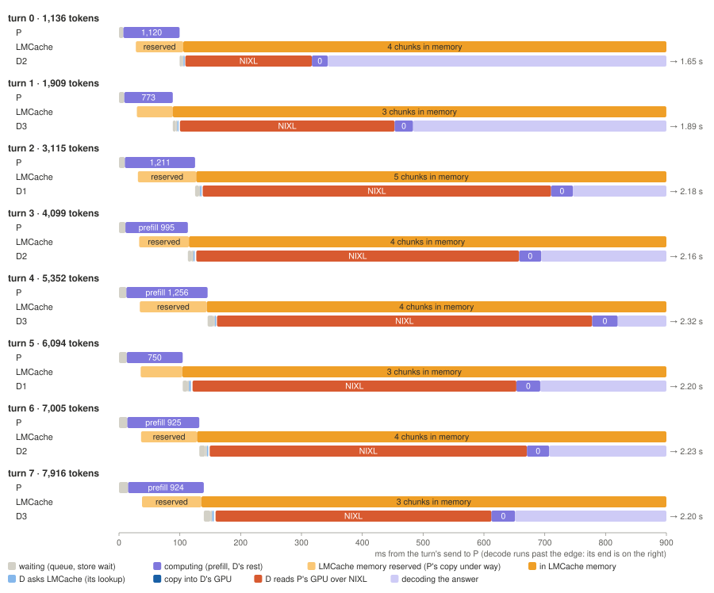

# Conversation 7: mt-rag-clapnq-elser-512-100-20240503 (memory mode, NIXL, shared servers, carry-forward, all passages)

P's KV reaches D over NIXL (D reads P's GPU blocks); every engine's LMCache connector stores beside it, to the one shared server. 8 turns on D1, D2, D3 (round-robin: each turn to the next D engine); prompts grow from 1,136 to 7,916 tokens (interleaved: each turn's prompt is the previous one, its answer, then this turn's documents and question). Chunks are 256 tokens (16 vLLM blocks of 16); a chunk's name is LMCache's hash of its tokens and everything before them, so the same prefix has the same chunks on every turn and engine.

Legend for the strips (one character a chunk): P: `=` on P's GPU from an earlier turn, `#` computed and stored now, `+` computed, not stored (a partial chunk). D: `=` on D's GPU from an earlier turn, `M` pulled from memory, `S` pulled from disk, `N` read from P's GPU over NIXL, `+` computed by D (a partial chunk), `?` missed.

GPU blocks (the chunk tables): where each engine keeps the chunk's 16 vLLM blocks in its GPU KV cache, by vLLM's block ids (vLLM's paged KV cache: a block, or page, holds 16 tokens; block 0 is its reserved null block), in the prompt's block order, a run of consecutive ids written as a range: `P 1, 138-152` is the prompt's block 0 in GPU block 1 and its blocks 1-15 in GPU blocks 138-152. An engine takes a GPU block from its free list when it first computes or loads a block, and the block keeps it while cached, so a later turn that reuses the block shows the same id. Blocks that are the same in several prompts (the same tokens and everything before them) share one GPU block once the first is cached: the system prompt's first block, the same in every conversation, is the usual one. `16/16 hashes = P's`: of the blocks D pulled, how many have the same vLLM hash on D as on P.

The prompts' text is the driver's own record of what it sent (answers included); lines over 100 characters are wrapped here for reading.

| turn | prompt | chunks + tail | P: own GPU / computed / stored | D: own GPU / loaded / computed | pulled | pull ms | D first token ms |
| ---: | ---: | --- | --- | --- | --- | ---: | ---: |
| [0](#turn-0) | 1,136 | 4 + 112 | 16 / 1,120 / 4 chunks | 16 / 1,120 / 0 | 5 chunks (NIXL 5) | 208.0 | 239.4 |
| [1](#turn-1) | 1,909 | 7 + 117 | 1,136 / 773 / 3 chunks | 16 / 1,893 / 0 | 8 chunks (NIXL 8) | 352.9 | 390.0 |
| [2](#turn-2) | 3,115 | 12 + 43 | 1,904 / 1,211 / 5 chunks | 16 / 3,099 / 0 | 13 chunks (NIXL 13) | 572.7 | 614.6 |
| [3](#turn-3) | 4,099 | 16 + 3 | 3,104 / 995 / 4 chunks | 1,248 / 2,851 / 0 | 13 chunks (NIXL 13) | 530.8 | 575.5 |
| [4](#turn-4) | 5,352 | 20 + 232 | 4,096 / 1,256 / 4 chunks | 2,032 / 3,320 / 0 | 14 chunks (NIXL 14) | 616.8 | 664.7 |
| [5](#turn-5) | 6,094 | 23 + 206 | 5,344 / 750 / 3 chunks | 3,232 / 2,862 / 0 | 12 chunks (NIXL 12) | 532.4 | 580.2 |
| [6](#turn-6) | 7,005 | 27 + 93 | 6,080 / 925 / 4 chunks | 4,224 / 2,781 / 0 | 12 chunks (NIXL 12) | 521.6 | 565.6 |
| [7](#turn-7) | 7,916 | 30 + 236 | 6,992 / 924 / 3 chunks | 5,472 / 2,444 / 0 | 10 chunks (NIXL 10) | 453.6 | 501.1 |

## How the prompt grows

Each turn's prompt is the previous one, token for token, and then: D's answer to the previous turn, this turn's documents, its question and the framing (the system prompt on turn 0, `Assistant:` and newlines). Only the new tokens can make new chunks: the previous prompt's partial chunk fills first. A document sent before comes again at another place, so in other chunks.

| turn | prompt | new | previous answer | documents | question | framing | whole chunks |
| ---: | ---: | ---: | ---: | --- | --- | ---: | --- |
| 0 | 1,136 | +1,136 | – | 5 docs, 1,094 | 12: which sport awards the oldest trophy in international sports | 30 | 4 (+4) |
| 1 | 1,909 | +773 | 120 | 5 docs, 616 | 34: As America's Cup is the oldest trophy awarded to sailing, May I ask y… | 3 | 7 (+3) |
| 2 | 3,115 | +1,206 | 128 | 7 docs, 1,036 | 39: Soccer is a very popular sport and watched by millions around the wor… | 3 | 12 (+5) |
| 3 | 4,099 | +984 | 128 | 7 docs, 836 | 17: Are those sport only played by man or woman also can play them? | 3 | 16 (+4) |
| 4 | 5,352 | +1,253 | 128 | 7 docs, 1,109 (1 sent before: 137) | 13: Do you think i can be a good soccer player? | 3 | 20 (+4) |
| 5 | 6,094 | +742 | 128 | 7 docs, 576 (3 sent before: 189) | 35: I can see that play any sport soccer any other needs some talend and … | 3 | 23 (+3) |
| 6 | 7,005 | +911 | 128 | 6 docs, 763 (2 sent before: 289) | 17: Are you saying that eat meat is not good for those play sports? | 3 | 27 (+4) |
| 7 | 7,916 | +911 | 128 | 6 docs, 758 (4 sent before: 586) | 22: You are right, a good diet is important for any person that wish to p… | 3 | 30 (+3) |

## Timeline

Every turn on one clock: ms from the moment the proxy sent the turn to P. P prefills it (one token out) and holds its blocks for D; the proxy sends the turn to the next D engine at once with P's reply's kv_transfer_params (no wait), D reads P's blocks over NIXL (orange-red), computes the rest and decodes the answer. Beside it every engine's LMCache connector stores its new whole chunks (P's lane, and D's own when it stored any). The lanes: P, LMCache (P's chunks), D, and LMCache (D's chunks).



| turn | P queued → done | P's chunks: in memory / on disk | D | D starts | NIXL read | D: held / from P / from LMCache / computed | D's chunks stored | first token | P freed | D done |
| ---: | --- | --- | --- | ---: | --- | --- | ---: | ---: | ---: | ---: |
| 0 | 7 → 100 | 4: 106 / – | D2 | 104 | 109-317 | 16 / 1,120 / 0 / 0 | 0 | 344 | 318 | 1,647 |
| 1 | 9 → 88 | 3: 88 / – | D3 | 94 | 100-453 | 16 / 1,893 / 0 / 0 | 0 | 484 | 453 | 1,891 |
| 2 | 10 → 125 | 5: 127 / – | D1 | 132 | 138-710 | 16 / 3,099 / 0 / 0 | 0 | 746 | 711 | 2,179 |
| 3 | 10 → 113 | 4: 115 / – | D2 | 119 | 127-658 | 1,248 / 2,851 / 0 / 0 | 0 | 694 | 659 | 2,159 |
| 4 | 12 → 146 | 4: 144 / – | D3 | 155 | 161-778 | 2,032 / 3,320 / 0 / 0 | 0 | 820 | 779 | 2,319 |
| 5 | 13 → 105 | 3: 104 / – | D1 | 112 | 121-653 | 3,232 / 2,862 / 0 / 0 | 0 | 692 | 654 | 2,199 |
| 6 | 14 → 132 | 4: 128 / – | D2 | 142 | 149-671 | 4,224 / 2,781 / 0 / 0 | 0 | 707 | 672 | 2,226 |
| 7 | 15 → 140 | 3: 136 / – | D3 | 150 | 159-612 | 5,472 / 2,444 / 0 / 0 | 0 | 651 | 613 | 2,196 |

All times in ms from the turn's send to P. NIXL read: D's worker posts the read of P's blocks to the KV in D's GPU blocks; P freed: D has read, P's blocks go back to its free queue (still cached). Each turn's section below tells it in a sentence and step by step.

### One chunk, block by block: chunk 1 of turn 0 (`ef22e6cab9b7e811`)

Tokens 256-512 (doc 804380142_446-: 57; doc 798029343_451-: 138; doc 864952571_2802: 61). P computed its blocks; D2 read them from P's GPU over NIXL, P's block into D's block, one for one:

| block | tokens | P's GPU block | vLLM hash on P | D's GPU block | same hash on D |
| ---: | --- | ---: | --- | ---: | --- |
| 16 | 256-272 | 2585 | `97249dcabf2c0f3f` | 2222 | True |
| 17 | 272-288 | 2586 | `4df4e0d02b68c371` | 2223 | True |
| 18 | 288-304 | 2587 | `0703a9955b521250` | 2224 | True |
| 19 | 304-320 | 2588 | `8bc652a7a6fec68d` | 2225 | True |
| 20 | 320-336 | 2589 | `fdaef33bf405b9d9` | 2226 | True |
| 21 | 336-352 | 2590 | `aa0dda001f67969a` | 2227 | True |
| 22 | 352-368 | 2591 | `641bf752403d7da3` | 2228 | True |
| 23 | 368-384 | 2592 | `59329f0563b38e60` | 2229 | True |
| 24 | 384-400 | 2593 | `02295926686de3ce` | 2230 | True |
| 25 | 400-416 | 2594 | `cd0eaa3ead0c0f9f` | 2231 | True |
| 26 | 416-432 | 2595 | `6c8ab163d416cdf0` | 2232 | True |
| 27 | 432-448 | 2596 | `009d28e9911a9105` | 2233 | True |
| 28 | 448-464 | 2597 | `6b925da88661249d` | 2234 | True |
| 29 | 464-480 | 2598 | `ad7d9394dd6c8e58` | 2235 | True |
| 30 | 480-496 | 2599 | `4f94cc142c2bd9ad` | 2236 | True |
| 31 | 496-512 | 2600 | `3236e13e3cc59174` | 2237 | True |

## Turn 0

**Timeline:** P queued until 7 ms, prefilled 1,120 tokens (held 16) and was done at 100 ms; its 4 new chunks were in LMCache's memory at 106 ms. D2 started at 104 ms (no wait) holding 16 tokens, read 1,120 from P's GPU over NIXL (posted at 109 ms, in its GPU at 317 ms; P freed its blocks at 318 ms), computed 0 and gave its first token at 344 ms; it decoded 120 tokens until 1,647 ms. ([all turns](#timeline))

### Step by step

Every move of this turn's KV, ms from the proxy sending the turn to P. P's KV reaches D over NIXL: D's worker reads P's GPU blocks into its own (a NIXL READ, P told when D is done); LMCache's copies (to and from each server's memory) its servers do themselves through CUDA IPC handles each engine registered at start.

| ms | where | what |
| ---: | --- | --- |
| 0.0 | proxy → P | sends the turn (1,136 prompt tokens; P is asked for one token: prefill only) |
| 3.0 | P | the request arrives |
| 7.0 | P GPU | its prefix cache holds 16 of the prompt's tokens: 1 block in GPU blocks 1 |
| 7.1 | P ↔ LMCache | LMCache has 0 of its tokens; P loads 0 and computes the rest |
| 7.2 | P GPU | 70 new GPU blocks for the 1,120 tokens it computes: 2570-2639; the prefill runs |
| 7.7 | P → LMCache | store planned: tokens 0-1,024, chunks 0-3 (64 blocks) |
| 27.0 | LMCache | the store request is in; it waits for P's forward pass to finish (a CUDA event) |
| 27.6 | LMCache memory | space reserved for 4 chunks (117 MB) |
| 95.7 | P GPU → LMCache memory | the copy starts: LMCache reads P's GPU blocks (CUDA IPC) |
| 95.9 | P GPU | the request is done: P holds its 71 blocks for D to read over NIXL, and its reply carries them (kv_transfer_params: the blocks, its NIXL agent) |
| 99.7 | P → proxy | P answers its one token: the prefill is done |
| 100.8 | P GPU → LMCache memory | copy done: 4 chunks, 117 MB in 5.1 ms |
| 104.1 | proxy → D2 | sends the turn to D2 at once, with P's kv_transfer_params (round-robin; no wait) |
| 105.6 | LMCache memory | 4 chunks in memory, kept for later requests (D gets this turn's KV from P over NIXL); P keeps its copy in its GPU blocks |
| 106.0 | D2 ↔ LMCache | asks LMCache for the prompt's chunks |
| 107.6 | LMCache memory | found 1,024 tokens it lacks: 4 chunks in memory |
| 108.0 | D2 GPU | its prefix cache holds 16 of the prompt's tokens: 1 block in GPU blocks 1 |
| 108.0 | D2 ↔ P (NIXL) | will read 1,120 prompt tokens from P's GPU (beyond the 16 its own cache holds) |
| 108.1 | D2 ↔ LMCache | LMCache has 1,024 of its tokens; NIXL loads it (MultiConnector: the first connector with tokens) |
| 108.4 | D2 GPU | 70 GPU blocks for the KV from P: 2207-2276 |
| 109.1 | P GPU → D2 GPU (NIXL) | D2 reads P's GPU blocks 1, 2570-2639 into its 2207-2276 (a NIXL READ) |
| 317.1 | D2 | the KV from P is in its GPU blocks (1,120 tokens) |
| 317.6 | P GPU | D2 has read: P frees its blocks (they stay in its prefix cache) |
| 331.8 | D2 GPU | 1 new GPU block for the 1 prompt tokens it computes: 2277 |
| 343.5 | D2 → proxy | the first answer token |
| 506.0 | D2 GPU | decoding: the answer's KV takes 7 new GPU blocks as it grows, one per 16 tokens: 2278-2284, until 1,559 ms |
| 1,647.1 | D2 | done: 120 tokens decoded; its blocks stay cached in its GPU for the next turn |
| 1,648.4 | proxy | the response is complete |

1,136 prompt tokens: 4 whole chunks and 112 tokens over (the partial chunk, computed by both engines and stored only when a later turn completes it). P held 16 tokens on its GPU, computed 1,120 and stored 4 new chunks; D2 held 16, read 1,120 from P over NIXL, loaded 0 from LMCache and computed 0.

### The prompt

The whole prompt, piece by piece:

- **system prompt** · tokens 0-28 (28) · chunk 0

```text
You are a helpful assistant. Answer the user's last question from the documents. If they do not hold
the answer, say so.
```

<details><summary>document <code>804380142_446-1836-0-1390</code> · tokens 28-313 (285) · chunks 0-1</summary>

```text
Document: Stanley Cup
Stanley Cup
The Stanley Cup ( French : La Coupe Stanley ) is the championship trophy awarded annually to the
National Hockey League ( NHL ) playoff winner . It is the oldest existing trophy to be awarded to a
professional sports franchise , and the International Ice Hockey Federation ( IIHF ) considers it to
be one of the `` most important championships available to the sport '' . Originally commissioned in
1892 as the Dominion Hockey Challenge Cup , the trophy is named after Lord Stanley of Preston , then
-- Governor General of Canada , who donated it as an award to Canada 's top - ranking amateur ice
hockey club , which the entire Stanley family supported , with the sons and daughters playing and
promoting the game . The first Cup was awarded in 1893 to Montreal HC , and subsequent winners from
1893 to 1914 were determined by challenge games and league play . Professional teams first became
eligible to challenge for the Stanley Cup in 1906 . In 1915 , the two professional ice hockey
organizations , the National Hockey Association ( NHA ) and the Pacific Coast Hockey Association (
PCHA ) , reached a gentlemen 's agreement in which their respective champions would face each other
annually for the Stanley Cup . After a series of league mergers and folds , it was established as
the de facto championship trophy of the NHL in 1926 and then the de jure NHL championship prize in
1947 .
```

</details>

<details><summary>document <code>798029343_451-1065-0-614</code> · tokens 313-451 (138) · chunk 1</summary>

```text
Document: America's Cup
America's Cup
The America 's Cup , affectionately known as the `` Auld Mug '' , is a trophy awarded to the winner
of the America 's Cup match races between two sailing yachts . One yacht , known as the defender ,
represents the yacht club that currently holds the America 's Cup and the second yacht , known as
the challenger , represents the yacht club that is challenging for the cup . The timing of each
match is determined by an agreement between the defender and the challenger . The America 's Cup is
the oldest international sporting trophy . It will next be raced for in the southern summer , in the
early part of 2021 .
```

</details>

<details><summary>document <code>864952571_28023-29282-0-1259</code> · tokens 451-707 (256) · chunks 1-2</summary>

```text
Document: Football
Football
One of the longest running football fixture is the Cordner - Eggleston Cup , contested between
Melbourne Grammar School and Scotch College , Melbourne every year since 1858 . It is believed by
many to also be the first match of Australian rules football , although it was played under
experimental rules in its first year . The first football trophy tournament was the Caledonian
Challenge Cup , donated by the Royal Caledonian Society of Melbourne , played in 1861 under the
Melbourne Rules . The oldest football league is a rugby football competition , the United Hospitals
Challenge Cup ( 1874 ) , while the oldest rugby trophy is the Yorkshire Cup , contested since 1878 .
The South Australian Football Association ( 30 April 1877 ) is the oldest surviving Australian rules
football competition . The oldest surviving soccer trophy is the Youdan Cup ( 1867 ) and the oldest
national football competition is the English FA Cup ( 1871 ) . The Football League ( 1888 ) is
recognised as the longest running Association Football league . The first ever international
football match took place between sides representing England and Scotland on March 5 , 1870 at the
Oval under the authority of the FA . The first Rugby international took place in 1871 . Modern
```

</details>

<details><summary>document <code>804380142_2872-4252-0-1380</code> · tokens 707-1003 (296) · chunks 2-3</summary>

```text
Document: Stanley Cup
Stanley Cup
Unlike the trophies awarded by the other major professional sports leagues of North America , a new
Stanley Cup is not made each year . Originally , the winners kept it until a new champion was
crowned . Currently , winning teams get the Stanley Cup during the summer and a limited number of
days during the season . It is unusual among trophies to include winning members ' names . Every
year since 1924 , a select portion of the winning players , coaches , management , and club staff
names are engraved on its bands . However , there is not enough room to include all the players and
non-players , so some names must be omitted . Initially a new band added each year , though this
caused the trophy to grow in size , earning the nickname `` Stovepipe Cup '' . In 1958 the modern
one - piece Cup was designed with a five - band barrel which could contain 13 winning teams per band
. To prevent the Stanley Cup from growing , when the bottom band is full , the oldest band is
removed and preserved in the Hockey Hall of Fame , and a new blank band added to the bottom . It has
been referred to as The Cup , Lord Stanley 's Cup , The Holy Grail , or facetiously ( chiefly by
sportswriters ) as Lord Stanley 's Mug . The Stanley Cup is surrounded by numerous legends and
traditions , the oldest of which is the celebratory drinking of champagne out of the cup by the
winning team .
```

</details>

<details><summary>document <code>865335038_17091-17557-0-466</code> · tokens 1003-1122 (119) · chunks 3-4</summary>

```text
Document: FIFA World Cup
FIFA World Cup
From 1930 to 1970 , the Jules Rimet Trophy was awarded to the World Cup winning team . It was
originally simply known as the World Cup or Coupe du Monde , but in 1946 it was renamed after the
FIFA president Jules Rimet who set up the first tournament . In 1970 , Brazil 's third victory in
the tournament entitled them to keep the trophy permanently . However , the trophy was stolen in
1983 and has never been recovered , apparently melted down by the thieves . The
```

</details>

- **question 0** · tokens 1122-1134 (12) · chunk 4

```text
User: which sport awards the oldest trophy in international sports
```

- `Assistant:` · tokens 1134-1136 (2) · chunk 4

### Pieces, chunks and blocks

| piece | tokens | length | chunks | |
| --- | --- | ---: | --- | --- |
| system | 0-28 | 28 | 0 |  |
| doc 804380142_446- | 28-313 | 285 | 0-1 |  |
| doc 798029343_451- | 313-451 | 138 | 1 |  |
| doc 864952571_2802 | 451-707 | 256 | 1-2 |  |
| doc 804380142_2872 | 707-1003 | 296 | 2-3 |  |
| doc 865335038_1709 | 1003-1122 | 119 | 3-4 |  |
| question 0 | 1122-1134 | 12 | 4 |  |
| `assistant:` 0 | 1134-1136 | 2 | 4 |  |

```
P  ####+
D  NNNNN
```

| chunk | tokens | pieces in it (tokens) | vLLM blocks | GPU blocks | in LMCache | P this turn | D this turn |
| ---: | --- | --- | --- | --- | --- | --- | --- |
| 0 | 0-256 | system: 28; doc 804380142_446-: 228 | 0-15 | P 1, 2570-2584; D 1, 2207-2221; 15/15 hashes = P's | `164bd412948ba57b` stored on turn 0 by P | computed (its first 16 tokens on P's GPU already), **stored now** | **read from P's GPU over NIXL** (its first 16 tokens on D's GPU already) |
| 1 | 256-512 | doc 804380142_446-: 57; doc 798029343_451-: 138; doc 864952571_2802: 61 | 16-31 | P 2585-2600; D 2222-2237; 16/16 hashes = P's | `ef22e6cab9b7e811` stored on turn 0 by P | computed, **stored now** | **read from P's GPU over NIXL** |
| 2 | 512-768 | doc 864952571_2802: 195; doc 804380142_2872: 61 | 32-47 | P 2601-2616; D 2238-2253; 16/16 hashes = P's | `d427da0baf6ce07c` stored on turn 0 by P | computed, **stored now** | **read from P's GPU over NIXL** |
| 3 | 768-1024 | doc 804380142_2872: 235; doc 865335038_1709: 21 | 48-63 | P 2617-2632; D 2254-2269; 16/16 hashes = P's | `a1d86ca2bbc3e7cb` stored on turn 0 by P | computed, **stored now** | **read from P's GPU over NIXL** |
| 4 | 1024-1136 | doc 865335038_1709: 98; question 0: 12; `assistant:` 0: 2 | 64-70 | P 2633-2639; D 2270-2276; 7/7 hashes = P's | – | computed (partial chunk: not stored) | **read from P's GPU over NIXL** (partial chunk) |

## Turn 1

**Timeline:** P queued until 9 ms, prefilled 773 tokens (held 1,136) and was done at 88 ms; its 3 new chunks were in LMCache's memory at 88 ms. D3 started at 94 ms (no wait) holding 16 tokens, read 1,893 from P's GPU over NIXL (posted at 100 ms, in its GPU at 453 ms; P freed its blocks at 453 ms), computed 0 and gave its first token at 484 ms; it decoded 128 tokens until 1,891 ms. ([all turns](#timeline))

### Step by step

Every move of this turn's KV, ms from the proxy sending the turn to P. P's KV reaches D over NIXL: D's worker reads P's GPU blocks into its own (a NIXL READ, P told when D is done); LMCache's copies (to and from each server's memory) its servers do themselves through CUDA IPC handles each engine registered at start.

| ms | where | what |
| ---: | --- | --- |
| 0.0 | proxy → P | sends the turn (1,909 prompt tokens; P is asked for one token: prefill only) |
| 3.4 | P | the request arrives |
| 8.3 | P GPU | its prefix cache holds 1,136 of the prompt's tokens: 71 blocks in GPU blocks 1, 2570-2639 |
| 8.5 | P ↔ LMCache | LMCache has 1,024 of its tokens; P loads 0 and computes the rest |
| 8.7 | P GPU | 49 new GPU blocks for the 773 tokens it computes: 2640-2688; the prefill runs |
| 9.2 | P → LMCache | store planned: tokens 1,024-1,792, chunks 4-6 (48 blocks) |
| 28.8 | LMCache | the store request is in; it waits for P's forward pass to finish (a CUDA event) |
| 29.3 | LMCache memory | space reserved for 3 chunks (88 MB) |
| 83.7 | P GPU → LMCache memory | the copy starts: LMCache reads P's GPU blocks (CUDA IPC) |
| 84.0 | P GPU | the request is done: P holds its 120 blocks for D to read over NIXL, and its reply carries them (kv_transfer_params: the blocks, its NIXL agent) |
| 87.5 | P GPU → LMCache memory | copy done: 3 chunks, 88 MB in 3.8 ms |
| 88.4 | P → proxy | P answers its one token: the prefill is done |
| 88.5 | LMCache memory | 3 chunks in memory, kept for later requests (D gets this turn's KV from P over NIXL); P keeps its copy in its GPU blocks |
| 93.5 | proxy → D3 | sends the turn to D3 at once, with P's kv_transfer_params (round-robin; no wait) |
| 96.0 | D3 ↔ LMCache | asks LMCache for the prompt's chunks |
| 97.9 | LMCache memory | found 1,792 tokens it lacks: 7 chunks in memory |
| 99.1 | D3 GPU | its prefix cache holds 16 of the prompt's tokens: 1 block in GPU blocks 1 |
| 99.1 | D3 ↔ P (NIXL) | will read 1,893 prompt tokens from P's GPU (beyond the 16 its own cache holds) |
| 99.2 | D3 ↔ LMCache | LMCache has 1,792 of its tokens; NIXL loads it (MultiConnector: the first connector with tokens) |
| 99.5 | D3 GPU | 119 GPU blocks for the KV from P: 2492-2610 |
| 100.2 | P GPU → D3 GPU (NIXL) | D3 reads P's GPU blocks 1, 2570-2688 into its 2492-2610 (a NIXL READ) |
| 453.1 | D3 | the KV from P is in its GPU blocks (1,893 tokens) |
| 453.1 | P GPU | D3 has read: P frees its blocks (they stay in its prefix cache) |
| 483.5 | D3 → proxy | the first answer token |
| 591.2 | D3 GPU | 1 new GPU block for the 1 prompt tokens it computes: 2611 |
| 768.5 | D3 GPU | decoding: the answer's KV takes 7 new GPU blocks as it grows, one per 16 tokens: 2612-2618, until 1,835 ms |
| 1,890.9 | D3 | done: 128 tokens decoded; its blocks stay cached in its GPU for the next turn |
| 1,892.1 | proxy | the response is complete |

1,909 prompt tokens: 7 whole chunks and 117 tokens over (the partial chunk, computed by both engines and stored only when a later turn completes it). P held 1,136 tokens on its GPU, computed 773 and stored 3 new chunks; D3 held 16, read 1,893 from P over NIXL, loaded 0 from LMCache and computed 0.

### The prompt

Tokens 0-1,136: [turn 0](#turn-0)'s prompt, unchanged (checked: its first 1,136 token ids are the previous prompt's), so chunks 0-3 are the same chunks; chunk 4 (partial then, 112 tokens) fills now. New from token 1,136:

- **D's answer to turn 0** · tokens 1136-1256 (120) · chunk 4

```text
 The oldest trophy in international sports is the America's Cup. It is awarded to the winner of the
America's Cup match races between two sailing yachts. One yacht, known as the defender, represents
the yacht club that currently holds the America's Cup and the second yacht, known as the challenger,
represents the yacht club that is challenging for the cup. The timing of each match is determined by
an agreement between the defender and the challenger. The America's Cup is the oldest international
sporting trophy. It will next be raced for in the southern summer, in the early part of 2021.
```

- `\n` · tokens 1256-1257 (1) · chunk 4

<details><summary>document <code>864996542_1179-1575-0-396</code> · tokens 1257-1374 (117) · chunks 4-5</summary>

```text
Document: Football (ball)
Football (ball)
The oldest football still in existence , which is thought to have been made circa 1550 , was
discovered in the roof of Stirling Castle , Scotland , in 1981 . The ball is made of leather (
possibly from a deer ) and a pig 's bladder . It has a diameter of between 14 -- 16 cm ( 5.5 -- 6.3
in ) , weighs 125 g ( 4.4 oz ) and is currently on display at the Smith Art Gallery and Museum in
Stirling .
```

</details>

<details><summary>document <code>803807172_2995-3230-0-235</code> · tokens 1374-1440 (66) · chunk 5</summary>

```text
Document: Mesoamerican ballgame
Mesoamerican ballgame
One candidate for the birthplace of the ballgame is the Soconusco coastal lowlands along the Pacific
Ocean . Here , at Paso de la Amada , archaeologists have found the oldest ballcourt yet discovered ,
dated to approximately 1400 BCE .
```

</details>

<details><summary>document <code>796369617_6680-7212-0-532</code> · tokens 1440-1560 (120) · chunks 5-6</summary>

```text
Document: Curling
Curling
Today , the sport is most firmly established in Canada , having been taken there by Scottish
emigrants . The Royal Montreal Curling Club , the oldest established sports club still active in
North America , was established in 1807 . The first curling club in the United States was
established in 1830 , and the sport was introduced to Switzerland and Sweden before the end of the
19th century , also by Scots . Today , curling is played all over Europe and has spread to Brazil ,
Japan , Australia , New Zealand , China , and Korea .
```

</details>

<details><summary>document <code>796369617_3120-3982-0-862</code> · tokens 1560-1761 (201) · chunk 6</summary>

```text
Document: Curling
Curling
Evidence that curling existed in Scotland in the early 16th century includes a curling stone
inscribed with the date 1511 uncovered ( along with another bearing the date 1551 ) when an old pond
was drained at Dunblane , Scotland . The world 's oldest curling stone and the world 's oldest
football are now kept in the same museum ( the Stirling Smith Art Gallery and Museum ) in Stirling .
The first written reference to a contest using stones on ice coming from the records of Paisley
Abbey , Renfrewshire , in February 1541 . Two paintings , `` Winter Landscape with a Bird Trap ''
and `` The Hunters in the Snow '' ( both dated 1565 ) by Pieter Bruegel the Elder depict Flemish
peasants curling , albeit without brooms ; Scotland and the Low Countries had strong trading and
cultural links during this period , which is also evident in the history of golf . A
```

</details>

<details><summary>document <code>864952571_33370-33915-0-545</code> · tokens 1761-1873 (112) · chunks 6-7</summary>

```text
Document: Football
Football
By the late 1850s , many football clubs had been formed throughout the English - speaking world , to
play various codes of football . Sheffield Football Club , founded in 1857 in the English city of
Sheffield by Nathaniel Creswick and William Prest , was later recognised as the world 's oldest club
playing association football . However , the club initially played its own code of football : the
Sheffield rules . The code was largely independent of the public school rules , the most significant
difference being the lack of an offside rule .
```

</details>

- **question 1** · tokens 1873-1907 (34) · chunk 7

```text
User: As America's Cup is the oldest trophy awarded to sailing, May I ask you what is the oldest
sport invented and if  it is still been currently playing ?
```

- `Assistant:` · tokens 1907-1909 (2) · chunk 7

### Pieces, chunks and blocks

| piece | tokens | length | chunks | |
| --- | --- | ---: | --- | --- |
| system | 0-28 | 28 | 0 |  |
| doc 804380142_446- | 28-313 | 285 | 0-1 |  |
| doc 798029343_451- | 313-451 | 138 | 1 |  |
| doc 864952571_2802 | 451-707 | 256 | 1-2 |  |
| doc 804380142_2872 | 707-1003 | 296 | 2-3 |  |
| doc 865335038_1709 | 1003-1122 | 119 | 3-4 |  |
| question 0 | 1122-1134 | 12 | 4 |  |
| `assistant:` 0 | 1134-1136 | 2 | 4 |  |
| answer 0 | 1136-1256 | 120 | 4 | new this turn |
| newline 0 | 1256-1257 | 1 | 4 | new this turn |
| doc 864996542_1179 | 1257-1374 | 117 | 4-5 | new this turn |
| doc 803807172_2995 | 1374-1440 | 66 | 5 | new this turn |
| doc 796369617_6680 | 1440-1560 | 120 | 5-6 | new this turn |
| doc 796369617_3120 | 1560-1761 | 201 | 6 | new this turn |
| doc 864952571_3337 | 1761-1873 | 112 | 6-7 | new this turn |
| question 1 | 1873-1907 | 34 | 7 | new this turn |
| `assistant:` 1 | 1907-1909 | 2 | 7 | new this turn |

```
P  ====###+
D  NNNNNNNN
```

| chunk | tokens | pieces in it (tokens) | vLLM blocks | GPU blocks | in LMCache | P this turn | D this turn |
| ---: | --- | --- | --- | --- | --- | --- | --- |
| 0 | 0-256 | system: 28; doc 804380142_446-: 228 | 0-15 | P 1, 2570-2584; D 1, 2492-2506 | `164bd412948ba57b` stored on turn 0 by P | on P's GPU (earlier turn) | **read from P's GPU over NIXL** (its first 16 tokens on D's GPU already) |
| 1 | 256-512 | doc 804380142_446-: 57; doc 798029343_451-: 138; doc 864952571_2802: 61 | 16-31 | P 2585-2600; D 2507-2522 | `ef22e6cab9b7e811` stored on turn 0 by P | on P's GPU (earlier turn) | **read from P's GPU over NIXL** |
| 2 | 512-768 | doc 864952571_2802: 195; doc 804380142_2872: 61 | 32-47 | P 2601-2616; D 2523-2538 | `d427da0baf6ce07c` stored on turn 0 by P | on P's GPU (earlier turn) | **read from P's GPU over NIXL** |
| 3 | 768-1024 | doc 804380142_2872: 235; doc 865335038_1709: 21 | 48-63 | P 2617-2632; D 2539-2554 | `a1d86ca2bbc3e7cb` stored on turn 0 by P | on P's GPU (earlier turn) | **read from P's GPU over NIXL** |
| 4 | 1024-1280 | doc 865335038_1709: 98; question 0: 12; `assistant:` 0: 2; answer 0 (new): 120; newline 0 (new): 1; doc 864996542_1179 (new): 23 | 64-79 | P 2633-2648; D 2555-2570; 9/9 hashes = P's | `9457cf23aaca2ecf` stored on turn 1 by P | computed (its first 112 tokens on P's GPU already), **stored now** | **read from P's GPU over NIXL** |
| 5 | 1280-1536 | doc 864996542_1179 (new): 94; doc 803807172_2995 (new): 66; doc 796369617_6680 (new): 96 | 80-95 | P 2649-2664; D 2571-2586; 16/16 hashes = P's | `b5cc2dbbd7e6ad28` stored on turn 1 by P | computed, **stored now** | **read from P's GPU over NIXL** |
| 6 | 1536-1792 | doc 796369617_6680 (new): 24; doc 796369617_3120 (new): 201; doc 864952571_3337 (new): 31 | 96-111 | P 2665-2680; D 2587-2602; 16/16 hashes = P's | `552dcb9959324558` stored on turn 1 by P | computed, **stored now** | **read from P's GPU over NIXL** |
| 7 | 1792-1909 | doc 864952571_3337 (new): 81; question 1 (new): 34; `assistant:` 1 (new): 2 | 112-119 | P 2681-2687; D 2603-2610; 7/7 hashes = P's | – | computed (partial chunk: not stored) | **read from P's GPU over NIXL** (partial chunk) |

## Turn 2

**Timeline:** P queued until 10 ms, prefilled 1,211 tokens (held 1,904) and was done at 125 ms; its 5 new chunks were in LMCache's memory at 127 ms. D1 started at 132 ms (no wait) holding 16 tokens, read 3,099 from P's GPU over NIXL (posted at 138 ms, in its GPU at 710 ms; P freed its blocks at 711 ms), computed 0 and gave its first token at 746 ms; it decoded 128 tokens until 2,179 ms. ([all turns](#timeline))

### Step by step

Every move of this turn's KV, ms from the proxy sending the turn to P. P's KV reaches D over NIXL: D's worker reads P's GPU blocks into its own (a NIXL READ, P told when D is done); LMCache's copies (to and from each server's memory) its servers do themselves through CUDA IPC handles each engine registered at start.

| ms | where | what |
| ---: | --- | --- |
| 0.0 | proxy → P | sends the turn (3,115 prompt tokens; P is asked for one token: prefill only) |
| 3.9 | P | the request arrives |
| 9.3 | P GPU | its prefix cache holds 1,904 of the prompt's tokens: 119 blocks in GPU blocks 1, 2570-2687 |
| 9.4 | P ↔ LMCache | LMCache has 1,792 of its tokens; P loads 0 and computes the rest |
| 9.7 | P GPU | 76 new GPU blocks for the 1,211 tokens it computes: 2688-2763; the prefill runs |
| 10.4 | P → LMCache | store planned: tokens 1,792-3,072, chunks 7-11 (80 blocks) |
| 30.1 | LMCache | the store request is in; it waits for P's forward pass to finish (a CUDA event) |
| 31.0 | LMCache memory | space reserved for 5 chunks (147 MB) |
| 119.0 | P GPU → LMCache memory | the copy starts: LMCache reads P's GPU blocks (CUDA IPC) |
| 119.3 | P GPU | the request is done: P holds its 195 blocks for D to read over NIXL, and its reply carries them (kv_transfer_params: the blocks, its NIXL agent) |
| 125.1 | P → proxy | P answers its one token: the prefill is done |
| 125.3 | P GPU → LMCache memory | copy done: 5 chunks, 147 MB in 6.3 ms |
| 127.1 | LMCache memory | 5 chunks in memory, kept for later requests (D gets this turn's KV from P over NIXL); P keeps its copy in its GPU blocks |
| 131.7 | proxy → D1 | sends the turn to D1 at once, with P's kv_transfer_params (round-robin; no wait) |
| 133.5 | D1 ↔ LMCache | asks LMCache for the prompt's chunks |
| 135.8 | LMCache memory | found 3,072 tokens it lacks: 12 chunks in memory |
| 136.4 | D1 GPU | its prefix cache holds 16 of the prompt's tokens: 1 block in GPU blocks 1 |
| 136.4 | D1 ↔ P (NIXL) | will read 3,099 prompt tokens from P's GPU (beyond the 16 its own cache holds) |
| 136.5 | D1 ↔ LMCache | LMCache has 3,072 of its tokens; NIXL loads it (MultiConnector: the first connector with tokens) |
| 136.8 | D1 GPU | 194 GPU blocks for the KV from P: 1961-2154 |
| 137.6 | P GPU → D1 GPU (NIXL) | D1 reads P's GPU blocks 1, 2570-2763 into its 1961-2154 (a NIXL READ) |
| 710.3 | D1 | the KV from P is in its GPU blocks (3,099 tokens) |
| 711.1 | P GPU | D1 has read: P frees its blocks (they stay in its prefix cache) |
| 746.4 | D1 → proxy | the first answer token |
| 787.8 | D1 GPU | 1 new GPU block for the 1 prompt tokens it computes: 2155 |
| 968.9 | D1 GPU | decoding: the answer's KV takes 7 new GPU blocks as it grows, one per 16 tokens: 2156-2162, until 2,055 ms |
| 2,179.2 | D1 | done: 128 tokens decoded; its blocks stay cached in its GPU for the next turn |
| 2,180.3 | proxy | the response is complete |

3,115 prompt tokens: 12 whole chunks and 43 tokens over (the partial chunk, computed by both engines and stored only when a later turn completes it). P held 1,904 tokens on its GPU, computed 1,211 and stored 5 new chunks; D1 held 16, read 3,099 from P over NIXL, loaded 0 from LMCache and computed 0.

### The prompt

Tokens 0-1,909: [turn 1](#turn-1)'s prompt, unchanged (checked: its first 1,909 token ids are the previous prompt's), so chunks 0-6 are the same chunks; chunk 7 (partial then, 117 tokens) fills now. New from token 1,909:

- **D's answer to turn 1** · tokens 1909-2037 (128) · chunk 7

```text
 The oldest sport invented is football. It is still being played today. The oldest football still in
existence, which is thought to have been made circa 1550, was discovered in the roof of Stirling
Castle, Scotland, in 1981. The ball is made of leather (possibly from a deer) and a pig's bladder.
It has a diameter of between 14--16 cm (5.5--6.3 in), weighs 125 g (4.4 oz) and is currently on
display at the Smith Art Gallery and Museum in Stirling. The oldest football still in existence,
which is thought to have been
```

- `\n` · tokens 2037-2038 (1) · chunk 7

<details><summary>document <code>856059988_1043-2017-0-974</code> · tokens 2038-2245 (207) · chunks 7-8</summary>

```text
Document: American football
American football
American football , referred to as football in the United States and Canada and also known as
gridiron , is a team sport played by two teams of eleven players on a rectangular field with
goalposts at each end . The offense , which is the team controlling the oval - shaped football ,
attempts to advance down the field by running with or passing the ball , while the defense , which
is the team without control of the ball , aims to stop the offense 's advance and aims to take
control of the ball for themselves . The offense must advance at least ten yards in four downs , or
plays , and otherwise they turn over the football to the defense ; if the offense succeeds in
advancing ten yards or more , they are given a new set of four downs . Points are primarily scored
by advancing the ball into the opposing team 's end zone for a touchdown or kicking the ball through
the opponent 's goalposts for a field goal . The team with the most points at the end of a game wins
.
```

</details>

<details><summary>document <code>864952571_3921-4540-0-619</code> · tokens 2245-2382 (137) · chunks 8-9</summary>

```text
Document: Football
Football
Two teams of usually between 11 and 18 players ; some variations that have fewer players ( five or
more per team ) are also popular . A clearly defined area in which to play the game . Scoring goals
or points by moving the ball to an opposing team 's end of the field and either into a goal area ,
or over a line . Goals or points resulting from players putting the ball between two goalposts . The
goal or line being defended by the opposing team . Players being required to move the ball --
depending on the code -- by kicking , carrying , or hand - passing the ball . Players using only
their body to move the ball .
```

</details>

<details><summary>document <code>856059988_5524-5831-0-307</code> · tokens 2382-2450 (68) · chunk 9</summary>

```text
Document: American football
American football
American football evolved from the sports of association football ( soccer ) and rugby football .
Rugby football , like American football , is a sport where two competing teams vie for control of a
ball , which can be kicked through a set of goalposts or run into the opponent 's goal area to score
points .
```

</details>

<details><summary>document <code>808419312_394-761-0-367</code> · tokens 2450-2530 (80) · chunk 9</summary>

```text
Document: Comparison of American football and rugby league
Comparison of American football and rugby league
A comparison between American football and rugby league is possible because of their shared origins
and similar game concepts . Along with Canadian football , rugby league is the most similar sport to
American football . Both sports involve the concept of a limited number of downs / tackles and
scoring touchdowns / tries takes clear precedence over goal - kicking .
```

</details>

<details><summary>document <code>864952571_491-1122-0-631</code> · tokens 2530-2649 (119) · chunks 9-10</summary>

```text
Document: Football
Football
Football is a family of team sports that involve , to varying degrees , kicking a ball to score a
goal . Unqualified , the word football is understood to refer to whichever form of football is the
most popular in the regional context in which the word appears . Sports commonly called football in
certain places include association football ( known as soccer in some countries ) ; gridiron
football ( specifically American football or Canadian football ) ; Australian rules football ; rugby
football ( either rugby league or rugby union ) ; and Gaelic football . These different variations
of football are known as football codes .
```

</details>

<details><summary>document <code>808419312_2507-3040-0-533</code> · tokens 2649-2763 (114) · chunk 10</summary>

```text
Document: Comparison of American football and rugby league
Comparison of American football and rugby league
Both sports descend from the older game of rugby football in the 19th Century when its two offshoots
developed . British colonists and the British military in Canada brought football to North America .
It became popular in American and Canadian universities and prep schools . At the time , association
football and rugby football were not as differentiated as they are now and teams would negotiate the
rules before playing each game . The sports of American football and Canadian football evolved from
these intercollegiate games .
```

</details>

<details><summary>document <code>808419312_762-2313-0-1551</code> · tokens 2763-3074 (311) · chunks 10-12</summary>

```text
Document: Comparison of American football and rugby league
Comparison of American football and rugby league
Generally , American football games last much longer than 80 - minute rugby league matches . Because
the field is reset after each tackle in American football , it is much slower - paced than the more
hectic rugby league , in which play stops for only as long as it takes the tackled player to get
back to his feet and return the ball to play . Another major difference is that only the player with
possession of the ball may be interfered with in rugby league ; defending players interfering with
any other attacking player ( and vice versa ) will incur a penalty . Passing in the two sports also
differs : while backward passing is common to both sports , in American football players are allowed
to throw the ball forward in certain situations whereas in rugby league forward passing is always
illegal . Rugby league players have to kick the ball or run it forward to advance it downfield . To
score a try or touchdown in rugby league , the player has to push the ball directly onto the ground
once in the try zone , whereas in American football the player has to simply cross the line .
American football also requires its players to use a large amount of protective equipment ,
including helmets , gloves and padding around the body , whereas protective clothing is much more
minimal in rugby league , usually amounting to light padding ( if any ) and soft head gear ( hard
helmets being illegal ) . The major difference between rugby league and American Football ( Gridiron
) is rugby fields are 100 metres where American football is 100 yards .
```

</details>

- **question 2** · tokens 3074-3113 (39) · chunk 12

```text
User: Soccer is a very popular sport and watched by millions around the world. What is the
difference between soccer and american football that is also very popular and viewed  by thousands
around the world?
```

- `Assistant:` · tokens 3113-3115 (2) · chunk 12

### Pieces, chunks and blocks

| piece | tokens | length | chunks | |
| --- | --- | ---: | --- | --- |
| system | 0-28 | 28 | 0 |  |
| doc 804380142_446- | 28-313 | 285 | 0-1 |  |
| doc 798029343_451- | 313-451 | 138 | 1 |  |
| doc 864952571_2802 | 451-707 | 256 | 1-2 |  |
| doc 804380142_2872 | 707-1003 | 296 | 2-3 |  |
| doc 865335038_1709 | 1003-1122 | 119 | 3-4 |  |
| question 0 | 1122-1134 | 12 | 4 |  |
| `assistant:` 0 | 1134-1136 | 2 | 4 |  |
| answer 0 | 1136-1256 | 120 | 4 |  |
| newline 0 | 1256-1257 | 1 | 4 |  |
| doc 864996542_1179 | 1257-1374 | 117 | 4-5 |  |
| doc 803807172_2995 | 1374-1440 | 66 | 5 |  |
| doc 796369617_6680 | 1440-1560 | 120 | 5-6 |  |
| doc 796369617_3120 | 1560-1761 | 201 | 6 |  |
| doc 864952571_3337 | 1761-1873 | 112 | 6-7 |  |
| question 1 | 1873-1907 | 34 | 7 |  |
| `assistant:` 1 | 1907-1909 | 2 | 7 |  |
| answer 1 | 1909-2037 | 128 | 7 | new this turn |
| newline 1 | 2037-2038 | 1 | 7 | new this turn |
| doc 856059988_1043 | 2038-2245 | 207 | 7-8 | new this turn |
| doc 864952571_3921 | 2245-2382 | 137 | 8-9 | new this turn |
| doc 856059988_5524 | 2382-2450 | 68 | 9 | new this turn |
| doc 808419312_394- | 2450-2530 | 80 | 9 | new this turn |
| doc 864952571_491- | 2530-2649 | 119 | 9-10 | new this turn |
| doc 808419312_2507 | 2649-2763 | 114 | 10 | new this turn |
| doc 808419312_762- | 2763-3074 | 311 | 10-12 | new this turn |
| question 2 | 3074-3113 | 39 | 12 | new this turn |
| `assistant:` 2 | 3113-3115 | 2 | 12 | new this turn |

```
P  =======#####+
D  NNNNNNNNNNNNN
```

| chunk | tokens | pieces in it (tokens) | vLLM blocks | GPU blocks | in LMCache | P this turn | D this turn |
| ---: | --- | --- | --- | --- | --- | --- | --- |
| 0 | 0-256 | system: 28; doc 804380142_446-: 228 | 0-15 | P 1, 2570-2584; D 1, 1961-1975 | `164bd412948ba57b` stored on turn 0 by P | on P's GPU (earlier turn) | **read from P's GPU over NIXL** (its first 16 tokens on D's GPU already) |
| 1 | 256-512 | doc 804380142_446-: 57; doc 798029343_451-: 138; doc 864952571_2802: 61 | 16-31 | P 2585-2600; D 1976-1991 | `ef22e6cab9b7e811` stored on turn 0 by P | on P's GPU (earlier turn) | **read from P's GPU over NIXL** |
| 2 | 512-768 | doc 864952571_2802: 195; doc 804380142_2872: 61 | 32-47 | P 2601-2616; D 1992-2007 | `d427da0baf6ce07c` stored on turn 0 by P | on P's GPU (earlier turn) | **read from P's GPU over NIXL** |
| 3 | 768-1024 | doc 804380142_2872: 235; doc 865335038_1709: 21 | 48-63 | P 2617-2632; D 2008-2023 | `a1d86ca2bbc3e7cb` stored on turn 0 by P | on P's GPU (earlier turn) | **read from P's GPU over NIXL** |
| 4 | 1024-1280 | doc 865335038_1709: 98; question 0: 12; `assistant:` 0: 2; answer 0: 120; newline 0: 1; doc 864996542_1179: 23 | 64-79 | P 2633-2648; D 2024-2039 | `9457cf23aaca2ecf` stored on turn 1 by P | on P's GPU (earlier turn) | **read from P's GPU over NIXL** |
| 5 | 1280-1536 | doc 864996542_1179: 94; doc 803807172_2995: 66; doc 796369617_6680: 96 | 80-95 | P 2649-2664; D 2040-2055 | `b5cc2dbbd7e6ad28` stored on turn 1 by P | on P's GPU (earlier turn) | **read from P's GPU over NIXL** |
| 6 | 1536-1792 | doc 796369617_6680: 24; doc 796369617_3120: 201; doc 864952571_3337: 31 | 96-111 | P 2665-2680; D 2056-2071 | `552dcb9959324558` stored on turn 1 by P | on P's GPU (earlier turn) | **read from P's GPU over NIXL** |
| 7 | 1792-2048 | doc 864952571_3337: 81; question 1: 34; `assistant:` 1: 2; answer 1 (new): 128; newline 1 (new): 1; doc 856059988_1043 (new): 10 | 112-127 | P 2681-2696; D 2072-2087; 9/9 hashes = P's | `6b4634c58766870a` stored on turn 2 by P | computed (its first 112 tokens on P's GPU already), **stored now** | **read from P's GPU over NIXL** |
| 8 | 2048-2304 | doc 856059988_1043 (new): 197; doc 864952571_3921 (new): 59 | 128-143 | P 2697-2712; D 2088-2103; 16/16 hashes = P's | `9eb7ebc38adb04fb` stored on turn 2 by P | computed, **stored now** | **read from P's GPU over NIXL** |
| 9 | 2304-2560 | doc 864952571_3921 (new): 78; doc 856059988_5524 (new): 68; doc 808419312_394- (new): 80; doc 864952571_491- (new): 30 | 144-159 | P 2713-2728; D 2104-2119; 16/16 hashes = P's | `727c7f11f25b4373` stored on turn 2 by P | computed, **stored now** | **read from P's GPU over NIXL** |
| 10 | 2560-2816 | doc 864952571_491- (new): 89; doc 808419312_2507 (new): 114; doc 808419312_762- (new): 53 | 160-175 | P 2729-2744; D 2120-2135; 16/16 hashes = P's | `cae1263ef13a3f47` stored on turn 2 by P | computed, **stored now** | **read from P's GPU over NIXL** |
| 11 | 2816-3072 | doc 808419312_762- (new): 256 | 176-191 | P 2745-2760; D 2136-2151; 16/16 hashes = P's | `e8d4361652b7c481` stored on turn 2 by P | computed, **stored now** | **read from P's GPU over NIXL** |
| 12 | 3072-3115 | doc 808419312_762- (new): 2; question 2 (new): 39; `assistant:` 2 (new): 2 | 192-194 | P 2761-2762; D 2152-2154; 2/2 hashes = P's | – | computed (partial chunk: not stored) | **read from P's GPU over NIXL** (partial chunk) |

## Turn 3

**Timeline:** P queued until 10 ms, prefilled 995 tokens (held 3,104) and was done at 113 ms; its 4 new chunks were in LMCache's memory at 115 ms. D2 started at 119 ms (no wait) holding 1,248 tokens, read 2,851 from P's GPU over NIXL (posted at 127 ms, in its GPU at 658 ms; P freed its blocks at 659 ms), computed 0 and gave its first token at 694 ms; it decoded 128 tokens until 2,159 ms. ([all turns](#timeline))

### Step by step

Every move of this turn's KV, ms from the proxy sending the turn to P. P's KV reaches D over NIXL: D's worker reads P's GPU blocks into its own (a NIXL READ, P told when D is done); LMCache's copies (to and from each server's memory) its servers do themselves through CUDA IPC handles each engine registered at start.

| ms | where | what |
| ---: | --- | --- |
| 0.0 | proxy → P | sends the turn (4,099 prompt tokens; P is asked for one token: prefill only) |
| 4.8 | P | the request arrives |
| 10.1 | P GPU | its prefix cache holds 3,104 of the prompt's tokens: 194 blocks in GPU blocks 1, 2570-2762 |
| 10.2 | P ↔ LMCache | LMCache has 3,072 of its tokens; P loads 0 and computes the rest |
| 10.5 | P GPU | 63 new GPU blocks for the 995 tokens it computes: 2763-2825; the prefill runs |
| 11.1 | P → LMCache | store planned: tokens 3,072-4,096, chunks 12-15 (64 blocks) |
| 31.9 | LMCache | the store request is in; it waits for P's forward pass to finish (a CUDA event) |
| 33.1 | LMCache memory | space reserved for 4 chunks (117 MB) |
| 106.0 | P GPU → LMCache memory | the copy starts: LMCache reads P's GPU blocks (CUDA IPC) |
| 106.3 | P GPU | the request is done: P holds its 257 blocks for D to read over NIXL, and its reply carries them (kv_transfer_params: the blocks, its NIXL agent) |
| 111.0 | P GPU → LMCache memory | copy done: 4 chunks, 117 MB in 5.1 ms |
| 113.2 | P → proxy | P answers its one token: the prefill is done |
| 115.0 | LMCache memory | 4 chunks in memory, kept for later requests (D gets this turn's KV from P over NIXL); P keeps its copy in its GPU blocks |
| 118.8 | proxy → D2 | sends the turn to D2 at once, with P's kv_transfer_params (round-robin; no wait) |
| 122.5 | D2 ↔ LMCache | asks LMCache for the prompt's chunks |
| 123.6 | LMCache memory | found 3,072 tokens it lacks: 12 chunks in memory |
| 125.7 | D2 GPU | its prefix cache holds 1,248 of the prompt's tokens: 78 blocks in GPU blocks 1, 2207-2283 |
| 125.7 | D2 ↔ P (NIXL) | will read 2,851 prompt tokens from P's GPU (beyond the 1,248 its own cache holds) |
| 125.8 | D2 ↔ LMCache | LMCache has 4,096 of its tokens; NIXL loads it (MultiConnector: the first connector with tokens) |
| 126.2 | D2 GPU | 179 GPU blocks for the KV from P: 2284-2462 |
| 127.1 | P GPU → D2 GPU (NIXL) | D2 reads P's GPU blocks 1, 2570-2825 into its 2284-2462 (a NIXL READ) |
| 657.9 | D2 | the KV from P is in its GPU blocks (2,851 tokens) |
| 658.7 | P GPU | D2 has read: P frees its blocks (they stay in its prefix cache) |
| 694.3 | D2 → proxy | the first answer token |
| 829.8 | D2 GPU | 1 new GPU block for the 1 prompt tokens it computes: 2463 |
| 1,014.6 | D2 GPU | decoding: the answer's KV takes 7 new GPU blocks as it grows, one per 16 tokens: 2464-2470, until 2,124 ms |
| 2,158.9 | D2 | done: 128 tokens decoded; its blocks stay cached in its GPU for the next turn |
| 2,160.0 | proxy | the response is complete |

4,099 prompt tokens: 16 whole chunks and 3 tokens over (the partial chunk, computed by both engines and stored only when a later turn completes it). P held 3,104 tokens on its GPU, computed 995 and stored 4 new chunks; D2 held 1,248, read 2,851 from P over NIXL, loaded 0 from LMCache and computed 0.

### The prompt

Tokens 0-3,115: [turn 2](#turn-2)'s prompt, unchanged (checked: its first 3,115 token ids are the previous prompt's), so chunks 0-11 are the same chunks; chunk 12 (partial then, 43 tokens) fills now. New from token 3,115:

- **D's answer to turn 2** · tokens 3115-3243 (128) · chunk 12

```text
 The main difference between soccer and American football is that soccer is played with a round ball
and American football is played with an oval ball. Another difference is that soccer is played on a
rectangular field and American football is played on a rectangular field. Another difference is that
soccer is played with 11 players on each team and American football is played with 11 players on
each team. Another difference is that soccer is played with a goal and American football is played
with a goal. Another difference is that soccer is played with a ball and American football is played
with a ball. Another difference is that soccer is played with a ball and American football is played
```

- `\n` · tokens 3243-3244 (1) · chunk 12

<details><summary>document <code>850509972_112-410-0-298</code> · tokens 3244-3311 (67) · chunk 12</summary>

```text
Document: Women's association football
Women's association football
Women 's association football , also commonly known as women 's football , or women 's soccer , is
the most prominent team sport played by women around the globe . It is played at the professional
level in numerous countries throughout the world and 176 national teams participate internationally
.
```

</details>

<details><summary>document <code>850509972_1631-2306-0-675</code> · tokens 3311-3475 (164) · chunks 12-13</summary>

```text
Document: Women's association football
Women's association football
Women may have been playing `` football '' for as long as the game has existed . Evidence shows that
an ancient version of the game ( Tsu Chu ) was played by women during the Han Dynasty ( 25 -- 220 CE
) . Two female figures are depicted in Han Dynasty ( 25 -- 220 CE ) frescoes , playing Tsu Chu .
There are , however , a number of opinions about the accuracy of dates , the earliest estimates at
5000 BCE . Reports of an annual match being played in Scotland are reported as early as the 1790s .
The first match recorded by the Scottish Football Association took place in 1892 in Glasgow . In
England , the first recorded game of football between women took place in 1895 .
```

</details>

<details><summary>document <code>850509972_2307-2750-0-443</code> · tokens 3475-3578 (103) · chunk 13</summary>

```text
Document: Women's association football
Women's association football
Association football , the modern game , also has documented early involvement of women . In Europe
, it is possible that 12th - century French women played football as part of that era 's folk games
. An annual competition in Mid-Lothian , Scotland during the 1790s is reported , too . In 1863 ,
football governing bodies introduced standardized rules to prohibit violence on the pitch , making
it more socially acceptable for women to play .
```

</details>

<details><summary>document <code>821328353_64611-65236-0-625</code> · tokens 3578-3720 (142) · chunks 13-14</summary>

```text
Document: Olympic Games
Olympic Games
The only sport on the Olympic programme that features men and women competing together is the
equestrian disciplines . There is no `` Women 's Eventing '' , or ' Men 's Dressage ' . As of 2008 ,
there were still more medal events for men than women . With the addition of women 's boxing to the
programme in the 2012 Summer Olympics , however , female athletes were able to compete in all the
same sports as men . In the winter Olympics , women are still unable to compete in the Nordic
Combined . There are currently two Olympic events in which male athletes may not compete :
synchronised swimming and rhythmic gymnastics .
```

</details>

<details><summary>document <code>850509972_14004-14982-0-978</code> · tokens 3720-3936 (216) · chunks 14-15</summary>

```text
Document: Women's association football
Women's association football
In the United States , the intercollegiate sport began from physical education programs that helped
establish organized teams . After sixty years of trying to gain social acceptance women 's football
was introduced to the college level . In the late 1970s , women 's club teams started to appear on
college campus , but it was n't until the 1980s that they started to gain recognition and gained a
varsity status . Brown University was the first college to grant full varsity level status to their
women 's soccer team . The Association of Intercollegiate Athletics for Women ( AIAW ) sponsored the
first regional women 's soccer tournament at college in the USA , which was held at Brown University
. The first national level tournament was held at Colorado College , which gained official AIAW
sponsorship in 1981 . The 1990s saw greater participation mainly due to the Title IX of 23 June 1972
, which increased school 's budgets and their addition of women 's scholarships .
```

</details>

<details><summary>document <code>804941361_95238-95597-0-359</code> · tokens 3936-4007 (71) · chunk 15</summary>

```text
Document: Saudi Arabia
Saudi Arabia
Women 's sport is controversial due to the suppression of female participation in sport by
conservative Islamic religious authorities , however this restriction has eased slightly in recent
years . Until 2018 women were not permitted in sport stadiums . Segregated seating , allowing women
to enter , has been developed in three stadiums across major cities .
```

</details>

<details><summary>document <code>850509972_7888-8220-0-332</code> · tokens 4007-4080 (73) · chunk 15</summary>

```text
Document: Women's association football
Women's association football
However , as in other sports , women have struggled for pay and opportunities equal to male football
players . Major league and international women 's football has enjoyed far less television and media
coverage than the men 's equivalent . In spite of this , the popularity and participation in women
's football continues to grow .
```

</details>

- **question 3** · tokens 4080-4097 (17) · chunks 15-16

```text
User: Are those sport only played by man or woman also can play  them?
```

- `Assistant:` · tokens 4097-4099 (2) · chunk 16

### Pieces, chunks and blocks

| piece | tokens | length | chunks | |
| --- | --- | ---: | --- | --- |
| system | 0-28 | 28 | 0 |  |
| doc 804380142_446- | 28-313 | 285 | 0-1 |  |
| doc 798029343_451- | 313-451 | 138 | 1 |  |
| doc 864952571_2802 | 451-707 | 256 | 1-2 |  |
| doc 804380142_2872 | 707-1003 | 296 | 2-3 |  |
| doc 865335038_1709 | 1003-1122 | 119 | 3-4 |  |
| question 0 | 1122-1134 | 12 | 4 |  |
| `assistant:` 0 | 1134-1136 | 2 | 4 |  |
| answer 0 | 1136-1256 | 120 | 4 |  |
| newline 0 | 1256-1257 | 1 | 4 |  |
| doc 864996542_1179 | 1257-1374 | 117 | 4-5 |  |
| doc 803807172_2995 | 1374-1440 | 66 | 5 |  |
| doc 796369617_6680 | 1440-1560 | 120 | 5-6 |  |
| doc 796369617_3120 | 1560-1761 | 201 | 6 |  |
| doc 864952571_3337 | 1761-1873 | 112 | 6-7 |  |
| question 1 | 1873-1907 | 34 | 7 |  |
| `assistant:` 1 | 1907-1909 | 2 | 7 |  |
| answer 1 | 1909-2037 | 128 | 7 |  |
| newline 1 | 2037-2038 | 1 | 7 |  |
| doc 856059988_1043 | 2038-2245 | 207 | 7-8 |  |
| doc 864952571_3921 | 2245-2382 | 137 | 8-9 |  |
| doc 856059988_5524 | 2382-2450 | 68 | 9 |  |
| doc 808419312_394- | 2450-2530 | 80 | 9 |  |
| doc 864952571_491- | 2530-2649 | 119 | 9-10 |  |
| doc 808419312_2507 | 2649-2763 | 114 | 10 |  |
| doc 808419312_762- | 2763-3074 | 311 | 10-12 |  |
| question 2 | 3074-3113 | 39 | 12 |  |
| `assistant:` 2 | 3113-3115 | 2 | 12 |  |
| answer 2 | 3115-3243 | 128 | 12 | new this turn |
| newline 2 | 3243-3244 | 1 | 12 | new this turn |
| doc 850509972_112- | 3244-3311 | 67 | 12 | new this turn |
| doc 850509972_1631 | 3311-3475 | 164 | 12-13 | new this turn |
| doc 850509972_2307 | 3475-3578 | 103 | 13 | new this turn |
| doc 821328353_6461 | 3578-3720 | 142 | 13-14 | new this turn |
| doc 850509972_1400 | 3720-3936 | 216 | 14-15 | new this turn |
| doc 804941361_9523 | 3936-4007 | 71 | 15 | new this turn |
| doc 850509972_7888 | 4007-4080 | 73 | 15 | new this turn |
| question 3 | 4080-4097 | 17 | 15-16 | new this turn |
| `assistant:` 3 | 4097-4099 | 2 | 16 | new this turn |

```
P  ============####+
D  ====NNNNNNNNNNNNN
```

| chunk | tokens | pieces in it (tokens) | vLLM blocks | GPU blocks | in LMCache | P this turn | D this turn |
| ---: | --- | --- | --- | --- | --- | --- | --- |
| 0 | 0-256 | system: 28; doc 804380142_446-: 228 | 0-15 | P 1, 2570-2584; D 1, 2207-2221 | `164bd412948ba57b` stored on turn 0 by P | on P's GPU (earlier turn) | on D's GPU (earlier turn) |
| 1 | 256-512 | doc 804380142_446-: 57; doc 798029343_451-: 138; doc 864952571_2802: 61 | 16-31 | P 2585-2600; D 2222-2237 | `ef22e6cab9b7e811` stored on turn 0 by P | on P's GPU (earlier turn) | on D's GPU (earlier turn) |
| 2 | 512-768 | doc 864952571_2802: 195; doc 804380142_2872: 61 | 32-47 | P 2601-2616; D 2238-2253 | `d427da0baf6ce07c` stored on turn 0 by P | on P's GPU (earlier turn) | on D's GPU (earlier turn) |
| 3 | 768-1024 | doc 804380142_2872: 235; doc 865335038_1709: 21 | 48-63 | P 2617-2632; D 2254-2269 | `a1d86ca2bbc3e7cb` stored on turn 0 by P | on P's GPU (earlier turn) | on D's GPU (earlier turn) |
| 4 | 1024-1280 | doc 865335038_1709: 98; question 0: 12; `assistant:` 0: 2; answer 0: 120; newline 0: 1; doc 864996542_1179: 23 | 64-79 | P 2633-2648; D 2270-2285 | `9457cf23aaca2ecf` stored on turn 1 by P | on P's GPU (earlier turn) | **read from P's GPU over NIXL** (its first 224 tokens on D's GPU already) |
| 5 | 1280-1536 | doc 864996542_1179: 94; doc 803807172_2995: 66; doc 796369617_6680: 96 | 80-95 | P 2649-2664; D 2286-2301 | `b5cc2dbbd7e6ad28` stored on turn 1 by P | on P's GPU (earlier turn) | **read from P's GPU over NIXL** |
| 6 | 1536-1792 | doc 796369617_6680: 24; doc 796369617_3120: 201; doc 864952571_3337: 31 | 96-111 | P 2665-2680; D 2302-2317 | `552dcb9959324558` stored on turn 1 by P | on P's GPU (earlier turn) | **read from P's GPU over NIXL** |
| 7 | 1792-2048 | doc 864952571_3337: 81; question 1: 34; `assistant:` 1: 2; answer 1: 128; newline 1: 1; doc 856059988_1043: 10 | 112-127 | P 2681-2696; D 2318-2333 | `6b4634c58766870a` stored on turn 2 by P | on P's GPU (earlier turn) | **read from P's GPU over NIXL** |
| 8 | 2048-2304 | doc 856059988_1043: 197; doc 864952571_3921: 59 | 128-143 | P 2697-2712; D 2334-2349 | `9eb7ebc38adb04fb` stored on turn 2 by P | on P's GPU (earlier turn) | **read from P's GPU over NIXL** |
| 9 | 2304-2560 | doc 864952571_3921: 78; doc 856059988_5524: 68; doc 808419312_394-: 80; doc 864952571_491-: 30 | 144-159 | P 2713-2728; D 2350-2365 | `727c7f11f25b4373` stored on turn 2 by P | on P's GPU (earlier turn) | **read from P's GPU over NIXL** |
| 10 | 2560-2816 | doc 864952571_491-: 89; doc 808419312_2507: 114; doc 808419312_762-: 53 | 160-175 | P 2729-2744; D 2366-2381 | `cae1263ef13a3f47` stored on turn 2 by P | on P's GPU (earlier turn) | **read from P's GPU over NIXL** |
| 11 | 2816-3072 | doc 808419312_762-: 256 | 176-191 | P 2745-2760; D 2382-2397 | `e8d4361652b7c481` stored on turn 2 by P | on P's GPU (earlier turn) | **read from P's GPU over NIXL** |
| 12 | 3072-3328 | doc 808419312_762-: 2; question 2: 39; `assistant:` 2: 2; answer 2 (new): 128; newline 2 (new): 1; doc 850509972_112- (new): 67; doc 850509972_1631 (new): 17 | 192-207 | P 2761-2776; D 2398-2413; 14/14 hashes = P's | `43b4e878999a52a2` stored on turn 3 by P | computed (its first 32 tokens on P's GPU already), **stored now** | **read from P's GPU over NIXL** |
| 13 | 3328-3584 | doc 850509972_1631 (new): 147; doc 850509972_2307 (new): 103; doc 821328353_6461 (new): 6 | 208-223 | P 2777-2792; D 2414-2429; 16/16 hashes = P's | `9f1414c8ce7b0fbb` stored on turn 3 by P | computed, **stored now** | **read from P's GPU over NIXL** |
| 14 | 3584-3840 | doc 821328353_6461 (new): 136; doc 850509972_1400 (new): 120 | 224-239 | P 2793-2808; D 2430-2445; 16/16 hashes = P's | `d258e44258308141` stored on turn 3 by P | computed, **stored now** | **read from P's GPU over NIXL** |
| 15 | 3840-4096 | doc 850509972_1400 (new): 96; doc 804941361_9523 (new): 71; doc 850509972_7888 (new): 73; question 3 (new): 16 | 240-255 | P 2809-2824; D 2446-2461; 16/16 hashes = P's | `642e02833d7db0b7` stored on turn 3 by P | computed, **stored now** | **read from P's GPU over NIXL** |
| 16 | 4096-4099 | question 3 (new): 1; `assistant:` 3 (new): 2 | 256 | P –; D 2462 | – | computed (partial chunk: not stored) | **read from P's GPU over NIXL** (partial chunk) |

## Turn 4

**Timeline:** P queued until 12 ms, prefilled 1,256 tokens (held 4,096) and was done at 146 ms; its 4 new chunks were in LMCache's memory at 144 ms. D3 started at 155 ms (no wait) holding 2,032 tokens, read 3,320 from P's GPU over NIXL (posted at 161 ms, in its GPU at 778 ms; P freed its blocks at 779 ms), computed 0 and gave its first token at 820 ms; it decoded 128 tokens until 2,319 ms. ([all turns](#timeline))

### Step by step

Every move of this turn's KV, ms from the proxy sending the turn to P. P's KV reaches D over NIXL: D's worker reads P's GPU blocks into its own (a NIXL READ, P told when D is done); LMCache's copies (to and from each server's memory) its servers do themselves through CUDA IPC handles each engine registered at start.

| ms | where | what |
| ---: | --- | --- |
| 0.0 | proxy → P | sends the turn (5,352 prompt tokens; P is asked for one token: prefill only) |
| 5.9 | P | the request arrives |
| 11.6 | P GPU | its prefix cache holds 4,096 of the prompt's tokens: 256 blocks in GPU blocks 1, 2570-2824 |
| 11.7 | P ↔ LMCache | LMCache has 4,096 of its tokens; P loads 0 and computes the rest |
| 12.1 | P GPU | 79 new GPU blocks for the 1,256 tokens it computes: 2825-2903; the prefill runs |
| 12.8 | P → LMCache | store planned: tokens 4,096-5,120, chunks 16-19 (64 blocks) |
| 33.4 | LMCache | the store request is in; it waits for P's forward pass to finish (a CUDA event) |
| 34.2 | LMCache memory | space reserved for 4 chunks (117 MB) |
| 137.0 | P GPU → LMCache memory | the copy starts: LMCache reads P's GPU blocks (CUDA IPC) |
| 137.3 | P GPU | the request is done: P holds its 335 blocks for D to read over NIXL, and its reply carries them (kv_transfer_params: the blocks, its NIXL agent) |
| 142.1 | P GPU → LMCache memory | copy done: 4 chunks, 117 MB in 5.1 ms |
| 144.2 | LMCache memory | 4 chunks in memory, kept for later requests (D gets this turn's KV from P over NIXL); P keeps its copy in its GPU blocks |
| 145.7 | P → proxy | P answers its one token: the prefill is done |
| 155.4 | proxy → D3 | sends the turn to D3 at once, with P's kv_transfer_params (round-robin; no wait) |
| 157.7 | D3 ↔ LMCache | asks LMCache for the prompt's chunks |
| 159.6 | LMCache memory | found 3,328 tokens it lacks: 13 chunks in memory |
| 160.2 | D3 GPU | its prefix cache holds 2,032 of the prompt's tokens: 127 blocks in GPU blocks 1, 2492-2617 |
| 160.2 | D3 ↔ P (NIXL) | will read 3,320 prompt tokens from P's GPU (beyond the 2,032 its own cache holds) |
| 160.3 | D3 ↔ LMCache | LMCache has 5,120 of its tokens; NIXL loads it (MultiConnector: the first connector with tokens) |
| 160.5 | D3 GPU | 208 GPU blocks for the KV from P: 2618-2825 |
| 161.1 | P GPU → D3 GPU (NIXL) | D3 reads P's GPU blocks 1, 2570-2903 into its 2618-2825 (a NIXL READ) |
| 777.9 | D3 | the KV from P is in its GPU blocks (3,320 tokens) |
| 779.1 | P GPU | D3 has read: P frees its blocks (they stay in its prefix cache) |
| 820.0 | D3 → proxy | the first answer token |
| 896.4 | D3 GPU | 1 new GPU block for the 1 prompt tokens it computes: 2826 |
| 1,084.2 | D3 GPU | decoding: the answer's KV takes 7 new GPU blocks as it grows, one per 16 tokens: 2827-2833, until 2,224 ms |
| 2,319.2 | D3 | done: 128 tokens decoded; its blocks stay cached in its GPU for the next turn |
| 2,320.4 | proxy | the response is complete |

5,352 prompt tokens: 20 whole chunks and 232 tokens over (the partial chunk, computed by both engines and stored only when a later turn completes it). P held 4,096 tokens on its GPU, computed 1,256 and stored 4 new chunks; D3 held 2,032, read 3,320 from P over NIXL, loaded 0 from LMCache and computed 0.

### The prompt

Tokens 0-4,099: [turn 3](#turn-3)'s prompt, unchanged (checked: its first 4,099 token ids are the previous prompt's), so chunks 0-15 are the same chunks; chunk 16 (partial then, 3 tokens) fills now. New from token 4,099:

- **D's answer to turn 3** · tokens 4099-4227 (128) · chunk 16

```text
 Yes, those sports can be played by both men and women. For example, soccer is a sport that can be
played by both men and women. In fact, women's soccer is a very popular sport and is played by many
women around the world. Another example is basketball, which is a sport that can be played by both
men and women. In fact, women's basketball is a very popular sport and is played by many women
around the world. Another example is tennis, which is a sport that can be played by both men and
women. In fact, women's tennis is a very popular sport and is played by many women around
```

- `\n` · tokens 4227-4228 (1) · chunk 16

<details><summary>document <code>842075902_1265-1597-0-332</code> · tokens 4228-4298 (70) · chunk 16</summary>

```text
Document: Football player
Football player
Footballers generally begin as amateurs and the best players progress to become professional players
. Normally they start at a youth team ( any local team ) and from there , based on skill and talent
, scouts offer contracts . Once signed , some learn to play better football and a few advance to the
senior or professional teams .
```

</details>

<details><summary>document <code>842075902_3979-4279-0-300</code> · tokens 4298-4362 (64) · chunks 16-17</summary>

```text
Document: Football player
Football player
An Irish 2002 study of association and Gaelic football players characterised players as `` lean and
muscular with a reasonably high level of capacity in all areas of physical performance '' . The
opposite is the case for American football , where obesity could be the cause of grave health
problems .
```

</details>

<details><summary>document <code>833398293_3819-4781-0-962</code> · tokens 4362-4553 (191) · chunk 17</summary>

```text
Document: Height in sports
Height in sports
In association football , or soccer , a player 's height may somewhat determine the position that
they play ; however , people of all heights have an equal opportunity to excel professionally at the
sport . Goalkeepers , centre backs and `` target '' heading forwards tend to be taller , while
players in wide and attacking positions tend to be shorter . A study of the greatest male players in
history showed that the distribution of heights approximated the average man and , when also looking
at the typical weight distribution , an estimated 95 % of the world 's population would fall into
the body type distribution of great footballers . A sample of reasonably select players from ages 11
-- 18 in the United States tended to approximate the height distribution of the population . However
, there is an overwhelming tendency for the 11-most picked players in a squad to be shorter than
their teammates , which could suggest a bias in the scouting system .
```

</details>

<details><summary>document <code>833398293_4782-7201-967-2377</code> · tokens 4553-5028 (475) · chunks 17-19</summary>

```text
Document: Height in sports
Height in sports
However , height is considered advantageous for forwards who aim to score with their heads .
Forwards who are particularly noted for their strength in the air include Lacina Traoré 2.03 m ( 6
ft 8 in ) , Jan Koller , Nikola Žigić 2.02 m ( 6 ft 7 ⁄ in ) , Peter Crouch 2.01 m ( 6 ft 7 in ) ,
Fernando Llorente and Andy Carroll 1.93 m ( 6 ft 4 in ) . Many of the world 's best forwards and
midfielders are taller than average , while still possessing a high all round level of technical
ability , such as Zlatan Ibrahimović 1.95 m ( 6 ft 5 in ) , Nemanja Matić 1.94 m ( 6 ft 4 ⁄ in ) ,
Luca Toni , Patrick Vieira 1.93 m ( 6 ft 4 in ) , Sócrates 1.92 m ( 6 ft 3 ⁄ in ) , Paul Pogba 1.91
m ( 6 ft 3 in ) , Ruud Gullit , Frank Rijkaard , Romelu Lukaku 1.90 m ( 6 ft 3 in ) , Didier Drogba
, Yaya Touré , Sergio Busquets 1.89 m ( 6 ft 2 ⁄ in ) , Thierry Henry , Eric Cantona , Robert Pirès
, Michael Ballack , Marco van Basten , Ruud van Nistelrooy , Robin van Persie 1.88 m ( 6 ft 2 in ) ,
Pierre - Emerick Aubameyang 1.87 m ( 6 ft 1 ⁄ in ) , Kaká , Rivaldo , Fernando Torres 1.86 m ( 6 ft
1 in ) , Zinedine Zidane , Cristiano Ronaldo , Robert Lewandowski and Gabriel Batistuta 1.85 m ( 6
ft 1 in ) , with their height being seen as an added bonus for their heading and physical ability ,
which adds to their completeness , it is seen as something desirable in modern top - level football
forwards and midfielders .
```

</details>

<details><summary>document <code>842075902_292-549-0-257</code> · tokens 5028-5083 (55) · chunk 19</summary>

```text
Document: Football player
Football player
A football player is a sportsperson who plays one of the different types of football . The main
types of football are association football , American football , Canadian football , Australian
rules football , Gaelic football , rugby league and rugby union .
```

</details>

- document `864952571_3921-4540-0-619` · tokens 5083-5220 (137) · chunks 19-20 · **again**: sent on [turn 2](#turn-2) already (the same 137 tokens), here at another place in the prompt, so in other chunks: a prefix cache cannot reuse it

<details><summary>document <code>807219735_61699-62222-0-523</code> · tokens 5220-5337 (117) · chunk 20</summary>

```text
Document: Cristiano Ronaldo
Cristiano Ronaldo
Both players have scored in at least two UEFA Champions League finals and have regularly broken the
50 - goal barrier in a single season . Sports journalists and pundits regularly argue the individual
merits of both players in an attempt to argue who they believe is the best player in modern football
. It has been compared to sports rivalries such as the Muhammad Ali -- Joe Frazier rivalry in boxing
, the Borg -- McEnroe rivalry in tennis , and the Ayrton Senna -- Alain Prost rivalry from Formula
One motor racing . ``
```

</details>

- **question 4** · tokens 5337-5350 (13) · chunk 20

```text
User: Do you think i can be a good soccer player?
```

- `Assistant:` · tokens 5350-5352 (2) · chunk 20

### Pieces, chunks and blocks

| piece | tokens | length | chunks | |
| --- | --- | ---: | --- | --- |
| system | 0-28 | 28 | 0 |  |
| doc 804380142_446- | 28-313 | 285 | 0-1 |  |
| doc 798029343_451- | 313-451 | 138 | 1 |  |
| doc 864952571_2802 | 451-707 | 256 | 1-2 |  |
| doc 804380142_2872 | 707-1003 | 296 | 2-3 |  |
| doc 865335038_1709 | 1003-1122 | 119 | 3-4 |  |
| question 0 | 1122-1134 | 12 | 4 |  |
| `assistant:` 0 | 1134-1136 | 2 | 4 |  |
| answer 0 | 1136-1256 | 120 | 4 |  |
| newline 0 | 1256-1257 | 1 | 4 |  |
| doc 864996542_1179 | 1257-1374 | 117 | 4-5 |  |
| doc 803807172_2995 | 1374-1440 | 66 | 5 |  |
| doc 796369617_6680 | 1440-1560 | 120 | 5-6 |  |
| doc 796369617_3120 | 1560-1761 | 201 | 6 |  |
| doc 864952571_3337 | 1761-1873 | 112 | 6-7 |  |
| question 1 | 1873-1907 | 34 | 7 |  |
| `assistant:` 1 | 1907-1909 | 2 | 7 |  |
| answer 1 | 1909-2037 | 128 | 7 |  |
| newline 1 | 2037-2038 | 1 | 7 |  |
| doc 856059988_1043 | 2038-2245 | 207 | 7-8 |  |
| doc 864952571_3921 | 2245-2382 | 137 | 8-9 |  |
| doc 856059988_5524 | 2382-2450 | 68 | 9 |  |
| doc 808419312_394- | 2450-2530 | 80 | 9 |  |
| doc 864952571_491- | 2530-2649 | 119 | 9-10 |  |
| doc 808419312_2507 | 2649-2763 | 114 | 10 |  |
| doc 808419312_762- | 2763-3074 | 311 | 10-12 |  |
| question 2 | 3074-3113 | 39 | 12 |  |
| `assistant:` 2 | 3113-3115 | 2 | 12 |  |
| answer 2 | 3115-3243 | 128 | 12 |  |
| newline 2 | 3243-3244 | 1 | 12 |  |
| doc 850509972_112- | 3244-3311 | 67 | 12 |  |
| doc 850509972_1631 | 3311-3475 | 164 | 12-13 |  |
| doc 850509972_2307 | 3475-3578 | 103 | 13 |  |
| doc 821328353_6461 | 3578-3720 | 142 | 13-14 |  |
| doc 850509972_1400 | 3720-3936 | 216 | 14-15 |  |
| doc 804941361_9523 | 3936-4007 | 71 | 15 |  |
| doc 850509972_7888 | 4007-4080 | 73 | 15 |  |
| question 3 | 4080-4097 | 17 | 15-16 |  |
| `assistant:` 3 | 4097-4099 | 2 | 16 |  |
| answer 3 | 4099-4227 | 128 | 16 | new this turn |
| newline 3 | 4227-4228 | 1 | 16 | new this turn |
| doc 842075902_1265 | 4228-4298 | 70 | 16 | new this turn |
| doc 842075902_3979 | 4298-4362 | 64 | 16-17 | new this turn |
| doc 833398293_3819 | 4362-4553 | 191 | 17 | new this turn |
| doc 833398293_4782 | 4553-5028 | 475 | 17-19 | new this turn |
| doc 842075902_292- | 5028-5083 | 55 | 19 | new this turn |
| doc 864952571_3921 | 5083-5220 | 137 | 19-20 | new this turn |
| doc 807219735_6169 | 5220-5337 | 117 | 20 | new this turn |
| question 4 | 5337-5350 | 13 | 20 | new this turn |
| `assistant:` 4 | 5350-5352 | 2 | 20 | new this turn |

```
P  ================####+
D  =======NNNNNNNNNNNNNN
```

| chunk | tokens | pieces in it (tokens) | vLLM blocks | GPU blocks | in LMCache | P this turn | D this turn |
| ---: | --- | --- | --- | --- | --- | --- | --- |
| 0 | 0-256 | system: 28; doc 804380142_446-: 228 | 0-15 | P 1, 2570-2584; D 1, 2492-2506 | `164bd412948ba57b` stored on turn 0 by P | on P's GPU (earlier turn) | on D's GPU (earlier turn) |
| 1 | 256-512 | doc 804380142_446-: 57; doc 798029343_451-: 138; doc 864952571_2802: 61 | 16-31 | P 2585-2600; D 2507-2522 | `ef22e6cab9b7e811` stored on turn 0 by P | on P's GPU (earlier turn) | on D's GPU (earlier turn) |
| 2 | 512-768 | doc 864952571_2802: 195; doc 804380142_2872: 61 | 32-47 | P 2601-2616; D 2523-2538 | `d427da0baf6ce07c` stored on turn 0 by P | on P's GPU (earlier turn) | on D's GPU (earlier turn) |
| 3 | 768-1024 | doc 804380142_2872: 235; doc 865335038_1709: 21 | 48-63 | P 2617-2632; D 2539-2554 | `a1d86ca2bbc3e7cb` stored on turn 0 by P | on P's GPU (earlier turn) | on D's GPU (earlier turn) |
| 4 | 1024-1280 | doc 865335038_1709: 98; question 0: 12; `assistant:` 0: 2; answer 0: 120; newline 0: 1; doc 864996542_1179: 23 | 64-79 | P 2633-2648; D 2555-2570 | `9457cf23aaca2ecf` stored on turn 1 by P | on P's GPU (earlier turn) | on D's GPU (earlier turn, its own answer) |
| 5 | 1280-1536 | doc 864996542_1179: 94; doc 803807172_2995: 66; doc 796369617_6680: 96 | 80-95 | P 2649-2664; D 2571-2586 | `b5cc2dbbd7e6ad28` stored on turn 1 by P | on P's GPU (earlier turn) | on D's GPU (earlier turn) |
| 6 | 1536-1792 | doc 796369617_6680: 24; doc 796369617_3120: 201; doc 864952571_3337: 31 | 96-111 | P 2665-2680; D 2587-2602 | `552dcb9959324558` stored on turn 1 by P | on P's GPU (earlier turn) | on D's GPU (earlier turn) |
| 7 | 1792-2048 | doc 864952571_3337: 81; question 1: 34; `assistant:` 1: 2; answer 1: 128; newline 1: 1; doc 856059988_1043: 10 | 112-127 | P 2681-2696; D 2603-2618 | `6b4634c58766870a` stored on turn 2 by P | on P's GPU (earlier turn) | **read from P's GPU over NIXL** (its first 240 tokens on D's GPU already) |
| 8 | 2048-2304 | doc 856059988_1043: 197; doc 864952571_3921: 59 | 128-143 | P 2697-2712; D 2619-2634 | `9eb7ebc38adb04fb` stored on turn 2 by P | on P's GPU (earlier turn) | **read from P's GPU over NIXL** |
| 9 | 2304-2560 | doc 864952571_3921: 78; doc 856059988_5524: 68; doc 808419312_394-: 80; doc 864952571_491-: 30 | 144-159 | P 2713-2728; D 2635-2650 | `727c7f11f25b4373` stored on turn 2 by P | on P's GPU (earlier turn) | **read from P's GPU over NIXL** |
| 10 | 2560-2816 | doc 864952571_491-: 89; doc 808419312_2507: 114; doc 808419312_762-: 53 | 160-175 | P 2729-2744; D 2651-2666 | `cae1263ef13a3f47` stored on turn 2 by P | on P's GPU (earlier turn) | **read from P's GPU over NIXL** |
| 11 | 2816-3072 | doc 808419312_762-: 256 | 176-191 | P 2745-2760; D 2667-2682 | `e8d4361652b7c481` stored on turn 2 by P | on P's GPU (earlier turn) | **read from P's GPU over NIXL** |
| 12 | 3072-3328 | doc 808419312_762-: 2; question 2: 39; `assistant:` 2: 2; answer 2: 128; newline 2: 1; doc 850509972_112-: 67; doc 850509972_1631: 17 | 192-207 | P 2761-2776; D 2683-2698 | `43b4e878999a52a2` stored on turn 3 by P | on P's GPU (earlier turn) | **read from P's GPU over NIXL** |
| 13 | 3328-3584 | doc 850509972_1631: 147; doc 850509972_2307: 103; doc 821328353_6461: 6 | 208-223 | P 2777-2792; D 2699-2714 | `9f1414c8ce7b0fbb` stored on turn 3 by P | on P's GPU (earlier turn) | **read from P's GPU over NIXL** |
| 14 | 3584-3840 | doc 821328353_6461: 136; doc 850509972_1400: 120 | 224-239 | P 2793-2808; D 2715-2730 | `d258e44258308141` stored on turn 3 by P | on P's GPU (earlier turn) | **read from P's GPU over NIXL** |
| 15 | 3840-4096 | doc 850509972_1400: 96; doc 804941361_9523: 71; doc 850509972_7888: 73; question 3: 16 | 240-255 | P 2809-2824; D 2731-2746 | `642e02833d7db0b7` stored on turn 3 by P | on P's GPU (earlier turn) | **read from P's GPU over NIXL** |
| 16 | 4096-4352 | question 3: 1; `assistant:` 3: 2; answer 3 (new): 128; newline 3 (new): 1; doc 842075902_1265 (new): 70; doc 842075902_3979 (new): 54 | 256-271 | P 2825-2840; D 2747-2762; 16/16 hashes = P's | `d9b11f9eb48fcb2b` stored on turn 4 by P | computed, **stored now** | **read from P's GPU over NIXL** |
| 17 | 4352-4608 | doc 842075902_3979 (new): 10; doc 833398293_3819 (new): 191; doc 833398293_4782 (new): 55 | 272-287 | P 2841-2856; D 2763-2778; 16/16 hashes = P's | `4dad237b55433bb3` stored on turn 4 by P | computed, **stored now** | **read from P's GPU over NIXL** |
| 18 | 4608-4864 | doc 833398293_4782 (new): 256 | 288-303 | P 2857-2872; D 2779-2794; 16/16 hashes = P's | `a48dc323969ae28c` stored on turn 4 by P | computed, **stored now** | **read from P's GPU over NIXL** |
| 19 | 4864-5120 | doc 833398293_4782 (new): 164; doc 842075902_292- (new): 55; doc 864952571_3921 (new): 37 | 304-319 | P 2873-2888; D 2795-2810; 16/16 hashes = P's | `da86166da37c28b3` stored on turn 4 by P | computed, **stored now** | **read from P's GPU over NIXL** |
| 20 | 5120-5352 | doc 864952571_3921 (new): 100; doc 807219735_6169 (new): 117; question 4 (new): 13; `assistant:` 4 (new): 2 | 320-334 | P 2889-2902; D 2811-2825; 14/14 hashes = P's | – | computed (partial chunk: not stored) | **read from P's GPU over NIXL** (partial chunk) |

## Turn 5

**Timeline:** P queued until 13 ms, prefilled 750 tokens (held 5,344) and was done at 105 ms; its 3 new chunks were in LMCache's memory at 104 ms. D1 started at 112 ms (no wait) holding 3,232 tokens, read 2,862 from P's GPU over NIXL (posted at 121 ms, in its GPU at 653 ms; P freed its blocks at 654 ms), computed 0 and gave its first token at 692 ms; it decoded 128 tokens until 2,199 ms. ([all turns](#timeline))

### Step by step

Every move of this turn's KV, ms from the proxy sending the turn to P. P's KV reaches D over NIXL: D's worker reads P's GPU blocks into its own (a NIXL READ, P told when D is done); LMCache's copies (to and from each server's memory) its servers do themselves through CUDA IPC handles each engine registered at start.

| ms | where | what |
| ---: | --- | --- |
| 0.0 | proxy → P | sends the turn (6,094 prompt tokens; P is asked for one token: prefill only) |
| 6.3 | P | the request arrives |
| 12.3 | P GPU | its prefix cache holds 5,344 of the prompt's tokens: 334 blocks in GPU blocks 1, 2570-2902 |
| 12.5 | P ↔ LMCache | LMCache has 5,120 of its tokens; P loads 0 and computes the rest |
| 12.8 | P GPU | 47 new GPU blocks for the 750 tokens it computes: 2903-2949; the prefill runs |
| 13.4 | P → LMCache | store planned: tokens 5,120-5,888, chunks 20-22 (48 blocks) |
| 34.7 | LMCache | the store request is in; it waits for P's forward pass to finish (a CUDA event) |
| 35.6 | LMCache memory | space reserved for 3 chunks (88 MB) |
| 96.2 | P GPU → LMCache memory | the copy starts: LMCache reads P's GPU blocks (CUDA IPC) |
| 96.5 | P GPU | the request is done: P holds its 381 blocks for D to read over NIXL, and its reply carries them (kv_transfer_params: the blocks, its NIXL agent) |
| 100.0 | P GPU → LMCache memory | copy done: 3 chunks, 88 MB in 3.8 ms |
| 104.1 | LMCache memory | 3 chunks in memory, kept for later requests (D gets this turn's KV from P over NIXL); P keeps its copy in its GPU blocks |
| 104.7 | P → proxy | P answers its one token: the prefill is done |
| 112.3 | proxy → D1 | sends the turn to D1 at once, with P's kv_transfer_params (round-robin; no wait) |
| 115.2 | D1 ↔ LMCache | asks LMCache for the prompt's chunks |
| 118.2 | LMCache memory | found 2,816 tokens it lacks: 11 chunks in memory |
| 119.2 | D1 GPU | its prefix cache holds 3,232 of the prompt's tokens: 202 blocks in GPU blocks 1, 1961-2161 |
| 119.3 | D1 ↔ P (NIXL) | will read 2,862 prompt tokens from P's GPU (beyond the 3,232 its own cache holds) |
| 119.4 | D1 ↔ LMCache | LMCache has 5,888 of its tokens; NIXL loads it (MultiConnector: the first connector with tokens) |
| 119.9 | D1 GPU | 179 GPU blocks for the KV from P: 2162-2340 |
| 120.9 | P GPU → D1 GPU (NIXL) | D1 reads P's GPU blocks 1, 2570-2949 into its 2162-2340 (a NIXL READ) |
| 653.3 | D1 | the KV from P is in its GPU blocks (2,862 tokens) |
| 653.9 | P GPU | D1 has read: P frees its blocks (they stay in its prefix cache) |
| 692.5 | D1 → proxy | the first answer token |
| 698.5 | D1 GPU | 1 new GPU block for the 1 prompt tokens it computes: 2341 |
| 889.2 | D1 GPU | decoding: the answer's KV takes 7 new GPU blocks as it grows, one per 16 tokens: 2342-2348, until 2,032 ms |
| 2,199.0 | D1 | done: 128 tokens decoded; its blocks stay cached in its GPU for the next turn |
| 2,199.9 | proxy | the response is complete |

6,094 prompt tokens: 23 whole chunks and 206 tokens over (the partial chunk, computed by both engines and stored only when a later turn completes it). P held 5,344 tokens on its GPU, computed 750 and stored 3 new chunks; D1 held 3,232, read 2,862 from P over NIXL, loaded 0 from LMCache and computed 0.

### The prompt

Tokens 0-5,352: [turn 4](#turn-4)'s prompt, unchanged (checked: its first 5,352 token ids are the previous prompt's), so chunks 0-19 are the same chunks; chunk 20 (partial then, 232 tokens) fills now. New from token 5,352:

- **D's answer to turn 4** · tokens 5352-5480 (128) · chunks 20-21

```text
 Yes, you can be a good soccer player. Soccer is a sport that can be played by both men and women.
In fact, women's soccer is a very popular sport and is played by many women around the world.
Another example is basketball, which is a sport that can be played by both men and women. In fact,
women's basketball is a very popular sport and is played by many women around the world. Another
example is tennis, which is a sport that can be played by both men and women. In fact, women's
tennis is a very popular sport and is played by many women around the world. Another example is
```

- `\n` · tokens 5480-5481 (1) · chunk 21

<details><summary>document <code>863752575_26108-26775-0-650</code> · tokens 5481-5654 (173) · chunks 21-22</summary>

```text
Document: Ancient Greek cuisine
Ancient Greek cuisine
Aelian claims that the first athlete to submit to a formal diet was Ikkos of Tarentum , a victor in
the Olympic pentathlon ( perhaps in 444 BC ) . However , Olympic wrestling champion ( 62nd through
66th Olympiads ) Milo of Croton was already said to eat twenty pounds of meat and twenty pounds of
bread and to drink eight quarts of wine each day . Before his time , athletes were said to practice
ξηροφαγία xērophagía ( from ξηρός xēros , `` dry '' ) , a diet based on dry foods such as dried figs
, fresh cheese and bread . Pythagoras ( either the philosopher or a gymnastics master of the same
name ) was the first to direct athletes to eat meat .
```

</details>

<details><summary>document <code>863752575_26776-27222-0-446</code> · tokens 5654-5770 (116) · chunk 22</summary>

```text
Document: Ancient Greek cuisine
Ancient Greek cuisine
Trainers later enforced some standard diet rules : to be an Olympic victor , `` you have to eat
according to regulations , keep away from desserts ( ... ) ; you must not drink cold water nor can
you have a drink of wine whenever you want '' . It seems this diet was primarily based on meat , for
Galen ( ca . 180 AD ) accused athletes of his day of `` always gorging themselved on flesh and blood
'' . Pausanias also refers to a `` meat diet '' .
```

</details>

- document `842075902_3979-4279-0-300` · tokens 5770-5834 (64) · chunk 22 · **again**: sent on [turn 4](#turn-4) already (the same 64 tokens), here at another place in the prompt, so in other chunks: a prefix cache cannot reuse it

<details><summary>document <code>856059988_21562-21819-0-257</code> · tokens 5834-5897 (63) · chunks 22-23</summary>

```text
Document: American football
American football
The special teams unit is responsible for all kicking plays . The special teams unit of the team in
control of the ball will try and execute field goal ( FG ) attempts , punts and kickoffs , while the
opposing team 's unit will aim to block or return them .
```

</details>

<details><summary>document <code>842075902_8738-8902-0-164</code> · tokens 5897-5932 (35) · chunk 23</summary>

```text
Document: Football player
Football player
In a 2009 study , association football was found to be associated with favourable sleep patterns and
psychological functioning in adolescent male football players .
```

</details>

- document `842075902_292-549-0-257` · tokens 5932-5987 (55) · chunk 23 · **again**: sent on [turn 4](#turn-4) already (the same 55 tokens), here at another place in the prompt, so in other chunks: a prefix cache cannot reuse it

- document `842075902_1265-1597-0-332` · tokens 5987-6057 (70) · chunk 23 · **again**: sent on [turn 4](#turn-4) already (the same 70 tokens), here at another place in the prompt, so in other chunks: a prefix cache cannot reuse it

- **question 5** · tokens 6057-6092 (35) · chunk 23

```text
User: I can see that play any sport soccer any other needs some talend and a lot practices and some
body, but is there any special diet become a good player?
```

- `Assistant:` · tokens 6092-6094 (2) · chunk 23

### Pieces, chunks and blocks

| piece | tokens | length | chunks | |
| --- | --- | ---: | --- | --- |
| system | 0-28 | 28 | 0 |  |
| doc 804380142_446- | 28-313 | 285 | 0-1 |  |
| doc 798029343_451- | 313-451 | 138 | 1 |  |
| doc 864952571_2802 | 451-707 | 256 | 1-2 |  |
| doc 804380142_2872 | 707-1003 | 296 | 2-3 |  |
| doc 865335038_1709 | 1003-1122 | 119 | 3-4 |  |
| question 0 | 1122-1134 | 12 | 4 |  |
| `assistant:` 0 | 1134-1136 | 2 | 4 |  |
| answer 0 | 1136-1256 | 120 | 4 |  |
| newline 0 | 1256-1257 | 1 | 4 |  |
| doc 864996542_1179 | 1257-1374 | 117 | 4-5 |  |
| doc 803807172_2995 | 1374-1440 | 66 | 5 |  |
| doc 796369617_6680 | 1440-1560 | 120 | 5-6 |  |
| doc 796369617_3120 | 1560-1761 | 201 | 6 |  |
| doc 864952571_3337 | 1761-1873 | 112 | 6-7 |  |
| question 1 | 1873-1907 | 34 | 7 |  |
| `assistant:` 1 | 1907-1909 | 2 | 7 |  |
| answer 1 | 1909-2037 | 128 | 7 |  |
| newline 1 | 2037-2038 | 1 | 7 |  |
| doc 856059988_1043 | 2038-2245 | 207 | 7-8 |  |
| doc 864952571_3921 | 2245-2382 | 137 | 8-9 |  |
| doc 856059988_5524 | 2382-2450 | 68 | 9 |  |
| doc 808419312_394- | 2450-2530 | 80 | 9 |  |
| doc 864952571_491- | 2530-2649 | 119 | 9-10 |  |
| doc 808419312_2507 | 2649-2763 | 114 | 10 |  |
| doc 808419312_762- | 2763-3074 | 311 | 10-12 |  |
| question 2 | 3074-3113 | 39 | 12 |  |
| `assistant:` 2 | 3113-3115 | 2 | 12 |  |
| answer 2 | 3115-3243 | 128 | 12 |  |
| newline 2 | 3243-3244 | 1 | 12 |  |
| doc 850509972_112- | 3244-3311 | 67 | 12 |  |
| doc 850509972_1631 | 3311-3475 | 164 | 12-13 |  |
| doc 850509972_2307 | 3475-3578 | 103 | 13 |  |
| doc 821328353_6461 | 3578-3720 | 142 | 13-14 |  |
| doc 850509972_1400 | 3720-3936 | 216 | 14-15 |  |
| doc 804941361_9523 | 3936-4007 | 71 | 15 |  |
| doc 850509972_7888 | 4007-4080 | 73 | 15 |  |
| question 3 | 4080-4097 | 17 | 15-16 |  |
| `assistant:` 3 | 4097-4099 | 2 | 16 |  |
| answer 3 | 4099-4227 | 128 | 16 |  |
| newline 3 | 4227-4228 | 1 | 16 |  |
| doc 842075902_1265 | 4228-4298 | 70 | 16 |  |
| doc 842075902_3979 | 4298-4362 | 64 | 16-17 |  |
| doc 833398293_3819 | 4362-4553 | 191 | 17 |  |
| doc 833398293_4782 | 4553-5028 | 475 | 17-19 |  |
| doc 842075902_292- | 5028-5083 | 55 | 19 |  |
| doc 864952571_3921 | 5083-5220 | 137 | 19-20 |  |
| doc 807219735_6169 | 5220-5337 | 117 | 20 |  |
| question 4 | 5337-5350 | 13 | 20 |  |
| `assistant:` 4 | 5350-5352 | 2 | 20 |  |
| answer 4 | 5352-5480 | 128 | 20-21 | new this turn |
| newline 4 | 5480-5481 | 1 | 21 | new this turn |
| doc 863752575_2610 | 5481-5654 | 173 | 21-22 | new this turn |
| doc 863752575_2677 | 5654-5770 | 116 | 22 | new this turn |
| doc 842075902_3979 | 5770-5834 | 64 | 22 | new this turn |
| doc 856059988_2156 | 5834-5897 | 63 | 22-23 | new this turn |
| doc 842075902_8738 | 5897-5932 | 35 | 23 | new this turn |
| doc 842075902_292- | 5932-5987 | 55 | 23 | new this turn |
| doc 842075902_1265 | 5987-6057 | 70 | 23 | new this turn |
| question 5 | 6057-6092 | 35 | 23 | new this turn |
| `assistant:` 5 | 6092-6094 | 2 | 23 | new this turn |

```
P  ====================###+
D  ============NNNNNNNNNNNN
```

| chunk | tokens | pieces in it (tokens) | vLLM blocks | GPU blocks | in LMCache | P this turn | D this turn |
| ---: | --- | --- | --- | --- | --- | --- | --- |
| 0 | 0-256 | system: 28; doc 804380142_446-: 228 | 0-15 | P 1, 2570-2584; D 1, 1961-1975 | `164bd412948ba57b` stored on turn 0 by P | on P's GPU (earlier turn) | on D's GPU (earlier turn) |
| 1 | 256-512 | doc 804380142_446-: 57; doc 798029343_451-: 138; doc 864952571_2802: 61 | 16-31 | P 2585-2600; D 1976-1991 | `ef22e6cab9b7e811` stored on turn 0 by P | on P's GPU (earlier turn) | on D's GPU (earlier turn) |
| 2 | 512-768 | doc 864952571_2802: 195; doc 804380142_2872: 61 | 32-47 | P 2601-2616; D 1992-2007 | `d427da0baf6ce07c` stored on turn 0 by P | on P's GPU (earlier turn) | on D's GPU (earlier turn) |
| 3 | 768-1024 | doc 804380142_2872: 235; doc 865335038_1709: 21 | 48-63 | P 2617-2632; D 2008-2023 | `a1d86ca2bbc3e7cb` stored on turn 0 by P | on P's GPU (earlier turn) | on D's GPU (earlier turn) |
| 4 | 1024-1280 | doc 865335038_1709: 98; question 0: 12; `assistant:` 0: 2; answer 0: 120; newline 0: 1; doc 864996542_1179: 23 | 64-79 | P 2633-2648; D 2024-2039 | `9457cf23aaca2ecf` stored on turn 1 by P | on P's GPU (earlier turn) | on D's GPU (earlier turn, its own answer) |
| 5 | 1280-1536 | doc 864996542_1179: 94; doc 803807172_2995: 66; doc 796369617_6680: 96 | 80-95 | P 2649-2664; D 2040-2055 | `b5cc2dbbd7e6ad28` stored on turn 1 by P | on P's GPU (earlier turn) | on D's GPU (earlier turn) |
| 6 | 1536-1792 | doc 796369617_6680: 24; doc 796369617_3120: 201; doc 864952571_3337: 31 | 96-111 | P 2665-2680; D 2056-2071 | `552dcb9959324558` stored on turn 1 by P | on P's GPU (earlier turn) | on D's GPU (earlier turn) |
| 7 | 1792-2048 | doc 864952571_3337: 81; question 1: 34; `assistant:` 1: 2; answer 1: 128; newline 1: 1; doc 856059988_1043: 10 | 112-127 | P 2681-2696; D 2072-2087 | `6b4634c58766870a` stored on turn 2 by P | on P's GPU (earlier turn) | on D's GPU (earlier turn, its own answer) |
| 8 | 2048-2304 | doc 856059988_1043: 197; doc 864952571_3921: 59 | 128-143 | P 2697-2712; D 2088-2103 | `9eb7ebc38adb04fb` stored on turn 2 by P | on P's GPU (earlier turn) | on D's GPU (earlier turn) |
| 9 | 2304-2560 | doc 864952571_3921: 78; doc 856059988_5524: 68; doc 808419312_394-: 80; doc 864952571_491-: 30 | 144-159 | P 2713-2728; D 2104-2119 | `727c7f11f25b4373` stored on turn 2 by P | on P's GPU (earlier turn) | on D's GPU (earlier turn) |
| 10 | 2560-2816 | doc 864952571_491-: 89; doc 808419312_2507: 114; doc 808419312_762-: 53 | 160-175 | P 2729-2744; D 2120-2135 | `cae1263ef13a3f47` stored on turn 2 by P | on P's GPU (earlier turn) | on D's GPU (earlier turn) |
| 11 | 2816-3072 | doc 808419312_762-: 256 | 176-191 | P 2745-2760; D 2136-2151 | `e8d4361652b7c481` stored on turn 2 by P | on P's GPU (earlier turn) | on D's GPU (earlier turn) |
| 12 | 3072-3328 | doc 808419312_762-: 2; question 2: 39; `assistant:` 2: 2; answer 2: 128; newline 2: 1; doc 850509972_112-: 67; doc 850509972_1631: 17 | 192-207 | P 2761-2776; D 2152-2167 | `43b4e878999a52a2` stored on turn 3 by P | on P's GPU (earlier turn) | **read from P's GPU over NIXL** (its first 160 tokens on D's GPU already) |
| 13 | 3328-3584 | doc 850509972_1631: 147; doc 850509972_2307: 103; doc 821328353_6461: 6 | 208-223 | P 2777-2792; D 2168-2183 | `9f1414c8ce7b0fbb` stored on turn 3 by P | on P's GPU (earlier turn) | **read from P's GPU over NIXL** |
| 14 | 3584-3840 | doc 821328353_6461: 136; doc 850509972_1400: 120 | 224-239 | P 2793-2808; D 2184-2199 | `d258e44258308141` stored on turn 3 by P | on P's GPU (earlier turn) | **read from P's GPU over NIXL** |
| 15 | 3840-4096 | doc 850509972_1400: 96; doc 804941361_9523: 71; doc 850509972_7888: 73; question 3: 16 | 240-255 | P 2809-2824; D 2200-2215 | `642e02833d7db0b7` stored on turn 3 by P | on P's GPU (earlier turn) | **read from P's GPU over NIXL** |
| 16 | 4096-4352 | question 3: 1; `assistant:` 3: 2; answer 3: 128; newline 3: 1; doc 842075902_1265: 70; doc 842075902_3979: 54 | 256-271 | P 2825-2840; D 2216-2231 | `d9b11f9eb48fcb2b` stored on turn 4 by P | on P's GPU (earlier turn) | **read from P's GPU over NIXL** |
| 17 | 4352-4608 | doc 842075902_3979: 10; doc 833398293_3819: 191; doc 833398293_4782: 55 | 272-287 | P 2841-2856; D 2232-2247 | `4dad237b55433bb3` stored on turn 4 by P | on P's GPU (earlier turn) | **read from P's GPU over NIXL** |
| 18 | 4608-4864 | doc 833398293_4782: 256 | 288-303 | P 2857-2872; D 2248-2263 | `a48dc323969ae28c` stored on turn 4 by P | on P's GPU (earlier turn) | **read from P's GPU over NIXL** |
| 19 | 4864-5120 | doc 833398293_4782: 164; doc 842075902_292-: 55; doc 864952571_3921: 37 | 304-319 | P 2873-2888; D 2264-2279 | `da86166da37c28b3` stored on turn 4 by P | on P's GPU (earlier turn) | **read from P's GPU over NIXL** |
| 20 | 5120-5376 | doc 864952571_3921: 100; doc 807219735_6169: 117; question 4: 13; `assistant:` 4: 2; answer 4 (new): 24 | 320-335 | P 2889-2904; D 2280-2295; 2/2 hashes = P's | `87c72d0d402db469` stored on turn 5 by P | computed (its first 224 tokens on P's GPU already), **stored now** | **read from P's GPU over NIXL** |
| 21 | 5376-5632 | answer 4 (new): 104; newline 4 (new): 1; doc 863752575_2610 (new): 151 | 336-351 | P 2905-2920; D 2296-2311; 16/16 hashes = P's | `d99f0844fdfea030` stored on turn 5 by P | computed, **stored now** | **read from P's GPU over NIXL** |
| 22 | 5632-5888 | doc 863752575_2610 (new): 22; doc 863752575_2677 (new): 116; doc 842075902_3979 (new): 64; doc 856059988_2156 (new): 54 | 352-367 | P 2921-2936; D 2312-2327; 16/16 hashes = P's | `393baec760bdfc6b` stored on turn 5 by P | computed, **stored now** | **read from P's GPU over NIXL** |
| 23 | 5888-6094 | doc 856059988_2156 (new): 9; doc 842075902_8738 (new): 35; doc 842075902_292- (new): 55; doc 842075902_1265 (new): 70; question 5 (new): 35; `assistant:` 5 (new): 2 | 368-380 | P 2937-2948; D 2328-2340; 12/12 hashes = P's | – | computed (partial chunk: not stored) | **read from P's GPU over NIXL** (partial chunk) |

## Turn 6

**Timeline:** P queued until 14 ms, prefilled 925 tokens (held 6,080) and was done at 132 ms; its 4 new chunks were in LMCache's memory at 128 ms. D2 started at 142 ms (no wait) holding 4,224 tokens, read 2,781 from P's GPU over NIXL (posted at 149 ms, in its GPU at 671 ms; P freed its blocks at 672 ms), computed 0 and gave its first token at 707 ms; it decoded 128 tokens until 2,226 ms. ([all turns](#timeline))

### Step by step

Every move of this turn's KV, ms from the proxy sending the turn to P. P's KV reaches D over NIXL: D's worker reads P's GPU blocks into its own (a NIXL READ, P told when D is done); LMCache's copies (to and from each server's memory) its servers do themselves through CUDA IPC handles each engine registered at start.

| ms | where | what |
| ---: | --- | --- |
| 0.0 | proxy → P | sends the turn (7,005 prompt tokens; P is asked for one token: prefill only) |
| 7.0 | P | the request arrives |
| 13.2 | P GPU | its prefix cache holds 6,080 of the prompt's tokens: 380 blocks in GPU blocks 1, 2570-2948 |
| 13.3 | P ↔ LMCache | LMCache has 5,888 of its tokens; P loads 0 and computes the rest |
| 13.7 | P GPU | 58 new GPU blocks for the 925 tokens it computes: 2949-3006; the prefill runs |
| 14.3 | P → LMCache | store planned: tokens 5,888-6,912, chunks 23-26 (64 blocks) |
| 35.4 | LMCache | the store request is in; it waits for P's forward pass to finish (a CUDA event) |
| 36.2 | LMCache memory | space reserved for 4 chunks (117 MB) |
| 122.1 | P GPU → LMCache memory | the copy starts: LMCache reads P's GPU blocks (CUDA IPC) |
| 122.6 | P GPU | the request is done: P holds its 438 blocks for D to read over NIXL, and its reply carries them (kv_transfer_params: the blocks, its NIXL agent) |
| 127.2 | P GPU → LMCache memory | copy done: 4 chunks, 117 MB in 5.1 ms |
| 128.3 | LMCache memory | 4 chunks in memory, kept for later requests (D gets this turn's KV from P over NIXL); P keeps its copy in its GPU blocks |
| 132.0 | P → proxy | P answers its one token: the prefill is done |
| 141.7 | proxy → D2 | sends the turn to D2 at once, with P's kv_transfer_params (round-robin; no wait) |
| 144.6 | D2 ↔ LMCache | asks LMCache for the prompt's chunks |
| 146.7 | LMCache memory | found 2,816 tokens it lacks: 11 chunks in memory |
| 147.7 | D2 GPU | its prefix cache holds 4,224 of the prompt's tokens: 264 blocks in GPU blocks 1, 2207-2469 |
| 147.8 | D2 ↔ P (NIXL) | will read 2,781 prompt tokens from P's GPU (beyond the 4,224 its own cache holds) |
| 147.8 | D2 ↔ LMCache | LMCache has 6,912 of its tokens; NIXL loads it (MultiConnector: the first connector with tokens) |
| 148.3 | D2 GPU | 174 GPU blocks for the KV from P: 2470-2643 |
| 149.1 | P GPU → D2 GPU (NIXL) | D2 reads P's GPU blocks 1, 2570-3006 into its 2470-2643 (a NIXL READ) |
| 670.7 | D2 | the KV from P is in its GPU blocks (2,781 tokens) |
| 671.7 | P GPU | D2 has read: P frees its blocks (they stay in its prefix cache) |
| 707.3 | D2 → proxy | the first answer token |
| 726.4 | D2 GPU | 1 new GPU block for the 1 prompt tokens it computes: 2644 |
| 918.5 | D2 GPU | decoding: the answer's KV takes 7 new GPU blocks as it grows, one per 16 tokens: 2645-2651, until 2,070 ms |
| 2,225.7 | D2 | done: 128 tokens decoded; its blocks stay cached in its GPU for the next turn |
| 2,227.1 | proxy | the response is complete |

7,005 prompt tokens: 27 whole chunks and 93 tokens over (the partial chunk, computed by both engines and stored only when a later turn completes it). P held 6,080 tokens on its GPU, computed 925 and stored 4 new chunks; D2 held 4,224, read 2,781 from P over NIXL, loaded 0 from LMCache and computed 0.

### The prompt

Tokens 0-6,094: [turn 5](#turn-5)'s prompt, unchanged (checked: its first 6,094 token ids are the previous prompt's), so chunks 0-22 are the same chunks; chunk 23 (partial then, 206 tokens) fills now. New from token 6,094:

- **D's answer to turn 5** · tokens 6094-6222 (128) · chunks 23-24

```text
 Yes, there is a special diet for becoming a good player. A football player is a sportsperson who
plays one of the different types of football. The main types of football are association football,
American football, Canadian football, Australian rules football, Gaelic football, rugby league and
rugby union. Footballers generally begin as amateurs and the best players progress to become
professional players. Normally they start at a youth team (any local team) and from there, based on
skill and talent, scouts offer contracts. Once signed, some learn to play better football and a few
advance to the senior or professional teams. In a 2009 study
```

- `\n` · tokens 6222-6223 (1) · chunk 24

<details><summary>document <code>839740068_9231-9559-0-328</code> · tokens 6223-6311 (88) · chunk 24</summary>

```text
Document: Food pyramid (nutrition)
Food pyramid (nutrition)
Meat is the tissue -- usually muscle -- of an animal consumed by humans . Since most parts of many
animals are edible , there is a vast variety of meats . Meat is a major source of protein , as well
as iron , zinc , and vitamin B12 . Meats , poultry , and fish include beef , chicken , pork , salmon
, tuna , shrimp , and eggs .
```

</details>

- document `863752575_26108-26775-0-650` · tokens 6311-6484 (173) · chunks 24-25 · **again**: sent on [turn 5](#turn-5) already (the same 173 tokens), here at another place in the prompt, so in other chunks: a prefix cache cannot reuse it

- document `863752575_26776-27222-0-446` · tokens 6484-6600 (116) · chunk 25 · **again**: sent on [turn 5](#turn-5) already (the same 116 tokens), here at another place in the prompt, so in other chunks: a prefix cache cannot reuse it

<details><summary>document <code>856894719_27629-28794-0-1165</code> · tokens 6600-6821 (221) · chunks 25-26</summary>

```text
Document: Eating disorder
Eating disorder
In addition to socioeconomic status being considered a cultural risk factor so is the world of
sports . Athletes and eating disorders tend to go hand in hand , especially the sports where weight
is a competitive factor . Gymnastics , horse back riding , wrestling , body building , and dancing
are just a few that fall into this category of weight dependent sports . Eating disorders among
individuals that participate in competitive activities , especially women , often lead to having
physical and biological changes related to their weight that often mimic prepubescent stages .
Oftentimes as women 's bodies change they lose their competitive edge which leads them to taking
extreme measures to maintain their younger body shape . Men often struggle with binge eating
followed by excessive exercise while focusing on building muscle rather than losing fat , but this
goal of gaining muscle is just as much an eating disorder as obsessing over thinness . The following
statistics taken from Susan Nolen - Hoeksema 's book , ( ab ) normal psychology , shows the
estimated percentage of athletes that struggle with eating disorders based on the category of sport
.
```

</details>

<details><summary>document <code>856894719_28795-29068-0-273</code> · tokens 6821-6897 (76) · chunk 26</summary>

```text
Document: Eating disorder
Eating disorder
Aesthetic sports ( dance , figure skating , gymnastics ) -- 35 % Weight dependent sports ( judo ,
wrestling ) -- 29 % Endurance sports ( cycling , swimming , running ) -- 20 % Technical sports (
golf , high jumping ) -- 14 % Ball game sports ( volleyball , soccer ) -- 12 %
```

</details>

<details><summary>document <code>856894719_24908-25260-0-352</code> · tokens 6897-6986 (89) · chunks 26-27</summary>

```text
Document: Eating disorder
Eating disorder
Elite athletes have a significantly higher rate in eating disorders . Female athletes in sports such
as gymnastics , ballet , diving , etc. are found to be at the highest risk among all athletes .
Women are more likely than men to acquire an eating disorder between the ages of 13 -- 30 . 0 -- 15
% of those with bulimia and anorexia are men . Cultural
```

</details>

- **question 6** · tokens 6986-7003 (17) · chunk 27

```text
User: Are you saying that eat meat is not good  for those play sports?
```

- `Assistant:` · tokens 7003-7005 (2) · chunk 27

### Pieces, chunks and blocks

| piece | tokens | length | chunks | |
| --- | --- | ---: | --- | --- |
| system | 0-28 | 28 | 0 |  |
| doc 804380142_446- | 28-313 | 285 | 0-1 |  |
| doc 798029343_451- | 313-451 | 138 | 1 |  |
| doc 864952571_2802 | 451-707 | 256 | 1-2 |  |
| doc 804380142_2872 | 707-1003 | 296 | 2-3 |  |
| doc 865335038_1709 | 1003-1122 | 119 | 3-4 |  |
| question 0 | 1122-1134 | 12 | 4 |  |
| `assistant:` 0 | 1134-1136 | 2 | 4 |  |
| answer 0 | 1136-1256 | 120 | 4 |  |
| newline 0 | 1256-1257 | 1 | 4 |  |
| doc 864996542_1179 | 1257-1374 | 117 | 4-5 |  |
| doc 803807172_2995 | 1374-1440 | 66 | 5 |  |
| doc 796369617_6680 | 1440-1560 | 120 | 5-6 |  |
| doc 796369617_3120 | 1560-1761 | 201 | 6 |  |
| doc 864952571_3337 | 1761-1873 | 112 | 6-7 |  |
| question 1 | 1873-1907 | 34 | 7 |  |
| `assistant:` 1 | 1907-1909 | 2 | 7 |  |
| answer 1 | 1909-2037 | 128 | 7 |  |
| newline 1 | 2037-2038 | 1 | 7 |  |
| doc 856059988_1043 | 2038-2245 | 207 | 7-8 |  |
| doc 864952571_3921 | 2245-2382 | 137 | 8-9 |  |
| doc 856059988_5524 | 2382-2450 | 68 | 9 |  |
| doc 808419312_394- | 2450-2530 | 80 | 9 |  |
| doc 864952571_491- | 2530-2649 | 119 | 9-10 |  |
| doc 808419312_2507 | 2649-2763 | 114 | 10 |  |
| doc 808419312_762- | 2763-3074 | 311 | 10-12 |  |
| question 2 | 3074-3113 | 39 | 12 |  |
| `assistant:` 2 | 3113-3115 | 2 | 12 |  |
| answer 2 | 3115-3243 | 128 | 12 |  |
| newline 2 | 3243-3244 | 1 | 12 |  |
| doc 850509972_112- | 3244-3311 | 67 | 12 |  |
| doc 850509972_1631 | 3311-3475 | 164 | 12-13 |  |
| doc 850509972_2307 | 3475-3578 | 103 | 13 |  |
| doc 821328353_6461 | 3578-3720 | 142 | 13-14 |  |
| doc 850509972_1400 | 3720-3936 | 216 | 14-15 |  |
| doc 804941361_9523 | 3936-4007 | 71 | 15 |  |
| doc 850509972_7888 | 4007-4080 | 73 | 15 |  |
| question 3 | 4080-4097 | 17 | 15-16 |  |
| `assistant:` 3 | 4097-4099 | 2 | 16 |  |
| answer 3 | 4099-4227 | 128 | 16 |  |
| newline 3 | 4227-4228 | 1 | 16 |  |
| doc 842075902_1265 | 4228-4298 | 70 | 16 |  |
| doc 842075902_3979 | 4298-4362 | 64 | 16-17 |  |
| doc 833398293_3819 | 4362-4553 | 191 | 17 |  |
| doc 833398293_4782 | 4553-5028 | 475 | 17-19 |  |
| doc 842075902_292- | 5028-5083 | 55 | 19 |  |
| doc 864952571_3921 | 5083-5220 | 137 | 19-20 |  |
| doc 807219735_6169 | 5220-5337 | 117 | 20 |  |
| question 4 | 5337-5350 | 13 | 20 |  |
| `assistant:` 4 | 5350-5352 | 2 | 20 |  |
| answer 4 | 5352-5480 | 128 | 20-21 |  |
| newline 4 | 5480-5481 | 1 | 21 |  |
| doc 863752575_2610 | 5481-5654 | 173 | 21-22 |  |
| doc 863752575_2677 | 5654-5770 | 116 | 22 |  |
| doc 842075902_3979 | 5770-5834 | 64 | 22 |  |
| doc 856059988_2156 | 5834-5897 | 63 | 22-23 |  |
| doc 842075902_8738 | 5897-5932 | 35 | 23 |  |
| doc 842075902_292- | 5932-5987 | 55 | 23 |  |
| doc 842075902_1265 | 5987-6057 | 70 | 23 |  |
| question 5 | 6057-6092 | 35 | 23 |  |
| `assistant:` 5 | 6092-6094 | 2 | 23 |  |
| answer 5 | 6094-6222 | 128 | 23-24 | new this turn |
| newline 5 | 6222-6223 | 1 | 24 | new this turn |
| doc 839740068_9231 | 6223-6311 | 88 | 24 | new this turn |
| doc 863752575_2610 | 6311-6484 | 173 | 24-25 | new this turn |
| doc 863752575_2677 | 6484-6600 | 116 | 25 | new this turn |
| doc 856894719_2762 | 6600-6821 | 221 | 25-26 | new this turn |
| doc 856894719_2879 | 6821-6897 | 76 | 26 | new this turn |
| doc 856894719_2490 | 6897-6986 | 89 | 26-27 | new this turn |
| question 6 | 6986-7003 | 17 | 27 | new this turn |
| `assistant:` 6 | 7003-7005 | 2 | 27 | new this turn |

```
P  =======================####+
D  ================NNNNNNNNNNNN
```

| chunk | tokens | pieces in it (tokens) | vLLM blocks | GPU blocks | in LMCache | P this turn | D this turn |
| ---: | --- | --- | --- | --- | --- | --- | --- |
| 0 | 0-256 | system: 28; doc 804380142_446-: 228 | 0-15 | P 1, 2570-2584; D 1, 2207-2221 | `164bd412948ba57b` stored on turn 0 by P | on P's GPU (earlier turn) | on D's GPU (earlier turn) |
| 1 | 256-512 | doc 804380142_446-: 57; doc 798029343_451-: 138; doc 864952571_2802: 61 | 16-31 | P 2585-2600; D 2222-2237 | `ef22e6cab9b7e811` stored on turn 0 by P | on P's GPU (earlier turn) | on D's GPU (earlier turn) |
| 2 | 512-768 | doc 864952571_2802: 195; doc 804380142_2872: 61 | 32-47 | P 2601-2616; D 2238-2253 | `d427da0baf6ce07c` stored on turn 0 by P | on P's GPU (earlier turn) | on D's GPU (earlier turn) |
| 3 | 768-1024 | doc 804380142_2872: 235; doc 865335038_1709: 21 | 48-63 | P 2617-2632; D 2254-2269 | `a1d86ca2bbc3e7cb` stored on turn 0 by P | on P's GPU (earlier turn) | on D's GPU (earlier turn) |
| 4 | 1024-1280 | doc 865335038_1709: 98; question 0: 12; `assistant:` 0: 2; answer 0: 120; newline 0: 1; doc 864996542_1179: 23 | 64-79 | P 2633-2648; D 2270-2285 | `9457cf23aaca2ecf` stored on turn 1 by P | on P's GPU (earlier turn) | on D's GPU (earlier turn, its own answer) |
| 5 | 1280-1536 | doc 864996542_1179: 94; doc 803807172_2995: 66; doc 796369617_6680: 96 | 80-95 | P 2649-2664; D 2286-2301 | `b5cc2dbbd7e6ad28` stored on turn 1 by P | on P's GPU (earlier turn) | on D's GPU (earlier turn) |
| 6 | 1536-1792 | doc 796369617_6680: 24; doc 796369617_3120: 201; doc 864952571_3337: 31 | 96-111 | P 2665-2680; D 2302-2317 | `552dcb9959324558` stored on turn 1 by P | on P's GPU (earlier turn) | on D's GPU (earlier turn) |
| 7 | 1792-2048 | doc 864952571_3337: 81; question 1: 34; `assistant:` 1: 2; answer 1: 128; newline 1: 1; doc 856059988_1043: 10 | 112-127 | P 2681-2696; D 2318-2333 | `6b4634c58766870a` stored on turn 2 by P | on P's GPU (earlier turn) | on D's GPU (earlier turn, its own answer) |
| 8 | 2048-2304 | doc 856059988_1043: 197; doc 864952571_3921: 59 | 128-143 | P 2697-2712; D 2334-2349 | `9eb7ebc38adb04fb` stored on turn 2 by P | on P's GPU (earlier turn) | on D's GPU (earlier turn) |
| 9 | 2304-2560 | doc 864952571_3921: 78; doc 856059988_5524: 68; doc 808419312_394-: 80; doc 864952571_491-: 30 | 144-159 | P 2713-2728; D 2350-2365 | `727c7f11f25b4373` stored on turn 2 by P | on P's GPU (earlier turn) | on D's GPU (earlier turn) |
| 10 | 2560-2816 | doc 864952571_491-: 89; doc 808419312_2507: 114; doc 808419312_762-: 53 | 160-175 | P 2729-2744; D 2366-2381 | `cae1263ef13a3f47` stored on turn 2 by P | on P's GPU (earlier turn) | on D's GPU (earlier turn) |
| 11 | 2816-3072 | doc 808419312_762-: 256 | 176-191 | P 2745-2760; D 2382-2397 | `e8d4361652b7c481` stored on turn 2 by P | on P's GPU (earlier turn) | on D's GPU (earlier turn) |
| 12 | 3072-3328 | doc 808419312_762-: 2; question 2: 39; `assistant:` 2: 2; answer 2: 128; newline 2: 1; doc 850509972_112-: 67; doc 850509972_1631: 17 | 192-207 | P 2761-2776; D 2398-2413 | `43b4e878999a52a2` stored on turn 3 by P | on P's GPU (earlier turn) | on D's GPU (earlier turn, its own answer) |
| 13 | 3328-3584 | doc 850509972_1631: 147; doc 850509972_2307: 103; doc 821328353_6461: 6 | 208-223 | P 2777-2792; D 2414-2429 | `9f1414c8ce7b0fbb` stored on turn 3 by P | on P's GPU (earlier turn) | on D's GPU (earlier turn) |
| 14 | 3584-3840 | doc 821328353_6461: 136; doc 850509972_1400: 120 | 224-239 | P 2793-2808; D 2430-2445 | `d258e44258308141` stored on turn 3 by P | on P's GPU (earlier turn) | on D's GPU (earlier turn) |
| 15 | 3840-4096 | doc 850509972_1400: 96; doc 804941361_9523: 71; doc 850509972_7888: 73; question 3: 16 | 240-255 | P 2809-2824; D 2446-2461 | `642e02833d7db0b7` stored on turn 3 by P | on P's GPU (earlier turn) | on D's GPU (earlier turn) |
| 16 | 4096-4352 | question 3: 1; `assistant:` 3: 2; answer 3: 128; newline 3: 1; doc 842075902_1265: 70; doc 842075902_3979: 54 | 256-271 | P 2825-2840; D 2462-2477 | `d9b11f9eb48fcb2b` stored on turn 4 by P | on P's GPU (earlier turn) | **read from P's GPU over NIXL** (its first 128 tokens on D's GPU already) |
| 17 | 4352-4608 | doc 842075902_3979: 10; doc 833398293_3819: 191; doc 833398293_4782: 55 | 272-287 | P 2841-2856; D 2478-2493 | `4dad237b55433bb3` stored on turn 4 by P | on P's GPU (earlier turn) | **read from P's GPU over NIXL** |
| 18 | 4608-4864 | doc 833398293_4782: 256 | 288-303 | P 2857-2872; D 2494-2509 | `a48dc323969ae28c` stored on turn 4 by P | on P's GPU (earlier turn) | **read from P's GPU over NIXL** |
| 19 | 4864-5120 | doc 833398293_4782: 164; doc 842075902_292-: 55; doc 864952571_3921: 37 | 304-319 | P 2873-2888; D 2510-2525 | `da86166da37c28b3` stored on turn 4 by P | on P's GPU (earlier turn) | **read from P's GPU over NIXL** |
| 20 | 5120-5376 | doc 864952571_3921: 100; doc 807219735_6169: 117; question 4: 13; `assistant:` 4: 2; answer 4: 24 | 320-335 | P 2889-2904; D 2526-2541 | `87c72d0d402db469` stored on turn 5 by P | on P's GPU (earlier turn) | **read from P's GPU over NIXL** |
| 21 | 5376-5632 | answer 4: 104; newline 4: 1; doc 863752575_2610: 151 | 336-351 | P 2905-2920; D 2542-2557 | `d99f0844fdfea030` stored on turn 5 by P | on P's GPU (earlier turn) | **read from P's GPU over NIXL** |
| 22 | 5632-5888 | doc 863752575_2610: 22; doc 863752575_2677: 116; doc 842075902_3979: 64; doc 856059988_2156: 54 | 352-367 | P 2921-2936; D 2558-2573 | `393baec760bdfc6b` stored on turn 5 by P | on P's GPU (earlier turn) | **read from P's GPU over NIXL** |
| 23 | 5888-6144 | doc 856059988_2156: 9; doc 842075902_8738: 35; doc 842075902_292-: 55; doc 842075902_1265: 70; question 5: 35; `assistant:` 5: 2; answer 5 (new): 50 | 368-383 | P 2937-2952; D 2574-2589; 4/4 hashes = P's | `7eaa9dc455b69702` stored on turn 6 by P | computed (its first 192 tokens on P's GPU already), **stored now** | **read from P's GPU over NIXL** |
| 24 | 6144-6400 | answer 5 (new): 78; newline 5 (new): 1; doc 839740068_9231 (new): 88; doc 863752575_2610 (new): 89 | 384-399 | P 2953-2968; D 2590-2605; 16/16 hashes = P's | `6dbf42a91165c4f8` stored on turn 6 by P | computed, **stored now** | **read from P's GPU over NIXL** |
| 25 | 6400-6656 | doc 863752575_2610 (new): 84; doc 863752575_2677 (new): 116; doc 856894719_2762 (new): 56 | 400-415 | P 2969-2984; D 2606-2621; 16/16 hashes = P's | `43b0880ea00686f3` stored on turn 6 by P | computed, **stored now** | **read from P's GPU over NIXL** |
| 26 | 6656-6912 | doc 856894719_2762 (new): 165; doc 856894719_2879 (new): 76; doc 856894719_2490 (new): 15 | 416-431 | P 2985-3000; D 2622-2637; 16/16 hashes = P's | `d90f708592032d9e` stored on turn 6 by P | computed, **stored now** | **read from P's GPU over NIXL** |
| 27 | 6912-7005 | doc 856894719_2490 (new): 74; question 6 (new): 17; `assistant:` 6 (new): 2 | 432-437 | P 3001-3005; D 2638-2643; 5/5 hashes = P's | – | computed (partial chunk: not stored) | **read from P's GPU over NIXL** (partial chunk) |

## Turn 7

**Timeline:** P queued until 15 ms, prefilled 924 tokens (held 6,992) and was done at 140 ms; its 3 new chunks were in LMCache's memory at 136 ms. D3 started at 150 ms (no wait) holding 5,472 tokens, read 2,444 from P's GPU over NIXL (posted at 159 ms, in its GPU at 612 ms; P freed its blocks at 613 ms), computed 0 and gave its first token at 651 ms; it decoded 128 tokens until 2,196 ms. ([all turns](#timeline))

### Step by step

Every move of this turn's KV, ms from the proxy sending the turn to P. P's KV reaches D over NIXL: D's worker reads P's GPU blocks into its own (a NIXL READ, P told when D is done); LMCache's copies (to and from each server's memory) its servers do themselves through CUDA IPC handles each engine registered at start.

| ms | where | what |
| ---: | --- | --- |
| 0.0 | proxy → P | sends the turn (7,916 prompt tokens; P is asked for one token: prefill only) |
| 7.9 | P | the request arrives |
| 14.5 | P GPU | its prefix cache holds 6,992 of the prompt's tokens: 437 blocks in GPU blocks 1, 2570-3005 |
| 14.6 | P ↔ LMCache | LMCache has 6,912 of its tokens; P loads 0 and computes the rest |
| 15.0 | P GPU | 58 new GPU blocks for the 924 tokens it computes: 3006-3063; the prefill runs |
| 15.6 | P → LMCache | store planned: tokens 6,912-7,680, chunks 27-29 (48 blocks) |
| 36.9 | LMCache | the store request is in; it waits for P's forward pass to finish (a CUDA event) |
| 37.8 | LMCache memory | space reserved for 3 chunks (88 MB) |
| 128.1 | P GPU → LMCache memory | the copy starts: LMCache reads P's GPU blocks (CUDA IPC) |
| 128.5 | P GPU | the request is done: P holds its 495 blocks for D to read over NIXL, and its reply carries them (kv_transfer_params: the blocks, its NIXL agent) |
| 131.9 | P GPU → LMCache memory | copy done: 3 chunks, 88 MB in 3.9 ms |
| 135.5 | LMCache memory | 3 chunks in memory, kept for later requests (D gets this turn's KV from P over NIXL); P keeps its copy in its GPU blocks |
| 139.5 | P → proxy | P answers its one token: the prefill is done |
| 150.3 | proxy → D3 | sends the turn to D3 at once, with P's kv_transfer_params (round-robin; no wait) |
| 153.2 | D3 ↔ LMCache | asks LMCache for the prompt's chunks |
| 156.0 | LMCache memory | found 2,304 tokens it lacks: 9 chunks in memory |
| 156.9 | D3 GPU | its prefix cache holds 5,472 of the prompt's tokens: 342 blocks in GPU blocks 1, 2492-2832 |
| 157.0 | D3 ↔ P (NIXL) | will read 2,444 prompt tokens from P's GPU (beyond the 5,472 its own cache holds) |
| 157.1 | D3 ↔ LMCache | LMCache has 7,680 of its tokens; NIXL loads it (MultiConnector: the first connector with tokens) |
| 157.7 | D3 GPU | 153 GPU blocks for the KV from P: 2833-2985 |
| 158.7 | P GPU → D3 GPU (NIXL) | D3 reads P's GPU blocks 1, 2570-3063 into its 2833-2985 (a NIXL READ) |
| 612.3 | D3 | the KV from P is in its GPU blocks (2,444 tokens) |
| 612.9 | P GPU | D3 has read: P frees its blocks (they stay in its prefix cache) |
| 651.3 | D3 → proxy | the first answer token |
| 679.5 | D3 GPU | 1 new GPU block for the 1 prompt tokens it computes: 2986 |
| 874.6 | D3 GPU | decoding: the answer's KV takes 7 new GPU blocks as it grows, one per 16 tokens: 2987-2993, until 2,049 ms |
| 2,195.9 | D3 | done: 128 tokens decoded; its blocks stay cached in its GPU for the next turn |
| 2,197.1 | proxy | the response is complete |

7,916 prompt tokens: 30 whole chunks and 236 tokens over (the partial chunk, computed by both engines and stored only when a later turn completes it). P held 6,992 tokens on its GPU, computed 924 and stored 3 new chunks; D3 held 5,472, read 2,444 from P over NIXL, loaded 0 from LMCache and computed 0.

### The prompt

Tokens 0-7,005: [turn 6](#turn-6)'s prompt, unchanged (checked: its first 7,005 token ids are the previous prompt's), so chunks 0-26 are the same chunks; chunk 27 (partial then, 93 tokens) fills now. New from token 7,005:

- **D's answer to turn 6** · tokens 7005-7133 (128) · chunk 27

```text
 No, I am not saying that eating meat is not good for those who play sports. In fact, eating meat is
a good source of protein, as well as iron, zinc, and vitamin B12. Meats, poultry, and fish include
beef, chicken, pork, salmon, tuna, shrimp, and eggs. Meat is the tissue -- usually muscle -- of an
animal consumed by humans. Since most parts of many animals are edible, there is a vast variety of
meats. Meat is a major source of protein, as well as iron, zinc, and vitamin B12. Meats, poultry,
and fish include beef, chicken
```

- `\n` · tokens 7133-7134 (1) · chunk 27

- document `856894719_28795-29068-0-273` · tokens 7134-7210 (76) · chunks 27-28 · **again**: sent on [turn 6](#turn-6) already (the same 76 tokens), here at another place in the prompt, so in other chunks: a prefix cache cannot reuse it

- document `856894719_27629-28794-0-1165` · tokens 7210-7431 (221) · chunks 28-29 · **again**: sent on [turn 6](#turn-6) already (the same 221 tokens), here at another place in the prompt, so in other chunks: a prefix cache cannot reuse it

<details><summary>document <code>815710723_22465-22960-0-495</code> · tokens 7431-7522 (91) · chunk 29</summary>

```text
Document: German Shepherd
German Shepherd
It is essential to feed a well - balanced diet designed for large breeds like the German shepherd ,
to ensure adequate growth rates and proper maintenance of musculoskeletal health. Dietary energy
levels should be monitored and controlled throughout all life stages and activity levels of the
German shepherd to assist in the prevention and treatment of musculoskeletal disorder symptoms .
Several dietary factors play a crucial role in maintaining skeletal health and are described as
follows .
```

</details>

<details><summary>document <code>833398293_1962-2363-0-401</code> · tokens 7522-7603 (81) · chunk 29</summary>

```text
Document: Height in sports
Height in sports
Greater absolute strength Greater work capacity ( force multiplied by distance ) Greater work per
unit of time ( Power ) Greater endurance Greater weight Greater reach ( very important in sports
such as Basketball and Boxing ) Larger hands ( catching ) Greater visibility Lower resting metabolic
rate Lower heart rate Less likely to break bones ( as they are thicker ) Less likely to become
dehydrated
```

</details>

- document `863752575_26108-26775-0-650` · tokens 7603-7776 (173) · chunks 29-30 · **again**: sent on [turn 5](#turn-5) already (the same 173 tokens), here at another place in the prompt, so in other chunks: a prefix cache cannot reuse it

- document `863752575_26776-27222-0-446` · tokens 7776-7892 (116) · chunk 30 · **again**: sent on [turn 5](#turn-5) already (the same 116 tokens), here at another place in the prompt, so in other chunks: a prefix cache cannot reuse it

- **question 7** · tokens 7892-7914 (22) · chunk 30

```text
User: You are right, a good diet is important for any person that wish to play any sport.  
```

- `Assistant:` · tokens 7914-7916 (2) · chunk 30

### Pieces, chunks and blocks

| piece | tokens | length | chunks | |
| --- | --- | ---: | --- | --- |
| system | 0-28 | 28 | 0 |  |
| doc 804380142_446- | 28-313 | 285 | 0-1 |  |
| doc 798029343_451- | 313-451 | 138 | 1 |  |
| doc 864952571_2802 | 451-707 | 256 | 1-2 |  |
| doc 804380142_2872 | 707-1003 | 296 | 2-3 |  |
| doc 865335038_1709 | 1003-1122 | 119 | 3-4 |  |
| question 0 | 1122-1134 | 12 | 4 |  |
| `assistant:` 0 | 1134-1136 | 2 | 4 |  |
| answer 0 | 1136-1256 | 120 | 4 |  |
| newline 0 | 1256-1257 | 1 | 4 |  |
| doc 864996542_1179 | 1257-1374 | 117 | 4-5 |  |
| doc 803807172_2995 | 1374-1440 | 66 | 5 |  |
| doc 796369617_6680 | 1440-1560 | 120 | 5-6 |  |
| doc 796369617_3120 | 1560-1761 | 201 | 6 |  |
| doc 864952571_3337 | 1761-1873 | 112 | 6-7 |  |
| question 1 | 1873-1907 | 34 | 7 |  |
| `assistant:` 1 | 1907-1909 | 2 | 7 |  |
| answer 1 | 1909-2037 | 128 | 7 |  |
| newline 1 | 2037-2038 | 1 | 7 |  |
| doc 856059988_1043 | 2038-2245 | 207 | 7-8 |  |
| doc 864952571_3921 | 2245-2382 | 137 | 8-9 |  |
| doc 856059988_5524 | 2382-2450 | 68 | 9 |  |
| doc 808419312_394- | 2450-2530 | 80 | 9 |  |
| doc 864952571_491- | 2530-2649 | 119 | 9-10 |  |
| doc 808419312_2507 | 2649-2763 | 114 | 10 |  |
| doc 808419312_762- | 2763-3074 | 311 | 10-12 |  |
| question 2 | 3074-3113 | 39 | 12 |  |
| `assistant:` 2 | 3113-3115 | 2 | 12 |  |
| answer 2 | 3115-3243 | 128 | 12 |  |
| newline 2 | 3243-3244 | 1 | 12 |  |
| doc 850509972_112- | 3244-3311 | 67 | 12 |  |
| doc 850509972_1631 | 3311-3475 | 164 | 12-13 |  |
| doc 850509972_2307 | 3475-3578 | 103 | 13 |  |
| doc 821328353_6461 | 3578-3720 | 142 | 13-14 |  |
| doc 850509972_1400 | 3720-3936 | 216 | 14-15 |  |
| doc 804941361_9523 | 3936-4007 | 71 | 15 |  |
| doc 850509972_7888 | 4007-4080 | 73 | 15 |  |
| question 3 | 4080-4097 | 17 | 15-16 |  |
| `assistant:` 3 | 4097-4099 | 2 | 16 |  |
| answer 3 | 4099-4227 | 128 | 16 |  |
| newline 3 | 4227-4228 | 1 | 16 |  |
| doc 842075902_1265 | 4228-4298 | 70 | 16 |  |
| doc 842075902_3979 | 4298-4362 | 64 | 16-17 |  |
| doc 833398293_3819 | 4362-4553 | 191 | 17 |  |
| doc 833398293_4782 | 4553-5028 | 475 | 17-19 |  |
| doc 842075902_292- | 5028-5083 | 55 | 19 |  |
| doc 864952571_3921 | 5083-5220 | 137 | 19-20 |  |
| doc 807219735_6169 | 5220-5337 | 117 | 20 |  |
| question 4 | 5337-5350 | 13 | 20 |  |
| `assistant:` 4 | 5350-5352 | 2 | 20 |  |
| answer 4 | 5352-5480 | 128 | 20-21 |  |
| newline 4 | 5480-5481 | 1 | 21 |  |
| doc 863752575_2610 | 5481-5654 | 173 | 21-22 |  |
| doc 863752575_2677 | 5654-5770 | 116 | 22 |  |
| doc 842075902_3979 | 5770-5834 | 64 | 22 |  |
| doc 856059988_2156 | 5834-5897 | 63 | 22-23 |  |
| doc 842075902_8738 | 5897-5932 | 35 | 23 |  |
| doc 842075902_292- | 5932-5987 | 55 | 23 |  |
| doc 842075902_1265 | 5987-6057 | 70 | 23 |  |
| question 5 | 6057-6092 | 35 | 23 |  |
| `assistant:` 5 | 6092-6094 | 2 | 23 |  |
| answer 5 | 6094-6222 | 128 | 23-24 |  |
| newline 5 | 6222-6223 | 1 | 24 |  |
| doc 839740068_9231 | 6223-6311 | 88 | 24 |  |
| doc 863752575_2610 | 6311-6484 | 173 | 24-25 |  |
| doc 863752575_2677 | 6484-6600 | 116 | 25 |  |
| doc 856894719_2762 | 6600-6821 | 221 | 25-26 |  |
| doc 856894719_2879 | 6821-6897 | 76 | 26 |  |
| doc 856894719_2490 | 6897-6986 | 89 | 26-27 |  |
| question 6 | 6986-7003 | 17 | 27 |  |
| `assistant:` 6 | 7003-7005 | 2 | 27 |  |
| answer 6 | 7005-7133 | 128 | 27 | new this turn |
| newline 6 | 7133-7134 | 1 | 27 | new this turn |
| doc 856894719_2879 | 7134-7210 | 76 | 27-28 | new this turn |
| doc 856894719_2762 | 7210-7431 | 221 | 28-29 | new this turn |
| doc 815710723_2246 | 7431-7522 | 91 | 29 | new this turn |
| doc 833398293_1962 | 7522-7603 | 81 | 29 | new this turn |
| doc 863752575_2610 | 7603-7776 | 173 | 29-30 | new this turn |
| doc 863752575_2677 | 7776-7892 | 116 | 30 | new this turn |
| question 7 | 7892-7914 | 22 | 30 | new this turn |
| `assistant:` 7 | 7914-7916 | 2 | 30 | new this turn |

```
P  ===========================###+
D  =====================NNNNNNNNNN
```

| chunk | tokens | pieces in it (tokens) | vLLM blocks | GPU blocks | in LMCache | P this turn | D this turn |
| ---: | --- | --- | --- | --- | --- | --- | --- |
| 0 | 0-256 | system: 28; doc 804380142_446-: 228 | 0-15 | P 1, 2570-2584; D 1, 2492-2506 | `164bd412948ba57b` stored on turn 0 by P | on P's GPU (earlier turn) | on D's GPU (earlier turn) |
| 1 | 256-512 | doc 804380142_446-: 57; doc 798029343_451-: 138; doc 864952571_2802: 61 | 16-31 | P 2585-2600; D 2507-2522 | `ef22e6cab9b7e811` stored on turn 0 by P | on P's GPU (earlier turn) | on D's GPU (earlier turn) |
| 2 | 512-768 | doc 864952571_2802: 195; doc 804380142_2872: 61 | 32-47 | P 2601-2616; D 2523-2538 | `d427da0baf6ce07c` stored on turn 0 by P | on P's GPU (earlier turn) | on D's GPU (earlier turn) |
| 3 | 768-1024 | doc 804380142_2872: 235; doc 865335038_1709: 21 | 48-63 | P 2617-2632; D 2539-2554 | `a1d86ca2bbc3e7cb` stored on turn 0 by P | on P's GPU (earlier turn) | on D's GPU (earlier turn) |
| 4 | 1024-1280 | doc 865335038_1709: 98; question 0: 12; `assistant:` 0: 2; answer 0: 120; newline 0: 1; doc 864996542_1179: 23 | 64-79 | P 2633-2648; D 2555-2570 | `9457cf23aaca2ecf` stored on turn 1 by P | on P's GPU (earlier turn) | on D's GPU (earlier turn, its own answer) |
| 5 | 1280-1536 | doc 864996542_1179: 94; doc 803807172_2995: 66; doc 796369617_6680: 96 | 80-95 | P 2649-2664; D 2571-2586 | `b5cc2dbbd7e6ad28` stored on turn 1 by P | on P's GPU (earlier turn) | on D's GPU (earlier turn) |
| 6 | 1536-1792 | doc 796369617_6680: 24; doc 796369617_3120: 201; doc 864952571_3337: 31 | 96-111 | P 2665-2680; D 2587-2602 | `552dcb9959324558` stored on turn 1 by P | on P's GPU (earlier turn) | on D's GPU (earlier turn) |
| 7 | 1792-2048 | doc 864952571_3337: 81; question 1: 34; `assistant:` 1: 2; answer 1: 128; newline 1: 1; doc 856059988_1043: 10 | 112-127 | P 2681-2696; D 2603-2618 | `6b4634c58766870a` stored on turn 2 by P | on P's GPU (earlier turn) | on D's GPU (earlier turn, its own answer) |
| 8 | 2048-2304 | doc 856059988_1043: 197; doc 864952571_3921: 59 | 128-143 | P 2697-2712; D 2619-2634 | `9eb7ebc38adb04fb` stored on turn 2 by P | on P's GPU (earlier turn) | on D's GPU (earlier turn) |
| 9 | 2304-2560 | doc 864952571_3921: 78; doc 856059988_5524: 68; doc 808419312_394-: 80; doc 864952571_491-: 30 | 144-159 | P 2713-2728; D 2635-2650 | `727c7f11f25b4373` stored on turn 2 by P | on P's GPU (earlier turn) | on D's GPU (earlier turn) |
| 10 | 2560-2816 | doc 864952571_491-: 89; doc 808419312_2507: 114; doc 808419312_762-: 53 | 160-175 | P 2729-2744; D 2651-2666 | `cae1263ef13a3f47` stored on turn 2 by P | on P's GPU (earlier turn) | on D's GPU (earlier turn) |
| 11 | 2816-3072 | doc 808419312_762-: 256 | 176-191 | P 2745-2760; D 2667-2682 | `e8d4361652b7c481` stored on turn 2 by P | on P's GPU (earlier turn) | on D's GPU (earlier turn) |
| 12 | 3072-3328 | doc 808419312_762-: 2; question 2: 39; `assistant:` 2: 2; answer 2: 128; newline 2: 1; doc 850509972_112-: 67; doc 850509972_1631: 17 | 192-207 | P 2761-2776; D 2683-2698 | `43b4e878999a52a2` stored on turn 3 by P | on P's GPU (earlier turn) | on D's GPU (earlier turn, its own answer) |
| 13 | 3328-3584 | doc 850509972_1631: 147; doc 850509972_2307: 103; doc 821328353_6461: 6 | 208-223 | P 2777-2792; D 2699-2714 | `9f1414c8ce7b0fbb` stored on turn 3 by P | on P's GPU (earlier turn) | on D's GPU (earlier turn) |
| 14 | 3584-3840 | doc 821328353_6461: 136; doc 850509972_1400: 120 | 224-239 | P 2793-2808; D 2715-2730 | `d258e44258308141` stored on turn 3 by P | on P's GPU (earlier turn) | on D's GPU (earlier turn) |
| 15 | 3840-4096 | doc 850509972_1400: 96; doc 804941361_9523: 71; doc 850509972_7888: 73; question 3: 16 | 240-255 | P 2809-2824; D 2731-2746 | `642e02833d7db0b7` stored on turn 3 by P | on P's GPU (earlier turn) | on D's GPU (earlier turn) |
| 16 | 4096-4352 | question 3: 1; `assistant:` 3: 2; answer 3: 128; newline 3: 1; doc 842075902_1265: 70; doc 842075902_3979: 54 | 256-271 | P 2825-2840; D 2747-2762 | `d9b11f9eb48fcb2b` stored on turn 4 by P | on P's GPU (earlier turn) | on D's GPU (earlier turn, its own answer) |
| 17 | 4352-4608 | doc 842075902_3979: 10; doc 833398293_3819: 191; doc 833398293_4782: 55 | 272-287 | P 2841-2856; D 2763-2778 | `4dad237b55433bb3` stored on turn 4 by P | on P's GPU (earlier turn) | on D's GPU (earlier turn) |
| 18 | 4608-4864 | doc 833398293_4782: 256 | 288-303 | P 2857-2872; D 2779-2794 | `a48dc323969ae28c` stored on turn 4 by P | on P's GPU (earlier turn) | on D's GPU (earlier turn) |
| 19 | 4864-5120 | doc 833398293_4782: 164; doc 842075902_292-: 55; doc 864952571_3921: 37 | 304-319 | P 2873-2888; D 2795-2810 | `da86166da37c28b3` stored on turn 4 by P | on P's GPU (earlier turn) | on D's GPU (earlier turn) |
| 20 | 5120-5376 | doc 864952571_3921: 100; doc 807219735_6169: 117; question 4: 13; `assistant:` 4: 2; answer 4: 24 | 320-335 | P 2889-2904; D 2811-2826 | `87c72d0d402db469` stored on turn 5 by P | on P's GPU (earlier turn) | on D's GPU (earlier turn, its own answer) |
| 21 | 5376-5632 | answer 4: 104; newline 4: 1; doc 863752575_2610: 151 | 336-351 | P 2905-2920; D 2827-2842 | `d99f0844fdfea030` stored on turn 5 by P | on P's GPU (earlier turn) | **read from P's GPU over NIXL** (its first 96 tokens on D's GPU already) |
| 22 | 5632-5888 | doc 863752575_2610: 22; doc 863752575_2677: 116; doc 842075902_3979: 64; doc 856059988_2156: 54 | 352-367 | P 2921-2936; D 2843-2858 | `393baec760bdfc6b` stored on turn 5 by P | on P's GPU (earlier turn) | **read from P's GPU over NIXL** |
| 23 | 5888-6144 | doc 856059988_2156: 9; doc 842075902_8738: 35; doc 842075902_292-: 55; doc 842075902_1265: 70; question 5: 35; `assistant:` 5: 2; answer 5: 50 | 368-383 | P 2937-2952; D 2859-2874 | `7eaa9dc455b69702` stored on turn 6 by P | on P's GPU (earlier turn) | **read from P's GPU over NIXL** |
| 24 | 6144-6400 | answer 5: 78; newline 5: 1; doc 839740068_9231: 88; doc 863752575_2610: 89 | 384-399 | P 2953-2968; D 2875-2890 | `6dbf42a91165c4f8` stored on turn 6 by P | on P's GPU (earlier turn) | **read from P's GPU over NIXL** |
| 25 | 6400-6656 | doc 863752575_2610: 84; doc 863752575_2677: 116; doc 856894719_2762: 56 | 400-415 | P 2969-2984; D 2891-2906 | `43b0880ea00686f3` stored on turn 6 by P | on P's GPU (earlier turn) | **read from P's GPU over NIXL** |
| 26 | 6656-6912 | doc 856894719_2762: 165; doc 856894719_2879: 76; doc 856894719_2490: 15 | 416-431 | P 2985-3000; D 2907-2922 | `d90f708592032d9e` stored on turn 6 by P | on P's GPU (earlier turn) | **read from P's GPU over NIXL** |
| 27 | 6912-7168 | doc 856894719_2490: 74; question 6: 17; `assistant:` 6: 2; answer 6 (new): 128; newline 6 (new): 1; doc 856894719_2879 (new): 34 | 432-447 | P 3001-3016; D 2923-2938; 11/11 hashes = P's | `0c3ed61d540417b6` stored on turn 7 by P | computed (its first 80 tokens on P's GPU already), **stored now** | **read from P's GPU over NIXL** |
| 28 | 7168-7424 | doc 856894719_2879 (new): 42; doc 856894719_2762 (new): 214 | 448-463 | P 3017-3032; D 2939-2954; 16/16 hashes = P's | `fec50b12e864d257` stored on turn 7 by P | computed, **stored now** | **read from P's GPU over NIXL** |
| 29 | 7424-7680 | doc 856894719_2762 (new): 7; doc 815710723_2246 (new): 91; doc 833398293_1962 (new): 81; doc 863752575_2610 (new): 77 | 464-479 | P 3033-3048; D 2955-2970; 16/16 hashes = P's | `c8510b92a44a4c85` stored on turn 7 by P | computed, **stored now** | **read from P's GPU over NIXL** |
| 30 | 7680-7916 | doc 863752575_2610 (new): 96; doc 863752575_2677 (new): 116; question 7 (new): 22; `assistant:` 7 (new): 2 | 480-494 | P 3049-3062; D 2971-2985; 14/14 hashes = P's | – | computed (partial chunk: not stored) | **read from P's GPU over NIXL** (partial chunk) |
