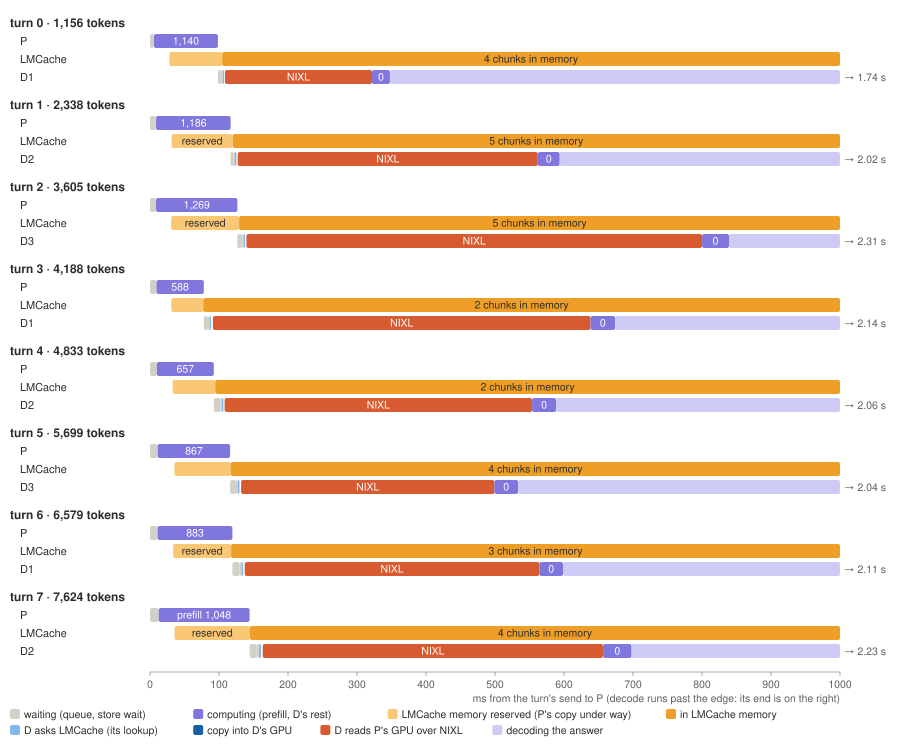

# Conversation 8: mt-rag-clapnq-elser-512-100-20240503 (memory mode, NIXL, shared servers, carry-forward, all passages)

P's KV reaches D over NIXL (D reads P's GPU blocks); every engine's LMCache connector stores beside it, to the one shared server. 8 turns on D1, D2, D3 (round-robin: each turn to the next D engine); prompts grow from 1,156 to 7,624 tokens (interleaved: each turn's prompt is the previous one, its answer, then this turn's documents and question). Chunks are 256 tokens (16 vLLM blocks of 16); a chunk's name is LMCache's hash of its tokens and everything before them, so the same prefix has the same chunks on every turn and engine.

Legend for the strips (one character a chunk): P: `=` on P's GPU from an earlier turn, `#` computed and stored now, `+` computed, not stored (a partial chunk). D: `=` on D's GPU from an earlier turn, `M` pulled from memory, `S` pulled from disk, `N` read from P's GPU over NIXL, `+` computed by D (a partial chunk), `?` missed.

GPU blocks (the chunk tables): where each engine keeps the chunk's 16 vLLM blocks in its GPU KV cache, by vLLM's block ids (vLLM's paged KV cache: a block, or page, holds 16 tokens; block 0 is its reserved null block), in the prompt's block order, a run of consecutive ids written as a range: `P 1, 138-152` is the prompt's block 0 in GPU block 1 and its blocks 1-15 in GPU blocks 138-152. An engine takes a GPU block from its free list when it first computes or loads a block, and the block keeps it while cached, so a later turn that reuses the block shows the same id. Blocks that are the same in several prompts (the same tokens and everything before them) share one GPU block once the first is cached: the system prompt's first block, the same in every conversation, is the usual one. `16/16 hashes = P's`: of the blocks D pulled, how many have the same vLLM hash on D as on P.

The prompts' text is the driver's own record of what it sent (answers included); lines over 100 characters are wrapped here for reading.

| turn | prompt | chunks + tail | P: own GPU / computed / stored | D: own GPU / loaded / computed | pulled | pull ms | D first token ms |
| ---: | ---: | --- | --- | --- | --- | ---: | ---: |
| [0](#turn-0) | 1,156 | 4 + 132 | 16 / 1,140 / 4 chunks | 16 / 1,140 / 0 | 5 chunks (NIXL 5) | 213.2 | 245.0 |
| [1](#turn-1) | 2,338 | 9 + 34 | 1,152 / 1,186 / 5 chunks | 16 / 2,322 / 0 | 10 chunks (NIXL 10) | 435.0 | 472.4 |
| [2](#turn-2) | 3,605 | 14 + 21 | 2,336 / 1,269 / 5 chunks | 16 / 3,589 / 0 | 15 chunks (NIXL 15) | 660.4 | 705.3 |
| [3](#turn-3) | 4,188 | 16 + 92 | 3,600 / 588 / 2 chunks | 1,280 / 2,908 / 0 | 12 chunks (NIXL 12) | 547.2 | 590.2 |
| [4](#turn-4) | 4,833 | 18 + 225 | 4,176 / 657 / 2 chunks | 2,464 / 2,369 / 0 | 10 chunks (NIXL 10) | 445.6 | 487.0 |
| [5](#turn-5) | 5,699 | 22 + 67 | 4,832 / 867 / 4 chunks | 3,728 / 1,971 / 0 | 9 chunks (NIXL 9) | 367.2 | 408.8 |
| [6](#turn-6) | 6,579 | 25 + 179 | 5,696 / 883 / 3 chunks | 4,304 / 2,275 / 0 | 10 chunks (NIXL 10) | 427.1 | 469.1 |
| [7](#turn-7) | 7,624 | 29 + 200 | 6,576 / 1,048 / 4 chunks | 4,960 / 2,664 / 0 | 11 chunks (NIXL 11) | 493.1 | 543.2 |

## How the prompt grows

Each turn's prompt is the previous one, token for token, and then: D's answer to the previous turn, this turn's documents, its question and the framing (the system prompt on turn 0, `Assistant:` and newlines). Only the new tokens can make new chunks: the previous prompt's partial chunk fills first. A document sent before comes again at another place, so in other chunks.

| turn | prompt | new | previous answer | documents | question | framing | whole chunks |
| ---: | ---: | ---: | ---: | --- | --- | ---: | --- |
| 0 | 1,156 | +1,156 | – | 6 docs, 1,113 | 13: what is the defense of marriage act 1996 | 30 | 4 (+4) |
| 1 | 2,338 | +1,182 | 128 | 5 docs, 1,044 (4 sent before: 837) | 7: How is marriage defined? | 3 | 9 (+5) |
| 2 | 3,605 | +1,267 | 128 | 7 docs, 1,129 (3 sent before: 492) | 7: How are weddings celebrated? | 3 | 14 (+5) |
| 3 | 4,188 | +583 | 128 | 5 docs, 436 | 16: What is the meaning of the glass being broken at a Jewish wedding? | 3 | 16 (+2) |
| 4 | 4,833 | +645 | 128 | 6 docs, 504 (2 sent before: 285) | 10: Do all states allow same sex marriages? | 3 | 18 (+2) |
| 5 | 5,699 | +866 | 128 | 5 docs, 726 (1 sent before: 43) | 9: Can same sex couples adopt children? | 3 | 22 (+4) |
| 6 | 6,579 | +880 | 128 | 5 docs, 740 (2 sent before: 358) | 9: Legal immigration for same sex couples. | 3 | 25 (+3) |
| 7 | 7,624 | +1,045 | 128 | 6 docs, 908 (5 sent before: 740) | 6: Restrictions to immigration. | 3 | 29 (+4) |

## Timeline

Every turn on one clock: ms from the moment the proxy sent the turn to P. P prefills it (one token out) and holds its blocks for D; the proxy sends the turn to the next D engine at once with P's reply's kv_transfer_params (no wait), D reads P's blocks over NIXL (orange-red), computes the rest and decodes the answer. Beside it every engine's LMCache connector stores its new whole chunks (P's lane, and D's own when it stored any). The lanes: P, LMCache (P's chunks), D, and LMCache (D's chunks).



| turn | P queued → done | P's chunks: in memory / on disk | D | D starts | NIXL read | D: held / from P / from LMCache / computed | D's chunks stored | first token | P freed | D done |
| ---: | --- | --- | --- | ---: | --- | --- | ---: | ---: | ---: | ---: |
| 0 | 6 → 98 | 4: 105 / – | D1 | 103 | 109-322 | 16 / 1,140 / 0 / 0 | 0 | 348 | 322 | 1,741 |
| 1 | 9 → 117 | 5: 120 / – | D2 | 121 | 127-562 | 16 / 2,322 / 0 / 0 | 0 | 594 | 562 | 2,020 |
| 2 | 9 → 127 | 5: 129 / – | D3 | 134 | 140-800 | 16 / 3,589 / 0 / 0 | 0 | 839 | 801 | 2,306 |
| 3 | 9 → 78 | 2: 77 / – | D1 | 84 | 91-638 | 1,280 / 2,908 / 0 / 0 | 0 | 674 | 639 | 2,140 |
| 4 | 10 → 92 | 2: 94 / – | D2 | 102 | 108-554 | 2,464 / 2,369 / 0 / 0 | 0 | 589 | 554 | 2,059 |
| 5 | 11 → 116 | 4: 117 / – | D3 | 125 | 132-499 | 3,728 / 1,971 / 0 / 0 | 0 | 534 | 499 | 2,042 |
| 6 | 11 → 119 | 3: 118 / – | D1 | 130 | 137-564 | 4,304 / 2,275 / 0 / 0 | 0 | 599 | 565 | 2,111 |
| 7 | 13 → 144 | 4: 145 / – | D2 | 155 | 163-657 | 4,960 / 2,664 / 0 / 0 | 0 | 698 | 658 | 2,233 |

All times in ms from the turn's send to P. NIXL read: D's worker posts the read of P's blocks to the KV in D's GPU blocks; P freed: D has read, P's blocks go back to its free queue (still cached). Each turn's section below tells it in a sentence and step by step.

### One chunk, block by block: chunk 1 of turn 0 (`a73e01feeed8b90e`)

Tokens 256-512 (doc 834188205_251-: 76; doc 834188205_8571: 161; doc 834188205_1069: 19). P computed its blocks; D1 read them from P's GPU over NIXL, P's block into D's block, one for one:

| block | tokens | P's GPU block | vLLM hash on P | D's GPU block | same hash on D |
| ---: | --- | ---: | --- | ---: | --- |
| 16 | 256-272 | 3078 | `da1410bb155baf43` | 2363 | True |
| 17 | 272-288 | 3079 | `346c8aef79fb27c4` | 2364 | True |
| 18 | 288-304 | 3080 | `19b473d5c76b984f` | 2365 | True |
| 19 | 304-320 | 3081 | `958dae1c7ebf75bb` | 2366 | True |
| 20 | 320-336 | 3082 | `e00875d44853e769` | 2367 | True |
| 21 | 336-352 | 3083 | `3e8a6b3ce214773a` | 2368 | True |
| 22 | 352-368 | 3084 | `fc02ee8f71a221fe` | 2369 | True |
| 23 | 368-384 | 3085 | `59d431fb66a6b109` | 2370 | True |
| 24 | 384-400 | 3086 | `0de1990ba4ed7939` | 2371 | True |
| 25 | 400-416 | 3087 | `91dcdafd870bcbce` | 2372 | True |
| 26 | 416-432 | 3088 | `af97d4988363c5c9` | 2373 | True |
| 27 | 432-448 | 3089 | `5293a694b686cdf5` | 2374 | True |
| 28 | 448-464 | 3090 | `eb48145431ce7a84` | 2375 | True |
| 29 | 464-480 | 3091 | `8bb22929a443594a` | 2376 | True |
| 30 | 480-496 | 3092 | `c6c63374cb952423` | 2377 | True |
| 31 | 496-512 | 3093 | `b9962ea997be4ca3` | 2378 | True |

## Turn 0

**Timeline:** P queued until 6 ms, prefilled 1,140 tokens (held 16) and was done at 98 ms; its 4 new chunks were in LMCache's memory at 105 ms. D1 started at 103 ms (no wait) holding 16 tokens, read 1,140 from P's GPU over NIXL (posted at 109 ms, in its GPU at 322 ms; P freed its blocks at 322 ms), computed 0 and gave its first token at 348 ms; it decoded 128 tokens until 1,741 ms. ([all turns](#timeline))

### Step by step

Every move of this turn's KV, ms from the proxy sending the turn to P. P's KV reaches D over NIXL: D's worker reads P's GPU blocks into its own (a NIXL READ, P told when D is done); LMCache's copies (to and from each server's memory) its servers do themselves through CUDA IPC handles each engine registered at start.

| ms | where | what |
| ---: | --- | --- |
| 0.0 | proxy → P | sends the turn (1,156 prompt tokens; P is asked for one token: prefill only) |
| 3.0 | P | the request arrives |
| 5.5 | P GPU | its prefix cache holds 16 of the prompt's tokens: 1 block in GPU blocks 1 |
| 5.6 | P ↔ LMCache | LMCache has 0 of its tokens; P loads 0 and computes the rest |
| 5.8 | P GPU | 72 new GPU blocks for the 1,140 tokens it computes: 3063-3134; the prefill runs |
| 6.4 | P → LMCache | store planned: tokens 0-1,024, chunks 0-3 (64 blocks) |
| 27.2 | LMCache | the store request is in; it waits for P's forward pass to finish (a CUDA event) |
| 27.9 | LMCache memory | space reserved for 4 chunks (117 MB) |
| 94.4 | P GPU → LMCache memory | the copy starts: LMCache reads P's GPU blocks (CUDA IPC) |
| 94.7 | P GPU | the request is done: P holds its 73 blocks for D to read over NIXL, and its reply carries them (kv_transfer_params: the blocks, its NIXL agent) |
| 98.4 | P → proxy | P answers its one token: the prefill is done |
| 99.5 | P GPU → LMCache memory | copy done: 4 chunks, 117 MB in 5.1 ms |
| 102.8 | proxy → D1 | sends the turn to D1 at once, with P's kv_transfer_params (round-robin; no wait) |
| 104.6 | LMCache memory | 4 chunks in memory, kept for later requests (D gets this turn's KV from P over NIXL); P keeps its copy in its GPU blocks |
| 105.3 | D1 ↔ LMCache | asks LMCache for the prompt's chunks |
| 106.9 | LMCache memory | found 1,024 tokens it lacks: 4 chunks in memory |
| 107.7 | D1 GPU | its prefix cache holds 16 of the prompt's tokens: 1 block in GPU blocks 1 |
| 107.7 | D1 ↔ P (NIXL) | will read 1,140 prompt tokens from P's GPU (beyond the 16 its own cache holds) |
| 107.8 | D1 ↔ LMCache | LMCache has 1,024 of its tokens; NIXL loads it (MultiConnector: the first connector with tokens) |
| 108.0 | D1 GPU | 72 GPU blocks for the KV from P: 2348-2419 |
| 108.7 | P GPU → D1 GPU (NIXL) | D1 reads P's GPU blocks 1, 3063-3134 into its 2348-2419 (a NIXL READ) |
| 321.8 | D1 | the KV from P is in its GPU blocks (1,140 tokens) |
| 322.5 | P GPU | D1 has read: P frees its blocks (they stay in its prefix cache) |
| 347.8 | D1 → proxy | the first answer token |
| 467.2 | D1 GPU | 1 new GPU block for the 1 prompt tokens it computes: 2420 |
| 642.9 | D1 GPU | decoding: the answer's KV takes 7 new GPU blocks as it grows, one per 16 tokens: 2421-2427, until 1,697 ms |
| 1,741.2 | D1 | done: 128 tokens decoded; its blocks stay cached in its GPU for the next turn |
| 1,742.2 | proxy | the response is complete |

1,156 prompt tokens: 4 whole chunks and 132 tokens over (the partial chunk, computed by both engines and stored only when a later turn completes it). P held 16 tokens on its GPU, computed 1,140 and stored 4 new chunks; D1 held 16, read 1,140 from P over NIXL, loaded 0 from LMCache and computed 0.

### The prompt

The whole prompt, piece by piece:

- **system prompt** · tokens 0-28 (28) · chunk 0

```text
You are a helpful assistant. Answer the user's last question from the documents. If they do not hold
the answer, say so.
```

<details><summary>document <code>834188205_251-1271-0-1018</code> · tokens 28-332 (304) · chunks 0-1</summary>

```text
Document: Defense of Marriage Act
Defense of Marriage Act
Defense of Marriage Act Long title An Act to define and protect the institution of marriage Acronyms
( colloquial ) DOMA Enacted by the 104th United States Congress Effective September 21 , 1996
Citations Public law Pub. L. 104 -- 199 Statutes at Large 110 Stat. 2419 ( 1996 ) Codification
Titles amended 1 U.S.C. General Provisions 28 U.S.C. Judiciary and Judicial Procedure U.S.C.
sections created 1 U.S.C. § 7 ( Struck down , June 26 , 2013 ) Legislative history Introduced in the
House as H.R. 3396 by Bob Barr ( R -- GA ) on May 7 , 1996 Committee consideration by Committee on
the Judiciary ( Subcommittee on the Constitution ) Passed the House on July 12 , 1996 ( Yeas : 342 ;
Nays : 67 ) Passed the Senate on September 10 , 1996 ( Yeas : 85 ; Nays : 14 ) Signed into law by
President Bill Clinton on September 21 , 1996 United States Supreme Court cases United States v.
Windsor , No. 12 - 307 , 570 U.S. ___ ( 2013 ) , in which Section 3 ( 1 U.S.C. § 7 ) was struck down
by the Supreme Court on June 26 , 2013
```

</details>

<details><summary>document <code>834188205_8571-9285-0-714</code> · tokens 332-493 (161) · chunk 1</summary>

```text
Document: Defense of Marriage Act
Defense of Marriage Act
Georgia Representative Bob Barr , then a Republican , authored the Defense of Marriage Act and
introduced it in the House of Representatives on May 7 , 1996 . Senator Don Nickles , ( R ) Oklahoma
, introduced the bill in the Senate . The House Judiciary Committee stated that the Act was intended
by Congress to `` reflect and honor a collective moral judgment and to express moral disapproval of
homosexuality '' . The Act 's congressional sponsors stated , `` ( T ) he bill amends the U.S. Code
to make explicit what has been understood under federal law for over 200 years ; that a marriage is
the legal union of a man and a woman as husband and wife , and a spouse is a husband or wife of the
opposite sex . ''
```

</details>

<details><summary>document <code>834188205_10696-11590-0-894</code> · tokens 493-697 (204) · chunks 1-2</summary>

```text
Document: Defense of Marriage Act
Defense of Marriage Act
The bill moved through Congress on a legislative fast track and met with overwhelming approval in
both houses of the Republican - controlled Congress . On July 12 , 1996 , with only 65 Democrats and
then Rep. Bernie Sanders ( Independent - Vermont ) and Rep. Steve Gunderson ( Republican - Wisconsin
) , in opposition , 342 members of the U.S. House of Representatives -- 224 Republicans and 118
Democrats -- voted to pass DOMA . Then , on September 10 , 1996 , 84 Senators -- a majority of the
Democratic Senators and all of the Republicans -- voted in favor of DOMA . Democratic Senators voted
for the bill 32 to 14 ( with Pryor of Arkansas absent ) , and Democratic Representatives voted for
it 118 to 65 , with 15 not participating . All Republicans in both houses voted for the bill with
the sole exception of the one openly gay Republican Congressman , Rep. Steve Gunderson of Wisconsin
.
```

</details>

<details><summary>document <code>834188205_1272-2165-0-891</code> · tokens 697-910 (213) · chunks 2-3</summary>

```text
Document: Defense of Marriage Act
Defense of Marriage Act
The Defense of Marriage Act ( DOMA ) ( Pub. L. 104 -- 199 , 110 Stat. 2419 , enacted September 21 ,
1996 , 1 U.S.C. § 7 and 28 U.S.C. § 1738C ) was a United States federal law that , prior to being
ruled unconstitutional , defined marriage for federal purposes as the union of one man and one woman
, and allowed states to refuse to recognize same - sex marriages granted under the laws of other
states . Until Section 3 of the Act was struck down in 2013 ( United States v. Windsor ) , DOMA , in
conjunction with other statutes , had barred same - sex married couples from being recognized as ``
spouses '' for purposes of federal laws , effectively barring them from receiving federal marriage
benefits . DOMA 's passage did not prevent individual states from recognizing same - sex marriage ,
but it imposed constraints on the benefits received by all legally married same - sex couples .
```

</details>

<details><summary>document <code>834188205_2166-2927-0-760</code> · tokens 910-1069 (159) · chunks 3-4</summary>

```text
Document: Defense of Marriage Act
Defense of Marriage Act
Initially introduced in May 1996 , DOMA passed both houses of Congress by large , veto - proof
majorities and was signed into law by President Bill Clinton in September 1996 . By defining ``
spouse '' and its related terms to signify a heterosexual couple in a recognized marriage , Section
3 codified non-recognition of same - sex marriages for all federal purposes , including insurance
benefits for government employees , social security survivors ' benefits , immigration , bankruptcy
, and the filing of joint tax returns , as well as excluding same - sex spouses from the scope of
laws protecting families of federal officers ( 18 U.S.C. § 115 ) , laws evaluating financial aid
eligibility , and federal ethics laws applicable to opposite - sex spouses .
```

</details>

<details><summary>document <code>834188205_51385-51606-0-221</code> · tokens 1069-1141 (72) · chunk 4</summary>

```text
Document: Defense of Marriage Act
Defense of Marriage Act
On June 26 , 2015 the U.S. Supreme Court ruled in Obergefell v. Hodges that the 14th Amendment
requires all U.S. state laws to recognize same - sex marriages . This left Section 2 of DOMA as
superseded and unenforceable .
```

</details>

- **question 0** · tokens 1141-1154 (13) · chunk 4

```text
User: what is the defense of marriage act 1996
```

- `Assistant:` · tokens 1154-1156 (2) · chunk 4

### Pieces, chunks and blocks

| piece | tokens | length | chunks | |
| --- | --- | ---: | --- | --- |
| system | 0-28 | 28 | 0 |  |
| doc 834188205_251- | 28-332 | 304 | 0-1 |  |
| doc 834188205_8571 | 332-493 | 161 | 1 |  |
| doc 834188205_1069 | 493-697 | 204 | 1-2 |  |
| doc 834188205_1272 | 697-910 | 213 | 2-3 |  |
| doc 834188205_2166 | 910-1069 | 159 | 3-4 |  |
| doc 834188205_5138 | 1069-1141 | 72 | 4 |  |
| question 0 | 1141-1154 | 13 | 4 |  |
| `assistant:` 0 | 1154-1156 | 2 | 4 |  |

```
P  ####+
D  NNNNN
```

| chunk | tokens | pieces in it (tokens) | vLLM blocks | GPU blocks | in LMCache | P this turn | D this turn |
| ---: | --- | --- | --- | --- | --- | --- | --- |
| 0 | 0-256 | system: 28; doc 834188205_251-: 228 | 0-15 | P 1, 3063-3077; D 1, 2348-2362; 15/15 hashes = P's | `6e9e89e257326d74` stored on turn 0 by P | computed (its first 16 tokens on P's GPU already), **stored now** | **read from P's GPU over NIXL** (its first 16 tokens on D's GPU already) |
| 1 | 256-512 | doc 834188205_251-: 76; doc 834188205_8571: 161; doc 834188205_1069: 19 | 16-31 | P 3078-3093; D 2363-2378; 16/16 hashes = P's | `a73e01feeed8b90e` stored on turn 0 by P | computed, **stored now** | **read from P's GPU over NIXL** |
| 2 | 512-768 | doc 834188205_1069: 185; doc 834188205_1272: 71 | 32-47 | P 3094-3109; D 2379-2394; 16/16 hashes = P's | `b07dd78e5dd6bcf8` stored on turn 0 by P | computed, **stored now** | **read from P's GPU over NIXL** |
| 3 | 768-1024 | doc 834188205_1272: 142; doc 834188205_2166: 114 | 48-63 | P 3110-3125; D 2395-2410; 16/16 hashes = P's | `0535ded48981788d` stored on turn 0 by P | computed, **stored now** | **read from P's GPU over NIXL** |
| 4 | 1024-1156 | doc 834188205_2166: 45; doc 834188205_5138: 72; question 0: 13; `assistant:` 0: 2 | 64-72 | P 3126-3133; D 2411-2419; 8/8 hashes = P's | – | computed (partial chunk: not stored) | **read from P's GPU over NIXL** (partial chunk) |

## Turn 1

**Timeline:** P queued until 9 ms, prefilled 1,186 tokens (held 1,152) and was done at 117 ms; its 5 new chunks were in LMCache's memory at 120 ms. D2 started at 121 ms (no wait) holding 16 tokens, read 2,322 from P's GPU over NIXL (posted at 127 ms, in its GPU at 562 ms; P freed its blocks at 562 ms), computed 0 and gave its first token at 594 ms; it decoded 128 tokens until 2,020 ms. ([all turns](#timeline))

### Step by step

Every move of this turn's KV, ms from the proxy sending the turn to P. P's KV reaches D over NIXL: D's worker reads P's GPU blocks into its own (a NIXL READ, P told when D is done); LMCache's copies (to and from each server's memory) its servers do themselves through CUDA IPC handles each engine registered at start.

| ms | where | what |
| ---: | --- | --- |
| 0.0 | proxy → P | sends the turn (2,338 prompt tokens; P is asked for one token: prefill only) |
| 4.0 | P | the request arrives |
| 8.6 | P GPU | its prefix cache holds 1,152 of the prompt's tokens: 72 blocks in GPU blocks 1, 3063-3133 |
| 8.7 | P ↔ LMCache | LMCache has 1,024 of its tokens; P loads 0 and computes the rest |
| 8.9 | P GPU | 75 new GPU blocks for the 1,186 tokens it computes: 3134-3208; the prefill runs |
| 9.5 | P → LMCache | store planned: tokens 1,024-2,304, chunks 4-8 (80 blocks) |
| 30.3 | LMCache | the store request is in; it waits for P's forward pass to finish (a CUDA event) |
| 31.3 | LMCache memory | space reserved for 5 chunks (147 MB) |
| 111.7 | P GPU → LMCache memory | the copy starts: LMCache reads P's GPU blocks (CUDA IPC) |
| 111.9 | P GPU | the request is done: P holds its 147 blocks for D to read over NIXL, and its reply carries them (kv_transfer_params: the blocks, its NIXL agent) |
| 116.8 | P → proxy | P answers its one token: the prefill is done |
| 118.0 | P GPU → LMCache memory | copy done: 5 chunks, 147 MB in 6.3 ms |
| 119.8 | LMCache memory | 5 chunks in memory, kept for later requests (D gets this turn's KV from P over NIXL); P keeps its copy in its GPU blocks |
| 121.4 | proxy → D2 | sends the turn to D2 at once, with P's kv_transfer_params (round-robin; no wait) |
| 123.0 | D2 ↔ LMCache | asks LMCache for the prompt's chunks |
| 124.2 | LMCache memory | found 2,304 tokens it lacks: 9 chunks in memory |
| 126.1 | D2 GPU | its prefix cache holds 16 of the prompt's tokens: 1 block in GPU blocks 1 |
| 126.1 | D2 ↔ P (NIXL) | will read 2,322 prompt tokens from P's GPU (beyond the 16 its own cache holds) |
| 126.2 | D2 ↔ LMCache | LMCache has 2,304 of its tokens; NIXL loads it (MultiConnector: the first connector with tokens) |
| 126.4 | D2 GPU | 146 GPU blocks for the KV from P: 2651-2796 |
| 127.1 | P GPU → D2 GPU (NIXL) | D2 reads P's GPU blocks 1, 3063-3208 into its 2651-2796 (a NIXL READ) |
| 562.1 | D2 | the KV from P is in its GPU blocks (2,322 tokens) |
| 562.2 | P GPU | D2 has read: P frees its blocks (they stay in its prefix cache) |
| 593.8 | D2 → proxy | the first answer token |
| 737.2 | D2 GPU | 1 new GPU block for the 1 prompt tokens it computes: 2797 |
| 917.2 | D2 GPU | decoding: the answer's KV takes 7 new GPU blocks as it grows, one per 16 tokens: 2798-2804, until 1,998 ms |
| 2,020.2 | D2 | done: 128 tokens decoded; its blocks stay cached in its GPU for the next turn |
| 2,021.5 | proxy | the response is complete |

2,338 prompt tokens: 9 whole chunks and 34 tokens over (the partial chunk, computed by both engines and stored only when a later turn completes it). P held 1,152 tokens on its GPU, computed 1,186 and stored 5 new chunks; D2 held 16, read 2,322 from P over NIXL, loaded 0 from LMCache and computed 0.

### The prompt

Tokens 0-1,156: [turn 0](#turn-0)'s prompt, unchanged (checked: its first 1,156 token ids are the previous prompt's), so chunks 0-3 are the same chunks; chunk 4 (partial then, 132 tokens) fills now. New from token 1,156:

- **D's answer to turn 0** · tokens 1156-1284 (128) · chunks 4-5

```text
 The Defense of Marriage Act ( DOMA ) was a United States federal law that , prior to being ruled
unconstitutional , defined marriage for federal purposes as the union of one man and one woman , and
allowed states to refuse to recognize same - sex marriages granted under the laws of other states .
Until Section 3 of the Act was struck down in 2013 ( United States v. Windsor ) , DOMA , in
conjunction with other statutes , had barred same - sex married couples from being recognized as ``
spouses '' for purposes of federal laws , effectively barring them from receiving federal marriage
benefits . DOMA 's passage did not prevent individual states from
```

- `\n` · tokens 1284-1285 (1) · chunk 5

- document `834188205_2166-2927-0-760` · tokens 1285-1444 (159) · chunk 5 · **again**: sent on [turn 0](#turn-0) already (the same 159 tokens), here at another place in the prompt, so in other chunks: a prefix cache cannot reuse it

- document `834188205_1272-2165-0-891` · tokens 1444-1657 (213) · chunks 5-6 · **again**: sent on [turn 0](#turn-0) already (the same 213 tokens), here at another place in the prompt, so in other chunks: a prefix cache cannot reuse it

<details><summary>document <code>834188205_7556-8521-0-965</code> · tokens 1657-1864 (207) · chunks 6-7</summary>

```text
Document: Defense of Marriage Act
Defense of Marriage Act
Section 1 . Short title This Act may be cited as the `` Defense of Marriage Act '' . Section 2 .
Powers reserved to the states No State , territory , or possession of the United States , or Indian
tribe , shall be required to give effect to any public act , record , or judicial proceeding of any
other State , territory , possession , or tribe respecting a relationship between persons of the
same sex that is treated as a marriage under the laws of such other State , territory , possession ,
or tribe , or a right or claim arising from such relationship . Section 3 . Definition of marriage
In determining the meaning of any Act of Congress , or of any ruling , regulation , or
interpretation of the various administrative bureaus and agencies of the United States , the word '
marriage ' means only a legal union between one man and one woman as husband and wife , and the word
' spouse ' refers only to a person of the opposite sex who is a husband or a wife .
```

</details>

- document `834188205_251-1271-0-1018` · tokens 1864-2168 (304) · chunks 7-8 · **again**: sent on [turn 0](#turn-0) already (the same 304 tokens), here at another place in the prompt, so in other chunks: a prefix cache cannot reuse it

- document `834188205_8571-9285-0-714` · tokens 2168-2329 (161) · chunks 8-9 · **again**: sent on [turn 0](#turn-0) already (the same 161 tokens), here at another place in the prompt, so in other chunks: a prefix cache cannot reuse it

- **question 1** · tokens 2329-2336 (7) · chunk 9

```text
User: How is marriage defined?
```

- `Assistant:` · tokens 2336-2338 (2) · chunk 9

### Pieces, chunks and blocks

| piece | tokens | length | chunks | |
| --- | --- | ---: | --- | --- |
| system | 0-28 | 28 | 0 |  |
| doc 834188205_251- | 28-332 | 304 | 0-1 |  |
| doc 834188205_8571 | 332-493 | 161 | 1 |  |
| doc 834188205_1069 | 493-697 | 204 | 1-2 |  |
| doc 834188205_1272 | 697-910 | 213 | 2-3 |  |
| doc 834188205_2166 | 910-1069 | 159 | 3-4 |  |
| doc 834188205_5138 | 1069-1141 | 72 | 4 |  |
| question 0 | 1141-1154 | 13 | 4 |  |
| `assistant:` 0 | 1154-1156 | 2 | 4 |  |
| answer 0 | 1156-1284 | 128 | 4-5 | new this turn |
| newline 0 | 1284-1285 | 1 | 5 | new this turn |
| doc 834188205_2166 | 1285-1444 | 159 | 5 | new this turn |
| doc 834188205_1272 | 1444-1657 | 213 | 5-6 | new this turn |
| doc 834188205_7556 | 1657-1864 | 207 | 6-7 | new this turn |
| doc 834188205_251- | 1864-2168 | 304 | 7-8 | new this turn |
| doc 834188205_8571 | 2168-2329 | 161 | 8-9 | new this turn |
| question 1 | 2329-2336 | 7 | 9 | new this turn |
| `assistant:` 1 | 2336-2338 | 2 | 9 | new this turn |

```
P  ====#####+
D  NNNNNNNNNN
```

| chunk | tokens | pieces in it (tokens) | vLLM blocks | GPU blocks | in LMCache | P this turn | D this turn |
| ---: | --- | --- | --- | --- | --- | --- | --- |
| 0 | 0-256 | system: 28; doc 834188205_251-: 228 | 0-15 | P 1, 3063-3077; D 1, 2651-2665 | `6e9e89e257326d74` stored on turn 0 by P | on P's GPU (earlier turn) | **read from P's GPU over NIXL** (its first 16 tokens on D's GPU already) |
| 1 | 256-512 | doc 834188205_251-: 76; doc 834188205_8571: 161; doc 834188205_1069: 19 | 16-31 | P 3078-3093; D 2666-2681 | `a73e01feeed8b90e` stored on turn 0 by P | on P's GPU (earlier turn) | **read from P's GPU over NIXL** |
| 2 | 512-768 | doc 834188205_1069: 185; doc 834188205_1272: 71 | 32-47 | P 3094-3109; D 2682-2697 | `b07dd78e5dd6bcf8` stored on turn 0 by P | on P's GPU (earlier turn) | **read from P's GPU over NIXL** |
| 3 | 768-1024 | doc 834188205_1272: 142; doc 834188205_2166: 114 | 48-63 | P 3110-3125; D 2698-2713 | `0535ded48981788d` stored on turn 0 by P | on P's GPU (earlier turn) | **read from P's GPU over NIXL** |
| 4 | 1024-1280 | doc 834188205_2166: 45; doc 834188205_5138: 72; question 0: 13; `assistant:` 0: 2; answer 0 (new): 124 | 64-79 | P 3126-3141; D 2714-2729; 8/8 hashes = P's | `3d028e4fc5733626` stored on turn 1 by P | computed (its first 128 tokens on P's GPU already), **stored now** | **read from P's GPU over NIXL** |
| 5 | 1280-1536 | answer 0 (new): 4; newline 0 (new): 1; doc 834188205_2166 (new): 159; doc 834188205_1272 (new): 92 | 80-95 | P 3142-3157; D 2730-2745; 16/16 hashes = P's | `9cfba0f1b347ac47` stored on turn 1 by P | computed, **stored now** | **read from P's GPU over NIXL** |
| 6 | 1536-1792 | doc 834188205_1272 (new): 121; doc 834188205_7556 (new): 135 | 96-111 | P 3158-3173; D 2746-2761; 16/16 hashes = P's | `5e351c98e30a8028` stored on turn 1 by P | computed, **stored now** | **read from P's GPU over NIXL** |
| 7 | 1792-2048 | doc 834188205_7556 (new): 72; doc 834188205_251- (new): 184 | 112-127 | P 3174-3189; D 2762-2777; 16/16 hashes = P's | `cd113a5926d408bb` stored on turn 1 by P | computed, **stored now** | **read from P's GPU over NIXL** |
| 8 | 2048-2304 | doc 834188205_251- (new): 120; doc 834188205_8571 (new): 136 | 128-143 | P 3190-3205; D 2778-2793; 16/16 hashes = P's | `fa90fd66330fd38b` stored on turn 1 by P | computed, **stored now** | **read from P's GPU over NIXL** |
| 9 | 2304-2338 | doc 834188205_8571 (new): 25; question 1 (new): 7; `assistant:` 1 (new): 2 | 144-146 | P 3206-3207; D 2794-2796; 2/2 hashes = P's | – | computed (partial chunk: not stored) | **read from P's GPU over NIXL** (partial chunk) |

## Turn 2

**Timeline:** P queued until 9 ms, prefilled 1,269 tokens (held 2,336) and was done at 127 ms; its 5 new chunks were in LMCache's memory at 129 ms. D3 started at 134 ms (no wait) holding 16 tokens, read 3,589 from P's GPU over NIXL (posted at 140 ms, in its GPU at 800 ms; P freed its blocks at 801 ms), computed 0 and gave its first token at 839 ms; it decoded 128 tokens until 2,306 ms. ([all turns](#timeline))

### Step by step

Every move of this turn's KV, ms from the proxy sending the turn to P. P's KV reaches D over NIXL: D's worker reads P's GPU blocks into its own (a NIXL READ, P told when D is done); LMCache's copies (to and from each server's memory) its servers do themselves through CUDA IPC handles each engine registered at start.

| ms | where | what |
| ---: | --- | --- |
| 0.0 | proxy → P | sends the turn (3,605 prompt tokens; P is asked for one token: prefill only) |
| 3.2 | P | the request arrives |
| 8.3 | P GPU | its prefix cache holds 2,336 of the prompt's tokens: 146 blocks in GPU blocks 1, 3063-3207 |
| 8.4 | P ↔ LMCache | LMCache has 2,304 of its tokens; P loads 0 and computes the rest |
| 8.7 | P GPU | 80 new GPU blocks for the 1,269 tokens it computes: 3208-3287; the prefill runs |
| 9.4 | P → LMCache | store planned: tokens 2,304-3,584, chunks 9-13 (80 blocks) |
| 30.0 | LMCache | the store request is in; it waits for P's forward pass to finish (a CUDA event) |
| 30.7 | LMCache memory | space reserved for 5 chunks (147 MB) |
| 122.1 | P GPU → LMCache memory | the copy starts: LMCache reads P's GPU blocks (CUDA IPC) |
| 122.4 | P GPU | the request is done: P holds its 226 blocks for D to read over NIXL, and its reply carries them (kv_transfer_params: the blocks, its NIXL agent) |
| 126.6 | P → proxy | P answers its one token: the prefill is done |
| 128.4 | P GPU → LMCache memory | copy done: 5 chunks, 147 MB in 6.3 ms |
| 129.2 | LMCache memory | 5 chunks in memory, kept for later requests (D gets this turn's KV from P over NIXL); P keeps its copy in its GPU blocks |
| 133.7 | proxy → D3 | sends the turn to D3 at once, with P's kv_transfer_params (round-robin; no wait) |
| 135.6 | D3 ↔ LMCache | asks LMCache for the prompt's chunks |
| 137.4 | LMCache memory | found 3,584 tokens it lacks: 14 chunks in memory |
| 138.5 | D3 GPU | its prefix cache holds 16 of the prompt's tokens: 1 block in GPU blocks 1 |
| 138.5 | D3 ↔ P (NIXL) | will read 3,589 prompt tokens from P's GPU (beyond the 16 its own cache holds) |
| 138.6 | D3 ↔ LMCache | LMCache has 3,584 of its tokens; NIXL loads it (MultiConnector: the first connector with tokens) |
| 139.0 | D3 GPU | 225 GPU blocks for the KV from P: 2993-3217 |
| 139.7 | P GPU → D3 GPU (NIXL) | D3 reads P's GPU blocks 1, 3063-3287 into its 2993-3217 (a NIXL READ) |
| 800.1 | D3 | the KV from P is in its GPU blocks (3,589 tokens) |
| 800.8 | P GPU | D3 has read: P frees its blocks (they stay in its prefix cache) |
| 839.1 | D3 → proxy | the first answer token |
| 950.3 | D3 GPU | 1 new GPU block for the 1 prompt tokens it computes: 3218 |
| 1,135.2 | D3 GPU | decoding: the answer's KV takes 7 new GPU blocks as it grows, one per 16 tokens: 3219-3225, until 2,248 ms |
| 2,305.6 | D3 | done: 128 tokens decoded; its blocks stay cached in its GPU for the next turn |
| 2,306.8 | proxy | the response is complete |

3,605 prompt tokens: 14 whole chunks and 21 tokens over (the partial chunk, computed by both engines and stored only when a later turn completes it). P held 2,336 tokens on its GPU, computed 1,269 and stored 5 new chunks; D3 held 16, read 3,589 from P over NIXL, loaded 0 from LMCache and computed 0.

### The prompt

Tokens 0-2,338: [turn 1](#turn-1)'s prompt, unchanged (checked: its first 2,338 token ids are the previous prompt's), so chunks 0-8 are the same chunks; chunk 9 (partial then, 34 tokens) fills now. New from token 2,338:

- **D's answer to turn 1** · tokens 2338-2466 (128) · chunk 9

```text
 The Defense of Marriage Act ( DOMA ) was a United States federal law that , prior to being ruled
unconstitutional , defined marriage for federal purposes as the union of one man and one woman , and
allowed states to refuse to recognize same - sex marriages granted under the laws of other states .
Until Section 3 of the Act was struck down in 2013 ( United States v. Windsor ) , DOMA , in
conjunction with other statutes , had barred same - sex married couples from being recognized as ``
spouses '' for purposes of federal laws , effectively barring them from receiving federal marriage
benefits . DOMA 's passage did not prevent individual states from
```

- `\n` · tokens 2466-2467 (1) · chunk 9

<details><summary>document <code>853841453_32621-33227-0-606</code> · tokens 2467-2605 (138) · chunks 9-10</summary>

```text
Document: Society of the United States
Society of the United States
In many states , it is illegal to cross state lines to obtain a marriage that would be illegal in
the home state . The typical wedding involves a couple proclaiming their commitment to one another
in front of their close relatives and friends , often presided over by a religious figure such as a
minister , priest , or rabbi , depending upon the faith of the couple . In traditional Christian
ceremonies , the bride 's father will `` give away '' ( hand off ) the bride to the groom . Secular
weddings are also common , often presided over by a judge , Justice of the Peace , or other
municipal official .
```

</details>

<details><summary>document <code>817115950_2342-3778-0-1436</code> · tokens 2605-2904 (299) · chunks 10-11</summary>

```text
Document: Toast (honor)
Toast (honor)
Toasts are generally offered at times of celebration or commemoration , including certain holidays ,
such as New Year 's Eve . Other occasions include retirement celebrations , housewarming parties ,
births , etc . The protocol for toasting at weddings is comparatively elaborate and fixed . At a
wedding reception , the father of the bride , in his role as host , regularly offers the first toast
, thanking the guests for attending , offering tasteful remembrances of the bride 's childhood , and
wishing the newlyweds a happy life together . The best man usually proposes a toast in the form of
best wishes and congratulations to the newlyweds . A best man 's toast takes the form of a short
speech ( 3 -- 5 minutes ) that combines a mixture of humor and sincerity . The humor often comes in
the shape of the best man telling jokes at the groom 's expense whilst the sincerity incorporates
the praise and complimentary comments that a best man should make about the bride and groom ,
amongst others . The actual `` toast '' is then delivered at the end of the speech and is a short
phrase wishing the newlyweds a happy , healthy , loving life together . The maid of honor may follow
suit , appropriately tailoring her comments to the bride . The groom may offer the final toast ,
thanking the bride 's parents for hosting the wedding , the wedding party for their participation ,
and finally dedicating the toast to the bridesmaids .
```

</details>

- document `834188205_51385-51606-0-221` · tokens 2904-2976 (72) · chunk 11 · **again**: sent on [turn 0](#turn-0) already (the same 72 tokens), here at another place in the prompt, so in other chunks: a prefix cache cannot reuse it

<details><summary>document <code>834188205_2928-3229-0-301</code> · tokens 2976-3057 (81) · chunk 11</summary>

```text
Document: Defense of Marriage Act
Defense of Marriage Act
In United States v. Windsor ( 2013 ) , the U.S. Supreme Court declared Section 3 of DOMA
unconstitutional under the Due Process Clause of the Fifth Amendment . Obergefell v. Hodges ( 2015 )
struck down the act 's provisions disallowing same - sex marriages to be performed under federal
jurisdiction .
```

</details>

- document `834188205_7556-8521-0-965` · tokens 3057-3264 (207) · chunks 11-12 · **again**: sent on [turn 1](#turn-1) already (the same 207 tokens), here at another place in the prompt, so in other chunks: a prefix cache cannot reuse it

- document `834188205_1272-2165-0-891` · tokens 3264-3477 (213) · chunks 12-13 · **again**: sent on [turn 0](#turn-0) already (the same 213 tokens), here at another place in the prompt, so in other chunks: a prefix cache cannot reuse it

<details><summary>document <code>834188205_30111-30591-0-480</code> · tokens 3477-3596 (119) · chunks 13-14</summary>

```text
Document: Defense of Marriage Act
Defense of Marriage Act
On March 3 , 2009 , GLAD filed a federal court challenge , Gill v. Office of Personnel Management ,
based on the Equal Protection Clause and the federal government 's consistent deference to each
state 's definition of marriage prior to the enactment of DOMA . The case questioned only the DOMA
provision that the federal government defines marriage as the union of a man and a woman . On May 6
, 2010 , Judge Joseph L. Tauro heard arguments in the U.S. District Court in Boston .
```

</details>

- **question 2** · tokens 3596-3603 (7) · chunk 14

```text
User: How are weddings celebrated?
```

- `Assistant:` · tokens 3603-3605 (2) · chunk 14

### Pieces, chunks and blocks

| piece | tokens | length | chunks | |
| --- | --- | ---: | --- | --- |
| system | 0-28 | 28 | 0 |  |
| doc 834188205_251- | 28-332 | 304 | 0-1 |  |
| doc 834188205_8571 | 332-493 | 161 | 1 |  |
| doc 834188205_1069 | 493-697 | 204 | 1-2 |  |
| doc 834188205_1272 | 697-910 | 213 | 2-3 |  |
| doc 834188205_2166 | 910-1069 | 159 | 3-4 |  |
| doc 834188205_5138 | 1069-1141 | 72 | 4 |  |
| question 0 | 1141-1154 | 13 | 4 |  |
| `assistant:` 0 | 1154-1156 | 2 | 4 |  |
| answer 0 | 1156-1284 | 128 | 4-5 |  |
| newline 0 | 1284-1285 | 1 | 5 |  |
| doc 834188205_2166 | 1285-1444 | 159 | 5 |  |
| doc 834188205_1272 | 1444-1657 | 213 | 5-6 |  |
| doc 834188205_7556 | 1657-1864 | 207 | 6-7 |  |
| doc 834188205_251- | 1864-2168 | 304 | 7-8 |  |
| doc 834188205_8571 | 2168-2329 | 161 | 8-9 |  |
| question 1 | 2329-2336 | 7 | 9 |  |
| `assistant:` 1 | 2336-2338 | 2 | 9 |  |
| answer 1 | 2338-2466 | 128 | 9 | new this turn |
| newline 1 | 2466-2467 | 1 | 9 | new this turn |
| doc 853841453_3262 | 2467-2605 | 138 | 9-10 | new this turn |
| doc 817115950_2342 | 2605-2904 | 299 | 10-11 | new this turn |
| doc 834188205_5138 | 2904-2976 | 72 | 11 | new this turn |
| doc 834188205_2928 | 2976-3057 | 81 | 11 | new this turn |
| doc 834188205_7556 | 3057-3264 | 207 | 11-12 | new this turn |
| doc 834188205_1272 | 3264-3477 | 213 | 12-13 | new this turn |
| doc 834188205_3011 | 3477-3596 | 119 | 13-14 | new this turn |
| question 2 | 3596-3603 | 7 | 14 | new this turn |
| `assistant:` 2 | 3603-3605 | 2 | 14 | new this turn |

```
P  =========#####+
D  NNNNNNNNNNNNNNN
```

| chunk | tokens | pieces in it (tokens) | vLLM blocks | GPU blocks | in LMCache | P this turn | D this turn |
| ---: | --- | --- | --- | --- | --- | --- | --- |
| 0 | 0-256 | system: 28; doc 834188205_251-: 228 | 0-15 | P 1, 3063-3077; D 1, 2993-3007 | `6e9e89e257326d74` stored on turn 0 by P | on P's GPU (earlier turn) | **read from P's GPU over NIXL** (its first 16 tokens on D's GPU already) |
| 1 | 256-512 | doc 834188205_251-: 76; doc 834188205_8571: 161; doc 834188205_1069: 19 | 16-31 | P 3078-3093; D 3008-3023 | `a73e01feeed8b90e` stored on turn 0 by P | on P's GPU (earlier turn) | **read from P's GPU over NIXL** |
| 2 | 512-768 | doc 834188205_1069: 185; doc 834188205_1272: 71 | 32-47 | P 3094-3109; D 3024-3039 | `b07dd78e5dd6bcf8` stored on turn 0 by P | on P's GPU (earlier turn) | **read from P's GPU over NIXL** |
| 3 | 768-1024 | doc 834188205_1272: 142; doc 834188205_2166: 114 | 48-63 | P 3110-3125; D 3040-3055 | `0535ded48981788d` stored on turn 0 by P | on P's GPU (earlier turn) | **read from P's GPU over NIXL** |
| 4 | 1024-1280 | doc 834188205_2166: 45; doc 834188205_5138: 72; question 0: 13; `assistant:` 0: 2; answer 0: 124 | 64-79 | P 3126-3141; D 3056-3071 | `3d028e4fc5733626` stored on turn 1 by P | on P's GPU (earlier turn) | **read from P's GPU over NIXL** |
| 5 | 1280-1536 | answer 0: 4; newline 0: 1; doc 834188205_2166: 159; doc 834188205_1272: 92 | 80-95 | P 3142-3157; D 3072-3087 | `9cfba0f1b347ac47` stored on turn 1 by P | on P's GPU (earlier turn) | **read from P's GPU over NIXL** |
| 6 | 1536-1792 | doc 834188205_1272: 121; doc 834188205_7556: 135 | 96-111 | P 3158-3173; D 3088-3103 | `5e351c98e30a8028` stored on turn 1 by P | on P's GPU (earlier turn) | **read from P's GPU over NIXL** |
| 7 | 1792-2048 | doc 834188205_7556: 72; doc 834188205_251-: 184 | 112-127 | P 3174-3189; D 3104-3119 | `cd113a5926d408bb` stored on turn 1 by P | on P's GPU (earlier turn) | **read from P's GPU over NIXL** |
| 8 | 2048-2304 | doc 834188205_251-: 120; doc 834188205_8571: 136 | 128-143 | P 3190-3205; D 3120-3135 | `fa90fd66330fd38b` stored on turn 1 by P | on P's GPU (earlier turn) | **read from P's GPU over NIXL** |
| 9 | 2304-2560 | doc 834188205_8571: 25; question 1: 7; `assistant:` 1: 2; answer 1 (new): 128; newline 1 (new): 1; doc 853841453_3262 (new): 93 | 144-159 | P 3206-3221; D 3136-3151; 14/14 hashes = P's | `f27c99b41f9c5ebe` stored on turn 2 by P | computed (its first 32 tokens on P's GPU already), **stored now** | **read from P's GPU over NIXL** |
| 10 | 2560-2816 | doc 853841453_3262 (new): 45; doc 817115950_2342 (new): 211 | 160-175 | P 3222-3237; D 3152-3167; 16/16 hashes = P's | `9ddf0ccb324a314a` stored on turn 2 by P | computed, **stored now** | **read from P's GPU over NIXL** |
| 11 | 2816-3072 | doc 817115950_2342 (new): 88; doc 834188205_5138 (new): 72; doc 834188205_2928 (new): 81; doc 834188205_7556 (new): 15 | 176-191 | P 3238-3253; D 3168-3183; 16/16 hashes = P's | `205cda4cc3994e78` stored on turn 2 by P | computed, **stored now** | **read from P's GPU over NIXL** |
| 12 | 3072-3328 | doc 834188205_7556 (new): 192; doc 834188205_1272 (new): 64 | 192-207 | P 3254-3269; D 3184-3199; 16/16 hashes = P's | `1b2ca0ebfaf3f86a` stored on turn 2 by P | computed, **stored now** | **read from P's GPU over NIXL** |
| 13 | 3328-3584 | doc 834188205_1272 (new): 149; doc 834188205_3011 (new): 107 | 208-223 | P 3270-3285; D 3200-3215; 16/16 hashes = P's | `ba54373f7a41347b` stored on turn 2 by P | computed, **stored now** | **read from P's GPU over NIXL** |
| 14 | 3584-3605 | doc 834188205_3011 (new): 12; question 2 (new): 7; `assistant:` 2 (new): 2 | 224-225 | P 3286; D 3216-3217; 1/1 hashes = P's | – | computed (partial chunk: not stored) | **read from P's GPU over NIXL** (partial chunk) |

## Turn 3

**Timeline:** P queued until 9 ms, prefilled 588 tokens (held 3,600) and was done at 78 ms; its 2 new chunks were in LMCache's memory at 77 ms. D1 started at 84 ms (no wait) holding 1,280 tokens, read 2,908 from P's GPU over NIXL (posted at 91 ms, in its GPU at 638 ms; P freed its blocks at 639 ms), computed 0 and gave its first token at 674 ms; it decoded 128 tokens until 2,140 ms. ([all turns](#timeline))

### Step by step

Every move of this turn's KV, ms from the proxy sending the turn to P. P's KV reaches D over NIXL: D's worker reads P's GPU blocks into its own (a NIXL READ, P told when D is done); LMCache's copies (to and from each server's memory) its servers do themselves through CUDA IPC handles each engine registered at start.

| ms | where | what |
| ---: | --- | --- |
| 0.0 | proxy → P | sends the turn (4,188 prompt tokens; P is asked for one token: prefill only) |
| 3.5 | P | the request arrives |
| 9.0 | P GPU | its prefix cache holds 3,600 of the prompt's tokens: 225 blocks in GPU blocks 1, 3063-3286 |
| 9.1 | P ↔ LMCache | LMCache has 3,584 of its tokens; P loads 0 and computes the rest |
| 9.4 | P GPU | 37 new GPU blocks for the 588 tokens it computes: 3287-3323; the prefill runs |
| 9.9 | P → LMCache | store planned: tokens 3,584-4,096, chunks 14-15 (32 blocks) |
| 30.1 | LMCache | the store request is in; it waits for P's forward pass to finish (a CUDA event) |
| 30.9 | LMCache memory | space reserved for 2 chunks (59 MB) |
| 73.1 | P GPU → LMCache memory | the copy starts: LMCache reads P's GPU blocks (CUDA IPC) |
| 73.3 | P GPU | the request is done: P holds its 262 blocks for D to read over NIXL, and its reply carries them (kv_transfer_params: the blocks, its NIXL agent) |
| 75.7 | P GPU → LMCache memory | copy done: 2 chunks, 59 MB in 2.6 ms |
| 77.1 | LMCache memory | 2 chunks in memory, kept for later requests (D gets this turn's KV from P over NIXL); P keeps its copy in its GPU blocks |
| 77.9 | P → proxy | P answers its one token: the prefill is done |
| 84.0 | proxy → D1 | sends the turn to D1 at once, with P's kv_transfer_params (round-robin; no wait) |
| 86.4 | D1 ↔ LMCache | asks LMCache for the prompt's chunks |
| 88.5 | LMCache memory | found 2,816 tokens it lacks: 11 chunks in memory |
| 89.7 | D1 GPU | its prefix cache holds 1,280 of the prompt's tokens: 80 blocks in GPU blocks 1, 2348-2426 |
| 89.8 | D1 ↔ P (NIXL) | will read 2,908 prompt tokens from P's GPU (beyond the 1,280 its own cache holds) |
| 89.9 | D1 ↔ LMCache | LMCache has 4,096 of its tokens; NIXL loads it (MultiConnector: the first connector with tokens) |
| 90.3 | D1 GPU | 182 GPU blocks for the KV from P: 2427-2608 |
| 91.1 | P GPU → D1 GPU (NIXL) | D1 reads P's GPU blocks 1, 3063-3323 into its 2427-2608 (a NIXL READ) |
| 638.4 | D1 | the KV from P is in its GPU blocks (2,908 tokens) |
| 638.9 | P GPU | D1 has read: P frees its blocks (they stay in its prefix cache) |
| 674.2 | D1 → proxy | the first answer token |
| 705.2 | D1 GPU | 1 new GPU block for the 1 prompt tokens it computes: 2609 |
| 890.5 | D1 GPU | decoding: the answer's KV takes 7 new GPU blocks as it grows, one per 16 tokens: 2610-2616, until 2,001 ms |
| 2,139.9 | D1 | done: 128 tokens decoded; its blocks stay cached in its GPU for the next turn |
| 2,141.0 | proxy | the response is complete |

4,188 prompt tokens: 16 whole chunks and 92 tokens over (the partial chunk, computed by both engines and stored only when a later turn completes it). P held 3,600 tokens on its GPU, computed 588 and stored 2 new chunks; D1 held 1,280, read 2,908 from P over NIXL, loaded 0 from LMCache and computed 0.

### The prompt

Tokens 0-3,605: [turn 2](#turn-2)'s prompt, unchanged (checked: its first 3,605 token ids are the previous prompt's), so chunks 0-13 are the same chunks; chunk 14 (partial then, 21 tokens) fills now. New from token 3,605:

- **D's answer to turn 2** · tokens 3605-3733 (128) · chunk 14

```text
 The Defense of Marriage Act ( DOMA ) was a United States federal law that , prior to being ruled
unconstitutional , defined marriage for federal purposes as the union of one man and one woman , and
allowed states to refuse to recognize same - sex marriages granted under the laws of other states .
Until Section 3 of the Act was struck down in 2013 ( United States v. Windsor ) , DOMA , in
conjunction with other statutes , had barred same - sex married couples from being recognized as ``
spouses '' for purposes of federal laws , effectively barring them from receiving federal marriage
benefits . DOMA 's passage did not prevent individual states from
```

- `\n` · tokens 3733-3734 (1) · chunk 14

<details><summary>document <code>866379367_6324-6973-0-649</code> · tokens 3734-3883 (149) · chunks 14-15</summary>

```text
Document: Jewish wedding
Jewish wedding
The origin of this custom is unknown , although many reasons have been given . The primary reason is
that joy must always be tempered . This is based on two accounts in the Talmud of rabbis who , upon
seeing that their son 's wedding celebration was getting out of hand , broke a vessel -- in the
second case a glass -- to calm things down . Another explanation is that it is a reminder that
despite the joy , Jews still mourn the destruction of the Temple in Jerusalem . Because of this ,
some recite the verses `` If I forget thee / O Jerusalem ... '' ( Ps. 137 : 5 ) at this point . Many
other reasons have been given by traditional authorities .
```

</details>

<details><summary>document <code>866379367_6974-7370-0-396</code> · tokens 3883-3972 (89) · chunk 15</summary>

```text
Document: Jewish wedding
Jewish wedding
Former Sephardic Chief Rabbi of Israel Ovadia Yosef has strongly criticized the way this custom is
sometimes carried out , arguing that `` Many unknowledgeable people fill their mouths with laughter
during the breaking of the glass , shouting ' mazel tov ' and turning a beautiful custom meant to
express our sorrow '' over Jerusalem 's destruction `` into an opportunity for lightheadedness . ''
```

</details>

<details><summary>document <code>866379367_5928-6323-0-387</code> · tokens 3972-4072 (100) · chunk 15</summary>

```text
Document: Jewish wedding
Jewish wedding
After the bride has been given the ring , or at the end of the ceremony ( depending on local custom
) , the groom breaks a glass , crushing it with his right foot , and the guests shout `` מזל טוב ‎
'' ( mazel tov ! ' congratulations ' ) . At some contemporary weddings , a lightbulb may be
substituted because it is thinner and more easily broken , and it makes a louder popping sound .
```

</details>

<details><summary>document <code>866379367_7371-7458-0-87</code> · tokens 4072-4099 (27) · chunks 15-16</summary>

```text
Document: Jewish wedding
Jewish wedding
Reform Judaism has a new custom where brides and grooms break the wine glass together .
```

</details>

<details><summary>document <code>866379367_229-514-0-285</code> · tokens 4099-4170 (71) · chunk 16</summary>

```text
Document: Jewish wedding
Jewish wedding
While wedding ceremonies vary , common features of a Jewish wedding include a ketubah ( marriage
contract ) which is signed by two witnesses , a wedding canopy ( chuppah or huppah ) , a ring owned
by the groom that is given to the bride under the canopy , and the breaking of a glass .
```

</details>

- **question 3** · tokens 4170-4186 (16) · chunk 16

```text
User: What is the meaning of the glass being broken at a Jewish wedding?
```

- `Assistant:` · tokens 4186-4188 (2) · chunk 16

### Pieces, chunks and blocks

| piece | tokens | length | chunks | |
| --- | --- | ---: | --- | --- |
| system | 0-28 | 28 | 0 |  |
| doc 834188205_251- | 28-332 | 304 | 0-1 |  |
| doc 834188205_8571 | 332-493 | 161 | 1 |  |
| doc 834188205_1069 | 493-697 | 204 | 1-2 |  |
| doc 834188205_1272 | 697-910 | 213 | 2-3 |  |
| doc 834188205_2166 | 910-1069 | 159 | 3-4 |  |
| doc 834188205_5138 | 1069-1141 | 72 | 4 |  |
| question 0 | 1141-1154 | 13 | 4 |  |
| `assistant:` 0 | 1154-1156 | 2 | 4 |  |
| answer 0 | 1156-1284 | 128 | 4-5 |  |
| newline 0 | 1284-1285 | 1 | 5 |  |
| doc 834188205_2166 | 1285-1444 | 159 | 5 |  |
| doc 834188205_1272 | 1444-1657 | 213 | 5-6 |  |
| doc 834188205_7556 | 1657-1864 | 207 | 6-7 |  |
| doc 834188205_251- | 1864-2168 | 304 | 7-8 |  |
| doc 834188205_8571 | 2168-2329 | 161 | 8-9 |  |
| question 1 | 2329-2336 | 7 | 9 |  |
| `assistant:` 1 | 2336-2338 | 2 | 9 |  |
| answer 1 | 2338-2466 | 128 | 9 |  |
| newline 1 | 2466-2467 | 1 | 9 |  |
| doc 853841453_3262 | 2467-2605 | 138 | 9-10 |  |
| doc 817115950_2342 | 2605-2904 | 299 | 10-11 |  |
| doc 834188205_5138 | 2904-2976 | 72 | 11 |  |
| doc 834188205_2928 | 2976-3057 | 81 | 11 |  |
| doc 834188205_7556 | 3057-3264 | 207 | 11-12 |  |
| doc 834188205_1272 | 3264-3477 | 213 | 12-13 |  |
| doc 834188205_3011 | 3477-3596 | 119 | 13-14 |  |
| question 2 | 3596-3603 | 7 | 14 |  |
| `assistant:` 2 | 3603-3605 | 2 | 14 |  |
| answer 2 | 3605-3733 | 128 | 14 | new this turn |
| newline 2 | 3733-3734 | 1 | 14 | new this turn |
| doc 866379367_6324 | 3734-3883 | 149 | 14-15 | new this turn |
| doc 866379367_6974 | 3883-3972 | 89 | 15 | new this turn |
| doc 866379367_5928 | 3972-4072 | 100 | 15 | new this turn |
| doc 866379367_7371 | 4072-4099 | 27 | 15-16 | new this turn |
| doc 866379367_229- | 4099-4170 | 71 | 16 | new this turn |
| question 3 | 4170-4186 | 16 | 16 | new this turn |
| `assistant:` 3 | 4186-4188 | 2 | 16 | new this turn |

```
P  ==============##+
D  =====NNNNNNNNNNNN
```

| chunk | tokens | pieces in it (tokens) | vLLM blocks | GPU blocks | in LMCache | P this turn | D this turn |
| ---: | --- | --- | --- | --- | --- | --- | --- |
| 0 | 0-256 | system: 28; doc 834188205_251-: 228 | 0-15 | P 1, 3063-3077; D 1, 2348-2362 | `6e9e89e257326d74` stored on turn 0 by P | on P's GPU (earlier turn) | on D's GPU (earlier turn) |
| 1 | 256-512 | doc 834188205_251-: 76; doc 834188205_8571: 161; doc 834188205_1069: 19 | 16-31 | P 3078-3093; D 2363-2378 | `a73e01feeed8b90e` stored on turn 0 by P | on P's GPU (earlier turn) | on D's GPU (earlier turn) |
| 2 | 512-768 | doc 834188205_1069: 185; doc 834188205_1272: 71 | 32-47 | P 3094-3109; D 2379-2394 | `b07dd78e5dd6bcf8` stored on turn 0 by P | on P's GPU (earlier turn) | on D's GPU (earlier turn) |
| 3 | 768-1024 | doc 834188205_1272: 142; doc 834188205_2166: 114 | 48-63 | P 3110-3125; D 2395-2410 | `0535ded48981788d` stored on turn 0 by P | on P's GPU (earlier turn) | on D's GPU (earlier turn) |
| 4 | 1024-1280 | doc 834188205_2166: 45; doc 834188205_5138: 72; question 0: 13; `assistant:` 0: 2; answer 0: 124 | 64-79 | P 3126-3141; D 2411-2426 | `3d028e4fc5733626` stored on turn 1 by P | on P's GPU (earlier turn) | on D's GPU (earlier turn, its own answer) |
| 5 | 1280-1536 | answer 0: 4; newline 0: 1; doc 834188205_2166: 159; doc 834188205_1272: 92 | 80-95 | P 3142-3157; D 2427-2442 | `9cfba0f1b347ac47` stored on turn 1 by P | on P's GPU (earlier turn) | **read from P's GPU over NIXL** |
| 6 | 1536-1792 | doc 834188205_1272: 121; doc 834188205_7556: 135 | 96-111 | P 3158-3173; D 2443-2458 | `5e351c98e30a8028` stored on turn 1 by P | on P's GPU (earlier turn) | **read from P's GPU over NIXL** |
| 7 | 1792-2048 | doc 834188205_7556: 72; doc 834188205_251-: 184 | 112-127 | P 3174-3189; D 2459-2474 | `cd113a5926d408bb` stored on turn 1 by P | on P's GPU (earlier turn) | **read from P's GPU over NIXL** |
| 8 | 2048-2304 | doc 834188205_251-: 120; doc 834188205_8571: 136 | 128-143 | P 3190-3205; D 2475-2490 | `fa90fd66330fd38b` stored on turn 1 by P | on P's GPU (earlier turn) | **read from P's GPU over NIXL** |
| 9 | 2304-2560 | doc 834188205_8571: 25; question 1: 7; `assistant:` 1: 2; answer 1: 128; newline 1: 1; doc 853841453_3262: 93 | 144-159 | P 3206-3221; D 2491-2506 | `f27c99b41f9c5ebe` stored on turn 2 by P | on P's GPU (earlier turn) | **read from P's GPU over NIXL** |
| 10 | 2560-2816 | doc 853841453_3262: 45; doc 817115950_2342: 211 | 160-175 | P 3222-3237; D 2507-2522 | `9ddf0ccb324a314a` stored on turn 2 by P | on P's GPU (earlier turn) | **read from P's GPU over NIXL** |
| 11 | 2816-3072 | doc 817115950_2342: 88; doc 834188205_5138: 72; doc 834188205_2928: 81; doc 834188205_7556: 15 | 176-191 | P 3238-3253; D 2523-2538 | `205cda4cc3994e78` stored on turn 2 by P | on P's GPU (earlier turn) | **read from P's GPU over NIXL** |
| 12 | 3072-3328 | doc 834188205_7556: 192; doc 834188205_1272: 64 | 192-207 | P 3254-3269; D 2539-2554 | `1b2ca0ebfaf3f86a` stored on turn 2 by P | on P's GPU (earlier turn) | **read from P's GPU over NIXL** |
| 13 | 3328-3584 | doc 834188205_1272: 149; doc 834188205_3011: 107 | 208-223 | P 3270-3285; D 2555-2570 | `ba54373f7a41347b` stored on turn 2 by P | on P's GPU (earlier turn) | **read from P's GPU over NIXL** |
| 14 | 3584-3840 | doc 834188205_3011: 12; question 2: 7; `assistant:` 2: 2; answer 2 (new): 128; newline 2 (new): 1; doc 866379367_6324 (new): 106 | 224-239 | P 3286-3301; D 2571-2586; 15/15 hashes = P's | `021f4a1dd16582a2` stored on turn 3 by P | computed (its first 16 tokens on P's GPU already), **stored now** | **read from P's GPU over NIXL** |
| 15 | 3840-4096 | doc 866379367_6324 (new): 43; doc 866379367_6974 (new): 89; doc 866379367_5928 (new): 100; doc 866379367_7371 (new): 24 | 240-255 | P 3302-3317; D 2587-2602; 16/16 hashes = P's | `fec7e4b8ad3a73fc` stored on turn 3 by P | computed, **stored now** | **read from P's GPU over NIXL** |
| 16 | 4096-4188 | doc 866379367_7371 (new): 3; doc 866379367_229- (new): 71; question 3 (new): 16; `assistant:` 3 (new): 2 | 256-261 | P 3318-3322; D 2603-2608; 5/5 hashes = P's | – | computed (partial chunk: not stored) | **read from P's GPU over NIXL** (partial chunk) |

## Turn 4

**Timeline:** P queued until 10 ms, prefilled 657 tokens (held 4,176) and was done at 92 ms; its 2 new chunks were in LMCache's memory at 94 ms. D2 started at 102 ms (no wait) holding 2,464 tokens, read 2,369 from P's GPU over NIXL (posted at 108 ms, in its GPU at 554 ms; P freed its blocks at 554 ms), computed 0 and gave its first token at 589 ms; it decoded 128 tokens until 2,059 ms. ([all turns](#timeline))

### Step by step

Every move of this turn's KV, ms from the proxy sending the turn to P. P's KV reaches D over NIXL: D's worker reads P's GPU blocks into its own (a NIXL READ, P told when D is done); LMCache's copies (to and from each server's memory) its servers do themselves through CUDA IPC handles each engine registered at start.

| ms | where | what |
| ---: | --- | --- |
| 0.0 | proxy → P | sends the turn (4,833 prompt tokens; P is asked for one token: prefill only) |
| 3.8 | P | the request arrives |
| 9.4 | P GPU | its prefix cache holds 4,176 of the prompt's tokens: 261 blocks in GPU blocks 1, 3063-3322 |
| 9.5 | P ↔ LMCache | LMCache has 4,096 of its tokens; P loads 0 and computes the rest |
| 9.9 | P GPU | 42 new GPU blocks for the 657 tokens it computes: 3323-3364; the prefill runs |
| 10.4 | P → LMCache | store planned: tokens 4,096-4,608, chunks 16-17 (32 blocks) |
| 32.1 | LMCache | the store request is in; it waits for P's forward pass to finish (a CUDA event) |
| 32.7 | LMCache memory | space reserved for 2 chunks (59 MB) |
| 86.7 | P GPU → LMCache memory | the copy starts: LMCache reads P's GPU blocks (CUDA IPC) |
| 87.0 | P GPU | the request is done: P holds its 303 blocks for D to read over NIXL, and its reply carries them (kv_transfer_params: the blocks, its NIXL agent) |
| 89.3 | P GPU → LMCache memory | copy done: 2 chunks, 59 MB in 2.6 ms |
| 92.5 | P → proxy | P answers its one token: the prefill is done |
| 94.5 | LMCache memory | 2 chunks in memory, kept for later requests (D gets this turn's KV from P over NIXL); P keeps its copy in its GPU blocks |
| 101.7 | proxy → D2 | sends the turn to D2 at once, with P's kv_transfer_params (round-robin; no wait) |
| 104.0 | D2 ↔ LMCache | asks LMCache for the prompt's chunks |
| 106.3 | LMCache memory | found 2,304 tokens it lacks: 9 chunks in memory |
| 106.8 | D2 GPU | its prefix cache holds 2,464 of the prompt's tokens: 154 blocks in GPU blocks 1, 2651-2803 |
| 106.9 | D2 ↔ P (NIXL) | will read 2,369 prompt tokens from P's GPU (beyond the 2,464 its own cache holds) |
| 107.0 | D2 ↔ LMCache | LMCache has 4,608 of its tokens; NIXL loads it (MultiConnector: the first connector with tokens) |
| 107.4 | D2 GPU | 149 GPU blocks for the KV from P: 2804-2952 |
| 108.1 | P GPU → D2 GPU (NIXL) | D2 reads P's GPU blocks 1, 3063-3364 into its 2804-2952 (a NIXL READ) |
| 553.7 | D2 | the KV from P is in its GPU blocks (2,369 tokens) |
| 554.3 | P GPU | D2 has read: P frees its blocks (they stay in its prefix cache) |
| 588.7 | D2 → proxy | the first answer token |
| 745.7 | D2 GPU | 1 new GPU block for the 1 prompt tokens it computes: 2953 |
| 931.5 | D2 GPU | decoding: the answer's KV takes 6 new GPU blocks as it grows, one per 16 tokens: 2954-2959, until 1,862 ms |
| 2,059.2 | D2 | done: 128 tokens decoded; its blocks stay cached in its GPU for the next turn |
| 2,060.5 | proxy | the response is complete |

4,833 prompt tokens: 18 whole chunks and 225 tokens over (the partial chunk, computed by both engines and stored only when a later turn completes it). P held 4,176 tokens on its GPU, computed 657 and stored 2 new chunks; D2 held 2,464, read 2,369 from P over NIXL, loaded 0 from LMCache and computed 0.

### The prompt

Tokens 0-4,188: [turn 3](#turn-3)'s prompt, unchanged (checked: its first 4,188 token ids are the previous prompt's), so chunks 0-15 are the same chunks; chunk 16 (partial then, 92 tokens) fills now. New from token 4,188:

- **D's answer to turn 3** · tokens 4188-4316 (128) · chunk 16

```text
 The Defense of Marriage Act ( DOMA ) was a United States federal law that , prior to being ruled
unconstitutional , defined marriage for federal purposes as the union of one man and one woman , and
allowed states to refuse to recognize same - sex marriages granted under the laws of other states .
Until Section 3 of the Act was struck down in 2013 ( United States v. Windsor ) , DOMA , in
conjunction with other statutes , had barred same - sex married couples from being recognized as ``
spouses '' for purposes of federal laws , effectively barring them from receiving federal marriage
benefits . DOMA 's passage did not prevent individual states from
```

- `\n` · tokens 4316-4317 (1) · chunk 16

- document `834188205_1272-2165-0-891` · tokens 4317-4530 (213) · chunks 16-17 · **again**: sent on [turn 0](#turn-0) already (the same 213 tokens), here at another place in the prompt, so in other chunks: a prefix cache cannot reuse it

<details><summary>document <code>853841453_32491-32620-0-129</code> · tokens 4530-4573 (43) · chunk 17</summary>

```text
Document: Society of the United States
Society of the United States
Marriage laws are established by individual states . Same - sex marriage has been legal in the
United States since 26 June 2015 .
```

</details>

- document `834188205_51385-51606-0-221` · tokens 4573-4645 (72) · chunks 17-18 · **again**: sent on [turn 0](#turn-0) already (the same 72 tokens), here at another place in the prompt, so in other chunks: a prefix cache cannot reuse it

<details><summary>document <code>800798238_29278-29507-0-229</code> · tokens 4645-4698 (53) · chunk 18</summary>

```text
Document: Michigan
Michigan
Michigan has recognized and performed same - sex marriages since June 26 , 2015 , following the
Supreme Court ruling in Obergefell v. Hodges . Previously , such unions were prohibited under a 2004
state constitutional amendment .
```

</details>

<details><summary>document <code>834188205_49428-49661-0-233</code> · tokens 4698-4754 (56) · chunk 18</summary>

```text
Document: Defense of Marriage Act
Defense of Marriage Act
Section 2 of DOMA states to give legal relief to any state from recognizing same - sex marriages
performed in other jurisdictions . Various federal lawsuits , some filed alongside challenges to
Section 3 , have challenged Section 2 .
```

</details>

<details><summary>document <code>856883712_20393-20623-0-230</code> · tokens 4754-4821 (67) · chunk 18</summary>

```text
Document: Los Angeles County, California
Los Angeles County, California
On November 4 , 2008 , Los Angeles County was almost evenly split over Proposition 8 which amended
the California Constitution to ban same - sex marriages . The county voted for the amendment 50.04 %
with a margin of 2,385 votes .
```

</details>

- **question 4** · tokens 4821-4831 (10) · chunk 18

```text
User: Do all states allow same sex marriages?
```

- `Assistant:` · tokens 4831-4833 (2) · chunk 18

### Pieces, chunks and blocks

| piece | tokens | length | chunks | |
| --- | --- | ---: | --- | --- |
| system | 0-28 | 28 | 0 |  |
| doc 834188205_251- | 28-332 | 304 | 0-1 |  |
| doc 834188205_8571 | 332-493 | 161 | 1 |  |
| doc 834188205_1069 | 493-697 | 204 | 1-2 |  |
| doc 834188205_1272 | 697-910 | 213 | 2-3 |  |
| doc 834188205_2166 | 910-1069 | 159 | 3-4 |  |
| doc 834188205_5138 | 1069-1141 | 72 | 4 |  |
| question 0 | 1141-1154 | 13 | 4 |  |
| `assistant:` 0 | 1154-1156 | 2 | 4 |  |
| answer 0 | 1156-1284 | 128 | 4-5 |  |
| newline 0 | 1284-1285 | 1 | 5 |  |
| doc 834188205_2166 | 1285-1444 | 159 | 5 |  |
| doc 834188205_1272 | 1444-1657 | 213 | 5-6 |  |
| doc 834188205_7556 | 1657-1864 | 207 | 6-7 |  |
| doc 834188205_251- | 1864-2168 | 304 | 7-8 |  |
| doc 834188205_8571 | 2168-2329 | 161 | 8-9 |  |
| question 1 | 2329-2336 | 7 | 9 |  |
| `assistant:` 1 | 2336-2338 | 2 | 9 |  |
| answer 1 | 2338-2466 | 128 | 9 |  |
| newline 1 | 2466-2467 | 1 | 9 |  |
| doc 853841453_3262 | 2467-2605 | 138 | 9-10 |  |
| doc 817115950_2342 | 2605-2904 | 299 | 10-11 |  |
| doc 834188205_5138 | 2904-2976 | 72 | 11 |  |
| doc 834188205_2928 | 2976-3057 | 81 | 11 |  |
| doc 834188205_7556 | 3057-3264 | 207 | 11-12 |  |
| doc 834188205_1272 | 3264-3477 | 213 | 12-13 |  |
| doc 834188205_3011 | 3477-3596 | 119 | 13-14 |  |
| question 2 | 3596-3603 | 7 | 14 |  |
| `assistant:` 2 | 3603-3605 | 2 | 14 |  |
| answer 2 | 3605-3733 | 128 | 14 |  |
| newline 2 | 3733-3734 | 1 | 14 |  |
| doc 866379367_6324 | 3734-3883 | 149 | 14-15 |  |
| doc 866379367_6974 | 3883-3972 | 89 | 15 |  |
| doc 866379367_5928 | 3972-4072 | 100 | 15 |  |
| doc 866379367_7371 | 4072-4099 | 27 | 15-16 |  |
| doc 866379367_229- | 4099-4170 | 71 | 16 |  |
| question 3 | 4170-4186 | 16 | 16 |  |
| `assistant:` 3 | 4186-4188 | 2 | 16 |  |
| answer 3 | 4188-4316 | 128 | 16 | new this turn |
| newline 3 | 4316-4317 | 1 | 16 | new this turn |
| doc 834188205_1272 | 4317-4530 | 213 | 16-17 | new this turn |
| doc 853841453_3249 | 4530-4573 | 43 | 17 | new this turn |
| doc 834188205_5138 | 4573-4645 | 72 | 17-18 | new this turn |
| doc 800798238_2927 | 4645-4698 | 53 | 18 | new this turn |
| doc 834188205_4942 | 4698-4754 | 56 | 18 | new this turn |
| doc 856883712_2039 | 4754-4821 | 67 | 18 | new this turn |
| question 4 | 4821-4831 | 10 | 18 | new this turn |
| `assistant:` 4 | 4831-4833 | 2 | 18 | new this turn |

```
P  ================##+
D  =========NNNNNNNNNN
```

| chunk | tokens | pieces in it (tokens) | vLLM blocks | GPU blocks | in LMCache | P this turn | D this turn |
| ---: | --- | --- | --- | --- | --- | --- | --- |
| 0 | 0-256 | system: 28; doc 834188205_251-: 228 | 0-15 | P 1, 3063-3077; D 1, 2651-2665 | `6e9e89e257326d74` stored on turn 0 by P | on P's GPU (earlier turn) | on D's GPU (earlier turn) |
| 1 | 256-512 | doc 834188205_251-: 76; doc 834188205_8571: 161; doc 834188205_1069: 19 | 16-31 | P 3078-3093; D 2666-2681 | `a73e01feeed8b90e` stored on turn 0 by P | on P's GPU (earlier turn) | on D's GPU (earlier turn) |
| 2 | 512-768 | doc 834188205_1069: 185; doc 834188205_1272: 71 | 32-47 | P 3094-3109; D 2682-2697 | `b07dd78e5dd6bcf8` stored on turn 0 by P | on P's GPU (earlier turn) | on D's GPU (earlier turn) |
| 3 | 768-1024 | doc 834188205_1272: 142; doc 834188205_2166: 114 | 48-63 | P 3110-3125; D 2698-2713 | `0535ded48981788d` stored on turn 0 by P | on P's GPU (earlier turn) | on D's GPU (earlier turn) |
| 4 | 1024-1280 | doc 834188205_2166: 45; doc 834188205_5138: 72; question 0: 13; `assistant:` 0: 2; answer 0: 124 | 64-79 | P 3126-3141; D 2714-2729 | `3d028e4fc5733626` stored on turn 1 by P | on P's GPU (earlier turn) | on D's GPU (earlier turn, its own answer) |
| 5 | 1280-1536 | answer 0: 4; newline 0: 1; doc 834188205_2166: 159; doc 834188205_1272: 92 | 80-95 | P 3142-3157; D 2730-2745 | `9cfba0f1b347ac47` stored on turn 1 by P | on P's GPU (earlier turn) | on D's GPU (earlier turn, its own answer) |
| 6 | 1536-1792 | doc 834188205_1272: 121; doc 834188205_7556: 135 | 96-111 | P 3158-3173; D 2746-2761 | `5e351c98e30a8028` stored on turn 1 by P | on P's GPU (earlier turn) | on D's GPU (earlier turn) |
| 7 | 1792-2048 | doc 834188205_7556: 72; doc 834188205_251-: 184 | 112-127 | P 3174-3189; D 2762-2777 | `cd113a5926d408bb` stored on turn 1 by P | on P's GPU (earlier turn) | on D's GPU (earlier turn) |
| 8 | 2048-2304 | doc 834188205_251-: 120; doc 834188205_8571: 136 | 128-143 | P 3190-3205; D 2778-2793 | `fa90fd66330fd38b` stored on turn 1 by P | on P's GPU (earlier turn) | on D's GPU (earlier turn) |
| 9 | 2304-2560 | doc 834188205_8571: 25; question 1: 7; `assistant:` 1: 2; answer 1: 128; newline 1: 1; doc 853841453_3262: 93 | 144-159 | P 3206-3221; D 2794-2809 | `f27c99b41f9c5ebe` stored on turn 2 by P | on P's GPU (earlier turn) | **read from P's GPU over NIXL** (its first 160 tokens on D's GPU already) |
| 10 | 2560-2816 | doc 853841453_3262: 45; doc 817115950_2342: 211 | 160-175 | P 3222-3237; D 2810-2825 | `9ddf0ccb324a314a` stored on turn 2 by P | on P's GPU (earlier turn) | **read from P's GPU over NIXL** |
| 11 | 2816-3072 | doc 817115950_2342: 88; doc 834188205_5138: 72; doc 834188205_2928: 81; doc 834188205_7556: 15 | 176-191 | P 3238-3253; D 2826-2841 | `205cda4cc3994e78` stored on turn 2 by P | on P's GPU (earlier turn) | **read from P's GPU over NIXL** |
| 12 | 3072-3328 | doc 834188205_7556: 192; doc 834188205_1272: 64 | 192-207 | P 3254-3269; D 2842-2857 | `1b2ca0ebfaf3f86a` stored on turn 2 by P | on P's GPU (earlier turn) | **read from P's GPU over NIXL** |
| 13 | 3328-3584 | doc 834188205_1272: 149; doc 834188205_3011: 107 | 208-223 | P 3270-3285; D 2858-2873 | `ba54373f7a41347b` stored on turn 2 by P | on P's GPU (earlier turn) | **read from P's GPU over NIXL** |
| 14 | 3584-3840 | doc 834188205_3011: 12; question 2: 7; `assistant:` 2: 2; answer 2: 128; newline 2: 1; doc 866379367_6324: 106 | 224-239 | P 3286-3301; D 2874-2889 | `021f4a1dd16582a2` stored on turn 3 by P | on P's GPU (earlier turn) | **read from P's GPU over NIXL** |
| 15 | 3840-4096 | doc 866379367_6324: 43; doc 866379367_6974: 89; doc 866379367_5928: 100; doc 866379367_7371: 24 | 240-255 | P 3302-3317; D 2890-2905 | `fec7e4b8ad3a73fc` stored on turn 3 by P | on P's GPU (earlier turn) | **read from P's GPU over NIXL** |
| 16 | 4096-4352 | doc 866379367_7371: 3; doc 866379367_229-: 71; question 3: 16; `assistant:` 3: 2; answer 3 (new): 128; newline 3 (new): 1; doc 834188205_1272 (new): 35 | 256-271 | P 3318-3333; D 2906-2921; 11/11 hashes = P's | `005291a36473f680` stored on turn 4 by P | computed (its first 80 tokens on P's GPU already), **stored now** | **read from P's GPU over NIXL** |
| 17 | 4352-4608 | doc 834188205_1272 (new): 178; doc 853841453_3249 (new): 43; doc 834188205_5138 (new): 35 | 272-287 | P 3334-3349; D 2922-2937; 16/16 hashes = P's | `7151602c510a89dd` stored on turn 4 by P | computed, **stored now** | **read from P's GPU over NIXL** |
| 18 | 4608-4833 | doc 834188205_5138 (new): 37; doc 800798238_2927 (new): 53; doc 834188205_4942 (new): 56; doc 856883712_2039 (new): 67; question 4 (new): 10; `assistant:` 4 (new): 2 | 288-302 | P 3350-3363; D 2938-2952; 14/14 hashes = P's | – | computed (partial chunk: not stored) | **read from P's GPU over NIXL** (partial chunk) |

## Turn 5

**Timeline:** P queued until 11 ms, prefilled 867 tokens (held 4,832) and was done at 116 ms; its 4 new chunks were in LMCache's memory at 117 ms. D3 started at 125 ms (no wait) holding 3,728 tokens, read 1,971 from P's GPU over NIXL (posted at 132 ms, in its GPU at 499 ms; P freed its blocks at 499 ms), computed 0 and gave its first token at 534 ms; it decoded 128 tokens until 2,042 ms. ([all turns](#timeline))

### Step by step

Every move of this turn's KV, ms from the proxy sending the turn to P. P's KV reaches D over NIXL: D's worker reads P's GPU blocks into its own (a NIXL READ, P told when D is done); LMCache's copies (to and from each server's memory) its servers do themselves through CUDA IPC handles each engine registered at start.

| ms | where | what |
| ---: | --- | --- |
| 0.0 | proxy → P | sends the turn (5,699 prompt tokens; P is asked for one token: prefill only) |
| 4.2 | P | the request arrives |
| 10.6 | P GPU | its prefix cache holds 4,832 of the prompt's tokens: 302 blocks in GPU blocks 1, 3063-3363 |
| 10.8 | P ↔ LMCache | LMCache has 4,608 of its tokens; P loads 0 and computes the rest |
| 11.2 | P GPU | 55 new GPU blocks for the 867 tokens it computes: 3364-3418; the prefill runs |
| 11.8 | P → LMCache | store planned: tokens 4,608-5,632, chunks 18-21 (64 blocks) |
| 34.4 | LMCache | the store request is in; it waits for P's forward pass to finish (a CUDA event) |
| 35.3 | LMCache memory | space reserved for 4 chunks (117 MB) |
| 109.4 | P GPU → LMCache memory | the copy starts: LMCache reads P's GPU blocks (CUDA IPC) |
| 109.7 | P GPU | the request is done: P holds its 357 blocks for D to read over NIXL, and its reply carries them (kv_transfer_params: the blocks, its NIXL agent) |
| 114.5 | P GPU → LMCache memory | copy done: 4 chunks, 117 MB in 5.1 ms |
| 116.1 | P → proxy | P answers its one token: the prefill is done |
| 117.0 | LMCache memory | 4 chunks in memory, kept for later requests (D gets this turn's KV from P over NIXL); P keeps its copy in its GPU blocks |
| 124.7 | proxy → D3 | sends the turn to D3 at once, with P's kv_transfer_params (round-robin; no wait) |
| 127.3 | D3 ↔ LMCache | asks LMCache for the prompt's chunks |
| 129.8 | LMCache memory | found 2,048 tokens it lacks: 8 chunks in memory |
| 130.6 | D3 GPU | its prefix cache holds 3,728 of the prompt's tokens: 233 blocks in GPU blocks 1, 2993-3224 |
| 130.7 | D3 ↔ P (NIXL) | will read 1,971 prompt tokens from P's GPU (beyond the 3,728 its own cache holds) |
| 130.8 | D3 ↔ LMCache | LMCache has 5,632 of its tokens; NIXL loads it (MultiConnector: the first connector with tokens) |
| 131.2 | D3 GPU | 124 GPU blocks for the KV from P: 3225-3348 |
| 132.0 | P GPU → D3 GPU (NIXL) | D3 reads P's GPU blocks 1, 3063-3418 into its 3225-3348 (a NIXL READ) |
| 499.1 | D3 | the KV from P is in its GPU blocks (1,971 tokens) |
| 499.2 | P GPU | D3 has read: P frees its blocks (they stay in its prefix cache) |
| 533.5 | D3 → proxy | the first answer token |
| 669.9 | D3 GPU | 1 new GPU block for the 1 prompt tokens it computes: 3349 |
| 860.1 | D3 GPU | decoding: the answer's KV takes 7 new GPU blocks as it grows, one per 16 tokens: 3350-3356, until 2,006 ms |
| 2,041.5 | D3 | done: 128 tokens decoded; its blocks stay cached in its GPU for the next turn |
| 2,042.5 | proxy | the response is complete |

5,699 prompt tokens: 22 whole chunks and 67 tokens over (the partial chunk, computed by both engines and stored only when a later turn completes it). P held 4,832 tokens on its GPU, computed 867 and stored 4 new chunks; D3 held 3,728, read 1,971 from P over NIXL, loaded 0 from LMCache and computed 0.

### The prompt

Tokens 0-4,833: [turn 4](#turn-4)'s prompt, unchanged (checked: its first 4,833 token ids are the previous prompt's), so chunks 0-17 are the same chunks; chunk 18 (partial then, 225 tokens) fills now. New from token 4,833:

- **D's answer to turn 4** · tokens 4833-4961 (128) · chunks 18-19

```text
 The Defense of Marriage Act ( DOMA ) was a United States federal law that , prior to being ruled
unconstitutional , defined marriage for federal purposes as the union of one man and one woman , and
allowed states to refuse to recognize same - sex marriages granted under the laws of other states .
Until Section 3 of the Act was struck down in 2013 ( United States v. Windsor ) , DOMA , in
conjunction with other statutes , had barred same - sex married couples from being recognized as ``
spouses '' for purposes of federal laws , effectively barring them from receiving federal marriage
benefits . DOMA 's passage did not prevent individual states from
```

- `\n` · tokens 4961-4962 (1) · chunk 19

<details><summary>document <code>866493429_67176-67628-0-452</code> · tokens 4962-5078 (116) · chunk 19</summary>

```text
Document: United States
United States
The total fertility rate ( TFR ) in 2016 was 1.82 births per 1000 woman . Adoption in the United
States is common and relatively easy from a legal point of view ( compared to other Western
countries ) . In 2001 , with over 127,000 adoptions , the U.S. accounted for nearly half of the
total number of adoptions worldwide . Same - sex marriage is legal nationwide and it is legal for
same - sex couples to adopt . Polygamy is illegal throughout the U.S.
```

</details>

<details><summary>document <code>834188205_44388-45448-0-1060</code> · tokens 5078-5302 (224) · chunks 19-20</summary>

```text
Document: Defense of Marriage Act
Defense of Marriage Act
Tim Coco and Genesio J. Oliveira , a same - sex couple married in Massachusetts in 2005 ,
successfully challenged this policy and developed a model since followed by other immigration
activists . The U.S. refused to recognize their marriage , and in 2007 Oliveira , a Brazilian
national , accepted `` voluntary departure '' and returned to Brazil . They conducted a national
press campaign A Boston Globe editorial commented , `` Great strides toward equality for gays have
been made in this country , but the woeful fate of Tim Coco and Genesio Oliveira shows that
thousands of same - sex couples , even in Massachusetts , still are n't really full citizens . ''
The editorial gained the attention of Senator John F. Kerry , who first lobbied Attorney General
Eric Holder without success . He then gained the support of Homeland Security Secretary Janet
Napolitano , who granted Oliveira humanitarian parole , enabling the couple to reunite in the U.S.
in June 2010 . Humanitarian parole is granted on a case - by - case basis at the Secretary 's
discretion .
```

</details>

<details><summary>document <code>834188205_46876-47454-0-578</code> · tokens 5302-5436 (134) · chunks 20-21</summary>

```text
Document: Defense of Marriage Act
Defense of Marriage Act
On April 2 , 2012 , five bi-national same - sex couples represented by Immigration Equality and Paul
, Weiss filed a lawsuit , Blesch v. Holder , in the District Court for the Eastern District of New
York , claiming that Section 3 of DOMA violated their equal protection rights by denying the U.S.
citizen in the relationship the same rights in the green card application process granted a U.S.
citizen who is in a relationship of partners of the opposite sex . On July 25 , Chief Judge Carol
Bagley Amon stayed the case pending the resolution of Windsor by the Second Circuit .
```

</details>

<details><summary>document <code>857125726_80987-81993-0-1005</code> · tokens 5436-5645 (209) · chunks 21-22</summary>

```text
Document: Republic of Ireland
Republic of Ireland
Capital punishment is constitutionally banned in Ireland , while discrimination based on age ,
gender , sexual orientation , marital or familial status , religion , race or membership of the
travelling community is illegal . The legislation which outlawed homosexual acts was repealed in
1993 . In 2010 , the Dáil and the Seanad passed the Civil Partnership and Certain Rights and
Obligations of Cohabitants Act , which recognised civil partnerships between same - sex couples . It
permits same - sex couples to register their relationship before a registrar . A Sunday Times poll
carried out in March 2011 showed that 73 % of people believe that same - sex couples should be
allowed to marry , while 60 % believe that same - sex couples should be allowed to adopt children .
In April 2012 , the Constitutional Convention voted overwhelmingly in favour of extending marriage
rights to same - sex couples . On 23 May 2015 , Ireland became the first country to legalise same -
sex marriage by popular vote .
```

</details>

- document `853841453_32491-32620-0-129` · tokens 5645-5688 (43) · chunk 22 · **again**: sent on [turn 4](#turn-4) already (the same 43 tokens), here at another place in the prompt, so in other chunks: a prefix cache cannot reuse it

- **question 5** · tokens 5688-5697 (9) · chunk 22

```text
User: Can same sex couples adopt children?
```

- `Assistant:` · tokens 5697-5699 (2) · chunk 22

### Pieces, chunks and blocks

| piece | tokens | length | chunks | |
| --- | --- | ---: | --- | --- |
| system | 0-28 | 28 | 0 |  |
| doc 834188205_251- | 28-332 | 304 | 0-1 |  |
| doc 834188205_8571 | 332-493 | 161 | 1 |  |
| doc 834188205_1069 | 493-697 | 204 | 1-2 |  |
| doc 834188205_1272 | 697-910 | 213 | 2-3 |  |
| doc 834188205_2166 | 910-1069 | 159 | 3-4 |  |
| doc 834188205_5138 | 1069-1141 | 72 | 4 |  |
| question 0 | 1141-1154 | 13 | 4 |  |
| `assistant:` 0 | 1154-1156 | 2 | 4 |  |
| answer 0 | 1156-1284 | 128 | 4-5 |  |
| newline 0 | 1284-1285 | 1 | 5 |  |
| doc 834188205_2166 | 1285-1444 | 159 | 5 |  |
| doc 834188205_1272 | 1444-1657 | 213 | 5-6 |  |
| doc 834188205_7556 | 1657-1864 | 207 | 6-7 |  |
| doc 834188205_251- | 1864-2168 | 304 | 7-8 |  |
| doc 834188205_8571 | 2168-2329 | 161 | 8-9 |  |
| question 1 | 2329-2336 | 7 | 9 |  |
| `assistant:` 1 | 2336-2338 | 2 | 9 |  |
| answer 1 | 2338-2466 | 128 | 9 |  |
| newline 1 | 2466-2467 | 1 | 9 |  |
| doc 853841453_3262 | 2467-2605 | 138 | 9-10 |  |
| doc 817115950_2342 | 2605-2904 | 299 | 10-11 |  |
| doc 834188205_5138 | 2904-2976 | 72 | 11 |  |
| doc 834188205_2928 | 2976-3057 | 81 | 11 |  |
| doc 834188205_7556 | 3057-3264 | 207 | 11-12 |  |
| doc 834188205_1272 | 3264-3477 | 213 | 12-13 |  |
| doc 834188205_3011 | 3477-3596 | 119 | 13-14 |  |
| question 2 | 3596-3603 | 7 | 14 |  |
| `assistant:` 2 | 3603-3605 | 2 | 14 |  |
| answer 2 | 3605-3733 | 128 | 14 |  |
| newline 2 | 3733-3734 | 1 | 14 |  |
| doc 866379367_6324 | 3734-3883 | 149 | 14-15 |  |
| doc 866379367_6974 | 3883-3972 | 89 | 15 |  |
| doc 866379367_5928 | 3972-4072 | 100 | 15 |  |
| doc 866379367_7371 | 4072-4099 | 27 | 15-16 |  |
| doc 866379367_229- | 4099-4170 | 71 | 16 |  |
| question 3 | 4170-4186 | 16 | 16 |  |
| `assistant:` 3 | 4186-4188 | 2 | 16 |  |
| answer 3 | 4188-4316 | 128 | 16 |  |
| newline 3 | 4316-4317 | 1 | 16 |  |
| doc 834188205_1272 | 4317-4530 | 213 | 16-17 |  |
| doc 853841453_3249 | 4530-4573 | 43 | 17 |  |
| doc 834188205_5138 | 4573-4645 | 72 | 17-18 |  |
| doc 800798238_2927 | 4645-4698 | 53 | 18 |  |
| doc 834188205_4942 | 4698-4754 | 56 | 18 |  |
| doc 856883712_2039 | 4754-4821 | 67 | 18 |  |
| question 4 | 4821-4831 | 10 | 18 |  |
| `assistant:` 4 | 4831-4833 | 2 | 18 |  |
| answer 4 | 4833-4961 | 128 | 18-19 | new this turn |
| newline 4 | 4961-4962 | 1 | 19 | new this turn |
| doc 866493429_6717 | 4962-5078 | 116 | 19 | new this turn |
| doc 834188205_4438 | 5078-5302 | 224 | 19-20 | new this turn |
| doc 834188205_4687 | 5302-5436 | 134 | 20-21 | new this turn |
| doc 857125726_8098 | 5436-5645 | 209 | 21-22 | new this turn |
| doc 853841453_3249 | 5645-5688 | 43 | 22 | new this turn |
| question 5 | 5688-5697 | 9 | 22 | new this turn |
| `assistant:` 5 | 5697-5699 | 2 | 22 | new this turn |

```
P  ==================####+
D  ==============NNNNNNNNN
```

| chunk | tokens | pieces in it (tokens) | vLLM blocks | GPU blocks | in LMCache | P this turn | D this turn |
| ---: | --- | --- | --- | --- | --- | --- | --- |
| 0 | 0-256 | system: 28; doc 834188205_251-: 228 | 0-15 | P 1, 3063-3077; D 1, 2993-3007 | `6e9e89e257326d74` stored on turn 0 by P | on P's GPU (earlier turn) | on D's GPU (earlier turn) |
| 1 | 256-512 | doc 834188205_251-: 76; doc 834188205_8571: 161; doc 834188205_1069: 19 | 16-31 | P 3078-3093; D 3008-3023 | `a73e01feeed8b90e` stored on turn 0 by P | on P's GPU (earlier turn) | on D's GPU (earlier turn) |
| 2 | 512-768 | doc 834188205_1069: 185; doc 834188205_1272: 71 | 32-47 | P 3094-3109; D 3024-3039 | `b07dd78e5dd6bcf8` stored on turn 0 by P | on P's GPU (earlier turn) | on D's GPU (earlier turn) |
| 3 | 768-1024 | doc 834188205_1272: 142; doc 834188205_2166: 114 | 48-63 | P 3110-3125; D 3040-3055 | `0535ded48981788d` stored on turn 0 by P | on P's GPU (earlier turn) | on D's GPU (earlier turn) |
| 4 | 1024-1280 | doc 834188205_2166: 45; doc 834188205_5138: 72; question 0: 13; `assistant:` 0: 2; answer 0: 124 | 64-79 | P 3126-3141; D 3056-3071 | `3d028e4fc5733626` stored on turn 1 by P | on P's GPU (earlier turn) | on D's GPU (earlier turn, its own answer) |
| 5 | 1280-1536 | answer 0: 4; newline 0: 1; doc 834188205_2166: 159; doc 834188205_1272: 92 | 80-95 | P 3142-3157; D 3072-3087 | `9cfba0f1b347ac47` stored on turn 1 by P | on P's GPU (earlier turn) | on D's GPU (earlier turn, its own answer) |
| 6 | 1536-1792 | doc 834188205_1272: 121; doc 834188205_7556: 135 | 96-111 | P 3158-3173; D 3088-3103 | `5e351c98e30a8028` stored on turn 1 by P | on P's GPU (earlier turn) | on D's GPU (earlier turn) |
| 7 | 1792-2048 | doc 834188205_7556: 72; doc 834188205_251-: 184 | 112-127 | P 3174-3189; D 3104-3119 | `cd113a5926d408bb` stored on turn 1 by P | on P's GPU (earlier turn) | on D's GPU (earlier turn) |
| 8 | 2048-2304 | doc 834188205_251-: 120; doc 834188205_8571: 136 | 128-143 | P 3190-3205; D 3120-3135 | `fa90fd66330fd38b` stored on turn 1 by P | on P's GPU (earlier turn) | on D's GPU (earlier turn) |
| 9 | 2304-2560 | doc 834188205_8571: 25; question 1: 7; `assistant:` 1: 2; answer 1: 128; newline 1: 1; doc 853841453_3262: 93 | 144-159 | P 3206-3221; D 3136-3151 | `f27c99b41f9c5ebe` stored on turn 2 by P | on P's GPU (earlier turn) | on D's GPU (earlier turn, its own answer) |
| 10 | 2560-2816 | doc 853841453_3262: 45; doc 817115950_2342: 211 | 160-175 | P 3222-3237; D 3152-3167 | `9ddf0ccb324a314a` stored on turn 2 by P | on P's GPU (earlier turn) | on D's GPU (earlier turn) |
| 11 | 2816-3072 | doc 817115950_2342: 88; doc 834188205_5138: 72; doc 834188205_2928: 81; doc 834188205_7556: 15 | 176-191 | P 3238-3253; D 3168-3183 | `205cda4cc3994e78` stored on turn 2 by P | on P's GPU (earlier turn) | on D's GPU (earlier turn) |
| 12 | 3072-3328 | doc 834188205_7556: 192; doc 834188205_1272: 64 | 192-207 | P 3254-3269; D 3184-3199 | `1b2ca0ebfaf3f86a` stored on turn 2 by P | on P's GPU (earlier turn) | on D's GPU (earlier turn) |
| 13 | 3328-3584 | doc 834188205_1272: 149; doc 834188205_3011: 107 | 208-223 | P 3270-3285; D 3200-3215 | `ba54373f7a41347b` stored on turn 2 by P | on P's GPU (earlier turn) | on D's GPU (earlier turn) |
| 14 | 3584-3840 | doc 834188205_3011: 12; question 2: 7; `assistant:` 2: 2; answer 2: 128; newline 2: 1; doc 866379367_6324: 106 | 224-239 | P 3286-3301; D 3216-3231 | `021f4a1dd16582a2` stored on turn 3 by P | on P's GPU (earlier turn) | **read from P's GPU over NIXL** (its first 144 tokens on D's GPU already) |
| 15 | 3840-4096 | doc 866379367_6324: 43; doc 866379367_6974: 89; doc 866379367_5928: 100; doc 866379367_7371: 24 | 240-255 | P 3302-3317; D 3232-3247 | `fec7e4b8ad3a73fc` stored on turn 3 by P | on P's GPU (earlier turn) | **read from P's GPU over NIXL** |
| 16 | 4096-4352 | doc 866379367_7371: 3; doc 866379367_229-: 71; question 3: 16; `assistant:` 3: 2; answer 3: 128; newline 3: 1; doc 834188205_1272: 35 | 256-271 | P 3318-3333; D 3248-3263 | `005291a36473f680` stored on turn 4 by P | on P's GPU (earlier turn) | **read from P's GPU over NIXL** |
| 17 | 4352-4608 | doc 834188205_1272: 178; doc 853841453_3249: 43; doc 834188205_5138: 35 | 272-287 | P 3334-3349; D 3264-3279 | `7151602c510a89dd` stored on turn 4 by P | on P's GPU (earlier turn) | **read from P's GPU over NIXL** |
| 18 | 4608-4864 | doc 834188205_5138: 37; doc 800798238_2927: 53; doc 834188205_4942: 56; doc 856883712_2039: 67; question 4: 10; `assistant:` 4: 2; answer 4 (new): 31 | 288-303 | P 3350-3365; D 3280-3295; 2/2 hashes = P's | `c4e79261167d341d` stored on turn 5 by P | computed (its first 224 tokens on P's GPU already), **stored now** | **read from P's GPU over NIXL** |
| 19 | 4864-5120 | answer 4 (new): 97; newline 4 (new): 1; doc 866493429_6717 (new): 116; doc 834188205_4438 (new): 42 | 304-319 | P 3366-3381; D 3296-3311; 16/16 hashes = P's | `461672dc5218aedf` stored on turn 5 by P | computed, **stored now** | **read from P's GPU over NIXL** |
| 20 | 5120-5376 | doc 834188205_4438 (new): 182; doc 834188205_4687 (new): 74 | 320-335 | P 3382-3397; D 3312-3327; 16/16 hashes = P's | `927fe37c15160174` stored on turn 5 by P | computed, **stored now** | **read from P's GPU over NIXL** |
| 21 | 5376-5632 | doc 834188205_4687 (new): 60; doc 857125726_8098 (new): 196 | 336-351 | P 3398-3413; D 3328-3343; 16/16 hashes = P's | `f971c97c984688a5` stored on turn 5 by P | computed, **stored now** | **read from P's GPU over NIXL** |
| 22 | 5632-5699 | doc 857125726_8098 (new): 13; doc 853841453_3249 (new): 43; question 5 (new): 9; `assistant:` 5 (new): 2 | 352-356 | P 3414-3417; D 3344-3348; 4/4 hashes = P's | – | computed (partial chunk: not stored) | **read from P's GPU over NIXL** (partial chunk) |

## Turn 6

**Timeline:** P queued until 11 ms, prefilled 883 tokens (held 5,696) and was done at 119 ms; its 3 new chunks were in LMCache's memory at 118 ms. D1 started at 130 ms (no wait) holding 4,304 tokens, read 2,275 from P's GPU over NIXL (posted at 137 ms, in its GPU at 564 ms; P freed its blocks at 565 ms), computed 0 and gave its first token at 599 ms; it decoded 128 tokens until 2,111 ms. ([all turns](#timeline))

### Step by step

Every move of this turn's KV, ms from the proxy sending the turn to P. P's KV reaches D over NIXL: D's worker reads P's GPU blocks into its own (a NIXL READ, P told when D is done); LMCache's copies (to and from each server's memory) its servers do themselves through CUDA IPC handles each engine registered at start.

| ms | where | what |
| ---: | --- | --- |
| 0.0 | proxy → P | sends the turn (6,579 prompt tokens; P is asked for one token: prefill only) |
| 4.2 | P | the request arrives |
| 10.5 | P GPU | its prefix cache holds 5,696 of the prompt's tokens: 356 blocks in GPU blocks 1, 3063-3417 |
| 10.6 | P ↔ LMCache | LMCache has 5,632 of its tokens; P loads 0 and computes the rest |
| 11.0 | P GPU | 56 new GPU blocks for the 883 tokens it computes: 3418-3473; the prefill runs |
| 11.6 | P → LMCache | store planned: tokens 5,632-6,400, chunks 22-24 (48 blocks) |
| 32.6 | LMCache | the store request is in; it waits for P's forward pass to finish (a CUDA event) |
| 33.5 | LMCache memory | space reserved for 3 chunks (88 MB) |
| 112.7 | P GPU → LMCache memory | the copy starts: LMCache reads P's GPU blocks (CUDA IPC) |
| 113.1 | P GPU | the request is done: P holds its 412 blocks for D to read over NIXL, and its reply carries them (kv_transfer_params: the blocks, its NIXL agent) |
| 116.5 | P GPU → LMCache memory | copy done: 3 chunks, 88 MB in 3.8 ms |
| 117.5 | LMCache memory | 3 chunks in memory, kept for later requests (D gets this turn's KV from P over NIXL); P keeps its copy in its GPU blocks |
| 119.4 | P → proxy | P answers its one token: the prefill is done |
| 129.5 | proxy → D1 | sends the turn to D1 at once, with P's kv_transfer_params (round-robin; no wait) |
| 132.4 | D1 ↔ LMCache | asks LMCache for the prompt's chunks |
| 134.9 | LMCache memory | found 2,304 tokens it lacks: 9 chunks in memory |
| 135.7 | D1 GPU | its prefix cache holds 4,304 of the prompt's tokens: 269 blocks in GPU blocks 1, 2348-2615 |
| 135.8 | D1 ↔ P (NIXL) | will read 2,275 prompt tokens from P's GPU (beyond the 4,304 its own cache holds) |
| 135.9 | D1 ↔ LMCache | LMCache has 6,400 of its tokens; NIXL loads it (MultiConnector: the first connector with tokens) |
| 136.4 | D1 GPU | 143 GPU blocks for the KV from P: 2616-2758 |
| 137.3 | P GPU → D1 GPU (NIXL) | D1 reads P's GPU blocks 1, 3063-3473 into its 2616-2758 (a NIXL READ) |
| 564.4 | D1 | the KV from P is in its GPU blocks (2,275 tokens) |
| 564.8 | P GPU | D1 has read: P frees its blocks (they stay in its prefix cache) |
| 598.6 | D1 → proxy | the first answer token |
| 737.4 | D1 GPU | 1 new GPU block for the 1 prompt tokens it computes: 2759 |
| 928.4 | D1 GPU | decoding: the answer's KV takes 7 new GPU blocks as it grows, one per 16 tokens: 2760-2766, until 2,075 ms |
| 2,111.0 | D1 | done: 128 tokens decoded; its blocks stay cached in its GPU for the next turn |
| 2,111.9 | proxy | the response is complete |

6,579 prompt tokens: 25 whole chunks and 179 tokens over (the partial chunk, computed by both engines and stored only when a later turn completes it). P held 5,696 tokens on its GPU, computed 883 and stored 3 new chunks; D1 held 4,304, read 2,275 from P over NIXL, loaded 0 from LMCache and computed 0.

### The prompt

Tokens 0-5,699: [turn 5](#turn-5)'s prompt, unchanged (checked: its first 5,699 token ids are the previous prompt's), so chunks 0-21 are the same chunks; chunk 22 (partial then, 67 tokens) fills now. New from token 5,699:

- **D's answer to turn 5** · tokens 5699-5827 (128) · chunk 22

```text
 The Defense of Marriage Act ( DOMA ) was a United States federal law that , prior to being ruled
unconstitutional , defined marriage for federal purposes as the union of one man and one woman , and
allowed states to refuse to recognize same - sex marriages granted under the laws of other states .
Until Section 3 of the Act was struck down in 2013 ( United States v. Windsor ) , DOMA , in
conjunction with other statutes , had barred same - sex married couples from being recognized as ``
spouses '' for purposes of federal laws , effectively barring them from receiving federal marriage
benefits . DOMA 's passage did not prevent individual states from
```

- `\n` · tokens 5827-5828 (1) · chunk 22

<details><summary>document <code>834188205_43780-44387-0-607</code> · tokens 5828-5951 (123) · chunks 22-23</summary>

```text
Document: Defense of Marriage Act
Defense of Marriage Act
Bi-national same - sex couples were kept from legally living in the United States by DOMA 's Section
3 , which prevented one spouse from sponsoring the other for a green card . Following some
uncertainty after the Obama Administration determined Section 3 to be unconstitutional , the United
States Citizenship and Immigration Services ( USCIS ) reaffirmed its policy of denying such
applications . With respect to obtaining a visitor 's visa , Bureau rules treated bi-national same -
sex spouses the same as bi-national opposite - sex unmarried partners under the classification ``
cohabiting partners '' .
```

</details>

- document `834188205_46876-47454-0-578` · tokens 5951-6085 (134) · chunk 23 · **again**: sent on [turn 5](#turn-5) already (the same 134 tokens), here at another place in the prompt, so in other chunks: a prefix cache cannot reuse it

<details><summary>document <code>834188205_18250-18688-0-438</code> · tokens 6085-6187 (102) · chunks 23-24</summary>

```text
Document: Defense of Marriage Act
Defense of Marriage Act
Under DOMA , persons in same - sex marriages were not considered married for immigration purposes .
U.S. citizens and permanent residents in same - sex marriages could not petition for their spouses ,
nor could they be accompanied by their spouses into the U.S. on the basis of a family or employment
- based visa . A non-citizen in such a marriage could not use it as the basis for obtaining a waiver
or relief from removal from the U.S.
```

</details>

- document `834188205_44388-45448-0-1060` · tokens 6187-6411 (224) · chunks 24-25 · **again**: sent on [turn 5](#turn-5) already (the same 224 tokens), here at another place in the prompt, so in other chunks: a prefix cache cannot reuse it

<details><summary>document <code>834188205_45449-46123-0-674</code> · tokens 6411-6568 (157) · chunk 25</summary>

```text
Document: Defense of Marriage Act
Defense of Marriage Act
On September 28 , 2011 , in Lui v. Holder , U.S. District Court Judge Stephen V. Wilson rejected a
challenge to DOMA , citing Adams v. Howerton ( 1982 ) . The plaintiffs in that case had
unsuccessfully challenged the denial of immediate relative status to the same - sex spouse of an
American citizen . Early in 2012 , two bi-national same - sex couples were granted `` deferred
action '' status , suspending deportation proceedings against the non-U.S. citizen for a year . A
similar Texas couple had a deportation case dismissed in March 2012 , leaving the non-citizen spouse
unable to work legally in the United States but no longer subject to the threat of deportation .
```

</details>

- **question 6** · tokens 6568-6577 (9) · chunk 25

```text
User: Legal immigration for same sex couples.
```

- `Assistant:` · tokens 6577-6579 (2) · chunk 25

### Pieces, chunks and blocks

| piece | tokens | length | chunks | |
| --- | --- | ---: | --- | --- |
| system | 0-28 | 28 | 0 |  |
| doc 834188205_251- | 28-332 | 304 | 0-1 |  |
| doc 834188205_8571 | 332-493 | 161 | 1 |  |
| doc 834188205_1069 | 493-697 | 204 | 1-2 |  |
| doc 834188205_1272 | 697-910 | 213 | 2-3 |  |
| doc 834188205_2166 | 910-1069 | 159 | 3-4 |  |
| doc 834188205_5138 | 1069-1141 | 72 | 4 |  |
| question 0 | 1141-1154 | 13 | 4 |  |
| `assistant:` 0 | 1154-1156 | 2 | 4 |  |
| answer 0 | 1156-1284 | 128 | 4-5 |  |
| newline 0 | 1284-1285 | 1 | 5 |  |
| doc 834188205_2166 | 1285-1444 | 159 | 5 |  |
| doc 834188205_1272 | 1444-1657 | 213 | 5-6 |  |
| doc 834188205_7556 | 1657-1864 | 207 | 6-7 |  |
| doc 834188205_251- | 1864-2168 | 304 | 7-8 |  |
| doc 834188205_8571 | 2168-2329 | 161 | 8-9 |  |
| question 1 | 2329-2336 | 7 | 9 |  |
| `assistant:` 1 | 2336-2338 | 2 | 9 |  |
| answer 1 | 2338-2466 | 128 | 9 |  |
| newline 1 | 2466-2467 | 1 | 9 |  |
| doc 853841453_3262 | 2467-2605 | 138 | 9-10 |  |
| doc 817115950_2342 | 2605-2904 | 299 | 10-11 |  |
| doc 834188205_5138 | 2904-2976 | 72 | 11 |  |
| doc 834188205_2928 | 2976-3057 | 81 | 11 |  |
| doc 834188205_7556 | 3057-3264 | 207 | 11-12 |  |
| doc 834188205_1272 | 3264-3477 | 213 | 12-13 |  |
| doc 834188205_3011 | 3477-3596 | 119 | 13-14 |  |
| question 2 | 3596-3603 | 7 | 14 |  |
| `assistant:` 2 | 3603-3605 | 2 | 14 |  |
| answer 2 | 3605-3733 | 128 | 14 |  |
| newline 2 | 3733-3734 | 1 | 14 |  |
| doc 866379367_6324 | 3734-3883 | 149 | 14-15 |  |
| doc 866379367_6974 | 3883-3972 | 89 | 15 |  |
| doc 866379367_5928 | 3972-4072 | 100 | 15 |  |
| doc 866379367_7371 | 4072-4099 | 27 | 15-16 |  |
| doc 866379367_229- | 4099-4170 | 71 | 16 |  |
| question 3 | 4170-4186 | 16 | 16 |  |
| `assistant:` 3 | 4186-4188 | 2 | 16 |  |
| answer 3 | 4188-4316 | 128 | 16 |  |
| newline 3 | 4316-4317 | 1 | 16 |  |
| doc 834188205_1272 | 4317-4530 | 213 | 16-17 |  |
| doc 853841453_3249 | 4530-4573 | 43 | 17 |  |
| doc 834188205_5138 | 4573-4645 | 72 | 17-18 |  |
| doc 800798238_2927 | 4645-4698 | 53 | 18 |  |
| doc 834188205_4942 | 4698-4754 | 56 | 18 |  |
| doc 856883712_2039 | 4754-4821 | 67 | 18 |  |
| question 4 | 4821-4831 | 10 | 18 |  |
| `assistant:` 4 | 4831-4833 | 2 | 18 |  |
| answer 4 | 4833-4961 | 128 | 18-19 |  |
| newline 4 | 4961-4962 | 1 | 19 |  |
| doc 866493429_6717 | 4962-5078 | 116 | 19 |  |
| doc 834188205_4438 | 5078-5302 | 224 | 19-20 |  |
| doc 834188205_4687 | 5302-5436 | 134 | 20-21 |  |
| doc 857125726_8098 | 5436-5645 | 209 | 21-22 |  |
| doc 853841453_3249 | 5645-5688 | 43 | 22 |  |
| question 5 | 5688-5697 | 9 | 22 |  |
| `assistant:` 5 | 5697-5699 | 2 | 22 |  |
| answer 5 | 5699-5827 | 128 | 22 | new this turn |
| newline 5 | 5827-5828 | 1 | 22 | new this turn |
| doc 834188205_4378 | 5828-5951 | 123 | 22-23 | new this turn |
| doc 834188205_4687 | 5951-6085 | 134 | 23 | new this turn |
| doc 834188205_1825 | 6085-6187 | 102 | 23-24 | new this turn |
| doc 834188205_4438 | 6187-6411 | 224 | 24-25 | new this turn |
| doc 834188205_4544 | 6411-6568 | 157 | 25 | new this turn |
| question 6 | 6568-6577 | 9 | 25 | new this turn |
| `assistant:` 6 | 6577-6579 | 2 | 25 | new this turn |

```
P  ======================###+
D  ================NNNNNNNNNN
```

| chunk | tokens | pieces in it (tokens) | vLLM blocks | GPU blocks | in LMCache | P this turn | D this turn |
| ---: | --- | --- | --- | --- | --- | --- | --- |
| 0 | 0-256 | system: 28; doc 834188205_251-: 228 | 0-15 | P 1, 3063-3077; D 1, 2348-2362 | `6e9e89e257326d74` stored on turn 0 by P | on P's GPU (earlier turn) | on D's GPU (earlier turn) |
| 1 | 256-512 | doc 834188205_251-: 76; doc 834188205_8571: 161; doc 834188205_1069: 19 | 16-31 | P 3078-3093; D 2363-2378 | `a73e01feeed8b90e` stored on turn 0 by P | on P's GPU (earlier turn) | on D's GPU (earlier turn) |
| 2 | 512-768 | doc 834188205_1069: 185; doc 834188205_1272: 71 | 32-47 | P 3094-3109; D 2379-2394 | `b07dd78e5dd6bcf8` stored on turn 0 by P | on P's GPU (earlier turn) | on D's GPU (earlier turn) |
| 3 | 768-1024 | doc 834188205_1272: 142; doc 834188205_2166: 114 | 48-63 | P 3110-3125; D 2395-2410 | `0535ded48981788d` stored on turn 0 by P | on P's GPU (earlier turn) | on D's GPU (earlier turn) |
| 4 | 1024-1280 | doc 834188205_2166: 45; doc 834188205_5138: 72; question 0: 13; `assistant:` 0: 2; answer 0: 124 | 64-79 | P 3126-3141; D 2411-2426 | `3d028e4fc5733626` stored on turn 1 by P | on P's GPU (earlier turn) | on D's GPU (earlier turn, its own answer) |
| 5 | 1280-1536 | answer 0: 4; newline 0: 1; doc 834188205_2166: 159; doc 834188205_1272: 92 | 80-95 | P 3142-3157; D 2427-2442 | `9cfba0f1b347ac47` stored on turn 1 by P | on P's GPU (earlier turn) | on D's GPU (earlier turn, its own answer) |
| 6 | 1536-1792 | doc 834188205_1272: 121; doc 834188205_7556: 135 | 96-111 | P 3158-3173; D 2443-2458 | `5e351c98e30a8028` stored on turn 1 by P | on P's GPU (earlier turn) | on D's GPU (earlier turn) |
| 7 | 1792-2048 | doc 834188205_7556: 72; doc 834188205_251-: 184 | 112-127 | P 3174-3189; D 2459-2474 | `cd113a5926d408bb` stored on turn 1 by P | on P's GPU (earlier turn) | on D's GPU (earlier turn) |
| 8 | 2048-2304 | doc 834188205_251-: 120; doc 834188205_8571: 136 | 128-143 | P 3190-3205; D 2475-2490 | `fa90fd66330fd38b` stored on turn 1 by P | on P's GPU (earlier turn) | on D's GPU (earlier turn) |
| 9 | 2304-2560 | doc 834188205_8571: 25; question 1: 7; `assistant:` 1: 2; answer 1: 128; newline 1: 1; doc 853841453_3262: 93 | 144-159 | P 3206-3221; D 2491-2506 | `f27c99b41f9c5ebe` stored on turn 2 by P | on P's GPU (earlier turn) | on D's GPU (earlier turn, its own answer) |
| 10 | 2560-2816 | doc 853841453_3262: 45; doc 817115950_2342: 211 | 160-175 | P 3222-3237; D 2507-2522 | `9ddf0ccb324a314a` stored on turn 2 by P | on P's GPU (earlier turn) | on D's GPU (earlier turn) |
| 11 | 2816-3072 | doc 817115950_2342: 88; doc 834188205_5138: 72; doc 834188205_2928: 81; doc 834188205_7556: 15 | 176-191 | P 3238-3253; D 2523-2538 | `205cda4cc3994e78` stored on turn 2 by P | on P's GPU (earlier turn) | on D's GPU (earlier turn) |
| 12 | 3072-3328 | doc 834188205_7556: 192; doc 834188205_1272: 64 | 192-207 | P 3254-3269; D 2539-2554 | `1b2ca0ebfaf3f86a` stored on turn 2 by P | on P's GPU (earlier turn) | on D's GPU (earlier turn) |
| 13 | 3328-3584 | doc 834188205_1272: 149; doc 834188205_3011: 107 | 208-223 | P 3270-3285; D 2555-2570 | `ba54373f7a41347b` stored on turn 2 by P | on P's GPU (earlier turn) | on D's GPU (earlier turn) |
| 14 | 3584-3840 | doc 834188205_3011: 12; question 2: 7; `assistant:` 2: 2; answer 2: 128; newline 2: 1; doc 866379367_6324: 106 | 224-239 | P 3286-3301; D 2571-2586 | `021f4a1dd16582a2` stored on turn 3 by P | on P's GPU (earlier turn) | on D's GPU (earlier turn, its own answer) |
| 15 | 3840-4096 | doc 866379367_6324: 43; doc 866379367_6974: 89; doc 866379367_5928: 100; doc 866379367_7371: 24 | 240-255 | P 3302-3317; D 2587-2602 | `fec7e4b8ad3a73fc` stored on turn 3 by P | on P's GPU (earlier turn) | on D's GPU (earlier turn) |
| 16 | 4096-4352 | doc 866379367_7371: 3; doc 866379367_229-: 71; question 3: 16; `assistant:` 3: 2; answer 3: 128; newline 3: 1; doc 834188205_1272: 35 | 256-271 | P 3318-3333; D 2603-2618 | `005291a36473f680` stored on turn 4 by P | on P's GPU (earlier turn) | **read from P's GPU over NIXL** (its first 208 tokens on D's GPU already) |
| 17 | 4352-4608 | doc 834188205_1272: 178; doc 853841453_3249: 43; doc 834188205_5138: 35 | 272-287 | P 3334-3349; D 2619-2634 | `7151602c510a89dd` stored on turn 4 by P | on P's GPU (earlier turn) | **read from P's GPU over NIXL** |
| 18 | 4608-4864 | doc 834188205_5138: 37; doc 800798238_2927: 53; doc 834188205_4942: 56; doc 856883712_2039: 67; question 4: 10; `assistant:` 4: 2; answer 4: 31 | 288-303 | P 3350-3365; D 2635-2650 | `c4e79261167d341d` stored on turn 5 by P | on P's GPU (earlier turn) | **read from P's GPU over NIXL** |
| 19 | 4864-5120 | answer 4: 97; newline 4: 1; doc 866493429_6717: 116; doc 834188205_4438: 42 | 304-319 | P 3366-3381; D 2651-2666 | `461672dc5218aedf` stored on turn 5 by P | on P's GPU (earlier turn) | **read from P's GPU over NIXL** |
| 20 | 5120-5376 | doc 834188205_4438: 182; doc 834188205_4687: 74 | 320-335 | P 3382-3397; D 2667-2682 | `927fe37c15160174` stored on turn 5 by P | on P's GPU (earlier turn) | **read from P's GPU over NIXL** |
| 21 | 5376-5632 | doc 834188205_4687: 60; doc 857125726_8098: 196 | 336-351 | P 3398-3413; D 2683-2698 | `f971c97c984688a5` stored on turn 5 by P | on P's GPU (earlier turn) | **read from P's GPU over NIXL** |
| 22 | 5632-5888 | doc 857125726_8098: 13; doc 853841453_3249: 43; question 5: 9; `assistant:` 5: 2; answer 5 (new): 128; newline 5 (new): 1; doc 834188205_4378 (new): 60 | 352-367 | P 3414-3429; D 2699-2714; 12/12 hashes = P's | `6c2d6c882317a7d2` stored on turn 6 by P | computed (its first 64 tokens on P's GPU already), **stored now** | **read from P's GPU over NIXL** |
| 23 | 5888-6144 | doc 834188205_4378 (new): 63; doc 834188205_4687 (new): 134; doc 834188205_1825 (new): 59 | 368-383 | P 3430-3445; D 2715-2730; 16/16 hashes = P's | `778fc5d2e71ba337` stored on turn 6 by P | computed, **stored now** | **read from P's GPU over NIXL** |
| 24 | 6144-6400 | doc 834188205_1825 (new): 43; doc 834188205_4438 (new): 213 | 384-399 | P 3446-3461; D 2731-2746; 16/16 hashes = P's | `d771345fae37d601` stored on turn 6 by P | computed, **stored now** | **read from P's GPU over NIXL** |
| 25 | 6400-6579 | doc 834188205_4438 (new): 11; doc 834188205_4544 (new): 157; question 6 (new): 9; `assistant:` 6 (new): 2 | 400-411 | P 3462-3472; D 2747-2758; 11/11 hashes = P's | – | computed (partial chunk: not stored) | **read from P's GPU over NIXL** (partial chunk) |

## Turn 7

**Timeline:** P queued until 13 ms, prefilled 1,048 tokens (held 6,576) and was done at 144 ms; its 4 new chunks were in LMCache's memory at 145 ms. D2 started at 155 ms (no wait) holding 4,960 tokens, read 2,664 from P's GPU over NIXL (posted at 163 ms, in its GPU at 657 ms; P freed its blocks at 658 ms), computed 0 and gave its first token at 698 ms; it decoded 128 tokens until 2,233 ms. ([all turns](#timeline))

### Step by step

Every move of this turn's KV, ms from the proxy sending the turn to P. P's KV reaches D over NIXL: D's worker reads P's GPU blocks into its own (a NIXL READ, P told when D is done); LMCache's copies (to and from each server's memory) its servers do themselves through CUDA IPC handles each engine registered at start.

| ms | where | what |
| ---: | --- | --- |
| 0.0 | proxy → P | sends the turn (7,624 prompt tokens; P is asked for one token: prefill only) |
| 5.1 | P | the request arrives |
| 12.0 | P GPU | its prefix cache holds 6,576 of the prompt's tokens: 411 blocks in GPU blocks 1, 3063-3472 |
| 12.2 | P ↔ LMCache | LMCache has 6,400 of its tokens; P loads 0 and computes the rest |
| 12.6 | P GPU | 66 new GPU blocks for the 1,048 tokens it computes: 3473-3538; the prefill runs |
| 13.3 | P → LMCache | store planned: tokens 6,400-7,424, chunks 25-28 (64 blocks) |
| 34.7 | LMCache | the store request is in; it waits for P's forward pass to finish (a CUDA event) |
| 35.6 | LMCache memory | space reserved for 4 chunks (117 MB) |
| 137.3 | P GPU → LMCache memory | the copy starts: LMCache reads P's GPU blocks (CUDA IPC) |
| 137.7 | P GPU | the request is done: P holds its 477 blocks for D to read over NIXL, and its reply carries them (kv_transfer_params: the blocks, its NIXL agent) |
| 142.4 | P GPU → LMCache memory | copy done: 4 chunks, 117 MB in 5.1 ms |
| 144.3 | P → proxy | P answers its one token: the prefill is done |
| 144.9 | LMCache memory | 4 chunks in memory, kept for later requests (D gets this turn's KV from P over NIXL); P keeps its copy in its GPU blocks |
| 154.7 | proxy → D2 | sends the turn to D2 at once, with P's kv_transfer_params (round-robin; no wait) |
| 157.8 | D2 ↔ LMCache | asks LMCache for the prompt's chunks |
| 160.8 | LMCache memory | found 2,560 tokens it lacks: 10 chunks in memory |
| 161.8 | D2 GPU | its prefix cache holds 4,960 of the prompt's tokens: 310 blocks in GPU blocks 1, 2651-2959 |
| 161.9 | D2 ↔ P (NIXL) | will read 2,664 prompt tokens from P's GPU (beyond the 4,960 its own cache holds) |
| 161.9 | D2 ↔ LMCache | LMCache has 7,424 of its tokens; NIXL loads it (MultiConnector: the first connector with tokens) |
| 162.5 | D2 GPU | 167 GPU blocks for the KV from P: 2960-3126 |
| 163.4 | P GPU → D2 GPU (NIXL) | D2 reads P's GPU blocks 1, 3063-3538 into its 2960-3126 (a NIXL READ) |
| 656.6 | D2 | the KV from P is in its GPU blocks (2,664 tokens) |
| 658.1 | P GPU | D2 has read: P frees its blocks (they stay in its prefix cache) |
| 697.9 | D2 → proxy | the first answer token |
| 774.8 | D2 GPU | 1 new GPU block for the 1 prompt tokens it computes: 3127 |
| 969.3 | D2 GPU | decoding: the answer's KV takes 7 new GPU blocks as it grows, one per 16 tokens: 3128-3134, until 2,136 ms |
| 2,233.2 | D2 | done: 128 tokens decoded; its blocks stay cached in its GPU for the next turn |
| 2,234.3 | proxy | the response is complete |

7,624 prompt tokens: 29 whole chunks and 200 tokens over (the partial chunk, computed by both engines and stored only when a later turn completes it). P held 6,576 tokens on its GPU, computed 1,048 and stored 4 new chunks; D2 held 4,960, read 2,664 from P over NIXL, loaded 0 from LMCache and computed 0.

### The prompt

Tokens 0-6,579: [turn 6](#turn-6)'s prompt, unchanged (checked: its first 6,579 token ids are the previous prompt's), so chunks 0-24 are the same chunks; chunk 25 (partial then, 179 tokens) fills now. New from token 6,579:

- **D's answer to turn 6** · tokens 6579-6707 (128) · chunks 25-26

```text
 The Defense of Marriage Act ( DOMA ) was a United States federal law that , prior to being ruled
unconstitutional , defined marriage for federal purposes as the union of one man and one woman , and
allowed states to refuse to recognize same - sex marriages granted under the laws of other states .
Until Section 3 of the Act was struck down in 2013 ( United States v. Windsor ) , DOMA , in
conjunction with other statutes , had barred same - sex married couples from being recognized as ``
spouses '' for purposes of federal laws , effectively barring them from receiving federal marriage
benefits . DOMA 's passage did not prevent individual states from
```

- `\n` · tokens 6707-6708 (1) · chunk 26

<details><summary>document <code>820778119_33451-34196-0-745</code> · tokens 6708-6876 (168) · chunk 26</summary>

```text
Document: History of immigration to the United States
History of immigration to the United States
Restriction proceeded piecemeal over the course of the late 19th and early 20th centuries , but
immediately after the end of World War I ( 1914 -- 18 ) and into the early 1920s , Congress changed
the nation 's basic policy about immigration . The National Origins Formula of 1921 ( and its final
form in 1924 ) not only restricted the number of immigrants who might enter the United States , but
also assigned slots according to quotas based on national origins . A complicated piece of
legislation , it essentially gave preference to immigrants from Central , Northern and Western
Europe , severely limiting the numbers from Russia and Southern Europe , and declared all potential
immigrants from Asia unworthy of entry into the United States .
```

</details>

- document `834188205_43780-44387-0-607` · tokens 6876-6999 (123) · chunks 26-27 · **again**: sent on [turn 6](#turn-6) already (the same 123 tokens), here at another place in the prompt, so in other chunks: a prefix cache cannot reuse it

- document `834188205_44388-45448-0-1060` · tokens 6999-7223 (224) · chunks 27-28 · **again**: sent on [turn 5](#turn-5) already (the same 224 tokens), here at another place in the prompt, so in other chunks: a prefix cache cannot reuse it

- document `834188205_18250-18688-0-438` · tokens 7223-7325 (102) · chunk 28 · **again**: sent on [turn 6](#turn-6) already (the same 102 tokens), here at another place in the prompt, so in other chunks: a prefix cache cannot reuse it

- document `834188205_46876-47454-0-578` · tokens 7325-7459 (134) · chunks 28-29 · **again**: sent on [turn 5](#turn-5) already (the same 134 tokens), here at another place in the prompt, so in other chunks: a prefix cache cannot reuse it

- document `834188205_45449-46123-0-674` · tokens 7459-7616 (157) · chunk 29 · **again**: sent on [turn 6](#turn-6) already (the same 157 tokens), here at another place in the prompt, so in other chunks: a prefix cache cannot reuse it

- **question 7** · tokens 7616-7622 (6) · chunk 29

```text
User: Restrictions to immigration.
```

- `Assistant:` · tokens 7622-7624 (2) · chunk 29

### Pieces, chunks and blocks

| piece | tokens | length | chunks | |
| --- | --- | ---: | --- | --- |
| system | 0-28 | 28 | 0 |  |
| doc 834188205_251- | 28-332 | 304 | 0-1 |  |
| doc 834188205_8571 | 332-493 | 161 | 1 |  |
| doc 834188205_1069 | 493-697 | 204 | 1-2 |  |
| doc 834188205_1272 | 697-910 | 213 | 2-3 |  |
| doc 834188205_2166 | 910-1069 | 159 | 3-4 |  |
| doc 834188205_5138 | 1069-1141 | 72 | 4 |  |
| question 0 | 1141-1154 | 13 | 4 |  |
| `assistant:` 0 | 1154-1156 | 2 | 4 |  |
| answer 0 | 1156-1284 | 128 | 4-5 |  |
| newline 0 | 1284-1285 | 1 | 5 |  |
| doc 834188205_2166 | 1285-1444 | 159 | 5 |  |
| doc 834188205_1272 | 1444-1657 | 213 | 5-6 |  |
| doc 834188205_7556 | 1657-1864 | 207 | 6-7 |  |
| doc 834188205_251- | 1864-2168 | 304 | 7-8 |  |
| doc 834188205_8571 | 2168-2329 | 161 | 8-9 |  |
| question 1 | 2329-2336 | 7 | 9 |  |
| `assistant:` 1 | 2336-2338 | 2 | 9 |  |
| answer 1 | 2338-2466 | 128 | 9 |  |
| newline 1 | 2466-2467 | 1 | 9 |  |
| doc 853841453_3262 | 2467-2605 | 138 | 9-10 |  |
| doc 817115950_2342 | 2605-2904 | 299 | 10-11 |  |
| doc 834188205_5138 | 2904-2976 | 72 | 11 |  |
| doc 834188205_2928 | 2976-3057 | 81 | 11 |  |
| doc 834188205_7556 | 3057-3264 | 207 | 11-12 |  |
| doc 834188205_1272 | 3264-3477 | 213 | 12-13 |  |
| doc 834188205_3011 | 3477-3596 | 119 | 13-14 |  |
| question 2 | 3596-3603 | 7 | 14 |  |
| `assistant:` 2 | 3603-3605 | 2 | 14 |  |
| answer 2 | 3605-3733 | 128 | 14 |  |
| newline 2 | 3733-3734 | 1 | 14 |  |
| doc 866379367_6324 | 3734-3883 | 149 | 14-15 |  |
| doc 866379367_6974 | 3883-3972 | 89 | 15 |  |
| doc 866379367_5928 | 3972-4072 | 100 | 15 |  |
| doc 866379367_7371 | 4072-4099 | 27 | 15-16 |  |
| doc 866379367_229- | 4099-4170 | 71 | 16 |  |
| question 3 | 4170-4186 | 16 | 16 |  |
| `assistant:` 3 | 4186-4188 | 2 | 16 |  |
| answer 3 | 4188-4316 | 128 | 16 |  |
| newline 3 | 4316-4317 | 1 | 16 |  |
| doc 834188205_1272 | 4317-4530 | 213 | 16-17 |  |
| doc 853841453_3249 | 4530-4573 | 43 | 17 |  |
| doc 834188205_5138 | 4573-4645 | 72 | 17-18 |  |
| doc 800798238_2927 | 4645-4698 | 53 | 18 |  |
| doc 834188205_4942 | 4698-4754 | 56 | 18 |  |
| doc 856883712_2039 | 4754-4821 | 67 | 18 |  |
| question 4 | 4821-4831 | 10 | 18 |  |
| `assistant:` 4 | 4831-4833 | 2 | 18 |  |
| answer 4 | 4833-4961 | 128 | 18-19 |  |
| newline 4 | 4961-4962 | 1 | 19 |  |
| doc 866493429_6717 | 4962-5078 | 116 | 19 |  |
| doc 834188205_4438 | 5078-5302 | 224 | 19-20 |  |
| doc 834188205_4687 | 5302-5436 | 134 | 20-21 |  |
| doc 857125726_8098 | 5436-5645 | 209 | 21-22 |  |
| doc 853841453_3249 | 5645-5688 | 43 | 22 |  |
| question 5 | 5688-5697 | 9 | 22 |  |
| `assistant:` 5 | 5697-5699 | 2 | 22 |  |
| answer 5 | 5699-5827 | 128 | 22 |  |
| newline 5 | 5827-5828 | 1 | 22 |  |
| doc 834188205_4378 | 5828-5951 | 123 | 22-23 |  |
| doc 834188205_4687 | 5951-6085 | 134 | 23 |  |
| doc 834188205_1825 | 6085-6187 | 102 | 23-24 |  |
| doc 834188205_4438 | 6187-6411 | 224 | 24-25 |  |
| doc 834188205_4544 | 6411-6568 | 157 | 25 |  |
| question 6 | 6568-6577 | 9 | 25 |  |
| `assistant:` 6 | 6577-6579 | 2 | 25 |  |
| answer 6 | 6579-6707 | 128 | 25-26 | new this turn |
| newline 6 | 6707-6708 | 1 | 26 | new this turn |
| doc 820778119_3345 | 6708-6876 | 168 | 26 | new this turn |
| doc 834188205_4378 | 6876-6999 | 123 | 26-27 | new this turn |
| doc 834188205_4438 | 6999-7223 | 224 | 27-28 | new this turn |
| doc 834188205_1825 | 7223-7325 | 102 | 28 | new this turn |
| doc 834188205_4687 | 7325-7459 | 134 | 28-29 | new this turn |
| doc 834188205_4544 | 7459-7616 | 157 | 29 | new this turn |
| question 7 | 7616-7622 | 6 | 29 | new this turn |
| `assistant:` 7 | 7622-7624 | 2 | 29 | new this turn |

```
P  =========================####+
D  ===================NNNNNNNNNNN
```

| chunk | tokens | pieces in it (tokens) | vLLM blocks | GPU blocks | in LMCache | P this turn | D this turn |
| ---: | --- | --- | --- | --- | --- | --- | --- |
| 0 | 0-256 | system: 28; doc 834188205_251-: 228 | 0-15 | P 1, 3063-3077; D 1, 2651-2665 | `6e9e89e257326d74` stored on turn 0 by P | on P's GPU (earlier turn) | on D's GPU (earlier turn) |
| 1 | 256-512 | doc 834188205_251-: 76; doc 834188205_8571: 161; doc 834188205_1069: 19 | 16-31 | P 3078-3093; D 2666-2681 | `a73e01feeed8b90e` stored on turn 0 by P | on P's GPU (earlier turn) | on D's GPU (earlier turn) |
| 2 | 512-768 | doc 834188205_1069: 185; doc 834188205_1272: 71 | 32-47 | P 3094-3109; D 2682-2697 | `b07dd78e5dd6bcf8` stored on turn 0 by P | on P's GPU (earlier turn) | on D's GPU (earlier turn) |
| 3 | 768-1024 | doc 834188205_1272: 142; doc 834188205_2166: 114 | 48-63 | P 3110-3125; D 2698-2713 | `0535ded48981788d` stored on turn 0 by P | on P's GPU (earlier turn) | on D's GPU (earlier turn) |
| 4 | 1024-1280 | doc 834188205_2166: 45; doc 834188205_5138: 72; question 0: 13; `assistant:` 0: 2; answer 0: 124 | 64-79 | P 3126-3141; D 2714-2729 | `3d028e4fc5733626` stored on turn 1 by P | on P's GPU (earlier turn) | on D's GPU (earlier turn, its own answer) |
| 5 | 1280-1536 | answer 0: 4; newline 0: 1; doc 834188205_2166: 159; doc 834188205_1272: 92 | 80-95 | P 3142-3157; D 2730-2745 | `9cfba0f1b347ac47` stored on turn 1 by P | on P's GPU (earlier turn) | on D's GPU (earlier turn, its own answer) |
| 6 | 1536-1792 | doc 834188205_1272: 121; doc 834188205_7556: 135 | 96-111 | P 3158-3173; D 2746-2761 | `5e351c98e30a8028` stored on turn 1 by P | on P's GPU (earlier turn) | on D's GPU (earlier turn) |
| 7 | 1792-2048 | doc 834188205_7556: 72; doc 834188205_251-: 184 | 112-127 | P 3174-3189; D 2762-2777 | `cd113a5926d408bb` stored on turn 1 by P | on P's GPU (earlier turn) | on D's GPU (earlier turn) |
| 8 | 2048-2304 | doc 834188205_251-: 120; doc 834188205_8571: 136 | 128-143 | P 3190-3205; D 2778-2793 | `fa90fd66330fd38b` stored on turn 1 by P | on P's GPU (earlier turn) | on D's GPU (earlier turn) |
| 9 | 2304-2560 | doc 834188205_8571: 25; question 1: 7; `assistant:` 1: 2; answer 1: 128; newline 1: 1; doc 853841453_3262: 93 | 144-159 | P 3206-3221; D 2794-2809 | `f27c99b41f9c5ebe` stored on turn 2 by P | on P's GPU (earlier turn) | on D's GPU (earlier turn, its own answer) |
| 10 | 2560-2816 | doc 853841453_3262: 45; doc 817115950_2342: 211 | 160-175 | P 3222-3237; D 2810-2825 | `9ddf0ccb324a314a` stored on turn 2 by P | on P's GPU (earlier turn) | on D's GPU (earlier turn) |
| 11 | 2816-3072 | doc 817115950_2342: 88; doc 834188205_5138: 72; doc 834188205_2928: 81; doc 834188205_7556: 15 | 176-191 | P 3238-3253; D 2826-2841 | `205cda4cc3994e78` stored on turn 2 by P | on P's GPU (earlier turn) | on D's GPU (earlier turn) |
| 12 | 3072-3328 | doc 834188205_7556: 192; doc 834188205_1272: 64 | 192-207 | P 3254-3269; D 2842-2857 | `1b2ca0ebfaf3f86a` stored on turn 2 by P | on P's GPU (earlier turn) | on D's GPU (earlier turn) |
| 13 | 3328-3584 | doc 834188205_1272: 149; doc 834188205_3011: 107 | 208-223 | P 3270-3285; D 2858-2873 | `ba54373f7a41347b` stored on turn 2 by P | on P's GPU (earlier turn) | on D's GPU (earlier turn) |
| 14 | 3584-3840 | doc 834188205_3011: 12; question 2: 7; `assistant:` 2: 2; answer 2: 128; newline 2: 1; doc 866379367_6324: 106 | 224-239 | P 3286-3301; D 2874-2889 | `021f4a1dd16582a2` stored on turn 3 by P | on P's GPU (earlier turn) | on D's GPU (earlier turn, its own answer) |
| 15 | 3840-4096 | doc 866379367_6324: 43; doc 866379367_6974: 89; doc 866379367_5928: 100; doc 866379367_7371: 24 | 240-255 | P 3302-3317; D 2890-2905 | `fec7e4b8ad3a73fc` stored on turn 3 by P | on P's GPU (earlier turn) | on D's GPU (earlier turn) |
| 16 | 4096-4352 | doc 866379367_7371: 3; doc 866379367_229-: 71; question 3: 16; `assistant:` 3: 2; answer 3: 128; newline 3: 1; doc 834188205_1272: 35 | 256-271 | P 3318-3333; D 2906-2921 | `005291a36473f680` stored on turn 4 by P | on P's GPU (earlier turn) | on D's GPU (earlier turn, its own answer) |
| 17 | 4352-4608 | doc 834188205_1272: 178; doc 853841453_3249: 43; doc 834188205_5138: 35 | 272-287 | P 3334-3349; D 2922-2937 | `7151602c510a89dd` stored on turn 4 by P | on P's GPU (earlier turn) | on D's GPU (earlier turn) |
| 18 | 4608-4864 | doc 834188205_5138: 37; doc 800798238_2927: 53; doc 834188205_4942: 56; doc 856883712_2039: 67; question 4: 10; `assistant:` 4: 2; answer 4: 31 | 288-303 | P 3350-3365; D 2938-2953 | `c4e79261167d341d` stored on turn 5 by P | on P's GPU (earlier turn) | on D's GPU (earlier turn, its own answer) |
| 19 | 4864-5120 | answer 4: 97; newline 4: 1; doc 866493429_6717: 116; doc 834188205_4438: 42 | 304-319 | P 3366-3381; D 2954-2969 | `461672dc5218aedf` stored on turn 5 by P | on P's GPU (earlier turn) | **read from P's GPU over NIXL** (its first 96 tokens on D's GPU already) |
| 20 | 5120-5376 | doc 834188205_4438: 182; doc 834188205_4687: 74 | 320-335 | P 3382-3397; D 2970-2985 | `927fe37c15160174` stored on turn 5 by P | on P's GPU (earlier turn) | **read from P's GPU over NIXL** |
| 21 | 5376-5632 | doc 834188205_4687: 60; doc 857125726_8098: 196 | 336-351 | P 3398-3413; D 2986-3001 | `f971c97c984688a5` stored on turn 5 by P | on P's GPU (earlier turn) | **read from P's GPU over NIXL** |
| 22 | 5632-5888 | doc 857125726_8098: 13; doc 853841453_3249: 43; question 5: 9; `assistant:` 5: 2; answer 5: 128; newline 5: 1; doc 834188205_4378: 60 | 352-367 | P 3414-3429; D 3002-3017 | `6c2d6c882317a7d2` stored on turn 6 by P | on P's GPU (earlier turn) | **read from P's GPU over NIXL** |
| 23 | 5888-6144 | doc 834188205_4378: 63; doc 834188205_4687: 134; doc 834188205_1825: 59 | 368-383 | P 3430-3445; D 3018-3033 | `778fc5d2e71ba337` stored on turn 6 by P | on P's GPU (earlier turn) | **read from P's GPU over NIXL** |
| 24 | 6144-6400 | doc 834188205_1825: 43; doc 834188205_4438: 213 | 384-399 | P 3446-3461; D 3034-3049 | `d771345fae37d601` stored on turn 6 by P | on P's GPU (earlier turn) | **read from P's GPU over NIXL** |
| 25 | 6400-6656 | doc 834188205_4438: 11; doc 834188205_4544: 157; question 6: 9; `assistant:` 6: 2; answer 6 (new): 77 | 400-415 | P 3462-3477; D 3050-3065; 5/5 hashes = P's | `32aae5fde429fc22` stored on turn 7 by P | computed (its first 176 tokens on P's GPU already), **stored now** | **read from P's GPU over NIXL** |
| 26 | 6656-6912 | answer 6 (new): 51; newline 6 (new): 1; doc 820778119_3345 (new): 168; doc 834188205_4378 (new): 36 | 416-431 | P 3478-3493; D 3066-3081; 16/16 hashes = P's | `a876a2a4c813e66d` stored on turn 7 by P | computed, **stored now** | **read from P's GPU over NIXL** |
| 27 | 6912-7168 | doc 834188205_4378 (new): 87; doc 834188205_4438 (new): 169 | 432-447 | P 3494-3509; D 3082-3097; 16/16 hashes = P's | `3593d904c9227b0f` stored on turn 7 by P | computed, **stored now** | **read from P's GPU over NIXL** |
| 28 | 7168-7424 | doc 834188205_4438 (new): 55; doc 834188205_1825 (new): 102; doc 834188205_4687 (new): 99 | 448-463 | P 3510-3525; D 3098-3113; 16/16 hashes = P's | `898ecde199fcb959` stored on turn 7 by P | computed, **stored now** | **read from P's GPU over NIXL** |
| 29 | 7424-7624 | doc 834188205_4687 (new): 35; doc 834188205_4544 (new): 157; question 7 (new): 6; `assistant:` 7 (new): 2 | 464-476 | P 3526-3537; D 3114-3126; 12/12 hashes = P's | – | computed (partial chunk: not stored) | **read from P's GPU over NIXL** (partial chunk) |
