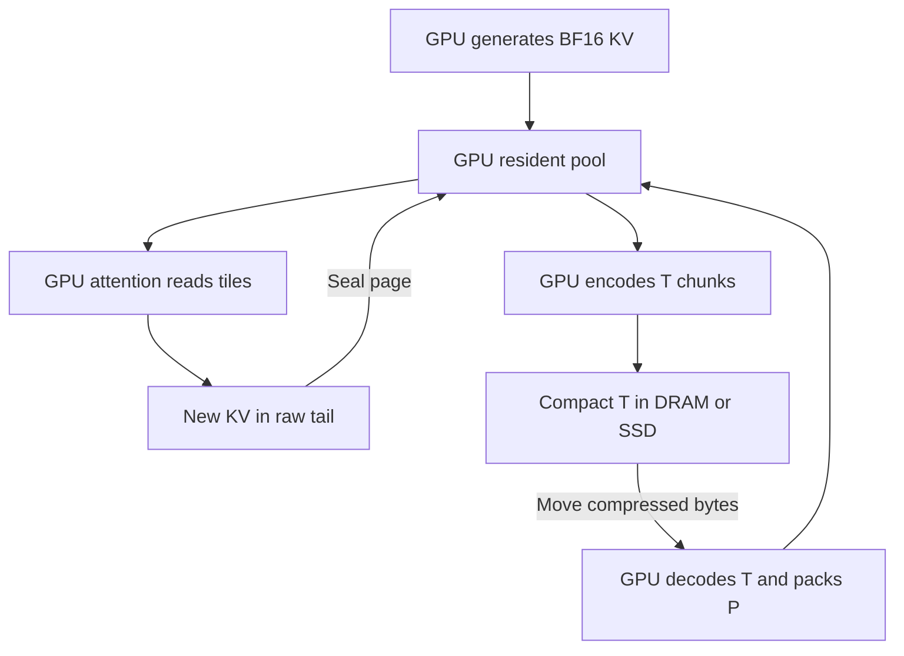

# GPU KV lifecycle: transfer, resident pool and attention

Date: 2026-10-21. Status: lifecycle plan with measured GPU components. The
[A4500 review](gpu_path_a4500_20261021_review.md) records the completed
P1 attention, T1 entropy and external restore batch. Native cache integration
and serving performance remain future work. The user has
now approved batching related work without a separate approval between steps.
See [the GPU path batch](gpu_path_batch.md) for current implementation coverage
and the A4500 experiment command.

The target is an exact GPU data path: produce KV, keep active pages in a
resident pool, store inactive KV as compact transfer chunks in DRAM/SSD, move
those same compact chunks, and install them into the GPU pool without
expanding the whole cache. Attention reconstructs only the tiles it consumes.

The transfer and pool formats have different jobs. Transfer coding minimizes
communication/storage bytes subject to codec cost. The resident pool minimizes
allocated GPU memory subject to efficient attention access. Compression ratios
from the two tiers are measured separately and never multiplied or added.

## Agreed tier policy: one logical cache, two physical representations

| Location or use | Canonical representation |
|---|---|
| SSD | Compact transfer/storage chunks, T |
| Host DRAM, including reusable cold cache | The same T chunks |
| SSD/DRAM-to-GPU or GPU-to-GPU movement | T bytes, kept compressed during staging and transport |
| Active GPU cache used by attention | Resident pool pages, P |
| Generation, transcoding or attention work | Temporary BF16 tiles and bounded feature/coder buffers |

Outside GPU memory, T is the storage format as well as the movement format.
Reading SSD into DRAM does not decode KV, and staging bytes through the CPU
does not turn them into BF16. GPU admission performs T-to-P conversion once;
GPU eviction performs P-to-T conversion before sending bytes out. Unchanged
pages may retain their existing external T backing, avoiding re-encoding on
eviction. GPU staging queues can briefly contain T, but active attention reads
P. The previous proposal's direct-pool wire mode is now a benchmark control,
not the selected external-storage or transport policy.

The measured 44.8208% reduction means complete packets occupy 55.1792% of
original BF16 word bytes on that pilot workload, excluding shared state. It is not a guaranteed
per-chunk or full-model saving. Explicit raw fallback remains legal inside
the canonical T container for incompressible inputs. A new GPU T1 stream,
indexes and restart layout must have its rate measured again.

### Why keep a pool if T has the smaller measured representation?

T's current decoder advances through earlier layers, earlier channel groups
and sequential entropy lanes. For example, recovering layer three's
last group in a chunk requires recovering its prerequisites. A byte offset
to that group does not remove those prediction dependencies. This work is
reasonable once at cache admission, but repeating it for attention's selected
layer/head tiles on every generated token may be expensive.

P gives each layer/head tile its own access location and local escape handling.
It can spend more bytes to avoid cross-layer reconstruction on the repeated
attention path. T-to-P conversion reconstructs original words in small scratch
and encodes them as P; it is not a second compression percentage applied to T.
The two encodings preserve the same original BF16 words exactly.

P is not required for losslessness and is not proven to be the best permanent
GPU representation. Its justification is a better measured resident-memory /
attention-latency tradeoff. Compare it with T-to-dense GPU admission, and with
direct tile access to T if that becomes feasible. If T obtains sufficiently
cheap independent access with better total cost, a single-format design can
replace P. Until then, the selected implementation is T outside GPU and P for
active GPU attention, rather than claiming the smallest wire stream is already
an efficient attention cache.

## 1. Current evidence and the representation boundary

| Representation | Current evidence | Remaining implementation |
|---|---|---|
| Original BF16 KV | Native HF capture from GPU model execution | Replace the persistent dense cache allocation when integrating the pool |
| Existing transfer stream, called T0 here | CPU entropy reference, 8.828674 complete bpv for Qwen B | Retained as a matched reference; T1 is a separate GPU ABI |
| Existing pool records, called P0 here | Exact GPU tensor pack/unpack; byte parity with the original records | Attention tile access, production allocation, raw tail, overflow and serving integration |
| Resident ABI P1 | Actual A4500 pack, selected reads, raw tail and fused attention; 13.05 allocated packet bpv on the SmolLM fixture | Reusable serving allocation, native cache writer, model continuation and concurrency |
| GPU wire ABI T1 | Actual GPU probabilities/entropy, exact isolated decode, file restore to P1; 9.023300 complete bpv for Qwen B | Reduce codec latency; measure compact identity framing; fused bounded-scratch conversion and transport integration |

The Qwen four-layer T0 study records arm B at 8.828674 complete packet
bits/value with CPU entropy coding. The new A4500 batch reuses the same
exploratory Qwen words and frozen states, measures T1 separately and compares
both coders on those pages. The older SmolLM pool replay remains a different
workload. No report establishes full-model serving performance. Designs and
integration milestones below include work beyond these measured components.

## 2. Target lifecycle

The diagram shows both local attention and offload/resume. All codec and
attention boxes are GPU work. DRAM and SSD store the same T chunks; CPU I/O
can move those bytes without decoding them. A local active request need not
create T until it is stored outside GPU or moved to another worker.

### Generation and local use

1. Capture the actual cache-writer words: final BF16 K after applicable key
   normalization and RoPE, and final BF16 V. Codec inputs are uint16 bit
   patterns, without numerical conversion or extra rounding.
2. Current computation may use the model's ordinary transient K/V tensors.
   Once a page's writes and current readers complete, pack it on GPU and
   publish a resident pool descriptor. Remove the persistent dense copy.
3. Attention uses compressed sealed pages plus the request's private raw
   partial page. A local request needs no transfer predictor or T1 state.

An observational hook alone does not stop HF from allocating its ordinary
dense cache. Actual memory savings require a cache-writer/attention-backend
integration. Model activations and prefill transients are also part of peak
memory, even if persistent KV is compressed.

### Moving KV between GPU, DRAM and SSD

Use one versioned, indexed T object per independent token chunk and local
model shard. It records valid tokens, layer/head geometry, codec state identity,
integrity information and all restart/anchor requirements. File and DRAM
indexes locate chunks without decompressing them. The initial chunk includes
all declared local layers for its token range, so no unrelated stored chunk is
needed to reconstruct it. Pipeline-shard boundaries need their own declared
anchors; they cannot silently inherit a previous layer on another worker.

| Transition | Required data path |
|---|---|
| Active GPU to DRAM | GPU P-to-T encoding, then copy compressed T bytes |
| DRAM to SSD, or SSD to DRAM | Write/read the same T bytes and index; no KV codec |
| DRAM/SSD to GPU | Stage/read T into GPU input buffers, then GPU T-to-P conversion |
| GPU to GPU | GPU P-to-T, send T bytes, GPU T-to-P |
| Local active GPU reuse | Attention reads P; no transfer codec required |

Device pointers are local. External metadata carries logical chunk/page
identities, extents and offsets. A receiver validates the model and T codec
identity, loads compatible shared state, reserves its P arena and only then
admits the chunk. Receiver pool layout/calibration is independent of T; both
representations meet at the exact original BF16 words.

The first transfer schedule starts after prefill: source P1 pages are read in
bounded chunks, encoded and sent; the source retains ownership until the
receiver acknowledges successful installation. Later, encoding may overlap
layer production, but that requires explicit layer-segment framing and readiness
events. Do not assume all layers of a token page exist when layer zero finishes.

CPU scheduling, network I/O and pinned-host staging are allowed. GPU codecs
never ask the CPU to compute probabilities or reconstruct KV. Direct GPU/NIC
transport is a later capability-dependent option, not an assumption about the
A4500 setup. Initial loopback/copy experiments do not establish real network
performance.

The current CPU entropy codec remains a reference and correctness control;
it is not the implementation of this target GPU admission/offload path.

### Receiving a transfer chunk

T1 preserves same-token previous-layer and earlier-channel dependencies.
For one token chunk, decode layer zero first and advance through layers/groups.
Once a layer's words are exact, pack its resident pages on GPU. Retain only the
previous/current layer context needed by the next step; recycle scratch after
the dependency ends. Incoming bytes, completed pool pages and scratch coexist
and must all be counted.

A tile of a packed previous layer may be reconstructed again if it is the most
memory-efficient way to provide later transfer context. That read is charged
to transcoding. Attention itself never walks the transfer dependency chain.

Start with 32-token transfer chunks and 16-token pool pages, matching existing
test granularities. Each transfer chunk maps to two pool pages per layer.
For the measured Qwen geometry, a 32-token layer's raw K/V is 128 KiB; two such
layer word buffers are 256 KiB. This is only word-buffer arithmetic. Fixed-point
features, probability/coder state, input queues, escape workspace and other
temporaries need a separate measured budget. Bound the number of in-flight
chunks with credits/backpressure.

### Attention and new generated tokens

Attention looks up one layer, KV head and token block. Its loader reconstructs
exact BF16 words into registers/shared memory, computes the attention tile and
discards those temporary values. It creates no full dense persistent cache.

Append new KV to a small private BF16 tail. With a 16-token page, at most one
partial page per request/layer is open, excluding bounded in-flight sealing.
Attention sees the compressed prefix and the valid raw tail exactly once.
When full, pack the page, publish its descriptor after a completion event, and
release the old tail only after existing readers finish. Track logical length
and page generation to handle rollback or cancelled work. Shared sealed pages
are immutable and use reference counting; mutable tails are not shared.

### Migration, offload and reclamation

A live migration snapshots a consistent token boundary. Completed pages and
the active tail are transferred under that snapshot; token generation either
pauses for the cutover or uses an explicitly versioned delta protocol later.
The first implementation pauses rather than introducing a second protocol.
The old owner releases pages after acknowledgment and completion of local
readers. Retries use the same logical identity and are idempotent.

Offload writes T with its model/calibration identities and a recoverable chunk
index. Verify completion of the DRAM copy or required SSD persistence boundary
before discarding the last live GPU copy. Resume installs T as P1 on GPU. A
completed request drops its page references and returns allocations only after
relevant GPU events finish. External T backing has its own retention policy.

Initially admit/evict whole token chunks across the declared local layers,
rather than dropping arbitrary prerequisite layers while encoding T. On
eviction, a partial raw tail is encoded with its valid-token count; padding,
if required by a GPU pool kernel, is not exposed as real tokens. Dirty new
pages need T encoding; clean pages with valid external T backing can release
their GPU copy after readers retire without writing the same data again.

## 3. Resident P1 layout and allocation

P0 stores a 2-byte escape count, raw sign/mantissa bytes, per-channel packed
exponent codes and ordered raw escape exponents. Its global record offsets
and dense token-row bit strides do not resolve an escaped value's rank.
Its tensor reference also allocates using a device-to-host scalar and expands
temporary bit tensors. Neither behavior is the intended serving hot path.

P1 retains those exact coding principles but uses an attention-oriented page
ABI. The first candidate divides each layer page into separately addressable
K/V and KV-head sectors. For 16 tokens and head dimension 128, one sector
contains 2,048 BF16 words, or 4 KiB when temporarily reconstructed. Q heads
share their appropriate KV head under GQA rather than duplicating storage.

Each sector has a mode, valid-token count, dense-code location, escape location
and escape count. Precomputed channel bit offsets identify dense exponent
codes. The first loader cooperatively reconstructs an entire head tile and
computes escape ranks within it. Compare paid rank checkpoints only if this
scan is too expensive. K/V layouts may differ to match their access patterns;
any reordering is versioned and tested against the original logical words.

Use a bounded preallocated GPU arena with explicit page allocation. A count/
reserve pass obtains payload and escape space; a write pass fills the sector.
An incompressible sector uses a raw BF16 allocation and a RAW descriptor.
The allocator must reserve a full-size raw slot where needed, rather than
assuming the smaller compressed reservation can hold it. Charge unused size
classes, alignment, directories, escape capacity, free lists and temporary
coexistence. When credits are exhausted, apply backpressure before accepting
more chunks. There is no per-page `.item()` allocation synchronization in the
target implementation.

Publish a page only when all required payloads and indexes are ready. Readers
use a stable descriptor snapshot. Superseded allocations stay live until
their readers retire; partial writes never become visible as valid KV.

## 4. GPU T1 design constraints

The current single range stream per page is a serial dependency, in addition
to the predictor's 64 channel stages per Qwen layer. GPU matrix prediction
alone cannot solve this. T1 first tests parallel independent token/microtile
coder lanes across chunks while retaining within-lane causal prediction.
Every restart state, lane directory, padding byte and layer anchor is paid.

Probability generation must be deterministic on GPU. Use declared integer
CDF counts, rounding, interpolation and positive-frequency rules. CPU/GPU
count parity and decoding of arbitrary BF16 bit patterns are required. If a
new probability discretization or stream layout is needed, give it a new
identity and measure its complete rate; exact output words do not require
identical bytes to T0. Never carry T0's 8.828674 rate over to a changed T1 ABI.

Begin with no transmitted hints, using B as the probability-model candidate.
C/D currently select zero contribution. Cosets remain a later encoded-rate
experiment; the prefix eligibility screen is not a GPU decoder or new saving.
Dense predictor state, coefficient traffic, integer arithmetic and context
scratch are part of T1's measured cost. Local resident attention should not
have to retain that state unless the worker actually handles T1 transfers.

If an actual-prefill hint is tested later, compute its small packed code while
the hidden input exists and retain only that code alongside P until T is
written. Its residency and hook work count. The decoder gets the code from T,
not the original hidden tensor. Codes for newly generated KV need the same
lifetime policy. Detailed arms, matched controls and timing boundaries are
specified in [the research and timing contract](gpu_kv_research_and_timing.md).

## 5. Shared identity and page contract

| Metadata | Purpose |
|---|---|
| Checkpoint/configuration/adapter identity | Do not reuse KV across incompatible model executions |
| Layer, KV-head/shard identity, token start/count | Place exact words in the right logical cache positions |
| BF16 word layout, K/V order, RoPE convention/parameters | Avoid numerical recasting, head swaps, or applying RoPE twice |
| Transfer/pool version and calibration/state hashes | Negotiate and load the exact codec before use |
| Chunk/page ID, generation, valid-token count, lengths and indexes | Locate DRAM/SSD objects; install, retry, access and reclaim pages consistently |
| Integrity information and readiness event | Validate complete data before publishing it to attention |

Fit shared constants offline, install them once per compatible worker and
report warm and cold initialization separately. A changed predictor/calibration
does not silently reinterpret existing pages. Coefficient/CDF tables, pool
calibration and encoder-only arrays have separate CPU/GPU byte ledgers.

The baseline order conversion between native HF split-half RoPE coordinates
and the transfer predictor's adjacent pairs is a layout operation. Original
post-RoPE BF16 cache words remain the exact reconstruction target. Extra
prefill hidden metadata is not required by this lifecycle.

## 6. Implementation tasks and approval gates

The rows identify separate deliverables and evidence requirements. Related
implementation/testing can now be batched under the user’s latest authorization.
The numbering is the execution order, not a claim that these components exist.

| Task | Concrete deliverable | Required evidence before moving on |
|---|---|---|
| 1. GPU pool pages | Frozen P1 descriptor/layout plus GPU pack and head-tile unpack with explicit escape/raw allocation | Exact original words; escape/all-raw/tail cases; no CPU KV codec; allocated-byte and scratch accounting; measured A4500 kernel timings |
| 2. Compressed GPU attention | Paired dense and P1 loaders in the same attention arithmetic, supporting compressed prefix and raw tail | Exact loaded KV; attention/logit/continuation comparisons; no whole-cache dense buffer; measured latency and occupancy/workspace |
| 3. GPU transfer feasibility | T1 GPU probability/coder lanes, encoder and decoder, starting from frozen B | Counts and original-word parity; all framing paid; codec-state/scratch/latency measurements; no CPU probability/range work |
| 4. External T storage and GPU bridge | P1 to T1 in DRAM/SSD, then T1 to P1 using indexed chunks and bounded layer scratch | Exact offload/resume; identical T bytes through DRAM/SSD/transport; actual stored/index bytes, I/O and install time; warm/cold state; ownership and persistence boundary |
| 5. Native generation and lifecycle | Actual cache-writer integration, page sealing/append, chunk eviction, clean backing reuse, cancellation and reclamation | Prefill-to-decode continuation; bounded in-flight storage; correct partial tails/retries/overflow; no duplicate persistent dense cache |
| 6. Full workload validation | Full-model 2K/8K, text/code/mixed prompts, concurrent decode, actual DRAM/SSD and real transport where available | Actual resident/peak VRAM, admitted requests under a declared latency budget, cold-resume TTFT, inter-token latency and tokens/s; distinguish single-GPU emulation from multi-GPU/network evidence |
| 7. One-change optimization loop | Matched width-context ablations, range/objective changes, predictor structure and selective correction/hint experiments | TRAIN/DEV-frozen choices, fresh TEST data, exact GPU path and complete rate/state/compute accounting for every accepted change |

Task 1 is the recommended immediate implementation. It provides the active
GPU storage/access foundation before taking on the harder T entropy kernel
and external-storage bridge. A task can stop with a negative measured
result: redesign the bottleneck rather than carrying an unverified speed or
capacity assumption into the next stage.

## 7. One measurement contract for every optimization

Keep two comparison groups. A system baseline uses ordinary dense KV, raw
transport and dense attention. The target uses T in external storage and
transit and P1 for GPU attention. Raw movement, direct P movement, and T-to-dense
admission are benchmark controls, not additional production tier policies.
If direct T tile access becomes feasible, compare it too before deciding that
P1 deserves to remain. Charge every conversion and allocation in each path.

Record:

- Complete stored and wire bytes, including DRAM/SSD chunk indexes,
  directories, restarts, hints, checksums, padding and cold shared state when
  applicable. Distinguish SSD file bytes from physical allocation/alignment.
- Actual resident allocated VRAM: pool payload, escapes, indexes, reserved
  slack, raw tail/overflow and state. Payload bits/value alone is insufficient.
- Peak VRAM: resident pages plus input/output queues, old/new page coexistence,
  predictor/coder arrays, word/feature scratch, model activations and attention
  workspace. Report measured allocations alongside framework counters.
- GPU encode/decode/transcode and attention intervals, synchronized wall time,
  host overhead, actual DRAM/SSD I/O, pinned-buffer bytes, transport bytes/time,
  stalls and cold setup. Include eviction encode cost and time to first usable
  attention after a cold resume; GPU decode is paid on admission, not on each
  attention read.
- Exact word reconstruction and declared attention/continuation criteria.
  Exact KV alone does not guarantee bit-identical logits if the attention
  arithmetic/reduction order changes. Compare dense and compressed loaders
  under the same kernel arithmetic first; report other backend differences.
- Model revision, all layers/shards, token IDs, workload/position coverage,
  source identities and all selected codec settings.

In an initial serial cost model, T's bytes saved versus a direct-pool control
repay extra codec work only when that work is below
`(POOL bytes - TRANSFER bytes) / link bandwidth`. This is a diagnostic, not a
rule that silently changes the external format. Report if the selected T
policy does not meet the intended latency budget. For an overlapped
implementation, measure actual completion time and stage bottlenecks instead
of adding isolated kernel medians. Separate one-time admission/eviction from
the repeated attention-read cost and include the expected reuse count.

Every optimization must use the stage boundaries in
[the research and timing contract](gpu_kv_research_and_timing.md), including
KV-to-T, KV-to-P, P-to-T and fused T-to-P. Mark missing GPU stages as not
implemented; current predictor/CPU timings cannot fill those fields.

The next width ablation is preserved as a research task, but it does not take
priority over establishing the GPU resident/access path. A useful adoption
result improves a measured latency/capacity/communication tradeoff within the
declared budget, rather than only lowering ideal bits/value.

## 8. Primary implementation context

These are integration references, not claims that their engines already
support our formats or that a particular serving framework has been selected:

- [vLLM disaggregated prefilling](https://docs.vllm.ai/en/latest/features/disagg_prefill/)
  describes producer/consumer workers and KV-transfer connectors. A connector
  is a later integration boundary; it does not supply our GPU codecs.
- [vLLM paged-attention design](https://docs.vllm.ai/en/latest/design/paged_attention/)
  describes token blocks per KV head and different K/V access patterns. It
  motivates testing a head-sector pool layout rather than assuming the
  current combined record is already an efficient attention layout.
- [CUDA 12.8.1 programming guide](https://docs.nvidia.com/cuda/archive/12.8.1/cuda-c-programming-guide/index.html#page-locked-host-memory)
  documents pinned-memory transfers and synchronization requirements. Actual
  overlap depends on the device and stream schedule.
- [vLLM NIXL cache lease design](https://docs.vllm.ai/en/latest/design/nixl_kv_cache_lease/)
  illustrates producer buffer lifetime during asynchronous KV retrieval.
  Our transport must likewise define successful installation and ownership
  release, even when it initially uses simpler copies rather than RDMA.

Local evidence: [four-arm review](block32_probability_a4500_review.md),
[probability experiment](transfer_probability_arms.md),
[pool and predictor GPU validation](transfer_gpu_validation.md), and
[original pool/transfer audit](team_pool_transfer_review.md).
