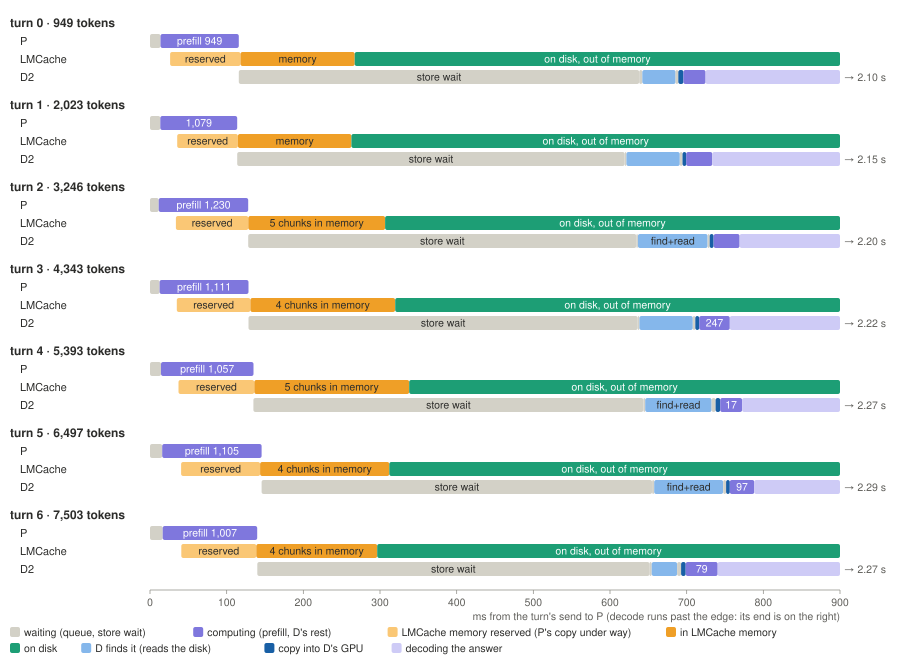

# Conversation 2: mt-rag-govt-elser-512-100-20240611 (disk mode)

7 turns on D2 (routed by conversation); prompts grow from 949 to 7,503 tokens (interleaved: each turn's prompt is the previous one, its answer, then this turn's documents and question). Chunks are 256 tokens (16 vLLM blocks of 16); a chunk's name is LMCache's hash of its tokens and everything before them, so the same prefix has the same chunks on every turn and engine.

Legend for the strips (one character a chunk): P: `=` on P's GPU from an earlier turn, `#` computed and stored now, `+` computed, not stored (a partial chunk). D: `=` on D's GPU from an earlier turn, `M` pulled from memory, `S` pulled from disk, `+` computed by D (a partial chunk), `?` missed.

GPU blocks (the chunk tables): the slots in each engine's GPU KV cache (vLLM's block pool ids; slot 0 is its reserved null block) that hold the chunk's 16 vLLM blocks, in block order, a run of consecutive slots written as a range: `P 1, 138-152` is block 0 in slot 1 and blocks 1-15 in slots 138-152. An engine hands a block a slot from its free list when it first computes or loads it, and the block keeps it while cached, so a later turn that reuses the block shows the same slot. Blocks that are the same in several prompts (the same tokens and everything before them) share one slot once the first is cached: the system prompt's first block, the same in every conversation, is the usual one. `16/16 hashes = P's`: of the blocks D pulled, how many have the same vLLM hash on D as on P.

The prompts' text is rebuilt from the MTRAG file the run read, by the driver's own code (scripts/pd_mtrag.py build()), and matches the run's record piece for piece; token counts and places are the run's. D's answers were not kept by this run's driver, only their token ids. Lines over 100 characters are wrapped here for reading.

| turn | prompt | chunks + tail | P: own GPU / computed / stored | D: own GPU / loaded / computed | pulled | pull ms | D first token ms |
| ---: | ---: | --- | --- | --- | --- | ---: | ---: |
| [0](#turn-0) | 949 | 3 + 181 | 0 / 949 / 3 chunks | 0 / 768 / 181 | 3 chunks (disk 3) | 51.6 | 86.5 |
| [1](#turn-1) | 2,023 | 7 + 231 | 944 / 1,079 / 4 chunks | 1,072 / 720 / 231 | 3 chunks (disk 3) | 77.3 | 114.1 |
| [2](#turn-2) | 3,246 | 12 + 174 | 2,016 / 1,230 / 5 chunks | 2,144 / 928 / 174 | 4 chunks (disk 4) | 98.7 | 134.6 |
| [3](#turn-3) | 4,343 | 16 + 247 | 3,232 / 1,111 / 4 chunks | 3,360 / 736 / 247 | 3 chunks (disk 3) | 77.4 | 120.3 |
| [4](#turn-4) | 5,393 | 21 + 17 | 4,336 / 1,057 / 5 chunks | 4,464 / 912 / 17 | 4 chunks (disk 4) | 96.7 | 128.7 |
| [5](#turn-5) | 6,497 | 25 + 97 | 5,392 / 1,105 / 4 chunks | 5,520 / 880 / 97 | 4 chunks (disk 4) | 98.3 | 133.2 |
| [6](#turn-6) | 7,503 | 29 + 79 | 6,496 / 1,007 / 4 chunks | 6,624 / 800 / 79 | 4 chunks (disk 4) | 43.5 | 89.1 |

## How the prompt grows

Each turn's prompt is the previous one, token for token, and then: D's answer to the previous turn, this turn's documents, its question and the framing (the system prompt on turn 0, `Assistant:` and newlines). Only the new tokens can make new chunks: the previous prompt's partial chunk fills first. A document sent before comes again at another place, so in other chunks.

| turn | prompt | new | previous answer | documents | question | framing | whole chunks |
| ---: | ---: | ---: | ---: | --- | --- | ---: | --- |
| 0 | 949 | +949 | – | 2 docs, 911 | 8: What is ground water contamination? | 30 | 3 (+3) |
| 1 | 2,023 | +1,074 | 128 | 2 docs, 935 | 8: Can it be clean up? | 3 | 7 (+4) |
| 2 | 3,246 | +1,223 | 128 | 2 docs, 1,086 (1 sent before: 472) | 6: What is it? | 3 | 12 (+5) |
| 3 | 4,343 | +1,097 | 128 | 2 docs, 956 (1 sent before: 472) | 10: What are the suppliers for the city? | 3 | 16 (+4) |
| 4 | 5,393 | +1,050 | 128 | 2 docs, 915 | 4: Pollution | 3 | 21 (+5) |
| 5 | 6,497 | +1,104 | 128 | 2 docs, 968 | 5: In water | 3 | 25 (+4) |
| 6 | 7,503 | +1,006 | 128 | 2 docs, 869 | 6: Sollutions | 3 | 29 (+4) |

## Timeline

Every turn on one clock: ms from the moment the proxy sent the turn to P. P prefills it (one token out) and stores its new whole chunks in LMCache; the proxy waits 500 ms after P is done (the store wait) and sends the turn to D2, which finds what LMCache has (reading it from disk), copies it into its GPU, computes the rest and decodes the answer. The lanes: P, LMCache (the chunks P stored this turn) and D. P computes the KV into its own GPU slots, where it stays (the next turn reuses it); its LMCache connector, set to store (P runs as kv_both), copies each new whole chunk from those slots to LMCache: LMCache reserves the space when P schedules the prefill (light orange) and has the chunks as P's prefill completes (orange).



| turn | P queued → done | chunks stored | in memory | on disk | D starts | D finds (+ disk read) | copy into D's GPU | D: held / pulled / computed | first token | D done |
| ---: | --- | ---: | ---: | ---: | ---: | --- | --- | --- | ---: | ---: |
| 0 | 14 → 116 | 3 | 118 | 267 (out of memory) | 638 | 642-686 | 689-696 | 0 / 768 from disk / 181 | 725 | 2,105 |
| 1 | 14 → 114 | 4 | 115 | 263 (out of memory) | 619 | 621-691 | 694-699 | 1,072 / 720 from disk / 231 | 733 | 2,147 |
| 2 | 11 → 128 | 5 | 128 | 307 (out of memory) | 634 | 636-727 | 730-735 | 2,144 / 928 from disk / 174 | 769 | 2,203 |
| 3 | 12 → 128 | 4 | 131 | 320 (out of memory) | 636 | 638-708 | 711-716 | 3,360 / 736 from disk / 247 | 756 | 2,222 |
| 4 | 14 → 135 | 5 | 136 | 338 (out of memory) | 644 | 646-732 | 738-744 | 4,464 / 912 from disk / 17 | 772 | 2,266 |
| 5 | 16 → 146 | 4 | 144 | 312 (out of memory) | 655 | 658-748 | 751-756 | 5,520 / 880 from disk / 97 | 788 | 2,295 |
| 6 | 17 → 140 | 4 | 139 | 296 (out of memory) | 651 | 654-688 | 693-699 | 6,624 / 800 from disk / 79 | 740 | 2,268 |

All times in ms from the turn's send to P. "in memory": the last of the turn's chunks written into LMCache's memory; "on disk": the last one written to disk (then dropped from memory, in the disk mode); D finds: from LMCache's lookup to its prefetch done (in the disk mode that is the read from disk); copy: LMCache's retrieve into D's GPU slots until D's connector has it. Each turn's section below tells it in a sentence.

### One chunk, block by block: chunk 0 of turn 0 (`85f8dd3d9f0a22f8`)

Tokens 0-256 (system: 28; doc 62964e3a387835: 228). P computed its blocks on turn 0 and stored them as one chunk; D2 pulled the chunk into these GPU blocks:

| block | tokens | P's GPU block | vLLM hash | D's GPU block | D wrote it | same hash on D |
| ---: | --- | ---: | --- | ---: | --- | --- |
| 0 | 0-16 | 1 | `9f9c499d1c876b7e` | 1 | yes | True |
| 1 | 16-32 | 2 | `76827a2f3154693e` | 2 | yes | True |
| 2 | 32-48 | 3 | `a35ee4baf572391e` | 3 | yes | True |
| 3 | 48-64 | 4 | `e6dbd6621e81463a` | 4 | yes | True |
| 4 | 64-80 | 5 | `27acba166ab4b848` | 5 | yes | True |
| 5 | 80-96 | 6 | `13e9a85d6c60e734` | 6 | yes | True |
| 6 | 96-112 | 7 | `10f8d51cb8b3d184` | 7 | yes | True |
| 7 | 112-128 | 8 | `ef73b0a6aa8db24b` | 8 | yes | True |
| 8 | 128-144 | 9 | `f5228c6b14aff6f0` | 9 | yes | True |
| 9 | 144-160 | 10 | `6b4708c4da6918be` | 10 | yes | True |
| 10 | 160-176 | 11 | `4e3bc5526b3d9372` | 11 | yes | True |
| 11 | 176-192 | 12 | `213157c34e5d730f` | 12 | yes | True |
| 12 | 192-208 | 13 | `09547c085c09ceb1` | 13 | yes | True |
| 13 | 208-224 | 14 | `16d8cfabed6e2758` | 14 | yes | True |
| 14 | 224-240 | 15 | `1e1596807cf66c1a` | 15 | yes | True |
| 15 | 240-256 | 16 | `f948ec801d8ffca5` | 16 | yes | True |

## Turn 0

**Timeline:** P queued until 14 ms, prefilled 949 tokens (held 0) and was done at 116 ms; its 3 new chunks were in LMCache's memory at 118 ms, on disk at 267 ms and out of memory. After the 500 ms store wait, D2 started at 638 ms holding 0 tokens, pulled 768 from disk (found 642-686 ms, copied into its GPU 689-696 ms), computed 181 and gave its first token at 725 ms; it decoded 128 tokens until 2,105 ms. ([all turns](#timeline))

949 prompt tokens: 3 whole chunks and 181 tokens over (the partial chunk, computed by both engines and stored only when a later turn completes it). P held 0 tokens on its GPU, computed 949 and stored 3 new chunks; D2 held 0, loaded 768 from LMCache and computed 181.

### The prompt

The whole prompt, piece by piece:

- **system prompt** · tokens 0-28 (28) · chunk 0

```text
You are a helpful assistant. Answer the user's last question from the documents. If they do not hold
the answer, say so.
```

<details><summary>document <code>62964e3a38783558-42267-44322</code> · tokens 28-478 (450) · chunks 0-1</summary>

```text
Document: FAQs • Monterey Park, CA • CivicEngage
FAQs • Monterey Park, CA • CivicEngage
Rain and snowmelt comes down from the San Gabriel Mountains through a series of dams and are then
diverted to "spreading basins". Spreading basins are designated areas of land that are very
permeable, such as sand and gravel areas. Water can then percolate into the ground. 100% of the
water served to residents and businesses in Monterey Park comes from groundwater. Thus, keeping our
groundwater resource clean is vitally important to all of us.

7.
Where do groundwater toxins come from?

Many products we use around our homes everyday are considered toxic, such as household cleaners,
flea powders, garden pesticides, paints, varnishes, motor oil, and antifreeze. These products are
not only hazardous to our health, but to our environment. By disposing these harmful products
improperly, we are contributing to the groundwater contamination in the San Gabriel Valley.

8.
Can contaminated groundwater be cleaned up?

Yes, but it can be time-consuming and expensive. Communities whose drinking water source has become
contaminated have had to spend millions of dollars to remove contaminants from the water before it
can be piped to homes and businesses. The cleanup is effective, but it can significantly affect the
cost of providing the water to customers. It is far better to prevent contamination in the first
place. What are the dos and do nots for groundwater?Do: Purchase only what you need Use products
completely before disposing Recycle whatever you can (oil, batteries, etc.) Recycle surplus paintsDo
not: Dump products onto the ground (they can contaminate soil and groundwater) Pour products or
wastes into the street (they can contaminate oceans, lakes, and groundwater) Put hazardous or toxic
products in the trash Pour products down the drainView proper disposal of Household Hazardous Wastes
online.

9.
Is our water fluoridated?

At this time fluoride is not added to the water. There are low levels of fluoride naturally
occurring in the water. The range at which they occur is between 0.2 to 0.8 milligrams per liter
(mg/L).
```

</details>

<details><summary>document <code>b4521304b77788b6-2-2025</code> · tokens 478-939 (461) · chunks 1-3</summary>

```text
Document: FAQs • Where do groundwater toxins come from?
FAQs • Where do groundwater toxins come from?
FAQs • Where do groundwater toxins come from?

 

Skip to Main Content

Create a Website Account - Manage notification subscriptions, save form progress and more.   

Website Sign In

 

 中文 Español

 
 
 

GovernmentServicesResidentsVisitorsBusinessHow Do I...

 

 

 

 

 

 

 

 

 
 
 

 

Search

 
 
 

 
HomeFAQs

Search

All categories
Code Enforcement
Construction Inspections
Drone FAQs
Election Information (English)
Fire Department
Library
Multi-Family Residential/Apartment Inspection Program
Planning
Public Works - Slurry Seal
Water

Categories

All Categories

Code Enforcement

Construction Inspections

Drone FAQs

Election Information (English)

Fire Department

Library

Multi-Family Residential/Apartment Inspection Program

Planning

Public Works - Slurry Seal

Water

 

Where do groundwater toxins come from?	

Many products we use around our homes everyday are considered toxic, such as household cleaners,
flea powders, garden pesticides, paints, varnishes, motor oil, and antifreeze. These products are
not only hazardous to our health, but to our environment. By disposing these harmful products
improperly, we are contributing to the groundwater contamination in the San Gabriel Valley.

▼
Water	

Show All Answers

1.
How do I pay my water bill?

Water bills are mailed out on a two-month cycle. There are three ways to pay your bill: by mail, in
person, or automatic billing.Bills can be paid in person at the Cashiers Counter located in the
first floor of the Monterey Park City Hall at 320 W. Newmark Ave. View the location map online. The
city has recently established a new automated billing system where your water bill can be
automatically paid from your checking account. See more information on automated billing. To mail a
payment, send it to Water / Refuse Billing at 320 West Newmark Avenue, Monterey Park, CA 91754. For
additional information about your water bill you may call 626-307-1342.

2.
How do I report problems such as dirty water or a water leak in the street?
```

</details>

- **question 0** · tokens 939-947 (8) · chunk 3

```text
User: What is ground water contamination?
```

- `Assistant:` · tokens 947-949 (2) · chunk 3

### Pieces, chunks and blocks

| piece | tokens | length | chunks | |
| --- | --- | ---: | --- | --- |
| system | 0-28 | 28 | 0 |  |
| doc 62964e3a387835 | 28-478 | 450 | 0-1 |  |
| doc b4521304b77788 | 478-939 | 461 | 1-3 |  |
| question 0 | 939-947 | 8 | 3 |  |
| `assistant:` 0 | 947-949 | 2 | 3 |  |

```
P  ###+
D  SSS+
```

| chunk | tokens | pieces in it (tokens) | vLLM blocks | GPU blocks | in LMCache | P this turn | D this turn |
| ---: | --- | --- | --- | --- | --- | --- | --- |
| 0 | 0-256 | system: 28; doc 62964e3a387835: 228 | 0-15 | P 1-16; D 1-16; 16/16 hashes = P's | `85f8dd3d9f0a22f8` stored on turn 0, on disk, out of memory | computed, **stored now** | **pulled from disk** |
| 1 | 256-512 | doc 62964e3a387835: 222; doc b4521304b77788: 34 | 16-31 | P 17-32; D 17-32; 16/16 hashes = P's | `8d2f3ac802435f4f` stored on turn 0, on disk, out of memory | computed, **stored now** | **pulled from disk** |
| 2 | 512-768 | doc b4521304b77788: 256 | 32-47 | P 33-48; D 33-48; 16/16 hashes = P's | `882398f250b36d4a` stored on turn 0, on disk, out of memory | computed, **stored now** | **pulled from disk** |
| 3 | 768-949 | doc b4521304b77788: 171; question 0: 8; `assistant:` 0: 2 | 48-59 | P 49-59; D 49-60 | – | computed (partial chunk: not stored) | computed by D (partial chunk) |

## Turn 1

**Timeline:** P queued until 14 ms, prefilled 1,079 tokens (held 944) and was done at 114 ms; its 4 new chunks were in LMCache's memory at 115 ms, on disk at 263 ms and out of memory. After the 500 ms store wait, D2 started at 619 ms holding 1,072 tokens, pulled 720 from disk (found 621-691 ms, copied into its GPU 694-699 ms), computed 231 and gave its first token at 733 ms; it decoded 128 tokens until 2,147 ms. ([all turns](#timeline))

2,023 prompt tokens: 7 whole chunks and 231 tokens over (the partial chunk, computed by both engines and stored only when a later turn completes it). P held 944 tokens on its GPU, computed 1,079 and stored 4 new chunks; D2 held 1,072, loaded 720 from LMCache and computed 231.

### The prompt

Tokens 0-949: [turn 0](#turn-0)'s prompt, unchanged (checked: its first 949 token ids are the previous prompt's), so chunks 0-2 are the same chunks; chunk 3 (partial then, 181 tokens) fills now. New from token 949:

- **D's answer to turn 0** · tokens 949-1077 (128) · chunks 3-4

  its text was not kept by this run: its driver kept only the token ids (later runs keep it: scripts/pd_mtrag.py --trace)

- `\n` · tokens 1077-1078 (1) · chunk 4

<details><summary>document <code>b4521304b77788b6-2983-5131</code> · tokens 1078-1550 (472) · chunks 4-6</summary>

```text
Document: FAQs • Where do groundwater toxins come from?
FAQs • Where do groundwater toxins come from?
The water is imported for us by the San Gabriel Valley Municipal Water District, a public agency,
and of which the City of Monterey Park is a member.

4.
How much water does the Monterey Park community use?

Usage ranges from an average low of 7.3 million gallons per day (mgd) in February to an average high
of 12 mgd in August. Average use per person is 100-110 gallons per day.

5.
What is ground water?

Contrary to what a lot of people think, groundwater is not found in underground rivers or lakes.
Rather, it is water that fills the cracks and pore spaces in rocks and sediments that lie beneath
the surface of the earth, much the way water fills the open spaces and saturates a sponge or towel.

6.
Why is keeping our groundwater clean so important?

The San Gabriel Valley is unique in that it is one of the few natural underground reservoirs in the
United States. Rain and snowmelt comes down from the San Gabriel Mountains through a series of dams
and are then diverted to "spreading basins". Spreading basins are designated areas of land that are
very permeable, such as sand and gravel areas. Water can then percolate into the ground. 100% of the
water served to residents and businesses in Monterey Park comes from groundwater. Thus, keeping our
groundwater resource clean is vitally important to all of us.

7.
Where do groundwater toxins come from?

Many products we use around our homes everyday are considered toxic, such as household cleaners,
flea powders, garden pesticides, paints, varnishes, motor oil, and antifreeze. These products are
not only hazardous to our health, but to our environment. By disposing these harmful products
improperly, we are contributing to the groundwater contamination in the San Gabriel Valley.

8.
Can contaminated groundwater be cleaned up?

Yes, but it can be time-consuming and expensive. Communities whose drinking water source has become
contaminated have had to spend millions of dollars to remove contaminants from the water before it
can be piped to homes and businesses. The cleanup is effective, but it can significantly affect the
cost of providing the water to customers.
```

</details>

<details><summary>document <code>b4521304b77788b6-4612-6743</code> · tokens 1550-2013 (463) · chunks 6-7</summary>

```text
Document: FAQs • Where do groundwater toxins come from?
FAQs • Where do groundwater toxins come from?
By disposing these harmful products improperly, we are contributing to the groundwater contamination
in the San Gabriel Valley.

8.
Can contaminated groundwater be cleaned up?

Yes, but it can be time-consuming and expensive. Communities whose drinking water source has become
contaminated have had to spend millions of dollars to remove contaminants from the water before it
can be piped to homes and businesses. The cleanup is effective, but it can significantly affect the
cost of providing the water to customers. It is far better to prevent contamination in the first
place. What are the dos and do nots for groundwater?Do: Purchase only what you need Use products
completely before disposing Recycle whatever you can (oil, batteries, etc.) Recycle surplus paintsDo
not: Dump products onto the ground (they can contaminate soil and groundwater) Pour products or
wastes into the street (they can contaminate oceans, lakes, and groundwater) Put hazardous or toxic
products in the trash Pour products down the drainView proper disposal of Household Hazardous Wastes
online.

9.
Is our water fluoridated?

At this time fluoride is not added to the water. There are low levels of fluoride naturally
occurring in the water. The range at which they occur is between 0.2 to 0.8 milligrams per liter
(mg/L). The optimum fluoride level recommended to reduce dental caries (cavities) is a consistent .8
mg/L does. A bill signed by Governor Wilson in 1997 mandates drinking water fluoridation for larger
water utilities, including Monterey Park, and requires the state to provide funding for the
installation and operation of fluoridation equipment. The state is currently seeking funding for
this program.

10.
Does the City of Monterey Park own the Garvey Reservoir?

The Garvey Reservoir is not owned by the City of Monterey Park and the water it contains is not
stored for city use.

Live Edit

 

 

Coronavirus Updates

Agenda Center

Documents Prior to 2012

Teleconference Procedures

City Council Meetings Written Communications / Addendums

Written Communications / Addendums 2024

Written Communications / Addendums 2023
```

</details>

- **question 1** · tokens 2013-2021 (8) · chunk 7

```text
User: Can it be clean up?
```

- `Assistant:` · tokens 2021-2023 (2) · chunk 7

### Pieces, chunks and blocks

| piece | tokens | length | chunks | |
| --- | --- | ---: | --- | --- |
| system | 0-28 | 28 | 0 |  |
| doc 62964e3a387835 | 28-478 | 450 | 0-1 |  |
| doc b4521304b77788 | 478-939 | 461 | 1-3 |  |
| question 0 | 939-947 | 8 | 3 |  |
| `assistant:` 0 | 947-949 | 2 | 3 |  |
| answer 0 | 949-1077 | 128 | 3-4 | new this turn |
| newline 0 | 1077-1078 | 1 | 4 | new this turn |
| doc b4521304b77788 | 1078-1550 | 472 | 4-6 | new this turn |
| doc b4521304b77788 | 1550-2013 | 463 | 6-7 | new this turn |
| question 1 | 2013-2021 | 8 | 7 | new this turn |
| `assistant:` 1 | 2021-2023 | 2 | 7 | new this turn |

```
P  ===####+
D  ====SSS+
```

| chunk | tokens | pieces in it (tokens) | vLLM blocks | GPU blocks | in LMCache | P this turn | D this turn |
| ---: | --- | --- | --- | --- | --- | --- | --- |
| 0 | 0-256 | system: 28; doc 62964e3a387835: 228 | 0-15 | P 1-16; D 1-16 | `85f8dd3d9f0a22f8` stored on turn 0, on disk, out of memory | on P's GPU (earlier turn) | on D's GPU (earlier turn) |
| 1 | 256-512 | doc 62964e3a387835: 222; doc b4521304b77788: 34 | 16-31 | P 17-32; D 17-32 | `8d2f3ac802435f4f` stored on turn 0, on disk, out of memory | on P's GPU (earlier turn) | on D's GPU (earlier turn) |
| 2 | 512-768 | doc b4521304b77788: 256 | 32-47 | P 33-48; D 33-48 | `882398f250b36d4a` stored on turn 0, on disk, out of memory | on P's GPU (earlier turn) | on D's GPU (earlier turn) |
| 3 | 768-1024 | doc b4521304b77788: 171; question 0: 8; `assistant:` 0: 2; answer 0 (new): 75 | 48-63 | P 49-59, 216-220; D 49-64 | `6225245ac6d7c372` stored on turn 1, on disk, out of memory | computed (its first 176 tokens on P's GPU already), **stored now** | on D's GPU (earlier turn, its own answer) |
| 4 | 1024-1280 | answer 0 (new): 53; newline 0 (new): 1; doc b4521304b77788 (new): 202 | 64-79 | P 221-236; D 65-80; 16/16 hashes = P's | `21cd5119cfb8110c` stored on turn 1, on disk, out of memory | computed, **stored now** | **pulled from disk** (its first 48 tokens on D's GPU already) |
| 5 | 1280-1536 | doc b4521304b77788 (new): 256 | 80-95 | P 237-252; D 81-96; 16/16 hashes = P's | `89c31d073cb3dd45` stored on turn 1, on disk, out of memory | computed, **stored now** | **pulled from disk** |
| 6 | 1536-1792 | doc b4521304b77788 (new): 14; doc b4521304b77788 (new): 242 | 96-111 | P 253-268; D 97-112; 16/16 hashes = P's | `fe165302915a1f84` stored on turn 1, on disk, out of memory | computed, **stored now** | **pulled from disk** |
| 7 | 1792-2023 | doc b4521304b77788 (new): 221; question 1 (new): 8; `assistant:` 1 (new): 2 | 112-126 | P 269-282; D 113-127 | – | computed (partial chunk: not stored) | computed by D (partial chunk) |

## Turn 2

**Timeline:** P queued until 11 ms, prefilled 1,230 tokens (held 2,016) and was done at 128 ms; its 5 new chunks were in LMCache's memory at 128 ms, on disk at 307 ms and out of memory. After the 500 ms store wait, D2 started at 634 ms holding 2,144 tokens, pulled 928 from disk (found 636-727 ms, copied into its GPU 730-735 ms), computed 174 and gave its first token at 769 ms; it decoded 128 tokens until 2,203 ms. ([all turns](#timeline))

3,246 prompt tokens: 12 whole chunks and 174 tokens over (the partial chunk, computed by both engines and stored only when a later turn completes it). P held 2,016 tokens on its GPU, computed 1,230 and stored 5 new chunks; D2 held 2,144, loaded 928 from LMCache and computed 174.

### The prompt

Tokens 0-2,023: [turn 1](#turn-1)'s prompt, unchanged (checked: its first 2,023 token ids are the previous prompt's), so chunks 0-6 are the same chunks; chunk 7 (partial then, 231 tokens) fills now. New from token 2,023:

- **D's answer to turn 1** · tokens 2023-2151 (128) · chunks 7-8

  its text was not kept by this run: its driver kept only the token ids (later runs keep it: scripts/pd_mtrag.py --trace)

- `\n` · tokens 2151-2152 (1) · chunk 8

- document `b4521304b77788b6-2983-5131` · tokens 2152-2624 (472) · chunks 8-10 · **again**: sent on [turn 1](#turn-1) already (the same 472 tokens), here at another place in the prompt, so in other chunks: a prefix cache cannot reuse it

<details><summary>document <code>8b076ccff5b50410-0-2279</code> · tokens 2624-3238 (614) · chunks 10-12</summary>

```text
Document: How Much Water Is on Earth? | NASA Space Place – NASA Science for Kids
How Much Water Is on Earth? | NASA Space Place – NASA Science for Kids


How Much Water Is on Earth? | NASA Space Place – NASA Science for Kids

water

Earth
Sun
Solar System
Universe
Science and Tech
Educators

How Much Water Is on Earth?

Click here to download this video (1920x1080, 37 MB, video/mp4).

How much water is on Earth?
Earth has a lot of water. It's one of the things that makes our big, blue planet so special. Learn
more about Earth's water in this video!

 Download the 8.5x11 poster!
 Download the 11x17 poster!
This poster summarizes the video and makes a great wall decoration!

 Click here to read a transcript of this video

How much water is on Earth?
Earth is special because it has so much water. It’s in the ground, forms big oceans, and it’s in our
atmosphere.
It’s also in living things. Your body is made up mostly of water.
Water covers 71 percent of Earth’s surface. And almost all of it—96.5 percent—is salt water. 
Salt water has different kinds of salt in it, but it mostly has sodium chloride, the same salt we
add to our food.
Just 3.5 percent of the water on Earth is fresh water we can drink. And most of that fresh water, 68
percent, is trapped in ice and glaciers.
A third of the fresh water is in the ground. We call it groundwater. The last two percent of fresh
water is in the rivers, lakes, and streams.
A very small amount is in our atmosphere, where it exists as water vapor. That’s what clouds are
made of.
If you took all the water on Earth and put it together it would be a ball 860 miles wide. That’s a
lot of water!

Related Resources for Educators

Our World: ICESat-2 - What Is Ice?
Our World: Why Are Oceans Salty?
Real World: Global Cloud Observation Day

 	article last updated August 29, 2022
 

More about Earth

Make an Earth fan!

Earth's atmosphere

Why is thesky blue?

If you liked this, you may like:

How Does GPS Work?

What Is a Solar Eclipse?

Searching for Other Planets Like Ours

	 Games	 

	 Crafts	 

	 Activities	 

	 Videos	 

	 Glossary	 

	 Mystery	 

About Us
Privacy Policy
Image Use
Accessibility

Contact NASA Space Place

 Last Updated: May 6th, 2024 

 

More
Less

By Subject

Space
Sun
Earth
Solar System
People & Technology
Parents & Educators

By Type

Explore
Do
Play

More
Less

More about Earth

Make an Earth fan!

Earth's atmosphere

Why is thesky blue?
```

</details>

- **question 2** · tokens 3238-3244 (6) · chunk 12

```text
User: What is it?
```

- `Assistant:` · tokens 3244-3246 (2) · chunk 12

### Pieces, chunks and blocks

| piece | tokens | length | chunks | |
| --- | --- | ---: | --- | --- |
| system | 0-28 | 28 | 0 |  |
| doc 62964e3a387835 | 28-478 | 450 | 0-1 |  |
| doc b4521304b77788 | 478-939 | 461 | 1-3 |  |
| question 0 | 939-947 | 8 | 3 |  |
| `assistant:` 0 | 947-949 | 2 | 3 |  |
| answer 0 | 949-1077 | 128 | 3-4 |  |
| newline 0 | 1077-1078 | 1 | 4 |  |
| doc b4521304b77788 | 1078-1550 | 472 | 4-6 |  |
| doc b4521304b77788 | 1550-2013 | 463 | 6-7 |  |
| question 1 | 2013-2021 | 8 | 7 |  |
| `assistant:` 1 | 2021-2023 | 2 | 7 |  |
| answer 1 | 2023-2151 | 128 | 7-8 | new this turn |
| newline 1 | 2151-2152 | 1 | 8 | new this turn |
| doc b4521304b77788 | 2152-2624 | 472 | 8-10 | new this turn |
| doc 8b076ccff5b504 | 2624-3238 | 614 | 10-12 | new this turn |
| question 2 | 3238-3244 | 6 | 12 | new this turn |
| `assistant:` 2 | 3244-3246 | 2 | 12 | new this turn |

```
P  =======#####+
D  ========SSSS+
```

| chunk | tokens | pieces in it (tokens) | vLLM blocks | GPU blocks | in LMCache | P this turn | D this turn |
| ---: | --- | --- | --- | --- | --- | --- | --- |
| 0 | 0-256 | system: 28; doc 62964e3a387835: 228 | 0-15 | P 1-16; D 1-16 | `85f8dd3d9f0a22f8` stored on turn 0, on disk, out of memory | on P's GPU (earlier turn) | on D's GPU (earlier turn) |
| 1 | 256-512 | doc 62964e3a387835: 222; doc b4521304b77788: 34 | 16-31 | P 17-32; D 17-32 | `8d2f3ac802435f4f` stored on turn 0, on disk, out of memory | on P's GPU (earlier turn) | on D's GPU (earlier turn) |
| 2 | 512-768 | doc b4521304b77788: 256 | 32-47 | P 33-48; D 33-48 | `882398f250b36d4a` stored on turn 0, on disk, out of memory | on P's GPU (earlier turn) | on D's GPU (earlier turn) |
| 3 | 768-1024 | doc b4521304b77788: 171; question 0: 8; `assistant:` 0: 2; answer 0: 75 | 48-63 | P 49-59, 216-220; D 49-64 | `6225245ac6d7c372` stored on turn 1, on disk, out of memory | on P's GPU (earlier turn) | on D's GPU (earlier turn, its own answer) |
| 4 | 1024-1280 | answer 0: 53; newline 0: 1; doc b4521304b77788: 202 | 64-79 | P 221-236; D 65-80 | `21cd5119cfb8110c` stored on turn 1, on disk, out of memory | on P's GPU (earlier turn) | on D's GPU (earlier turn, its own answer) |
| 5 | 1280-1536 | doc b4521304b77788: 256 | 80-95 | P 237-252; D 81-96 | `89c31d073cb3dd45` stored on turn 1, on disk, out of memory | on P's GPU (earlier turn) | on D's GPU (earlier turn) |
| 6 | 1536-1792 | doc b4521304b77788: 14; doc b4521304b77788: 242 | 96-111 | P 253-268; D 97-112 | `fe165302915a1f84` stored on turn 1, on disk, out of memory | on P's GPU (earlier turn) | on D's GPU (earlier turn) |
| 7 | 1792-2048 | doc b4521304b77788: 221; question 1: 8; `assistant:` 1: 2; answer 1 (new): 25 | 112-127 | P 269-282, 457-458; D 113-128 | `7ad72aaf7a9563b2` stored on turn 2, on disk, out of memory | computed (its first 224 tokens on P's GPU already), **stored now** | on D's GPU (earlier turn, its own answer) |
| 8 | 2048-2304 | answer 1 (new): 103; newline 1 (new): 1; doc b4521304b77788 (new): 152 | 128-143 | P 459-474; D 129-144; 16/16 hashes = P's | `59e65ae8809a4cb6` stored on turn 2, on disk, out of memory | computed, **stored now** | **pulled from disk** (its first 96 tokens on D's GPU already) |
| 9 | 2304-2560 | doc b4521304b77788 (new): 256 | 144-159 | P 475-490; D 145-160; 16/16 hashes = P's | `1a5c24426a423af1` stored on turn 2, on disk, out of memory | computed, **stored now** | **pulled from disk** |
| 10 | 2560-2816 | doc b4521304b77788 (new): 64; doc 8b076ccff5b504 (new): 192 | 160-175 | P 491-506; D 161-176; 16/16 hashes = P's | `383d5afb2961c615` stored on turn 2, on disk, out of memory | computed, **stored now** | **pulled from disk** |
| 11 | 2816-3072 | doc 8b076ccff5b504 (new): 256 | 176-191 | P 507-522; D 177-192; 16/16 hashes = P's | `b3fe075f4455a184` stored on turn 2, on disk, out of memory | computed, **stored now** | **pulled from disk** |
| 12 | 3072-3246 | doc 8b076ccff5b504 (new): 166; question 2 (new): 6; `assistant:` 2 (new): 2 | 192-202 | P 523-532; D 193-203 | – | computed (partial chunk: not stored) | computed by D (partial chunk) |

## Turn 3

**Timeline:** P queued until 12 ms, prefilled 1,111 tokens (held 3,232) and was done at 128 ms; its 4 new chunks were in LMCache's memory at 131 ms, on disk at 320 ms and out of memory. After the 500 ms store wait, D2 started at 636 ms holding 3,360 tokens, pulled 736 from disk (found 638-708 ms, copied into its GPU 711-716 ms), computed 247 and gave its first token at 756 ms; it decoded 128 tokens until 2,222 ms. ([all turns](#timeline))

4,343 prompt tokens: 16 whole chunks and 247 tokens over (the partial chunk, computed by both engines and stored only when a later turn completes it). P held 3,232 tokens on its GPU, computed 1,111 and stored 4 new chunks; D2 held 3,360, loaded 736 from LMCache and computed 247.

### The prompt

Tokens 0-3,246: [turn 2](#turn-2)'s prompt, unchanged (checked: its first 3,246 token ids are the previous prompt's), so chunks 0-11 are the same chunks; chunk 12 (partial then, 174 tokens) fills now. New from token 3,246:

- **D's answer to turn 2** · tokens 3246-3374 (128) · chunks 12-13

  its text was not kept by this run: its driver kept only the token ids (later runs keep it: scripts/pd_mtrag.py --trace)

- `\n` · tokens 3374-3375 (1) · chunk 13

- document `b4521304b77788b6-2983-5131` · tokens 3375-3847 (472) · chunks 13-15 · **again**: sent on [turn 1](#turn-1) already (the same 472 tokens), here at another place in the prompt, so in other chunks: a prefix cache cannot reuse it

<details><summary>document <code>62964e3a38783558-40656-42759</code> · tokens 3847-4331 (484) · chunks 15-16</summary>

```text
Document: FAQs • Monterey Park, CA • CivicEngage
FAQs • Monterey Park, CA • CivicEngage
The City of Monterey Park Water System receives its water supply from one source - local
groundwater. The water is produced by 12 City-owned wells with a total capacity of 20 million
gallons per day (mgd). The wells reach a depth of up to 1,800 feet and are located in the vicinity
of the Rio Hondo, which is outside the city limits and in the Main San Gabriel groundwater basin.
Water from our deep wells is of excellent quality and requires little or no treatment. The Monterey
Park Water System supplies an average of 10 mgd to its customers.On average, about 65% of the water
used each year is supplied from local rainfall; the other 35% is imported from northern California
and then percolated into the groundwater aquifers. The water is imported for us by the San Gabriel
Valley Municipal Water District, a public agency, and of which the City of Monterey Park is a
member.

4.
How much water does the Monterey Park community use?

Usage ranges from an average low of 7.3 million gallons per day (mgd) in February to an average high
of 12 mgd in August. Average use per person is 100-110 gallons per day.

5.
What is ground water?

Contrary to what a lot of people think, groundwater is not found in underground rivers or lakes.
Rather, it is water that fills the cracks and pore spaces in rocks and sediments that lie beneath
the surface of the earth, much the way water fills the open spaces and saturates a sponge or towel.

6.
Why is keeping our groundwater clean so important?

The San Gabriel Valley is unique in that it is one of the few natural underground reservoirs in the
United States. Rain and snowmelt comes down from the San Gabriel Mountains through a series of dams
and are then diverted to "spreading basins". Spreading basins are designated areas of land that are
very permeable, such as sand and gravel areas. Water can then percolate into the ground. 100% of the
water served to residents and businesses in Monterey Park comes from groundwater. Thus, keeping our
groundwater resource clean is vitally important to all of us.

7.
Where do groundwater toxins come from?
```

</details>

- **question 3** · tokens 4331-4341 (10) · chunk 16

```text
User: What are the suppliers for the city?
```

- `Assistant:` · tokens 4341-4343 (2) · chunk 16

### Pieces, chunks and blocks

| piece | tokens | length | chunks | |
| --- | --- | ---: | --- | --- |
| system | 0-28 | 28 | 0 |  |
| doc 62964e3a387835 | 28-478 | 450 | 0-1 |  |
| doc b4521304b77788 | 478-939 | 461 | 1-3 |  |
| question 0 | 939-947 | 8 | 3 |  |
| `assistant:` 0 | 947-949 | 2 | 3 |  |
| answer 0 | 949-1077 | 128 | 3-4 |  |
| newline 0 | 1077-1078 | 1 | 4 |  |
| doc b4521304b77788 | 1078-1550 | 472 | 4-6 |  |
| doc b4521304b77788 | 1550-2013 | 463 | 6-7 |  |
| question 1 | 2013-2021 | 8 | 7 |  |
| `assistant:` 1 | 2021-2023 | 2 | 7 |  |
| answer 1 | 2023-2151 | 128 | 7-8 |  |
| newline 1 | 2151-2152 | 1 | 8 |  |
| doc b4521304b77788 | 2152-2624 | 472 | 8-10 |  |
| doc 8b076ccff5b504 | 2624-3238 | 614 | 10-12 |  |
| question 2 | 3238-3244 | 6 | 12 |  |
| `assistant:` 2 | 3244-3246 | 2 | 12 |  |
| answer 2 | 3246-3374 | 128 | 12-13 | new this turn |
| newline 2 | 3374-3375 | 1 | 13 | new this turn |
| doc b4521304b77788 | 3375-3847 | 472 | 13-15 | new this turn |
| doc 62964e3a387835 | 3847-4331 | 484 | 15-16 | new this turn |
| question 3 | 4331-4341 | 10 | 16 | new this turn |
| `assistant:` 3 | 4341-4343 | 2 | 16 | new this turn |

```
P  ============####+
D  =============SSS+
```

| chunk | tokens | pieces in it (tokens) | vLLM blocks | GPU blocks | in LMCache | P this turn | D this turn |
| ---: | --- | --- | --- | --- | --- | --- | --- |
| 0 | 0-256 | system: 28; doc 62964e3a387835: 228 | 0-15 | P 1-16; D 1-16 | `85f8dd3d9f0a22f8` stored on turn 0, on disk, out of memory | on P's GPU (earlier turn) | on D's GPU (earlier turn) |
| 1 | 256-512 | doc 62964e3a387835: 222; doc b4521304b77788: 34 | 16-31 | P 17-32; D 17-32 | `8d2f3ac802435f4f` stored on turn 0, on disk, out of memory | on P's GPU (earlier turn) | on D's GPU (earlier turn) |
| 2 | 512-768 | doc b4521304b77788: 256 | 32-47 | P 33-48; D 33-48 | `882398f250b36d4a` stored on turn 0, on disk, out of memory | on P's GPU (earlier turn) | on D's GPU (earlier turn) |
| 3 | 768-1024 | doc b4521304b77788: 171; question 0: 8; `assistant:` 0: 2; answer 0: 75 | 48-63 | P 49-59, 216-220; D 49-64 | `6225245ac6d7c372` stored on turn 1, on disk, out of memory | on P's GPU (earlier turn) | on D's GPU (earlier turn, its own answer) |
| 4 | 1024-1280 | answer 0: 53; newline 0: 1; doc b4521304b77788: 202 | 64-79 | P 221-236; D 65-80 | `21cd5119cfb8110c` stored on turn 1, on disk, out of memory | on P's GPU (earlier turn) | on D's GPU (earlier turn, its own answer) |
| 5 | 1280-1536 | doc b4521304b77788: 256 | 80-95 | P 237-252; D 81-96 | `89c31d073cb3dd45` stored on turn 1, on disk, out of memory | on P's GPU (earlier turn) | on D's GPU (earlier turn) |
| 6 | 1536-1792 | doc b4521304b77788: 14; doc b4521304b77788: 242 | 96-111 | P 253-268; D 97-112 | `fe165302915a1f84` stored on turn 1, on disk, out of memory | on P's GPU (earlier turn) | on D's GPU (earlier turn) |
| 7 | 1792-2048 | doc b4521304b77788: 221; question 1: 8; `assistant:` 1: 2; answer 1: 25 | 112-127 | P 269-282, 457-458; D 113-128 | `7ad72aaf7a9563b2` stored on turn 2, on disk, out of memory | on P's GPU (earlier turn) | on D's GPU (earlier turn, its own answer) |
| 8 | 2048-2304 | answer 1: 103; newline 1: 1; doc b4521304b77788: 152 | 128-143 | P 459-474; D 129-144 | `59e65ae8809a4cb6` stored on turn 2, on disk, out of memory | on P's GPU (earlier turn) | on D's GPU (earlier turn, its own answer) |
| 9 | 2304-2560 | doc b4521304b77788: 256 | 144-159 | P 475-490; D 145-160 | `1a5c24426a423af1` stored on turn 2, on disk, out of memory | on P's GPU (earlier turn) | on D's GPU (earlier turn) |
| 10 | 2560-2816 | doc b4521304b77788: 64; doc 8b076ccff5b504: 192 | 160-175 | P 491-506; D 161-176 | `383d5afb2961c615` stored on turn 2, on disk, out of memory | on P's GPU (earlier turn) | on D's GPU (earlier turn) |
| 11 | 2816-3072 | doc 8b076ccff5b504: 256 | 176-191 | P 507-522; D 177-192 | `b3fe075f4455a184` stored on turn 2, on disk, out of memory | on P's GPU (earlier turn) | on D's GPU (earlier turn) |
| 12 | 3072-3328 | doc 8b076ccff5b504: 166; question 2: 6; `assistant:` 2: 2; answer 2 (new): 82 | 192-207 | P 523-532, 764-769; D 193-208 | `5ba380551af48729` stored on turn 3, on disk, out of memory | computed (its first 160 tokens on P's GPU already), **stored now** | on D's GPU (earlier turn, its own answer) |
| 13 | 3328-3584 | answer 2 (new): 46; newline 2 (new): 1; doc b4521304b77788 (new): 209 | 208-223 | P 770-785; D 209-224; 16/16 hashes = P's | `b8a0a9df1331b56e` stored on turn 3, on disk, out of memory | computed, **stored now** | **pulled from disk** (its first 32 tokens on D's GPU already) |
| 14 | 3584-3840 | doc b4521304b77788 (new): 256 | 224-239 | P 786-801; D 225-240; 16/16 hashes = P's | `d99bd2026626c9be` stored on turn 3, on disk, out of memory | computed, **stored now** | **pulled from disk** |
| 15 | 3840-4096 | doc b4521304b77788 (new): 7; doc 62964e3a387835 (new): 249 | 240-255 | P 802-817; D 241-256; 16/16 hashes = P's | `4494d5f18d24b867` stored on turn 3, on disk, out of memory | computed, **stored now** | **pulled from disk** |
| 16 | 4096-4343 | doc 62964e3a387835 (new): 235; question 3 (new): 10; `assistant:` 3 (new): 2 | 256-271 | P 818-832; D 257-272 | – | computed (partial chunk: not stored) | computed by D (partial chunk) |

## Turn 4

**Timeline:** P queued until 14 ms, prefilled 1,057 tokens (held 4,336) and was done at 135 ms; its 5 new chunks were in LMCache's memory at 136 ms, on disk at 338 ms and out of memory. After the 500 ms store wait, D2 started at 644 ms holding 4,464 tokens, pulled 912 from disk (found 646-732 ms, copied into its GPU 738-744 ms), computed 17 and gave its first token at 772 ms; it decoded 128 tokens until 2,266 ms. ([all turns](#timeline))

5,393 prompt tokens: 21 whole chunks and 17 tokens over (the partial chunk, computed by both engines and stored only when a later turn completes it). P held 4,336 tokens on its GPU, computed 1,057 and stored 5 new chunks; D2 held 4,464, loaded 912 from LMCache and computed 17.

### The prompt

Tokens 0-4,343: [turn 3](#turn-3)'s prompt, unchanged (checked: its first 4,343 token ids are the previous prompt's), so chunks 0-15 are the same chunks; chunk 16 (partial then, 247 tokens) fills now. New from token 4,343:

- **D's answer to turn 3** · tokens 4343-4471 (128) · chunks 16-17

  its text was not kept by this run: its driver kept only the token ids (later runs keep it: scripts/pd_mtrag.py --trace)

- `\n` · tokens 4471-4472 (1) · chunk 17

<details><summary>document <code>6eeb0327b99b9a53-4571-6549</code> · tokens 4472-4965 (493) · chunks 17-19</summary>

```text
Document: No Breathing Easy for City Dwellers: Particulates
No Breathing Easy for City Dwellers: Particulates
“Nearly everyone in any city around the world is exposed to air that has harmful levels of air
pollution in it,” said Anenberg, a member of NASA’s Health and Air Quality Applied Sciences team.
For areas with little to no ground-based pollution monitoring, the data from Anenberg and colleagues
may be the first that local officials have regarding the impacts of air pollution in their cities.
The team plans to continue working with local stakeholders and governments to help them interpret
the data.
“Even cities with ground monitors can benefit from this information because the monitors can be
sparsely located and may not cover the entire urban area,” Anenberg said. The team next plans to
apply their methodology and satellite data to examine trends over time for other pollutants,
including ozone.
NASA Earth Observatory images by Joshua Stevens, using data courtesy of Southerland, V. A., et al.
(2022). Story by Sara E. Pratt.

A new satellite-derived dataset links concentrations of fine particulate matter in air pollution
with health outcomes in cities around the world.
Image of the Day for March 15, 2022

Instruments:
Aqua — MODIS
In situ Measurement
Model
OrbView-2 — SeaWiFS
Terra — MISR
Terra — MODIS

Appears in these Collections:
Air Quality
Applied Sciences

Image of the Day
Atmosphere
Life
Human Presence
Remote Sensing

View more Images of the Day:

Mar 14, 2022

Mar 16, 2022

References & Resources

Anenberg, S.C., et al. (2022) Long-term trends in urban NO2 concentrations and associated paediatric
asthma incidence: estimates from global datasets The Lancet Planetary Health, 6: e49–e58.
Hammer, M.S. et al. (2020) Global Estimates and Long-Term Trends of Fine Particulate Matter
Concentrations (1998–2018) Environmental Science and Technology 54, 13, 7879–7890.
NASA Applied Sciences (2022, January 5) Child Asthma and Other Health Effects of Long-Term Urban Air
Pollution.
NASA Earth Observatory (2021, November 8) An Extra Air Pollution Burden.
```

</details>

<details><summary>document <code>7d4f6f216a8dffac-5696-7729</code> · tokens 4965-5387 (422) · chunks 19-21</summary>

```text
Document: Air - NYSDEC
Air - NYSDEC
Most pollutants come from:on- and off-road vehicles and power equipment,power plants that burn oil,
gas or coal, andindustries that manufacture chemicals and other goods.Other routine activities, such
as mowing the lawn, burning brush, heating with wood, and running errands in automobiles also create
air pollution. Everyone can help significantly reduce pollution by following tips on Living the
Green Life.

 Sign up with DEC Delivers to receive Air Mail! 
 

 The monthly air quality newsletter that includes public participation news and other air program
issues in New York State.
 

Gov Delivery Form

You must have JavaScript enabled to use this form.

Email address

 
 This field is required.
 

Topic Id

 
- None -AdirondacksAir Quality (Air Mail! e-newsletter)Air Quality AlertsAmphibian Migrations and
Road CrossingsBirdingBond Act UpdatesCatskillsChautauqua Lake News and UpdatesClimate ChangeContract
Opportunities and M/WBE SupportDrinking Water Source Protection Program (DWSP2)Employment and
InternshipsEncuentre Su Aventura (Find Your Adventure - Spanish Edition)Environmental
JusticeEnvironmental Notice BulletinFive Rivers EECForests, Plants, and Land ConservationFreshwater
Fishing and Boating (The Fishing Line)Global - Blank IdGrant OpportunitiesGreat Lakes Funding, News
& EventsGreen LivingHudson River AlmanacHudson River EstuaryHudson River Estuary Conservation and
Land UseInvasive SpeciesOutdoor Discovery e-NewsletterPesticidesReinstein Woods EECSaltwater Fishing
and BoatingShellfishingWastewater OperatorsWildlife, Fish, and Marine LifeCamping, Wildlife Viewing,
and Hiking (Find Your Adventure)Hunting and TrappingSolid Waste and RecyclingMaking Waves

Leave this field blank

 

New York State's Air Pollution Control ProgramFor over 50 years, federal and state air pollution
programs have included permits and technical requirements to control emission of criteria pollutants
and toxic air contaminants from facilities, along with extensive measurement and monitoring of
ambient pollutant levels.
```

</details>

- **question 4** · tokens 5387-5391 (4) · chunk 21

```text
User: Pollution
```

- `Assistant:` · tokens 5391-5393 (2) · chunk 21

### Pieces, chunks and blocks

| piece | tokens | length | chunks | |
| --- | --- | ---: | --- | --- |
| system | 0-28 | 28 | 0 |  |
| doc 62964e3a387835 | 28-478 | 450 | 0-1 |  |
| doc b4521304b77788 | 478-939 | 461 | 1-3 |  |
| question 0 | 939-947 | 8 | 3 |  |
| `assistant:` 0 | 947-949 | 2 | 3 |  |
| answer 0 | 949-1077 | 128 | 3-4 |  |
| newline 0 | 1077-1078 | 1 | 4 |  |
| doc b4521304b77788 | 1078-1550 | 472 | 4-6 |  |
| doc b4521304b77788 | 1550-2013 | 463 | 6-7 |  |
| question 1 | 2013-2021 | 8 | 7 |  |
| `assistant:` 1 | 2021-2023 | 2 | 7 |  |
| answer 1 | 2023-2151 | 128 | 7-8 |  |
| newline 1 | 2151-2152 | 1 | 8 |  |
| doc b4521304b77788 | 2152-2624 | 472 | 8-10 |  |
| doc 8b076ccff5b504 | 2624-3238 | 614 | 10-12 |  |
| question 2 | 3238-3244 | 6 | 12 |  |
| `assistant:` 2 | 3244-3246 | 2 | 12 |  |
| answer 2 | 3246-3374 | 128 | 12-13 |  |
| newline 2 | 3374-3375 | 1 | 13 |  |
| doc b4521304b77788 | 3375-3847 | 472 | 13-15 |  |
| doc 62964e3a387835 | 3847-4331 | 484 | 15-16 |  |
| question 3 | 4331-4341 | 10 | 16 |  |
| `assistant:` 3 | 4341-4343 | 2 | 16 |  |
| answer 3 | 4343-4471 | 128 | 16-17 | new this turn |
| newline 3 | 4471-4472 | 1 | 17 | new this turn |
| doc 6eeb0327b99b9a | 4472-4965 | 493 | 17-19 | new this turn |
| doc 7d4f6f216a8dff | 4965-5387 | 422 | 19-21 | new this turn |
| question 4 | 5387-5391 | 4 | 21 | new this turn |
| `assistant:` 4 | 5391-5393 | 2 | 21 | new this turn |

```
P  ================#####+
D  =================SSSS+
```

| chunk | tokens | pieces in it (tokens) | vLLM blocks | GPU blocks | in LMCache | P this turn | D this turn |
| ---: | --- | --- | --- | --- | --- | --- | --- |
| 0 | 0-256 | system: 28; doc 62964e3a387835: 228 | 0-15 | P 1-16; D 1-16 | `85f8dd3d9f0a22f8` stored on turn 0, on disk, out of memory | on P's GPU (earlier turn) | on D's GPU (earlier turn) |
| 1 | 256-512 | doc 62964e3a387835: 222; doc b4521304b77788: 34 | 16-31 | P 17-32; D 17-32 | `8d2f3ac802435f4f` stored on turn 0, on disk, out of memory | on P's GPU (earlier turn) | on D's GPU (earlier turn) |
| 2 | 512-768 | doc b4521304b77788: 256 | 32-47 | P 33-48; D 33-48 | `882398f250b36d4a` stored on turn 0, on disk, out of memory | on P's GPU (earlier turn) | on D's GPU (earlier turn) |
| 3 | 768-1024 | doc b4521304b77788: 171; question 0: 8; `assistant:` 0: 2; answer 0: 75 | 48-63 | P 49-59, 216-220; D 49-64 | `6225245ac6d7c372` stored on turn 1, on disk, out of memory | on P's GPU (earlier turn) | on D's GPU (earlier turn, its own answer) |
| 4 | 1024-1280 | answer 0: 53; newline 0: 1; doc b4521304b77788: 202 | 64-79 | P 221-236; D 65-80 | `21cd5119cfb8110c` stored on turn 1, on disk, out of memory | on P's GPU (earlier turn) | on D's GPU (earlier turn, its own answer) |
| 5 | 1280-1536 | doc b4521304b77788: 256 | 80-95 | P 237-252; D 81-96 | `89c31d073cb3dd45` stored on turn 1, on disk, out of memory | on P's GPU (earlier turn) | on D's GPU (earlier turn) |
| 6 | 1536-1792 | doc b4521304b77788: 14; doc b4521304b77788: 242 | 96-111 | P 253-268; D 97-112 | `fe165302915a1f84` stored on turn 1, on disk, out of memory | on P's GPU (earlier turn) | on D's GPU (earlier turn) |
| 7 | 1792-2048 | doc b4521304b77788: 221; question 1: 8; `assistant:` 1: 2; answer 1: 25 | 112-127 | P 269-282, 457-458; D 113-128 | `7ad72aaf7a9563b2` stored on turn 2, on disk, out of memory | on P's GPU (earlier turn) | on D's GPU (earlier turn, its own answer) |
| 8 | 2048-2304 | answer 1: 103; newline 1: 1; doc b4521304b77788: 152 | 128-143 | P 459-474; D 129-144 | `59e65ae8809a4cb6` stored on turn 2, on disk, out of memory | on P's GPU (earlier turn) | on D's GPU (earlier turn, its own answer) |
| 9 | 2304-2560 | doc b4521304b77788: 256 | 144-159 | P 475-490; D 145-160 | `1a5c24426a423af1` stored on turn 2, on disk, out of memory | on P's GPU (earlier turn) | on D's GPU (earlier turn) |
| 10 | 2560-2816 | doc b4521304b77788: 64; doc 8b076ccff5b504: 192 | 160-175 | P 491-506; D 161-176 | `383d5afb2961c615` stored on turn 2, on disk, out of memory | on P's GPU (earlier turn) | on D's GPU (earlier turn) |
| 11 | 2816-3072 | doc 8b076ccff5b504: 256 | 176-191 | P 507-522; D 177-192 | `b3fe075f4455a184` stored on turn 2, on disk, out of memory | on P's GPU (earlier turn) | on D's GPU (earlier turn) |
| 12 | 3072-3328 | doc 8b076ccff5b504: 166; question 2: 6; `assistant:` 2: 2; answer 2: 82 | 192-207 | P 523-532, 764-769; D 193-208 | `5ba380551af48729` stored on turn 3, on disk, out of memory | on P's GPU (earlier turn) | on D's GPU (earlier turn, its own answer) |
| 13 | 3328-3584 | answer 2: 46; newline 2: 1; doc b4521304b77788: 209 | 208-223 | P 770-785; D 209-224 | `b8a0a9df1331b56e` stored on turn 3, on disk, out of memory | on P's GPU (earlier turn) | on D's GPU (earlier turn, its own answer) |
| 14 | 3584-3840 | doc b4521304b77788: 256 | 224-239 | P 786-801; D 225-240 | `d99bd2026626c9be` stored on turn 3, on disk, out of memory | on P's GPU (earlier turn) | on D's GPU (earlier turn) |
| 15 | 3840-4096 | doc b4521304b77788: 7; doc 62964e3a387835: 249 | 240-255 | P 802-817; D 241-256 | `4494d5f18d24b867` stored on turn 3, on disk, out of memory | on P's GPU (earlier turn) | on D's GPU (earlier turn) |
| 16 | 4096-4352 | doc 62964e3a387835: 235; question 3: 10; `assistant:` 3: 2; answer 3 (new): 9 | 256-271 | P 818-832, 1013; D 257-272 | `a5971893925ee45b` stored on turn 4, on disk, out of memory | computed (its first 240 tokens on P's GPU already), **stored now** | on D's GPU (earlier turn, its own answer) |
| 17 | 4352-4608 | answer 3 (new): 119; newline 3 (new): 1; doc 6eeb0327b99b9a (new): 136 | 272-287 | P 1014-1029; D 273-288; 16/16 hashes = P's | `7a933aee77f29e38` stored on turn 4, on disk, out of memory | computed, **stored now** | **pulled from disk** (its first 112 tokens on D's GPU already) |
| 18 | 4608-4864 | doc 6eeb0327b99b9a (new): 256 | 288-303 | P 1030-1045; D 289-304; 16/16 hashes = P's | `e21b98aea830a2b7` stored on turn 4, on disk, out of memory | computed, **stored now** | **pulled from disk** |
| 19 | 4864-5120 | doc 6eeb0327b99b9a (new): 101; doc 7d4f6f216a8dff (new): 155 | 304-319 | P 1046-1061; D 305-320; 16/16 hashes = P's | `d19792f5b7c0cfc9` stored on turn 4, on disk, out of memory | computed, **stored now** | **pulled from disk** |
| 20 | 5120-5376 | doc 7d4f6f216a8dff (new): 256 | 320-335 | P 1062-1077; D 321-336; 16/16 hashes = P's | `d85c5943b188bcc6` stored on turn 4, on disk, out of memory | computed, **stored now** | **pulled from disk** |
| 21 | 5376-5393 | doc 7d4f6f216a8dff (new): 11; question 4 (new): 4; `assistant:` 4 (new): 2 | 336-337 | P 1078; D 337-338 | – | computed (partial chunk: not stored) | computed by D (partial chunk) |

## Turn 5

**Timeline:** P queued until 16 ms, prefilled 1,105 tokens (held 5,392) and was done at 146 ms; its 4 new chunks were in LMCache's memory at 144 ms, on disk at 312 ms and out of memory. After the 500 ms store wait, D2 started at 655 ms holding 5,520 tokens, pulled 880 from disk (found 658-748 ms, copied into its GPU 751-756 ms), computed 97 and gave its first token at 788 ms; it decoded 128 tokens until 2,295 ms. ([all turns](#timeline))

6,497 prompt tokens: 25 whole chunks and 97 tokens over (the partial chunk, computed by both engines and stored only when a later turn completes it). P held 5,392 tokens on its GPU, computed 1,105 and stored 4 new chunks; D2 held 5,520, loaded 880 from LMCache and computed 97.

### The prompt

Tokens 0-5,393: [turn 4](#turn-4)'s prompt, unchanged (checked: its first 5,393 token ids are the previous prompt's), so chunks 0-20 are the same chunks; chunk 21 (partial then, 17 tokens) fills now. New from token 5,393:

- **D's answer to turn 4** · tokens 5393-5521 (128) · chunk 21

  its text was not kept by this run: its driver kept only the token ids (later runs keep it: scripts/pd_mtrag.py --trace)

- `\n` · tokens 5521-5522 (1) · chunk 21

<details><summary>document <code>d7fa2708b828254f-5127-7288</code> · tokens 5522-6018 (496) · chunks 21-23</summary>

```text
Document: 2001 Budget Analysis:State Water Resources 
2001 Budget Analysis:State Water Resources 
nine regional water quality control boards, operating under SWRCB's oversight. The regions' lists
and TMDLs are both submitted to SWRCB for its review and
approval.
A number of other state agencies assist in the development of TMDLs, depending on the sources of
pollution and beneficial uses of a particular water body. For
example, the Department of Pesticide Regulation (DPR) would be involved if pesticides were the
pollutants of concern, and the California Department of
Forestry and Fire Protection (CDFFP) would comment on a TMDL if timber harvesting was contributing
to the impairment of a water body. The Department of
Fish and Game would be involved if fish and wildlife were beneficial uses of water that were
impacted in an impaired water body.
The list of impaired water bodies and TMDLs are submitted to the U.S. Environmental Protection
Agency (U.S. EPA) for its review and approval. If U.S. EPA
rejects a particular TMDL, it must establish the TMDL itself. In some cases, the development of
TMDLs is carried out under a federal court settlement. These
TMDLs may be developed by U.S. EPA or delegated by U.S. EPA to the state to develop.
The TMDL Requirements Largely Ignored from 1972 to the Early 1990s. The requirement for TMDLs was
largely ignored by federal and state water quality
agencies until the early 1990s. Until then, water quality regulation had been focused on controlling
point sources of pollution through state and federal
permitting programs. Although water quality had been improving, over 40 percent of assessed water
bodies nationwide remained too polluted for fishing or
swimming. It became apparent that the remaining water pollution problems—largely associated with
nonpoint source pollution—required different solutions. The
activation of the TMDL program in the 1990s, in part instigated by lawsuits against the federal
government to enforce the TMDL requirements, provides a
planning framework to address these problems.
Current State List of Impaired Water Bodies. The most recent list of impaired water bodies in the
state (1998) lists 509 impaired water bodies for which 1,471
TMDLs have to be developed.
```

</details>

<details><summary>document <code>d7fa2708b828254f-3391-5603</code> · tokens 6018-6490 (472) · chunks 23-25</summary>

```text
Document: 2001 Budget Analysis:State Water Resources 
2001 Budget Analysis:State Water Resources 
In contrast, nonpoint source pollution is created when water picks up
contaminants from pesticide use, mining, logging, and other sources and deposits them in water
bodies.
States are required to develop plans—called Total Maximum Daily Loads (TMDLs)—to meet water quality
standards in the impaired water bodies that have been
listed. A TMDL is developed for each pollutant contributing to the impairment of a listed water
body. The development of a TMDL involves the following
steps:

Determination of how much of a particular pollutant a water body can receive from all sources and
still meet water quality standards.
Determination of how much of the existing level of pollution must be reduced to meet water quality
standards.
Allocation of responsibility for reducing pollution to the acceptable level among the various
contributing sources, including both point and nonpoint sources.
Development of a plan to implement the TMDL. While implementation plans are not currently a federal
requirement, federal regulations effective later this
year will require these plans. 
Adoption of a regulation (a "basin plan amendment") to establish actions to implement a TMDL, such
as revising permits to control waste discharges.

When a listed water body later meets water quality standards, it is "de-listed." Neither state nor
federal law specifies a time schedule for the development or
implementation of TMDLs or for when listed water bodies should become de-listed. Only three of the
18 impaired water bodies on the state's initial list from
1976 have been de-listed.
State Versus Federal Role. The state is primarily responsible for compiling the list of impaired
water bodies and developing TMDLs. This is carried out by the
nine regional water quality control boards, operating under SWRCB's oversight. The regions' lists
and TMDLs are both submitted to SWRCB for its review and
approval.
A number of other state agencies assist in the development of TMDLs, depending on the sources of
pollution and beneficial uses of a particular water body. For
example, the Department of Pesticide Regulation (DPR) would be involved if pesticides were the
pollutants of concern, and the California Department of
```

</details>

- **question 5** · tokens 6490-6495 (5) · chunk 25

```text
User: In water
```

- `Assistant:` · tokens 6495-6497 (2) · chunk 25

### Pieces, chunks and blocks

| piece | tokens | length | chunks | |
| --- | --- | ---: | --- | --- |
| system | 0-28 | 28 | 0 |  |
| doc 62964e3a387835 | 28-478 | 450 | 0-1 |  |
| doc b4521304b77788 | 478-939 | 461 | 1-3 |  |
| question 0 | 939-947 | 8 | 3 |  |
| `assistant:` 0 | 947-949 | 2 | 3 |  |
| answer 0 | 949-1077 | 128 | 3-4 |  |
| newline 0 | 1077-1078 | 1 | 4 |  |
| doc b4521304b77788 | 1078-1550 | 472 | 4-6 |  |
| doc b4521304b77788 | 1550-2013 | 463 | 6-7 |  |
| question 1 | 2013-2021 | 8 | 7 |  |
| `assistant:` 1 | 2021-2023 | 2 | 7 |  |
| answer 1 | 2023-2151 | 128 | 7-8 |  |
| newline 1 | 2151-2152 | 1 | 8 |  |
| doc b4521304b77788 | 2152-2624 | 472 | 8-10 |  |
| doc 8b076ccff5b504 | 2624-3238 | 614 | 10-12 |  |
| question 2 | 3238-3244 | 6 | 12 |  |
| `assistant:` 2 | 3244-3246 | 2 | 12 |  |
| answer 2 | 3246-3374 | 128 | 12-13 |  |
| newline 2 | 3374-3375 | 1 | 13 |  |
| doc b4521304b77788 | 3375-3847 | 472 | 13-15 |  |
| doc 62964e3a387835 | 3847-4331 | 484 | 15-16 |  |
| question 3 | 4331-4341 | 10 | 16 |  |
| `assistant:` 3 | 4341-4343 | 2 | 16 |  |
| answer 3 | 4343-4471 | 128 | 16-17 |  |
| newline 3 | 4471-4472 | 1 | 17 |  |
| doc 6eeb0327b99b9a | 4472-4965 | 493 | 17-19 |  |
| doc 7d4f6f216a8dff | 4965-5387 | 422 | 19-21 |  |
| question 4 | 5387-5391 | 4 | 21 |  |
| `assistant:` 4 | 5391-5393 | 2 | 21 |  |
| answer 4 | 5393-5521 | 128 | 21 | new this turn |
| newline 4 | 5521-5522 | 1 | 21 | new this turn |
| doc d7fa2708b82825 | 5522-6018 | 496 | 21-23 | new this turn |
| doc d7fa2708b82825 | 6018-6490 | 472 | 23-25 | new this turn |
| question 5 | 6490-6495 | 5 | 25 | new this turn |
| `assistant:` 5 | 6495-6497 | 2 | 25 | new this turn |

```
P  =====================####+
D  =====================SSSS+
```

| chunk | tokens | pieces in it (tokens) | vLLM blocks | GPU blocks | in LMCache | P this turn | D this turn |
| ---: | --- | --- | --- | --- | --- | --- | --- |
| 0 | 0-256 | system: 28; doc 62964e3a387835: 228 | 0-15 | P 1-16; D 1-16 | `85f8dd3d9f0a22f8` stored on turn 0, on disk, out of memory | on P's GPU (earlier turn) | on D's GPU (earlier turn) |
| 1 | 256-512 | doc 62964e3a387835: 222; doc b4521304b77788: 34 | 16-31 | P 17-32; D 17-32 | `8d2f3ac802435f4f` stored on turn 0, on disk, out of memory | on P's GPU (earlier turn) | on D's GPU (earlier turn) |
| 2 | 512-768 | doc b4521304b77788: 256 | 32-47 | P 33-48; D 33-48 | `882398f250b36d4a` stored on turn 0, on disk, out of memory | on P's GPU (earlier turn) | on D's GPU (earlier turn) |
| 3 | 768-1024 | doc b4521304b77788: 171; question 0: 8; `assistant:` 0: 2; answer 0: 75 | 48-63 | P 49-59, 216-220; D 49-64 | `6225245ac6d7c372` stored on turn 1, on disk, out of memory | on P's GPU (earlier turn) | on D's GPU (earlier turn, its own answer) |
| 4 | 1024-1280 | answer 0: 53; newline 0: 1; doc b4521304b77788: 202 | 64-79 | P 221-236; D 65-80 | `21cd5119cfb8110c` stored on turn 1, on disk, out of memory | on P's GPU (earlier turn) | on D's GPU (earlier turn, its own answer) |
| 5 | 1280-1536 | doc b4521304b77788: 256 | 80-95 | P 237-252; D 81-96 | `89c31d073cb3dd45` stored on turn 1, on disk, out of memory | on P's GPU (earlier turn) | on D's GPU (earlier turn) |
| 6 | 1536-1792 | doc b4521304b77788: 14; doc b4521304b77788: 242 | 96-111 | P 253-268; D 97-112 | `fe165302915a1f84` stored on turn 1, on disk, out of memory | on P's GPU (earlier turn) | on D's GPU (earlier turn) |
| 7 | 1792-2048 | doc b4521304b77788: 221; question 1: 8; `assistant:` 1: 2; answer 1: 25 | 112-127 | P 269-282, 457-458; D 113-128 | `7ad72aaf7a9563b2` stored on turn 2, on disk, out of memory | on P's GPU (earlier turn) | on D's GPU (earlier turn, its own answer) |
| 8 | 2048-2304 | answer 1: 103; newline 1: 1; doc b4521304b77788: 152 | 128-143 | P 459-474; D 129-144 | `59e65ae8809a4cb6` stored on turn 2, on disk, out of memory | on P's GPU (earlier turn) | on D's GPU (earlier turn, its own answer) |
| 9 | 2304-2560 | doc b4521304b77788: 256 | 144-159 | P 475-490; D 145-160 | `1a5c24426a423af1` stored on turn 2, on disk, out of memory | on P's GPU (earlier turn) | on D's GPU (earlier turn) |
| 10 | 2560-2816 | doc b4521304b77788: 64; doc 8b076ccff5b504: 192 | 160-175 | P 491-506; D 161-176 | `383d5afb2961c615` stored on turn 2, on disk, out of memory | on P's GPU (earlier turn) | on D's GPU (earlier turn) |
| 11 | 2816-3072 | doc 8b076ccff5b504: 256 | 176-191 | P 507-522; D 177-192 | `b3fe075f4455a184` stored on turn 2, on disk, out of memory | on P's GPU (earlier turn) | on D's GPU (earlier turn) |
| 12 | 3072-3328 | doc 8b076ccff5b504: 166; question 2: 6; `assistant:` 2: 2; answer 2: 82 | 192-207 | P 523-532, 764-769; D 193-208 | `5ba380551af48729` stored on turn 3, on disk, out of memory | on P's GPU (earlier turn) | on D's GPU (earlier turn, its own answer) |
| 13 | 3328-3584 | answer 2: 46; newline 2: 1; doc b4521304b77788: 209 | 208-223 | P 770-785; D 209-224 | `b8a0a9df1331b56e` stored on turn 3, on disk, out of memory | on P's GPU (earlier turn) | on D's GPU (earlier turn, its own answer) |
| 14 | 3584-3840 | doc b4521304b77788: 256 | 224-239 | P 786-801; D 225-240 | `d99bd2026626c9be` stored on turn 3, on disk, out of memory | on P's GPU (earlier turn) | on D's GPU (earlier turn) |
| 15 | 3840-4096 | doc b4521304b77788: 7; doc 62964e3a387835: 249 | 240-255 | P 802-817; D 241-256 | `4494d5f18d24b867` stored on turn 3, on disk, out of memory | on P's GPU (earlier turn) | on D's GPU (earlier turn) |
| 16 | 4096-4352 | doc 62964e3a387835: 235; question 3: 10; `assistant:` 3: 2; answer 3: 9 | 256-271 | P 818-832, 1013; D 257-272 | `a5971893925ee45b` stored on turn 4, on disk, out of memory | on P's GPU (earlier turn) | on D's GPU (earlier turn, its own answer) |
| 17 | 4352-4608 | answer 3: 119; newline 3: 1; doc 6eeb0327b99b9a: 136 | 272-287 | P 1014-1029; D 273-288 | `7a933aee77f29e38` stored on turn 4, on disk, out of memory | on P's GPU (earlier turn) | on D's GPU (earlier turn, its own answer) |
| 18 | 4608-4864 | doc 6eeb0327b99b9a: 256 | 288-303 | P 1030-1045; D 289-304 | `e21b98aea830a2b7` stored on turn 4, on disk, out of memory | on P's GPU (earlier turn) | on D's GPU (earlier turn) |
| 19 | 4864-5120 | doc 6eeb0327b99b9a: 101; doc 7d4f6f216a8dff: 155 | 304-319 | P 1046-1061; D 305-320 | `d19792f5b7c0cfc9` stored on turn 4, on disk, out of memory | on P's GPU (earlier turn) | on D's GPU (earlier turn) |
| 20 | 5120-5376 | doc 7d4f6f216a8dff: 256 | 320-335 | P 1062-1077; D 321-336 | `d85c5943b188bcc6` stored on turn 4, on disk, out of memory | on P's GPU (earlier turn) | on D's GPU (earlier turn) |
| 21 | 5376-5632 | doc 7d4f6f216a8dff: 11; question 4: 4; `assistant:` 4: 2; answer 4 (new): 128; newline 4 (new): 1; doc d7fa2708b82825 (new): 110 | 336-351 | P 1078, 1303-1317; D 337-352; 16/16 hashes = P's | `d90f84be6aa74482` stored on turn 5, on disk, out of memory | computed (its first 16 tokens on P's GPU already), **stored now** | **pulled from disk** (its first 144 tokens on D's GPU already) |
| 22 | 5632-5888 | doc d7fa2708b82825 (new): 256 | 352-367 | P 1318-1333; D 353-368; 16/16 hashes = P's | `554b75a6a5ea5d03` stored on turn 5, on disk, out of memory | computed, **stored now** | **pulled from disk** |
| 23 | 5888-6144 | doc d7fa2708b82825 (new): 130; doc d7fa2708b82825 (new): 126 | 368-383 | P 1334-1349; D 369-384; 16/16 hashes = P's | `0a853a0ddd2cc0ee` stored on turn 5, on disk, out of memory | computed, **stored now** | **pulled from disk** |
| 24 | 6144-6400 | doc d7fa2708b82825 (new): 256 | 384-399 | P 1350-1365; D 385-400; 16/16 hashes = P's | `4bf14990159a5f0a` stored on turn 5, on disk, out of memory | computed, **stored now** | **pulled from disk** |
| 25 | 6400-6497 | doc d7fa2708b82825 (new): 90; question 5 (new): 5; `assistant:` 5 (new): 2 | 400-406 | P 1366-1371; D 401-407 | – | computed (partial chunk: not stored) | computed by D (partial chunk) |

## Turn 6

**Timeline:** P queued until 17 ms, prefilled 1,007 tokens (held 6,496) and was done at 140 ms; its 4 new chunks were in LMCache's memory at 139 ms, on disk at 296 ms and out of memory. After the 500 ms store wait, D2 started at 651 ms holding 6,624 tokens, pulled 800 from disk (found 654-688 ms, copied into its GPU 693-699 ms), computed 79 and gave its first token at 740 ms; it decoded 128 tokens until 2,268 ms. ([all turns](#timeline))

7,503 prompt tokens: 29 whole chunks and 79 tokens over (the partial chunk, computed by both engines and stored only when a later turn completes it). P held 6,496 tokens on its GPU, computed 1,007 and stored 4 new chunks; D2 held 6,624, loaded 800 from LMCache and computed 79.

### The prompt

Tokens 0-6,497: [turn 5](#turn-5)'s prompt, unchanged (checked: its first 6,497 token ids are the previous prompt's), so chunks 0-24 are the same chunks; chunk 25 (partial then, 97 tokens) fills now. New from token 6,497:

- **D's answer to turn 5** · tokens 6497-6625 (128) · chunk 25

  its text was not kept by this run: its driver kept only the token ids (later runs keep it: scripts/pd_mtrag.py --trace)

- `\n` · tokens 6625-6626 (1) · chunk 25

<details><summary>document <code>5fefc2cc192686c9-3017-4971</code> · tokens 6626-7039 (413) · chunks 25-27</summary>

```text
Document: Simple Solutions to Help Reduce Air Pollution | California Air Resources Board
Simple Solutions to Help Reduce Air Pollution | California Air Resources Board
The suggestions below will help reduce exposure in your home:Turn the lights off when you leave a
room.Replace energy-hungry incandescent lights with compact fluorescent light bulbs.Ask your energy
supplier for a home audit and inquire about alternative energy solutions like solar or wind.Opt for
a fan instead of air conditioning.Use a programmable thermostat and set it to 78°F in the summer and
68°F in the winter.Install low- ow shower heads.Recycle paper, plastic, metals and organic
materials.Use an EPA-approved wood burning stove or replace insert.Don’t use your wood stove or
replace on days with unhealthy air.Don’t heat your home with a gas stove.Use a surge protector for
multiple appliances and turn it off when products are not in use.Add insulation to your home.Wash
laundry in cold water and line dry.When ready to replace, look for energy star appliances.Use a
propane or natural gas barbecue rather than a charcoal one.Microwave or use a toaster oven for small
meals.Have your gas appliances and heater regularly inspected and maintained.Use washable dishes,
utensils and fabric napkins rather than disposable dinnerware.Choose products that use recycled
materials.Eat locally, shop at farmers markets and buy organic products.Buy products from
sustainable sources such as bamboo and hemp.Use durable reusable grocery bags and keep them in your
car so you’re never caught off guard.Paint with a brush instead of a sprayer.Store all solvents in
airtight containers.Use an electric or push lawn mower.Use a rake or broom instead of a leaf
blower.Use water-based cleaning products that are labeled ‘zero VOC’.Insulate your water heater and
any accessible hot water pipes.Eliminate use of toxic chemicals at home; opt for natural
substitutes.Plant a tree! They filter the air and provide shade.Let your elected representatives
know you support action for cleaner air.At WorkThere are multiple ways of reducing consumption at
the workplace.
```

</details>

<details><summary>document <code>9a8c6d9e77c91eaa-1457-3536</code> · tokens 7039-7495 (456) · chunks 27-29</summary>

```text
Document: Rain Brings Renewal, But Also Toxins: How Californians Can Keep Their Water Pollutant-Free
This Summer | Caltrans
Rain Brings Renewal, But Also Toxins: How Californians Can Keep Their Water Pollutant-Free This
Summer | Caltrans
California residents unknowingly contribute to water pollution through their daily activities. The
use of toxic chemical pesticides or neglecting vehicular maintenance, can further pollute our water
supply. These substances inevitably end up in our waterways, contaminating local lakes, rivers,
streams and the ocean. Thankfully, there are simple steps all of us can take to reduce stormwater
pollution and help keep our water clean.
Californians can positively impact the environment by taking necessary steps to minimize
contributions to water pollution. The “Let’s Change This to That” campaign via
CleanWaterCA.com provides a list of tips to help support clean water from summer to winter and all
year round. They include:
Pick up after your pet. A common misconception is that pet waste is a natural fertilizer and can be
left to decompose in the environment. Not so! Pet waste can contain harmful bacteria such as E. coli
and fecal coliform, which can carry diseases that affect wildlife and contaminate waterways when not
properly disposed of.
Save water. Reduce water pollution by sweeping your driveway instead of using the hose and, if you
can, by washing your car at a facility. The United States Environmental Protection Agency warns that
washing cars and driveways at home can cause pollution as metals and fluids are washed off and enter
storm drains, collecting more pollutants along the way and ending up in our waterways. If you can,
choose car wash facilities that use advanced filtration systems to recycle water used for washing
cars.
Go organic. This summer consider using natural pest control methods instead of harmful pesticides.
Pesticides made from highly toxic chemicals can have long-lasting effects on the health of our water
and the environment. By choosing organic alternatives, like companion planting or using beneficial
insects like ladybugs, you can make a difference.
Give your vehicle a tune-up. Vehicle fluids, oils and brake dust are made up of toxic heavy metals
that end up on roadways and highways if we don’t provide proper maintenance.
```

</details>

- **question 6** · tokens 7495-7501 (6) · chunk 29

```text
User: Sollutions
```

- `Assistant:` · tokens 7501-7503 (2) · chunk 29

### Pieces, chunks and blocks

| piece | tokens | length | chunks | |
| --- | --- | ---: | --- | --- |
| system | 0-28 | 28 | 0 |  |
| doc 62964e3a387835 | 28-478 | 450 | 0-1 |  |
| doc b4521304b77788 | 478-939 | 461 | 1-3 |  |
| question 0 | 939-947 | 8 | 3 |  |
| `assistant:` 0 | 947-949 | 2 | 3 |  |
| answer 0 | 949-1077 | 128 | 3-4 |  |
| newline 0 | 1077-1078 | 1 | 4 |  |
| doc b4521304b77788 | 1078-1550 | 472 | 4-6 |  |
| doc b4521304b77788 | 1550-2013 | 463 | 6-7 |  |
| question 1 | 2013-2021 | 8 | 7 |  |
| `assistant:` 1 | 2021-2023 | 2 | 7 |  |
| answer 1 | 2023-2151 | 128 | 7-8 |  |
| newline 1 | 2151-2152 | 1 | 8 |  |
| doc b4521304b77788 | 2152-2624 | 472 | 8-10 |  |
| doc 8b076ccff5b504 | 2624-3238 | 614 | 10-12 |  |
| question 2 | 3238-3244 | 6 | 12 |  |
| `assistant:` 2 | 3244-3246 | 2 | 12 |  |
| answer 2 | 3246-3374 | 128 | 12-13 |  |
| newline 2 | 3374-3375 | 1 | 13 |  |
| doc b4521304b77788 | 3375-3847 | 472 | 13-15 |  |
| doc 62964e3a387835 | 3847-4331 | 484 | 15-16 |  |
| question 3 | 4331-4341 | 10 | 16 |  |
| `assistant:` 3 | 4341-4343 | 2 | 16 |  |
| answer 3 | 4343-4471 | 128 | 16-17 |  |
| newline 3 | 4471-4472 | 1 | 17 |  |
| doc 6eeb0327b99b9a | 4472-4965 | 493 | 17-19 |  |
| doc 7d4f6f216a8dff | 4965-5387 | 422 | 19-21 |  |
| question 4 | 5387-5391 | 4 | 21 |  |
| `assistant:` 4 | 5391-5393 | 2 | 21 |  |
| answer 4 | 5393-5521 | 128 | 21 |  |
| newline 4 | 5521-5522 | 1 | 21 |  |
| doc d7fa2708b82825 | 5522-6018 | 496 | 21-23 |  |
| doc d7fa2708b82825 | 6018-6490 | 472 | 23-25 |  |
| question 5 | 6490-6495 | 5 | 25 |  |
| `assistant:` 5 | 6495-6497 | 2 | 25 |  |
| answer 5 | 6497-6625 | 128 | 25 | new this turn |
| newline 5 | 6625-6626 | 1 | 25 | new this turn |
| doc 5fefc2cc192686 | 6626-7039 | 413 | 25-27 | new this turn |
| doc 9a8c6d9e77c91e | 7039-7495 | 456 | 27-29 | new this turn |
| question 6 | 7495-7501 | 6 | 29 | new this turn |
| `assistant:` 6 | 7501-7503 | 2 | 29 | new this turn |

```
P  =========================####+
D  =========================SSSS+
```

| chunk | tokens | pieces in it (tokens) | vLLM blocks | GPU blocks | in LMCache | P this turn | D this turn |
| ---: | --- | --- | --- | --- | --- | --- | --- |
| 0 | 0-256 | system: 28; doc 62964e3a387835: 228 | 0-15 | P 1-16; D 1-16 | `85f8dd3d9f0a22f8` stored on turn 0, on disk, out of memory | on P's GPU (earlier turn) | on D's GPU (earlier turn) |
| 1 | 256-512 | doc 62964e3a387835: 222; doc b4521304b77788: 34 | 16-31 | P 17-32; D 17-32 | `8d2f3ac802435f4f` stored on turn 0, on disk, out of memory | on P's GPU (earlier turn) | on D's GPU (earlier turn) |
| 2 | 512-768 | doc b4521304b77788: 256 | 32-47 | P 33-48; D 33-48 | `882398f250b36d4a` stored on turn 0, on disk, out of memory | on P's GPU (earlier turn) | on D's GPU (earlier turn) |
| 3 | 768-1024 | doc b4521304b77788: 171; question 0: 8; `assistant:` 0: 2; answer 0: 75 | 48-63 | P 49-59, 216-220; D 49-64 | `6225245ac6d7c372` stored on turn 1, on disk, out of memory | on P's GPU (earlier turn) | on D's GPU (earlier turn, its own answer) |
| 4 | 1024-1280 | answer 0: 53; newline 0: 1; doc b4521304b77788: 202 | 64-79 | P 221-236; D 65-80 | `21cd5119cfb8110c` stored on turn 1, on disk, out of memory | on P's GPU (earlier turn) | on D's GPU (earlier turn, its own answer) |
| 5 | 1280-1536 | doc b4521304b77788: 256 | 80-95 | P 237-252; D 81-96 | `89c31d073cb3dd45` stored on turn 1, on disk, out of memory | on P's GPU (earlier turn) | on D's GPU (earlier turn) |
| 6 | 1536-1792 | doc b4521304b77788: 14; doc b4521304b77788: 242 | 96-111 | P 253-268; D 97-112 | `fe165302915a1f84` stored on turn 1, on disk, out of memory | on P's GPU (earlier turn) | on D's GPU (earlier turn) |
| 7 | 1792-2048 | doc b4521304b77788: 221; question 1: 8; `assistant:` 1: 2; answer 1: 25 | 112-127 | P 269-282, 457-458; D 113-128 | `7ad72aaf7a9563b2` stored on turn 2, on disk, out of memory | on P's GPU (earlier turn) | on D's GPU (earlier turn, its own answer) |
| 8 | 2048-2304 | answer 1: 103; newline 1: 1; doc b4521304b77788: 152 | 128-143 | P 459-474; D 129-144 | `59e65ae8809a4cb6` stored on turn 2, on disk, out of memory | on P's GPU (earlier turn) | on D's GPU (earlier turn, its own answer) |
| 9 | 2304-2560 | doc b4521304b77788: 256 | 144-159 | P 475-490; D 145-160 | `1a5c24426a423af1` stored on turn 2, on disk, out of memory | on P's GPU (earlier turn) | on D's GPU (earlier turn) |
| 10 | 2560-2816 | doc b4521304b77788: 64; doc 8b076ccff5b504: 192 | 160-175 | P 491-506; D 161-176 | `383d5afb2961c615` stored on turn 2, on disk, out of memory | on P's GPU (earlier turn) | on D's GPU (earlier turn) |
| 11 | 2816-3072 | doc 8b076ccff5b504: 256 | 176-191 | P 507-522; D 177-192 | `b3fe075f4455a184` stored on turn 2, on disk, out of memory | on P's GPU (earlier turn) | on D's GPU (earlier turn) |
| 12 | 3072-3328 | doc 8b076ccff5b504: 166; question 2: 6; `assistant:` 2: 2; answer 2: 82 | 192-207 | P 523-532, 764-769; D 193-208 | `5ba380551af48729` stored on turn 3, on disk, out of memory | on P's GPU (earlier turn) | on D's GPU (earlier turn, its own answer) |
| 13 | 3328-3584 | answer 2: 46; newline 2: 1; doc b4521304b77788: 209 | 208-223 | P 770-785; D 209-224 | `b8a0a9df1331b56e` stored on turn 3, on disk, out of memory | on P's GPU (earlier turn) | on D's GPU (earlier turn, its own answer) |
| 14 | 3584-3840 | doc b4521304b77788: 256 | 224-239 | P 786-801; D 225-240 | `d99bd2026626c9be` stored on turn 3, on disk, out of memory | on P's GPU (earlier turn) | on D's GPU (earlier turn) |
| 15 | 3840-4096 | doc b4521304b77788: 7; doc 62964e3a387835: 249 | 240-255 | P 802-817; D 241-256 | `4494d5f18d24b867` stored on turn 3, on disk, out of memory | on P's GPU (earlier turn) | on D's GPU (earlier turn) |
| 16 | 4096-4352 | doc 62964e3a387835: 235; question 3: 10; `assistant:` 3: 2; answer 3: 9 | 256-271 | P 818-832, 1013; D 257-272 | `a5971893925ee45b` stored on turn 4, on disk, out of memory | on P's GPU (earlier turn) | on D's GPU (earlier turn, its own answer) |
| 17 | 4352-4608 | answer 3: 119; newline 3: 1; doc 6eeb0327b99b9a: 136 | 272-287 | P 1014-1029; D 273-288 | `7a933aee77f29e38` stored on turn 4, on disk, out of memory | on P's GPU (earlier turn) | on D's GPU (earlier turn, its own answer) |
| 18 | 4608-4864 | doc 6eeb0327b99b9a: 256 | 288-303 | P 1030-1045; D 289-304 | `e21b98aea830a2b7` stored on turn 4, on disk, out of memory | on P's GPU (earlier turn) | on D's GPU (earlier turn) |
| 19 | 4864-5120 | doc 6eeb0327b99b9a: 101; doc 7d4f6f216a8dff: 155 | 304-319 | P 1046-1061; D 305-320 | `d19792f5b7c0cfc9` stored on turn 4, on disk, out of memory | on P's GPU (earlier turn) | on D's GPU (earlier turn) |
| 20 | 5120-5376 | doc 7d4f6f216a8dff: 256 | 320-335 | P 1062-1077; D 321-336 | `d85c5943b188bcc6` stored on turn 4, on disk, out of memory | on P's GPU (earlier turn) | on D's GPU (earlier turn) |
| 21 | 5376-5632 | doc 7d4f6f216a8dff: 11; question 4: 4; `assistant:` 4: 2; answer 4: 128; newline 4: 1; doc d7fa2708b82825: 110 | 336-351 | P 1078, 1303-1317; D 337-352 | `d90f84be6aa74482` stored on turn 5, on disk, out of memory | on P's GPU (earlier turn) | on D's GPU (earlier turn, its own answer) |
| 22 | 5632-5888 | doc d7fa2708b82825: 256 | 352-367 | P 1318-1333; D 353-368 | `554b75a6a5ea5d03` stored on turn 5, on disk, out of memory | on P's GPU (earlier turn) | on D's GPU (earlier turn) |
| 23 | 5888-6144 | doc d7fa2708b82825: 130; doc d7fa2708b82825: 126 | 368-383 | P 1334-1349; D 369-384 | `0a853a0ddd2cc0ee` stored on turn 5, on disk, out of memory | on P's GPU (earlier turn) | on D's GPU (earlier turn) |
| 24 | 6144-6400 | doc d7fa2708b82825: 256 | 384-399 | P 1350-1365; D 385-400 | `4bf14990159a5f0a` stored on turn 5, on disk, out of memory | on P's GPU (earlier turn) | on D's GPU (earlier turn) |
| 25 | 6400-6656 | doc d7fa2708b82825: 90; question 5: 5; `assistant:` 5: 2; answer 5 (new): 128; newline 5 (new): 1; doc 5fefc2cc192686 (new): 30 | 400-415 | P 1366-1371, 1502-1511; D 401-416; 16/16 hashes = P's | `4ae2dafc0e9e84d1` stored on turn 6, on disk, out of memory | computed (its first 96 tokens on P's GPU already), **stored now** | **pulled from disk** (its first 224 tokens on D's GPU already) |
| 26 | 6656-6912 | doc 5fefc2cc192686 (new): 256 | 416-431 | P 1512-1527; D 417-432; 16/16 hashes = P's | `481464c33618395b` stored on turn 6, on disk, out of memory | computed, **stored now** | **pulled from disk** |
| 27 | 6912-7168 | doc 5fefc2cc192686 (new): 127; doc 9a8c6d9e77c91e (new): 129 | 432-447 | P 1528-1543; D 433-448; 16/16 hashes = P's | `5022b363f69dc27b` stored on turn 6, on disk, out of memory | computed, **stored now** | **pulled from disk** |
| 28 | 7168-7424 | doc 9a8c6d9e77c91e (new): 256 | 448-463 | P 1544-1559; D 449-464; 16/16 hashes = P's | `11ededca43b8c20c` stored on turn 6, on disk, out of memory | computed, **stored now** | **pulled from disk** |
| 29 | 7424-7503 | doc 9a8c6d9e77c91e (new): 71; question 6 (new): 6; `assistant:` 6 (new): 2 | 464-468 | P 1560-1563; D 465-469 | – | computed (partial chunk: not stored) | computed by D (partial chunk) |
