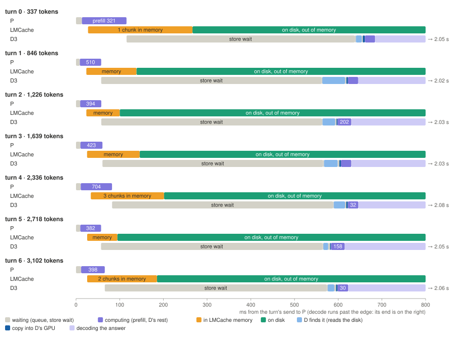

# Conversation 3: mt-rag-fiqa-beir-elser-512-100-20240501 (disk mode)

7 turns on D3 (routed by conversation); prompts grow from 337 to 3,102 tokens (interleaved: each turn's prompt is the previous one, its answer, then this turn's documents and question). Chunks are 256 tokens (16 vLLM blocks of 16); a chunk's name is LMCache's hash of its tokens and everything before them, so the same prefix has the same chunks on every turn and engine.

Legend for the strips (one character a chunk): P: `=` on P's GPU from an earlier turn, `#` computed and stored now, `+` computed, not stored (a partial chunk). D: `=` on D's GPU from an earlier turn, `M` pulled from memory, `S` pulled from disk, `+` computed by D (a partial chunk), `?` missed.

GPU blocks (the chunk tables): the slots in each engine's GPU KV cache (vLLM's block pool ids; slot 0 is its reserved null block) that hold the chunk's 16 vLLM blocks, in block order, a run of consecutive slots written as a range: `P 1, 138-152` is block 0 in slot 1 and blocks 1-15 in slots 138-152. An engine hands a block a slot from its free list when it first computes or loads it, and the block keeps it while cached, so a later turn that reuses the block shows the same slot. Blocks that are the same in several prompts (the same tokens and everything before them) share one slot once the first is cached: the system prompt's first block, the same in every conversation, is the usual one. `16/16 hashes = P's`: of the blocks D pulled, how many have the same vLLM hash on D as on P.

The prompts' text is rebuilt from the MTRAG file the run read, by the driver's own code (scripts/pd_mtrag.py build()), and matches the run's record piece for piece; token counts and places are the run's. D's answers were not kept by this run's driver, only their token ids. Lines over 100 characters are wrapped here for reading.

| turn | prompt | chunks + tail | P: own GPU / computed / stored | D: own GPU / loaded / computed | pulled | pull ms | D first token ms |
| ---: | ---: | --- | --- | --- | --- | ---: | ---: |
| [0](#turn-0) | 337 | 1 + 81 | 16 / 321 / 1 chunk | 0 / 256 / 81 | 1 chunks (disk 1) | 18.3 | 46.9 |
| [1](#turn-1) | 846 | 3 + 78 | 336 / 510 / 2 chunks | 464 / 304 / 78 | 2 chunks (disk 2) | 57.5 | 83.9 |
| [2](#turn-2) | 1,226 | 4 + 202 | 832 / 394 / 1 chunk | 960 / 64 / 202 | 1 chunks (disk 1) | 33.2 | 67.8 |
| [3](#turn-3) | 1,639 | 6 + 103 | 1,216 / 423 / 2 chunks | 1,344 / 192 / 103 | 1 chunks (disk 1) | 37.7 | 65.0 |
| [4](#turn-4) | 2,336 | 9 + 32 | 1,632 / 704 / 3 chunks | 1,760 / 544 / 32 | 3 chunks (disk 3) | 31.9 | 58.2 |
| [5](#turn-5) | 2,718 | 10 + 158 | 2,336 / 382 / 1 chunk | 2,448 / 112 / 158 | 1 chunks (disk 1) | 16.8 | 51.2 |
| [6](#turn-6) | 3,102 | 12 + 30 | 2,704 / 398 / 2 chunks | 2,832 / 240 / 30 | 1 chunks (disk 1) | 21.4 | 49.1 |

## How the prompt grows

Each turn's prompt is the previous one, token for token, and then: D's answer to the previous turn, this turn's documents, its question and the framing (the system prompt on turn 0, `Assistant:` and newlines). Only the new tokens can make new chunks: the previous prompt's partial chunk fills first. A document sent before comes again at another place, so in other chunks.

| turn | prompt | new | previous answer | documents | question | framing | whole chunks |
| ---: | ---: | ---: | ---: | --- | --- | ---: | --- |
| 0 | 337 | +337 | – | 2 docs, 294 | 13: What's the difference between Market Cap and NAV? | 30 | 1 (+1) |
| 1 | 846 | +509 | 128 | 2 docs, 371 | 7: Which is more important? | 3 | 3 (+2) |
| 2 | 1,226 | +380 | 128 | 2 docs, 244 | 5: enterprise value | 3 | 4 (+1) |
| 3 | 1,639 | +413 | 128 | 2 docs, 275 | 7: How is it calculated? | 3 | 6 (+2) |
| 4 | 2,336 | +697 | 128 | 2 docs, 559 | 7: What is WACC? | 3 | 9 (+3) |
| 5 | 2,718 | +382 | 128 | 2 docs, 241 | 10: Is the WACC formula highly reliable? | 3 | 10 (+1) |
| 6 | 3,102 | +384 | 128 | 2 docs, 241 | 12: What is the ideal formula to evaluate a company? | 3 | 12 (+2) |

## Timeline

Every turn on one clock: ms from the moment the proxy sent the turn to P. P prefills it (one token out) and stores its new whole chunks in LMCache; the proxy waits 500 ms after P is done (the store wait) and sends the turn to D3, which finds what LMCache has (reading it from disk), copies it into its GPU, computes the rest and decodes the answer. The lanes: P, LMCache (the chunks P stored this turn) and D. P computes the KV into its own GPU slots, where it stays (the next turn reuses it); its LMCache connector, set to store (P runs as kv_both), copies each new whole chunk from those slots to LMCache: LMCache reserves the space when P schedules the prefill (light orange) and has the chunks as P's prefill completes (orange).



| turn | P queued → done | chunks stored | in memory | on disk | D starts | D finds (+ disk read) | copy into D's GPU | D: held / pulled / computed | first token | D done |
| ---: | --- | ---: | ---: | ---: | ---: | --- | --- | --- | ---: | ---: |
| 0 | 14 → 116 | 1 | 118 | 267 (out of memory) | 638 | 640-654 | 656-661 | 0 / 256 from disk / 81 | 684 | 2,055 |
| 1 | 9 → 58 | 2 | 62 | 139 (out of memory) | 562 | 564-616 | 619-622 | 464 / 304 from disk / 78 | 646 | 2,024 |
| 2 | 10 → 58 | 1 | 59 | 100 (out of memory) | 562 | 564-593 | 596-598 | 960 / 64 from disk / 202 | 630 | 2,028 |
| 3 | 10 → 60 | 2 | 62 | 146 (out of memory) | 565 | 567-599 | 603-606 | 1,344 / 192 from disk / 103 | 630 | 2,035 |
| 4 | 11 → 82 | 3 | 85 | 202 (out of memory) | 588 | 590-616 | 618-622 | 1,760 / 544 from disk / 32 | 646 | 2,077 |
| 5 | 10 → 57 | 1 | 57 | 95 (out of memory) | 564 | 566-577 | 581-584 | 2,448 / 112 from disk / 158 | 615 | 2,051 |
| 6 | 12 → 66 | 2 | 67 | 185 (out of memory) | 574 | 576-591 | 595-599 | 2,832 / 240 from disk / 30 | 623 | 2,062 |

All times in ms from the turn's send to P. "in memory": the last of the turn's chunks written into LMCache's memory; "on disk": the last one written to disk (then dropped from memory, in the disk mode); D finds: from LMCache's lookup to its prefetch done (in the disk mode that is the read from disk); copy: LMCache's retrieve into D's GPU slots until D's connector has it. Each turn's section below tells it in a sentence.

### One chunk, block by block: chunk 0 of turn 0 (`47dc4d47ce072861`)

Tokens 0-256 (system: 28; doc 471123-0-798: 176; doc 414940-0-474: 52). P computed its blocks on turn 0 and stored them as one chunk; D3 pulled the chunk into these GPU blocks:

| block | tokens | P's GPU block | vLLM hash | D's GPU block | D wrote it | same hash on D |
| ---: | --- | ---: | --- | ---: | --- | --- |
| 0 | 0-16 | 1 | `9f9c499d1c876b7e` | 1 | yes | True |
| 1 | 16-32 | 61 | `f0aa562f7a5736de` | 2 | yes | True |
| 2 | 32-48 | 62 | `9df4288d52128763` | 3 | yes | True |
| 3 | 48-64 | 63 | `22346d454b037dde` | 4 | yes | True |
| 4 | 64-80 | 64 | `df34a823be5b1b7f` | 5 | yes | True |
| 5 | 80-96 | 65 | `96c1d75a7e880e94` | 6 | yes | True |
| 6 | 96-112 | 66 | `d908d6e813f0a6d4` | 7 | yes | True |
| 7 | 112-128 | 67 | `78a9824aea4d7338` | 8 | yes | True |
| 8 | 128-144 | 68 | `bae2e9c4c69e49f7` | 9 | yes | True |
| 9 | 144-160 | 69 | `ee282b7939ed7f2b` | 10 | yes | True |
| 10 | 160-176 | 70 | `aa096713a93fb29f` | 11 | yes | True |
| 11 | 176-192 | 71 | `68cbb151452211bd` | 12 | yes | True |
| 12 | 192-208 | 72 | `435b65f22ecdb757` | 13 | yes | True |
| 13 | 208-224 | 73 | `59ab3ffc2a0ed74d` | 14 | yes | True |
| 14 | 224-240 | 74 | `bb55580321998834` | 15 | yes | True |
| 15 | 240-256 | 75 | `e48f383f10716db6` | 16 | yes | True |

## Turn 0

**Timeline:** P queued until 14 ms, prefilled 321 tokens (held 16) and was done at 116 ms; its 1 new chunk were in LMCache's memory at 118 ms, on disk at 267 ms and out of memory. After the 500 ms store wait, D3 started at 638 ms holding 0 tokens, pulled 256 from disk (found 640-654 ms, copied into its GPU 656-661 ms), computed 81 and gave its first token at 684 ms; it decoded 128 tokens until 2,055 ms. ([all turns](#timeline))

### Step by step

Every move of this turn's KV, ms from the proxy sending the turn to P. The copies are LMCache's: its server reads P's GPU slots and writes D's through CUDA IPC handles each engine registered at start (no NIXL in this setup).

| ms | where | what |
| ---: | --- | --- |
| 0.0 | proxy → P | sends the turn (337 prompt tokens; P is asked for one token: prefill only) |
| 4.6 | P | the request arrives |
| 13.4 | P GPU | its prefix cache holds 16 of the prompt's tokens: 1 block in slots 1 |
| 13.4 | P ↔ LMCache | LMCache has 0 of its tokens; P loads 0 and computes the rest |
| 13.5 | P GPU | 21 new slots for the 321 tokens it computes: 61-81; the prefill runs |
| 13.7 | P → LMCache | store planned: tokens 0-256, chunks 0-0 (16 blocks) |
| 27.3 | LMCache | the store request is in; it waits for P's forward pass to finish (a CUDA event) |
| 27.5 | LMCache memory | space reserved for 1 chunk (29 MB) |
| 114.5 | P GPU → LMCache memory | the copy starts: LMCache reads P's GPU slots (CUDA IPC) |
| 115.7 | P GPU → LMCache memory | copy done: 1 chunk, 29 MB in 1.2 ms |
| 115.7 | P → proxy | P answers its one token: the prefill is done |
| 117.8 | LMCache memory | 1 chunk in memory, ready for D; P keeps its copy in its GPU slots |
| 266.6 | LMCache disk | 1 chunk written to disk (one file each) |
| 267.1 | LMCache memory | 1 memory copy dropped: on disk only now |
| 637.5 | proxy → D3 | after the 500 ms store wait, sends the turn to D3 |
| 640.5 | D3 ↔ LMCache | asks LMCache for the prompt's chunks |
| 654.0 | LMCache disk → memory | found 256 tokens it lacks: 1 chunk read from disk into a memory buffer |
| 654.5 | D3 GPU | its prefix cache holds 0 of the prompt's tokens |
| 654.5 | D3 | will load 256 tokens and compute 81 |
| 654.8 | D3 GPU | slots for the loaded blocks: 1-16 |
| 656.4 | LMCache memory → D3 GPU | the copy starts: LMCache writes D3's GPU slots (CUDA IPC) |
| 658.8 | LMCache memory → D3 GPU | copy done: 1 chunk, 29 MB in 2.4 ms |
| 661.1 | D3 | has the KV in its GPU slots |
| 663.2 | LMCache memory | the read buffer dropped (1 chunk) |
| 664.3 | D3 GPU | 6 new slots for the 81 prompt tokens it computes: 17-22 |
| 684.4 | D3 → proxy | the first answer token |
| 833.2 | D3 GPU | decoding: the answer's KV takes 7 new slots as it grows, one per 16 tokens: 23-29, until 1,871 ms |
| 2,054.8 | D3 | done: 128 tokens decoded; its blocks stay cached in its GPU slots for the next turn |
| 2,056.4 | proxy | the response is complete |

337 prompt tokens: 1 whole chunk and 81 tokens over (the partial chunk, computed by both engines and stored only when a later turn completes it). P held 16 tokens on its GPU, computed 321 and stored 1 new chunk; D3 held 0, loaded 256 from LMCache and computed 81.

### The prompt

The whole prompt, piece by piece:

- **system prompt** · tokens 0-28 (28) · chunk 0

```text
You are a helpful assistant. Answer the user's last question from the documents. If they do not hold
the answer, say so.
```

<details><summary>document <code>471123-0-798</code> · tokens 28-204 (176) · chunk 0</summary>

```text
Document:

"Market caps is just the share price, multiplied by the number of shares. It doesn't represent any
value (if people decide to pay more or less for the shares, the market cap goes up or down). It does
represent what people think the company is worth.  NAV sounds very much like book value. It
basically says ""how much cash would we end up with if we sold everything the company owns, paid
back all the debt, and closed down the business? "" Since closing down the business is rarely a good
idea, this underestimates the value of the business enormously. Take a hairdresser who owns nothing
but a pair of scissors, but has a huge number of repeat customers, charges $200 for a haircut, and
makes tons of money every year. The business has a huge value, but NAV = price of one pair of used
scissors."
```

</details>

<details><summary>document <code>414940-0-474</code> · tokens 204-322 (118) · chunks 0-1</summary>

```text
Document:

NAV is  how much is the stuff of the company worth divided by the number of shares. This total is
also called book value. The market cap is share price times number of shares. For Amazon  today
people are willing to pay 290 a share for a company with a NAV of 22 a share. If of nav and price
were equal the P/B (price to book ratio) would be 1, but for Amazon it is 13.  Why? Because
investors believe Amazon is worth a lot more than a money losing company with a NAV of 22.
```

</details>

- **question 0** · tokens 322-335 (13) · chunk 1

```text
User:  What's the difference between Market Cap and NAV?
```

- `Assistant:` · tokens 335-337 (2) · chunk 1

### Pieces, chunks and blocks

| piece | tokens | length | chunks | |
| --- | --- | ---: | --- | --- |
| system | 0-28 | 28 | 0 |  |
| doc 471123-0-798 | 28-204 | 176 | 0 |  |
| doc 414940-0-474 | 204-322 | 118 | 0-1 |  |
| question 0 | 322-335 | 13 | 1 |  |
| `assistant:` 0 | 335-337 | 2 | 1 |  |

```
P  #+
D  S+
```

| chunk | tokens | pieces in it (tokens) | vLLM blocks | GPU blocks | in LMCache | P this turn | D this turn |
| ---: | --- | --- | --- | --- | --- | --- | --- |
| 0 | 0-256 | system: 28; doc 471123-0-798: 176; doc 414940-0-474: 52 | 0-15 | P 1, 61-75; D 1-16; 16/16 hashes = P's | `47dc4d47ce072861` stored on turn 0, on disk, out of memory | computed (its first 16 tokens on P's GPU already), **stored now** | **pulled from disk** |
| 1 | 256-337 | doc 414940-0-474: 66; question 0: 13; `assistant:` 0: 2 | 16-21 | P 76-80; D 17-22 | – | computed (partial chunk: not stored) | computed by D (partial chunk) |

## Turn 1

**Timeline:** P queued until 9 ms, prefilled 510 tokens (held 336) and was done at 58 ms; its 2 new chunks were in LMCache's memory at 62 ms, on disk at 139 ms and out of memory. After the 500 ms store wait, D3 started at 562 ms holding 464 tokens, pulled 304 from disk (found 564-616 ms, copied into its GPU 619-622 ms), computed 78 and gave its first token at 646 ms; it decoded 128 tokens until 2,024 ms. ([all turns](#timeline))

### Step by step

Every move of this turn's KV, ms from the proxy sending the turn to P. The copies are LMCache's: its server reads P's GPU slots and writes D's through CUDA IPC handles each engine registered at start (no NIXL in this setup).

| ms | where | what |
| ---: | --- | --- |
| 0.0 | proxy → P | sends the turn (846 prompt tokens; P is asked for one token: prefill only) |
| 2.7 | P | the request arrives |
| 8.6 | P GPU | its prefix cache holds 336 of the prompt's tokens: 21 blocks in slots 1, 61-80 |
| 8.7 | P ↔ LMCache | LMCache has 256 of its tokens; P loads 0 and computes the rest |
| 8.8 | P GPU | 32 new slots for the 510 tokens it computes: 188 … 189-216 (32 blocks); the prefill runs |
| 9.3 | P → LMCache | store planned: tokens 256-768, chunks 1-2 (32 blocks) |
| 23.1 | LMCache | the store request is in; it waits for P's forward pass to finish (a CUDA event) |
| 23.7 | LMCache memory | space reserved for 2 chunks (59 MB) |
| 54.7 | P GPU → LMCache memory | the copy starts: LMCache reads P's GPU slots (CUDA IPC) |
| 57.1 | P GPU → LMCache memory | copy done: 2 chunks, 59 MB in 2.3 ms |
| 57.6 | P → proxy | P answers its one token: the prefill is done |
| 62.0 | LMCache memory | 2 chunks in memory, ready for D; P keeps its copy in its GPU slots |
| 138.6 | LMCache disk | 2 chunks written to disk (one file each) |
| 139.1 | LMCache memory | 2 memory copies dropped: on disk only now |
| 561.8 | proxy → D3 | after the 500 ms store wait, sends the turn to D3 |
| 563.6 | D3 ↔ LMCache | asks LMCache for the prompt's chunks |
| 615.8 | LMCache disk → memory | found 512 tokens it lacks: 2 chunks read from disk into a memory buffer |
| 616.8 | D3 GPU | its prefix cache holds 464 of the prompt's tokens: 29 blocks in slots 1-29 |
| 616.8 | D3 | will load 304 tokens and compute 78 |
| 617.3 | D3 GPU | slots for the loaded blocks: 30-48 |
| 618.7 | LMCache memory → D3 GPU | the copy starts: LMCache writes D3's GPU slots (CUDA IPC) |
| 621.2 | LMCache memory → D3 GPU | copy done: 2 chunks, 59 MB in 2.4 ms |
| 621.6 | LMCache memory | the read buffer dropped (2 chunks) |
| 622.4 | D3 | has the KV in its GPU slots |
| 625.3 | D3 GPU | 5 new slots for the 78 prompt tokens it computes: 49-53 |
| 645.7 | D3 → proxy | the first answer token |
| 654.3 | D3 GPU | decoding: the answer's KV takes 8 new slots as it grows, one per 16 tokens: 54-61, until 1,872 ms |
| 2,024.2 | D3 | done: 128 tokens decoded; its blocks stay cached in its GPU slots for the next turn |
| 2,025.8 | proxy | the response is complete |

846 prompt tokens: 3 whole chunks and 78 tokens over (the partial chunk, computed by both engines and stored only when a later turn completes it). P held 336 tokens on its GPU, computed 510 and stored 2 new chunks; D3 held 464, loaded 304 from LMCache and computed 78.

### The prompt

Tokens 0-337: [turn 0](#turn-0)'s prompt, unchanged (checked: its first 337 token ids are the previous prompt's), so chunk 0 is the same chunk; chunk 1 (partial then, 81 tokens) fills now. New from token 337:

- **D's answer to turn 0** · tokens 337-465 (128) · chunk 1

  its text was not kept by this run: its driver kept only the token ids (later runs keep it: scripts/pd_mtrag.py --trace)

- `\n` · tokens 465-466 (1) · chunk 1

<details><summary>document <code>416727-0-1356</code> · tokens 466-775 (309) · chunks 1-3</summary>

```text
Document:

"I think the key concept here is future value.  The NAV is essentially a book-keeping exercise- you
add up all the assets and remove all the liabilities.  For a public company this is spelled out in
the balance sheet, and is generally listed at the bottom.  I pulled a recent one from Cisco Systems
(because I used to work there and know the numbers  ;-) and you can see it here: roughly $56
billion... https://finance.yahoo.com/q/bs?s=CSCO+Balance+Sheet&annual  Another way to think about
it: In theory (and we know about this, right?) the NAV is what you would get if you liquidated the
company instantaneously.  A definition I like to use for market cap is ""the current assets, plus
the perceived present value of all future earnings for the company""... so let's dissect that a
little.  The term ""present value"" is really important, because a million dollars today is worth
more than a million dollars next year.  A company expected to make a lot of money soon will be worth
more (i.e. a higher market cap) than a company expected to make the same amount of money, but later.
The ""all future earnings"" part is exactly what it sounds like.  So again, following our cisco
example, the current market cap is ~142 billion, which means that ""the market"" thinks they will
earn about $85 billion over the life of the company (in present day dollars)."
```

</details>

<details><summary>document <code>418610-0-264</code> · tokens 775-837 (62) · chunk 3</summary>

```text
Document:

Market cap is basically the amount of money that it would cost to buy all of the shares of public
stock in a company.  Or  share cost * number of outstanding shares. It is a measure of how much a
company is worth. http://en.wikipedia.org/wiki/Market_capitalization
```

</details>

- **question 1** · tokens 837-844 (7) · chunk 3

```text
User: Which is more important?
```

- `Assistant:` · tokens 844-846 (2) · chunk 3

### Pieces, chunks and blocks

| piece | tokens | length | chunks | |
| --- | --- | ---: | --- | --- |
| system | 0-28 | 28 | 0 |  |
| doc 471123-0-798 | 28-204 | 176 | 0 |  |
| doc 414940-0-474 | 204-322 | 118 | 0-1 |  |
| question 0 | 322-335 | 13 | 1 |  |
| `assistant:` 0 | 335-337 | 2 | 1 |  |
| answer 0 | 337-465 | 128 | 1 | new this turn |
| newline 0 | 465-466 | 1 | 1 | new this turn |
| doc 416727-0-1356 | 466-775 | 309 | 1-3 | new this turn |
| doc 418610-0-264 | 775-837 | 62 | 3 | new this turn |
| question 1 | 837-844 | 7 | 3 | new this turn |
| `assistant:` 1 | 844-846 | 2 | 3 | new this turn |

```
P  =##+
D  =SS+
```

| chunk | tokens | pieces in it (tokens) | vLLM blocks | GPU blocks | in LMCache | P this turn | D this turn |
| ---: | --- | --- | --- | --- | --- | --- | --- |
| 0 | 0-256 | system: 28; doc 471123-0-798: 176; doc 414940-0-474: 52 | 0-15 | P 1, 61-75; D 1-16 | `47dc4d47ce072861` stored on turn 0, on disk, out of memory | on P's GPU (earlier turn) | on D's GPU (earlier turn) |
| 1 | 256-512 | doc 414940-0-474: 66; question 0: 13; `assistant:` 0: 2; answer 0 (new): 128; newline 0 (new): 1; doc 416727-0-1356 (new): 46 | 16-31 | P 76-80 … 189-195 (16 blocks); D 17-32; 16/16 hashes = P's | `c3de14602f3d4726` stored on turn 1, on disk, out of memory | computed (its first 80 tokens on P's GPU already), **stored now** | **pulled from disk** (its first 208 tokens on D's GPU already) |
| 2 | 512-768 | doc 416727-0-1356 (new): 256 | 32-47 | P 196-211; D 33-48; 16/16 hashes = P's | `cd6084602efd4e78` stored on turn 1, on disk, out of memory | computed, **stored now** | **pulled from disk** |
| 3 | 768-846 | doc 416727-0-1356 (new): 7; doc 418610-0-264 (new): 62; question 1 (new): 7; `assistant:` 1 (new): 2 | 48-52 | P 212-215; D 49-53 | – | computed (partial chunk: not stored) | computed by D (partial chunk) |

## Turn 2

**Timeline:** P queued until 10 ms, prefilled 394 tokens (held 832) and was done at 58 ms; its 1 new chunk were in LMCache's memory at 59 ms, on disk at 100 ms and out of memory. After the 500 ms store wait, D3 started at 562 ms holding 960 tokens, pulled 64 from disk (found 564-593 ms, copied into its GPU 596-598 ms), computed 202 and gave its first token at 630 ms; it decoded 128 tokens until 2,028 ms. ([all turns](#timeline))

### Step by step

Every move of this turn's KV, ms from the proxy sending the turn to P. The copies are LMCache's: its server reads P's GPU slots and writes D's through CUDA IPC handles each engine registered at start (no NIXL in this setup).

| ms | where | what |
| ---: | --- | --- |
| 0.0 | proxy → P | sends the turn (1,226 prompt tokens; P is asked for one token: prefill only) |
| 3.0 | P | the request arrives |
| 9.2 | P GPU | its prefix cache holds 832 of the prompt's tokens: slots 1 … 189-215 (52 blocks) |
| 9.3 | P ↔ LMCache | LMCache has 768 of its tokens; P loads 0 and computes the rest |
| 9.5 | P GPU | 25 new slots for the 394 tokens it computes: 344, 434-457; the prefill runs |
| 9.9 | P → LMCache | store planned: tokens 768-1,024, chunks 3-3 (16 blocks) |
| 23.2 | LMCache | the store request is in; it waits for P's forward pass to finish (a CUDA event) |
| 23.7 | LMCache memory | space reserved for 1 chunk (29 MB) |
| 54.1 | P GPU → LMCache memory | the copy starts: LMCache reads P's GPU slots (CUDA IPC) |
| 55.3 | P GPU → LMCache memory | copy done: 1 chunk, 29 MB in 1.2 ms |
| 57.8 | P → proxy | P answers its one token: the prefill is done |
| 58.9 | LMCache memory | 1 chunk in memory, ready for D; P keeps its copy in its GPU slots |
| 100.2 | LMCache disk | 1 chunk written to disk (one file each) |
| 100.7 | LMCache memory | 1 memory copy dropped: on disk only now |
| 562.3 | proxy → D3 | after the 500 ms store wait, sends the turn to D3 |
| 564.0 | D3 ↔ LMCache | asks LMCache for the prompt's chunks |
| 593.3 | LMCache disk → memory | found 256 tokens it lacks: 1 chunk read from disk into a memory buffer |
| 594.3 | D3 GPU | its prefix cache holds 960 of the prompt's tokens: 60 blocks in slots 1-60 |
| 594.4 | D3 | will load 64 tokens and compute 202 |
| 594.8 | D3 GPU | slots for the loaded blocks: 61-64 |
| 596.2 | LMCache memory → D3 GPU | the copy starts: LMCache writes D3's GPU slots (CUDA IPC) |
| 597.3 | LMCache memory → D3 GPU | copy done: 1 chunk, 29 MB in 1.0 ms |
| 598.5 | D3 | has the KV in its GPU slots |
| 599.0 | LMCache memory | the read buffer dropped (1 chunk) |
| 601.3 | D3 GPU | 13 new slots for the 202 prompt tokens it computes: 65-77 |
| 630.0 | D3 → proxy | the first answer token |
| 683.1 | D3 GPU | decoding: the answer's KV takes 8 new slots as it grows, one per 16 tokens: 78-85, until 1,918 ms |
| 2,028.0 | D3 | done: 128 tokens decoded; its blocks stay cached in its GPU slots for the next turn |
| 2,029.4 | proxy | the response is complete |

1,226 prompt tokens: 4 whole chunks and 202 tokens over (the partial chunk, computed by both engines and stored only when a later turn completes it). P held 832 tokens on its GPU, computed 394 and stored 1 new chunk; D3 held 960, loaded 64 from LMCache and computed 202.

### The prompt

Tokens 0-846: [turn 1](#turn-1)'s prompt, unchanged (checked: its first 846 token ids are the previous prompt's), so chunks 0-2 are the same chunks; chunk 3 (partial then, 78 tokens) fills now. New from token 846:

- **D's answer to turn 1** · tokens 846-974 (128) · chunk 3

  its text was not kept by this run: its driver kept only the token ids (later runs keep it: scripts/pd_mtrag.py --trace)

- `\n` · tokens 974-975 (1) · chunk 3

<details><summary>document <code>346760-0-445</code> · tokens 975-1072 (97) · chunks 3-4</summary>

```text
Document:

"Read again what I said in my original post.  ""Enterprise Value is the sort of ""bare bones"" total
firm value. It doesn't include any cash because you'd basically be paying cash for cash. Also, this
makes analysis of transaction multiples more streamlined, as some firms may have a ton of excess
cash on their balance sheet, skewing multiples.""  I said that that is WHY we use enterprise value.
Because if you didn't it would skew multiples."
```

</details>

<details><summary>document <code>192515-0-701</code> · tokens 1072-1219 (147) · chunk 4</summary>

```text
Document:

Enterprise Value is supposed to be the price you would be willing to pay to acquire the company.
Typically, companies are delivered debt-free and cash-free, so the cash on the balance sheet at the
time of the transaction is distributed to the original owners. So, for instance, a company like
Apple would have a lower EV than Market Value because the cash on the balance sheet is not going to
be included in an acquisition.  And you are right, there are plenty of instances where you see
Enterprise Value lower than Market Value (Cap).   If you are solely looking at equity valuation
(equity investing), then use market cap. If you are looking at firm valuation for M&amp;A, then EV
is more important.
```

</details>

- **question 2** · tokens 1219-1224 (5) · chunk 4

```text
User: enterprise value
```

- `Assistant:` · tokens 1224-1226 (2) · chunk 4

### Pieces, chunks and blocks

| piece | tokens | length | chunks | |
| --- | --- | ---: | --- | --- |
| system | 0-28 | 28 | 0 |  |
| doc 471123-0-798 | 28-204 | 176 | 0 |  |
| doc 414940-0-474 | 204-322 | 118 | 0-1 |  |
| question 0 | 322-335 | 13 | 1 |  |
| `assistant:` 0 | 335-337 | 2 | 1 |  |
| answer 0 | 337-465 | 128 | 1 |  |
| newline 0 | 465-466 | 1 | 1 |  |
| doc 416727-0-1356 | 466-775 | 309 | 1-3 |  |
| doc 418610-0-264 | 775-837 | 62 | 3 |  |
| question 1 | 837-844 | 7 | 3 |  |
| `assistant:` 1 | 844-846 | 2 | 3 |  |
| answer 1 | 846-974 | 128 | 3 | new this turn |
| newline 1 | 974-975 | 1 | 3 | new this turn |
| doc 346760-0-445 | 975-1072 | 97 | 3-4 | new this turn |
| doc 192515-0-701 | 1072-1219 | 147 | 4 | new this turn |
| question 2 | 1219-1224 | 5 | 4 | new this turn |
| `assistant:` 2 | 1224-1226 | 2 | 4 | new this turn |

```
P  ===#+
D  ===S+
```

| chunk | tokens | pieces in it (tokens) | vLLM blocks | GPU blocks | in LMCache | P this turn | D this turn |
| ---: | --- | --- | --- | --- | --- | --- | --- |
| 0 | 0-256 | system: 28; doc 471123-0-798: 176; doc 414940-0-474: 52 | 0-15 | P 1, 61-75; D 1-16 | `47dc4d47ce072861` stored on turn 0, on disk, out of memory | on P's GPU (earlier turn) | on D's GPU (earlier turn) |
| 1 | 256-512 | doc 414940-0-474: 66; question 0: 13; `assistant:` 0: 2; answer 0: 128; newline 0: 1; doc 416727-0-1356: 46 | 16-31 | P 76-80 … 189-195 (16 blocks); D 17-32 | `c3de14602f3d4726` stored on turn 1, on disk, out of memory | on P's GPU (earlier turn) | on D's GPU (earlier turn, its own answer) |
| 2 | 512-768 | doc 416727-0-1356: 256 | 32-47 | P 196-211; D 33-48 | `cd6084602efd4e78` stored on turn 1, on disk, out of memory | on P's GPU (earlier turn) | on D's GPU (earlier turn) |
| 3 | 768-1024 | doc 416727-0-1356: 7; doc 418610-0-264: 62; question 1: 7; `assistant:` 1: 2; answer 1 (new): 128; newline 1 (new): 1; doc 346760-0-445 (new): 49 | 48-63 | P 212-215, 344, 434-444; D 49-64; 16/16 hashes = P's | `98e036362aa62d61` stored on turn 2, on disk, out of memory | computed (its first 64 tokens on P's GPU already), **stored now** | **pulled from disk** (its first 192 tokens on D's GPU already) |
| 4 | 1024-1226 | doc 346760-0-445 (new): 48; doc 192515-0-701 (new): 147; question 2 (new): 5; `assistant:` 2 (new): 2 | 64-76 | P 445-456; D 65-77 | – | computed (partial chunk: not stored) | computed by D (partial chunk) |

## Turn 3

**Timeline:** P queued until 10 ms, prefilled 423 tokens (held 1,216) and was done at 60 ms; its 2 new chunks were in LMCache's memory at 62 ms, on disk at 146 ms and out of memory. After the 500 ms store wait, D3 started at 565 ms holding 1,344 tokens, pulled 192 from disk (found 567-599 ms, copied into its GPU 603-606 ms), computed 103 and gave its first token at 630 ms; it decoded 128 tokens until 2,035 ms. ([all turns](#timeline))

### Step by step

Every move of this turn's KV, ms from the proxy sending the turn to P. The copies are LMCache's: its server reads P's GPU slots and writes D's through CUDA IPC handles each engine registered at start (no NIXL in this setup).

| ms | where | what |
| ---: | --- | --- |
| 0.0 | proxy → P | sends the turn (1,639 prompt tokens; P is asked for one token: prefill only) |
| 3.2 | P | the request arrives |
| 9.8 | P GPU | its prefix cache holds 1,216 of the prompt's tokens: slots 1 … 434-456 (76 blocks) |
| 9.9 | P ↔ LMCache | LMCache has 1,024 of its tokens; P loads 0 and computes the rest |
| 10.1 | P GPU | 27 new slots for the 423 tokens it computes: 738-764; the prefill runs |
| 10.6 | P → LMCache | store planned: tokens 1,024-1,536, chunks 4-5 (32 blocks) |
| 24.7 | LMCache | the store request is in; it waits for P's forward pass to finish (a CUDA event) |
| 25.3 | LMCache memory | space reserved for 2 chunks (59 MB) |
| 56.6 | P GPU → LMCache memory | the copy starts: LMCache reads P's GPU slots (CUDA IPC) |
| 58.9 | P GPU → LMCache memory | copy done: 2 chunks, 59 MB in 2.3 ms |
| 60.5 | P → proxy | P answers its one token: the prefill is done |
| 62.2 | LMCache memory | 2 chunks in memory, ready for D; P keeps its copy in its GPU slots |
| 145.9 | LMCache disk | 2 chunks written to disk (one file each) |
| 146.4 | LMCache memory | 2 memory copies dropped: on disk only now |
| 565.1 | proxy → D3 | after the 500 ms store wait, sends the turn to D3 |
| 567.4 | D3 ↔ LMCache | asks LMCache for the prompt's chunks |
| 598.7 | LMCache disk → memory | found 256 tokens it lacks: 1 chunk read from disk into a memory buffer |
| 600.6 | D3 GPU | its prefix cache holds 1,344 of the prompt's tokens: 84 blocks in slots 1-84 |
| 600.7 | D3 | will load 192 tokens and compute 103 |
| 601.1 | D3 GPU | slots for the loaded blocks: 85-96 |
| 602.6 | LMCache memory → D3 GPU | the copy starts: LMCache writes D3's GPU slots (CUDA IPC) |
| 605.1 | LMCache memory → D3 GPU | copy done: 1 chunk, 29 MB in 2.5 ms |
| 606.2 | LMCache memory | the read buffer dropped (1 chunk) |
| 606.3 | D3 | has the KV in its GPU slots |
| 609.2 | D3 GPU | 7 new slots for the 103 prompt tokens it computes: 97-103 |
| 630.1 | D3 → proxy | the first answer token |
| 716.0 | D3 GPU | decoding: the answer's KV takes 8 new slots as it grows, one per 16 tokens: 104-111, until 1,957 ms |
| 2,034.9 | D3 | done: 128 tokens decoded; its blocks stay cached in its GPU slots for the next turn |
| 2,036.5 | proxy | the response is complete |

1,639 prompt tokens: 6 whole chunks and 103 tokens over (the partial chunk, computed by both engines and stored only when a later turn completes it). P held 1,216 tokens on its GPU, computed 423 and stored 2 new chunks; D3 held 1,344, loaded 192 from LMCache and computed 103.

### The prompt

Tokens 0-1,226: [turn 2](#turn-2)'s prompt, unchanged (checked: its first 1,226 token ids are the previous prompt's), so chunks 0-3 are the same chunks; chunk 4 (partial then, 202 tokens) fills now. New from token 1,226:

- **D's answer to turn 2** · tokens 1226-1354 (128) · chunks 4-5

  its text was not kept by this run: its driver kept only the token ids (later runs keep it: scripts/pd_mtrag.py --trace)

- `\n` · tokens 1354-1355 (1) · chunk 5

<details><summary>document <code>587508-0-651</code> · tokens 1355-1492 (137) · chunk 5</summary>

```text
Document:

Right, I understand minority interest but it is typically reported as a positive under liabilities
instead of a negative. For example, when you are calculating the enterprise value of a company, you
add back in the minority interest.    Enterprise Value= Market Share +Pref Equity + Min Interest+
Total Debt - Cash and ST Equivalents.    EV is used to quantify the total price of a company's
worth. If you have negative Min Interest on your books, that will make your EV less than it should
be, creating an incorrect valuation.   This just doesn't make any sense to me. Does it mean that the
subsidiary that they had a stake in had a negative earning?
```

</details>

<details><summary>document <code>366249-0-656</code> · tokens 1492-1630 (138) · chunks 5-6</summary>

```text
Document:

You wouldn't know it's value (Enterprise Value) without knowing its cash balance.  The equation:
EV = Market Cap + Minority Interest + Preferred Stock + Debt - Cash  Enterprise Value is the value
of the company to ALL shareholders (creditors, preferred stock holders, common stock holders).  So,
taking on debt could either increase or decrease the EV depending on the cash balance of the
company.  This will have no effect, directly, on the market cap. It will, however effect the present
value of its future cash flows as the WACC will increase due to the new cost of debt (interest
payments, higher risk of bankruptcy, less flexibility by management).
```

</details>

- **question 3** · tokens 1630-1637 (7) · chunk 6

```text
User: How is it calculated?
```

- `Assistant:` · tokens 1637-1639 (2) · chunk 6

### Pieces, chunks and blocks

| piece | tokens | length | chunks | |
| --- | --- | ---: | --- | --- |
| system | 0-28 | 28 | 0 |  |
| doc 471123-0-798 | 28-204 | 176 | 0 |  |
| doc 414940-0-474 | 204-322 | 118 | 0-1 |  |
| question 0 | 322-335 | 13 | 1 |  |
| `assistant:` 0 | 335-337 | 2 | 1 |  |
| answer 0 | 337-465 | 128 | 1 |  |
| newline 0 | 465-466 | 1 | 1 |  |
| doc 416727-0-1356 | 466-775 | 309 | 1-3 |  |
| doc 418610-0-264 | 775-837 | 62 | 3 |  |
| question 1 | 837-844 | 7 | 3 |  |
| `assistant:` 1 | 844-846 | 2 | 3 |  |
| answer 1 | 846-974 | 128 | 3 |  |
| newline 1 | 974-975 | 1 | 3 |  |
| doc 346760-0-445 | 975-1072 | 97 | 3-4 |  |
| doc 192515-0-701 | 1072-1219 | 147 | 4 |  |
| question 2 | 1219-1224 | 5 | 4 |  |
| `assistant:` 2 | 1224-1226 | 2 | 4 |  |
| answer 2 | 1226-1354 | 128 | 4-5 | new this turn |
| newline 2 | 1354-1355 | 1 | 5 | new this turn |
| doc 587508-0-651 | 1355-1492 | 137 | 5 | new this turn |
| doc 366249-0-656 | 1492-1630 | 138 | 5-6 | new this turn |
| question 3 | 1630-1637 | 7 | 6 | new this turn |
| `assistant:` 3 | 1637-1639 | 2 | 6 | new this turn |

```
P  ====##+
D  =====S+
```

| chunk | tokens | pieces in it (tokens) | vLLM blocks | GPU blocks | in LMCache | P this turn | D this turn |
| ---: | --- | --- | --- | --- | --- | --- | --- |
| 0 | 0-256 | system: 28; doc 471123-0-798: 176; doc 414940-0-474: 52 | 0-15 | P 1, 61-75; D 1-16 | `47dc4d47ce072861` stored on turn 0, on disk, out of memory | on P's GPU (earlier turn) | on D's GPU (earlier turn) |
| 1 | 256-512 | doc 414940-0-474: 66; question 0: 13; `assistant:` 0: 2; answer 0: 128; newline 0: 1; doc 416727-0-1356: 46 | 16-31 | P 76-80 … 189-195 (16 blocks); D 17-32 | `c3de14602f3d4726` stored on turn 1, on disk, out of memory | on P's GPU (earlier turn) | on D's GPU (earlier turn, its own answer) |
| 2 | 512-768 | doc 416727-0-1356: 256 | 32-47 | P 196-211; D 33-48 | `cd6084602efd4e78` stored on turn 1, on disk, out of memory | on P's GPU (earlier turn) | on D's GPU (earlier turn) |
| 3 | 768-1024 | doc 416727-0-1356: 7; doc 418610-0-264: 62; question 1: 7; `assistant:` 1: 2; answer 1: 128; newline 1: 1; doc 346760-0-445: 49 | 48-63 | P 212-215, 344, 434-444; D 49-64 | `98e036362aa62d61` stored on turn 2, on disk, out of memory | on P's GPU (earlier turn) | on D's GPU (earlier turn, its own answer) |
| 4 | 1024-1280 | doc 346760-0-445: 48; doc 192515-0-701: 147; question 2: 5; `assistant:` 2: 2; answer 2 (new): 54 | 64-79 | P 445-456, 738-741; D 65-80 | `b6960f33b0ee6772` stored on turn 3, on disk, out of memory | computed (its first 192 tokens on P's GPU already), **stored now** | on D's GPU (earlier turn, its own answer) |
| 5 | 1280-1536 | answer 2 (new): 74; newline 2 (new): 1; doc 587508-0-651 (new): 137; doc 366249-0-656 (new): 44 | 80-95 | P 742-757; D 81-96; 16/16 hashes = P's | `e6db7091ab30e9e9` stored on turn 3, on disk, out of memory | computed, **stored now** | **pulled from disk** (its first 64 tokens on D's GPU already) |
| 6 | 1536-1639 | doc 366249-0-656 (new): 94; question 3 (new): 7; `assistant:` 3 (new): 2 | 96-102 | P 758-763; D 97-103 | – | computed (partial chunk: not stored) | computed by D (partial chunk) |

## Turn 4

**Timeline:** P queued until 11 ms, prefilled 704 tokens (held 1,632) and was done at 82 ms; its 3 new chunks were in LMCache's memory at 85 ms, on disk at 202 ms and out of memory. After the 500 ms store wait, D3 started at 588 ms holding 1,760 tokens, pulled 544 from disk (found 590-616 ms, copied into its GPU 618-622 ms), computed 32 and gave its first token at 646 ms; it decoded 128 tokens until 2,077 ms. ([all turns](#timeline))

### Step by step

Every move of this turn's KV, ms from the proxy sending the turn to P. The copies are LMCache's: its server reads P's GPU slots and writes D's through CUDA IPC handles each engine registered at start (no NIXL in this setup).

| ms | where | what |
| ---: | --- | --- |
| 0.0 | proxy → P | sends the turn (2,336 prompt tokens; P is asked for one token: prefill only) |
| 3.9 | P | the request arrives |
| 10.5 | P GPU | its prefix cache holds 1,632 of the prompt's tokens: slots 1 … 738-763 (102 blocks) |
| 10.6 | P ↔ LMCache | LMCache has 1,536 of its tokens; P loads 0 and computes the rest |
| 10.8 | P GPU | 44 new slots for the 704 tokens it computes: 969-1012; the prefill runs |
| 11.3 | P → LMCache | store planned: tokens 1,536-2,304, chunks 6-8 (48 blocks) |
| 33.2 | LMCache | the store request is in; it waits for P's forward pass to finish (a CUDA event) |
| 33.8 | LMCache memory | space reserved for 3 chunks (88 MB) |
| 77.5 | P GPU → LMCache memory | the copy starts: LMCache reads P's GPU slots (CUDA IPC) |
| 80.9 | P GPU → LMCache memory | copy done: 3 chunks, 88 MB in 3.4 ms |
| 82.5 | P → proxy | P answers its one token: the prefill is done |
| 85.4 | LMCache memory | 3 chunks in memory, ready for D; P keeps its copy in its GPU slots |
| 201.5 | LMCache disk | 3 chunks written to disk (one file each) |
| 202.0 | LMCache memory | 3 memory copies dropped: on disk only now |
| 587.9 | proxy → D3 | after the 500 ms store wait, sends the turn to D3 |
| 589.8 | D3 ↔ LMCache | asks LMCache for the prompt's chunks |
| 615.6 | LMCache disk → memory | found 768 tokens it lacks: 3 chunks read from disk into a memory buffer |
| 616.3 | D3 GPU | its prefix cache holds 1,760 of the prompt's tokens: 110 blocks in slots 1-110 |
| 616.4 | D3 | will load 544 tokens and compute 32 |
| 616.8 | D3 GPU | slots for the loaded blocks: 111-144 |
| 618.3 | LMCache memory → D3 GPU | the copy starts: LMCache writes D3's GPU slots (CUDA IPC) |
| 621.7 | LMCache memory → D3 GPU | copy done: 3 chunks, 88 MB in 3.4 ms |
| 622.1 | D3 | has the KV in its GPU slots |
| 625.3 | D3 GPU | 2 new slots for the 32 prompt tokens it computes: 145-146 |
| 626.4 | LMCache memory | the read buffer dropped (3 chunks) |
| 640.1 | D3 GPU | decoding: the answer's KV takes 8 new slots as it grows, one per 16 tokens: 147-154, until 1,897 ms |
| 646.1 | D3 → proxy | the first answer token |
| 2,077.1 | D3 | done: 128 tokens decoded; its blocks stay cached in its GPU slots for the next turn |
| 2,078.5 | proxy | the response is complete |

2,336 prompt tokens: 9 whole chunks and 32 tokens over (the partial chunk, computed by both engines and stored only when a later turn completes it). P held 1,632 tokens on its GPU, computed 704 and stored 3 new chunks; D3 held 1,760, loaded 544 from LMCache and computed 32.

### The prompt

Tokens 0-1,639: [turn 3](#turn-3)'s prompt, unchanged (checked: its first 1,639 token ids are the previous prompt's), so chunks 0-5 are the same chunks; chunk 6 (partial then, 103 tokens) fills now. New from token 1,639:

- **D's answer to turn 3** · tokens 1639-1767 (128) · chunk 6

  its text was not kept by this run: its driver kept only the token ids (later runs keep it: scripts/pd_mtrag.py --trace)

- `\n` · tokens 1767-1768 (1) · chunk 6

<details><summary>document <code>554465-0-780</code> · tokens 1768-1942 (174) · chunks 6-7</summary>

```text
Document:

If you want to see a more academic version of this look up Weighted Average Cost of Capital (WACC).
It's a formula that tells you how much it costs for a company to raise $1 of capital whether it be
through issuing bonds or stocks.   One thing you learn is that there are times that if you take on
loans (even if you don't need it) you can raise shareholder value and therefore the total company
netvalue. The thought process is (as it states in the article above) that a company can issue debt
for cheaper than issue shares and it will have extra cash which it can use to get a better return
than its net effective interest rate.   I tried to give an example but I only ended up rehashing
what it says in the article. Anyhow look up WACC and you'll understand the fundamentals.
```

</details>

<details><summary>document <code>477310-0-1809</code> · tokens 1942-2327 (385) · chunks 7-9</summary>

```text
Document:

"No, I understood your question perfectly. I'm just saying that sort of situation is generally rare.
A quick Google search yields [this article]
(http://www.investopedia.com/financial-edge/1112/small-business-financing-debt-or-equity.aspx) which
responds to the question - Which funding method should I choose? with the answer ""Often you will
not have a choice"". That is exactly what I'm saying. The status and stage of your business dictates
what sort of financing is even available to you. Most often you don't even have a choice between one
or the other. If you want a formula, the other people responding mentioned [WACC]
(http://www.investopedia.com/terms/w/wacc.asp) which is the ""standard"" that finance professionals
typically use. You generally will want a WACC that is similar to other successful companies of your
similar size and industry. The actual mechanics of adjusting your WACC will involve either issuing
(or repurchasing) equity or debt. Regardless, what you are asking is not generally practical nor
does it come into practice in 99 out of 100 financing situations. WACC is important to understand
and consider but people don't issue equity or debt just to balance their WACC. Think about this
another way... how easy is it to raise debt? Probably fairly easy as usually you can go to
commercial banks or go to an investment bank if you're raising enough debt. Companies borrow all of
the time, they're constantly paying off loans or taking new ones with different interest rates.
There are revolving lines of credit, secured loans, factoring (borrowing against receivables),
EETCs, fixed interest debt, variable interest debt, mezzanine debt, etc etc. How easy is it to issue
equity? Pretty amazingly difficult... sure you have your IPOs but that happens once in a company's
lifetime.
```

</details>

- **question 4** · tokens 2327-2334 (7) · chunk 9

```text
User: What is WACC?
```

- `Assistant:` · tokens 2334-2336 (2) · chunk 9

### Pieces, chunks and blocks

| piece | tokens | length | chunks | |
| --- | --- | ---: | --- | --- |
| system | 0-28 | 28 | 0 |  |
| doc 471123-0-798 | 28-204 | 176 | 0 |  |
| doc 414940-0-474 | 204-322 | 118 | 0-1 |  |
| question 0 | 322-335 | 13 | 1 |  |
| `assistant:` 0 | 335-337 | 2 | 1 |  |
| answer 0 | 337-465 | 128 | 1 |  |
| newline 0 | 465-466 | 1 | 1 |  |
| doc 416727-0-1356 | 466-775 | 309 | 1-3 |  |
| doc 418610-0-264 | 775-837 | 62 | 3 |  |
| question 1 | 837-844 | 7 | 3 |  |
| `assistant:` 1 | 844-846 | 2 | 3 |  |
| answer 1 | 846-974 | 128 | 3 |  |
| newline 1 | 974-975 | 1 | 3 |  |
| doc 346760-0-445 | 975-1072 | 97 | 3-4 |  |
| doc 192515-0-701 | 1072-1219 | 147 | 4 |  |
| question 2 | 1219-1224 | 5 | 4 |  |
| `assistant:` 2 | 1224-1226 | 2 | 4 |  |
| answer 2 | 1226-1354 | 128 | 4-5 |  |
| newline 2 | 1354-1355 | 1 | 5 |  |
| doc 587508-0-651 | 1355-1492 | 137 | 5 |  |
| doc 366249-0-656 | 1492-1630 | 138 | 5-6 |  |
| question 3 | 1630-1637 | 7 | 6 |  |
| `assistant:` 3 | 1637-1639 | 2 | 6 |  |
| answer 3 | 1639-1767 | 128 | 6 | new this turn |
| newline 3 | 1767-1768 | 1 | 6 | new this turn |
| doc 554465-0-780 | 1768-1942 | 174 | 6-7 | new this turn |
| doc 477310-0-1809 | 1942-2327 | 385 | 7-9 | new this turn |
| question 4 | 2327-2334 | 7 | 9 | new this turn |
| `assistant:` 4 | 2334-2336 | 2 | 9 | new this turn |

```
P  ======###+
D  ======SSS+
```

| chunk | tokens | pieces in it (tokens) | vLLM blocks | GPU blocks | in LMCache | P this turn | D this turn |
| ---: | --- | --- | --- | --- | --- | --- | --- |
| 0 | 0-256 | system: 28; doc 471123-0-798: 176; doc 414940-0-474: 52 | 0-15 | P 1, 61-75; D 1-16 | `47dc4d47ce072861` stored on turn 0, on disk, out of memory | on P's GPU (earlier turn) | on D's GPU (earlier turn) |
| 1 | 256-512 | doc 414940-0-474: 66; question 0: 13; `assistant:` 0: 2; answer 0: 128; newline 0: 1; doc 416727-0-1356: 46 | 16-31 | P 76-80 … 189-195 (16 blocks); D 17-32 | `c3de14602f3d4726` stored on turn 1, on disk, out of memory | on P's GPU (earlier turn) | on D's GPU (earlier turn, its own answer) |
| 2 | 512-768 | doc 416727-0-1356: 256 | 32-47 | P 196-211; D 33-48 | `cd6084602efd4e78` stored on turn 1, on disk, out of memory | on P's GPU (earlier turn) | on D's GPU (earlier turn) |
| 3 | 768-1024 | doc 416727-0-1356: 7; doc 418610-0-264: 62; question 1: 7; `assistant:` 1: 2; answer 1: 128; newline 1: 1; doc 346760-0-445: 49 | 48-63 | P 212-215, 344, 434-444; D 49-64 | `98e036362aa62d61` stored on turn 2, on disk, out of memory | on P's GPU (earlier turn) | on D's GPU (earlier turn, its own answer) |
| 4 | 1024-1280 | doc 346760-0-445: 48; doc 192515-0-701: 147; question 2: 5; `assistant:` 2: 2; answer 2: 54 | 64-79 | P 445-456, 738-741; D 65-80 | `b6960f33b0ee6772` stored on turn 3, on disk, out of memory | on P's GPU (earlier turn) | on D's GPU (earlier turn, its own answer) |
| 5 | 1280-1536 | answer 2: 74; newline 2: 1; doc 587508-0-651: 137; doc 366249-0-656: 44 | 80-95 | P 742-757; D 81-96 | `e6db7091ab30e9e9` stored on turn 3, on disk, out of memory | on P's GPU (earlier turn) | on D's GPU (earlier turn, its own answer) |
| 6 | 1536-1792 | doc 366249-0-656: 94; question 3: 7; `assistant:` 3: 2; answer 3 (new): 128; newline 3 (new): 1; doc 554465-0-780 (new): 24 | 96-111 | P 758-763, 969-978; D 97-112; 16/16 hashes = P's | `1e8ed7f848e45caf` stored on turn 4, on disk, out of memory | computed (its first 96 tokens on P's GPU already), **stored now** | **pulled from disk** (its first 224 tokens on D's GPU already) |
| 7 | 1792-2048 | doc 554465-0-780 (new): 150; doc 477310-0-1809 (new): 106 | 112-127 | P 979-994; D 113-128; 16/16 hashes = P's | `5cc2c4dd6717f930` stored on turn 4, on disk, out of memory | computed, **stored now** | **pulled from disk** |
| 8 | 2048-2304 | doc 477310-0-1809 (new): 256 | 128-143 | P 995-1010; D 129-144; 16/16 hashes = P's | `712fee3710dd597a` stored on turn 4, on disk, out of memory | computed, **stored now** | **pulled from disk** |
| 9 | 2304-2336 | doc 477310-0-1809 (new): 23; question 4 (new): 7; `assistant:` 4 (new): 2 | 144-145 | P 1011-1012; D 145-146 | – | computed (partial chunk: not stored) | computed by D (partial chunk) |

## Turn 5

**Timeline:** P queued until 10 ms, prefilled 382 tokens (held 2,336) and was done at 57 ms; its 1 new chunk were in LMCache's memory at 57 ms, on disk at 95 ms and out of memory. After the 500 ms store wait, D3 started at 564 ms holding 2,448 tokens, pulled 112 from disk (found 566-577 ms, copied into its GPU 581-584 ms), computed 158 and gave its first token at 615 ms; it decoded 128 tokens until 2,051 ms. ([all turns](#timeline))

### Step by step

Every move of this turn's KV, ms from the proxy sending the turn to P. The copies are LMCache's: its server reads P's GPU slots and writes D's through CUDA IPC handles each engine registered at start (no NIXL in this setup).

| ms | where | what |
| ---: | --- | --- |
| 0.0 | proxy → P | sends the turn (2,718 prompt tokens; P is asked for one token: prefill only) |
| 4.1 | P | the request arrives |
| 9.4 | P GPU | its prefix cache holds 2,336 of the prompt's tokens: slots 1 … 969-1012 (146 blocks) |
| 9.5 | P ↔ LMCache | LMCache has 2,304 of its tokens; P loads 0 and computes the rest |
| 9.7 | P GPU | 24 new slots for the 382 tokens it computes: 1280-1303; the prefill runs |
| 10.1 | P → LMCache | store planned: tokens 2,304-2,560, chunks 9-9 (16 blocks) |
| 24.9 | LMCache | the store request is in; it waits for P's forward pass to finish (a CUDA event) |
| 25.5 | LMCache memory | space reserved for 1 chunk (29 MB) |
| 52.2 | P GPU → LMCache memory | the copy starts: LMCache reads P's GPU slots (CUDA IPC) |
| 53.5 | P GPU → LMCache memory | copy done: 1 chunk, 29 MB in 1.2 ms |
| 56.6 | LMCache memory | 1 chunk in memory, ready for D; P keeps its copy in its GPU slots |
| 57.3 | P → proxy | P answers its one token: the prefill is done |
| 94.7 | LMCache disk | 1 chunk written to disk (one file each) |
| 95.2 | LMCache memory | 1 memory copy dropped: on disk only now |
| 563.8 | proxy → D3 | after the 500 ms store wait, sends the turn to D3 |
| 565.9 | D3 ↔ LMCache | asks LMCache for the prompt's chunks |
| 577.2 | LMCache disk → memory | found 256 tokens it lacks: 1 chunk read from disk into a memory buffer |
| 579.2 | D3 GPU | its prefix cache holds 2,448 of the prompt's tokens: 153 blocks in slots 1-153 |
| 579.3 | D3 | will load 112 tokens and compute 158 |
| 579.7 | D3 GPU | slots for the loaded blocks: 154-160 |
| 581.4 | LMCache memory → D3 GPU | the copy starts: LMCache writes D3's GPU slots (CUDA IPC) |
| 582.8 | LMCache memory → D3 GPU | copy done: 1 chunk, 29 MB in 1.4 ms |
| 583.5 | D3 | has the KV in its GPU slots |
| 586.1 | LMCache memory | the read buffer dropped (1 chunk) |
| 586.4 | D3 GPU | 10 new slots for the 158 prompt tokens it computes: 161-170 |
| 614.9 | D3 → proxy | the first answer token |
| 622.7 | D3 GPU | decoding: the answer's KV takes 8 new slots as it grows, one per 16 tokens: 171-178, until 1,892 ms |
| 2,050.9 | D3 | done: 128 tokens decoded; its blocks stay cached in its GPU slots for the next turn |
| 2,052.6 | proxy | the response is complete |

2,718 prompt tokens: 10 whole chunks and 158 tokens over (the partial chunk, computed by both engines and stored only when a later turn completes it). P held 2,336 tokens on its GPU, computed 382 and stored 1 new chunk; D3 held 2,448, loaded 112 from LMCache and computed 158.

### The prompt

Tokens 0-2,336: [turn 4](#turn-4)'s prompt, unchanged (checked: its first 2,336 token ids are the previous prompt's), so chunks 0-8 are the same chunks; chunk 9 (partial then, 32 tokens) fills now. New from token 2,336:

- **D's answer to turn 4** · tokens 2336-2464 (128) · chunk 9

  its text was not kept by this run: its driver kept only the token ids (later runs keep it: scripts/pd_mtrag.py --trace)

- `\n` · tokens 2464-2465 (1) · chunk 9

<details><summary>document <code>597850-0-335</code> · tokens 2465-2545 (80) · chunk 9</summary>

```text
Document:

CAPM is a pricing model.  Not a risk model.  &gt; If you're talking about corporate finance where a
firm is considering an investment such as a new project, then a determining a WACC and using it as a
discount rate for your cash flow is a basic strategy.  Once again... WACC is a pricing model and has
nothing to do with risk modeling.
```

</details>

<details><summary>document <code>467535-0-727</code> · tokens 2545-2706 (161) · chunks 9-10</summary>

```text
Document:

Each situation is different, but it has to do with assessing what the Company is trying to do.
People always talk about WACC, but in reality, WACC is less important than figuring how how much
debt a Company can support (determined by leverage and solvency statistics).  Here are a few things
to think about:  -How stable are the Company's cash flows? (big difference between a Company that
has multi-year contracts locked in place vs. variable/cyclical revenue streams; what type of Capex
requirement is there?)  -What is the purpose of raising the capital? (growth vs. recapitalization;
where are the proceeds going?)  -What collateral is available for creditors?  -What does working
capital look like? (is there seasonality?)
```

</details>

- **question 5** · tokens 2706-2716 (10) · chunk 10

```text
User: Is the WACC formula highly reliable?
```

- `Assistant:` · tokens 2716-2718 (2) · chunk 10

### Pieces, chunks and blocks

| piece | tokens | length | chunks | |
| --- | --- | ---: | --- | --- |
| system | 0-28 | 28 | 0 |  |
| doc 471123-0-798 | 28-204 | 176 | 0 |  |
| doc 414940-0-474 | 204-322 | 118 | 0-1 |  |
| question 0 | 322-335 | 13 | 1 |  |
| `assistant:` 0 | 335-337 | 2 | 1 |  |
| answer 0 | 337-465 | 128 | 1 |  |
| newline 0 | 465-466 | 1 | 1 |  |
| doc 416727-0-1356 | 466-775 | 309 | 1-3 |  |
| doc 418610-0-264 | 775-837 | 62 | 3 |  |
| question 1 | 837-844 | 7 | 3 |  |
| `assistant:` 1 | 844-846 | 2 | 3 |  |
| answer 1 | 846-974 | 128 | 3 |  |
| newline 1 | 974-975 | 1 | 3 |  |
| doc 346760-0-445 | 975-1072 | 97 | 3-4 |  |
| doc 192515-0-701 | 1072-1219 | 147 | 4 |  |
| question 2 | 1219-1224 | 5 | 4 |  |
| `assistant:` 2 | 1224-1226 | 2 | 4 |  |
| answer 2 | 1226-1354 | 128 | 4-5 |  |
| newline 2 | 1354-1355 | 1 | 5 |  |
| doc 587508-0-651 | 1355-1492 | 137 | 5 |  |
| doc 366249-0-656 | 1492-1630 | 138 | 5-6 |  |
| question 3 | 1630-1637 | 7 | 6 |  |
| `assistant:` 3 | 1637-1639 | 2 | 6 |  |
| answer 3 | 1639-1767 | 128 | 6 |  |
| newline 3 | 1767-1768 | 1 | 6 |  |
| doc 554465-0-780 | 1768-1942 | 174 | 6-7 |  |
| doc 477310-0-1809 | 1942-2327 | 385 | 7-9 |  |
| question 4 | 2327-2334 | 7 | 9 |  |
| `assistant:` 4 | 2334-2336 | 2 | 9 |  |
| answer 4 | 2336-2464 | 128 | 9 | new this turn |
| newline 4 | 2464-2465 | 1 | 9 | new this turn |
| doc 597850-0-335 | 2465-2545 | 80 | 9 | new this turn |
| doc 467535-0-727 | 2545-2706 | 161 | 9-10 | new this turn |
| question 5 | 2706-2716 | 10 | 10 | new this turn |
| `assistant:` 5 | 2716-2718 | 2 | 10 | new this turn |

```
P  =========#+
D  =========S+
```

| chunk | tokens | pieces in it (tokens) | vLLM blocks | GPU blocks | in LMCache | P this turn | D this turn |
| ---: | --- | --- | --- | --- | --- | --- | --- |
| 0 | 0-256 | system: 28; doc 471123-0-798: 176; doc 414940-0-474: 52 | 0-15 | P 1, 61-75; D 1-16 | `47dc4d47ce072861` stored on turn 0, on disk, out of memory | on P's GPU (earlier turn) | on D's GPU (earlier turn) |
| 1 | 256-512 | doc 414940-0-474: 66; question 0: 13; `assistant:` 0: 2; answer 0: 128; newline 0: 1; doc 416727-0-1356: 46 | 16-31 | P 76-80 … 189-195 (16 blocks); D 17-32 | `c3de14602f3d4726` stored on turn 1, on disk, out of memory | on P's GPU (earlier turn) | on D's GPU (earlier turn, its own answer) |
| 2 | 512-768 | doc 416727-0-1356: 256 | 32-47 | P 196-211; D 33-48 | `cd6084602efd4e78` stored on turn 1, on disk, out of memory | on P's GPU (earlier turn) | on D's GPU (earlier turn) |
| 3 | 768-1024 | doc 416727-0-1356: 7; doc 418610-0-264: 62; question 1: 7; `assistant:` 1: 2; answer 1: 128; newline 1: 1; doc 346760-0-445: 49 | 48-63 | P 212-215, 344, 434-444; D 49-64 | `98e036362aa62d61` stored on turn 2, on disk, out of memory | on P's GPU (earlier turn) | on D's GPU (earlier turn, its own answer) |
| 4 | 1024-1280 | doc 346760-0-445: 48; doc 192515-0-701: 147; question 2: 5; `assistant:` 2: 2; answer 2: 54 | 64-79 | P 445-456, 738-741; D 65-80 | `b6960f33b0ee6772` stored on turn 3, on disk, out of memory | on P's GPU (earlier turn) | on D's GPU (earlier turn, its own answer) |
| 5 | 1280-1536 | answer 2: 74; newline 2: 1; doc 587508-0-651: 137; doc 366249-0-656: 44 | 80-95 | P 742-757; D 81-96 | `e6db7091ab30e9e9` stored on turn 3, on disk, out of memory | on P's GPU (earlier turn) | on D's GPU (earlier turn, its own answer) |
| 6 | 1536-1792 | doc 366249-0-656: 94; question 3: 7; `assistant:` 3: 2; answer 3: 128; newline 3: 1; doc 554465-0-780: 24 | 96-111 | P 758-763, 969-978; D 97-112 | `1e8ed7f848e45caf` stored on turn 4, on disk, out of memory | on P's GPU (earlier turn) | on D's GPU (earlier turn, its own answer) |
| 7 | 1792-2048 | doc 554465-0-780: 150; doc 477310-0-1809: 106 | 112-127 | P 979-994; D 113-128 | `5cc2c4dd6717f930` stored on turn 4, on disk, out of memory | on P's GPU (earlier turn) | on D's GPU (earlier turn) |
| 8 | 2048-2304 | doc 477310-0-1809: 256 | 128-143 | P 995-1010; D 129-144 | `712fee3710dd597a` stored on turn 4, on disk, out of memory | on P's GPU (earlier turn) | on D's GPU (earlier turn) |
| 9 | 2304-2560 | doc 477310-0-1809: 23; question 4: 7; `assistant:` 4: 2; answer 4 (new): 128; newline 4 (new): 1; doc 597850-0-335 (new): 80; doc 467535-0-727 (new): 15 | 144-159 | P 1011-1012, 1280-1293; D 145-160; 16/16 hashes = P's | `125142856548d9f2` stored on turn 5, on disk, out of memory | computed (its first 32 tokens on P's GPU already), **stored now** | **pulled from disk** (its first 144 tokens on D's GPU already) |
| 10 | 2560-2718 | doc 467535-0-727 (new): 146; question 5 (new): 10; `assistant:` 5 (new): 2 | 160-169 | P 1294-1302; D 161-170 | – | computed (partial chunk: not stored) | computed by D (partial chunk) |

## Turn 6

**Timeline:** P queued until 12 ms, prefilled 398 tokens (held 2,704) and was done at 66 ms; its 2 new chunks were in LMCache's memory at 67 ms, on disk at 185 ms and out of memory. After the 500 ms store wait, D3 started at 574 ms holding 2,832 tokens, pulled 240 from disk (found 576-591 ms, copied into its GPU 595-599 ms), computed 30 and gave its first token at 623 ms; it decoded 128 tokens until 2,062 ms. ([all turns](#timeline))

### Step by step

Every move of this turn's KV, ms from the proxy sending the turn to P. The copies are LMCache's: its server reads P's GPU slots and writes D's through CUDA IPC handles each engine registered at start (no NIXL in this setup).

| ms | where | what |
| ---: | --- | --- |
| 0.0 | proxy → P | sends the turn (3,102 prompt tokens; P is asked for one token: prefill only) |
| 4.5 | P | the request arrives |
| 11.3 | P GPU | its prefix cache holds 2,704 of the prompt's tokens: slots 1 … 1280-1302 (169 blocks) |
| 11.4 | P ↔ LMCache | LMCache has 2,560 of its tokens; P loads 0 and computes the rest |
| 11.7 | P GPU | 25 new slots for the 398 tokens it computes: 1478-1502; the prefill runs |
| 12.1 | P → LMCache | store planned: tokens 2,560-3,072, chunks 10-11 (32 blocks) |
| 24.9 | LMCache | the store request is in; it waits for P's forward pass to finish (a CUDA event) |
| 25.5 | LMCache memory | space reserved for 2 chunks (59 MB) |
| 60.3 | P GPU → LMCache memory | the copy starts: LMCache reads P's GPU slots (CUDA IPC) |
| 62.7 | P GPU → LMCache memory | copy done: 2 chunks, 59 MB in 2.4 ms |
| 65.9 | P → proxy | P answers its one token: the prefill is done |
| 67.1 | LMCache memory | 2 chunks in memory, ready for D; P keeps its copy in its GPU slots |
| 185.4 | LMCache disk | 2 chunks written to disk (one file each) |
| 185.9 | LMCache memory | 2 memory copies dropped: on disk only now |
| 573.7 | proxy → D3 | after the 500 ms store wait, sends the turn to D3 |
| 575.9 | D3 ↔ LMCache | asks LMCache for the prompt's chunks |
| 591.2 | LMCache disk → memory | found 256 tokens it lacks: 1 chunk read from disk into a memory buffer |
| 592.8 | D3 GPU | its prefix cache holds 2,832 of the prompt's tokens: 177 blocks in slots 1-177 |
| 592.9 | D3 | will load 240 tokens and compute 30 |
| 593.5 | D3 GPU | slots for the loaded blocks: 178-192 |
| 595.1 | LMCache memory → D3 GPU | the copy starts: LMCache writes D3's GPU slots (CUDA IPC) |
| 597.3 | LMCache memory → D3 GPU | copy done: 1 chunk, 29 MB in 2.2 ms |
| 598.2 | LMCache memory | the read buffer dropped (1 chunk) |
| 598.6 | D3 | has the KV in its GPU slots |
| 601.4 | D3 GPU | 2 new slots for the 30 prompt tokens it computes: 193-194 |
| 622.8 | D3 → proxy | the first answer token |
| 630.5 | D3 GPU | decoding: the answer's KV takes 8 new slots as it grows, one per 16 tokens: 195-202, until 1,903 ms |
| 2,062.5 | D3 | done: 128 tokens decoded; its blocks stay cached in its GPU slots for the next turn |
| 2,064.0 | proxy | the response is complete |

3,102 prompt tokens: 12 whole chunks and 30 tokens over (the partial chunk, computed by both engines and stored only when a later turn completes it). P held 2,704 tokens on its GPU, computed 398 and stored 2 new chunks; D3 held 2,832, loaded 240 from LMCache and computed 30.

### The prompt

Tokens 0-2,718: [turn 5](#turn-5)'s prompt, unchanged (checked: its first 2,718 token ids are the previous prompt's), so chunks 0-9 are the same chunks; chunk 10 (partial then, 158 tokens) fills now. New from token 2,718:

- **D's answer to turn 5** · tokens 2718-2846 (128) · chunks 10-11

  its text was not kept by this run: its driver kept only the token ids (later runs keep it: scripts/pd_mtrag.py --trace)

- `\n` · tokens 2846-2847 (1) · chunk 11

<details><summary>document <code>241308-0-414</code> · tokens 2847-2942 (95) · chunk 11</summary>

```text
Document:

The three places you want to focus on are the income statement, the balance sheet, and cash flow
statement. The standard measure for multiple of income is the P/E or price earnings ratio  For the
balance sheet, the debt to equity or debt to capital (debt+equity) ratio. For cash generation, price
to cash flow, or price to free cash flow. (The lower the better, all other things being equal, for
all three ratios.)
```

</details>

<details><summary>document <code>558617-0-616</code> · tokens 2942-3088 (146) · chunks 11-12</summary>

```text
Document:

Note that the formula for Price to Book ratio is:  Stock Price / {[Total Assets - (Intangible Assets
+ Liabilities)] / Stock Outstanding}  http://www.investopedia.com/terms/p/price-to-bookratio.asp
http://www.investopedia.com/articles/fundamental/03/112603.asp  There's a number of factors that
could lead to a lower than 1. The primary reason, imho, could be the company is in a state of
retiring stock with debt. The company is selling penny stocks (only to get people more interested in
it's later development) which are inherently undervalued. There may be other reasons, but definitely
check out both articles.
```

</details>

- **question 6** · tokens 3088-3100 (12) · chunk 12

```text
User: What is the ideal formula to evaluate a company?
```

- `Assistant:` · tokens 3100-3102 (2) · chunk 12

### Pieces, chunks and blocks

| piece | tokens | length | chunks | |
| --- | --- | ---: | --- | --- |
| system | 0-28 | 28 | 0 |  |
| doc 471123-0-798 | 28-204 | 176 | 0 |  |
| doc 414940-0-474 | 204-322 | 118 | 0-1 |  |
| question 0 | 322-335 | 13 | 1 |  |
| `assistant:` 0 | 335-337 | 2 | 1 |  |
| answer 0 | 337-465 | 128 | 1 |  |
| newline 0 | 465-466 | 1 | 1 |  |
| doc 416727-0-1356 | 466-775 | 309 | 1-3 |  |
| doc 418610-0-264 | 775-837 | 62 | 3 |  |
| question 1 | 837-844 | 7 | 3 |  |
| `assistant:` 1 | 844-846 | 2 | 3 |  |
| answer 1 | 846-974 | 128 | 3 |  |
| newline 1 | 974-975 | 1 | 3 |  |
| doc 346760-0-445 | 975-1072 | 97 | 3-4 |  |
| doc 192515-0-701 | 1072-1219 | 147 | 4 |  |
| question 2 | 1219-1224 | 5 | 4 |  |
| `assistant:` 2 | 1224-1226 | 2 | 4 |  |
| answer 2 | 1226-1354 | 128 | 4-5 |  |
| newline 2 | 1354-1355 | 1 | 5 |  |
| doc 587508-0-651 | 1355-1492 | 137 | 5 |  |
| doc 366249-0-656 | 1492-1630 | 138 | 5-6 |  |
| question 3 | 1630-1637 | 7 | 6 |  |
| `assistant:` 3 | 1637-1639 | 2 | 6 |  |
| answer 3 | 1639-1767 | 128 | 6 |  |
| newline 3 | 1767-1768 | 1 | 6 |  |
| doc 554465-0-780 | 1768-1942 | 174 | 6-7 |  |
| doc 477310-0-1809 | 1942-2327 | 385 | 7-9 |  |
| question 4 | 2327-2334 | 7 | 9 |  |
| `assistant:` 4 | 2334-2336 | 2 | 9 |  |
| answer 4 | 2336-2464 | 128 | 9 |  |
| newline 4 | 2464-2465 | 1 | 9 |  |
| doc 597850-0-335 | 2465-2545 | 80 | 9 |  |
| doc 467535-0-727 | 2545-2706 | 161 | 9-10 |  |
| question 5 | 2706-2716 | 10 | 10 |  |
| `assistant:` 5 | 2716-2718 | 2 | 10 |  |
| answer 5 | 2718-2846 | 128 | 10-11 | new this turn |
| newline 5 | 2846-2847 | 1 | 11 | new this turn |
| doc 241308-0-414 | 2847-2942 | 95 | 11 | new this turn |
| doc 558617-0-616 | 2942-3088 | 146 | 11-12 | new this turn |
| question 6 | 3088-3100 | 12 | 12 | new this turn |
| `assistant:` 6 | 3100-3102 | 2 | 12 | new this turn |

```
P  ==========##+
D  ===========S+
```

| chunk | tokens | pieces in it (tokens) | vLLM blocks | GPU blocks | in LMCache | P this turn | D this turn |
| ---: | --- | --- | --- | --- | --- | --- | --- |
| 0 | 0-256 | system: 28; doc 471123-0-798: 176; doc 414940-0-474: 52 | 0-15 | P 1, 61-75; D 1-16 | `47dc4d47ce072861` stored on turn 0, on disk, out of memory | on P's GPU (earlier turn) | on D's GPU (earlier turn) |
| 1 | 256-512 | doc 414940-0-474: 66; question 0: 13; `assistant:` 0: 2; answer 0: 128; newline 0: 1; doc 416727-0-1356: 46 | 16-31 | P 76-80 … 189-195 (16 blocks); D 17-32 | `c3de14602f3d4726` stored on turn 1, on disk, out of memory | on P's GPU (earlier turn) | on D's GPU (earlier turn, its own answer) |
| 2 | 512-768 | doc 416727-0-1356: 256 | 32-47 | P 196-211; D 33-48 | `cd6084602efd4e78` stored on turn 1, on disk, out of memory | on P's GPU (earlier turn) | on D's GPU (earlier turn) |
| 3 | 768-1024 | doc 416727-0-1356: 7; doc 418610-0-264: 62; question 1: 7; `assistant:` 1: 2; answer 1: 128; newline 1: 1; doc 346760-0-445: 49 | 48-63 | P 212-215, 344, 434-444; D 49-64 | `98e036362aa62d61` stored on turn 2, on disk, out of memory | on P's GPU (earlier turn) | on D's GPU (earlier turn, its own answer) |
| 4 | 1024-1280 | doc 346760-0-445: 48; doc 192515-0-701: 147; question 2: 5; `assistant:` 2: 2; answer 2: 54 | 64-79 | P 445-456, 738-741; D 65-80 | `b6960f33b0ee6772` stored on turn 3, on disk, out of memory | on P's GPU (earlier turn) | on D's GPU (earlier turn, its own answer) |
| 5 | 1280-1536 | answer 2: 74; newline 2: 1; doc 587508-0-651: 137; doc 366249-0-656: 44 | 80-95 | P 742-757; D 81-96 | `e6db7091ab30e9e9` stored on turn 3, on disk, out of memory | on P's GPU (earlier turn) | on D's GPU (earlier turn, its own answer) |
| 6 | 1536-1792 | doc 366249-0-656: 94; question 3: 7; `assistant:` 3: 2; answer 3: 128; newline 3: 1; doc 554465-0-780: 24 | 96-111 | P 758-763, 969-978; D 97-112 | `1e8ed7f848e45caf` stored on turn 4, on disk, out of memory | on P's GPU (earlier turn) | on D's GPU (earlier turn, its own answer) |
| 7 | 1792-2048 | doc 554465-0-780: 150; doc 477310-0-1809: 106 | 112-127 | P 979-994; D 113-128 | `5cc2c4dd6717f930` stored on turn 4, on disk, out of memory | on P's GPU (earlier turn) | on D's GPU (earlier turn) |
| 8 | 2048-2304 | doc 477310-0-1809: 256 | 128-143 | P 995-1010; D 129-144 | `712fee3710dd597a` stored on turn 4, on disk, out of memory | on P's GPU (earlier turn) | on D's GPU (earlier turn) |
| 9 | 2304-2560 | doc 477310-0-1809: 23; question 4: 7; `assistant:` 4: 2; answer 4: 128; newline 4: 1; doc 597850-0-335: 80; doc 467535-0-727: 15 | 144-159 | P 1011-1012, 1280-1293; D 145-160 | `125142856548d9f2` stored on turn 5, on disk, out of memory | on P's GPU (earlier turn) | on D's GPU (earlier turn, its own answer) |
| 10 | 2560-2816 | doc 467535-0-727: 146; question 5: 10; `assistant:` 5: 2; answer 5 (new): 98 | 160-175 | P 1294-1302, 1478-1484; D 161-176 | `90a80fb01fe6b9c3` stored on turn 6, on disk, out of memory | computed (its first 144 tokens on P's GPU already), **stored now** | on D's GPU (earlier turn, its own answer) |
| 11 | 2816-3072 | answer 5 (new): 30; newline 5 (new): 1; doc 241308-0-414 (new): 95; doc 558617-0-616 (new): 130 | 176-191 | P 1485-1500; D 177-192; 16/16 hashes = P's | `604ff888ee28bd9d` stored on turn 6, on disk, out of memory | computed, **stored now** | **pulled from disk** (its first 16 tokens on D's GPU already) |
| 12 | 3072-3102 | doc 558617-0-616 (new): 16; question 6 (new): 12; `assistant:` 6 (new): 2 | 192-193 | P 1501; D 193-194 | – | computed (partial chunk: not stored) | computed by D (partial chunk) |
