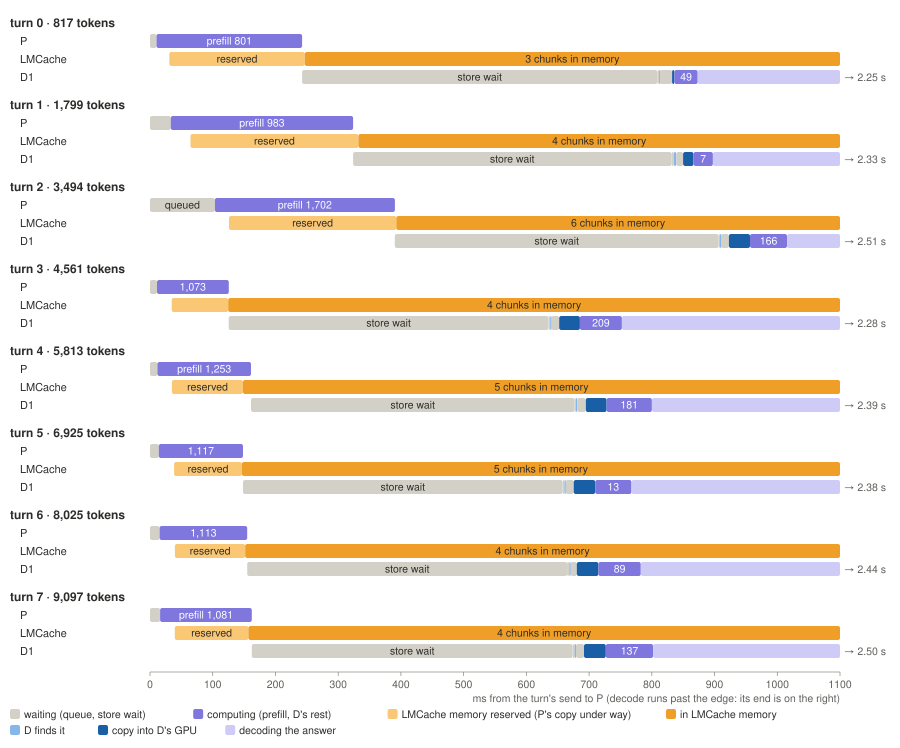

# Conversation 0: mt-rag-clapnq-elser-512-100-20240503 (memory mode)

8 turns on D1 (routed by conversation); prompts grow from 817 to 9,097 tokens (interleaved: each turn's prompt is the previous one, its answer, then this turn's documents and question). Chunks are 256 tokens (16 vLLM blocks of 16); a chunk's name is LMCache's hash of its tokens and everything before them, so the same prefix has the same chunks on every turn and engine.

Legend for the strips (one character a chunk): P: `=` on P's GPU from an earlier turn, `#` computed and stored now, `+` computed, not stored (a partial chunk). D: `=` on D's GPU from an earlier turn, `M` pulled from memory, `S` pulled from disk, `+` computed by D (a partial chunk), `?` missed.

GPU blocks (the chunk tables): the slots in each engine's GPU KV cache (vLLM's block pool ids; slot 0 is its reserved null block) that hold the chunk's 16 vLLM blocks, in block order, a run of consecutive slots written as a range: `P 1, 138-152` is block 0 in slot 1 and blocks 1-15 in slots 138-152. An engine hands a block a slot from its free list when it first computes or loads it, and the block keeps it while cached, so a later turn that reuses the block shows the same slot. Blocks that are the same in several prompts (the same tokens and everything before them) share one slot once the first is cached: the system prompt's first block, the same in every conversation, is the usual one. `16/16 hashes = P's`: of the blocks D pulled, how many have the same vLLM hash on D as on P.

The prompts' text is rebuilt from the MTRAG file the run read, by the driver's own code (scripts/pd_mtrag.py build()), and matches the run's record piece for piece; token counts and places are the run's. D's answers were not kept by this run's driver, only their token ids. Lines over 100 characters are wrapped here for reading.

| turn | prompt | chunks + tail | P: own GPU / computed / stored | D: own GPU / loaded / computed | pulled | pull ms | D first token ms |
| ---: | ---: | --- | --- | --- | --- | ---: | ---: |
| [0](#turn-0) | 817 | 3 + 49 | 16 / 801 / 3 chunks | 0 / 768 / 49 | 3 chunks (memory 3) | 24.3 | 64.5 |
| [1](#turn-1) | 1,799 | 7 + 7 | 816 / 983 / 4 chunks | 944 / 848 / 7 | 4 chunks (memory 4) | 18.6 | 66.2 |
| [2](#turn-2) | 3,494 | 13 + 166 | 1,792 / 1,702 / 6 chunks | 1,920 / 1,408 / 166 | 6 chunks (memory 6) | 38.8 | 109.3 |
| [3](#turn-3) | 4,561 | 17 + 209 | 3,488 / 1,073 / 4 chunks | 3,616 / 736 / 209 | 3 chunks (memory 3) | 35.7 | 116.9 |
| [4](#turn-4) | 5,813 | 22 + 181 | 4,560 / 1,253 / 5 chunks | 4,688 / 944 / 181 | 4 chunks (memory 4) | 37.7 | 123.6 |
| [5](#turn-5) | 6,925 | 27 + 13 | 5,808 / 1,117 / 5 chunks | 5,936 / 976 / 13 | 4 chunks (memory 4) | 37.9 | 109.7 |
| [6](#turn-6) | 8,025 | 31 + 89 | 6,912 / 1,113 / 4 chunks | 7,040 / 896 / 89 | 4 chunks (memory 4) | 34.9 | 117.4 |
| [7](#turn-7) | 9,097 | 35 + 137 | 8,016 / 1,081 / 4 chunks | 8,144 / 816 / 137 | 4 chunks (memory 4) | 37.6 | 128.4 |

## How the prompt grows

Each turn's prompt is the previous one, token for token, and then: D's answer to the previous turn, this turn's documents, its question and the framing (the system prompt on turn 0, `Assistant:` and newlines). Only the new tokens can make new chunks: the previous prompt's partial chunk fills first. A document sent before comes again at another place, so in other chunks.

| turn | prompt | new | previous answer | documents | question | framing | whole chunks |
| ---: | ---: | ---: | ---: | --- | --- | ---: | --- |
| 0 | 817 | +817 | – | 4 docs, 774 | 13: where do the arizona cardinals play this week | 30 | 3 (+3) |
| 1 | 1,799 | +982 | 128 | 5 docs, 840 (3 sent before: 627) | 11: Do the Arizona Cardinals play outside the US? | 3 | 7 (+4) |
| 2 | 3,494 | +1,695 | 128 | 7 docs, 1,550 (3 sent before: 681) | 14: Are the Arizona Cardinals and the Chicago Cardinals the same team? | 3 | 13 (+6) |
| 3 | 4,561 | +1,067 | 128 | 5 docs, 926 (3 sent before: 681) | 10: How many teams are in the NFL? | 3 | 17 (+4) |
| 4 | 5,813 | +1,252 | 128 | 6 docs, 1,110 (4 sent before: 778) | 11: How many teams are in the NFL playoffs? | 3 | 22 (+5) |
| 5 | 6,925 | +1,112 | 128 | 5 docs, 969 (3 sent before: 681) | 12: Which team has won the most Super Bowls? | 3 | 27 (+5) |
| 6 | 8,025 | +1,100 | 128 | 5 docs, 954 (3 sent before: 681) | 15: How many times have the New England Patriots played the super bowl? | 3 | 31 (+4) |
| 7 | 9,097 | +1,072 | 128 | 5 docs, 932 (3 sent before: 681) | 9: Who is the Patriot's coach? | 3 | 35 (+4) |

## Timeline

Every turn on one clock: ms from the moment the proxy sent the turn to P. P prefills it (one token out) and stores its new whole chunks in LMCache; the proxy waits 500 ms after P is done (the store wait) and sends the turn to D1, which finds what LMCache has, copies it into its GPU, computes the rest and decodes the answer. The lanes: P, LMCache (the chunks P stored this turn) and D. P computes the KV into its own GPU slots, where it stays (the next turn reuses it); its LMCache connector, set to store (P runs as kv_both), copies each new whole chunk from those slots to LMCache: LMCache reserves the space when P schedules the prefill (light orange) and has the chunks as P's prefill completes (orange).



| turn | P queued → done | chunks stored | in memory | on disk | D starts | D finds | copy into D's GPU | D: held / pulled / computed | first token | D done |
| ---: | --- | ---: | ---: | ---: | ---: | --- | --- | --- | ---: | ---: |
| 0 | 10 → 242 | 3 | 247 | – | 809 | 812-813 | 832-836 | 0 / 768 from memory / 49 | 873 | 2,248 |
| 1 | 33 → 324 | 4 | 332 | – | 831 | 835-839 | 850-866 | 944 / 848 from memory / 7 | 897 | 2,330 |
| 2 | 103 → 390 | 6 | 393 | – | 906 | 908-910 | 923-957 | 1,920 / 1,408 from memory / 166 | 1,016 | 2,506 |
| 3 | 11 → 126 | 4 | 125 | – | 635 | 638-640 | 652-685 | 3,616 / 736 from memory / 209 | 752 | 2,283 |
| 4 | 12 → 161 | 5 | 148 | – | 676 | 679-681 | 695-728 | 4,688 / 944 from memory / 181 | 800 | 2,387 |
| 5 | 14 → 148 | 5 | 146 | – | 658 | 661-663 | 675-710 | 5,936 / 976 from memory / 13 | 768 | 2,384 |
| 6 | 15 → 155 | 4 | 152 | – | 665 | 668-671 | 680-715 | 7,040 / 896 from memory / 89 | 782 | 2,438 |
| 7 | 16 → 162 | 4 | 157 | – | 674 | 677-679 | 692-727 | 8,144 / 816 from memory / 137 | 802 | 2,498 |

All times in ms from the turn's send to P. "in memory": the last of the turn's chunks written into LMCache's memory; "on disk": the last one written to disk (then dropped from memory, in the disk mode); D finds: from LMCache's lookup to its prefetch done (in the disk mode that is the read from disk); copy: LMCache's retrieve into D's GPU slots until D's connector has it. Each turn's section below tells it in a sentence.

### One chunk, block by block: chunk 0 of turn 0 (`f6bcdcf6a0cbe97e`)

Tokens 0-256 (system: 28; doc 822086267_6698: 137; doc 822086267_7384: 91). P computed its blocks on turn 0 and stored them as one chunk; D1 pulled the chunk into these GPU blocks:

| block | tokens | P's GPU block | vLLM hash | D's GPU block | D wrote it | same hash on D |
| ---: | --- | ---: | --- | ---: | --- | --- |
| 0 | 0-16 | 1 | `9f9c499d1c876b7e` | 49 | yes | True |
| 1 | 16-32 | 138 | `add775ff3d671c91` | 50 | yes | True |
| 2 | 32-48 | 139 | `d06f2312c2b2c4b0` | 51 | yes | True |
| 3 | 48-64 | 140 | `2e56c372645fbf91` | 52 | yes | True |
| 4 | 64-80 | 141 | `198bbe7f6d9acb78` | 53 | yes | True |
| 5 | 80-96 | 142 | `4fbfc818bf13cd97` | 54 | yes | True |
| 6 | 96-112 | 143 | `b7f32df1e1f34de5` | 55 | yes | True |
| 7 | 112-128 | 144 | `06f6fc561bc2b48d` | 56 | yes | True |
| 8 | 128-144 | 145 | `a61bbe5e4de373c4` | 57 | yes | True |
| 9 | 144-160 | 146 | `934b10bb9418a828` | 58 | yes | True |
| 10 | 160-176 | 147 | `7dc84b44126672f7` | 59 | yes | True |
| 11 | 176-192 | 148 | `99be881fdc72b973` | 60 | yes | True |
| 12 | 192-208 | 149 | `bad3973680bb4bfd` | 61 | yes | True |
| 13 | 208-224 | 150 | `f31724477bfa42c3` | 62 | yes | True |
| 14 | 224-240 | 151 | `436ab34d3f2eb22a` | 63 | yes | True |
| 15 | 240-256 | 152 | `00b829e6b92a441c` | 64 | yes | True |

## Turn 0

**Timeline:** P queued until 10 ms, prefilled 801 tokens (held 16) and was done at 242 ms; its 3 new chunks were in LMCache's memory at 247 ms. After the 500 ms store wait, D1 started at 809 ms holding 0 tokens, pulled 768 from memory (found 812-813 ms, copied into its GPU 832-836 ms), computed 49 and gave its first token at 873 ms; it decoded 128 tokens until 2,248 ms. ([all turns](#timeline))

### Step by step

Every move of this turn's KV, ms from the proxy sending the turn to P. The copies are LMCache's: its server reads P's GPU slots and writes D's through CUDA IPC handles each engine registered at start (no NIXL in this setup).

| ms | where | what |
| ---: | --- | --- |
| 0.0 | proxy → P | sends the turn (817 prompt tokens; P is asked for one token: prefill only) |
| 4.1 | P | the request arrives |
| 10.4 | P GPU | its prefix cache holds 16 of the prompt's tokens: 1 block in slots 1 |
| 10.4 | P ↔ LMCache | LMCache has 0 of its tokens; P loads 0 and computes the rest |
| 10.4 | P GPU | 51 new slots for the 801 tokens it computes: 138-188; the prefill runs |
| 10.7 | P → LMCache | store planned: tokens 0-768, chunks 0-2 (48 blocks) |
| 30.6 | LMCache | the store request is in; it waits for P's forward pass to finish (a CUDA event) |
| 30.8 | LMCache memory | space reserved for 3 chunks (88 MB) |
| 240.3 | P GPU → LMCache memory | the copy starts: LMCache reads P's GPU slots (CUDA IPC) |
| 242.5 | P → proxy | P answers its one token: the prefill is done |
| 243.7 | P GPU → LMCache memory | copy done: 3 chunks, 88 MB in 3.5 ms |
| 246.7 | LMCache memory | 3 chunks in memory, ready for D; P keeps its copy in its GPU slots |
| 808.7 | proxy → D1 | after the 500 ms store wait, sends the turn to D1 |
| 811.5 | D1 ↔ LMCache | asks LMCache for the prompt's chunks |
| 812.7 | LMCache memory | found 768 tokens it lacks: 3 chunks in memory |
| 813.1 | D1 GPU | its prefix cache holds 0 of the prompt's tokens |
| 813.2 | D1 | will load 768 tokens and compute 49 |
| 813.3 | D1 GPU | slots for the loaded blocks: 49-96 |
| 832.3 | LMCache memory → D1 GPU | the copy starts: LMCache writes D1's GPU slots (CUDA IPC) |
| 835.7 | LMCache memory → D1 GPU | copy done: 3 chunks, 88 MB in 3.4 ms |
| 836.0 | D1 | has the KV in its GPU slots |
| 846.7 | D1 GPU | 4 new slots for the 49 prompt tokens it computes: 107-110 |
| 873.2 | D1 → proxy | the first answer token |
| 1,024.1 | D1 GPU | decoding: the answer's KV takes 7 new slots as it grows, one per 16 tokens: 112 … 124 (7 blocks), until 2,063 ms |
| 2,248.5 | D1 | done: 128 tokens decoded; its blocks stay cached in its GPU slots for the next turn |
| 2,250.2 | proxy | the response is complete |

817 prompt tokens: 3 whole chunks and 49 tokens over (the partial chunk, computed by both engines and stored only when a later turn completes it). P held 16 tokens on its GPU, computed 801 and stored 3 new chunks; D1 held 0, loaded 768 from LMCache and computed 49.

### The prompt

The whole prompt, piece by piece:

- **system prompt** · tokens 0-28 (28) · chunk 0

```text
You are a helpful assistant. Answer the user's last question from the documents. If they do not hold
the answer, say so.
```

<details><summary>document <code>822086267_6698-7277-0-579</code> · tokens 28-165 (137) · chunk 0</summary>

```text
Document: 2017 Arizona Cardinals season
2017 Arizona Cardinals season
On December 13 , 2016 , the NFL announced that the Cardinals will play the Los Angeles Rams as one
of the NFL International Series at Twickenham Stadium in London , England , with the Rams serving as
the home team . It will be the Cardinals ' first appearance in the International Series , though the
Cardinals played in Mexico in 2005 against the San Francisco 49ers . The game will occur during Week
7 on Sunday , October 22 , and will be televised in the United States . The network and date were
announced in conjunction with the release of the 2017 regular season schedule .
```

</details>

<details><summary>document <code>822086267_7384-8758-0-1374</code> · tokens 165-576 (411) · chunks 0-2</summary>

```text
Document: 2017 Arizona Cardinals season
2017 Arizona Cardinals season
Week Date Opponent Result Record Game site NFL.com recap September 10 at Detroit Lions L 23 -- 35 0
-- 1 Ford Field Recap September 17 at Indianapolis Colts W 16 -- 13 ( OT ) 1 -- 1 Lucas Oil Stadium
Recap September 25 Dallas Cowboys L 17 -- 28 1 -- 2 University of Phoenix Stadium Recap October 1
San Francisco 49ers W 18 -- 15 ( OT ) 2 -- 2 University of Phoenix Stadium Recap 5 October 8 at
Philadelphia Eagles L 7 -- 34 2 -- 3 Lincoln Financial Field Recap 6 October 15 Tampa Bay Buccaneers
W 38 -- 33 3 -- 3 University of Phoenix Stadium Recap 7 October 22 at Los Angeles Rams L 0 -- 33 3
-- 4 Twickenham Stadium ( London , England ) Recap 8 Bye 9 November 5 at San Francisco 49ers W 20 --
10 4 -- 4 Levi 's Stadium Recap 10 November 9 Seattle Seahawks L 16 -- 22 4 -- 5 University of
Phoenix Stadium Recap 11 November 19 at Houston Texans L 21 -- 31 4 -- 6 NRG Stadium Recap 12
November 26 Jacksonville Jaguars W 27 -- 24 5 -- 6 University of Phoenix Stadium Recap 13 December 3
Los Angeles Rams L 16 -- 32 5 -- 7 University of Phoenix Stadium Recap 14 December 10 Tennessee
Titans W 12 -- 7 6 -- 7 University of Phoenix Stadium Recap 15 December 17 at Washington Redskins L
15 -- 20 6 -- 8 FedExField Recap 16 December 24 New York Giants W 23 -- 0 7 -- 8 University of
Phoenix Stadium Recap 17 December 31 at Seattle Seahawks W 26 -- 24 8 -- 8 CenturyLink Field Recap
```

</details>

<details><summary>document <code>822086267_6171-6655-0-484</code> · tokens 576-723 (147) · chunk 2</summary>

```text
Document: 2017 Arizona Cardinals season
2017 Arizona Cardinals season
Week Date Opponent Result Record Game site NFL.com recap HOF August 3 vs. Dallas Cowboys L 18 -- 20
0 -- 1 Tom Benson Hall of Fame Stadium ( Canton , Ohio ) Recap August 12 Oakland Raiders W 20 -- 10
1 -- 1 University of Phoenix Stadium Recap August 19 Chicago Bears L 23 -- 24 1 -- 2 University of
Phoenix Stadium Recap August 26 at Atlanta Falcons W 24 -- 14 2 -- 2 Mercedes - Benz Stadium Recap
August 31 at Denver Broncos L 2 -- 30 2 -- 3 Sports Authority Field at Mile High Recap
```

</details>

<details><summary>document <code>822086267_32952-33189-0-237</code> · tokens 723-802 (79) · chunks 2-3</summary>

```text
Document: 2017 Arizona Cardinals season
2017 Arizona Cardinals season
Date : December 10 Game time : 2 : 05 p.m. MST Game weather : Played indoors ( retractable roof
closed ) Game attendance : 64,153 Referee : Jerome Boger TV announcers ( CBS ) : Andrew Catalon ,
James Lofton and Jay Feely Recap , Gamebook
```

</details>

- **question 0** · tokens 802-815 (13) · chunk 3

```text
User: where do the arizona cardinals play this week
```

- `Assistant:` · tokens 815-817 (2) · chunk 3

### Pieces, chunks and blocks

| piece | tokens | length | chunks | |
| --- | --- | ---: | --- | --- |
| system | 0-28 | 28 | 0 |  |
| doc 822086267_6698 | 28-165 | 137 | 0 |  |
| doc 822086267_7384 | 165-576 | 411 | 0-2 |  |
| doc 822086267_6171 | 576-723 | 147 | 2 |  |
| doc 822086267_3295 | 723-802 | 79 | 2-3 |  |
| question 0 | 802-815 | 13 | 3 |  |
| `assistant:` 0 | 815-817 | 2 | 3 |  |

```
P  ###+
D  MMM+
```

| chunk | tokens | pieces in it (tokens) | vLLM blocks | GPU blocks | in LMCache | P this turn | D this turn |
| ---: | --- | --- | --- | --- | --- | --- | --- |
| 0 | 0-256 | system: 28; doc 822086267_6698: 137; doc 822086267_7384: 91 | 0-15 | P 1, 138-152; D 49-64; 16/16 hashes = P's | `f6bcdcf6a0cbe97e` stored on turn 0 | computed (its first 16 tokens on P's GPU already), **stored now** | **pulled from memory** |
| 1 | 256-512 | doc 822086267_7384: 256 | 16-31 | P 153-168; D 65-80; 16/16 hashes = P's | `bc60126ba58d64c3` stored on turn 0 | computed, **stored now** | **pulled from memory** |
| 2 | 512-768 | doc 822086267_7384: 64; doc 822086267_6171: 147; doc 822086267_3295: 45 | 32-47 | P 169-184; D 81-96; 16/16 hashes = P's | `f640fb7afed278d4` stored on turn 0 | computed, **stored now** | **pulled from memory** |
| 3 | 768-817 | doc 822086267_3295: 34; question 0: 13; `assistant:` 0: 2 | 48-51 | P 185-187; D 107-110 | – | computed (partial chunk: not stored) | computed by D (partial chunk) |

## Turn 1

**Timeline:** P queued until 33 ms, prefilled 983 tokens (held 816) and was done at 324 ms; its 4 new chunks were in LMCache's memory at 332 ms. After the 500 ms store wait, D1 started at 831 ms holding 944 tokens, pulled 848 from memory (found 835-839 ms, copied into its GPU 850-866 ms), computed 7 and gave its first token at 897 ms; it decoded 128 tokens until 2,330 ms. ([all turns](#timeline))

### Step by step

Every move of this turn's KV, ms from the proxy sending the turn to P. The copies are LMCache's: its server reads P's GPU slots and writes D's through CUDA IPC handles each engine registered at start (no NIXL in this setup).

| ms | where | what |
| ---: | --- | --- |
| 0.0 | proxy → P | sends the turn (1,799 prompt tokens; P is asked for one token: prefill only) |
| 24.0 | P | the request arrives |
| 32.9 | P GPU | its prefix cache holds 816 of the prompt's tokens: 51 blocks in slots 1, 138-187 |
| 32.9 | P ↔ LMCache | LMCache has 768 of its tokens; P loads 0 and computes the rest |
| 33.1 | P GPU | 62 new slots for the 983 tokens it computes: 373-434; the prefill runs |
| 33.6 | P → LMCache | store planned: tokens 768-1,792, chunks 3-6 (64 blocks) |
| 63.9 | LMCache | the store request is in; it waits for P's forward pass to finish (a CUDA event) |
| 64.5 | LMCache memory | space reserved for 4 chunks (117 MB) |
| 323.8 | P → proxy | P answers its one token: the prefill is done |
| 324.4 | P GPU → LMCache memory | the copy starts: LMCache reads P's GPU slots (CUDA IPC) |
| 328.9 | P GPU → LMCache memory | copy done: 4 chunks, 117 MB in 4.5 ms |
| 332.2 | LMCache memory | 4 chunks in memory, ready for D; P keeps its copy in its GPU slots |
| 831.2 | proxy → D1 | after the 500 ms store wait, sends the turn to D1 |
| 835.0 | D1 ↔ LMCache | asks LMCache for the prompt's chunks |
| 839.0 | LMCache memory | found 1,024 tokens it lacks: 4 chunks in memory |
| 840.7 | D1 GPU | its prefix cache holds 944 of the prompt's tokens: slots 1 … 124 (59 blocks) |
| 840.7 | D1 | will load 848 tokens and compute 7 |
| 841.2 | D1 GPU | slots for the loaded blocks: 204-256 |
| 849.8 | LMCache memory → D1 GPU | the copy starts: LMCache writes D1's GPU slots (CUDA IPC) |
| 853.5 | LMCache memory → D1 GPU | copy done: 4 chunks, 117 MB in 3.7 ms |
| 866.4 | D1 | has the KV in its GPU slots |
| 871.8 | D1 GPU | 1 new slot for the 7 prompt tokens it computes: 260 |
| 897.4 | D1 → proxy | the first answer token |
| 985.2 | D1 GPU | decoding: the answer's KV takes 8 new slots as it grows, one per 16 tokens: 261 … 275 (8 blocks), until 2,252 ms |
| 2,330.0 | D1 | done: 128 tokens decoded; its blocks stay cached in its GPU slots for the next turn |
| 2,331.5 | proxy | the response is complete |

1,799 prompt tokens: 7 whole chunks and 7 tokens over (the partial chunk, computed by both engines and stored only when a later turn completes it). P held 816 tokens on its GPU, computed 983 and stored 4 new chunks; D1 held 944, loaded 848 from LMCache and computed 7.

### The prompt

Tokens 0-817: [turn 0](#turn-0)'s prompt, unchanged (checked: its first 817 token ids are the previous prompt's), so chunks 0-2 are the same chunks; chunk 3 (partial then, 49 tokens) fills now. New from token 817:

- **D's answer to turn 0** · tokens 817-945 (128) · chunk 3

  its text was not kept by this run: its driver kept only the token ids (later runs keep it: scripts/pd_mtrag.py --trace)

- `\n` · tokens 945-946 (1) · chunk 3

- document `822086267_32952-33189-0-237` · tokens 946-1025 (79) · chunks 3-4 · **again**: sent on [turn 0](#turn-0) already (the same 79 tokens), here at another place in the prompt, so in other chunks: a prefix cache cannot reuse it

<details><summary>document <code>822086267_36346-36586-0-240</code> · tokens 1025-1105 (80) · chunk 4</summary>

```text
Document: 2017 Arizona Cardinals season
2017 Arizona Cardinals season
Date : December 24 Game time : 2 : 25 p.m. MST Game weather : Played indoors ( retractable roof
closed ) Game attendance : 63,850 Referee : John Parry TV announcers ( Fox ) : Dick Stockton , Mark
Schlereth and Shannon Spake Recap , Gamebook
```

</details>

- document `822086267_7384-8758-0-1374` · tokens 1105-1516 (411) · chunks 4-5 · **again**: sent on [turn 0](#turn-0) already (the same 411 tokens), here at another place in the prompt, so in other chunks: a prefix cache cannot reuse it

- document `822086267_6698-7277-0-579` · tokens 1516-1653 (137) · chunks 5-6 · **again**: sent on [turn 0](#turn-0) already (the same 137 tokens), here at another place in the prompt, so in other chunks: a prefix cache cannot reuse it

<details><summary>document <code>822086267_453-961-0-508</code> · tokens 1653-1786 (133) · chunk 6</summary>

```text
Document: 2017 Arizona Cardinals season
2017 Arizona Cardinals season
The 2017 Arizona Cardinals season was the franchise 's 98th season in the National Football League ,
the 30th in Arizona and 12th at University of Phoenix Stadium . It was also the fifth and final
season under head coach Bruce Arians . The Cardinals played one road game in London at Twickenham
Stadium against the Los Angeles Rams as one of the NFL London Games . They improved on a 7 -- 8 -- 1
season they had in 2016 , finishing 8 -- 8 . However , they missed the playoffs for the second
straight season .
```

</details>

- **question 1** · tokens 1786-1797 (11) · chunks 6-7

```text
User: Do the Arizona Cardinals play outside the US?
```

- `Assistant:` · tokens 1797-1799 (2) · chunk 7

### Pieces, chunks and blocks

| piece | tokens | length | chunks | |
| --- | --- | ---: | --- | --- |
| system | 0-28 | 28 | 0 |  |
| doc 822086267_6698 | 28-165 | 137 | 0 |  |
| doc 822086267_7384 | 165-576 | 411 | 0-2 |  |
| doc 822086267_6171 | 576-723 | 147 | 2 |  |
| doc 822086267_3295 | 723-802 | 79 | 2-3 |  |
| question 0 | 802-815 | 13 | 3 |  |
| `assistant:` 0 | 815-817 | 2 | 3 |  |
| answer 0 | 817-945 | 128 | 3 | new this turn |
| newline 0 | 945-946 | 1 | 3 | new this turn |
| doc 822086267_3295 | 946-1025 | 79 | 3-4 | new this turn |
| doc 822086267_3634 | 1025-1105 | 80 | 4 | new this turn |
| doc 822086267_7384 | 1105-1516 | 411 | 4-5 | new this turn |
| doc 822086267_6698 | 1516-1653 | 137 | 5-6 | new this turn |
| doc 822086267_453- | 1653-1786 | 133 | 6 | new this turn |
| question 1 | 1786-1797 | 11 | 6-7 | new this turn |
| `assistant:` 1 | 1797-1799 | 2 | 7 | new this turn |

```
P  ===####+
D  ===MMMM+
```

| chunk | tokens | pieces in it (tokens) | vLLM blocks | GPU blocks | in LMCache | P this turn | D this turn |
| ---: | --- | --- | --- | --- | --- | --- | --- |
| 0 | 0-256 | system: 28; doc 822086267_6698: 137; doc 822086267_7384: 91 | 0-15 | P 1, 138-152; D 1, 50-64 | `f6bcdcf6a0cbe97e` stored on turn 0 | on P's GPU (earlier turn) | on D's GPU (earlier turn) |
| 1 | 256-512 | doc 822086267_7384: 256 | 16-31 | P 153-168; D 65-80 | `bc60126ba58d64c3` stored on turn 0 | on P's GPU (earlier turn) | on D's GPU (earlier turn) |
| 2 | 512-768 | doc 822086267_7384: 64; doc 822086267_6171: 147; doc 822086267_3295: 45 | 32-47 | P 169-184; D 81-96 | `f640fb7afed278d4` stored on turn 0 | on P's GPU (earlier turn) | on D's GPU (earlier turn) |
| 3 | 768-1024 | doc 822086267_3295: 34; question 0: 13; `assistant:` 0: 2; answer 0 (new): 128; newline 0 (new): 1; doc 822086267_3295 (new): 78 | 48-63 | P 185-187, 373-385; D 107-110 … 204-208 (16 blocks); 16/16 hashes = P's | `50c0f6d5e58eb4cc` stored on turn 1 | computed (its first 48 tokens on P's GPU already), **stored now** | **pulled from memory** (its first 176 tokens on D's GPU already) |
| 4 | 1024-1280 | doc 822086267_3295 (new): 1; doc 822086267_3634 (new): 80; doc 822086267_7384 (new): 175 | 64-79 | P 386-401; D 209-224; 16/16 hashes = P's | `fc65370ee173d3fb` stored on turn 1 | computed, **stored now** | **pulled from memory** |
| 5 | 1280-1536 | doc 822086267_7384 (new): 236; doc 822086267_6698 (new): 20 | 80-95 | P 402-417; D 225-240; 16/16 hashes = P's | `e3854004ac7cde07` stored on turn 1 | computed, **stored now** | **pulled from memory** |
| 6 | 1536-1792 | doc 822086267_6698 (new): 117; doc 822086267_453- (new): 133; question 1 (new): 6 | 96-111 | P 418-433; D 241-256; 16/16 hashes = P's | `b745229884366b35` stored on turn 1 | computed, **stored now** | **pulled from memory** |
| 7 | 1792-1799 | question 1 (new): 5; `assistant:` 1 (new): 2 | 112 | P –; D 260 | – | computed (partial chunk: not stored) | computed by D (partial chunk) |

## Turn 2

**Timeline:** P queued until 103 ms, prefilled 1,702 tokens (held 1,792) and was done at 390 ms; its 6 new chunks were in LMCache's memory at 393 ms. After the 500 ms store wait, D1 started at 906 ms holding 1,920 tokens, pulled 1,408 from memory (found 908-910 ms, copied into its GPU 923-957 ms), computed 166 and gave its first token at 1,016 ms; it decoded 128 tokens until 2,506 ms. ([all turns](#timeline))

### Step by step

Every move of this turn's KV, ms from the proxy sending the turn to P. The copies are LMCache's: its server reads P's GPU slots and writes D's through CUDA IPC handles each engine registered at start (no NIXL in this setup).

| ms | where | what |
| ---: | --- | --- |
| 0.0 | proxy → P | sends the turn (3,494 prompt tokens; P is asked for one token: prefill only) |
| 79.8 | P | the request arrives |
| 103.1 | P GPU | its prefix cache holds 1,792 of the prompt's tokens: 112 blocks in slots 1, 138-187, 373-433 |
| 103.2 | P ↔ LMCache | LMCache has 1,792 of its tokens; P loads 0 and computes the rest |
| 103.4 | P GPU | 107 new slots for the 1,702 tokens it computes: 634-740; the prefill runs |
| 104.1 | P → LMCache | store planned: tokens 1,792-3,328, chunks 7-12 (96 blocks) |
| 125.0 | LMCache | the store request is in; it waits for P's forward pass to finish (a CUDA event) |
| 125.9 | LMCache memory | space reserved for 6 chunks (176 MB) |
| 384.4 | P GPU → LMCache memory | the copy starts: LMCache reads P's GPU slots (CUDA IPC) |
| 390.3 | P → proxy | P answers its one token: the prefill is done |
| 391.2 | P GPU → LMCache memory | copy done: 6 chunks, 176 MB in 6.8 ms |
| 392.6 | LMCache memory | 6 chunks in memory, ready for D; P keeps its copy in its GPU slots |
| 906.3 | proxy → D1 | after the 500 ms store wait, sends the turn to D1 |
| 908.4 | D1 ↔ LMCache | asks LMCache for the prompt's chunks |
| 910.3 | LMCache memory | found 1,536 tokens it lacks: 6 chunks in memory |
| 918.1 | D1 GPU | its prefix cache holds 1,920 of the prompt's tokens: slots 1 … 273 (120 blocks) |
| 918.2 | D1 | will load 1,408 tokens and compute 166 |
| 918.8 | D1 GPU | slots for the loaded blocks: 367-454 |
| 922.9 | LMCache memory → D1 GPU | the copy starts: LMCache writes D1's GPU slots (CUDA IPC) |
| 947.2 | LMCache memory → D1 GPU | copy done: 6 chunks, 176 MB in 24.3 ms |
| 956.6 | D1 | has the KV in its GPU slots |
| 976.6 | D1 GPU | 11 new slots for the 166 prompt tokens it computes: 456-466 |
| 1,015.6 | D1 → proxy | the first answer token |
| 1,117.7 | D1 GPU | decoding: the answer's KV takes 8 new slots as it grows, one per 16 tokens: 467 … 479-480 (8 blocks), until 2,437 ms |
| 2,505.8 | D1 | done: 128 tokens decoded; its blocks stay cached in its GPU slots for the next turn |
| 2,507.3 | proxy | the response is complete |

3,494 prompt tokens: 13 whole chunks and 166 tokens over (the partial chunk, computed by both engines and stored only when a later turn completes it). P held 1,792 tokens on its GPU, computed 1,702 and stored 6 new chunks; D1 held 1,920, loaded 1,408 from LMCache and computed 166.

### The prompt

Tokens 0-1,799: [turn 1](#turn-1)'s prompt, unchanged (checked: its first 1,799 token ids are the previous prompt's), so chunks 0-6 are the same chunks; chunk 7 (partial then, 7 tokens) fills now. New from token 1,799:

- **D's answer to turn 1** · tokens 1799-1927 (128) · chunk 7

  its text was not kept by this run: its driver kept only the token ids (later runs keep it: scripts/pd_mtrag.py --trace)

- `\n` · tokens 1927-1928 (1) · chunk 7

- document `822086267_6698-7277-0-579` · tokens 1928-2065 (137) · chunks 7-8 · **again**: sent on [turn 0](#turn-0) already (the same 137 tokens), here at another place in the prompt, so in other chunks: a prefix cache cannot reuse it

- document `822086267_7384-8758-0-1374` · tokens 2065-2476 (411) · chunks 8-9 · **again**: sent on [turn 0](#turn-0) already (the same 411 tokens), here at another place in the prompt, so in other chunks: a prefix cache cannot reuse it

- document `822086267_453-961-0-508` · tokens 2476-2609 (133) · chunks 9-10 · **again**: sent on [turn 1](#turn-1) already (the same 133 tokens), here at another place in the prompt, so in other chunks: a prefix cache cannot reuse it

<details><summary>document <code>866343245_65754-66191-0-437</code> · tokens 2609-2714 (105) · chunk 10</summary>

```text
Document: Illinois
Illinois
The NFL 's Arizona Cardinals , who currently play in the Phoenix suburb of Glendale , Arizona ,
played in Chicago as the Chicago Cardinals , until moving to St. Louis , Missouri after the 1959
season . An NBA expansion team known as the Chicago Packers in 1961 -- 1962 , and as the Chicago
Zephyrs the following year , moved to Baltimore after the 1962 -- 1963 season . The franchise is now
known as the Washington Wizards . Professional
```

</details>

<details><summary>document <code>837407666_8367-9237-0-870</code> · tokens 2714-2903 (189) · chunks 10-11</summary>

```text
Document: History of the National Football League
History of the National Football League
Two charter members , the Chicago Cardinals ( now the Arizona Cardinals ) and the Decatur Staleys (
now the Chicago Bears ) , are still in existence . The Green Bay Packers franchise , founded in 1919
, is the oldest team not to change locations , but did not begin league play until 1921 . The New
York Football Giants joined in 1925 , followed by the Portsmouth Spartans in 1930 , relocating to
Detroit in 1934 to become the Lions . The Indianapolis Colts franchise traces its history through
several predecessors , including one of the league 's founding teams -- the Dayton Triangles -- but
is considered a separate franchise from those teams and was founded as the Baltimore Colts in 1953 .
Although the original NFL teams representing Buffalo , Cleveland , Chicago and Detroit no longer
exist , replacement franchises have since been established for those cities .
```

</details>

<details><summary>document <code>836236385_70524-72270-0-1746</code> · tokens 2903-3311 (408) · chunks 11-12</summary>

```text
Document: Missouri
Missouri
National Football League : St. Louis Cardinals ( moved from Chicago in 1960 ; moved to Tempe ,
Arizona in 1988 and are now the Arizona Cardinals ) St. Louis All Stars ( active in 1923 only )
Kansas City Blues / Cowboys ( active 1924 -- 1926 , folded ) St. Louis Gunners ( independent team ,
joined the NFL for the last three weeks of the 1934 season and folded thereafter ) St. Louis Rams
1995 -- 2015 moved from Los Angeles and then back to Los Angeles Major League Baseball ( American
League ) : St. Louis Browns ( moved from Milwaukee in 1902 ; moved to Baltimore , Maryland after the
1953 season and are now the Baltimore Orioles ) Kansas City Athletics ( moved from Philadelphia in
1955 ; moved to Oakland , California after the 1967 season and are now the Oakland Athletics )
National Basketball Association : St. Louis Bombers ( charter BAA franchise in 1946 , joined the NBA
when it formed in 1949 ; ceased operations in 1950 ) St. Louis Hawks ( moved from Milwaukee in 1955
; moved to Atlanta in 1968 and are now the Atlanta Hawks ) Kansas City Kings ( moved from Cincinnati
in 1972 ; moved to Sacramento in 1985 and are now the Sacramento Kings ; prior to locating in Kansas
City , they were known as the Cincinnati Royals ) National Hockey League : Kansas City Scouts ( 1974
expansion team , moved to Denver , Colorado in 1976 and became the Colorado Rockies , and would move
again to Newark , New Jersey ; now called the New Jersey Devils ) St. Louis Eagles ( 1934 relocation
of the original Ottawa Senators , folded after the 1934 -- 35 season ) Major League Soccer : Kansas
City Wiz / Kansas City Wizards ( founded in 1995 , but moved from Kansas City , Missouri , to Kansas
City , Kansas , in 2010 and became Sporting Kansas City )
```

</details>

<details><summary>document <code>837407666_122-881-0-759</code> · tokens 3311-3478 (167) · chunks 12-13</summary>

```text
Document: History of the National Football League
History of the National Football League
The National Football League ( NFL ) was founded in 1899 as the American Professional Football
Association ( APFA ) with ten teams from four states , all of whom existed in some form as
participants of regional leagues in their respective territories ; it took on its current name in
1922 . The NFL was the first professional football league to successfully establish a nationwide
presence , after several decades of failed attempts . Only two teams currently in the NFL , the
Decatur Staleys ( now the Chicago Bears ) and the Chicago Cardinals ( now the Arizona Cardinals ) ,
are founding members . The Green Bay Packers , founded 1919 ( joined the NFL in 1921 ) , is the
oldest NFL franchise in continuous operation with the same name in the same location .
```

</details>

- **question 2** · tokens 3478-3492 (14) · chunk 13

```text
User: Are the Arizona Cardinals and the Chicago Cardinals the same team?
```

- `Assistant:` · tokens 3492-3494 (2) · chunk 13

### Pieces, chunks and blocks

| piece | tokens | length | chunks | |
| --- | --- | ---: | --- | --- |
| system | 0-28 | 28 | 0 |  |
| doc 822086267_6698 | 28-165 | 137 | 0 |  |
| doc 822086267_7384 | 165-576 | 411 | 0-2 |  |
| doc 822086267_6171 | 576-723 | 147 | 2 |  |
| doc 822086267_3295 | 723-802 | 79 | 2-3 |  |
| question 0 | 802-815 | 13 | 3 |  |
| `assistant:` 0 | 815-817 | 2 | 3 |  |
| answer 0 | 817-945 | 128 | 3 |  |
| newline 0 | 945-946 | 1 | 3 |  |
| doc 822086267_3295 | 946-1025 | 79 | 3-4 |  |
| doc 822086267_3634 | 1025-1105 | 80 | 4 |  |
| doc 822086267_7384 | 1105-1516 | 411 | 4-5 |  |
| doc 822086267_6698 | 1516-1653 | 137 | 5-6 |  |
| doc 822086267_453- | 1653-1786 | 133 | 6 |  |
| question 1 | 1786-1797 | 11 | 6-7 |  |
| `assistant:` 1 | 1797-1799 | 2 | 7 |  |
| answer 1 | 1799-1927 | 128 | 7 | new this turn |
| newline 1 | 1927-1928 | 1 | 7 | new this turn |
| doc 822086267_6698 | 1928-2065 | 137 | 7-8 | new this turn |
| doc 822086267_7384 | 2065-2476 | 411 | 8-9 | new this turn |
| doc 822086267_453- | 2476-2609 | 133 | 9-10 | new this turn |
| doc 866343245_6575 | 2609-2714 | 105 | 10 | new this turn |
| doc 837407666_8367 | 2714-2903 | 189 | 10-11 | new this turn |
| doc 836236385_7052 | 2903-3311 | 408 | 11-12 | new this turn |
| doc 837407666_122- | 3311-3478 | 167 | 12-13 | new this turn |
| question 2 | 3478-3492 | 14 | 13 | new this turn |
| `assistant:` 2 | 3492-3494 | 2 | 13 | new this turn |

```
P  =======######+
D  =======MMMMMM+
```

| chunk | tokens | pieces in it (tokens) | vLLM blocks | GPU blocks | in LMCache | P this turn | D this turn |
| ---: | --- | --- | --- | --- | --- | --- | --- |
| 0 | 0-256 | system: 28; doc 822086267_6698: 137; doc 822086267_7384: 91 | 0-15 | P 1, 138-152; D 1, 50-64 | `f6bcdcf6a0cbe97e` stored on turn 0 | on P's GPU (earlier turn) | on D's GPU (earlier turn) |
| 1 | 256-512 | doc 822086267_7384: 256 | 16-31 | P 153-168; D 65-80 | `bc60126ba58d64c3` stored on turn 0 | on P's GPU (earlier turn) | on D's GPU (earlier turn) |
| 2 | 512-768 | doc 822086267_7384: 64; doc 822086267_6171: 147; doc 822086267_3295: 45 | 32-47 | P 169-184; D 81-96 | `f640fb7afed278d4` stored on turn 0 | on P's GPU (earlier turn) | on D's GPU (earlier turn) |
| 3 | 768-1024 | doc 822086267_3295: 34; question 0: 13; `assistant:` 0: 2; answer 0: 128; newline 0: 1; doc 822086267_3295: 78 | 48-63 | P 185-187, 373-385; D 107-110 … 204-208 (16 blocks) | `50c0f6d5e58eb4cc` stored on turn 1 | on P's GPU (earlier turn) | on D's GPU (earlier turn, its own answer) |
| 4 | 1024-1280 | doc 822086267_3295: 1; doc 822086267_3634: 80; doc 822086267_7384: 175 | 64-79 | P 386-401; D 209-224 | `fc65370ee173d3fb` stored on turn 1 | on P's GPU (earlier turn) | on D's GPU (earlier turn) |
| 5 | 1280-1536 | doc 822086267_7384: 236; doc 822086267_6698: 20 | 80-95 | P 402-417; D 225-240 | `e3854004ac7cde07` stored on turn 1 | on P's GPU (earlier turn) | on D's GPU (earlier turn) |
| 6 | 1536-1792 | doc 822086267_6698: 117; doc 822086267_453-: 133; question 1: 6 | 96-111 | P 418-433; D 241-256 | `b745229884366b35` stored on turn 1 | on P's GPU (earlier turn) | on D's GPU (earlier turn) |
| 7 | 1792-2048 | question 1: 5; `assistant:` 1: 2; answer 1 (new): 128; newline 1 (new): 1; doc 822086267_6698 (new): 120 | 112-127 | P 634-649; D 260-261 … 367-374 (16 blocks); 16/16 hashes = P's | `c4ff1d48f0dc0d62` stored on turn 2 | computed, **stored now** | **pulled from memory** (its first 128 tokens on D's GPU already) |
| 8 | 2048-2304 | doc 822086267_6698 (new): 17; doc 822086267_7384 (new): 239 | 128-143 | P 650-665; D 375-390; 16/16 hashes = P's | `436a280e0d93efc2` stored on turn 2 | computed, **stored now** | **pulled from memory** |
| 9 | 2304-2560 | doc 822086267_7384 (new): 172; doc 822086267_453- (new): 84 | 144-159 | P 666-681; D 391-406; 16/16 hashes = P's | `a930ae09a0bfcac5` stored on turn 2 | computed, **stored now** | **pulled from memory** |
| 10 | 2560-2816 | doc 822086267_453- (new): 49; doc 866343245_6575 (new): 105; doc 837407666_8367 (new): 102 | 160-175 | P 682-697; D 407-422; 16/16 hashes = P's | `01a93d9215c9bf09` stored on turn 2 | computed, **stored now** | **pulled from memory** |
| 11 | 2816-3072 | doc 837407666_8367 (new): 87; doc 836236385_7052 (new): 169 | 176-191 | P 698-713; D 423-438; 16/16 hashes = P's | `789ae0a2d1db7245` stored on turn 2 | computed, **stored now** | **pulled from memory** |
| 12 | 3072-3328 | doc 836236385_7052 (new): 239; doc 837407666_122- (new): 17 | 192-207 | P 714-729; D 439-454; 16/16 hashes = P's | `ce31b70d1883b445` stored on turn 2 | computed, **stored now** | **pulled from memory** |
| 13 | 3328-3494 | doc 837407666_122- (new): 150; question 2 (new): 14; `assistant:` 2 (new): 2 | 208-218 | P 730-739; D 456-466 | – | computed (partial chunk: not stored) | computed by D (partial chunk) |

## Turn 3

**Timeline:** P queued until 11 ms, prefilled 1,073 tokens (held 3,488) and was done at 126 ms; its 4 new chunks were in LMCache's memory at 125 ms. After the 500 ms store wait, D1 started at 635 ms holding 3,616 tokens, pulled 736 from memory (found 638-640 ms, copied into its GPU 652-685 ms), computed 209 and gave its first token at 752 ms; it decoded 128 tokens until 2,283 ms. ([all turns](#timeline))

### Step by step

Every move of this turn's KV, ms from the proxy sending the turn to P. The copies are LMCache's: its server reads P's GPU slots and writes D's through CUDA IPC handles each engine registered at start (no NIXL in this setup).

| ms | where | what |
| ---: | --- | --- |
| 0.0 | proxy → P | sends the turn (4,561 prompt tokens; P is asked for one token: prefill only) |
| 5.3 | P | the request arrives |
| 10.7 | P GPU | its prefix cache holds 3,488 of the prompt's tokens: slots 1 … 634-739 (218 blocks) |
| 10.8 | P ↔ LMCache | LMCache has 3,328 of its tokens; P loads 0 and computes the rest |
| 11.1 | P GPU | 68 new slots for the 1,073 tokens it computes: 902-969; the prefill runs |
| 11.7 | P → LMCache | store planned: tokens 3,328-4,352, chunks 13-16 (64 blocks) |
| 33.8 | LMCache | the store request is in; it waits for P's forward pass to finish (a CUDA event) |
| 34.6 | LMCache memory | space reserved for 4 chunks (117 MB) |
| 118.0 | P GPU → LMCache memory | the copy starts: LMCache reads P's GPU slots (CUDA IPC) |
| 122.6 | P GPU → LMCache memory | copy done: 4 chunks, 117 MB in 4.6 ms |
| 124.7 | LMCache memory | 4 chunks in memory, ready for D; P keeps its copy in its GPU slots |
| 125.5 | P → proxy | P answers its one token: the prefill is done |
| 635.4 | proxy → D1 | after the 500 ms store wait, sends the turn to D1 |
| 638.0 | D1 ↔ LMCache | asks LMCache for the prompt's chunks |
| 639.9 | LMCache memory | found 768 tokens it lacks: 3 chunks in memory |
| 647.5 | D1 GPU | its prefix cache holds 3,616 of the prompt's tokens: slots 1 … 479 (226 blocks) |
| 647.6 | D1 | will load 736 tokens and compute 209 |
| 648.2 | D1 GPU | slots for the loaded blocks: 543-588 |
| 652.3 | LMCache memory → D1 GPU | the copy starts: LMCache writes D1's GPU slots (CUDA IPC) |
| 673.7 | LMCache memory → D1 GPU | copy done: 3 chunks, 88 MB in 21.4 ms |
| 685.3 | D1 | has the KV in its GPU slots |
| 706.2 | D1 GPU | 14 new slots for the 209 prompt tokens it computes: 589-602 |
| 752.3 | D1 → proxy | the first answer token |
| 918.3 | D1 GPU | decoding: the answer's KV takes 7 new slots as it grows, one per 16 tokens: 604 … 614-615 (7 blocks), until 2,085 ms |
| 2,283.2 | D1 | done: 128 tokens decoded; its blocks stay cached in its GPU slots for the next turn |
| 2,284.8 | proxy | the response is complete |

4,561 prompt tokens: 17 whole chunks and 209 tokens over (the partial chunk, computed by both engines and stored only when a later turn completes it). P held 3,488 tokens on its GPU, computed 1,073 and stored 4 new chunks; D1 held 3,616, loaded 736 from LMCache and computed 209.

### The prompt

Tokens 0-3,494: [turn 2](#turn-2)'s prompt, unchanged (checked: its first 3,494 token ids are the previous prompt's), so chunks 0-12 are the same chunks; chunk 13 (partial then, 166 tokens) fills now. New from token 3,494:

- **D's answer to turn 2** · tokens 3494-3622 (128) · chunks 13-14

  its text was not kept by this run: its driver kept only the token ids (later runs keep it: scripts/pd_mtrag.py --trace)

- `\n` · tokens 3622-3623 (1) · chunk 14

- document `822086267_6698-7277-0-579` · tokens 3623-3760 (137) · chunk 14 · **again**: sent on [turn 0](#turn-0) already (the same 137 tokens), here at another place in the prompt, so in other chunks: a prefix cache cannot reuse it

- document `822086267_7384-8758-0-1374` · tokens 3760-4171 (411) · chunks 14-16 · **again**: sent on [turn 0](#turn-0) already (the same 411 tokens), here at another place in the prompt, so in other chunks: a prefix cache cannot reuse it

- document `822086267_453-961-0-508` · tokens 4171-4304 (133) · chunk 16 · **again**: sent on [turn 1](#turn-1) already (the same 133 tokens), here at another place in the prompt, so in other chunks: a prefix cache cannot reuse it

<details><summary>document <code>832860310_2886-3341-0-455</code> · tokens 4304-4401 (97) · chunks 16-17</summary>

```text
Document: NFL playoffs
NFL playoffs
The 32 - team National Football League is divided into two conferences , American Football
Conference ( AFC ) and National Football Conference ( NFC ) , each with 16 teams . Since 2002 , each
conference has been further divided into four divisions of four teams each . The tournament brackets
are made up of six teams from each of the league 's two conferences , following the end of the
regular season . Qualification into the playoffs works as follows :
```

</details>

<details><summary>document <code>837407666_1762-2394-0-632</code> · tokens 4401-4549 (148) · chunk 17</summary>

```text
Document: History of the National Football League
History of the National Football League
The rival American Football League was founded in 1960 . It was very successful , and forced a
merger with the older NFL that resulted in a greatly expanded league and the creation of the Super
Bowl , which has become the most - watched annual sporting event in the United States . The league
continued to expand to its current size of 32 teams . A series of labor agreements during the 1990s
and increasingly large television contracts has helped keep the league one of the most profitable in
the U.S. , and the only major league in the U.S. since 1990 to avoid a work stoppage that resulted
in the loss of regular - season games .
```

</details>

- **question 3** · tokens 4549-4559 (10) · chunk 17

```text
User: How many teams are in the NFL?
```

- `Assistant:` · tokens 4559-4561 (2) · chunk 17

### Pieces, chunks and blocks

| piece | tokens | length | chunks | |
| --- | --- | ---: | --- | --- |
| system | 0-28 | 28 | 0 |  |
| doc 822086267_6698 | 28-165 | 137 | 0 |  |
| doc 822086267_7384 | 165-576 | 411 | 0-2 |  |
| doc 822086267_6171 | 576-723 | 147 | 2 |  |
| doc 822086267_3295 | 723-802 | 79 | 2-3 |  |
| question 0 | 802-815 | 13 | 3 |  |
| `assistant:` 0 | 815-817 | 2 | 3 |  |
| answer 0 | 817-945 | 128 | 3 |  |
| newline 0 | 945-946 | 1 | 3 |  |
| doc 822086267_3295 | 946-1025 | 79 | 3-4 |  |
| doc 822086267_3634 | 1025-1105 | 80 | 4 |  |
| doc 822086267_7384 | 1105-1516 | 411 | 4-5 |  |
| doc 822086267_6698 | 1516-1653 | 137 | 5-6 |  |
| doc 822086267_453- | 1653-1786 | 133 | 6 |  |
| question 1 | 1786-1797 | 11 | 6-7 |  |
| `assistant:` 1 | 1797-1799 | 2 | 7 |  |
| answer 1 | 1799-1927 | 128 | 7 |  |
| newline 1 | 1927-1928 | 1 | 7 |  |
| doc 822086267_6698 | 1928-2065 | 137 | 7-8 |  |
| doc 822086267_7384 | 2065-2476 | 411 | 8-9 |  |
| doc 822086267_453- | 2476-2609 | 133 | 9-10 |  |
| doc 866343245_6575 | 2609-2714 | 105 | 10 |  |
| doc 837407666_8367 | 2714-2903 | 189 | 10-11 |  |
| doc 836236385_7052 | 2903-3311 | 408 | 11-12 |  |
| doc 837407666_122- | 3311-3478 | 167 | 12-13 |  |
| question 2 | 3478-3492 | 14 | 13 |  |
| `assistant:` 2 | 3492-3494 | 2 | 13 |  |
| answer 2 | 3494-3622 | 128 | 13-14 | new this turn |
| newline 2 | 3622-3623 | 1 | 14 | new this turn |
| doc 822086267_6698 | 3623-3760 | 137 | 14 | new this turn |
| doc 822086267_7384 | 3760-4171 | 411 | 14-16 | new this turn |
| doc 822086267_453- | 4171-4304 | 133 | 16 | new this turn |
| doc 832860310_2886 | 4304-4401 | 97 | 16-17 | new this turn |
| doc 837407666_1762 | 4401-4549 | 148 | 17 | new this turn |
| question 3 | 4549-4559 | 10 | 17 | new this turn |
| `assistant:` 3 | 4559-4561 | 2 | 17 | new this turn |

```
P  =============####+
D  ==============MMM+
```

| chunk | tokens | pieces in it (tokens) | vLLM blocks | GPU blocks | in LMCache | P this turn | D this turn |
| ---: | --- | --- | --- | --- | --- | --- | --- |
| 0 | 0-256 | system: 28; doc 822086267_6698: 137; doc 822086267_7384: 91 | 0-15 | P 1, 138-152; D 1, 50-64 | `f6bcdcf6a0cbe97e` stored on turn 0 | on P's GPU (earlier turn) | on D's GPU (earlier turn) |
| 1 | 256-512 | doc 822086267_7384: 256 | 16-31 | P 153-168; D 65-80 | `bc60126ba58d64c3` stored on turn 0 | on P's GPU (earlier turn) | on D's GPU (earlier turn) |
| 2 | 512-768 | doc 822086267_7384: 64; doc 822086267_6171: 147; doc 822086267_3295: 45 | 32-47 | P 169-184; D 81-96 | `f640fb7afed278d4` stored on turn 0 | on P's GPU (earlier turn) | on D's GPU (earlier turn) |
| 3 | 768-1024 | doc 822086267_3295: 34; question 0: 13; `assistant:` 0: 2; answer 0: 128; newline 0: 1; doc 822086267_3295: 78 | 48-63 | P 185-187, 373-385; D 107-110 … 204-208 (16 blocks) | `50c0f6d5e58eb4cc` stored on turn 1 | on P's GPU (earlier turn) | on D's GPU (earlier turn, its own answer) |
| 4 | 1024-1280 | doc 822086267_3295: 1; doc 822086267_3634: 80; doc 822086267_7384: 175 | 64-79 | P 386-401; D 209-224 | `fc65370ee173d3fb` stored on turn 1 | on P's GPU (earlier turn) | on D's GPU (earlier turn) |
| 5 | 1280-1536 | doc 822086267_7384: 236; doc 822086267_6698: 20 | 80-95 | P 402-417; D 225-240 | `e3854004ac7cde07` stored on turn 1 | on P's GPU (earlier turn) | on D's GPU (earlier turn) |
| 6 | 1536-1792 | doc 822086267_6698: 117; doc 822086267_453-: 133; question 1: 6 | 96-111 | P 418-433; D 241-256 | `b745229884366b35` stored on turn 1 | on P's GPU (earlier turn) | on D's GPU (earlier turn) |
| 7 | 1792-2048 | question 1: 5; `assistant:` 1: 2; answer 1: 128; newline 1: 1; doc 822086267_6698: 120 | 112-127 | P 634-649; D 260-261 … 367-374 (16 blocks) | `c4ff1d48f0dc0d62` stored on turn 2 | on P's GPU (earlier turn) | on D's GPU (earlier turn, its own answer) |
| 8 | 2048-2304 | doc 822086267_6698: 17; doc 822086267_7384: 239 | 128-143 | P 650-665; D 375-390 | `436a280e0d93efc2` stored on turn 2 | on P's GPU (earlier turn) | on D's GPU (earlier turn) |
| 9 | 2304-2560 | doc 822086267_7384: 172; doc 822086267_453-: 84 | 144-159 | P 666-681; D 391-406 | `a930ae09a0bfcac5` stored on turn 2 | on P's GPU (earlier turn) | on D's GPU (earlier turn) |
| 10 | 2560-2816 | doc 822086267_453-: 49; doc 866343245_6575: 105; doc 837407666_8367: 102 | 160-175 | P 682-697; D 407-422 | `01a93d9215c9bf09` stored on turn 2 | on P's GPU (earlier turn) | on D's GPU (earlier turn) |
| 11 | 2816-3072 | doc 837407666_8367: 87; doc 836236385_7052: 169 | 176-191 | P 698-713; D 423-438 | `789ae0a2d1db7245` stored on turn 2 | on P's GPU (earlier turn) | on D's GPU (earlier turn) |
| 12 | 3072-3328 | doc 836236385_7052: 239; doc 837407666_122-: 17 | 192-207 | P 714-729; D 439-454 | `ce31b70d1883b445` stored on turn 2 | on P's GPU (earlier turn) | on D's GPU (earlier turn) |
| 13 | 3328-3584 | doc 837407666_122-: 150; question 2: 14; `assistant:` 2: 2; answer 2 (new): 90 | 208-223 | P 730-739, 902-907; D 456-467 … 475 (16 blocks) | `5948ffc3133d7d65` stored on turn 3 | computed (its first 160 tokens on P's GPU already), **stored now** | on D's GPU (earlier turn, its own answer) |
| 14 | 3584-3840 | answer 2 (new): 38; newline 2 (new): 1; doc 822086267_6698 (new): 137; doc 822086267_7384 (new): 80 | 224-239 | P 908-923; D 477, 479, 543-556; 16/16 hashes = P's | `a855a548a0b7c9c1` stored on turn 3 | computed, **stored now** | **pulled from memory** (its first 32 tokens on D's GPU already) |
| 15 | 3840-4096 | doc 822086267_7384 (new): 256 | 240-255 | P 924-939; D 557-572; 16/16 hashes = P's | `a4829622e99f6a85` stored on turn 3 | computed, **stored now** | **pulled from memory** |
| 16 | 4096-4352 | doc 822086267_7384 (new): 75; doc 822086267_453- (new): 133; doc 832860310_2886 (new): 48 | 256-271 | P 940-955; D 573-588; 16/16 hashes = P's | `a568e2db65f9df9e` stored on turn 3 | computed, **stored now** | **pulled from memory** |
| 17 | 4352-4561 | doc 832860310_2886 (new): 49; doc 837407666_1762 (new): 148; question 3 (new): 10; `assistant:` 3 (new): 2 | 272-285 | P 956-968; D 589-602 | – | computed (partial chunk: not stored) | computed by D (partial chunk) |

## Turn 4

**Timeline:** P queued until 12 ms, prefilled 1,253 tokens (held 4,560) and was done at 161 ms; its 5 new chunks were in LMCache's memory at 148 ms. After the 500 ms store wait, D1 started at 676 ms holding 4,688 tokens, pulled 944 from memory (found 679-681 ms, copied into its GPU 695-728 ms), computed 181 and gave its first token at 800 ms; it decoded 128 tokens until 2,387 ms. ([all turns](#timeline))

### Step by step

Every move of this turn's KV, ms from the proxy sending the turn to P. The copies are LMCache's: its server reads P's GPU slots and writes D's through CUDA IPC handles each engine registered at start (no NIXL in this setup).

| ms | where | what |
| ---: | --- | --- |
| 0.0 | proxy → P | sends the turn (5,813 prompt tokens; P is asked for one token: prefill only) |
| 6.0 | P | the request arrives |
| 11.3 | P GPU | its prefix cache holds 4,560 of the prompt's tokens: slots 1 … 902-968 (285 blocks) |
| 11.5 | P ↔ LMCache | LMCache has 4,352 of its tokens; P loads 0 and computes the rest |
| 11.8 | P GPU | 79 new slots for the 1,253 tokens it computes: 1202-1280; the prefill runs |
| 12.4 | P → LMCache | store planned: tokens 4,352-5,632, chunks 17-21 (80 blocks) |
| 34.1 | LMCache | the store request is in; it waits for P's forward pass to finish (a CUDA event) |
| 34.9 | LMCache memory | space reserved for 5 chunks (147 MB) |
| 139.3 | P GPU → LMCache memory | the copy starts: LMCache reads P's GPU slots (CUDA IPC) |
| 145.0 | P GPU → LMCache memory | copy done: 5 chunks, 147 MB in 5.7 ms |
| 148.3 | LMCache memory | 5 chunks in memory, ready for D; P keeps its copy in its GPU slots |
| 161.0 | P → proxy | P answers its one token: the prefill is done |
| 676.5 | proxy → D1 | after the 500 ms store wait, sends the turn to D1 |
| 679.0 | D1 ↔ LMCache | asks LMCache for the prompt's chunks |
| 681.4 | LMCache memory | found 1,024 tokens it lacks: 4 chunks in memory |
| 689.1 | D1 GPU | its prefix cache holds 4,688 of the prompt's tokens: slots 1 … 614-615 (293 blocks) |
| 689.2 | D1 | will load 944 tokens and compute 181 |
| 689.9 | D1 GPU | slots for the loaded blocks: 733-791 |
| 694.7 | LMCache memory → D1 GPU | the copy starts: LMCache writes D1's GPU slots (CUDA IPC) |
| 716.7 | LMCache memory → D1 GPU | copy done: 4 chunks, 117 MB in 22.0 ms |
| 727.9 | D1 | has the KV in its GPU slots |
| 749.5 | D1 GPU | 12 new slots for the 181 prompt tokens it computes: 792-803 |
| 800.1 | D1 → proxy | the first answer token |
| 916.7 | D1 GPU | decoding: the answer's KV takes 8 new slots as it grows, one per 16 tokens: 805 … 816 (8 blocks), until 2,327 ms |
| 2,386.6 | D1 | done: 128 tokens decoded; its blocks stay cached in its GPU slots for the next turn |
| 2,388.1 | proxy | the response is complete |

5,813 prompt tokens: 22 whole chunks and 181 tokens over (the partial chunk, computed by both engines and stored only when a later turn completes it). P held 4,560 tokens on its GPU, computed 1,253 and stored 5 new chunks; D1 held 4,688, loaded 944 from LMCache and computed 181.

### The prompt

Tokens 0-4,561: [turn 3](#turn-3)'s prompt, unchanged (checked: its first 4,561 token ids are the previous prompt's), so chunks 0-16 are the same chunks; chunk 17 (partial then, 209 tokens) fills now. New from token 4,561:

- **D's answer to turn 3** · tokens 4561-4689 (128) · chunks 17-18

  its text was not kept by this run: its driver kept only the token ids (later runs keep it: scripts/pd_mtrag.py --trace)

- `\n` · tokens 4689-4690 (1) · chunk 18

- document `822086267_6698-7277-0-579` · tokens 4690-4827 (137) · chunk 18 · **again**: sent on [turn 0](#turn-0) already (the same 137 tokens), here at another place in the prompt, so in other chunks: a prefix cache cannot reuse it

- document `822086267_7384-8758-0-1374` · tokens 4827-5238 (411) · chunks 18-20 · **again**: sent on [turn 0](#turn-0) already (the same 411 tokens), here at another place in the prompt, so in other chunks: a prefix cache cannot reuse it

- document `822086267_453-961-0-508` · tokens 5238-5371 (133) · chunk 20 · **again**: sent on [turn 1](#turn-1) already (the same 133 tokens), here at another place in the prompt, so in other chunks: a prefix cache cannot reuse it

- document `832860310_2886-3341-0-455` · tokens 5371-5468 (97) · chunks 20-21 · **again**: sent on [turn 3](#turn-3) already (the same 97 tokens), here at another place in the prompt, so in other chunks: a prefix cache cannot reuse it

<details><summary>document <code>832860310_28027-28822-0-795</code> · tokens 5468-5634 (166) · chunks 21-22</summary>

```text
Document: NFL playoffs
NFL playoffs
As a result of this seeding issue , frequent calls have been made to modify the playoff format even
further . One proposal has been to expand the playoffs to 14 teams . Proponents of expansion note
the increased revenue that could be gained from an additional two playoff games . They also note
that the 12 - team playoff system was implemented when the league only had 28 teams and six
divisions ( of 4 to 5 teams each ) . The opposition to such a move notes that an expansion of the
playoffs would `` water down '' the field by giving access to lower - caliber teams . Opponents to
expansion further point to the NBA playoffs and the NHL playoffs where more than half of the teams
qualify for the postseason , and there is often a decreased emphasis on regular season performance
as a result .
```

</details>

<details><summary>document <code>832860310_25394-26168-0-774</code> · tokens 5634-5800 (166) · chunk 22</summary>

```text
Document: NFL playoffs
NFL playoffs
There are some limitations that exist in the current 12 - team playoff system . Since being a
division winner is a guaranteed playoff berth , there have been many cases in which a team that wins
a `` weak '' division either barely has a winning record or has a . 500 or losing record altogether
( such as the 2010 Seattle Seahawks ) . At the same time , since a division winner is seeded higher
than the wild cards , non-division winners may end up playing a road game during Wild Card Weekend
against a team with an inferior record , or may end up outright missing the playoffs . And going on
the road during the first postseason round does not guarantee success : the first time that all four
road teams won during Wild Card Weekend occurred during the 2015 -- 16 season .
```

</details>

- **question 4** · tokens 5800-5811 (11) · chunk 22

```text
User: How many teams are in the NFL playoffs?
```

- `Assistant:` · tokens 5811-5813 (2) · chunk 22

### Pieces, chunks and blocks

| piece | tokens | length | chunks | |
| --- | --- | ---: | --- | --- |
| system | 0-28 | 28 | 0 |  |
| doc 822086267_6698 | 28-165 | 137 | 0 |  |
| doc 822086267_7384 | 165-576 | 411 | 0-2 |  |
| doc 822086267_6171 | 576-723 | 147 | 2 |  |
| doc 822086267_3295 | 723-802 | 79 | 2-3 |  |
| question 0 | 802-815 | 13 | 3 |  |
| `assistant:` 0 | 815-817 | 2 | 3 |  |
| answer 0 | 817-945 | 128 | 3 |  |
| newline 0 | 945-946 | 1 | 3 |  |
| doc 822086267_3295 | 946-1025 | 79 | 3-4 |  |
| doc 822086267_3634 | 1025-1105 | 80 | 4 |  |
| doc 822086267_7384 | 1105-1516 | 411 | 4-5 |  |
| doc 822086267_6698 | 1516-1653 | 137 | 5-6 |  |
| doc 822086267_453- | 1653-1786 | 133 | 6 |  |
| question 1 | 1786-1797 | 11 | 6-7 |  |
| `assistant:` 1 | 1797-1799 | 2 | 7 |  |
| answer 1 | 1799-1927 | 128 | 7 |  |
| newline 1 | 1927-1928 | 1 | 7 |  |
| doc 822086267_6698 | 1928-2065 | 137 | 7-8 |  |
| doc 822086267_7384 | 2065-2476 | 411 | 8-9 |  |
| doc 822086267_453- | 2476-2609 | 133 | 9-10 |  |
| doc 866343245_6575 | 2609-2714 | 105 | 10 |  |
| doc 837407666_8367 | 2714-2903 | 189 | 10-11 |  |
| doc 836236385_7052 | 2903-3311 | 408 | 11-12 |  |
| doc 837407666_122- | 3311-3478 | 167 | 12-13 |  |
| question 2 | 3478-3492 | 14 | 13 |  |
| `assistant:` 2 | 3492-3494 | 2 | 13 |  |
| answer 2 | 3494-3622 | 128 | 13-14 |  |
| newline 2 | 3622-3623 | 1 | 14 |  |
| doc 822086267_6698 | 3623-3760 | 137 | 14 |  |
| doc 822086267_7384 | 3760-4171 | 411 | 14-16 |  |
| doc 822086267_453- | 4171-4304 | 133 | 16 |  |
| doc 832860310_2886 | 4304-4401 | 97 | 16-17 |  |
| doc 837407666_1762 | 4401-4549 | 148 | 17 |  |
| question 3 | 4549-4559 | 10 | 17 |  |
| `assistant:` 3 | 4559-4561 | 2 | 17 |  |
| answer 3 | 4561-4689 | 128 | 17-18 | new this turn |
| newline 3 | 4689-4690 | 1 | 18 | new this turn |
| doc 822086267_6698 | 4690-4827 | 137 | 18 | new this turn |
| doc 822086267_7384 | 4827-5238 | 411 | 18-20 | new this turn |
| doc 822086267_453- | 5238-5371 | 133 | 20 | new this turn |
| doc 832860310_2886 | 5371-5468 | 97 | 20-21 | new this turn |
| doc 832860310_2802 | 5468-5634 | 166 | 21-22 | new this turn |
| doc 832860310_2539 | 5634-5800 | 166 | 22 | new this turn |
| question 4 | 5800-5811 | 11 | 22 | new this turn |
| `assistant:` 4 | 5811-5813 | 2 | 22 | new this turn |

```
P  =================#####+
D  ==================MMMM+
```

| chunk | tokens | pieces in it (tokens) | vLLM blocks | GPU blocks | in LMCache | P this turn | D this turn |
| ---: | --- | --- | --- | --- | --- | --- | --- |
| 0 | 0-256 | system: 28; doc 822086267_6698: 137; doc 822086267_7384: 91 | 0-15 | P 1, 138-152; D 1, 50-64 | `f6bcdcf6a0cbe97e` stored on turn 0 | on P's GPU (earlier turn) | on D's GPU (earlier turn) |
| 1 | 256-512 | doc 822086267_7384: 256 | 16-31 | P 153-168; D 65-80 | `bc60126ba58d64c3` stored on turn 0 | on P's GPU (earlier turn) | on D's GPU (earlier turn) |
| 2 | 512-768 | doc 822086267_7384: 64; doc 822086267_6171: 147; doc 822086267_3295: 45 | 32-47 | P 169-184; D 81-96 | `f640fb7afed278d4` stored on turn 0 | on P's GPU (earlier turn) | on D's GPU (earlier turn) |
| 3 | 768-1024 | doc 822086267_3295: 34; question 0: 13; `assistant:` 0: 2; answer 0: 128; newline 0: 1; doc 822086267_3295: 78 | 48-63 | P 185-187, 373-385; D 107-110 … 204-208 (16 blocks) | `50c0f6d5e58eb4cc` stored on turn 1 | on P's GPU (earlier turn) | on D's GPU (earlier turn, its own answer) |
| 4 | 1024-1280 | doc 822086267_3295: 1; doc 822086267_3634: 80; doc 822086267_7384: 175 | 64-79 | P 386-401; D 209-224 | `fc65370ee173d3fb` stored on turn 1 | on P's GPU (earlier turn) | on D's GPU (earlier turn) |
| 5 | 1280-1536 | doc 822086267_7384: 236; doc 822086267_6698: 20 | 80-95 | P 402-417; D 225-240 | `e3854004ac7cde07` stored on turn 1 | on P's GPU (earlier turn) | on D's GPU (earlier turn) |
| 6 | 1536-1792 | doc 822086267_6698: 117; doc 822086267_453-: 133; question 1: 6 | 96-111 | P 418-433; D 241-256 | `b745229884366b35` stored on turn 1 | on P's GPU (earlier turn) | on D's GPU (earlier turn) |
| 7 | 1792-2048 | question 1: 5; `assistant:` 1: 2; answer 1: 128; newline 1: 1; doc 822086267_6698: 120 | 112-127 | P 634-649; D 260-261 … 367-374 (16 blocks) | `c4ff1d48f0dc0d62` stored on turn 2 | on P's GPU (earlier turn) | on D's GPU (earlier turn, its own answer) |
| 8 | 2048-2304 | doc 822086267_6698: 17; doc 822086267_7384: 239 | 128-143 | P 650-665; D 375-390 | `436a280e0d93efc2` stored on turn 2 | on P's GPU (earlier turn) | on D's GPU (earlier turn) |
| 9 | 2304-2560 | doc 822086267_7384: 172; doc 822086267_453-: 84 | 144-159 | P 666-681; D 391-406 | `a930ae09a0bfcac5` stored on turn 2 | on P's GPU (earlier turn) | on D's GPU (earlier turn) |
| 10 | 2560-2816 | doc 822086267_453-: 49; doc 866343245_6575: 105; doc 837407666_8367: 102 | 160-175 | P 682-697; D 407-422 | `01a93d9215c9bf09` stored on turn 2 | on P's GPU (earlier turn) | on D's GPU (earlier turn) |
| 11 | 2816-3072 | doc 837407666_8367: 87; doc 836236385_7052: 169 | 176-191 | P 698-713; D 423-438 | `789ae0a2d1db7245` stored on turn 2 | on P's GPU (earlier turn) | on D's GPU (earlier turn) |
| 12 | 3072-3328 | doc 836236385_7052: 239; doc 837407666_122-: 17 | 192-207 | P 714-729; D 439-454 | `ce31b70d1883b445` stored on turn 2 | on P's GPU (earlier turn) | on D's GPU (earlier turn) |
| 13 | 3328-3584 | doc 837407666_122-: 150; question 2: 14; `assistant:` 2: 2; answer 2: 90 | 208-223 | P 730-739, 902-907; D 456-467 … 475 (16 blocks) | `5948ffc3133d7d65` stored on turn 3 | on P's GPU (earlier turn) | on D's GPU (earlier turn, its own answer) |
| 14 | 3584-3840 | answer 2: 38; newline 2: 1; doc 822086267_6698: 137; doc 822086267_7384: 80 | 224-239 | P 908-923; D 477, 479, 543-556 | `a855a548a0b7c9c1` stored on turn 3 | on P's GPU (earlier turn) | on D's GPU (earlier turn, its own answer) |
| 15 | 3840-4096 | doc 822086267_7384: 256 | 240-255 | P 924-939; D 557-572 | `a4829622e99f6a85` stored on turn 3 | on P's GPU (earlier turn) | on D's GPU (earlier turn) |
| 16 | 4096-4352 | doc 822086267_7384: 75; doc 822086267_453-: 133; doc 832860310_2886: 48 | 256-271 | P 940-955; D 573-588 | `a568e2db65f9df9e` stored on turn 3 | on P's GPU (earlier turn) | on D's GPU (earlier turn) |
| 17 | 4352-4608 | doc 832860310_2886: 49; doc 837407666_1762: 148; question 3: 10; `assistant:` 3: 2; answer 3 (new): 47 | 272-287 | P 956-968, 1202-1204; D 589-602, 604, 606 | `81f24ee9f0445b92` stored on turn 4 | computed (its first 208 tokens on P's GPU already), **stored now** | on D's GPU (earlier turn, its own answer) |
| 18 | 4608-4864 | answer 3 (new): 81; newline 3 (new): 1; doc 822086267_6698 (new): 137; doc 822086267_7384 (new): 37 | 288-303 | P 1205-1220; D 608 … 733-743 (16 blocks); 16/16 hashes = P's | `494b88f933dd4b6c` stored on turn 4 | computed, **stored now** | **pulled from memory** (its first 80 tokens on D's GPU already) |
| 19 | 4864-5120 | doc 822086267_7384 (new): 256 | 304-319 | P 1221-1236; D 744-759; 16/16 hashes = P's | `bc817e38622ef274` stored on turn 4 | computed, **stored now** | **pulled from memory** |
| 20 | 5120-5376 | doc 822086267_7384 (new): 118; doc 822086267_453- (new): 133; doc 832860310_2886 (new): 5 | 320-335 | P 1237-1252; D 760-775; 16/16 hashes = P's | `33bfd1edeabaeedb` stored on turn 4 | computed, **stored now** | **pulled from memory** |
| 21 | 5376-5632 | doc 832860310_2886 (new): 92; doc 832860310_2802 (new): 164 | 336-351 | P 1253-1268; D 776-791; 16/16 hashes = P's | `122f7da1727edcfb` stored on turn 4 | computed, **stored now** | **pulled from memory** |
| 22 | 5632-5813 | doc 832860310_2802 (new): 2; doc 832860310_2539 (new): 166; question 4 (new): 11; `assistant:` 4 (new): 2 | 352-363 | P 1269-1279; D 792-803 | – | computed (partial chunk: not stored) | computed by D (partial chunk) |

## Turn 5

**Timeline:** P queued until 14 ms, prefilled 1,117 tokens (held 5,808) and was done at 148 ms; its 5 new chunks were in LMCache's memory at 146 ms. After the 500 ms store wait, D1 started at 658 ms holding 5,936 tokens, pulled 976 from memory (found 661-663 ms, copied into its GPU 675-710 ms), computed 13 and gave its first token at 768 ms; it decoded 128 tokens until 2,384 ms. ([all turns](#timeline))

### Step by step

Every move of this turn's KV, ms from the proxy sending the turn to P. The copies are LMCache's: its server reads P's GPU slots and writes D's through CUDA IPC handles each engine registered at start (no NIXL in this setup).

| ms | where | what |
| ---: | --- | --- |
| 0.0 | proxy → P | sends the turn (6,925 prompt tokens; P is asked for one token: prefill only) |
| 7.7 | P | the request arrives |
| 13.6 | P GPU | its prefix cache holds 5,808 of the prompt's tokens: slots 1 … 1202-1279 (363 blocks) |
| 13.8 | P ↔ LMCache | LMCache has 5,632 of its tokens; P loads 0 and computes the rest |
| 14.1 | P GPU | 70 new slots for the 1,117 tokens it computes: 1409-1478; the prefill runs |
| 14.8 | P → LMCache | store planned: tokens 5,632-6,912, chunks 22-26 (80 blocks) |
| 37.5 | LMCache | the store request is in; it waits for P's forward pass to finish (a CUDA event) |
| 38.4 | LMCache memory | space reserved for 5 chunks (147 MB) |
| 137.7 | P GPU → LMCache memory | the copy starts: LMCache reads P's GPU slots (CUDA IPC) |
| 143.4 | P GPU → LMCache memory | copy done: 5 chunks, 147 MB in 5.7 ms |
| 146.5 | LMCache memory | 5 chunks in memory, ready for D; P keeps its copy in its GPU slots |
| 148.3 | P → proxy | P answers its one token: the prefill is done |
| 657.8 | proxy → D1 | after the 500 ms store wait, sends the turn to D1 |
| 660.6 | D1 ↔ LMCache | asks LMCache for the prompt's chunks |
| 662.7 | LMCache memory | found 1,024 tokens it lacks: 4 chunks in memory |
| 670.4 | D1 GPU | its prefix cache holds 5,936 of the prompt's tokens: slots 1 … 817 (371 blocks) |
| 670.6 | D1 | will load 976 tokens and compute 13 |
| 671.3 | D1 GPU | slots for the loaded blocks: 848-908 |
| 675.4 | LMCache memory → D1 GPU | the copy starts: LMCache writes D1's GPU slots (CUDA IPC) |
| 698.6 | LMCache memory → D1 GPU | copy done: 4 chunks, 117 MB in 23.2 ms |
| 709.7 | D1 | has the KV in its GPU slots |
| 731.8 | D1 GPU | 1 new slot for the 13 prompt tokens it computes: 909 |
| 767.5 | D1 → proxy | the first answer token |
| 786.2 | D1 GPU | decoding: the answer's KV takes 8 new slots as it grows, one per 16 tokens: 910 … 922-923 (8 blocks), until 2,228 ms |
| 2,383.8 | D1 | done: 128 tokens decoded; its blocks stay cached in its GPU slots for the next turn |
| 2,385.4 | proxy | the response is complete |

6,925 prompt tokens: 27 whole chunks and 13 tokens over (the partial chunk, computed by both engines and stored only when a later turn completes it). P held 5,808 tokens on its GPU, computed 1,117 and stored 5 new chunks; D1 held 5,936, loaded 976 from LMCache and computed 13.

### The prompt

Tokens 0-5,813: [turn 4](#turn-4)'s prompt, unchanged (checked: its first 5,813 token ids are the previous prompt's), so chunks 0-21 are the same chunks; chunk 22 (partial then, 181 tokens) fills now. New from token 5,813:

- **D's answer to turn 4** · tokens 5813-5941 (128) · chunks 22-23

  its text was not kept by this run: its driver kept only the token ids (later runs keep it: scripts/pd_mtrag.py --trace)

- `\n` · tokens 5941-5942 (1) · chunk 23

- document `822086267_6698-7277-0-579` · tokens 5942-6079 (137) · chunk 23 · **again**: sent on [turn 0](#turn-0) already (the same 137 tokens), here at another place in the prompt, so in other chunks: a prefix cache cannot reuse it

- document `822086267_7384-8758-0-1374` · tokens 6079-6490 (411) · chunks 23-25 · **again**: sent on [turn 0](#turn-0) already (the same 411 tokens), here at another place in the prompt, so in other chunks: a prefix cache cannot reuse it

- document `822086267_453-961-0-508` · tokens 6490-6623 (133) · chunk 25 · **again**: sent on [turn 1](#turn-1) already (the same 133 tokens), here at another place in the prompt, so in other chunks: a prefix cache cannot reuse it

<details><summary>document <code>826807874_23300-23459-0-159</code> · tokens 6623-6665 (42) · chunks 25-26</summary>

```text
Document: Super Bowl
Super Bowl
The following season , the Steelers logged their record sixth Super Bowl title ( XLIII ) in a 27 --
23 , final - minute victory against the Arizona Cardinals .
```

</details>

<details><summary>document <code>826807874_12058-13245-0-1187</code> · tokens 6665-6911 (246) · chunk 26</summary>

```text
Document: Super Bowl
Super Bowl
The Pittsburgh Steelers have won six Super Bowls , the most of any team ; the Dallas Cowboys , New
England Patriots and San Francisco 49ers have five victories each , while the Green Bay Packers and
New York Giants have four Super Bowl championships . Fourteen other NFL franchises have won at least
one Super Bowl . Eight teams have appeared in Super Bowl games without a win . The Minnesota Vikings
were the first team to have appeared a record four times without a win . The Buffalo Bills played in
a record four Super Bowls in a row and lost every one . Four teams ( the Cleveland Browns , Detroit
Lions , Jacksonville Jaguars , and Houston Texans ) have never appeared in a Super Bowl . The Browns
and Lions both won NFL Championships prior to the creation of the Super Bowl , while the Jaguars (
1995 ) and Texans ( 2002 ) are both recent NFL expansion teams . ( Detroit , Houston , and
Jacksonville , however , have hosted a Super Bowl , leaving the Browns the only team to date who has
neither played in nor whose city has hosted the game . ) The Minnesota Vikings won the last NFL
Championship before the merger but lost to the AFL champion Kansas City Chiefs in Super Bowl IV .
```

</details>

- **question 5** · tokens 6911-6923 (12) · chunks 26-27

```text
User: Which team has won the most Super Bowls?
```

- `Assistant:` · tokens 6923-6925 (2) · chunk 27

### Pieces, chunks and blocks

| piece | tokens | length | chunks | |
| --- | --- | ---: | --- | --- |
| system | 0-28 | 28 | 0 |  |
| doc 822086267_6698 | 28-165 | 137 | 0 |  |
| doc 822086267_7384 | 165-576 | 411 | 0-2 |  |
| doc 822086267_6171 | 576-723 | 147 | 2 |  |
| doc 822086267_3295 | 723-802 | 79 | 2-3 |  |
| question 0 | 802-815 | 13 | 3 |  |
| `assistant:` 0 | 815-817 | 2 | 3 |  |
| answer 0 | 817-945 | 128 | 3 |  |
| newline 0 | 945-946 | 1 | 3 |  |
| doc 822086267_3295 | 946-1025 | 79 | 3-4 |  |
| doc 822086267_3634 | 1025-1105 | 80 | 4 |  |
| doc 822086267_7384 | 1105-1516 | 411 | 4-5 |  |
| doc 822086267_6698 | 1516-1653 | 137 | 5-6 |  |
| doc 822086267_453- | 1653-1786 | 133 | 6 |  |
| question 1 | 1786-1797 | 11 | 6-7 |  |
| `assistant:` 1 | 1797-1799 | 2 | 7 |  |
| answer 1 | 1799-1927 | 128 | 7 |  |
| newline 1 | 1927-1928 | 1 | 7 |  |
| doc 822086267_6698 | 1928-2065 | 137 | 7-8 |  |
| doc 822086267_7384 | 2065-2476 | 411 | 8-9 |  |
| doc 822086267_453- | 2476-2609 | 133 | 9-10 |  |
| doc 866343245_6575 | 2609-2714 | 105 | 10 |  |
| doc 837407666_8367 | 2714-2903 | 189 | 10-11 |  |
| doc 836236385_7052 | 2903-3311 | 408 | 11-12 |  |
| doc 837407666_122- | 3311-3478 | 167 | 12-13 |  |
| question 2 | 3478-3492 | 14 | 13 |  |
| `assistant:` 2 | 3492-3494 | 2 | 13 |  |
| answer 2 | 3494-3622 | 128 | 13-14 |  |
| newline 2 | 3622-3623 | 1 | 14 |  |
| doc 822086267_6698 | 3623-3760 | 137 | 14 |  |
| doc 822086267_7384 | 3760-4171 | 411 | 14-16 |  |
| doc 822086267_453- | 4171-4304 | 133 | 16 |  |
| doc 832860310_2886 | 4304-4401 | 97 | 16-17 |  |
| doc 837407666_1762 | 4401-4549 | 148 | 17 |  |
| question 3 | 4549-4559 | 10 | 17 |  |
| `assistant:` 3 | 4559-4561 | 2 | 17 |  |
| answer 3 | 4561-4689 | 128 | 17-18 |  |
| newline 3 | 4689-4690 | 1 | 18 |  |
| doc 822086267_6698 | 4690-4827 | 137 | 18 |  |
| doc 822086267_7384 | 4827-5238 | 411 | 18-20 |  |
| doc 822086267_453- | 5238-5371 | 133 | 20 |  |
| doc 832860310_2886 | 5371-5468 | 97 | 20-21 |  |
| doc 832860310_2802 | 5468-5634 | 166 | 21-22 |  |
| doc 832860310_2539 | 5634-5800 | 166 | 22 |  |
| question 4 | 5800-5811 | 11 | 22 |  |
| `assistant:` 4 | 5811-5813 | 2 | 22 |  |
| answer 4 | 5813-5941 | 128 | 22-23 | new this turn |
| newline 4 | 5941-5942 | 1 | 23 | new this turn |
| doc 822086267_6698 | 5942-6079 | 137 | 23 | new this turn |
| doc 822086267_7384 | 6079-6490 | 411 | 23-25 | new this turn |
| doc 822086267_453- | 6490-6623 | 133 | 25 | new this turn |
| doc 826807874_2330 | 6623-6665 | 42 | 25-26 | new this turn |
| doc 826807874_1205 | 6665-6911 | 246 | 26 | new this turn |
| question 5 | 6911-6923 | 12 | 26-27 | new this turn |
| `assistant:` 5 | 6923-6925 | 2 | 27 | new this turn |

```
P  ======================#####+
D  =======================MMMM+
```

| chunk | tokens | pieces in it (tokens) | vLLM blocks | GPU blocks | in LMCache | P this turn | D this turn |
| ---: | --- | --- | --- | --- | --- | --- | --- |
| 0 | 0-256 | system: 28; doc 822086267_6698: 137; doc 822086267_7384: 91 | 0-15 | P 1, 138-152; D 1, 50-64 | `f6bcdcf6a0cbe97e` stored on turn 0 | on P's GPU (earlier turn) | on D's GPU (earlier turn) |
| 1 | 256-512 | doc 822086267_7384: 256 | 16-31 | P 153-168; D 65-80 | `bc60126ba58d64c3` stored on turn 0 | on P's GPU (earlier turn) | on D's GPU (earlier turn) |
| 2 | 512-768 | doc 822086267_7384: 64; doc 822086267_6171: 147; doc 822086267_3295: 45 | 32-47 | P 169-184; D 81-96 | `f640fb7afed278d4` stored on turn 0 | on P's GPU (earlier turn) | on D's GPU (earlier turn) |
| 3 | 768-1024 | doc 822086267_3295: 34; question 0: 13; `assistant:` 0: 2; answer 0: 128; newline 0: 1; doc 822086267_3295: 78 | 48-63 | P 185-187, 373-385; D 107-110 … 204-208 (16 blocks) | `50c0f6d5e58eb4cc` stored on turn 1 | on P's GPU (earlier turn) | on D's GPU (earlier turn, its own answer) |
| 4 | 1024-1280 | doc 822086267_3295: 1; doc 822086267_3634: 80; doc 822086267_7384: 175 | 64-79 | P 386-401; D 209-224 | `fc65370ee173d3fb` stored on turn 1 | on P's GPU (earlier turn) | on D's GPU (earlier turn) |
| 5 | 1280-1536 | doc 822086267_7384: 236; doc 822086267_6698: 20 | 80-95 | P 402-417; D 225-240 | `e3854004ac7cde07` stored on turn 1 | on P's GPU (earlier turn) | on D's GPU (earlier turn) |
| 6 | 1536-1792 | doc 822086267_6698: 117; doc 822086267_453-: 133; question 1: 6 | 96-111 | P 418-433; D 241-256 | `b745229884366b35` stored on turn 1 | on P's GPU (earlier turn) | on D's GPU (earlier turn) |
| 7 | 1792-2048 | question 1: 5; `assistant:` 1: 2; answer 1: 128; newline 1: 1; doc 822086267_6698: 120 | 112-127 | P 634-649; D 260-261 … 367-374 (16 blocks) | `c4ff1d48f0dc0d62` stored on turn 2 | on P's GPU (earlier turn) | on D's GPU (earlier turn, its own answer) |
| 8 | 2048-2304 | doc 822086267_6698: 17; doc 822086267_7384: 239 | 128-143 | P 650-665; D 375-390 | `436a280e0d93efc2` stored on turn 2 | on P's GPU (earlier turn) | on D's GPU (earlier turn) |
| 9 | 2304-2560 | doc 822086267_7384: 172; doc 822086267_453-: 84 | 144-159 | P 666-681; D 391-406 | `a930ae09a0bfcac5` stored on turn 2 | on P's GPU (earlier turn) | on D's GPU (earlier turn) |
| 10 | 2560-2816 | doc 822086267_453-: 49; doc 866343245_6575: 105; doc 837407666_8367: 102 | 160-175 | P 682-697; D 407-422 | `01a93d9215c9bf09` stored on turn 2 | on P's GPU (earlier turn) | on D's GPU (earlier turn) |
| 11 | 2816-3072 | doc 837407666_8367: 87; doc 836236385_7052: 169 | 176-191 | P 698-713; D 423-438 | `789ae0a2d1db7245` stored on turn 2 | on P's GPU (earlier turn) | on D's GPU (earlier turn) |
| 12 | 3072-3328 | doc 836236385_7052: 239; doc 837407666_122-: 17 | 192-207 | P 714-729; D 439-454 | `ce31b70d1883b445` stored on turn 2 | on P's GPU (earlier turn) | on D's GPU (earlier turn) |
| 13 | 3328-3584 | doc 837407666_122-: 150; question 2: 14; `assistant:` 2: 2; answer 2: 90 | 208-223 | P 730-739, 902-907; D 456-467 … 475 (16 blocks) | `5948ffc3133d7d65` stored on turn 3 | on P's GPU (earlier turn) | on D's GPU (earlier turn, its own answer) |
| 14 | 3584-3840 | answer 2: 38; newline 2: 1; doc 822086267_6698: 137; doc 822086267_7384: 80 | 224-239 | P 908-923; D 477, 479, 543-556 | `a855a548a0b7c9c1` stored on turn 3 | on P's GPU (earlier turn) | on D's GPU (earlier turn, its own answer) |
| 15 | 3840-4096 | doc 822086267_7384: 256 | 240-255 | P 924-939; D 557-572 | `a4829622e99f6a85` stored on turn 3 | on P's GPU (earlier turn) | on D's GPU (earlier turn) |
| 16 | 4096-4352 | doc 822086267_7384: 75; doc 822086267_453-: 133; doc 832860310_2886: 48 | 256-271 | P 940-955; D 573-588 | `a568e2db65f9df9e` stored on turn 3 | on P's GPU (earlier turn) | on D's GPU (earlier turn) |
| 17 | 4352-4608 | doc 832860310_2886: 49; doc 837407666_1762: 148; question 3: 10; `assistant:` 3: 2; answer 3: 47 | 272-287 | P 956-968, 1202-1204; D 589-602, 604, 606 | `81f24ee9f0445b92` stored on turn 4 | on P's GPU (earlier turn) | on D's GPU (earlier turn, its own answer) |
| 18 | 4608-4864 | answer 3: 81; newline 3: 1; doc 822086267_6698: 137; doc 822086267_7384: 37 | 288-303 | P 1205-1220; D 608 … 733-743 (16 blocks) | `494b88f933dd4b6c` stored on turn 4 | on P's GPU (earlier turn) | on D's GPU (earlier turn, its own answer) |
| 19 | 4864-5120 | doc 822086267_7384: 256 | 304-319 | P 1221-1236; D 744-759 | `bc817e38622ef274` stored on turn 4 | on P's GPU (earlier turn) | on D's GPU (earlier turn) |
| 20 | 5120-5376 | doc 822086267_7384: 118; doc 822086267_453-: 133; doc 832860310_2886: 5 | 320-335 | P 1237-1252; D 760-775 | `33bfd1edeabaeedb` stored on turn 4 | on P's GPU (earlier turn) | on D's GPU (earlier turn) |
| 21 | 5376-5632 | doc 832860310_2886: 92; doc 832860310_2802: 164 | 336-351 | P 1253-1268; D 776-791 | `122f7da1727edcfb` stored on turn 4 | on P's GPU (earlier turn) | on D's GPU (earlier turn) |
| 22 | 5632-5888 | doc 832860310_2802: 2; doc 832860310_2539: 166; question 4: 11; `assistant:` 4: 2; answer 4 (new): 75 | 352-367 | P 1269-1279, 1409-1413; D 792-803 … 811 (16 blocks) | `807dd430611412f7` stored on turn 5 | computed (its first 176 tokens on P's GPU already), **stored now** | on D's GPU (earlier turn, its own answer) |
| 23 | 5888-6144 | answer 4 (new): 53; newline 4 (new): 1; doc 822086267_6698 (new): 137; doc 822086267_7384 (new): 65 | 368-383 | P 1414-1429; D 813 … 848-860 (16 blocks); 16/16 hashes = P's | `8cb171ff6a8e0a6f` stored on turn 5 | computed, **stored now** | **pulled from memory** (its first 48 tokens on D's GPU already) |
| 24 | 6144-6400 | doc 822086267_7384 (new): 256 | 384-399 | P 1430-1445; D 861-876; 16/16 hashes = P's | `fdd1868e3cf70cbf` stored on turn 5 | computed, **stored now** | **pulled from memory** |
| 25 | 6400-6656 | doc 822086267_7384 (new): 90; doc 822086267_453- (new): 133; doc 826807874_2330 (new): 33 | 400-415 | P 1446-1461; D 877-892; 16/16 hashes = P's | `8eb2d652cb50ea52` stored on turn 5 | computed, **stored now** | **pulled from memory** |
| 26 | 6656-6912 | doc 826807874_2330 (new): 9; doc 826807874_1205 (new): 246; question 5 (new): 1 | 416-431 | P 1462-1477; D 893-908; 16/16 hashes = P's | `83be56885e524f9f` stored on turn 5 | computed, **stored now** | **pulled from memory** |
| 27 | 6912-6925 | question 5 (new): 11; `assistant:` 5 (new): 2 | 432 | P –; D 909 | – | computed (partial chunk: not stored) | computed by D (partial chunk) |

## Turn 6

**Timeline:** P queued until 15 ms, prefilled 1,113 tokens (held 6,912) and was done at 155 ms; its 4 new chunks were in LMCache's memory at 152 ms. After the 500 ms store wait, D1 started at 665 ms holding 7,040 tokens, pulled 896 from memory (found 668-671 ms, copied into its GPU 680-715 ms), computed 89 and gave its first token at 782 ms; it decoded 128 tokens until 2,438 ms. ([all turns](#timeline))

### Step by step

Every move of this turn's KV, ms from the proxy sending the turn to P. The copies are LMCache's: its server reads P's GPU slots and writes D's through CUDA IPC handles each engine registered at start (no NIXL in this setup).

| ms | where | what |
| ---: | --- | --- |
| 0.0 | proxy → P | sends the turn (8,025 prompt tokens; P is asked for one token: prefill only) |
| 8.0 | P | the request arrives |
| 14.8 | P GPU | its prefix cache holds 6,912 of the prompt's tokens: slots 1 … 1409-1477 (432 blocks) |
| 14.9 | P ↔ LMCache | LMCache has 6,912 of its tokens; P loads 0 and computes the rest |
| 15.3 | P GPU | 70 new slots for the 1,113 tokens it computes: 1634-1703; the prefill runs |
| 16.0 | P → LMCache | store planned: tokens 6,912-7,936, chunks 27-30 (64 blocks) |
| 38.8 | LMCache | the store request is in; it waits for P's forward pass to finish (a CUDA event) |
| 39.7 | LMCache memory | space reserved for 4 chunks (117 MB) |
| 144.3 | P GPU → LMCache memory | the copy starts: LMCache reads P's GPU slots (CUDA IPC) |
| 148.9 | P GPU → LMCache memory | copy done: 4 chunks, 117 MB in 4.6 ms |
| 151.8 | LMCache memory | 4 chunks in memory, ready for D; P keeps its copy in its GPU slots |
| 154.9 | P → proxy | P answers its one token: the prefill is done |
| 665.0 | proxy → D1 | after the 500 ms store wait, sends the turn to D1 |
| 668.4 | D1 ↔ LMCache | asks LMCache for the prompt's chunks |
| 670.7 | LMCache memory | found 1,024 tokens it lacks: 4 chunks in memory |
| 675.5 | D1 GPU | its prefix cache holds 7,040 of the prompt's tokens: slots 1 … 922 (440 blocks) |
| 675.6 | D1 | will load 896 tokens and compute 89 |
| 676.4 | D1 GPU | slots for the loaded blocks: 987-1042 |
| 680.4 | LMCache memory → D1 GPU | the copy starts: LMCache writes D1's GPU slots (CUDA IPC) |
| 703.4 | LMCache memory → D1 GPU | copy done: 4 chunks, 117 MB in 23.0 ms |
| 714.8 | D1 | has the KV in its GPU slots |
| 737.1 | D1 GPU | 6 new slots for the 89 prompt tokens it computes: 1043-1048 |
| 782.4 | D1 → proxy | the first answer token |
| 855.3 | D1 GPU | decoding: the answer's KV takes 8 new slots as it grows, one per 16 tokens: 1050 … 1060-1062 (8 blocks), until 2,328 ms |
| 2,438.0 | D1 | done: 128 tokens decoded; its blocks stay cached in its GPU slots for the next turn |
| 2,439.8 | proxy | the response is complete |

8,025 prompt tokens: 31 whole chunks and 89 tokens over (the partial chunk, computed by both engines and stored only when a later turn completes it). P held 6,912 tokens on its GPU, computed 1,113 and stored 4 new chunks; D1 held 7,040, loaded 896 from LMCache and computed 89.

### The prompt

Tokens 0-6,925: [turn 5](#turn-5)'s prompt, unchanged (checked: its first 6,925 token ids are the previous prompt's), so chunks 0-26 are the same chunks; chunk 27 (partial then, 13 tokens) fills now. New from token 6,925:

- **D's answer to turn 5** · tokens 6925-7053 (128) · chunk 27

  its text was not kept by this run: its driver kept only the token ids (later runs keep it: scripts/pd_mtrag.py --trace)

- `\n` · tokens 7053-7054 (1) · chunk 27

- document `822086267_6698-7277-0-579` · tokens 7054-7191 (137) · chunks 27-28 · **again**: sent on [turn 0](#turn-0) already (the same 137 tokens), here at another place in the prompt, so in other chunks: a prefix cache cannot reuse it

- document `822086267_7384-8758-0-1374` · tokens 7191-7602 (411) · chunks 28-29 · **again**: sent on [turn 0](#turn-0) already (the same 411 tokens), here at another place in the prompt, so in other chunks: a prefix cache cannot reuse it

- document `822086267_453-961-0-508` · tokens 7602-7735 (133) · chunks 29-30 · **again**: sent on [turn 1](#turn-1) already (the same 133 tokens), here at another place in the prompt, so in other chunks: a prefix cache cannot reuse it

<details><summary>document <code>826807874_25506-25892-0-386</code> · tokens 7735-7822 (87) · chunk 30</summary>

```text
Document: Super Bowl
Super Bowl
In Super Bowl LII , the Philadelphia Eagles defeated the New England Patriots , 41 -- 33 . It was
the Eagles ' third Super Bowl appearance , and their first win in franchise history . It was the
Patriots ' tenth Super Bowl appearance , and their fourth appearance in ten years ; had the Patriots
won , they would have tied the Pittsburgh Steelers with the most Super Bowl wins ( six ) .
```

</details>

<details><summary>document <code>826807874_1485-2382-0-897</code> · tokens 7822-8008 (186) · chunks 30-31</summary>

```text
Document: Super Bowl
Super Bowl
The game was created as part of a merger agreement between the NFL and its then - rival league , the
American Football League ( AFL ) . It was agreed that the two leagues ' champion teams would play in
the AFL -- NFL World Championship Game until the merger was to officially begin in 1970 . After the
merger , each league was redesignated as a `` conference '' , and the game has since been played
between the conference champions to determine the NFL 's league champion . Currently , the National
Football Conference ( NFC ) leads the league with 27 wins to 25 wins for the American Football
Conference ( AFC ) . The Pittsburgh Steelers have the most Super Bowl championship titles , with six
. The New England Patriots have the most Super Bowl appearances , with ten . Charles Haley and Tom
Brady both have five Super Bowl rings , which is the record for the most rings won by a single
player .
```

</details>

- **question 6** · tokens 8008-8023 (15) · chunk 31

```text
User: How many times have the New England Patriots played the super bowl?
```

- `Assistant:` · tokens 8023-8025 (2) · chunk 31

### Pieces, chunks and blocks

| piece | tokens | length | chunks | |
| --- | --- | ---: | --- | --- |
| system | 0-28 | 28 | 0 |  |
| doc 822086267_6698 | 28-165 | 137 | 0 |  |
| doc 822086267_7384 | 165-576 | 411 | 0-2 |  |
| doc 822086267_6171 | 576-723 | 147 | 2 |  |
| doc 822086267_3295 | 723-802 | 79 | 2-3 |  |
| question 0 | 802-815 | 13 | 3 |  |
| `assistant:` 0 | 815-817 | 2 | 3 |  |
| answer 0 | 817-945 | 128 | 3 |  |
| newline 0 | 945-946 | 1 | 3 |  |
| doc 822086267_3295 | 946-1025 | 79 | 3-4 |  |
| doc 822086267_3634 | 1025-1105 | 80 | 4 |  |
| doc 822086267_7384 | 1105-1516 | 411 | 4-5 |  |
| doc 822086267_6698 | 1516-1653 | 137 | 5-6 |  |
| doc 822086267_453- | 1653-1786 | 133 | 6 |  |
| question 1 | 1786-1797 | 11 | 6-7 |  |
| `assistant:` 1 | 1797-1799 | 2 | 7 |  |
| answer 1 | 1799-1927 | 128 | 7 |  |
| newline 1 | 1927-1928 | 1 | 7 |  |
| doc 822086267_6698 | 1928-2065 | 137 | 7-8 |  |
| doc 822086267_7384 | 2065-2476 | 411 | 8-9 |  |
| doc 822086267_453- | 2476-2609 | 133 | 9-10 |  |
| doc 866343245_6575 | 2609-2714 | 105 | 10 |  |
| doc 837407666_8367 | 2714-2903 | 189 | 10-11 |  |
| doc 836236385_7052 | 2903-3311 | 408 | 11-12 |  |
| doc 837407666_122- | 3311-3478 | 167 | 12-13 |  |
| question 2 | 3478-3492 | 14 | 13 |  |
| `assistant:` 2 | 3492-3494 | 2 | 13 |  |
| answer 2 | 3494-3622 | 128 | 13-14 |  |
| newline 2 | 3622-3623 | 1 | 14 |  |
| doc 822086267_6698 | 3623-3760 | 137 | 14 |  |
| doc 822086267_7384 | 3760-4171 | 411 | 14-16 |  |
| doc 822086267_453- | 4171-4304 | 133 | 16 |  |
| doc 832860310_2886 | 4304-4401 | 97 | 16-17 |  |
| doc 837407666_1762 | 4401-4549 | 148 | 17 |  |
| question 3 | 4549-4559 | 10 | 17 |  |
| `assistant:` 3 | 4559-4561 | 2 | 17 |  |
| answer 3 | 4561-4689 | 128 | 17-18 |  |
| newline 3 | 4689-4690 | 1 | 18 |  |
| doc 822086267_6698 | 4690-4827 | 137 | 18 |  |
| doc 822086267_7384 | 4827-5238 | 411 | 18-20 |  |
| doc 822086267_453- | 5238-5371 | 133 | 20 |  |
| doc 832860310_2886 | 5371-5468 | 97 | 20-21 |  |
| doc 832860310_2802 | 5468-5634 | 166 | 21-22 |  |
| doc 832860310_2539 | 5634-5800 | 166 | 22 |  |
| question 4 | 5800-5811 | 11 | 22 |  |
| `assistant:` 4 | 5811-5813 | 2 | 22 |  |
| answer 4 | 5813-5941 | 128 | 22-23 |  |
| newline 4 | 5941-5942 | 1 | 23 |  |
| doc 822086267_6698 | 5942-6079 | 137 | 23 |  |
| doc 822086267_7384 | 6079-6490 | 411 | 23-25 |  |
| doc 822086267_453- | 6490-6623 | 133 | 25 |  |
| doc 826807874_2330 | 6623-6665 | 42 | 25-26 |  |
| doc 826807874_1205 | 6665-6911 | 246 | 26 |  |
| question 5 | 6911-6923 | 12 | 26-27 |  |
| `assistant:` 5 | 6923-6925 | 2 | 27 |  |
| answer 5 | 6925-7053 | 128 | 27 | new this turn |
| newline 5 | 7053-7054 | 1 | 27 | new this turn |
| doc 822086267_6698 | 7054-7191 | 137 | 27-28 | new this turn |
| doc 822086267_7384 | 7191-7602 | 411 | 28-29 | new this turn |
| doc 822086267_453- | 7602-7735 | 133 | 29-30 | new this turn |
| doc 826807874_2550 | 7735-7822 | 87 | 30 | new this turn |
| doc 826807874_1485 | 7822-8008 | 186 | 30-31 | new this turn |
| question 6 | 8008-8023 | 15 | 31 | new this turn |
| `assistant:` 6 | 8023-8025 | 2 | 31 | new this turn |

```
P  ===========================####+
D  ===========================MMMM+
```

| chunk | tokens | pieces in it (tokens) | vLLM blocks | GPU blocks | in LMCache | P this turn | D this turn |
| ---: | --- | --- | --- | --- | --- | --- | --- |
| 0 | 0-256 | system: 28; doc 822086267_6698: 137; doc 822086267_7384: 91 | 0-15 | P 1, 138-152; D 1, 50-64 | `f6bcdcf6a0cbe97e` stored on turn 0 | on P's GPU (earlier turn) | on D's GPU (earlier turn) |
| 1 | 256-512 | doc 822086267_7384: 256 | 16-31 | P 153-168; D 65-80 | `bc60126ba58d64c3` stored on turn 0 | on P's GPU (earlier turn) | on D's GPU (earlier turn) |
| 2 | 512-768 | doc 822086267_7384: 64; doc 822086267_6171: 147; doc 822086267_3295: 45 | 32-47 | P 169-184; D 81-96 | `f640fb7afed278d4` stored on turn 0 | on P's GPU (earlier turn) | on D's GPU (earlier turn) |
| 3 | 768-1024 | doc 822086267_3295: 34; question 0: 13; `assistant:` 0: 2; answer 0: 128; newline 0: 1; doc 822086267_3295: 78 | 48-63 | P 185-187, 373-385; D 107-110 … 204-208 (16 blocks) | `50c0f6d5e58eb4cc` stored on turn 1 | on P's GPU (earlier turn) | on D's GPU (earlier turn, its own answer) |
| 4 | 1024-1280 | doc 822086267_3295: 1; doc 822086267_3634: 80; doc 822086267_7384: 175 | 64-79 | P 386-401; D 209-224 | `fc65370ee173d3fb` stored on turn 1 | on P's GPU (earlier turn) | on D's GPU (earlier turn) |
| 5 | 1280-1536 | doc 822086267_7384: 236; doc 822086267_6698: 20 | 80-95 | P 402-417; D 225-240 | `e3854004ac7cde07` stored on turn 1 | on P's GPU (earlier turn) | on D's GPU (earlier turn) |
| 6 | 1536-1792 | doc 822086267_6698: 117; doc 822086267_453-: 133; question 1: 6 | 96-111 | P 418-433; D 241-256 | `b745229884366b35` stored on turn 1 | on P's GPU (earlier turn) | on D's GPU (earlier turn) |
| 7 | 1792-2048 | question 1: 5; `assistant:` 1: 2; answer 1: 128; newline 1: 1; doc 822086267_6698: 120 | 112-127 | P 634-649; D 260-261 … 367-374 (16 blocks) | `c4ff1d48f0dc0d62` stored on turn 2 | on P's GPU (earlier turn) | on D's GPU (earlier turn, its own answer) |
| 8 | 2048-2304 | doc 822086267_6698: 17; doc 822086267_7384: 239 | 128-143 | P 650-665; D 375-390 | `436a280e0d93efc2` stored on turn 2 | on P's GPU (earlier turn) | on D's GPU (earlier turn) |
| 9 | 2304-2560 | doc 822086267_7384: 172; doc 822086267_453-: 84 | 144-159 | P 666-681; D 391-406 | `a930ae09a0bfcac5` stored on turn 2 | on P's GPU (earlier turn) | on D's GPU (earlier turn) |
| 10 | 2560-2816 | doc 822086267_453-: 49; doc 866343245_6575: 105; doc 837407666_8367: 102 | 160-175 | P 682-697; D 407-422 | `01a93d9215c9bf09` stored on turn 2 | on P's GPU (earlier turn) | on D's GPU (earlier turn) |
| 11 | 2816-3072 | doc 837407666_8367: 87; doc 836236385_7052: 169 | 176-191 | P 698-713; D 423-438 | `789ae0a2d1db7245` stored on turn 2 | on P's GPU (earlier turn) | on D's GPU (earlier turn) |
| 12 | 3072-3328 | doc 836236385_7052: 239; doc 837407666_122-: 17 | 192-207 | P 714-729; D 439-454 | `ce31b70d1883b445` stored on turn 2 | on P's GPU (earlier turn) | on D's GPU (earlier turn) |
| 13 | 3328-3584 | doc 837407666_122-: 150; question 2: 14; `assistant:` 2: 2; answer 2: 90 | 208-223 | P 730-739, 902-907; D 456-467 … 475 (16 blocks) | `5948ffc3133d7d65` stored on turn 3 | on P's GPU (earlier turn) | on D's GPU (earlier turn, its own answer) |
| 14 | 3584-3840 | answer 2: 38; newline 2: 1; doc 822086267_6698: 137; doc 822086267_7384: 80 | 224-239 | P 908-923; D 477, 479, 543-556 | `a855a548a0b7c9c1` stored on turn 3 | on P's GPU (earlier turn) | on D's GPU (earlier turn, its own answer) |
| 15 | 3840-4096 | doc 822086267_7384: 256 | 240-255 | P 924-939; D 557-572 | `a4829622e99f6a85` stored on turn 3 | on P's GPU (earlier turn) | on D's GPU (earlier turn) |
| 16 | 4096-4352 | doc 822086267_7384: 75; doc 822086267_453-: 133; doc 832860310_2886: 48 | 256-271 | P 940-955; D 573-588 | `a568e2db65f9df9e` stored on turn 3 | on P's GPU (earlier turn) | on D's GPU (earlier turn) |
| 17 | 4352-4608 | doc 832860310_2886: 49; doc 837407666_1762: 148; question 3: 10; `assistant:` 3: 2; answer 3: 47 | 272-287 | P 956-968, 1202-1204; D 589-602, 604, 606 | `81f24ee9f0445b92` stored on turn 4 | on P's GPU (earlier turn) | on D's GPU (earlier turn, its own answer) |
| 18 | 4608-4864 | answer 3: 81; newline 3: 1; doc 822086267_6698: 137; doc 822086267_7384: 37 | 288-303 | P 1205-1220; D 608 … 733-743 (16 blocks) | `494b88f933dd4b6c` stored on turn 4 | on P's GPU (earlier turn) | on D's GPU (earlier turn, its own answer) |
| 19 | 4864-5120 | doc 822086267_7384: 256 | 304-319 | P 1221-1236; D 744-759 | `bc817e38622ef274` stored on turn 4 | on P's GPU (earlier turn) | on D's GPU (earlier turn) |
| 20 | 5120-5376 | doc 822086267_7384: 118; doc 822086267_453-: 133; doc 832860310_2886: 5 | 320-335 | P 1237-1252; D 760-775 | `33bfd1edeabaeedb` stored on turn 4 | on P's GPU (earlier turn) | on D's GPU (earlier turn) |
| 21 | 5376-5632 | doc 832860310_2886: 92; doc 832860310_2802: 164 | 336-351 | P 1253-1268; D 776-791 | `122f7da1727edcfb` stored on turn 4 | on P's GPU (earlier turn) | on D's GPU (earlier turn) |
| 22 | 5632-5888 | doc 832860310_2802: 2; doc 832860310_2539: 166; question 4: 11; `assistant:` 4: 2; answer 4: 75 | 352-367 | P 1269-1279, 1409-1413; D 792-803 … 811 (16 blocks) | `807dd430611412f7` stored on turn 5 | on P's GPU (earlier turn) | on D's GPU (earlier turn, its own answer) |
| 23 | 5888-6144 | answer 4: 53; newline 4: 1; doc 822086267_6698: 137; doc 822086267_7384: 65 | 368-383 | P 1414-1429; D 813 … 848-860 (16 blocks) | `8cb171ff6a8e0a6f` stored on turn 5 | on P's GPU (earlier turn) | on D's GPU (earlier turn, its own answer) |
| 24 | 6144-6400 | doc 822086267_7384: 256 | 384-399 | P 1430-1445; D 861-876 | `fdd1868e3cf70cbf` stored on turn 5 | on P's GPU (earlier turn) | on D's GPU (earlier turn) |
| 25 | 6400-6656 | doc 822086267_7384: 90; doc 822086267_453-: 133; doc 826807874_2330: 33 | 400-415 | P 1446-1461; D 877-892 | `8eb2d652cb50ea52` stored on turn 5 | on P's GPU (earlier turn) | on D's GPU (earlier turn) |
| 26 | 6656-6912 | doc 826807874_2330: 9; doc 826807874_1205: 246; question 5: 1 | 416-431 | P 1462-1477; D 893-908 | `83be56885e524f9f` stored on turn 5 | on P's GPU (earlier turn) | on D's GPU (earlier turn) |
| 27 | 6912-7168 | question 5: 11; `assistant:` 5: 2; answer 5 (new): 128; newline 5 (new): 1; doc 822086267_6698 (new): 114 | 432-447 | P 1634-1649; D 909-910 … 987-994 (16 blocks); 16/16 hashes = P's | `e8d161a8116f24a1` stored on turn 6 | computed, **stored now** | **pulled from memory** (its first 128 tokens on D's GPU already) |
| 28 | 7168-7424 | doc 822086267_6698 (new): 23; doc 822086267_7384 (new): 233 | 448-463 | P 1650-1665; D 995-1010; 16/16 hashes = P's | `b442f7847ac580d2` stored on turn 6 | computed, **stored now** | **pulled from memory** |
| 29 | 7424-7680 | doc 822086267_7384 (new): 178; doc 822086267_453- (new): 78 | 464-479 | P 1666-1681; D 1011-1026; 16/16 hashes = P's | `4aff7312036d0133` stored on turn 6 | computed, **stored now** | **pulled from memory** |
| 30 | 7680-7936 | doc 822086267_453- (new): 55; doc 826807874_2550 (new): 87; doc 826807874_1485 (new): 114 | 480-495 | P 1682-1697; D 1027-1042; 16/16 hashes = P's | `edf741ae8f59acea` stored on turn 6 | computed, **stored now** | **pulled from memory** |
| 31 | 7936-8025 | doc 826807874_1485 (new): 72; question 6 (new): 15; `assistant:` 6 (new): 2 | 496-501 | P 1698-1702; D 1043-1048 | – | computed (partial chunk: not stored) | computed by D (partial chunk) |

## Turn 7

**Timeline:** P queued until 16 ms, prefilled 1,081 tokens (held 8,016) and was done at 162 ms; its 4 new chunks were in LMCache's memory at 157 ms. After the 500 ms store wait, D1 started at 674 ms holding 8,144 tokens, pulled 816 from memory (found 677-679 ms, copied into its GPU 692-727 ms), computed 137 and gave its first token at 802 ms; it decoded 128 tokens until 2,498 ms. ([all turns](#timeline))

### Step by step

Every move of this turn's KV, ms from the proxy sending the turn to P. The copies are LMCache's: its server reads P's GPU slots and writes D's through CUDA IPC handles each engine registered at start (no NIXL in this setup).

| ms | where | what |
| ---: | --- | --- |
| 0.0 | proxy → P | sends the turn (9,097 prompt tokens; P is asked for one token: prefill only) |
| 8.8 | P | the request arrives |
| 15.5 | P GPU | its prefix cache holds 8,016 of the prompt's tokens: slots 1 … 1634-1702 (501 blocks) |
| 15.6 | P ↔ LMCache | LMCache has 7,936 of its tokens; P loads 0 and computes the rest |
| 16.1 | P GPU | 68 new slots for the 1,081 tokens it computes: 1769-1836; the prefill runs |
| 16.7 | P → LMCache | store planned: tokens 7,936-8,960, chunks 31-34 (64 blocks) |
| 38.7 | LMCache | the store request is in; it waits for P's forward pass to finish (a CUDA event) |
| 39.5 | LMCache memory | space reserved for 4 chunks (117 MB) |
| 151.5 | P GPU → LMCache memory | the copy starts: LMCache reads P's GPU slots (CUDA IPC) |
| 156.1 | P GPU → LMCache memory | copy done: 4 chunks, 117 MB in 4.6 ms |
| 156.9 | LMCache memory | 4 chunks in memory, ready for D; P keeps its copy in its GPU slots |
| 162.3 | P → proxy | P answers its one token: the prefill is done |
| 673.8 | proxy → D1 | after the 500 ms store wait, sends the turn to D1 |
| 677.1 | D1 ↔ LMCache | asks LMCache for the prompt's chunks |
| 679.2 | LMCache memory | found 1,024 tokens it lacks: 4 chunks in memory |
| 687.0 | D1 GPU | its prefix cache holds 8,144 of the prompt's tokens: slots 1 … 1060-1061 (509 blocks) |
| 687.2 | D1 | will load 816 tokens and compute 137 |
| 688.0 | D1 GPU | slots for the loaded blocks: 1122-1172 |
| 691.9 | LMCache memory → D1 GPU | the copy starts: LMCache writes D1's GPU slots (CUDA IPC) |
| 714.8 | LMCache memory → D1 GPU | copy done: 4 chunks, 117 MB in 22.9 ms |
| 726.7 | D1 | has the KV in its GPU slots |
| 749.5 | D1 GPU | 9 new slots for the 137 prompt tokens it computes: 1174-1182 |
| 802.1 | D1 → proxy | the first answer token |
| 876.5 | D1 GPU | decoding: the answer's KV takes 8 new slots as it grows, one per 16 tokens: 1183 … 1193-1195 (8 blocks), until 2,386 ms |
| 2,497.6 | D1 | done: 128 tokens decoded; its blocks stay cached in its GPU slots for the next turn |
| 2,499.4 | proxy | the response is complete |

9,097 prompt tokens: 35 whole chunks and 137 tokens over (the partial chunk, computed by both engines and stored only when a later turn completes it). P held 8,016 tokens on its GPU, computed 1,081 and stored 4 new chunks; D1 held 8,144, loaded 816 from LMCache and computed 137.

### The prompt

Tokens 0-8,025: [turn 6](#turn-6)'s prompt, unchanged (checked: its first 8,025 token ids are the previous prompt's), so chunks 0-30 are the same chunks; chunk 31 (partial then, 89 tokens) fills now. New from token 8,025:

- **D's answer to turn 6** · tokens 8025-8153 (128) · chunk 31

  its text was not kept by this run: its driver kept only the token ids (later runs keep it: scripts/pd_mtrag.py --trace)

- `\n` · tokens 8153-8154 (1) · chunk 31

- document `822086267_6698-7277-0-579` · tokens 8154-8291 (137) · chunks 31-32 · **again**: sent on [turn 0](#turn-0) already (the same 137 tokens), here at another place in the prompt, so in other chunks: a prefix cache cannot reuse it

- document `822086267_453-961-0-508` · tokens 8291-8424 (133) · chunk 32 · **again**: sent on [turn 1](#turn-1) already (the same 133 tokens), here at another place in the prompt, so in other chunks: a prefix cache cannot reuse it

- document `822086267_7384-8758-0-1374` · tokens 8424-8835 (411) · chunks 32-34 · **again**: sent on [turn 0](#turn-0) already (the same 411 tokens), here at another place in the prompt, so in other chunks: a prefix cache cannot reuse it

<details><summary>document <code>836318260_11736-12054-0-318</code> · tokens 8835-8930 (95) · chunk 34</summary>

```text
Document: New England Patriots
New England Patriots
Bill Belichick achieved his 200th career head coaching win ( regular season and playoffs ) on
November 22 , 2012 , defeating the Jets 49 -- 19 ; it was his 163rd such win as Patriots coach . The
Patriots defeated the Jets in Week seven of the 2015 season by a score of 30 -- 23 , to give them a
6 -- 0 record to date .
```

</details>

<details><summary>document <code>821803535_1441-2074-0-633</code> · tokens 8930-9086 (156) · chunks 34-35</summary>

```text
Document: List of New England Patriots seasons
List of New England Patriots seasons
Since Bill Belichick was hired as the team 's head coach in 2000 , the Patriots have finished first
or second in the AFC East every year except Belichick 's first season , with both second - place
finishes caused by tiebreakers . Over that time , they have won five Super Bowls , seven AFC
Championship Games , and fourteen AFC East titles , while amassing a regular season record of 201 --
71 . The team 's quarterback over that same period , Tom Brady , has been awarded the NFL Most
Valuable Player ( MVP ) twice and the Super Bowl Most Valuable Player four times ; he is one of only
five men named Super Bowl MVP more than once .
```

</details>

- **question 7** · tokens 9086-9095 (9) · chunk 35

```text
User: Who is the Patriot's coach?
```

- `Assistant:` · tokens 9095-9097 (2) · chunk 35

### Pieces, chunks and blocks

| piece | tokens | length | chunks | |
| --- | --- | ---: | --- | --- |
| system | 0-28 | 28 | 0 |  |
| doc 822086267_6698 | 28-165 | 137 | 0 |  |
| doc 822086267_7384 | 165-576 | 411 | 0-2 |  |
| doc 822086267_6171 | 576-723 | 147 | 2 |  |
| doc 822086267_3295 | 723-802 | 79 | 2-3 |  |
| question 0 | 802-815 | 13 | 3 |  |
| `assistant:` 0 | 815-817 | 2 | 3 |  |
| answer 0 | 817-945 | 128 | 3 |  |
| newline 0 | 945-946 | 1 | 3 |  |
| doc 822086267_3295 | 946-1025 | 79 | 3-4 |  |
| doc 822086267_3634 | 1025-1105 | 80 | 4 |  |
| doc 822086267_7384 | 1105-1516 | 411 | 4-5 |  |
| doc 822086267_6698 | 1516-1653 | 137 | 5-6 |  |
| doc 822086267_453- | 1653-1786 | 133 | 6 |  |
| question 1 | 1786-1797 | 11 | 6-7 |  |
| `assistant:` 1 | 1797-1799 | 2 | 7 |  |
| answer 1 | 1799-1927 | 128 | 7 |  |
| newline 1 | 1927-1928 | 1 | 7 |  |
| doc 822086267_6698 | 1928-2065 | 137 | 7-8 |  |
| doc 822086267_7384 | 2065-2476 | 411 | 8-9 |  |
| doc 822086267_453- | 2476-2609 | 133 | 9-10 |  |
| doc 866343245_6575 | 2609-2714 | 105 | 10 |  |
| doc 837407666_8367 | 2714-2903 | 189 | 10-11 |  |
| doc 836236385_7052 | 2903-3311 | 408 | 11-12 |  |
| doc 837407666_122- | 3311-3478 | 167 | 12-13 |  |
| question 2 | 3478-3492 | 14 | 13 |  |
| `assistant:` 2 | 3492-3494 | 2 | 13 |  |
| answer 2 | 3494-3622 | 128 | 13-14 |  |
| newline 2 | 3622-3623 | 1 | 14 |  |
| doc 822086267_6698 | 3623-3760 | 137 | 14 |  |
| doc 822086267_7384 | 3760-4171 | 411 | 14-16 |  |
| doc 822086267_453- | 4171-4304 | 133 | 16 |  |
| doc 832860310_2886 | 4304-4401 | 97 | 16-17 |  |
| doc 837407666_1762 | 4401-4549 | 148 | 17 |  |
| question 3 | 4549-4559 | 10 | 17 |  |
| `assistant:` 3 | 4559-4561 | 2 | 17 |  |
| answer 3 | 4561-4689 | 128 | 17-18 |  |
| newline 3 | 4689-4690 | 1 | 18 |  |
| doc 822086267_6698 | 4690-4827 | 137 | 18 |  |
| doc 822086267_7384 | 4827-5238 | 411 | 18-20 |  |
| doc 822086267_453- | 5238-5371 | 133 | 20 |  |
| doc 832860310_2886 | 5371-5468 | 97 | 20-21 |  |
| doc 832860310_2802 | 5468-5634 | 166 | 21-22 |  |
| doc 832860310_2539 | 5634-5800 | 166 | 22 |  |
| question 4 | 5800-5811 | 11 | 22 |  |
| `assistant:` 4 | 5811-5813 | 2 | 22 |  |
| answer 4 | 5813-5941 | 128 | 22-23 |  |
| newline 4 | 5941-5942 | 1 | 23 |  |
| doc 822086267_6698 | 5942-6079 | 137 | 23 |  |
| doc 822086267_7384 | 6079-6490 | 411 | 23-25 |  |
| doc 822086267_453- | 6490-6623 | 133 | 25 |  |
| doc 826807874_2330 | 6623-6665 | 42 | 25-26 |  |
| doc 826807874_1205 | 6665-6911 | 246 | 26 |  |
| question 5 | 6911-6923 | 12 | 26-27 |  |
| `assistant:` 5 | 6923-6925 | 2 | 27 |  |
| answer 5 | 6925-7053 | 128 | 27 |  |
| newline 5 | 7053-7054 | 1 | 27 |  |
| doc 822086267_6698 | 7054-7191 | 137 | 27-28 |  |
| doc 822086267_7384 | 7191-7602 | 411 | 28-29 |  |
| doc 822086267_453- | 7602-7735 | 133 | 29-30 |  |
| doc 826807874_2550 | 7735-7822 | 87 | 30 |  |
| doc 826807874_1485 | 7822-8008 | 186 | 30-31 |  |
| question 6 | 8008-8023 | 15 | 31 |  |
| `assistant:` 6 | 8023-8025 | 2 | 31 |  |
| answer 6 | 8025-8153 | 128 | 31 | new this turn |
| newline 6 | 8153-8154 | 1 | 31 | new this turn |
| doc 822086267_6698 | 8154-8291 | 137 | 31-32 | new this turn |
| doc 822086267_453- | 8291-8424 | 133 | 32 | new this turn |
| doc 822086267_7384 | 8424-8835 | 411 | 32-34 | new this turn |
| doc 836318260_1173 | 8835-8930 | 95 | 34 | new this turn |
| doc 821803535_1441 | 8930-9086 | 156 | 34-35 | new this turn |
| question 7 | 9086-9095 | 9 | 35 | new this turn |
| `assistant:` 7 | 9095-9097 | 2 | 35 | new this turn |

```
P  ===============================####+
D  ===============================MMMM+
```

| chunk | tokens | pieces in it (tokens) | vLLM blocks | GPU blocks | in LMCache | P this turn | D this turn |
| ---: | --- | --- | --- | --- | --- | --- | --- |
| 0 | 0-256 | system: 28; doc 822086267_6698: 137; doc 822086267_7384: 91 | 0-15 | P 1, 138-152; D 1, 50-64 | `f6bcdcf6a0cbe97e` stored on turn 0 | on P's GPU (earlier turn) | on D's GPU (earlier turn) |
| 1 | 256-512 | doc 822086267_7384: 256 | 16-31 | P 153-168; D 65-80 | `bc60126ba58d64c3` stored on turn 0 | on P's GPU (earlier turn) | on D's GPU (earlier turn) |
| 2 | 512-768 | doc 822086267_7384: 64; doc 822086267_6171: 147; doc 822086267_3295: 45 | 32-47 | P 169-184; D 81-96 | `f640fb7afed278d4` stored on turn 0 | on P's GPU (earlier turn) | on D's GPU (earlier turn) |
| 3 | 768-1024 | doc 822086267_3295: 34; question 0: 13; `assistant:` 0: 2; answer 0: 128; newline 0: 1; doc 822086267_3295: 78 | 48-63 | P 185-187, 373-385; D 107-110 … 204-208 (16 blocks) | `50c0f6d5e58eb4cc` stored on turn 1 | on P's GPU (earlier turn) | on D's GPU (earlier turn, its own answer) |
| 4 | 1024-1280 | doc 822086267_3295: 1; doc 822086267_3634: 80; doc 822086267_7384: 175 | 64-79 | P 386-401; D 209-224 | `fc65370ee173d3fb` stored on turn 1 | on P's GPU (earlier turn) | on D's GPU (earlier turn) |
| 5 | 1280-1536 | doc 822086267_7384: 236; doc 822086267_6698: 20 | 80-95 | P 402-417; D 225-240 | `e3854004ac7cde07` stored on turn 1 | on P's GPU (earlier turn) | on D's GPU (earlier turn) |
| 6 | 1536-1792 | doc 822086267_6698: 117; doc 822086267_453-: 133; question 1: 6 | 96-111 | P 418-433; D 241-256 | `b745229884366b35` stored on turn 1 | on P's GPU (earlier turn) | on D's GPU (earlier turn) |
| 7 | 1792-2048 | question 1: 5; `assistant:` 1: 2; answer 1: 128; newline 1: 1; doc 822086267_6698: 120 | 112-127 | P 634-649; D 260-261 … 367-374 (16 blocks) | `c4ff1d48f0dc0d62` stored on turn 2 | on P's GPU (earlier turn) | on D's GPU (earlier turn, its own answer) |
| 8 | 2048-2304 | doc 822086267_6698: 17; doc 822086267_7384: 239 | 128-143 | P 650-665; D 375-390 | `436a280e0d93efc2` stored on turn 2 | on P's GPU (earlier turn) | on D's GPU (earlier turn) |
| 9 | 2304-2560 | doc 822086267_7384: 172; doc 822086267_453-: 84 | 144-159 | P 666-681; D 391-406 | `a930ae09a0bfcac5` stored on turn 2 | on P's GPU (earlier turn) | on D's GPU (earlier turn) |
| 10 | 2560-2816 | doc 822086267_453-: 49; doc 866343245_6575: 105; doc 837407666_8367: 102 | 160-175 | P 682-697; D 407-422 | `01a93d9215c9bf09` stored on turn 2 | on P's GPU (earlier turn) | on D's GPU (earlier turn) |
| 11 | 2816-3072 | doc 837407666_8367: 87; doc 836236385_7052: 169 | 176-191 | P 698-713; D 423-438 | `789ae0a2d1db7245` stored on turn 2 | on P's GPU (earlier turn) | on D's GPU (earlier turn) |
| 12 | 3072-3328 | doc 836236385_7052: 239; doc 837407666_122-: 17 | 192-207 | P 714-729; D 439-454 | `ce31b70d1883b445` stored on turn 2 | on P's GPU (earlier turn) | on D's GPU (earlier turn) |
| 13 | 3328-3584 | doc 837407666_122-: 150; question 2: 14; `assistant:` 2: 2; answer 2: 90 | 208-223 | P 730-739, 902-907; D 456-467 … 475 (16 blocks) | `5948ffc3133d7d65` stored on turn 3 | on P's GPU (earlier turn) | on D's GPU (earlier turn, its own answer) |
| 14 | 3584-3840 | answer 2: 38; newline 2: 1; doc 822086267_6698: 137; doc 822086267_7384: 80 | 224-239 | P 908-923; D 477, 479, 543-556 | `a855a548a0b7c9c1` stored on turn 3 | on P's GPU (earlier turn) | on D's GPU (earlier turn, its own answer) |
| 15 | 3840-4096 | doc 822086267_7384: 256 | 240-255 | P 924-939; D 557-572 | `a4829622e99f6a85` stored on turn 3 | on P's GPU (earlier turn) | on D's GPU (earlier turn) |
| 16 | 4096-4352 | doc 822086267_7384: 75; doc 822086267_453-: 133; doc 832860310_2886: 48 | 256-271 | P 940-955; D 573-588 | `a568e2db65f9df9e` stored on turn 3 | on P's GPU (earlier turn) | on D's GPU (earlier turn) |
| 17 | 4352-4608 | doc 832860310_2886: 49; doc 837407666_1762: 148; question 3: 10; `assistant:` 3: 2; answer 3: 47 | 272-287 | P 956-968, 1202-1204; D 589-602, 604, 606 | `81f24ee9f0445b92` stored on turn 4 | on P's GPU (earlier turn) | on D's GPU (earlier turn, its own answer) |
| 18 | 4608-4864 | answer 3: 81; newline 3: 1; doc 822086267_6698: 137; doc 822086267_7384: 37 | 288-303 | P 1205-1220; D 608 … 733-743 (16 blocks) | `494b88f933dd4b6c` stored on turn 4 | on P's GPU (earlier turn) | on D's GPU (earlier turn, its own answer) |
| 19 | 4864-5120 | doc 822086267_7384: 256 | 304-319 | P 1221-1236; D 744-759 | `bc817e38622ef274` stored on turn 4 | on P's GPU (earlier turn) | on D's GPU (earlier turn) |
| 20 | 5120-5376 | doc 822086267_7384: 118; doc 822086267_453-: 133; doc 832860310_2886: 5 | 320-335 | P 1237-1252; D 760-775 | `33bfd1edeabaeedb` stored on turn 4 | on P's GPU (earlier turn) | on D's GPU (earlier turn) |
| 21 | 5376-5632 | doc 832860310_2886: 92; doc 832860310_2802: 164 | 336-351 | P 1253-1268; D 776-791 | `122f7da1727edcfb` stored on turn 4 | on P's GPU (earlier turn) | on D's GPU (earlier turn) |
| 22 | 5632-5888 | doc 832860310_2802: 2; doc 832860310_2539: 166; question 4: 11; `assistant:` 4: 2; answer 4: 75 | 352-367 | P 1269-1279, 1409-1413; D 792-803 … 811 (16 blocks) | `807dd430611412f7` stored on turn 5 | on P's GPU (earlier turn) | on D's GPU (earlier turn, its own answer) |
| 23 | 5888-6144 | answer 4: 53; newline 4: 1; doc 822086267_6698: 137; doc 822086267_7384: 65 | 368-383 | P 1414-1429; D 813 … 848-860 (16 blocks) | `8cb171ff6a8e0a6f` stored on turn 5 | on P's GPU (earlier turn) | on D's GPU (earlier turn, its own answer) |
| 24 | 6144-6400 | doc 822086267_7384: 256 | 384-399 | P 1430-1445; D 861-876 | `fdd1868e3cf70cbf` stored on turn 5 | on P's GPU (earlier turn) | on D's GPU (earlier turn) |
| 25 | 6400-6656 | doc 822086267_7384: 90; doc 822086267_453-: 133; doc 826807874_2330: 33 | 400-415 | P 1446-1461; D 877-892 | `8eb2d652cb50ea52` stored on turn 5 | on P's GPU (earlier turn) | on D's GPU (earlier turn) |
| 26 | 6656-6912 | doc 826807874_2330: 9; doc 826807874_1205: 246; question 5: 1 | 416-431 | P 1462-1477; D 893-908 | `83be56885e524f9f` stored on turn 5 | on P's GPU (earlier turn) | on D's GPU (earlier turn) |
| 27 | 6912-7168 | question 5: 11; `assistant:` 5: 2; answer 5: 128; newline 5: 1; doc 822086267_6698: 114 | 432-447 | P 1634-1649; D 909-910 … 987-994 (16 blocks) | `e8d161a8116f24a1` stored on turn 6 | on P's GPU (earlier turn) | on D's GPU (earlier turn, its own answer) |
| 28 | 7168-7424 | doc 822086267_6698: 23; doc 822086267_7384: 233 | 448-463 | P 1650-1665; D 995-1010 | `b442f7847ac580d2` stored on turn 6 | on P's GPU (earlier turn) | on D's GPU (earlier turn) |
| 29 | 7424-7680 | doc 822086267_7384: 178; doc 822086267_453-: 78 | 464-479 | P 1666-1681; D 1011-1026 | `4aff7312036d0133` stored on turn 6 | on P's GPU (earlier turn) | on D's GPU (earlier turn) |
| 30 | 7680-7936 | doc 822086267_453-: 55; doc 826807874_2550: 87; doc 826807874_1485: 114 | 480-495 | P 1682-1697; D 1027-1042 | `edf741ae8f59acea` stored on turn 6 | on P's GPU (earlier turn) | on D's GPU (earlier turn) |
| 31 | 7936-8192 | doc 826807874_1485: 72; question 6: 15; `assistant:` 6: 2; answer 6 (new): 128; newline 6 (new): 1; doc 822086267_6698 (new): 38 | 496-511 | P 1698-1702, 1769-1779; D 1043-1048 … 1122-1124 (16 blocks); 16/16 hashes = P's | `c53c45e8ce76bb0b` stored on turn 7 | computed (its first 80 tokens on P's GPU already), **stored now** | **pulled from memory** (its first 208 tokens on D's GPU already) |
| 32 | 8192-8448 | doc 822086267_6698 (new): 99; doc 822086267_453- (new): 133; doc 822086267_7384 (new): 24 | 512-527 | P 1780-1795; D 1125-1140; 16/16 hashes = P's | `88820f1cefa5b15d` stored on turn 7 | computed, **stored now** | **pulled from memory** |
| 33 | 8448-8704 | doc 822086267_7384 (new): 256 | 528-543 | P 1796-1811; D 1141-1156; 16/16 hashes = P's | `9d58b599f3c38f3f` stored on turn 7 | computed, **stored now** | **pulled from memory** |
| 34 | 8704-8960 | doc 822086267_7384 (new): 131; doc 836318260_1173 (new): 95; doc 821803535_1441 (new): 30 | 544-559 | P 1812-1827; D 1157-1172; 16/16 hashes = P's | `0c76fcdd544ea64f` stored on turn 7 | computed, **stored now** | **pulled from memory** |
| 35 | 8960-9097 | doc 821803535_1441 (new): 126; question 7 (new): 9; `assistant:` 7 (new): 2 | 560-568 | P 1828-1835; D 1174-1182 | – | computed (partial chunk: not stored) | computed by D (partial chunk) |
