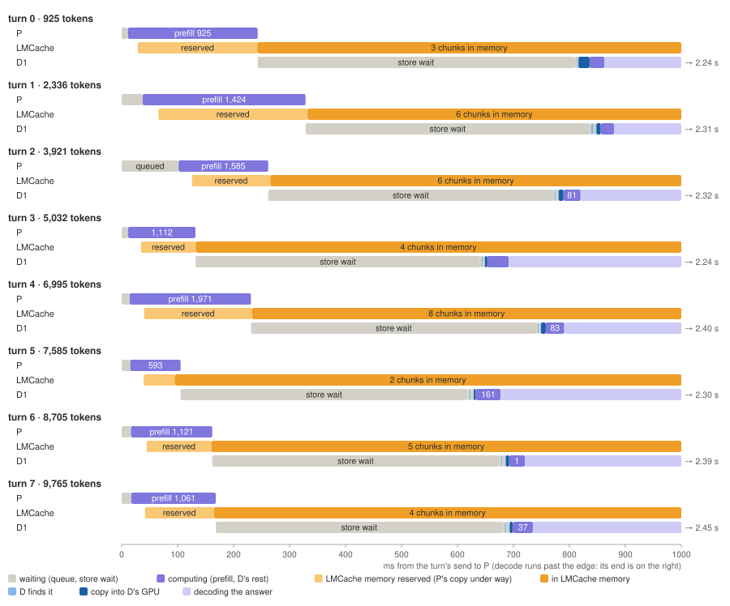

# Conversation 1: mt-rag-govt-elser-512-100-20240611 (memory mode)

8 turns on D1 (routed by conversation); prompts grow from 925 to 9,765 tokens (interleaved: each turn's prompt is the previous one, its answer, then this turn's documents and question). Chunks are 256 tokens (16 vLLM blocks of 16); a chunk's name is LMCache's hash of its tokens and everything before them, so the same prefix has the same chunks on every turn and engine.

Legend for the strips (one character a chunk): P: `=` on P's GPU from an earlier turn, `#` computed and stored now, `+` computed, not stored (a partial chunk). D: `=` on D's GPU from an earlier turn, `M` pulled from memory, `S` pulled from disk, `+` computed by D (a partial chunk), `?` missed.

GPU blocks (the chunk tables): the slots in each engine's GPU KV cache (vLLM's block pool ids; slot 0 is its reserved null block) that hold the chunk's 16 vLLM blocks, in block order, a run of consecutive slots written as a range: `P 1, 138-152` is block 0 in slot 1 and blocks 1-15 in slots 138-152. An engine hands a block a slot from its free list when it first computes or loads it, and the block keeps it while cached, so a later turn that reuses the block shows the same slot. Blocks that are the same in several prompts (the same tokens and everything before them) share one slot once the first is cached: the system prompt's first block, the same in every conversation, is the usual one. `16/16 hashes = P's`: of the blocks D pulled, how many have the same vLLM hash on D as on P.

The prompts' text is rebuilt from the MTRAG file the run read, by the driver's own code (scripts/pd_mtrag.py build()), and matches the run's record piece for piece; token counts and places are the run's. D's answers were not kept by this run's driver, only their token ids. Lines over 100 characters are wrapped here for reading.

| turn | prompt | chunks + tail | P: own GPU / computed / stored | D: own GPU / loaded / computed | pulled | pull ms | D first token ms |
| ---: | ---: | --- | --- | --- | --- | ---: | ---: |
| [0](#turn-0) | 925 | 3 + 157 | 0 / 925 / 3 chunks | 0 / 768 / 157 | 3 chunks (memory 3) | 21.1 | 54.2 |
| [1](#turn-1) | 2,336 | 9 + 32 | 912 / 1,424 / 6 chunks | 1,040 / 1,264 / 32 | 5 chunks (memory 5) | 16.3 | 43.8 |
| [2](#turn-2) | 3,921 | 15 + 81 | 2,336 / 1,585 / 6 chunks | 2,448 / 1,392 / 81 | 6 chunks (memory 6) | 15.2 | 48.8 |
| [3](#turn-3) | 5,032 | 19 + 168 | 3,920 / 1,112 / 4 chunks | 4,048 / 816 / 168 | 4 chunks (memory 4) | 10.3 | 51.2 |
| [4](#turn-4) | 6,995 | 27 + 83 | 5,024 / 1,971 / 8 chunks | 5,152 / 1,760 / 83 | 7 chunks (memory 7) | 14.3 | 50.1 |
| [5](#turn-5) | 7,585 | 29 + 161 | 6,992 / 593 / 2 chunks | 7,120 / 304 / 161 | 2 chunks (memory 2) | 10.7 | 59.5 |
| [6](#turn-6) | 8,705 | 34 + 1 | 7,584 / 1,121 / 5 chunks | 7,712 / 992 / 1 | 4 chunks (memory 4) | 14.1 | 46.1 |
| [7](#turn-7) | 9,765 | 38 + 37 | 8,704 / 1,061 / 4 chunks | 8,832 / 896 / 37 | 4 chunks (memory 4) | 13.9 | 54.6 |

## How the prompt grows

Each turn's prompt is the previous one, token for token, and then: D's answer to the previous turn, this turn's documents, its question and the framing (the system prompt on turn 0, `Assistant:` and newlines). Only the new tokens can make new chunks: the previous prompt's partial chunk fills first. A document sent before comes again at another place, so in other chunks.

| turn | prompt | new | previous answer | documents | question | framing | whole chunks |
| ---: | ---: | ---: | ---: | --- | --- | ---: | --- |
| 0 | 925 | +925 | – | 2 docs, 882 | 13: "What are the sheltered rooms designated for use? | 30 | 3 (+3) |
| 1 | 2,336 | +1,411 | 128 | 3 docs, 1,272 | 8: What items should I keep? | 3 | 9 (+6) |
| 2 | 3,921 | +1,585 | 128 | 3 docs, 1,445 | 9: Is it the same for earthquakes? | 3 | 15 (+6) |
| 3 | 5,032 | +1,111 | 128 | 2 docs, 972 | 8: Which state has more wildfires? | 3 | 19 (+4) |
| 4 | 6,995 | +1,963 | 128 | 4 docs, 1,826 | 6: What causes wildfires? | 3 | 27 (+8) |
| 5 | 7,585 | +590 | 128 | 1 doc, 442 (1 sent before: 442) | 17: Why doesn't the government prevent people from living in areas prone … | 3 | 29 (+2) |
| 6 | 8,705 | +1,120 | 128 | 2 docs, 978 | 11: Is flooding the most common type of disaster? | 3 | 34 (+5) |
| 7 | 9,765 | +1,060 | 128 | 2 docs, 918 | 11: Is climate change the cause of natural disasters? | 3 | 38 (+4) |

## Timeline

Every turn on one clock: ms from the moment the proxy sent the turn to P. P prefills it (one token out) and stores its new whole chunks in LMCache; the proxy waits 500 ms after P is done (the store wait) and sends the turn to D1, which finds what LMCache has, copies it into its GPU, computes the rest and decodes the answer. The lanes: P, LMCache (the chunks P stored this turn) and D. P computes the KV into its own GPU slots, where it stays (the next turn reuses it); its LMCache connector, set to store (P runs as kv_both), copies each new whole chunk from those slots to LMCache: LMCache reserves the space when P schedules the prefill (light orange) and has the chunks as P's prefill completes (orange).



| turn | P queued → done | chunks stored | in memory | on disk | D starts | D finds | copy into D's GPU | D: held / pulled / computed | first token | D done |
| ---: | --- | ---: | ---: | ---: | ---: | --- | --- | --- | ---: | ---: |
| 0 | 11 → 243 | 3 | 242 | – | 809 | 813-814 | 816-836 | 0 / 768 from memory / 157 | 863 | 2,239 |
| 1 | 38 → 328 | 6 | 332 | – | 836 | 839-843 | 848-856 | 1,040 / 1,264 from memory / 32 | 880 | 2,313 |
| 2 | 102 → 262 | 6 | 266 | – | 771 | 774-776 | 781-789 | 2,448 / 1,392 from memory / 81 | 820 | 2,320 |
| 3 | 12 → 132 | 4 | 132 | – | 640 | 643-645 | 649-654 | 4,048 / 816 from memory / 168 | 692 | 2,241 |
| 4 | 14 → 231 | 8 | 233 | – | 741 | 744-746 | 749-758 | 5,152 / 1,760 from memory / 83 | 791 | 2,400 |
| 5 | 15 → 105 | 2 | 94 | – | 618 | 621-624 | 629-633 | 7,120 / 304 from memory / 161 | 677 | 2,302 |
| 6 | 16 → 162 | 5 | 160 | – | 674 | 678-680 | 686-692 | 7,712 / 992 from memory / 1 | 720 | 2,391 |
| 7 | 17 → 168 | 4 | 165 | – | 680 | 684-687 | 693-699 | 8,832 / 896 from memory / 37 | 735 | 2,449 |

All times in ms from the turn's send to P. "in memory": the last of the turn's chunks written into LMCache's memory; "on disk": the last one written to disk (then dropped from memory, in the disk mode); D finds: from LMCache's lookup to its prefetch done (in the disk mode that is the read from disk); copy: LMCache's retrieve into D's GPU slots until D's connector has it. Each turn's section below tells it in a sentence.

### One chunk, block by block: chunk 0 of turn 0 (`1dd495890c85343c`)

Tokens 0-256 (system: 28; doc c8db6e06ff4666: 228). P computed its blocks on turn 0 and stored them as one chunk; D1 pulled the chunk into these GPU blocks:

| block | tokens | P's GPU block | vLLM hash | D's GPU block | D wrote it | same hash on D |
| ---: | --- | ---: | --- | ---: | --- | --- |
| 0 | 0-16 | 1 | `9f9c499d1c876b7e` | 1 | yes | True |
| 1 | 16-32 | 2 | `76827a2f3154693e` | 2 | yes | True |
| 2 | 32-48 | 3 | `fb3b0d8a267bb4ed` | 3 | yes | True |
| 3 | 48-64 | 4 | `8d92f86df79acbc2` | 4 | yes | True |
| 4 | 64-80 | 5 | `a7500780232c0a2d` | 5 | yes | True |
| 5 | 80-96 | 6 | `c51d16a97f22208e` | 6 | yes | True |
| 6 | 96-112 | 7 | `cea451b28ed2eb08` | 7 | yes | True |
| 7 | 112-128 | 8 | `a038e48664bc438e` | 8 | yes | True |
| 8 | 128-144 | 9 | `957caa342b15b4e3` | 9 | yes | True |
| 9 | 144-160 | 10 | `3effd4342bb857a2` | 10 | yes | True |
| 10 | 160-176 | 11 | `883c60777d5e6d1d` | 11 | yes | True |
| 11 | 176-192 | 12 | `7ec2c6abd00cf383` | 12 | yes | True |
| 12 | 192-208 | 13 | `86a4aa2913df969a` | 13 | yes | True |
| 13 | 208-224 | 14 | `e9a9f2d05d921c73` | 14 | yes | True |
| 14 | 224-240 | 15 | `f90fdb8523fe5179` | 15 | yes | True |
| 15 | 240-256 | 16 | `549e5b84eeeceb71` | 16 | yes | True |

## Turn 0

**Timeline:** P queued until 11 ms, prefilled 925 tokens (held 0) and was done at 243 ms; its 3 new chunks were in LMCache's memory at 242 ms. After the 500 ms store wait, D1 started at 809 ms holding 0 tokens, pulled 768 from memory (found 813-814 ms, copied into its GPU 816-836 ms), computed 157 and gave its first token at 863 ms; it decoded 128 tokens until 2,239 ms. ([all turns](#timeline))

### Step by step

Every move of this turn's KV, ms from the proxy sending the turn to P. The copies are LMCache's: its server reads P's GPU slots and writes D's through CUDA IPC handles each engine registered at start (no NIXL in this setup).

| ms | where | what |
| ---: | --- | --- |
| 0.0 | proxy → P | sends the turn (925 prompt tokens; P is asked for one token: prefill only) |
| 4.4 | P | the request arrives |
| 11.2 | P GPU | its prefix cache holds 0 of the prompt's tokens |
| 11.2 | P ↔ LMCache | LMCache has 0 of its tokens; P loads 0 and computes the rest |
| 11.3 | P GPU | 58 new slots for the 925 tokens it computes: 1-58; the prefill runs |
| 12.1 | P → LMCache | store planned: tokens 0-768, chunks 0-2 (48 blocks) |
| 28.2 | LMCache | the store request is in; it waits for P's forward pass to finish (a CUDA event) |
| 28.7 | LMCache memory | space reserved for 3 chunks (88 MB) |
| 233.4 | P GPU → LMCache memory | the copy starts: LMCache reads P's GPU slots (CUDA IPC) |
| 236.8 | P GPU → LMCache memory | copy done: 3 chunks, 88 MB in 3.5 ms |
| 242.2 | LMCache memory | 3 chunks in memory, ready for D; P keeps its copy in its GPU slots |
| 243.0 | P → proxy | P answers its one token: the prefill is done |
| 808.7 | proxy → D1 | after the 500 ms store wait, sends the turn to D1 |
| 812.6 | D1 ↔ LMCache | asks LMCache for the prompt's chunks |
| 813.9 | LMCache memory | found 768 tokens it lacks: 3 chunks in memory |
| 814.4 | D1 GPU | its prefix cache holds 0 of the prompt's tokens |
| 814.5 | D1 | will load 768 tokens and compute 157 |
| 814.8 | D1 GPU | slots for the loaded blocks: 1-48 |
| 816.3 | LMCache memory → D1 GPU | the copy starts: LMCache writes D1's GPU slots (CUDA IPC) |
| 833.8 | LMCache memory → D1 GPU | copy done: 3 chunks, 88 MB in 17.4 ms |
| 836.1 | D1 | has the KV in its GPU slots |
| 839.0 | D1 GPU | 10 new slots for the 157 prompt tokens it computes: 97-106 |
| 862.8 | D1 → proxy | the first answer token |
| 883.5 | D1 GPU | decoding: the answer's KV takes 8 new slots as it grows, one per 16 tokens: 111 … 125 (8 blocks), until 2,097 ms |
| 2,239.0 | D1 | done: 128 tokens decoded; its blocks stay cached in its GPU slots for the next turn |
| 2,241.1 | proxy | the response is complete |

925 prompt tokens: 3 whole chunks and 157 tokens over (the partial chunk, computed by both engines and stored only when a later turn completes it). P held 0 tokens on its GPU, computed 925 and stored 3 new chunks; D1 held 0, loaded 768 from LMCache and computed 157.

### The prompt

The whole prompt, piece by piece:

- **system prompt** · tokens 0-28 (28) · chunk 0

```text
You are a helpful assistant. Answer the user's last question from the documents. If they do not hold
the answer, say so.
```

<details><summary>document <code>c8db6e06ff46669e-50302-52227</code> · tokens 28-468 (440) · chunks 0-1</summary>

```text
Document: FAQs • Dublin • CivicEngage
FAQs • Dublin • CivicEngage
A safe room, as defined by the Federal Emergency Management Agency (FEMA), is a room - preferably
below ground - in which people can take shelter from a tornado. If such a room is below ground, it
may not be the safest choice if told to stay at home and shelter-in-place during a weapons of mass
destruction event due to the possibility that some contaminants may seep into rooms below ground
level. For this reason, the Red Cross recommends and endorses having a safe room in areas where
tornadoes are a threat. However, do not confuse a safe room used for protection from windstorms with
a room selected for shelter-in-place. They are technically different, although they serve a similar
purpose. If a safe room for windstorms is above ground level and has no windows, it can also be an
ideal location in which to shelter-in-place.

6.
How much time do I have to get to my designated room to shelter-in-place once I hear of an attack?

The situation will vary, depending on the nature of the event. It is best to take immediate
protective action as soon as you think there is a local emergency, or if you hear on the radio or
television that you need to shelter-in-place.

7.
Do I need to put towels under my door? Should they be wet?

Wet towels under a door are used in cases when you are in a room from which you can not escape and a
fire is on the other side. That is not the same thing as what needs to be done when you
shelter-in-place. See the instructions on shelter-in-place on the Red Cross website.

8.
If I seal off my rooms and vents, how will I breathe? How long should I anticipate being in the room
in which I am sheltering-in-place?

Instructions to shelter-in-place are usually provided for a matter of hours, not weeks. There is
little danger that the room in which you are taking shelter will run out of oxygen and you will
suffocate.

9.
Is the bathroom a good room in which to shelter-in-place?
```

</details>

<details><summary>document <code>7d4d64e7f6aff125-3194-5132</code> · tokens 468-910 (442) · chunks 1-3</summary>

```text
Document: FAQs • Disaster Preparedness
FAQs • Disaster Preparedness
It is intended to provide a barrier to air flow. While we can not guarantee that plastic sheeting
over air vents will stop all biological, chemical, or radiological agents, it will add to the
barrier of protection for your safety.

5.
Do I need a safe room? What is a safe room?

A safe room, as defined by the Federal Emergency Management Agency (FEMA), is a room - preferably
below ground - in which people can take shelter from a tornado. If such a room is below ground, it
may not be the safest choice if told to stay at home and shelter-in-place during a weapons of mass
destruction event due to the possibility that some contaminants may seep into rooms below ground
level. For this reason, the Red Cross recommends and endorses having a safe room in areas where
tornadoes are a threat. However, do not confuse a safe room used for protection from windstorms with
a room selected for shelter-in-place. They are technically different, although they serve a similar
purpose. If a safe room for windstorms is above ground level and has no windows, it can also be an
ideal location in which to shelter-in-place.

6.
How much time do I have to get to my designated room to shelter-in-place once I hear of an attack?

The situation will vary, depending on the nature of the event. It is best to take immediate
protective action as soon as you think there is a local emergency, or if you hear on the radio or
television that you need to shelter-in-place.

7.
Do I need to put towels under my door? Should they be wet?

Wet towels under a door are used in cases when you are in a room from which you can not escape and a
fire is on the other side. That is not the same thing as what needs to be done when you
shelter-in-place. See the instructions on shelter-in-place on the Red Cross website.

8.
If I seal off my rooms and vents, how will I breathe? How long should I anticipate being in the room
in which I am sheltering-in-place?
```

</details>

- **question 0** · tokens 910-923 (13) · chunk 3

```text
User: "What are the sheltered rooms designated for use?
```

- `Assistant:` · tokens 923-925 (2) · chunk 3

### Pieces, chunks and blocks

| piece | tokens | length | chunks | |
| --- | --- | ---: | --- | --- |
| system | 0-28 | 28 | 0 |  |
| doc c8db6e06ff4666 | 28-468 | 440 | 0-1 |  |
| doc 7d4d64e7f6aff1 | 468-910 | 442 | 1-3 |  |
| question 0 | 910-923 | 13 | 3 |  |
| `assistant:` 0 | 923-925 | 2 | 3 |  |

```
P  ###+
D  MMM+
```

| chunk | tokens | pieces in it (tokens) | vLLM blocks | GPU blocks | in LMCache | P this turn | D this turn |
| ---: | --- | --- | --- | --- | --- | --- | --- |
| 0 | 0-256 | system: 28; doc c8db6e06ff4666: 228 | 0-15 | P 1-16; D 1-16; 16/16 hashes = P's | `1dd495890c85343c` stored on turn 0 | computed, **stored now** | **pulled from memory** |
| 1 | 256-512 | doc c8db6e06ff4666: 212; doc 7d4d64e7f6aff1: 44 | 16-31 | P 17-32; D 17-32; 16/16 hashes = P's | `931e9f699f8d5ce5` stored on turn 0 | computed, **stored now** | **pulled from memory** |
| 2 | 512-768 | doc 7d4d64e7f6aff1: 256 | 32-47 | P 33-48; D 33-48; 16/16 hashes = P's | `e6a2246ebc7818db` stored on turn 0 | computed, **stored now** | **pulled from memory** |
| 3 | 768-925 | doc 7d4d64e7f6aff1: 142; question 0: 13; `assistant:` 0: 2 | 48-57 | P 49-57; D 97-106 | – | computed (partial chunk: not stored) | computed by D (partial chunk) |

## Turn 1

**Timeline:** P queued until 38 ms, prefilled 1,424 tokens (held 912) and was done at 328 ms; its 6 new chunks were in LMCache's memory at 332 ms. After the 500 ms store wait, D1 started at 836 ms holding 1,040 tokens, pulled 1,264 from memory (found 839-843 ms, copied into its GPU 848-856 ms), computed 32 and gave its first token at 880 ms; it decoded 128 tokens until 2,313 ms. ([all turns](#timeline))

### Step by step

Every move of this turn's KV, ms from the proxy sending the turn to P. The copies are LMCache's: its server reads P's GPU slots and writes D's through CUDA IPC handles each engine registered at start (no NIXL in this setup).

| ms | where | what |
| ---: | --- | --- |
| 0.0 | proxy → P | sends the turn (2,336 prompt tokens; P is asked for one token: prefill only) |
| 29.1 | P | the request arrives |
| 37.3 | P GPU | its prefix cache holds 912 of the prompt's tokens: 57 blocks in slots 1-57 |
| 37.3 | P ↔ LMCache | LMCache has 768 of its tokens; P loads 0 and computes the rest |
| 37.5 | P GPU | 89 new slots for the 1,424 tokens it computes: 284-372; the prefill runs |
| 38.8 | P → LMCache | store planned: tokens 768-2,304, chunks 3-8 (96 blocks) |
| 64.9 | LMCache | the store request is in; it waits for P's forward pass to finish (a CUDA event) |
| 65.7 | LMCache memory | space reserved for 6 chunks (176 MB) |
| 322.7 | P GPU → LMCache memory | the copy starts: LMCache reads P's GPU slots (CUDA IPC) |
| 328.5 | P → proxy | P answers its one token: the prefill is done |
| 329.5 | P GPU → LMCache memory | copy done: 6 chunks, 176 MB in 6.8 ms |
| 332.0 | LMCache memory | 6 chunks in memory, ready for D; P keeps its copy in its GPU slots |
| 836.1 | proxy → D1 | after the 500 ms store wait, sends the turn to D1 |
| 838.7 | D1 ↔ LMCache | asks LMCache for the prompt's chunks |
| 843.2 | LMCache memory | found 1,280 tokens it lacks: 5 chunks in memory |
| 845.3 | D1 GPU | its prefix cache holds 1,040 of the prompt's tokens: slots 1-48 … 123 (65 blocks) |
| 845.3 | D1 | will load 1,264 tokens and compute 32 |
| 846.3 | D1 GPU | slots for the loaded blocks: 125-203 |
| 848.1 | LMCache memory → D1 GPU | the copy starts: LMCache writes D1's GPU slots (CUDA IPC) |
| 855.0 | LMCache memory → D1 GPU | copy done: 5 chunks, 147 MB in 6.9 ms |
| 856.0 | D1 | has the KV in its GPU slots |
| 859.0 | D1 GPU | 2 new slots for the 32 prompt tokens it computes: 257-258 |
| 871.8 | D1 GPU | decoding: the answer's KV takes 8 new slots as it grows, one per 16 tokens: 259 … 274 (8 blocks), until 2,132 ms |
| 879.9 | D1 → proxy | the first answer token |
| 2,313.2 | D1 | done: 128 tokens decoded; its blocks stay cached in its GPU slots for the next turn |
| 2,315.2 | proxy | the response is complete |

2,336 prompt tokens: 9 whole chunks and 32 tokens over (the partial chunk, computed by both engines and stored only when a later turn completes it). P held 912 tokens on its GPU, computed 1,424 and stored 6 new chunks; D1 held 1,040, loaded 1,264 from LMCache and computed 32.

### The prompt

Tokens 0-925: [turn 0](#turn-0)'s prompt, unchanged (checked: its first 925 token ids are the previous prompt's), so chunks 0-2 are the same chunks; chunk 3 (partial then, 157 tokens) fills now. New from token 925:

- **D's answer to turn 0** · tokens 925-1053 (128) · chunks 3-4

  its text was not kept by this run: its driver kept only the token ids (later runs keep it: scripts/pd_mtrag.py --trace)

- `\n` · tokens 1053-1054 (1) · chunk 4

<details><summary>document <code>c8db6e06ff46669e-48670-50814</code> · tokens 1054-1515 (461) · chunks 4-5</summary>

```text
Document: FAQs • Dublin • CivicEngage
FAQs • Dublin • CivicEngage
Please do not confuse the recommendation to have at least three days worth of disaster supplies on
hand with the amount of time that you may be asked to shelter-in-place. We always recommend having
at least three days worth of supplies in case stores are closed and roads are impossible due to a
disaster like a flood or winter storm.

3.
Does the Red Cross recommend stocking duct tape and plastic sheeting?

Yes. These materials have always been recommended to have as part of a Disasters Supplies Kit. They
may be needed if the public is advised by local authorities to shelter-in-place.

4.
I'm confused about this duct tape and plastic sheeting recommendation. Am I supposed to seal my
whole house and do it now? How much do I need? Is plastic really going to stop a chemical agent?

The recommendation to shelter-in-place using duct tape and plastic sheeting will be provided by
local government officials only when an emergency occurs. The Red Cross recommends that people have
these supplies on hand in case they are needed.You would seal only one room when advised to do so,
and do it only when instructed - not in advance. It is likely that one roll of duct tape will be
adequate. Plastic sheeting of durable thickness (thicker than food wrap) is recommended for covering
vents and other openings to the outside - not the entire room. It is intended to provide a barrier
to air flow. While we can not guarantee that plastic sheeting over air vents will stop all
biological, chemical, or radiological agents, it will add to the barrier of protection for your
safety.

5.
Do I need a safe room? What is a safe room?

A safe room, as defined by the Federal Emergency Management Agency (FEMA), is a room - preferably
below ground - in which people can take shelter from a tornado. If such a room is below ground, it
may not be the safest choice if told to stay at home and shelter-in-place during a weapons of mass
destruction event due to the possibility that some contaminants may seep into rooms below ground
level. For this reason, the Red Cross recommends and endorses having a safe room in areas where
tornadoes are a threat.
```

</details>

<details><summary>document <code>7d4d64e7f6aff125-1590-3637</code> · tokens 1515-1954 (439) · chunks 5-7</summary>

```text
Document: FAQs • Disaster Preparedness
FAQs • Disaster Preparedness
What are the important points to remember in case we are told to "shelter-in-place?"

You should be in a place that will afford you protection from a contaminant in the air. Instructions
on how to shelter-in-place are provided on the Red Cross website. Please do not confuse the
recommendation to have at least three days worth of disaster supplies on hand with the amount of
time that you may be asked to shelter-in-place. We always recommend having at least three days worth
of supplies in case stores are closed and roads are impossible due to a disaster like a flood or
winter storm.

3.
Does the Red Cross recommend stocking duct tape and plastic sheeting?

Yes. These materials have always been recommended to have as part of a Disasters Supplies Kit. They
may be needed if the public is advised by local authorities to shelter-in-place.

4.
I'm confused about this duct tape and plastic sheeting recommendation. Am I supposed to seal my
whole house and do it now? How much do I need? Is plastic really going to stop a chemical agent?

The recommendation to shelter-in-place using duct tape and plastic sheeting will be provided by
local government officials only when an emergency occurs. The Red Cross recommends that people have
these supplies on hand in case they are needed.You would seal only one room when advised to do so,
and do it only when instructed - not in advance. It is likely that one roll of duct tape will be
adequate. Plastic sheeting of durable thickness (thicker than food wrap) is recommended for covering
vents and other openings to the outside - not the entire room. It is intended to provide a barrier
to air flow. While we can not guarantee that plastic sheeting over air vents will stop all
biological, chemical, or radiological agents, it will add to the barrier of protection for your
safety.

5.
Do I need a safe room? What is a safe room?

A safe room, as defined by the Federal Emergency Management Agency (FEMA), is a room - preferably
below ground - in which people can take shelter from a tornado.
```

</details>

<details><summary>document <code>88aca7ee734372ad-0-1462</code> · tokens 1954-2326 (372) · chunks 7-9</summary>

```text
Document: FEMA: Assemble a Disaster Supplies Kit
FEMA: Assemble a Disaster Supplies Kit


FEMA: Assemble a Disaster Supplies Kit

Contact Us
Site Map
Frequently Asked Questions
Español

Search

 Advanced Search

Home
Disaster Information
Plan Ahead
Apply for Assistance
Recover & Rebuild
About Us

Prepare for a Disaster
Determine Your Risk
Plan for Emergencies
Assemble Supplies
Protect Your Property
Are You Ready? Guide
What FEMA Is Doing - Mitigation Activities

Assemble a Disaster Supplies Kit

You may need to survive on your own after a disaster. This means having your own food, water, and
other supplies in sufficient quantity to last for at least three days. Local officials and relief
workers will be on the scene after a disaster, but they cannot reach everyone immediately. You could
get help in hours, or it might take days.
Basic services such as electricity, gas, water, sewage treatment, and telephones may be cut off for
days, or even a week or longer. Or, you may have to evacuate at a moment’s notice and take
essentials with you. You probably will not have the opportunity to shop or search for the supplies
you need.
A disaster supplies kit is a collection of basic items that members of a household may need in the
event of a disaster.

Basic Disaster Supplies
Kit locations
Maintenance

Last Modified: Tuesday, 08-May-2007 16:04:14 EDT

Home
Contact Us
Privacy Policy
Important Notices
FOIA
No FEAR Act Data
USA.gov
DHS

FEMA 500 C Street SW, Washington, D.C. 20472Disaster Assistance: (800) 621-FEMA, TTY (800) 462-7585

 
```

</details>

- **question 1** · tokens 2326-2334 (8) · chunk 9

```text
User: What items should I keep?
```

- `Assistant:` · tokens 2334-2336 (2) · chunk 9

### Pieces, chunks and blocks

| piece | tokens | length | chunks | |
| --- | --- | ---: | --- | --- |
| system | 0-28 | 28 | 0 |  |
| doc c8db6e06ff4666 | 28-468 | 440 | 0-1 |  |
| doc 7d4d64e7f6aff1 | 468-910 | 442 | 1-3 |  |
| question 0 | 910-923 | 13 | 3 |  |
| `assistant:` 0 | 923-925 | 2 | 3 |  |
| answer 0 | 925-1053 | 128 | 3-4 | new this turn |
| newline 0 | 1053-1054 | 1 | 4 | new this turn |
| doc c8db6e06ff4666 | 1054-1515 | 461 | 4-5 | new this turn |
| doc 7d4d64e7f6aff1 | 1515-1954 | 439 | 5-7 | new this turn |
| doc 88aca7ee734372 | 1954-2326 | 372 | 7-9 | new this turn |
| question 1 | 2326-2334 | 8 | 9 | new this turn |
| `assistant:` 1 | 2334-2336 | 2 | 9 | new this turn |

```
P  ===######+
D  ====MMMMM+
```

| chunk | tokens | pieces in it (tokens) | vLLM blocks | GPU blocks | in LMCache | P this turn | D this turn |
| ---: | --- | --- | --- | --- | --- | --- | --- |
| 0 | 0-256 | system: 28; doc c8db6e06ff4666: 228 | 0-15 | P 1-16; D 1-16 | `1dd495890c85343c` stored on turn 0 | on P's GPU (earlier turn) | on D's GPU (earlier turn) |
| 1 | 256-512 | doc c8db6e06ff4666: 212; doc 7d4d64e7f6aff1: 44 | 16-31 | P 17-32; D 17-32 | `931e9f699f8d5ce5` stored on turn 0 | on P's GPU (earlier turn) | on D's GPU (earlier turn) |
| 2 | 512-768 | doc 7d4d64e7f6aff1: 256 | 32-47 | P 33-48; D 33-48 | `e6a2246ebc7818db` stored on turn 0 | on P's GPU (earlier turn) | on D's GPU (earlier turn) |
| 3 | 768-1024 | doc 7d4d64e7f6aff1: 142; question 0: 13; `assistant:` 0: 2; answer 0 (new): 99 | 48-63 | P 49-57, 284-290; D 97-106 … 121 (16 blocks) | `db3378056f154f8b` stored on turn 1 | computed (its first 144 tokens on P's GPU already), **stored now** | on D's GPU (earlier turn, its own answer) |
| 4 | 1024-1280 | answer 0 (new): 29; newline 0 (new): 1; doc c8db6e06ff4666 (new): 226 | 64-79 | P 291-306; D 123, 125-139; 16/16 hashes = P's | `ef56131fbdafd648` stored on turn 1 | computed, **stored now** | **pulled from memory** (its first 16 tokens on D's GPU already) |
| 5 | 1280-1536 | doc c8db6e06ff4666 (new): 235; doc 7d4d64e7f6aff1 (new): 21 | 80-95 | P 307-322; D 140-155; 16/16 hashes = P's | `8c391d82c20faefd` stored on turn 1 | computed, **stored now** | **pulled from memory** |
| 6 | 1536-1792 | doc 7d4d64e7f6aff1 (new): 256 | 96-111 | P 323-338; D 156-171; 16/16 hashes = P's | `29b263badcec2b7e` stored on turn 1 | computed, **stored now** | **pulled from memory** |
| 7 | 1792-2048 | doc 7d4d64e7f6aff1 (new): 162; doc 88aca7ee734372 (new): 94 | 112-127 | P 339-354; D 172-187; 16/16 hashes = P's | `af1c4476de067ff9` stored on turn 1 | computed, **stored now** | **pulled from memory** |
| 8 | 2048-2304 | doc 88aca7ee734372 (new): 256 | 128-143 | P 355-370; D 188-203; 16/16 hashes = P's | `62545b3002b3e711` stored on turn 1 | computed, **stored now** | **pulled from memory** |
| 9 | 2304-2336 | doc 88aca7ee734372 (new): 22; question 1 (new): 8; `assistant:` 1 (new): 2 | 144-145 | P 371-372; D 257-258 | – | computed (partial chunk: not stored) | computed by D (partial chunk) |

## Turn 2

**Timeline:** P queued until 102 ms, prefilled 1,585 tokens (held 2,336) and was done at 262 ms; its 6 new chunks were in LMCache's memory at 266 ms. After the 500 ms store wait, D1 started at 771 ms holding 2,448 tokens, pulled 1,392 from memory (found 774-776 ms, copied into its GPU 781-789 ms), computed 81 and gave its first token at 820 ms; it decoded 128 tokens until 2,320 ms. ([all turns](#timeline))

### Step by step

Every move of this turn's KV, ms from the proxy sending the turn to P. The copies are LMCache's: its server reads P's GPU slots and writes D's through CUDA IPC handles each engine registered at start (no NIXL in this setup).

| ms | where | what |
| ---: | --- | --- |
| 0.0 | proxy → P | sends the turn (3,921 prompt tokens; P is asked for one token: prefill only) |
| 9.8 | P | the request arrives |
| 101.3 | P GPU | its prefix cache holds 2,336 of the prompt's tokens: 146 blocks in slots 1-57, 284-372 |
| 101.4 | P ↔ LMCache | LMCache has 2,304 of its tokens; P loads 0 and computes the rest |
| 101.7 | P GPU | 100 new slots for the 1,585 tokens it computes: 534-633; the prefill runs |
| 102.9 | P → LMCache | store planned: tokens 2,304-3,840, chunks 9-14 (96 blocks) |
| 124.7 | LMCache | the store request is in; it waits for P's forward pass to finish (a CUDA event) |
| 125.6 | LMCache memory | space reserved for 6 chunks (176 MB) |
| 255.2 | P GPU → LMCache memory | the copy starts: LMCache reads P's GPU slots (CUDA IPC) |
| 261.9 | P → proxy | P answers its one token: the prefill is done |
| 262.1 | P GPU → LMCache memory | copy done: 6 chunks, 176 MB in 6.9 ms |
| 265.5 | LMCache memory | 6 chunks in memory, ready for D; P keeps its copy in its GPU slots |
| 771.2 | proxy → D1 | after the 500 ms store wait, sends the turn to D1 |
| 773.5 | D1 ↔ LMCache | asks LMCache for the prompt's chunks |
| 775.7 | LMCache memory | found 1,536 tokens it lacks: 6 chunks in memory |
| 778.1 | D1 GPU | its prefix cache holds 2,448 of the prompt's tokens: slots 1-48 … 272 (153 blocks) |
| 778.3 | D1 | will load 1,392 tokens and compute 81 |
| 778.8 | D1 GPU | slots for the loaded blocks: 275, 274, 276-360 |
| 780.7 | LMCache memory → D1 GPU | the copy starts: LMCache writes D1's GPU slots (CUDA IPC) |
| 788.7 | LMCache memory → D1 GPU | copy done: 6 chunks, 176 MB in 8.0 ms |
| 789.4 | D1 | has the KV in its GPU slots |
| 792.4 | D1 GPU | 6 new slots for the 81 prompt tokens it computes: 361-366 |
| 820.0 | D1 → proxy | the first answer token |
| 974.3 | D1 GPU | decoding: the answer's KV takes 7 new slots as it grows, one per 16 tokens: 455 … 478 (7 blocks), until 2,118 ms |
| 2,320.0 | D1 | done: 128 tokens decoded; its blocks stay cached in its GPU slots for the next turn |
| 2,322.3 | proxy | the response is complete |

3,921 prompt tokens: 15 whole chunks and 81 tokens over (the partial chunk, computed by both engines and stored only when a later turn completes it). P held 2,336 tokens on its GPU, computed 1,585 and stored 6 new chunks; D1 held 2,448, loaded 1,392 from LMCache and computed 81.

### The prompt

Tokens 0-2,336: [turn 1](#turn-1)'s prompt, unchanged (checked: its first 2,336 token ids are the previous prompt's), so chunks 0-8 are the same chunks; chunk 9 (partial then, 32 tokens) fills now. New from token 2,336:

- **D's answer to turn 1** · tokens 2336-2464 (128) · chunk 9

  its text was not kept by this run: its driver kept only the token ids (later runs keep it: scripts/pd_mtrag.py --trace)

- `\n` · tokens 2464-2465 (1) · chunk 9

<details><summary>document <code>8bb77f30210c5f4b-614-2843</code> · tokens 2465-2924 (459) · chunks 9-11</summary>

```text
Document: Emergency Preparedness | San Bruno, CA
Emergency Preparedness | San Bruno, CA
These steps include the following:Get a kit of Emergency Supplies that will last up to three days
per family member; don't forget your petsMake a plan to include family communications,
shelter-in-place and evacuationBe Informed, visit Ready.gov and sign up for emergency notifications
from San Mateo County (SMC) AlertGet involved, sign up for one of our Community Emergency Response
Team (CERT) courses, and learn how to save a life at one of our CPR classesSupplemental MaterialsThe
following materials will aid you and your family in preparing for the next unexpected event:This
Emergency Preparation Checklist (PDF) provides a great general guideline for things to do before the
next disaster occursThis Family Disaster Plan (PDF) publication provides a guide for your family
before and after the next disaster occursCheck out a list of what should be in your Family Disaster
Kit (PDF)This Food and Water List (PDF) provides a good guide on how to store, use and maintain food
and water for an emergencyAccess the Putting Down Roots in Earthquake Country publication developed
by the USGS and the Red Cross which has a great collection of information for preparing and dealing
with the special hazards of living in Earthquake country (this version was developed specifically
for the Bay Area Region): Putting Down Roots in Earthquake Country (English) (PDF)Putting Down Roots
in Earthquake Country (Spanish) (PDF)Putting Down Roots in Earthquake Country (Chinese, Vietnamese,
Korean) (PDF)How to Duck Cover and Hold (PDF)Information is about How and When to Shelter in Place
(PDF)Helpful information on how to deal with the aftermath of a Transportation Disaster (PDF) such
as an aviation disasterBeing part of a major metropolitan region brings the unfortunate risk of
Terrorism; view a helpful Terrorism Publication (PDF) that has information on how to prepare and
deal with a Terrorist disasterUseful tips for Preparing for Disaster for People with Disabilities
and Other Special Needs (PDF)Public Safety Power ShutoffWhat can I do to prepare for a Public Safety
Power Shutoff? The effects of climate change are making California's wildfire season longer and more
intense, threatening our homes, our lives and our economy.
```

</details>

<details><summary>document <code>7f851a7621a884ae-2-2292</code> · tokens 2924-3418 (494) · chunks 11-13</summary>

```text
Document: Earthquake Safety | Monterey Park, CA - Official Website
Earthquake Safety | Monterey Park, CA - Official Website
Earthquake Safety | Monterey Park, CA - Official Website

 

Skip to Main Content

Create a Website Account - Manage notification subscriptions, save form progress and more.   

Website Sign In

 

 中文 Español

 
 
 

GovernmentServicesResidentsVisitorsBusinessHow Do I...

 

 

 

 

 

 

 

 

 
 
 

 

Search

 
 
 

 
HomeGovernmentDepartmentsFire DepartmentDisaster PreparednessEarthquake Safety


Earthquake Safety	

Be PreparedAre you prepared for a major earthquake? What will you do when one occurs? While the
potential earthquake hazards you may experience depend upon your location, everywhere in California
is considered at high risk compared to the rest of the country. There are a multitude of reasons you
may or may not have prepared yourself, your home, or business for the occurrence of an earthquake.
But you need to take the time to do it now.Safety TipsThe Monterey Park Fire Department provides the
following information to inform the general public of what to do before, during,and after an
earthquake. Earthquakes strike suddenly, violently and without warning. Identifying potential
hazards ahead of time and advance planning can reduce the dangers of serious injury or loss of life
from an earthquake.Checking Utilities in Damaged HomesCheck for gas leaks - If you smell gas or hear
blowing or hissing noises, open a window and quickly leave the building. Turn off the gas at the
outside main valve if you can and call the gas company from a neighbor's home. If you turn off the
gas for any reason, it must be turned back on by a professional.Look for electrical system damage -
If you see sparks or broken or frayed wires, or if you smell hot insulation, turn off the
electricity at the main fuse box or circuit breaker. If you have to step in water to get to the fuse
box or circuit breaker, call an electrician first for advice.Check for sewage and water lines damage
- If you suspect sewage lines are damaged, avoid using the toilets and call a plumber. If water
pipes are damaged, contact the water company and avoid using water from the tap. You can obtain safe
water by melting ice cubes.

 
 
 

 

 

Before

During

After

 

 

Services

News

Calendar

Subscribe

Contact

 
 
 

 

Community Development

Employment

Library

 
 

Online Services
```

</details>

<details><summary>document <code>8bb77f30210c5f4b-277-2698</code> · tokens 3418-3910 (492) · chunks 13-15</summary>

```text
Document: Emergency Preparedness | San Bruno, CA
Emergency Preparedness | San Bruno, CA
HomeDepartmentsFireCommunity OutreachEmergency Preparedness


Emergency Preparedness	

The likelihood that you and your family will recover from an emergency tomorrow often depends on the
planning and preparation done today. There are several steps that citizens of San Bruno can do to be
prepared for the next disaster or emergency. These steps include the following:Get a kit of
Emergency Supplies that will last up to three days per family member; don't forget your petsMake a
plan to include family communications, shelter-in-place and evacuationBe Informed, visit Ready.gov
and sign up for emergency notifications from San Mateo County (SMC) AlertGet involved, sign up for
one of our Community Emergency Response Team (CERT) courses, and learn how to save a life at one of
our CPR classesSupplemental MaterialsThe following materials will aid you and your family in
preparing for the next unexpected event:This Emergency Preparation Checklist (PDF) provides a great
general guideline for things to do before the next disaster occursThis Family Disaster Plan (PDF)
publication provides a guide for your family before and after the next disaster occursCheck out a
list of what should be in your Family Disaster Kit (PDF)This Food and Water List (PDF) provides a
good guide on how to store, use and maintain food and water for an emergencyAccess the Putting Down
Roots in Earthquake Country publication developed by the USGS and the Red Cross which has a great
collection of information for preparing and dealing with the special hazards of living in Earthquake
country (this version was developed specifically for the Bay Area Region): Putting Down Roots in
Earthquake Country (English) (PDF)Putting Down Roots in Earthquake Country (Spanish) (PDF)Putting
Down Roots in Earthquake Country (Chinese, Vietnamese, Korean) (PDF)How to Duck Cover and Hold
(PDF)Information is about How and When to Shelter in Place (PDF)Helpful information on how to deal
with the aftermath of a Transportation Disaster (PDF) such as an aviation disasterBeing part of a
major metropolitan region brings the unfortunate risk of Terrorism; view a helpful Terrorism
Publication (PDF) that has information on how to prepare and deal with a Terrorist disasterUseful
tips for Preparing for Disaster for People with Disabilities and Other Special Needs (PDF)Public
Safety Power ShutoffWhat can I do to prepare for a Public Safety Power Shutoff?
```

</details>

- **question 2** · tokens 3910-3919 (9) · chunk 15

```text
User: Is it the same for earthquakes?
```

- `Assistant:` · tokens 3919-3921 (2) · chunk 15

### Pieces, chunks and blocks

| piece | tokens | length | chunks | |
| --- | --- | ---: | --- | --- |
| system | 0-28 | 28 | 0 |  |
| doc c8db6e06ff4666 | 28-468 | 440 | 0-1 |  |
| doc 7d4d64e7f6aff1 | 468-910 | 442 | 1-3 |  |
| question 0 | 910-923 | 13 | 3 |  |
| `assistant:` 0 | 923-925 | 2 | 3 |  |
| answer 0 | 925-1053 | 128 | 3-4 |  |
| newline 0 | 1053-1054 | 1 | 4 |  |
| doc c8db6e06ff4666 | 1054-1515 | 461 | 4-5 |  |
| doc 7d4d64e7f6aff1 | 1515-1954 | 439 | 5-7 |  |
| doc 88aca7ee734372 | 1954-2326 | 372 | 7-9 |  |
| question 1 | 2326-2334 | 8 | 9 |  |
| `assistant:` 1 | 2334-2336 | 2 | 9 |  |
| answer 1 | 2336-2464 | 128 | 9 | new this turn |
| newline 1 | 2464-2465 | 1 | 9 | new this turn |
| doc 8bb77f30210c5f | 2465-2924 | 459 | 9-11 | new this turn |
| doc 7f851a7621a884 | 2924-3418 | 494 | 11-13 | new this turn |
| doc 8bb77f30210c5f | 3418-3910 | 492 | 13-15 | new this turn |
| question 2 | 3910-3919 | 9 | 15 | new this turn |
| `assistant:` 2 | 3919-3921 | 2 | 15 | new this turn |

```
P  =========######+
D  =========MMMMMM+
```

| chunk | tokens | pieces in it (tokens) | vLLM blocks | GPU blocks | in LMCache | P this turn | D this turn |
| ---: | --- | --- | --- | --- | --- | --- | --- |
| 0 | 0-256 | system: 28; doc c8db6e06ff4666: 228 | 0-15 | P 1-16; D 1-16 | `1dd495890c85343c` stored on turn 0 | on P's GPU (earlier turn) | on D's GPU (earlier turn) |
| 1 | 256-512 | doc c8db6e06ff4666: 212; doc 7d4d64e7f6aff1: 44 | 16-31 | P 17-32; D 17-32 | `931e9f699f8d5ce5` stored on turn 0 | on P's GPU (earlier turn) | on D's GPU (earlier turn) |
| 2 | 512-768 | doc 7d4d64e7f6aff1: 256 | 32-47 | P 33-48; D 33-48 | `e6a2246ebc7818db` stored on turn 0 | on P's GPU (earlier turn) | on D's GPU (earlier turn) |
| 3 | 768-1024 | doc 7d4d64e7f6aff1: 142; question 0: 13; `assistant:` 0: 2; answer 0: 99 | 48-63 | P 49-57, 284-290; D 97-106 … 121 (16 blocks) | `db3378056f154f8b` stored on turn 1 | on P's GPU (earlier turn) | on D's GPU (earlier turn, its own answer) |
| 4 | 1024-1280 | answer 0: 29; newline 0: 1; doc c8db6e06ff4666: 226 | 64-79 | P 291-306; D 123, 125-139 | `ef56131fbdafd648` stored on turn 1 | on P's GPU (earlier turn) | on D's GPU (earlier turn, its own answer) |
| 5 | 1280-1536 | doc c8db6e06ff4666: 235; doc 7d4d64e7f6aff1: 21 | 80-95 | P 307-322; D 140-155 | `8c391d82c20faefd` stored on turn 1 | on P's GPU (earlier turn) | on D's GPU (earlier turn) |
| 6 | 1536-1792 | doc 7d4d64e7f6aff1: 256 | 96-111 | P 323-338; D 156-171 | `29b263badcec2b7e` stored on turn 1 | on P's GPU (earlier turn) | on D's GPU (earlier turn) |
| 7 | 1792-2048 | doc 7d4d64e7f6aff1: 162; doc 88aca7ee734372: 94 | 112-127 | P 339-354; D 172-187 | `af1c4476de067ff9` stored on turn 1 | on P's GPU (earlier turn) | on D's GPU (earlier turn) |
| 8 | 2048-2304 | doc 88aca7ee734372: 256 | 128-143 | P 355-370; D 188-203 | `62545b3002b3e711` stored on turn 1 | on P's GPU (earlier turn) | on D's GPU (earlier turn) |
| 9 | 2304-2560 | doc 88aca7ee734372: 22; question 1: 8; `assistant:` 1: 2; answer 1 (new): 128; newline 1 (new): 1; doc 8bb77f30210c5f (new): 95 | 144-159 | P 371-372, 534-547; D 257-259 … 276-280 (16 blocks); 16/16 hashes = P's | `30b12248dc08664f` stored on turn 2 | computed (its first 32 tokens on P's GPU already), **stored now** | **pulled from memory** (its first 144 tokens on D's GPU already) |
| 10 | 2560-2816 | doc 8bb77f30210c5f (new): 256 | 160-175 | P 548-563; D 281-296; 16/16 hashes = P's | `dda183e62d75bc8d` stored on turn 2 | computed, **stored now** | **pulled from memory** |
| 11 | 2816-3072 | doc 8bb77f30210c5f (new): 108; doc 7f851a7621a884 (new): 148 | 176-191 | P 564-579; D 297-312; 16/16 hashes = P's | `9627ab104bc4ba56` stored on turn 2 | computed, **stored now** | **pulled from memory** |
| 12 | 3072-3328 | doc 7f851a7621a884 (new): 256 | 192-207 | P 580-595; D 313-328; 16/16 hashes = P's | `b07bc63b3fc66ef0` stored on turn 2 | computed, **stored now** | **pulled from memory** |
| 13 | 3328-3584 | doc 7f851a7621a884 (new): 90; doc 8bb77f30210c5f (new): 166 | 208-223 | P 596-611; D 329-344; 16/16 hashes = P's | `f3016ff95618a267` stored on turn 2 | computed, **stored now** | **pulled from memory** |
| 14 | 3584-3840 | doc 8bb77f30210c5f (new): 256 | 224-239 | P 612-627; D 345-360; 16/16 hashes = P's | `d049aa24668c0744` stored on turn 2 | computed, **stored now** | **pulled from memory** |
| 15 | 3840-3921 | doc 8bb77f30210c5f (new): 70; question 2 (new): 9; `assistant:` 2 (new): 2 | 240-245 | P 628-632; D 361-366 | – | computed (partial chunk: not stored) | computed by D (partial chunk) |

## Turn 3

**Timeline:** P queued until 12 ms, prefilled 1,112 tokens (held 3,920) and was done at 132 ms; its 4 new chunks were in LMCache's memory at 132 ms. After the 500 ms store wait, D1 started at 640 ms holding 4,048 tokens, pulled 816 from memory (found 643-645 ms, copied into its GPU 649-654 ms), computed 168 and gave its first token at 692 ms; it decoded 128 tokens until 2,241 ms. ([all turns](#timeline))

### Step by step

Every move of this turn's KV, ms from the proxy sending the turn to P. The copies are LMCache's: its server reads P's GPU slots and writes D's through CUDA IPC handles each engine registered at start (no NIXL in this setup).

| ms | where | what |
| ---: | --- | --- |
| 0.0 | proxy → P | sends the turn (5,032 prompt tokens; P is asked for one token: prefill only) |
| 5.8 | P | the request arrives |
| 11.1 | P GPU | its prefix cache holds 3,920 of the prompt's tokens: 245 blocks in slots 1-57, 284-372, 534-632 |
| 11.2 | P ↔ LMCache | LMCache has 3,840 of its tokens; P loads 0 and computes the rest |
| 11.5 | P GPU | 70 new slots for the 1,112 tokens it computes: 833-902; the prefill runs |
| 12.1 | P → LMCache | store planned: tokens 3,840-4,864, chunks 15-18 (64 blocks) |
| 33.6 | LMCache | the store request is in; it waits for P's forward pass to finish (a CUDA event) |
| 34.5 | LMCache memory | space reserved for 4 chunks (117 MB) |
| 122.8 | P GPU → LMCache memory | the copy starts: LMCache reads P's GPU slots (CUDA IPC) |
| 127.4 | P GPU → LMCache memory | copy done: 4 chunks, 117 MB in 4.6 ms |
| 132.0 | P → proxy | P answers its one token: the prefill is done |
| 132.2 | LMCache memory | 4 chunks in memory, ready for D; P keeps its copy in its GPU slots |
| 640.4 | proxy → D1 | after the 500 ms store wait, sends the turn to D1 |
| 643.0 | D1 ↔ LMCache | asks LMCache for the prompt's chunks |
| 645.1 | LMCache memory | found 1,024 tokens it lacks: 4 chunks in memory |
| 646.3 | D1 GPU | its prefix cache holds 4,048 of the prompt's tokens: slots 1-48 … 478 (253 blocks) |
| 646.4 | D1 | will load 816 tokens and compute 168 |
| 647.0 | D1 GPU | slots for the loaded blocks: 480-530 |
| 648.8 | LMCache memory → D1 GPU | the copy starts: LMCache writes D1's GPU slots (CUDA IPC) |
| 653.3 | LMCache memory → D1 GPU | copy done: 4 chunks, 117 MB in 4.6 ms |
| 653.5 | D1 | has the KV in its GPU slots |
| 656.6 | D1 GPU | 11 new slots for the 168 prompt tokens it computes: 531-541 |
| 691.7 | D1 → proxy | the first answer token |
| 767.2 | D1 GPU | decoding: the answer's KV takes 8 new slots as it grows, one per 16 tokens: 542 … 615 (8 blocks), until 2,143 ms |
| 2,240.8 | D1 | done: 128 tokens decoded; its blocks stay cached in its GPU slots for the next turn |
| 2,242.8 | proxy | the response is complete |

5,032 prompt tokens: 19 whole chunks and 168 tokens over (the partial chunk, computed by both engines and stored only when a later turn completes it). P held 3,920 tokens on its GPU, computed 1,112 and stored 4 new chunks; D1 held 4,048, loaded 816 from LMCache and computed 168.

### The prompt

Tokens 0-3,921: [turn 2](#turn-2)'s prompt, unchanged (checked: its first 3,921 token ids are the previous prompt's), so chunks 0-14 are the same chunks; chunk 15 (partial then, 81 tokens) fills now. New from token 3,921:

- **D's answer to turn 2** · tokens 3921-4049 (128) · chunk 15

  its text was not kept by this run: its driver kept only the token ids (later runs keep it: scripts/pd_mtrag.py --trace)

- `\n` · tokens 4049-4050 (1) · chunk 15

<details><summary>document <code>35b1d4a5ce1b0313-1421-3591</code> · tokens 4050-4565 (515) · chunks 15-17</summary>

```text
Document: Our Impact | CAL FIRE
Our Impact | CAL FIRE
The 2018 wildfire season was the deadliest and most destructive wildfire season on record in
California.
2020 was the largest wildfire season recorded in California's modern history with more than 4% of
the state's total land burning in a single year. 

Remembering the Camp Fire

Demonstration State Forests
Leading by Example

California’s forests are iconic. From the coastal redwoods, to the high sierra conifers, and Giant
Sequoia’s, these forests help define our state. Our forests demonstrate how harvests and growth can
be balanced over a century to maintain optimally stocked forests, all while providing public
recreation. 


 14
 
Demonstration State Forests


 85,000
 
Acres

WE RESTORE THE FORESTS

EMERGENCY RESPONSE
On the scene when disaster strikes

 In addition to the more than 7,500 wildfire incidents, we respond to an average of more than
550,000 emergencies each year.
 


 594,971
 
Emergency responses in 2023


 7,127
 
Wildfires in 2023

ANNUAL AND HISTORICAL STATISTICS

Fire prevention
Reducing the risk of wildfire across the state

 In order to reduce the fuel that spreads catastrophic fires and their damage, we have a bold goal
to significantly increase the number of acres treated, as well as our Defensible Space inspections.
Prescribed burns are just one of the strategies for preventing fires. 
 
 


 105,531
 
Acres treated by fuel reduction in fiscal year 2022/23


 253,587
 
Defensible Space inspections in the SRA during fiscal year 2022

Learn more about Fuels Reduction

 

CAL FIRE LAW ENFORCEMENT
Keeping consumers and communities safe

Set standards for consumer and commercial fire retardants.

Investigate and determine the cause of fires.

Hold arsonists accountable.

LEARN MORE ABOUT LAW ENFORCEMENT

 

ECONOMIC IMPACT
A major employer offering work that makes a difference

In partnership with


 12,000+
 
Full time and seasonal staff

Proud employer of veterans

JOIN US
RETURNING VETERANS

Quick Links

Current Incidents

2024 Incidents

Defensible Space

Executive Staff

Resources

Statistics

Subscribe to Newsletter

2024 Strategic Plan

Programs

Board of Forestry and Fire Protection
```

</details>

<details><summary>document <code>2806a7d8f0775d28-14422-16441</code> · tokens 4565-5022 (457) · chunks 17-19</summary>

```text
Document: 2020 Fire Season Incident Archive | CAL FIRE
2020 Fire Season Incident Archive | CAL FIRE
The 2020 California wildfire year was characterized by record-setting wildfires that burned across
the state of California as measured during the modern era of wildfire management and record keeping.
As of the end of the year, nearly 10,000 fires had burned over 4.2 million acres, more than 4% of
the state's roughly 100 million acres of land, making 2020 the largest wildfire season recorded in
California's modern history. California's August Complex fire has been described as the first
"gigafire" as the area burned exceeded 1 million acres. The fire crossed seven counties and has been
described as being larger than the state of Rhode Island. On August 19, 2020, California Governor
Gavin Newsom reported that the state was battling 367 known fires, many sparked by intense
thunderstorms on August 16–17. In early September 2020, a combination of a record-breaking heat
wave, and Diablo and Santa Ana winds sparked more fires and explosively grew the active fires, with
the August Complex more than doubling the Mendocino Complex's size to become California's largest
recorded wildfire.

Pictured: The LNU Lightning Complex which burned across wine country in August 2020.

incidents by year

ACTIVE 
2023 
2022 
2021 
2019 
2018 
2017 
2016 

Quick Links

Current Incidents

2024 Incidents

Defensible Space

Executive Staff

Resources

Statistics

Subscribe to Newsletter

2024 Strategic Plan

Programs

Board of Forestry and Fire Protection

Communications

Equal Employment Opportunity

Fire and Resource Assessment Program

Fire Protection

Natural Resource Management

Office of the State Fire Marshal

Professional Standards Program

Grants

Business and Workforce Development

California Forest Improvement Program

Forest Health

Forest Legacy

Urban and Community Forestry

Wildfire Prevention

Tribal Wildfire Resilience

Wildfire Resilience

Back to Top
Accessibility
Language Access
Conditions of Use
Privacy Policy
Site Map
Glossary of Terms


 Copyright © 2024 State of California
 

Back to top
```

</details>

- **question 3** · tokens 5022-5030 (8) · chunk 19

```text
User: Which state has more wildfires?
```

- `Assistant:` · tokens 5030-5032 (2) · chunk 19

### Pieces, chunks and blocks

| piece | tokens | length | chunks | |
| --- | --- | ---: | --- | --- |
| system | 0-28 | 28 | 0 |  |
| doc c8db6e06ff4666 | 28-468 | 440 | 0-1 |  |
| doc 7d4d64e7f6aff1 | 468-910 | 442 | 1-3 |  |
| question 0 | 910-923 | 13 | 3 |  |
| `assistant:` 0 | 923-925 | 2 | 3 |  |
| answer 0 | 925-1053 | 128 | 3-4 |  |
| newline 0 | 1053-1054 | 1 | 4 |  |
| doc c8db6e06ff4666 | 1054-1515 | 461 | 4-5 |  |
| doc 7d4d64e7f6aff1 | 1515-1954 | 439 | 5-7 |  |
| doc 88aca7ee734372 | 1954-2326 | 372 | 7-9 |  |
| question 1 | 2326-2334 | 8 | 9 |  |
| `assistant:` 1 | 2334-2336 | 2 | 9 |  |
| answer 1 | 2336-2464 | 128 | 9 |  |
| newline 1 | 2464-2465 | 1 | 9 |  |
| doc 8bb77f30210c5f | 2465-2924 | 459 | 9-11 |  |
| doc 7f851a7621a884 | 2924-3418 | 494 | 11-13 |  |
| doc 8bb77f30210c5f | 3418-3910 | 492 | 13-15 |  |
| question 2 | 3910-3919 | 9 | 15 |  |
| `assistant:` 2 | 3919-3921 | 2 | 15 |  |
| answer 2 | 3921-4049 | 128 | 15 | new this turn |
| newline 2 | 4049-4050 | 1 | 15 | new this turn |
| doc 35b1d4a5ce1b03 | 4050-4565 | 515 | 15-17 | new this turn |
| doc 2806a7d8f0775d | 4565-5022 | 457 | 17-19 | new this turn |
| question 3 | 5022-5030 | 8 | 19 | new this turn |
| `assistant:` 3 | 5030-5032 | 2 | 19 | new this turn |

```
P  ===============####+
D  ===============MMMM+
```

| chunk | tokens | pieces in it (tokens) | vLLM blocks | GPU blocks | in LMCache | P this turn | D this turn |
| ---: | --- | --- | --- | --- | --- | --- | --- |
| 0 | 0-256 | system: 28; doc c8db6e06ff4666: 228 | 0-15 | P 1-16; D 1-16 | `1dd495890c85343c` stored on turn 0 | on P's GPU (earlier turn) | on D's GPU (earlier turn) |
| 1 | 256-512 | doc c8db6e06ff4666: 212; doc 7d4d64e7f6aff1: 44 | 16-31 | P 17-32; D 17-32 | `931e9f699f8d5ce5` stored on turn 0 | on P's GPU (earlier turn) | on D's GPU (earlier turn) |
| 2 | 512-768 | doc 7d4d64e7f6aff1: 256 | 32-47 | P 33-48; D 33-48 | `e6a2246ebc7818db` stored on turn 0 | on P's GPU (earlier turn) | on D's GPU (earlier turn) |
| 3 | 768-1024 | doc 7d4d64e7f6aff1: 142; question 0: 13; `assistant:` 0: 2; answer 0: 99 | 48-63 | P 49-57, 284-290; D 97-106 … 121 (16 blocks) | `db3378056f154f8b` stored on turn 1 | on P's GPU (earlier turn) | on D's GPU (earlier turn, its own answer) |
| 4 | 1024-1280 | answer 0: 29; newline 0: 1; doc c8db6e06ff4666: 226 | 64-79 | P 291-306; D 123, 125-139 | `ef56131fbdafd648` stored on turn 1 | on P's GPU (earlier turn) | on D's GPU (earlier turn, its own answer) |
| 5 | 1280-1536 | doc c8db6e06ff4666: 235; doc 7d4d64e7f6aff1: 21 | 80-95 | P 307-322; D 140-155 | `8c391d82c20faefd` stored on turn 1 | on P's GPU (earlier turn) | on D's GPU (earlier turn) |
| 6 | 1536-1792 | doc 7d4d64e7f6aff1: 256 | 96-111 | P 323-338; D 156-171 | `29b263badcec2b7e` stored on turn 1 | on P's GPU (earlier turn) | on D's GPU (earlier turn) |
| 7 | 1792-2048 | doc 7d4d64e7f6aff1: 162; doc 88aca7ee734372: 94 | 112-127 | P 339-354; D 172-187 | `af1c4476de067ff9` stored on turn 1 | on P's GPU (earlier turn) | on D's GPU (earlier turn) |
| 8 | 2048-2304 | doc 88aca7ee734372: 256 | 128-143 | P 355-370; D 188-203 | `62545b3002b3e711` stored on turn 1 | on P's GPU (earlier turn) | on D's GPU (earlier turn) |
| 9 | 2304-2560 | doc 88aca7ee734372: 22; question 1: 8; `assistant:` 1: 2; answer 1: 128; newline 1: 1; doc 8bb77f30210c5f: 95 | 144-159 | P 371-372, 534-547; D 257-259 … 276-280 (16 blocks) | `30b12248dc08664f` stored on turn 2 | on P's GPU (earlier turn) | on D's GPU (earlier turn, its own answer) |
| 10 | 2560-2816 | doc 8bb77f30210c5f: 256 | 160-175 | P 548-563; D 281-296 | `dda183e62d75bc8d` stored on turn 2 | on P's GPU (earlier turn) | on D's GPU (earlier turn) |
| 11 | 2816-3072 | doc 8bb77f30210c5f: 108; doc 7f851a7621a884: 148 | 176-191 | P 564-579; D 297-312 | `9627ab104bc4ba56` stored on turn 2 | on P's GPU (earlier turn) | on D's GPU (earlier turn) |
| 12 | 3072-3328 | doc 7f851a7621a884: 256 | 192-207 | P 580-595; D 313-328 | `b07bc63b3fc66ef0` stored on turn 2 | on P's GPU (earlier turn) | on D's GPU (earlier turn) |
| 13 | 3328-3584 | doc 7f851a7621a884: 90; doc 8bb77f30210c5f: 166 | 208-223 | P 596-611; D 329-344 | `f3016ff95618a267` stored on turn 2 | on P's GPU (earlier turn) | on D's GPU (earlier turn) |
| 14 | 3584-3840 | doc 8bb77f30210c5f: 256 | 224-239 | P 612-627; D 345-360 | `d049aa24668c0744` stored on turn 2 | on P's GPU (earlier turn) | on D's GPU (earlier turn) |
| 15 | 3840-4096 | doc 8bb77f30210c5f: 70; question 2: 9; `assistant:` 2: 2; answer 2 (new): 128; newline 2 (new): 1; doc 35b1d4a5ce1b03 (new): 46 | 240-255 | P 628-632, 833-843; D 361-366 … 480-482 (16 blocks); 16/16 hashes = P's | `aea46b321df5ee34` stored on turn 3 | computed (its first 80 tokens on P's GPU already), **stored now** | **pulled from memory** (its first 208 tokens on D's GPU already) |
| 16 | 4096-4352 | doc 35b1d4a5ce1b03 (new): 256 | 256-271 | P 844-859; D 483-498; 16/16 hashes = P's | `4b79490b2e8e77e2` stored on turn 3 | computed, **stored now** | **pulled from memory** |
| 17 | 4352-4608 | doc 35b1d4a5ce1b03 (new): 213; doc 2806a7d8f0775d (new): 43 | 272-287 | P 860-875; D 499-514; 16/16 hashes = P's | `4ffb45c105c97bf2` stored on turn 3 | computed, **stored now** | **pulled from memory** |
| 18 | 4608-4864 | doc 2806a7d8f0775d (new): 256 | 288-303 | P 876-891; D 515-530; 16/16 hashes = P's | `b9e95cd1762d03bb` stored on turn 3 | computed, **stored now** | **pulled from memory** |
| 19 | 4864-5032 | doc 2806a7d8f0775d (new): 158; question 3 (new): 8; `assistant:` 3 (new): 2 | 304-314 | P 892-901; D 531-541 | – | computed (partial chunk: not stored) | computed by D (partial chunk) |

## Turn 4

**Timeline:** P queued until 14 ms, prefilled 1,971 tokens (held 5,024) and was done at 231 ms; its 8 new chunks were in LMCache's memory at 233 ms. After the 500 ms store wait, D1 started at 741 ms holding 5,152 tokens, pulled 1,760 from memory (found 744-746 ms, copied into its GPU 749-758 ms), computed 83 and gave its first token at 791 ms; it decoded 128 tokens until 2,400 ms. ([all turns](#timeline))

### Step by step

Every move of this turn's KV, ms from the proxy sending the turn to P. The copies are LMCache's: its server reads P's GPU slots and writes D's through CUDA IPC handles each engine registered at start (no NIXL in this setup).

| ms | where | what |
| ---: | --- | --- |
| 0.0 | proxy → P | sends the turn (6,995 prompt tokens; P is asked for one token: prefill only) |
| 8.1 | P | the request arrives |
| 13.9 | P GPU | its prefix cache holds 5,024 of the prompt's tokens: slots 1-57 … 833-901 (314 blocks) |
| 14.1 | P ↔ LMCache | LMCache has 4,864 of its tokens; P loads 0 and computes the rest |
| 14.4 | P GPU | 124 new slots for the 1,971 tokens it computes: 1079-1202; the prefill runs |
| 15.2 | P → LMCache | store planned: tokens 4,864-6,912, chunks 19-26 (128 blocks) |
| 39.2 | LMCache | the store request is in; it waits for P's forward pass to finish (a CUDA event) |
| 40.2 | LMCache memory | space reserved for 8 chunks (235 MB) |
| 220.1 | P GPU → LMCache memory | the copy starts: LMCache reads P's GPU slots (CUDA IPC) |
| 229.1 | P GPU → LMCache memory | copy done: 8 chunks, 235 MB in 9.0 ms |
| 231.1 | P → proxy | P answers its one token: the prefill is done |
| 232.8 | LMCache memory | 8 chunks in memory, ready for D; P keeps its copy in its GPU slots |
| 740.7 | proxy → D1 | after the 500 ms store wait, sends the turn to D1 |
| 743.6 | D1 ↔ LMCache | asks LMCache for the prompt's chunks |
| 745.8 | LMCache memory | found 1,792 tokens it lacks: 7 chunks in memory |
| 746.5 | D1 GPU | its prefix cache holds 5,152 of the prompt's tokens: slots 1-48 … 613 (322 blocks) |
| 746.7 | D1 | will load 1,760 tokens and compute 83 |
| 747.4 | D1 GPU | slots for the loaded blocks: 616-725 |
| 749.1 | LMCache memory → D1 GPU | the copy starts: LMCache writes D1's GPU slots (CUDA IPC) |
| 757.8 | D1 | has the KV in its GPU slots |
| 757.8 | LMCache memory → D1 GPU | copy done: 7 chunks, 206 MB in 8.8 ms |
| 760.9 | D1 GPU | 6 new slots for the 83 prompt tokens it computes: 726-731 |
| 790.8 | D1 → proxy | the first answer token |
| 927.1 | D1 GPU | decoding: the answer's KV takes 8 new slots as it grows, one per 16 tokens: 732 … 816 (8 blocks), until 2,362 ms |
| 2,399.8 | D1 | done: 128 tokens decoded; its blocks stay cached in its GPU slots for the next turn |
| 2,401.9 | proxy | the response is complete |

6,995 prompt tokens: 27 whole chunks and 83 tokens over (the partial chunk, computed by both engines and stored only when a later turn completes it). P held 5,024 tokens on its GPU, computed 1,971 and stored 8 new chunks; D1 held 5,152, loaded 1,760 from LMCache and computed 83.

### The prompt

Tokens 0-5,032: [turn 3](#turn-3)'s prompt, unchanged (checked: its first 5,032 token ids are the previous prompt's), so chunks 0-18 are the same chunks; chunk 19 (partial then, 168 tokens) fills now. New from token 5,032:

- **D's answer to turn 3** · tokens 5032-5160 (128) · chunks 19-20

  its text was not kept by this run: its driver kept only the token ids (later runs keep it: scripts/pd_mtrag.py --trace)

- `\n` · tokens 5160-5161 (1) · chunk 20

<details><summary>document <code>031693dc1490c39e-4593-6990</code> · tokens 5161-5652 (491) · chunks 20-22</summary>

```text
Document: Wildfires - NYSDEC
Wildfires - NYSDEC
Wildfires, often called forest fires, damage thousands of acres of natural resources most every year
in New York. Although wildfires naturally occur from lightning, human activities are the cause of
most wildfires (PDF). To protect our natural resources and communities from wildfire damage,
residents, visitors, and municipal jurisdictions must contribute to wildfire prevention and fire
containment.

Wildfire terms definedWildfires are unplanned or unwanted fires burning vegetation in areas where
growth is minimal or non-existent. They may also be referred to asforest fires;brush fires;grass
fires;range fires;ground fires; orcrown fires.Wildland Fires include wildfires and those fires
intentionally set or allowed to burn according to a recognized land management plan and are commonly
referred to as prescribed fires or controlled burns.Wildland-Urban Interface Fires are wildfires
that burn or threaten to burn buildings and other structures.Wildfire Mitigation is the activity of
reducing the risk of wildfires and their associated property loss, forest damage, and sometimes loss
of life.Wildland Fire Management is activity related to wildfire mitigation and the use of
prescribed fire to accomplish ecological goals.Wildfire OccurrenceAccording to Forest Rangers
Division wildfire occurrence data from 1993-2017 (PDF), wildfires in New York State are caused by
the following.95% by humans.Lightning is responsible for 5%.Debris burning accounts for
33%.Incendiary fires account for 16%.Campfires cause 16%.Children are responsible for 4%.Smoking,
equipment, railroads, and miscellaneous causes contribute to the remaining 25% of
wildfires.Beginning in 2010, New York enacted revised open burning regulations that ban brush
burning statewide from March 15 through May 15, a period when 47% of all fire department-response
wildfires occur. Forest ranger data indicates that this new statewide ban resulted in 46% fewer
spring wildfires caused by debris burning in upstate New York from 2010-2017 when compared to the
previous 8-year average. Debris burning has been prohibited in New York City and Long Island for
more than 40 years.

Wildland Fire Management in New YorkNew York state is 30.9 million acres in size with 18.9 million
acres of non-federal forested lands. In addition, there is an undetermined amount of open-space
non-forested lands with significant wildfire potential.
```

</details>

<details><summary>document <code>a46d1e3a08f3522c-3330-5539</code> · tokens 5652-6137 (485) · chunks 22-23</summary>

```text
Document: Drought Fuels Wildfires in the Amazon
Drought Fuels Wildfires in the Amazon
The system also detected large numbers of understory forest fires, a particularly harmful type of
fire that can cause damage that persists for decades.
“Deforestation fires are happening this year as well, but I’m especially worried about the addition
of so many understory forest fires associated with the drought,” said Douglas Morton, chief of the
Biospheric Sciences Laboratory at NASA’s Goddard Space Flight Center. “This is a classic response to
El Niño. We’ve seen lower rainfall and lower river levels and water tables—conditions that made it
more likely that fires could escape their intended boundaries and burn into standing Amazon
rainforest.”
It is possible to identify some understory forest fires with the VIIRS (Visible Infrared Imaging
Radiometer Suite) sensors on the Suomi NPP and NOAA-20 satellites, but it’s challenging for
satellites to detect all of them because they often burn beneath dense canopy. Sensors on Landsat 8
and 9 and the Sentinel-2 satellites offer more detailed observations than VIIRS and can sometimes
detect understory fires, though they pass over the Amazon basin less frequently than VIIRS.
The false-color image above, captured by the OLI-2 (Operational Land Imager-2) sensor on Landsat 9,
shows an example of several understory fires burning in densely forested areas south of Manaus. The
use of the sensor’s observations in the shortwave infrared makes it easier to identify fires.
“Understory fires are lose-lose: they degrade the value of forests and contribute to climate
change,” added Morton. “We’ve been working as quickly as possible to get data from the SERVIR Amazon
Fire Dashboard and several satellites about the location of these fires to fire brigades on the
ground to support suppression efforts as quickly as possible. This is an all-hands-on-deck
situation.”
NASA Earth Observatory images by Lauren Dauphin, using MODIS data from NASA EOSDIS LANCE and
GIBS/Worldview and Landsat data from the U.S. Geological Survey. Story by Adam Voiland.

View this area in EO Explorer

With an El Niño brewing in the Pacific, uncontrolled fires are burning beneath the canopy in some
parts of the rainforest.
Image of the Day for October 20, 2023

Instruments:
```

</details>

<details><summary>document <code>a46d1e3a08f3522c-5152-6973</code> · tokens 6137-6633 (496) · chunks 23-25</summary>

```text
Document: Drought Fuels Wildfires in the Amazon
Drought Fuels Wildfires in the Amazon
NASA Earth Observatory images by Lauren Dauphin, using MODIS data from NASA EOSDIS LANCE and
GIBS/Worldview and Landsat data from the U.S. Geological Survey. Story by Adam Voiland.

View this area in EO Explorer

With an El Niño brewing in the Pacific, uncontrolled fires are burning beneath the canopy in some
parts of the rainforest.
Image of the Day for October 20, 2023

Instruments:
Landsat 9 — OLI-2
Terra — MODIS

Appears in this Collection:
Applied Sciences

Image of the Day
Heat
Land
Fires

View more Images of the Day:

Oct 19, 2023

Oct 21, 2023

South American Fires in 2023

The fire season in South America spans several ecosystems and has far-reaching consequences.

References & Resources

Amazonia Real (2023, October 11) Manaus is suffocated by smoke. Accessed October 19, 2023.
Associated Press (2023, October 12) In the Amazon, millions breathe hazardous air as drought and
wildfires spread through the rainforest. Accessed October 19, 2023.
Global Forest Watch Brazil. Accessed October 19, 2023.
Mongabay (2023, October 13) Despite severe drought, Amazon deforestation continues to slow. Accessed
October 18, 2023.
Monitoring of the Andean Amazon Project (2023, July 17) MAAP: #189: Amazon fire season heats up.
Accessed October 19, 2023.
National Institute for Space Research Queimadas Program. Accessed October 19, 2023.
NASA FIRMS Fire Information for Resource Management System. Accessed October 19, 2023.
The New York Times (2023, October 17) A Severe Drought Pushes an Imperiled Amazon to the Brink.
Accessed October 19, 2023.
SERVIR Amazonia (2023, August 1) July-September 2023 climate forecast points to an above normal fire
season in western Amazon. Accessed October 19, 2023.
SERVIR Amazonia Amazon Fire Dashboard. Accessed October 19, 2023.

You might also be interested in    (view all)
```

</details>

<details><summary>document <code>031693dc1490c39e-3478-5128</code> · tokens 6633-6987 (354) · chunks 25-27</summary>

```text
Document: Wildfires - NYSDEC
Wildfires - NYSDEC
Education

Events

Find a Form

Environmental Justice

Grant Applications

Living the Green Life

Public Participation

HuntFishNY Mobile App

Environmental Excellence Awards

About

About

Passionate about the environment? Check our employment pages and come work for DEC. If you have a
question, we are here to help so contact us using one of the roster or office pages on our site.

Learn About DEC

Contact Us

Commissioner And Executive Team

Boards And Commissions

Employment

Diversity And Inclusion

Website Usage And Policies

Accessibility For Persons With Disabilities

UST Operator Exam

State Agency Environmental Audit & MS4 Reports

Doing Business With DEC

Sustainability at DEC

Search Site

Submit

Wildfires

Top

Wildfires

 Print
 

Share

Email

Facebook

Twitter

Translate

Breadcrumb

Home

Environmental Protection

Wildfires

Wildfires

Wildfires

Fire Danger Map

Map of Wildland Fire Protection Areas

FIREWISE New York

Wildland Fires & Acres Burned In New York State

To report a forest fire call 911 immediately
Forest Ranger Emergency Contact:
1-833-NYS-RANGERS (1-833-697-7264)

Wildfires, often called forest fires, damage thousands of acres of natural resources most every year
in New York. Although wildfires naturally occur from lightning, human activities are the cause of
most wildfires (PDF). To protect our natural resources and communities from wildfire damage,
residents, visitors, and municipal jurisdictions must contribute to wildfire prevention and fire
containment.

Wildfire terms definedWildfires are unplanned or unwanted fires burning vegetation in areas where
growth is minimal or non-existent.
```

</details>

- **question 4** · tokens 6987-6993 (6) · chunk 27

```text
User: What causes wildfires?
```

- `Assistant:` · tokens 6993-6995 (2) · chunk 27

### Pieces, chunks and blocks

| piece | tokens | length | chunks | |
| --- | --- | ---: | --- | --- |
| system | 0-28 | 28 | 0 |  |
| doc c8db6e06ff4666 | 28-468 | 440 | 0-1 |  |
| doc 7d4d64e7f6aff1 | 468-910 | 442 | 1-3 |  |
| question 0 | 910-923 | 13 | 3 |  |
| `assistant:` 0 | 923-925 | 2 | 3 |  |
| answer 0 | 925-1053 | 128 | 3-4 |  |
| newline 0 | 1053-1054 | 1 | 4 |  |
| doc c8db6e06ff4666 | 1054-1515 | 461 | 4-5 |  |
| doc 7d4d64e7f6aff1 | 1515-1954 | 439 | 5-7 |  |
| doc 88aca7ee734372 | 1954-2326 | 372 | 7-9 |  |
| question 1 | 2326-2334 | 8 | 9 |  |
| `assistant:` 1 | 2334-2336 | 2 | 9 |  |
| answer 1 | 2336-2464 | 128 | 9 |  |
| newline 1 | 2464-2465 | 1 | 9 |  |
| doc 8bb77f30210c5f | 2465-2924 | 459 | 9-11 |  |
| doc 7f851a7621a884 | 2924-3418 | 494 | 11-13 |  |
| doc 8bb77f30210c5f | 3418-3910 | 492 | 13-15 |  |
| question 2 | 3910-3919 | 9 | 15 |  |
| `assistant:` 2 | 3919-3921 | 2 | 15 |  |
| answer 2 | 3921-4049 | 128 | 15 |  |
| newline 2 | 4049-4050 | 1 | 15 |  |
| doc 35b1d4a5ce1b03 | 4050-4565 | 515 | 15-17 |  |
| doc 2806a7d8f0775d | 4565-5022 | 457 | 17-19 |  |
| question 3 | 5022-5030 | 8 | 19 |  |
| `assistant:` 3 | 5030-5032 | 2 | 19 |  |
| answer 3 | 5032-5160 | 128 | 19-20 | new this turn |
| newline 3 | 5160-5161 | 1 | 20 | new this turn |
| doc 031693dc1490c3 | 5161-5652 | 491 | 20-22 | new this turn |
| doc a46d1e3a08f352 | 5652-6137 | 485 | 22-23 | new this turn |
| doc a46d1e3a08f352 | 6137-6633 | 496 | 23-25 | new this turn |
| doc 031693dc1490c3 | 6633-6987 | 354 | 25-27 | new this turn |
| question 4 | 6987-6993 | 6 | 27 | new this turn |
| `assistant:` 4 | 6993-6995 | 2 | 27 | new this turn |

```
P  ===================########+
D  ====================MMMMMMM+
```

| chunk | tokens | pieces in it (tokens) | vLLM blocks | GPU blocks | in LMCache | P this turn | D this turn |
| ---: | --- | --- | --- | --- | --- | --- | --- |
| 0 | 0-256 | system: 28; doc c8db6e06ff4666: 228 | 0-15 | P 1-16; D 1-16 | `1dd495890c85343c` stored on turn 0 | on P's GPU (earlier turn) | on D's GPU (earlier turn) |
| 1 | 256-512 | doc c8db6e06ff4666: 212; doc 7d4d64e7f6aff1: 44 | 16-31 | P 17-32; D 17-32 | `931e9f699f8d5ce5` stored on turn 0 | on P's GPU (earlier turn) | on D's GPU (earlier turn) |
| 2 | 512-768 | doc 7d4d64e7f6aff1: 256 | 32-47 | P 33-48; D 33-48 | `e6a2246ebc7818db` stored on turn 0 | on P's GPU (earlier turn) | on D's GPU (earlier turn) |
| 3 | 768-1024 | doc 7d4d64e7f6aff1: 142; question 0: 13; `assistant:` 0: 2; answer 0: 99 | 48-63 | P 49-57, 284-290; D 97-106 … 121 (16 blocks) | `db3378056f154f8b` stored on turn 1 | on P's GPU (earlier turn) | on D's GPU (earlier turn, its own answer) |
| 4 | 1024-1280 | answer 0: 29; newline 0: 1; doc c8db6e06ff4666: 226 | 64-79 | P 291-306; D 123, 125-139 | `ef56131fbdafd648` stored on turn 1 | on P's GPU (earlier turn) | on D's GPU (earlier turn, its own answer) |
| 5 | 1280-1536 | doc c8db6e06ff4666: 235; doc 7d4d64e7f6aff1: 21 | 80-95 | P 307-322; D 140-155 | `8c391d82c20faefd` stored on turn 1 | on P's GPU (earlier turn) | on D's GPU (earlier turn) |
| 6 | 1536-1792 | doc 7d4d64e7f6aff1: 256 | 96-111 | P 323-338; D 156-171 | `29b263badcec2b7e` stored on turn 1 | on P's GPU (earlier turn) | on D's GPU (earlier turn) |
| 7 | 1792-2048 | doc 7d4d64e7f6aff1: 162; doc 88aca7ee734372: 94 | 112-127 | P 339-354; D 172-187 | `af1c4476de067ff9` stored on turn 1 | on P's GPU (earlier turn) | on D's GPU (earlier turn) |
| 8 | 2048-2304 | doc 88aca7ee734372: 256 | 128-143 | P 355-370; D 188-203 | `62545b3002b3e711` stored on turn 1 | on P's GPU (earlier turn) | on D's GPU (earlier turn) |
| 9 | 2304-2560 | doc 88aca7ee734372: 22; question 1: 8; `assistant:` 1: 2; answer 1: 128; newline 1: 1; doc 8bb77f30210c5f: 95 | 144-159 | P 371-372, 534-547; D 257-259 … 276-280 (16 blocks) | `30b12248dc08664f` stored on turn 2 | on P's GPU (earlier turn) | on D's GPU (earlier turn, its own answer) |
| 10 | 2560-2816 | doc 8bb77f30210c5f: 256 | 160-175 | P 548-563; D 281-296 | `dda183e62d75bc8d` stored on turn 2 | on P's GPU (earlier turn) | on D's GPU (earlier turn) |
| 11 | 2816-3072 | doc 8bb77f30210c5f: 108; doc 7f851a7621a884: 148 | 176-191 | P 564-579; D 297-312 | `9627ab104bc4ba56` stored on turn 2 | on P's GPU (earlier turn) | on D's GPU (earlier turn) |
| 12 | 3072-3328 | doc 7f851a7621a884: 256 | 192-207 | P 580-595; D 313-328 | `b07bc63b3fc66ef0` stored on turn 2 | on P's GPU (earlier turn) | on D's GPU (earlier turn) |
| 13 | 3328-3584 | doc 7f851a7621a884: 90; doc 8bb77f30210c5f: 166 | 208-223 | P 596-611; D 329-344 | `f3016ff95618a267` stored on turn 2 | on P's GPU (earlier turn) | on D's GPU (earlier turn) |
| 14 | 3584-3840 | doc 8bb77f30210c5f: 256 | 224-239 | P 612-627; D 345-360 | `d049aa24668c0744` stored on turn 2 | on P's GPU (earlier turn) | on D's GPU (earlier turn) |
| 15 | 3840-4096 | doc 8bb77f30210c5f: 70; question 2: 9; `assistant:` 2: 2; answer 2: 128; newline 2: 1; doc 35b1d4a5ce1b03: 46 | 240-255 | P 628-632, 833-843; D 361-366 … 480-482 (16 blocks) | `aea46b321df5ee34` stored on turn 3 | on P's GPU (earlier turn) | on D's GPU (earlier turn, its own answer) |
| 16 | 4096-4352 | doc 35b1d4a5ce1b03: 256 | 256-271 | P 844-859; D 483-498 | `4b79490b2e8e77e2` stored on turn 3 | on P's GPU (earlier turn) | on D's GPU (earlier turn) |
| 17 | 4352-4608 | doc 35b1d4a5ce1b03: 213; doc 2806a7d8f0775d: 43 | 272-287 | P 860-875; D 499-514 | `4ffb45c105c97bf2` stored on turn 3 | on P's GPU (earlier turn) | on D's GPU (earlier turn) |
| 18 | 4608-4864 | doc 2806a7d8f0775d: 256 | 288-303 | P 876-891; D 515-530 | `b9e95cd1762d03bb` stored on turn 3 | on P's GPU (earlier turn) | on D's GPU (earlier turn) |
| 19 | 4864-5120 | doc 2806a7d8f0775d: 158; question 3: 8; `assistant:` 3: 2; answer 3 (new): 88 | 304-319 | P 892-901, 1079-1084; D 531-542 … 609 (16 blocks) | `2cc0c05a2fb893ac` stored on turn 4 | computed (its first 160 tokens on P's GPU already), **stored now** | on D's GPU (earlier turn, its own answer) |
| 20 | 5120-5376 | answer 3 (new): 40; newline 3 (new): 1; doc 031693dc1490c3 (new): 215 | 320-335 | P 1085-1100; D 611, 613, 616-629; 16/16 hashes = P's | `18c543a30447b7c9` stored on turn 4 | computed, **stored now** | **pulled from memory** (its first 32 tokens on D's GPU already) |
| 21 | 5376-5632 | doc 031693dc1490c3 (new): 256 | 336-351 | P 1101-1116; D 630-645; 16/16 hashes = P's | `8650ee985a5d877c` stored on turn 4 | computed, **stored now** | **pulled from memory** |
| 22 | 5632-5888 | doc 031693dc1490c3 (new): 20; doc a46d1e3a08f352 (new): 236 | 352-367 | P 1117-1132; D 646-661; 16/16 hashes = P's | `1a4cedb3fb65b249` stored on turn 4 | computed, **stored now** | **pulled from memory** |
| 23 | 5888-6144 | doc a46d1e3a08f352 (new): 249; doc a46d1e3a08f352 (new): 7 | 368-383 | P 1133-1148; D 662-677; 16/16 hashes = P's | `7eacadaf10b20818` stored on turn 4 | computed, **stored now** | **pulled from memory** |
| 24 | 6144-6400 | doc a46d1e3a08f352 (new): 256 | 384-399 | P 1149-1164; D 678-693; 16/16 hashes = P's | `c080a47ca3563089` stored on turn 4 | computed, **stored now** | **pulled from memory** |
| 25 | 6400-6656 | doc a46d1e3a08f352 (new): 233; doc 031693dc1490c3 (new): 23 | 400-415 | P 1165-1180; D 694-709; 16/16 hashes = P's | `59c7c924ce9a2e4a` stored on turn 4 | computed, **stored now** | **pulled from memory** |
| 26 | 6656-6912 | doc 031693dc1490c3 (new): 256 | 416-431 | P 1181-1196; D 710-725; 16/16 hashes = P's | `93287088554b79c4` stored on turn 4 | computed, **stored now** | **pulled from memory** |
| 27 | 6912-6995 | doc 031693dc1490c3 (new): 75; question 4 (new): 6; `assistant:` 4 (new): 2 | 432-437 | P 1197-1201; D 726-731 | – | computed (partial chunk: not stored) | computed by D (partial chunk) |

## Turn 5

**Timeline:** P queued until 15 ms, prefilled 593 tokens (held 6,992) and was done at 105 ms; its 2 new chunks were in LMCache's memory at 94 ms. After the 500 ms store wait, D1 started at 618 ms holding 7,120 tokens, pulled 304 from memory (found 621-624 ms, copied into its GPU 629-633 ms), computed 161 and gave its first token at 677 ms; it decoded 128 tokens until 2,302 ms. ([all turns](#timeline))

### Step by step

Every move of this turn's KV, ms from the proxy sending the turn to P. The copies are LMCache's: its server reads P's GPU slots and writes D's through CUDA IPC handles each engine registered at start (no NIXL in this setup).

| ms | where | what |
| ---: | --- | --- |
| 0.0 | proxy → P | sends the turn (7,585 prompt tokens; P is asked for one token: prefill only) |
| 8.0 | P | the request arrives |
| 14.6 | P GPU | its prefix cache holds 6,992 of the prompt's tokens: slots 1-57 … 1079-1201 (437 blocks) |
| 14.8 | P ↔ LMCache | LMCache has 6,912 of its tokens; P loads 0 and computes the rest |
| 15.2 | P GPU | 38 new slots for the 593 tokens it computes: 1372-1409; the prefill runs |
| 15.7 | P → LMCache | store planned: tokens 6,912-7,424, chunks 27-28 (32 blocks) |
| 38.3 | LMCache | the store request is in; it waits for P's forward pass to finish (a CUDA event) |
| 39.2 | LMCache memory | space reserved for 2 chunks (59 MB) |
| 91.5 | P GPU → LMCache memory | the copy starts: LMCache reads P's GPU slots (CUDA IPC) |
| 93.8 | P GPU → LMCache memory | copy done: 2 chunks, 59 MB in 2.3 ms |
| 94.5 | LMCache memory | 2 chunks in memory, ready for D; P keeps its copy in its GPU slots |
| 105.4 | P → proxy | P answers its one token: the prefill is done |
| 617.8 | proxy → D1 | after the 500 ms store wait, sends the turn to D1 |
| 621.0 | D1 ↔ LMCache | asks LMCache for the prompt's chunks |
| 623.7 | LMCache memory | found 512 tokens it lacks: 2 chunks in memory |
| 626.6 | D1 GPU | its prefix cache holds 7,120 of the prompt's tokens: slots 1-48 … 814 (445 blocks) |
| 626.7 | D1 | will load 304 tokens and compute 161 |
| 627.4 | D1 GPU | slots for the loaded blocks: 816, 818-835 |
| 629.2 | LMCache memory → D1 GPU | the copy starts: LMCache writes D1's GPU slots (CUDA IPC) |
| 631.7 | LMCache memory → D1 GPU | copy done: 2 chunks, 59 MB in 2.5 ms |
| 632.8 | D1 | has the KV in its GPU slots |
| 635.7 | D1 GPU | 11 new slots for the 161 prompt tokens it computes: 836-846 |
| 677.3 | D1 → proxy | the first answer token |
| 839.4 | D1 GPU | decoding: the answer's KV takes 7 new slots as it grows, one per 16 tokens: 847 … 921 (7 blocks), until 2,081 ms |
| 2,302.1 | D1 | done: 128 tokens decoded; its blocks stay cached in its GPU slots for the next turn |
| 2,304.4 | proxy | the response is complete |

7,585 prompt tokens: 29 whole chunks and 161 tokens over (the partial chunk, computed by both engines and stored only when a later turn completes it). P held 6,992 tokens on its GPU, computed 593 and stored 2 new chunks; D1 held 7,120, loaded 304 from LMCache and computed 161.

### The prompt

Tokens 0-6,995: [turn 4](#turn-4)'s prompt, unchanged (checked: its first 6,995 token ids are the previous prompt's), so chunks 0-26 are the same chunks; chunk 27 (partial then, 83 tokens) fills now. New from token 6,995:

- **D's answer to turn 4** · tokens 6995-7123 (128) · chunk 27

  its text was not kept by this run: its driver kept only the token ids (later runs keep it: scripts/pd_mtrag.py --trace)

- `\n` · tokens 7123-7124 (1) · chunk 27

- document `7d4d64e7f6aff125-3194-5132` · tokens 7124-7566 (442) · chunks 27-29 · **again**: sent on [turn 0](#turn-0) already (the same 442 tokens), here at another place in the prompt, so in other chunks: a prefix cache cannot reuse it

- **question 5** · tokens 7566-7583 (17) · chunk 29

```text
User: Why doesn't the government prevent people from living in areas prone to flooding?
```

- `Assistant:` · tokens 7583-7585 (2) · chunk 29

### Pieces, chunks and blocks

| piece | tokens | length | chunks | |
| --- | --- | ---: | --- | --- |
| system | 0-28 | 28 | 0 |  |
| doc c8db6e06ff4666 | 28-468 | 440 | 0-1 |  |
| doc 7d4d64e7f6aff1 | 468-910 | 442 | 1-3 |  |
| question 0 | 910-923 | 13 | 3 |  |
| `assistant:` 0 | 923-925 | 2 | 3 |  |
| answer 0 | 925-1053 | 128 | 3-4 |  |
| newline 0 | 1053-1054 | 1 | 4 |  |
| doc c8db6e06ff4666 | 1054-1515 | 461 | 4-5 |  |
| doc 7d4d64e7f6aff1 | 1515-1954 | 439 | 5-7 |  |
| doc 88aca7ee734372 | 1954-2326 | 372 | 7-9 |  |
| question 1 | 2326-2334 | 8 | 9 |  |
| `assistant:` 1 | 2334-2336 | 2 | 9 |  |
| answer 1 | 2336-2464 | 128 | 9 |  |
| newline 1 | 2464-2465 | 1 | 9 |  |
| doc 8bb77f30210c5f | 2465-2924 | 459 | 9-11 |  |
| doc 7f851a7621a884 | 2924-3418 | 494 | 11-13 |  |
| doc 8bb77f30210c5f | 3418-3910 | 492 | 13-15 |  |
| question 2 | 3910-3919 | 9 | 15 |  |
| `assistant:` 2 | 3919-3921 | 2 | 15 |  |
| answer 2 | 3921-4049 | 128 | 15 |  |
| newline 2 | 4049-4050 | 1 | 15 |  |
| doc 35b1d4a5ce1b03 | 4050-4565 | 515 | 15-17 |  |
| doc 2806a7d8f0775d | 4565-5022 | 457 | 17-19 |  |
| question 3 | 5022-5030 | 8 | 19 |  |
| `assistant:` 3 | 5030-5032 | 2 | 19 |  |
| answer 3 | 5032-5160 | 128 | 19-20 |  |
| newline 3 | 5160-5161 | 1 | 20 |  |
| doc 031693dc1490c3 | 5161-5652 | 491 | 20-22 |  |
| doc a46d1e3a08f352 | 5652-6137 | 485 | 22-23 |  |
| doc a46d1e3a08f352 | 6137-6633 | 496 | 23-25 |  |
| doc 031693dc1490c3 | 6633-6987 | 354 | 25-27 |  |
| question 4 | 6987-6993 | 6 | 27 |  |
| `assistant:` 4 | 6993-6995 | 2 | 27 |  |
| answer 4 | 6995-7123 | 128 | 27 | new this turn |
| newline 4 | 7123-7124 | 1 | 27 | new this turn |
| doc 7d4d64e7f6aff1 | 7124-7566 | 442 | 27-29 | new this turn |
| question 5 | 7566-7583 | 17 | 29 | new this turn |
| `assistant:` 5 | 7583-7585 | 2 | 29 | new this turn |

```
P  ===========================##+
D  ===========================MM+
```

| chunk | tokens | pieces in it (tokens) | vLLM blocks | GPU blocks | in LMCache | P this turn | D this turn |
| ---: | --- | --- | --- | --- | --- | --- | --- |
| 0 | 0-256 | system: 28; doc c8db6e06ff4666: 228 | 0-15 | P 1-16; D 1-16 | `1dd495890c85343c` stored on turn 0 | on P's GPU (earlier turn) | on D's GPU (earlier turn) |
| 1 | 256-512 | doc c8db6e06ff4666: 212; doc 7d4d64e7f6aff1: 44 | 16-31 | P 17-32; D 17-32 | `931e9f699f8d5ce5` stored on turn 0 | on P's GPU (earlier turn) | on D's GPU (earlier turn) |
| 2 | 512-768 | doc 7d4d64e7f6aff1: 256 | 32-47 | P 33-48; D 33-48 | `e6a2246ebc7818db` stored on turn 0 | on P's GPU (earlier turn) | on D's GPU (earlier turn) |
| 3 | 768-1024 | doc 7d4d64e7f6aff1: 142; question 0: 13; `assistant:` 0: 2; answer 0: 99 | 48-63 | P 49-57, 284-290; D 97-106 … 121 (16 blocks) | `db3378056f154f8b` stored on turn 1 | on P's GPU (earlier turn) | on D's GPU (earlier turn, its own answer) |
| 4 | 1024-1280 | answer 0: 29; newline 0: 1; doc c8db6e06ff4666: 226 | 64-79 | P 291-306; D 123, 125-139 | `ef56131fbdafd648` stored on turn 1 | on P's GPU (earlier turn) | on D's GPU (earlier turn, its own answer) |
| 5 | 1280-1536 | doc c8db6e06ff4666: 235; doc 7d4d64e7f6aff1: 21 | 80-95 | P 307-322; D 140-155 | `8c391d82c20faefd` stored on turn 1 | on P's GPU (earlier turn) | on D's GPU (earlier turn) |
| 6 | 1536-1792 | doc 7d4d64e7f6aff1: 256 | 96-111 | P 323-338; D 156-171 | `29b263badcec2b7e` stored on turn 1 | on P's GPU (earlier turn) | on D's GPU (earlier turn) |
| 7 | 1792-2048 | doc 7d4d64e7f6aff1: 162; doc 88aca7ee734372: 94 | 112-127 | P 339-354; D 172-187 | `af1c4476de067ff9` stored on turn 1 | on P's GPU (earlier turn) | on D's GPU (earlier turn) |
| 8 | 2048-2304 | doc 88aca7ee734372: 256 | 128-143 | P 355-370; D 188-203 | `62545b3002b3e711` stored on turn 1 | on P's GPU (earlier turn) | on D's GPU (earlier turn) |
| 9 | 2304-2560 | doc 88aca7ee734372: 22; question 1: 8; `assistant:` 1: 2; answer 1: 128; newline 1: 1; doc 8bb77f30210c5f: 95 | 144-159 | P 371-372, 534-547; D 257-259 … 276-280 (16 blocks) | `30b12248dc08664f` stored on turn 2 | on P's GPU (earlier turn) | on D's GPU (earlier turn, its own answer) |
| 10 | 2560-2816 | doc 8bb77f30210c5f: 256 | 160-175 | P 548-563; D 281-296 | `dda183e62d75bc8d` stored on turn 2 | on P's GPU (earlier turn) | on D's GPU (earlier turn) |
| 11 | 2816-3072 | doc 8bb77f30210c5f: 108; doc 7f851a7621a884: 148 | 176-191 | P 564-579; D 297-312 | `9627ab104bc4ba56` stored on turn 2 | on P's GPU (earlier turn) | on D's GPU (earlier turn) |
| 12 | 3072-3328 | doc 7f851a7621a884: 256 | 192-207 | P 580-595; D 313-328 | `b07bc63b3fc66ef0` stored on turn 2 | on P's GPU (earlier turn) | on D's GPU (earlier turn) |
| 13 | 3328-3584 | doc 7f851a7621a884: 90; doc 8bb77f30210c5f: 166 | 208-223 | P 596-611; D 329-344 | `f3016ff95618a267` stored on turn 2 | on P's GPU (earlier turn) | on D's GPU (earlier turn) |
| 14 | 3584-3840 | doc 8bb77f30210c5f: 256 | 224-239 | P 612-627; D 345-360 | `d049aa24668c0744` stored on turn 2 | on P's GPU (earlier turn) | on D's GPU (earlier turn) |
| 15 | 3840-4096 | doc 8bb77f30210c5f: 70; question 2: 9; `assistant:` 2: 2; answer 2: 128; newline 2: 1; doc 35b1d4a5ce1b03: 46 | 240-255 | P 628-632, 833-843; D 361-366 … 480-482 (16 blocks) | `aea46b321df5ee34` stored on turn 3 | on P's GPU (earlier turn) | on D's GPU (earlier turn, its own answer) |
| 16 | 4096-4352 | doc 35b1d4a5ce1b03: 256 | 256-271 | P 844-859; D 483-498 | `4b79490b2e8e77e2` stored on turn 3 | on P's GPU (earlier turn) | on D's GPU (earlier turn) |
| 17 | 4352-4608 | doc 35b1d4a5ce1b03: 213; doc 2806a7d8f0775d: 43 | 272-287 | P 860-875; D 499-514 | `4ffb45c105c97bf2` stored on turn 3 | on P's GPU (earlier turn) | on D's GPU (earlier turn) |
| 18 | 4608-4864 | doc 2806a7d8f0775d: 256 | 288-303 | P 876-891; D 515-530 | `b9e95cd1762d03bb` stored on turn 3 | on P's GPU (earlier turn) | on D's GPU (earlier turn) |
| 19 | 4864-5120 | doc 2806a7d8f0775d: 158; question 3: 8; `assistant:` 3: 2; answer 3: 88 | 304-319 | P 892-901, 1079-1084; D 531-542 … 609 (16 blocks) | `2cc0c05a2fb893ac` stored on turn 4 | on P's GPU (earlier turn) | on D's GPU (earlier turn, its own answer) |
| 20 | 5120-5376 | answer 3: 40; newline 3: 1; doc 031693dc1490c3: 215 | 320-335 | P 1085-1100; D 611, 613, 616-629 | `18c543a30447b7c9` stored on turn 4 | on P's GPU (earlier turn) | on D's GPU (earlier turn, its own answer) |
| 21 | 5376-5632 | doc 031693dc1490c3: 256 | 336-351 | P 1101-1116; D 630-645 | `8650ee985a5d877c` stored on turn 4 | on P's GPU (earlier turn) | on D's GPU (earlier turn) |
| 22 | 5632-5888 | doc 031693dc1490c3: 20; doc a46d1e3a08f352: 236 | 352-367 | P 1117-1132; D 646-661 | `1a4cedb3fb65b249` stored on turn 4 | on P's GPU (earlier turn) | on D's GPU (earlier turn) |
| 23 | 5888-6144 | doc a46d1e3a08f352: 249; doc a46d1e3a08f352: 7 | 368-383 | P 1133-1148; D 662-677 | `7eacadaf10b20818` stored on turn 4 | on P's GPU (earlier turn) | on D's GPU (earlier turn) |
| 24 | 6144-6400 | doc a46d1e3a08f352: 256 | 384-399 | P 1149-1164; D 678-693 | `c080a47ca3563089` stored on turn 4 | on P's GPU (earlier turn) | on D's GPU (earlier turn) |
| 25 | 6400-6656 | doc a46d1e3a08f352: 233; doc 031693dc1490c3: 23 | 400-415 | P 1165-1180; D 694-709 | `59c7c924ce9a2e4a` stored on turn 4 | on P's GPU (earlier turn) | on D's GPU (earlier turn) |
| 26 | 6656-6912 | doc 031693dc1490c3: 256 | 416-431 | P 1181-1196; D 710-725 | `93287088554b79c4` stored on turn 4 | on P's GPU (earlier turn) | on D's GPU (earlier turn) |
| 27 | 6912-7168 | doc 031693dc1490c3: 75; question 4: 6; `assistant:` 4: 2; answer 4 (new): 128; newline 4 (new): 1; doc 7d4d64e7f6aff1 (new): 44 | 432-447 | P 1197-1201, 1372-1382; D 726-732 … 818-819 (16 blocks); 16/16 hashes = P's | `aa5ec94636aa1f2c` stored on turn 5 | computed (its first 80 tokens on P's GPU already), **stored now** | **pulled from memory** (its first 208 tokens on D's GPU already) |
| 28 | 7168-7424 | doc 7d4d64e7f6aff1 (new): 256 | 448-463 | P 1383-1398; D 820-835; 16/16 hashes = P's | `250f8fca7969c39b` stored on turn 5 | computed, **stored now** | **pulled from memory** |
| 29 | 7424-7585 | doc 7d4d64e7f6aff1 (new): 142; question 5 (new): 17; `assistant:` 5 (new): 2 | 464-474 | P 1399-1408; D 836-846 | – | computed (partial chunk: not stored) | computed by D (partial chunk) |

## Turn 6

**Timeline:** P queued until 16 ms, prefilled 1,121 tokens (held 7,584) and was done at 162 ms; its 5 new chunks were in LMCache's memory at 160 ms. After the 500 ms store wait, D1 started at 674 ms holding 7,712 tokens, pulled 992 from memory (found 678-680 ms, copied into its GPU 686-692 ms), computed 1 and gave its first token at 720 ms; it decoded 128 tokens until 2,391 ms. ([all turns](#timeline))

### Step by step

Every move of this turn's KV, ms from the proxy sending the turn to P. The copies are LMCache's: its server reads P's GPU slots and writes D's through CUDA IPC handles each engine registered at start (no NIXL in this setup).

| ms | where | what |
| ---: | --- | --- |
| 0.0 | proxy → P | sends the turn (8,705 prompt tokens; P is asked for one token: prefill only) |
| 8.9 | P | the request arrives |
| 15.9 | P GPU | its prefix cache holds 7,584 of the prompt's tokens: slots 1-57 … 1372-1408 (474 blocks) |
| 16.1 | P ↔ LMCache | LMCache has 7,424 of its tokens; P loads 0 and computes the rest |
| 16.5 | P GPU | 71 new slots for the 1,121 tokens it computes: 1564-1634; the prefill runs |
| 17.2 | P → LMCache | store planned: tokens 7,424-8,704, chunks 29-33 (80 blocks) |
| 43.6 | LMCache | the store request is in; it waits for P's forward pass to finish (a CUDA event) |
| 44.6 | LMCache memory | space reserved for 5 chunks (147 MB) |
| 150.5 | P GPU → LMCache memory | the copy starts: LMCache reads P's GPU slots (CUDA IPC) |
| 156.2 | P GPU → LMCache memory | copy done: 5 chunks, 147 MB in 5.7 ms |
| 160.1 | LMCache memory | 5 chunks in memory, ready for D; P keeps its copy in its GPU slots |
| 161.8 | P → proxy | P answers its one token: the prefill is done |
| 674.2 | proxy → D1 | after the 500 ms store wait, sends the turn to D1 |
| 677.7 | D1 ↔ LMCache | asks LMCache for the prompt's chunks |
| 680.1 | LMCache memory | found 1,024 tokens it lacks: 4 chunks in memory |
| 683.4 | D1 GPU | its prefix cache holds 7,712 of the prompt's tokens: slots 1-48 … 921 (482 blocks) |
| 683.6 | D1 | will load 992 tokens and compute 1 |
| 684.4 | D1 GPU | slots for the loaded blocks: 923-984 |
| 686.2 | LMCache memory → D1 GPU | the copy starts: LMCache writes D1's GPU slots (CUDA IPC) |
| 691.8 | LMCache memory → D1 GPU | copy done: 4 chunks, 117 MB in 5.6 ms |
| 692.4 | D1 | has the KV in its GPU slots |
| 695.4 | D1 GPU | 1 new slot for the 1 prompt tokens it computes: 985 |
| 720.3 | D1 → proxy | the first answer token |
| 883.3 | D1 GPU | decoding: the answer's KV takes 7 new slots as it grows, one per 16 tokens: 986 … 1059 (7 blocks), until 2,163 ms |
| 2,390.8 | D1 | done: 128 tokens decoded; its blocks stay cached in its GPU slots for the next turn |
| 2,393.1 | proxy | the response is complete |

8,705 prompt tokens: 34 whole chunks and 1 tokens over (the partial chunk, computed by both engines and stored only when a later turn completes it). P held 7,584 tokens on its GPU, computed 1,121 and stored 5 new chunks; D1 held 7,712, loaded 992 from LMCache and computed 1.

### The prompt

Tokens 0-7,585: [turn 5](#turn-5)'s prompt, unchanged (checked: its first 7,585 token ids are the previous prompt's), so chunks 0-28 are the same chunks; chunk 29 (partial then, 161 tokens) fills now. New from token 7,585:

- **D's answer to turn 5** · tokens 7585-7713 (128) · chunks 29-30

  its text was not kept by this run: its driver kept only the token ids (later runs keep it: scripts/pd_mtrag.py --trace)

- `\n` · tokens 7713-7714 (1) · chunk 30

<details><summary>document <code>4d3eba5aeb31c32c-2848-4992</code> · tokens 7714-8184 (470) · chunks 30-31</summary>

```text
Document: Floods | Ready.gov
Floods | Ready.gov
Floods are the most common disaster in the United States. Failing to evacuate flooded areas or
entering flood waters can lead to injury or death.
Floods may:
Result from rain, snow, coastal storms, storm surges and overflows of dams and other water
systems.Develop slowly or quickly. Flash floods can come with no warning.Cause outages, disrupt
transportation, damage buildings and create landslides.
 If you are under a flood warning:

Image
 

Find safe shelter right away.Do not walk, swim or drive through flood waters. Turn Around, Don’t
Drown!Remember, just six inches of moving water can knock you down, and one foot of moving water can
sweep your vehicle away.Stay off bridges over fast-moving water.Depending on the type of
flooding:Evacuate if told to do so.Move to higher ground or a higher floor.Stay where you are.

Preparing for a Flood

Know Your Risk for FloodsVisit FEMA's Flood Map Service Center to know types of flood risk in your
area.  Sign up for your community’s warning system. The Emergency Alert System (EAS) and National
Oceanic and Atmospheric Administration (NOAA) Weather Radio also provide emergency alerts.
Purchase Flood InsurancePurchase or renew a flood insurance policy. Homeowner’s insurance policies
do not cover flooding. It typically takes up to 30 days for a policy to go into effect so the time
to buy is well before a disaster. Get flood coverage under the National Flood Insurance Program
(NFIP).

Preparing for a FloodMake a plan for your household, including your pets, so that you and your
family know what to do, where to go, and what you will need to protect yourselves from flooding.
Learn and practice evacuation routes, shelter plans, and flash flood response. Gather
supplies, including non-perishable foods, cleaning supplies, and water for several days, in case you
must leave immediately or if services are cut off in your area.
In Case of EmergencyKeep important documents in a waterproof container. Create password-protected
digital copies. Protect your property. Move valuables to higher levels. Declutter drains and
gutters. Install check valves. Consider a sump pump with a battery.
```

</details>

<details><summary>document <code>89c8998bbb932fff-0-2046</code> · tokens 8184-8692 (508) · chunks 31-33</summary>

```text
Document: FEMA: Flood
FEMA: Flood


FEMA: Flood

Contact Us
Site Map
Frequently Asked Questions
Español

Search

 Advanced Search

Home
Disaster Information
Plan Ahead
Apply for Assistance
Recover & Rebuild
About Us

Disaster Information
Types of Disasters
Flood

Flood Maps
Flood Terms
Before a Flood
During a Flood
After a Flood

Flood

Floods are one of the most common hazards in the United States. Flood effects can be local,
impacting a neighborhood or community, or very large, affecting entire river basins and multiple
states.
However, all floods are not alike. Some floods develop slowly, sometimes over a period of days. But
flash floods can develop quickly, sometimes in just a few minutes and without any visible signs of
rain. Flash floods often have a dangerous wall of roaring water that carries rocks, mud, and other
debris and can sweep away most things in its path. Overland flooding occurs outside a defined river
or stream, such as when a levee is breached, but still can be destructive. Flooding can also occur
when a dam breaks, producing effects similar to flash floods.
Be aware of flood hazards no matter where you live, but especially if you live in a low-lying area,
near water or downstream from a dam. Even very small streams, gullies, creeks, culverts, dry
streambeds, or low-lying ground that appear harmless in dry weather can flood. Every state is at
risk from this hazard.
What is the flood risk where I live?
How can I protect myself from a flood?

Know your flood terms
What to do before a flood
What to do during a flood
What to do after a flood

Last Modified: Friday, 13-Jun-2008 13:32:33 EDT

Fast Facts
Learn about flood risk and flood insurance
Significant Flood Events
Flood Health Risks

Solutions

Repair Flood Damage
Buy Flood Insurance

Online Tools

Map Service Center

Related Topics

Flood Photos
Floodplain Management
Flood Hazard Mapping

Home
Contact Us
Privacy Policy
Important Notices
FOIA
No FEAR Act Data
USA.gov
DHS

FEMA 500 C Street SW, Washington, D.C. 20472Disaster Assistance: (800) 621-FEMA, TTY (800) 462-7585

 
```

</details>

- **question 6** · tokens 8692-8703 (11) · chunk 33

```text
User: Is flooding the most common type of disaster?
```

- `Assistant:` · tokens 8703-8705 (2) · chunks 33-34

### Pieces, chunks and blocks

| piece | tokens | length | chunks | |
| --- | --- | ---: | --- | --- |
| system | 0-28 | 28 | 0 |  |
| doc c8db6e06ff4666 | 28-468 | 440 | 0-1 |  |
| doc 7d4d64e7f6aff1 | 468-910 | 442 | 1-3 |  |
| question 0 | 910-923 | 13 | 3 |  |
| `assistant:` 0 | 923-925 | 2 | 3 |  |
| answer 0 | 925-1053 | 128 | 3-4 |  |
| newline 0 | 1053-1054 | 1 | 4 |  |
| doc c8db6e06ff4666 | 1054-1515 | 461 | 4-5 |  |
| doc 7d4d64e7f6aff1 | 1515-1954 | 439 | 5-7 |  |
| doc 88aca7ee734372 | 1954-2326 | 372 | 7-9 |  |
| question 1 | 2326-2334 | 8 | 9 |  |
| `assistant:` 1 | 2334-2336 | 2 | 9 |  |
| answer 1 | 2336-2464 | 128 | 9 |  |
| newline 1 | 2464-2465 | 1 | 9 |  |
| doc 8bb77f30210c5f | 2465-2924 | 459 | 9-11 |  |
| doc 7f851a7621a884 | 2924-3418 | 494 | 11-13 |  |
| doc 8bb77f30210c5f | 3418-3910 | 492 | 13-15 |  |
| question 2 | 3910-3919 | 9 | 15 |  |
| `assistant:` 2 | 3919-3921 | 2 | 15 |  |
| answer 2 | 3921-4049 | 128 | 15 |  |
| newline 2 | 4049-4050 | 1 | 15 |  |
| doc 35b1d4a5ce1b03 | 4050-4565 | 515 | 15-17 |  |
| doc 2806a7d8f0775d | 4565-5022 | 457 | 17-19 |  |
| question 3 | 5022-5030 | 8 | 19 |  |
| `assistant:` 3 | 5030-5032 | 2 | 19 |  |
| answer 3 | 5032-5160 | 128 | 19-20 |  |
| newline 3 | 5160-5161 | 1 | 20 |  |
| doc 031693dc1490c3 | 5161-5652 | 491 | 20-22 |  |
| doc a46d1e3a08f352 | 5652-6137 | 485 | 22-23 |  |
| doc a46d1e3a08f352 | 6137-6633 | 496 | 23-25 |  |
| doc 031693dc1490c3 | 6633-6987 | 354 | 25-27 |  |
| question 4 | 6987-6993 | 6 | 27 |  |
| `assistant:` 4 | 6993-6995 | 2 | 27 |  |
| answer 4 | 6995-7123 | 128 | 27 |  |
| newline 4 | 7123-7124 | 1 | 27 |  |
| doc 7d4d64e7f6aff1 | 7124-7566 | 442 | 27-29 |  |
| question 5 | 7566-7583 | 17 | 29 |  |
| `assistant:` 5 | 7583-7585 | 2 | 29 |  |
| answer 5 | 7585-7713 | 128 | 29-30 | new this turn |
| newline 5 | 7713-7714 | 1 | 30 | new this turn |
| doc 4d3eba5aeb31c3 | 7714-8184 | 470 | 30-31 | new this turn |
| doc 89c8998bbb932f | 8184-8692 | 508 | 31-33 | new this turn |
| question 6 | 8692-8703 | 11 | 33 | new this turn |
| `assistant:` 6 | 8703-8705 | 2 | 33-34 | new this turn |

```
P  =============================#####+
D  ==============================MMMM+
```

| chunk | tokens | pieces in it (tokens) | vLLM blocks | GPU blocks | in LMCache | P this turn | D this turn |
| ---: | --- | --- | --- | --- | --- | --- | --- |
| 0 | 0-256 | system: 28; doc c8db6e06ff4666: 228 | 0-15 | P 1-16; D 1-16 | `1dd495890c85343c` stored on turn 0 | on P's GPU (earlier turn) | on D's GPU (earlier turn) |
| 1 | 256-512 | doc c8db6e06ff4666: 212; doc 7d4d64e7f6aff1: 44 | 16-31 | P 17-32; D 17-32 | `931e9f699f8d5ce5` stored on turn 0 | on P's GPU (earlier turn) | on D's GPU (earlier turn) |
| 2 | 512-768 | doc 7d4d64e7f6aff1: 256 | 32-47 | P 33-48; D 33-48 | `e6a2246ebc7818db` stored on turn 0 | on P's GPU (earlier turn) | on D's GPU (earlier turn) |
| 3 | 768-1024 | doc 7d4d64e7f6aff1: 142; question 0: 13; `assistant:` 0: 2; answer 0: 99 | 48-63 | P 49-57, 284-290; D 97-106 … 121 (16 blocks) | `db3378056f154f8b` stored on turn 1 | on P's GPU (earlier turn) | on D's GPU (earlier turn, its own answer) |
| 4 | 1024-1280 | answer 0: 29; newline 0: 1; doc c8db6e06ff4666: 226 | 64-79 | P 291-306; D 123, 125-139 | `ef56131fbdafd648` stored on turn 1 | on P's GPU (earlier turn) | on D's GPU (earlier turn, its own answer) |
| 5 | 1280-1536 | doc c8db6e06ff4666: 235; doc 7d4d64e7f6aff1: 21 | 80-95 | P 307-322; D 140-155 | `8c391d82c20faefd` stored on turn 1 | on P's GPU (earlier turn) | on D's GPU (earlier turn) |
| 6 | 1536-1792 | doc 7d4d64e7f6aff1: 256 | 96-111 | P 323-338; D 156-171 | `29b263badcec2b7e` stored on turn 1 | on P's GPU (earlier turn) | on D's GPU (earlier turn) |
| 7 | 1792-2048 | doc 7d4d64e7f6aff1: 162; doc 88aca7ee734372: 94 | 112-127 | P 339-354; D 172-187 | `af1c4476de067ff9` stored on turn 1 | on P's GPU (earlier turn) | on D's GPU (earlier turn) |
| 8 | 2048-2304 | doc 88aca7ee734372: 256 | 128-143 | P 355-370; D 188-203 | `62545b3002b3e711` stored on turn 1 | on P's GPU (earlier turn) | on D's GPU (earlier turn) |
| 9 | 2304-2560 | doc 88aca7ee734372: 22; question 1: 8; `assistant:` 1: 2; answer 1: 128; newline 1: 1; doc 8bb77f30210c5f: 95 | 144-159 | P 371-372, 534-547; D 257-259 … 276-280 (16 blocks) | `30b12248dc08664f` stored on turn 2 | on P's GPU (earlier turn) | on D's GPU (earlier turn, its own answer) |
| 10 | 2560-2816 | doc 8bb77f30210c5f: 256 | 160-175 | P 548-563; D 281-296 | `dda183e62d75bc8d` stored on turn 2 | on P's GPU (earlier turn) | on D's GPU (earlier turn) |
| 11 | 2816-3072 | doc 8bb77f30210c5f: 108; doc 7f851a7621a884: 148 | 176-191 | P 564-579; D 297-312 | `9627ab104bc4ba56` stored on turn 2 | on P's GPU (earlier turn) | on D's GPU (earlier turn) |
| 12 | 3072-3328 | doc 7f851a7621a884: 256 | 192-207 | P 580-595; D 313-328 | `b07bc63b3fc66ef0` stored on turn 2 | on P's GPU (earlier turn) | on D's GPU (earlier turn) |
| 13 | 3328-3584 | doc 7f851a7621a884: 90; doc 8bb77f30210c5f: 166 | 208-223 | P 596-611; D 329-344 | `f3016ff95618a267` stored on turn 2 | on P's GPU (earlier turn) | on D's GPU (earlier turn) |
| 14 | 3584-3840 | doc 8bb77f30210c5f: 256 | 224-239 | P 612-627; D 345-360 | `d049aa24668c0744` stored on turn 2 | on P's GPU (earlier turn) | on D's GPU (earlier turn) |
| 15 | 3840-4096 | doc 8bb77f30210c5f: 70; question 2: 9; `assistant:` 2: 2; answer 2: 128; newline 2: 1; doc 35b1d4a5ce1b03: 46 | 240-255 | P 628-632, 833-843; D 361-366 … 480-482 (16 blocks) | `aea46b321df5ee34` stored on turn 3 | on P's GPU (earlier turn) | on D's GPU (earlier turn, its own answer) |
| 16 | 4096-4352 | doc 35b1d4a5ce1b03: 256 | 256-271 | P 844-859; D 483-498 | `4b79490b2e8e77e2` stored on turn 3 | on P's GPU (earlier turn) | on D's GPU (earlier turn) |
| 17 | 4352-4608 | doc 35b1d4a5ce1b03: 213; doc 2806a7d8f0775d: 43 | 272-287 | P 860-875; D 499-514 | `4ffb45c105c97bf2` stored on turn 3 | on P's GPU (earlier turn) | on D's GPU (earlier turn) |
| 18 | 4608-4864 | doc 2806a7d8f0775d: 256 | 288-303 | P 876-891; D 515-530 | `b9e95cd1762d03bb` stored on turn 3 | on P's GPU (earlier turn) | on D's GPU (earlier turn) |
| 19 | 4864-5120 | doc 2806a7d8f0775d: 158; question 3: 8; `assistant:` 3: 2; answer 3: 88 | 304-319 | P 892-901, 1079-1084; D 531-542 … 609 (16 blocks) | `2cc0c05a2fb893ac` stored on turn 4 | on P's GPU (earlier turn) | on D's GPU (earlier turn, its own answer) |
| 20 | 5120-5376 | answer 3: 40; newline 3: 1; doc 031693dc1490c3: 215 | 320-335 | P 1085-1100; D 611, 613, 616-629 | `18c543a30447b7c9` stored on turn 4 | on P's GPU (earlier turn) | on D's GPU (earlier turn, its own answer) |
| 21 | 5376-5632 | doc 031693dc1490c3: 256 | 336-351 | P 1101-1116; D 630-645 | `8650ee985a5d877c` stored on turn 4 | on P's GPU (earlier turn) | on D's GPU (earlier turn) |
| 22 | 5632-5888 | doc 031693dc1490c3: 20; doc a46d1e3a08f352: 236 | 352-367 | P 1117-1132; D 646-661 | `1a4cedb3fb65b249` stored on turn 4 | on P's GPU (earlier turn) | on D's GPU (earlier turn) |
| 23 | 5888-6144 | doc a46d1e3a08f352: 249; doc a46d1e3a08f352: 7 | 368-383 | P 1133-1148; D 662-677 | `7eacadaf10b20818` stored on turn 4 | on P's GPU (earlier turn) | on D's GPU (earlier turn) |
| 24 | 6144-6400 | doc a46d1e3a08f352: 256 | 384-399 | P 1149-1164; D 678-693 | `c080a47ca3563089` stored on turn 4 | on P's GPU (earlier turn) | on D's GPU (earlier turn) |
| 25 | 6400-6656 | doc a46d1e3a08f352: 233; doc 031693dc1490c3: 23 | 400-415 | P 1165-1180; D 694-709 | `59c7c924ce9a2e4a` stored on turn 4 | on P's GPU (earlier turn) | on D's GPU (earlier turn) |
| 26 | 6656-6912 | doc 031693dc1490c3: 256 | 416-431 | P 1181-1196; D 710-725 | `93287088554b79c4` stored on turn 4 | on P's GPU (earlier turn) | on D's GPU (earlier turn) |
| 27 | 6912-7168 | doc 031693dc1490c3: 75; question 4: 6; `assistant:` 4: 2; answer 4: 128; newline 4: 1; doc 7d4d64e7f6aff1: 44 | 432-447 | P 1197-1201, 1372-1382; D 726-732 … 818-819 (16 blocks) | `aa5ec94636aa1f2c` stored on turn 5 | on P's GPU (earlier turn) | on D's GPU (earlier turn, its own answer) |
| 28 | 7168-7424 | doc 7d4d64e7f6aff1: 256 | 448-463 | P 1383-1398; D 820-835 | `250f8fca7969c39b` stored on turn 5 | on P's GPU (earlier turn) | on D's GPU (earlier turn) |
| 29 | 7424-7680 | doc 7d4d64e7f6aff1: 142; question 5: 17; `assistant:` 5: 2; answer 5 (new): 95 | 464-479 | P 1399-1408, 1564-1569; D 836-847 … 917 (16 blocks) | `209669262a3aa2f3` stored on turn 6 | computed (its first 160 tokens on P's GPU already), **stored now** | on D's GPU (earlier turn, its own answer) |
| 30 | 7680-7936 | answer 5 (new): 33; newline 5 (new): 1; doc 4d3eba5aeb31c3 (new): 222 | 480-495 | P 1570-1585; D 919, 921, 923-936; 16/16 hashes = P's | `a1314184fdfde0ea` stored on turn 6 | computed, **stored now** | **pulled from memory** (its first 32 tokens on D's GPU already) |
| 31 | 7936-8192 | doc 4d3eba5aeb31c3 (new): 248; doc 89c8998bbb932f (new): 8 | 496-511 | P 1586-1601; D 937-952; 16/16 hashes = P's | `f4a6b2d9ab94b553` stored on turn 6 | computed, **stored now** | **pulled from memory** |
| 32 | 8192-8448 | doc 89c8998bbb932f (new): 256 | 512-527 | P 1602-1617; D 953-968; 16/16 hashes = P's | `68a7ccd00644150b` stored on turn 6 | computed, **stored now** | **pulled from memory** |
| 33 | 8448-8704 | doc 89c8998bbb932f (new): 244; question 6 (new): 11; `assistant:` 6 (new): 1 | 528-543 | P 1618-1633; D 969-984; 16/16 hashes = P's | `aadee84c47bd5f63` stored on turn 6 | computed, **stored now** | **pulled from memory** |
| 34 | 8704-8705 | `assistant:` 6 (new): 1 | 544 | P –; D 985 | – | computed (partial chunk: not stored) | computed by D (partial chunk) |

## Turn 7

**Timeline:** P queued until 17 ms, prefilled 1,061 tokens (held 8,704) and was done at 168 ms; its 4 new chunks were in LMCache's memory at 165 ms. After the 500 ms store wait, D1 started at 680 ms holding 8,832 tokens, pulled 896 from memory (found 684-687 ms, copied into its GPU 693-699 ms), computed 37 and gave its first token at 735 ms; it decoded 128 tokens until 2,449 ms. ([all turns](#timeline))

### Step by step

Every move of this turn's KV, ms from the proxy sending the turn to P. The copies are LMCache's: its server reads P's GPU slots and writes D's through CUDA IPC handles each engine registered at start (no NIXL in this setup).

| ms | where | what |
| ---: | --- | --- |
| 0.0 | proxy → P | sends the turn (9,765 prompt tokens; P is asked for one token: prefill only) |
| 9.3 | P | the request arrives |
| 16.4 | P GPU | its prefix cache holds 8,704 of the prompt's tokens: slots 1-57 … 1564-1633 (544 blocks) |
| 16.6 | P ↔ LMCache | LMCache has 8,704 of its tokens; P loads 0 and computes the rest |
| 17.1 | P GPU | 67 new slots for the 1,061 tokens it computes: 1703-1769; the prefill runs |
| 17.8 | P → LMCache | store planned: tokens 8,704-9,728, chunks 34-37 (64 blocks) |
| 40.7 | LMCache | the store request is in; it waits for P's forward pass to finish (a CUDA event) |
| 41.7 | LMCache memory | space reserved for 4 chunks (117 MB) |
| 155.1 | P GPU → LMCache memory | the copy starts: LMCache reads P's GPU slots (CUDA IPC) |
| 159.7 | P GPU → LMCache memory | copy done: 4 chunks, 117 MB in 4.6 ms |
| 164.6 | LMCache memory | 4 chunks in memory, ready for D; P keeps its copy in its GPU slots |
| 168.3 | P → proxy | P answers its one token: the prefill is done |
| 680.5 | proxy → D1 | after the 500 ms store wait, sends the turn to D1 |
| 684.3 | D1 ↔ LMCache | asks LMCache for the prompt's chunks |
| 686.7 | LMCache memory | found 1,024 tokens it lacks: 4 chunks in memory |
| 690.1 | D1 GPU | its prefix cache holds 8,832 of the prompt's tokens: slots 1-48 … 1059 (552 blocks) |
| 690.2 | D1 | will load 896 tokens and compute 37 |
| 691.1 | D1 GPU | slots for the loaded blocks: 1062-1117 |
| 693.2 | LMCache memory → D1 GPU | the copy starts: LMCache writes D1's GPU slots (CUDA IPC) |
| 698.2 | LMCache memory → D1 GPU | copy done: 4 chunks, 117 MB in 5.0 ms |
| 699.0 | D1 | has the KV in its GPU slots |
| 701.9 | D1 GPU | 3 new slots for the 37 prompt tokens it computes: 1118-1120 |
| 735.0 | D1 → proxy | the first answer token |
| 849.3 | D1 GPU | decoding: the answer's KV takes 8 new slots as it grows, one per 16 tokens: 1121 … 1194 (8 blocks), until 2,380 ms |
| 2,449.2 | D1 | done: 128 tokens decoded; its blocks stay cached in its GPU slots for the next turn |
| 2,451.6 | proxy | the response is complete |

9,765 prompt tokens: 38 whole chunks and 37 tokens over (the partial chunk, computed by both engines and stored only when a later turn completes it). P held 8,704 tokens on its GPU, computed 1,061 and stored 4 new chunks; D1 held 8,832, loaded 896 from LMCache and computed 37.

### The prompt

Tokens 0-8,705: [turn 6](#turn-6)'s prompt, unchanged (checked: its first 8,705 token ids are the previous prompt's), so chunks 0-33 are the same chunks; chunk 34 (partial then, 1 tokens) fills now. New from token 8,705:

- **D's answer to turn 6** · tokens 8705-8833 (128) · chunk 34

  its text was not kept by this run: its driver kept only the token ids (later runs keep it: scripts/pd_mtrag.py --trace)

- `\n` · tokens 8833-8834 (1) · chunk 34

<details><summary>document <code>28f6abec5bb810ba-5134-7570</code> · tokens 8834-9306 (472) · chunks 34-36</summary>

```text
Document: Climate Change - NYSDEC
Climate Change - NYSDEC
Climate, however, refers to regional or global average patterns of temperature, humidity, and
precipitation over longer time periods such as seasons, years, decades, or centuries. Climate is
influenced by the movement of heat and moisture by air and ocean currents, which can affect the
temperatures, precipitation, humidity, soil moisture, surface water levels, groundwater levels, and
even storm events of a particular region.Climate change refers to long-term changes in the average
weather patterns that define the Earth's global, regional and local climates. Often when we think of
climate change, we think of the physical effects of climate change such as heatwaves, sea level
rise, and heavy rainfall, and the impacts on communities and the environment, such as floods and
droughts.Some climate change is influenced by naturally occurring changes in the Earth's
temperature. For at least the last million years, the Earth has experienced natural cycles of
cooling and warming, taking the Earth into ice ages and warming it up again. Each of these
naturally-occurring cycles has taken approximately 100,000 years to complete.However, today's
climate is changing much more rapidly because of greenhouse gas emissions released from burning
fossil fuels, deforestation, wetland loss, and other human activities that are causing the Earth's
average temperature to heat up much faster than it would naturally.The Greenhouse Effect, Greenhouse
Gases, and Global Warming

 

Energy from the sun, or solar radiation, travels through space and enters the Earth's atmosphere,
which forms a kind of warm blanket around the Earth. Some solar radiation remains trapped in the
atmosphere under this blanket and is absorbed by land, air, and surface waters, while some solar
radiation is reflected by land, ice, or clouds and escapes back out into space. When the Earth
reflects the same amount of energy as it absorbs, the balance keeps the planet's average temperature
fairly stable. This is called the greenhouse effect, and is essential for sustaining life on Earth.
The revolution of the Earth around the sun and the tilt of the Earth on its axis create variation in
the intensity of solar radiation received by different sections of the planet and drive naturally
occurring cycles of planetary cooling and warming. This variation over time is what sends the Earth
into ice ages and then into shorter warming periods between these ice ages.
```

</details>

<details><summary>document <code>28f6abec5bb810ba-6980-9294</code> · tokens 9306-9752 (446) · chunks 36-38</summary>

```text
Document: Climate Change - NYSDEC
Climate Change - NYSDEC
When the Earth reflects the same amount of energy as it absorbs, the balance keeps the planet's
average temperature fairly stable. This is called the greenhouse effect, and is essential for
sustaining life on Earth. The revolution of the Earth around the sun and the tilt of the Earth on
its axis create variation in the intensity of solar radiation received by different sections of the
planet and drive naturally occurring cycles of planetary cooling and warming. This variation over
time is what sends the Earth into ice ages and then into shorter warming periods between these ice
ages. However, these natural climate cycles can be disrupted by conditions that cause an excessive
amount of solar radiation to get trapped in the Earth's atmosphere and throw off the natural
balance.Greenhouse gases (GHGs) are heat-trapping gases such as carbon dioxide (CO2), methane (CH4),
and nitrous oxide (N20), that are naturally present in the Earth's atmosphere in small amounts and
help form the atmospheric blanket at the ideal thickness. CO2 is vital for plants to carry out
photosynthesis and produce oxygen for humans and animals to breathe. When excess GHGs are generated
by human activities and accumulate in the atmosphere, they increase the thickness of the atmospheric
blanket, trapping solar radiation in the Earth's atmosphere. GHGs absorb and transmit that radiation
back to Earth as heat. The more GHGs accumulate in the atmosphere, the thicker the blanket becomes,
trapping more heat inside and creating global warming.Global warming causes the Earth's land and
oceans to absorb heat energy and warm more quickly than would happen naturally. Global warming is
made worse by the melting of polar ice and glaciers. Because of the albedo effect, light-colored
snow and ice act as mirrors to reflect solar radiation back out into space. As ice sheets and
glaciers melt with increased global warming, reducing the amount of ice and snow covering, less of
the solar radiation is reflected and more is absorbed into the darker ocean waters, creating a
vicious cycle that warms the planet even more and melts even more polar ice and glaciers.Global
warming has been rapidly accelerating in recent decades due to excess emissions of GHGs from human
activities, especially burning of fossil fuels and deforestation.
```

</details>

- **question 7** · tokens 9752-9763 (11) · chunk 38

```text
User: Is climate change the cause of natural disasters?
```

- `Assistant:` · tokens 9763-9765 (2) · chunk 38

### Pieces, chunks and blocks

| piece | tokens | length | chunks | |
| --- | --- | ---: | --- | --- |
| system | 0-28 | 28 | 0 |  |
| doc c8db6e06ff4666 | 28-468 | 440 | 0-1 |  |
| doc 7d4d64e7f6aff1 | 468-910 | 442 | 1-3 |  |
| question 0 | 910-923 | 13 | 3 |  |
| `assistant:` 0 | 923-925 | 2 | 3 |  |
| answer 0 | 925-1053 | 128 | 3-4 |  |
| newline 0 | 1053-1054 | 1 | 4 |  |
| doc c8db6e06ff4666 | 1054-1515 | 461 | 4-5 |  |
| doc 7d4d64e7f6aff1 | 1515-1954 | 439 | 5-7 |  |
| doc 88aca7ee734372 | 1954-2326 | 372 | 7-9 |  |
| question 1 | 2326-2334 | 8 | 9 |  |
| `assistant:` 1 | 2334-2336 | 2 | 9 |  |
| answer 1 | 2336-2464 | 128 | 9 |  |
| newline 1 | 2464-2465 | 1 | 9 |  |
| doc 8bb77f30210c5f | 2465-2924 | 459 | 9-11 |  |
| doc 7f851a7621a884 | 2924-3418 | 494 | 11-13 |  |
| doc 8bb77f30210c5f | 3418-3910 | 492 | 13-15 |  |
| question 2 | 3910-3919 | 9 | 15 |  |
| `assistant:` 2 | 3919-3921 | 2 | 15 |  |
| answer 2 | 3921-4049 | 128 | 15 |  |
| newline 2 | 4049-4050 | 1 | 15 |  |
| doc 35b1d4a5ce1b03 | 4050-4565 | 515 | 15-17 |  |
| doc 2806a7d8f0775d | 4565-5022 | 457 | 17-19 |  |
| question 3 | 5022-5030 | 8 | 19 |  |
| `assistant:` 3 | 5030-5032 | 2 | 19 |  |
| answer 3 | 5032-5160 | 128 | 19-20 |  |
| newline 3 | 5160-5161 | 1 | 20 |  |
| doc 031693dc1490c3 | 5161-5652 | 491 | 20-22 |  |
| doc a46d1e3a08f352 | 5652-6137 | 485 | 22-23 |  |
| doc a46d1e3a08f352 | 6137-6633 | 496 | 23-25 |  |
| doc 031693dc1490c3 | 6633-6987 | 354 | 25-27 |  |
| question 4 | 6987-6993 | 6 | 27 |  |
| `assistant:` 4 | 6993-6995 | 2 | 27 |  |
| answer 4 | 6995-7123 | 128 | 27 |  |
| newline 4 | 7123-7124 | 1 | 27 |  |
| doc 7d4d64e7f6aff1 | 7124-7566 | 442 | 27-29 |  |
| question 5 | 7566-7583 | 17 | 29 |  |
| `assistant:` 5 | 7583-7585 | 2 | 29 |  |
| answer 5 | 7585-7713 | 128 | 29-30 |  |
| newline 5 | 7713-7714 | 1 | 30 |  |
| doc 4d3eba5aeb31c3 | 7714-8184 | 470 | 30-31 |  |
| doc 89c8998bbb932f | 8184-8692 | 508 | 31-33 |  |
| question 6 | 8692-8703 | 11 | 33 |  |
| `assistant:` 6 | 8703-8705 | 2 | 33-34 |  |
| answer 6 | 8705-8833 | 128 | 34 | new this turn |
| newline 6 | 8833-8834 | 1 | 34 | new this turn |
| doc 28f6abec5bb810 | 8834-9306 | 472 | 34-36 | new this turn |
| doc 28f6abec5bb810 | 9306-9752 | 446 | 36-38 | new this turn |
| question 7 | 9752-9763 | 11 | 38 | new this turn |
| `assistant:` 7 | 9763-9765 | 2 | 38 | new this turn |

```
P  ==================================####+
D  ==================================MMMM+
```

| chunk | tokens | pieces in it (tokens) | vLLM blocks | GPU blocks | in LMCache | P this turn | D this turn |
| ---: | --- | --- | --- | --- | --- | --- | --- |
| 0 | 0-256 | system: 28; doc c8db6e06ff4666: 228 | 0-15 | P 1-16; D 1-16 | `1dd495890c85343c` stored on turn 0 | on P's GPU (earlier turn) | on D's GPU (earlier turn) |
| 1 | 256-512 | doc c8db6e06ff4666: 212; doc 7d4d64e7f6aff1: 44 | 16-31 | P 17-32; D 17-32 | `931e9f699f8d5ce5` stored on turn 0 | on P's GPU (earlier turn) | on D's GPU (earlier turn) |
| 2 | 512-768 | doc 7d4d64e7f6aff1: 256 | 32-47 | P 33-48; D 33-48 | `e6a2246ebc7818db` stored on turn 0 | on P's GPU (earlier turn) | on D's GPU (earlier turn) |
| 3 | 768-1024 | doc 7d4d64e7f6aff1: 142; question 0: 13; `assistant:` 0: 2; answer 0: 99 | 48-63 | P 49-57, 284-290; D 97-106 … 121 (16 blocks) | `db3378056f154f8b` stored on turn 1 | on P's GPU (earlier turn) | on D's GPU (earlier turn, its own answer) |
| 4 | 1024-1280 | answer 0: 29; newline 0: 1; doc c8db6e06ff4666: 226 | 64-79 | P 291-306; D 123, 125-139 | `ef56131fbdafd648` stored on turn 1 | on P's GPU (earlier turn) | on D's GPU (earlier turn, its own answer) |
| 5 | 1280-1536 | doc c8db6e06ff4666: 235; doc 7d4d64e7f6aff1: 21 | 80-95 | P 307-322; D 140-155 | `8c391d82c20faefd` stored on turn 1 | on P's GPU (earlier turn) | on D's GPU (earlier turn) |
| 6 | 1536-1792 | doc 7d4d64e7f6aff1: 256 | 96-111 | P 323-338; D 156-171 | `29b263badcec2b7e` stored on turn 1 | on P's GPU (earlier turn) | on D's GPU (earlier turn) |
| 7 | 1792-2048 | doc 7d4d64e7f6aff1: 162; doc 88aca7ee734372: 94 | 112-127 | P 339-354; D 172-187 | `af1c4476de067ff9` stored on turn 1 | on P's GPU (earlier turn) | on D's GPU (earlier turn) |
| 8 | 2048-2304 | doc 88aca7ee734372: 256 | 128-143 | P 355-370; D 188-203 | `62545b3002b3e711` stored on turn 1 | on P's GPU (earlier turn) | on D's GPU (earlier turn) |
| 9 | 2304-2560 | doc 88aca7ee734372: 22; question 1: 8; `assistant:` 1: 2; answer 1: 128; newline 1: 1; doc 8bb77f30210c5f: 95 | 144-159 | P 371-372, 534-547; D 257-259 … 276-280 (16 blocks) | `30b12248dc08664f` stored on turn 2 | on P's GPU (earlier turn) | on D's GPU (earlier turn, its own answer) |
| 10 | 2560-2816 | doc 8bb77f30210c5f: 256 | 160-175 | P 548-563; D 281-296 | `dda183e62d75bc8d` stored on turn 2 | on P's GPU (earlier turn) | on D's GPU (earlier turn) |
| 11 | 2816-3072 | doc 8bb77f30210c5f: 108; doc 7f851a7621a884: 148 | 176-191 | P 564-579; D 297-312 | `9627ab104bc4ba56` stored on turn 2 | on P's GPU (earlier turn) | on D's GPU (earlier turn) |
| 12 | 3072-3328 | doc 7f851a7621a884: 256 | 192-207 | P 580-595; D 313-328 | `b07bc63b3fc66ef0` stored on turn 2 | on P's GPU (earlier turn) | on D's GPU (earlier turn) |
| 13 | 3328-3584 | doc 7f851a7621a884: 90; doc 8bb77f30210c5f: 166 | 208-223 | P 596-611; D 329-344 | `f3016ff95618a267` stored on turn 2 | on P's GPU (earlier turn) | on D's GPU (earlier turn) |
| 14 | 3584-3840 | doc 8bb77f30210c5f: 256 | 224-239 | P 612-627; D 345-360 | `d049aa24668c0744` stored on turn 2 | on P's GPU (earlier turn) | on D's GPU (earlier turn) |
| 15 | 3840-4096 | doc 8bb77f30210c5f: 70; question 2: 9; `assistant:` 2: 2; answer 2: 128; newline 2: 1; doc 35b1d4a5ce1b03: 46 | 240-255 | P 628-632, 833-843; D 361-366 … 480-482 (16 blocks) | `aea46b321df5ee34` stored on turn 3 | on P's GPU (earlier turn) | on D's GPU (earlier turn, its own answer) |
| 16 | 4096-4352 | doc 35b1d4a5ce1b03: 256 | 256-271 | P 844-859; D 483-498 | `4b79490b2e8e77e2` stored on turn 3 | on P's GPU (earlier turn) | on D's GPU (earlier turn) |
| 17 | 4352-4608 | doc 35b1d4a5ce1b03: 213; doc 2806a7d8f0775d: 43 | 272-287 | P 860-875; D 499-514 | `4ffb45c105c97bf2` stored on turn 3 | on P's GPU (earlier turn) | on D's GPU (earlier turn) |
| 18 | 4608-4864 | doc 2806a7d8f0775d: 256 | 288-303 | P 876-891; D 515-530 | `b9e95cd1762d03bb` stored on turn 3 | on P's GPU (earlier turn) | on D's GPU (earlier turn) |
| 19 | 4864-5120 | doc 2806a7d8f0775d: 158; question 3: 8; `assistant:` 3: 2; answer 3: 88 | 304-319 | P 892-901, 1079-1084; D 531-542 … 609 (16 blocks) | `2cc0c05a2fb893ac` stored on turn 4 | on P's GPU (earlier turn) | on D's GPU (earlier turn, its own answer) |
| 20 | 5120-5376 | answer 3: 40; newline 3: 1; doc 031693dc1490c3: 215 | 320-335 | P 1085-1100; D 611, 613, 616-629 | `18c543a30447b7c9` stored on turn 4 | on P's GPU (earlier turn) | on D's GPU (earlier turn, its own answer) |
| 21 | 5376-5632 | doc 031693dc1490c3: 256 | 336-351 | P 1101-1116; D 630-645 | `8650ee985a5d877c` stored on turn 4 | on P's GPU (earlier turn) | on D's GPU (earlier turn) |
| 22 | 5632-5888 | doc 031693dc1490c3: 20; doc a46d1e3a08f352: 236 | 352-367 | P 1117-1132; D 646-661 | `1a4cedb3fb65b249` stored on turn 4 | on P's GPU (earlier turn) | on D's GPU (earlier turn) |
| 23 | 5888-6144 | doc a46d1e3a08f352: 249; doc a46d1e3a08f352: 7 | 368-383 | P 1133-1148; D 662-677 | `7eacadaf10b20818` stored on turn 4 | on P's GPU (earlier turn) | on D's GPU (earlier turn) |
| 24 | 6144-6400 | doc a46d1e3a08f352: 256 | 384-399 | P 1149-1164; D 678-693 | `c080a47ca3563089` stored on turn 4 | on P's GPU (earlier turn) | on D's GPU (earlier turn) |
| 25 | 6400-6656 | doc a46d1e3a08f352: 233; doc 031693dc1490c3: 23 | 400-415 | P 1165-1180; D 694-709 | `59c7c924ce9a2e4a` stored on turn 4 | on P's GPU (earlier turn) | on D's GPU (earlier turn) |
| 26 | 6656-6912 | doc 031693dc1490c3: 256 | 416-431 | P 1181-1196; D 710-725 | `93287088554b79c4` stored on turn 4 | on P's GPU (earlier turn) | on D's GPU (earlier turn) |
| 27 | 6912-7168 | doc 031693dc1490c3: 75; question 4: 6; `assistant:` 4: 2; answer 4: 128; newline 4: 1; doc 7d4d64e7f6aff1: 44 | 432-447 | P 1197-1201, 1372-1382; D 726-732 … 818-819 (16 blocks) | `aa5ec94636aa1f2c` stored on turn 5 | on P's GPU (earlier turn) | on D's GPU (earlier turn, its own answer) |
| 28 | 7168-7424 | doc 7d4d64e7f6aff1: 256 | 448-463 | P 1383-1398; D 820-835 | `250f8fca7969c39b` stored on turn 5 | on P's GPU (earlier turn) | on D's GPU (earlier turn) |
| 29 | 7424-7680 | doc 7d4d64e7f6aff1: 142; question 5: 17; `assistant:` 5: 2; answer 5: 95 | 464-479 | P 1399-1408, 1564-1569; D 836-847 … 917 (16 blocks) | `209669262a3aa2f3` stored on turn 6 | on P's GPU (earlier turn) | on D's GPU (earlier turn, its own answer) |
| 30 | 7680-7936 | answer 5: 33; newline 5: 1; doc 4d3eba5aeb31c3: 222 | 480-495 | P 1570-1585; D 919, 921, 923-936 | `a1314184fdfde0ea` stored on turn 6 | on P's GPU (earlier turn) | on D's GPU (earlier turn, its own answer) |
| 31 | 7936-8192 | doc 4d3eba5aeb31c3: 248; doc 89c8998bbb932f: 8 | 496-511 | P 1586-1601; D 937-952 | `f4a6b2d9ab94b553` stored on turn 6 | on P's GPU (earlier turn) | on D's GPU (earlier turn) |
| 32 | 8192-8448 | doc 89c8998bbb932f: 256 | 512-527 | P 1602-1617; D 953-968 | `68a7ccd00644150b` stored on turn 6 | on P's GPU (earlier turn) | on D's GPU (earlier turn) |
| 33 | 8448-8704 | doc 89c8998bbb932f: 244; question 6: 11; `assistant:` 6: 1 | 528-543 | P 1618-1633; D 969-984 | `aadee84c47bd5f63` stored on turn 6 | on P's GPU (earlier turn) | on D's GPU (earlier turn) |
| 34 | 8704-8960 | `assistant:` 6: 1; answer 6 (new): 128; newline 6 (new): 1; doc 28f6abec5bb810 (new): 126 | 544-559 | P 1703-1718; D 985-986 … 1062-1069 (16 blocks); 16/16 hashes = P's | `a71974bb29fde67b` stored on turn 7 | computed, **stored now** | **pulled from memory** (its first 128 tokens on D's GPU already) |
| 35 | 8960-9216 | doc 28f6abec5bb810 (new): 256 | 560-575 | P 1719-1734; D 1070-1085; 16/16 hashes = P's | `877913ff52927cca` stored on turn 7 | computed, **stored now** | **pulled from memory** |
| 36 | 9216-9472 | doc 28f6abec5bb810 (new): 90; doc 28f6abec5bb810 (new): 166 | 576-591 | P 1735-1750; D 1086-1101; 16/16 hashes = P's | `b9b48f0c0169a93d` stored on turn 7 | computed, **stored now** | **pulled from memory** |
| 37 | 9472-9728 | doc 28f6abec5bb810 (new): 256 | 592-607 | P 1751-1766; D 1102-1117; 16/16 hashes = P's | `84e46a6bce6c942b` stored on turn 7 | computed, **stored now** | **pulled from memory** |
| 38 | 9728-9765 | doc 28f6abec5bb810 (new): 24; question 7 (new): 11; `assistant:` 7 (new): 2 | 608-610 | P 1767-1768; D 1118-1120 | – | computed (partial chunk: not stored) | computed by D (partial chunk) |
