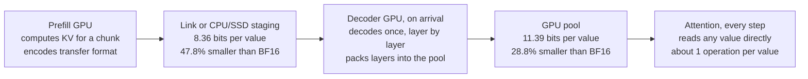

# Lossless KV Compression: Pool and Transfer Formats

Oct 20, 2026

Two lossless formats cut KV size for prefill–decode serving: a pool format that attention reads every step (28.8% smaller than BF16) and a transfer format decoded once on arrival (47.8% smaller). Run end to end on SmolLM2 KV, every one of 11.8M values came back bit-exact.

## At a glance



*KV is compressed hardest where it is decoded once (transfer format); attention reads the pool format on every step.*

The transfer format is decoded once, on arrival or reload. The decoder writes each layer straight into the pool format, which attention reads on every step.

## The gap each format closes

A BF16 value is 1 sign bit, 8 exponent bits (how big the number is) and 7 mantissa bits (the fine detail). The pool format removes wasted exponent bits; the transfer format removes everything the receiver can already predict, across all 16 bits.

|  | Pool format | Transfer format |
| --- | --- | --- |
| Waste it removes | The exponent range, which today's format re-describes in every group of 8 values | Information the decoder can predict from the token's previous layer and its already-decoded channels |
| Bits it shrinks | Exponent only; sign and mantissa stay raw | All 16 |
| How often it is decoded | Every attention step | Once, on arrival or reload |
| Decode cost per value | About one operation; any value reachable directly | Hundreds of operations, in a fixed order |
| Size, bits per value (BF16 = 16) | 11.39, 28.8% smaller | 8.36, 47.8% smaller |
| Gap it closes | Decoder GPU memory, so admission headroom | Bytes over the link and in CPU/SSD staging |

Today's GPU format measures 12.24 bits per value (23.5% smaller) on the same tokens. Two formats are needed because attention reads every value on every step, so the format it reads must be nearly free to decode. Data that is decoded once can afford a far heavier decoder, and gets much smaller in return.

## Pool format

Each channel's typical exponent and the width it needs are learned once, offline. Each value then stores a short exponent offset plus its raw sign and mantissa: 11.39 bits per value, against 12.24 for today's format.

How a 16-token block is built (one layer, all 384 K and V values per token):

1. **Offline, per layer and channel:** the reference exponent is the median exponent on calibration data. The width w (1 to 8 bits) minimizes w + 8 × the share of values that would not fit.
2. **Each value** stores its zigzag-coded offset from the reference in w bits. Its sign and 7 mantissa bits go in one raw byte.
3. **Escapes:** a value whose offset does not fit stores the all-ones code, and its raw 8-bit exponent goes in a list after the block. Escapes are listed in position order, so the n-th all-ones code reads the n-th entry and no position is stored.
4. **Header:** a 16-bit escape count per block.

Every token row in a layer has the same length (the sum of the widths plus 8 bits per value), so the attention kernel can find any value directly. Rebuilding a word is one add plus putting the bits back together. About 5.6% of values escape (343 per 6,144-value block on average).

| Variant (whole test documents, all 30 layers) | Text, bits per value | Code, bits per value |
| --- | --- | --- |
| Today's GPU format (minimum + width per 8 values) | 12.24 (23.5%) | 12.24 (23.5%) |
| Pool format, variable-size blocks | 11.37 (28.9%) | 11.35 (29.1%) |
| Pool format, fixed-size blocks | 11.65 (27.2%) | 11.64 (27.2%) |
| Plus a 4-bit exponent offset per (token, head), fixed-size blocks | 11.54 (27.9%) | 11.53 (27.9%) |

Fixed-size blocks reserve room for a set number of escapes per block. The room is set per layer from the calibration data's 99.9th percentile, and a block that overflows is stored raw (0.05–0.21% of blocks). The per-(token, head) offset is the cheapest piece of a predictor that fits inside the pool format. It gains 0.7 points with fixed-size blocks and is slightly worse (0.05 bits) with variable-size blocks.

On your pool (2,910 usable blocks, two requests of 1,616 blocks each, output blocks raw), today's format leaves 431 spare blocks. The pool format leaves 604, or 548 with fixed-size blocks. A third request would need 9.54 bits per value or less, which no format cheap enough to read every step reaches.

## Transfer format

Both sides predict each value from what the decoder already holds, and only the surprise is coded: 8.36 bits per value on the four test chunks, 47.8% smaller than BF16. It works like video coding, which predicts a frame from the previous one and sends the difference.

1. **Prediction.** Layer l of a token is predicted from the same token's layer l−1 KV and from the channels of layer l already decoded. Keys are de-rotated (RoPE removed) before being used or predicted, and the prediction is rotated back.
2. **Fit.** The coefficients are the conditional mean of each block of channels given everything decoded before it, read off the covariance of \[previous layer, current layer\] on the calibration documents. There is no training loop. Each channel's spread is set on a separate document.
3. **Coding.** Each BF16 word gets a probability: the mass of a logistic distribution (centered on the prediction, with that channel's spread) over the word's rounding interval. 2^-16 of the mass is spread over all 65,536 words, so any word can be coded. A range coder codes the word's (sign, exponent) group first (512 symbols), then its 7 mantissa bits (128 symbols): the same two fields the pool stores.
4. **Decode order.** Layers go in order. Within a token, channels go in blocks of 32 (12 steps per layer; a RoPE pair never straddles blocks). Tokens are independent, so thousands decode in parallel.
5. **Determinism.** One differing bit in a prediction corrupts the rest of the stream, so everything that sets a probability uses integers or single IEEE add, subtract or multiply. Inputs are integers in units of 2^-16, cos/sin and the logistic CDF are integer tables, coefficients are integers with 64-bit sums, and probabilities are integer ratios over 2^48. The integer version is the same size as the float one to within 0.001 bits.

Larger decode blocks mean fewer sequential steps for a small loss in size (cost computation, layers 1–29, whole test documents):

| Channels per decode step | Steps per layer | Text, smaller than BF16 | Code, smaller than BF16 |
| --- | --- | --- | --- |
| 2 (one RoPE pair) | 192 | 48.4% | 50.4% |
| 8 | 48 | 48.3% | 50.2% |
| 32 (used end to end) | 12 | 47.8% | 49.7% |
| All K, then all V | 2 | 45.8% | 47.6% |
| Previous layer only | 1 | 44.0% | 45.6% |

On SmolLM2, decoding costs about 560 integer multiply-adds per value, and the coefficients total about 6.3M integers (around 5% of the model's parameters). For an 8B model the estimate is about 3% of prefill compute, spent once on the decoder side. Inside the pool this would cost hundreds of operations per value on every step, far more than attention itself, so this format is only for data that is decoded once.

## How we tested

Every number comes from real SmolLM2-135M KV, with calibration and test documents kept apart. The headline results are actual bytes and bit-for-bit decode checks, not estimates.

**Model and KV.** SmolLM2-135M-Instruct (GGUF, Q4\_1 weights) was prefilled by a numpy re-implementation. KV was saved as the BF16 words a serving cache holds (keys after RoPE, and values): 30 layers × 384 values per token, 8,192 tokens per document. To check the re-implementation, perplexity is 11.81 on PEP 8 and 5.29 on argparse.py. On the first 1,024 tokens of PEP 484, the correct RoPE layout gives 20.7 and the wrong one 673.

| Role | Documents (8,192 tokens each) | What is fitted on them |
| --- | --- | --- |
| Calibration | PEP 484; typing.py, inspect.py, subprocess.py, tarfile.py, logging/\_\_init\_\_.py | Predictor coefficients and means; pool references, widths and escape room |
| Scales | dataclasses.py | Each channel's spread in the transfer format |
| Test | PEP 8 (text), argparse.py (code) | Nothing; measured only |

**Measure.** Bits per value = total bits ÷ number of values, where BF16 = 16. "Real bytes" means the actual range-coder stream or packed pool blocks, headers included.

| # | Test | Script | What it checks | Result |
| --- | --- | --- | --- | --- |
| 1 | Sizes on whole documents | exact\_ideas.py | Exact coding cost of each format, 30 layers × 8,192 tokens per test document | Pool idea 29.0% / 29.1% smaller; predictor 48.5% / 50.5% (text / code) |
| 2 | Real coder round trip | linear\_roundtrip.py | Range-codes the words; the decoder sees only the stream and what it has already decoded | Layers 2, 12, 24 (4,608 values each): stream within 0.011 bits of the computed cost; bit-exact |
| 3 | Decode block size, integer arithmetic | deploy\_checks.py | Size as decode steps get coarser; integer vs float predictor | Block-size table above; integer equals float to 0.001 bits |
| 4 | Pool variants | pool\_variants.py | Per-block escape counts; fixed-size room set from calibration only; raw fallback rate | Pool table above |
| 5 | End to end | combined.py | Encode, stream, decode layer by layer, pack into pool blocks, unpack, compare every word | 4 chunks, 11.8M values, all bit-exact (next table) |

| Chunk (256 tokens, all 30 layers) | Transfer, bits per value | Pool, bits per value | Today's format, bits per value |
| --- | --- | --- | --- |
| PEP 8, tokens 0–255 | 8.66 (45.9%) | 11.44 (28.5%) | 12.24 (23.5%) |
| PEP 8, tokens 4,096–4,351 | 8.24 (48.5%) | 11.35 (29.1%) | 12.24 (23.5%) |
| argparse.py, tokens 0–255 | 8.51 (46.8%) | 11.41 (28.7%) | 12.24 (23.5%) |
| argparse.py, tokens 4,096–4,351 | 8.03 (49.8%) | 11.35 (29.1%) | 12.24 (23.5%) |
| Average | 8.36 (47.8%) | 11.39 (28.8%) | 12.24 (23.5%) |

The actual stream matches the computed cost to 0.001 bits. The first 256 tokens of a document cost more because they are less predictable.

**What a reviewer should check.**

- The decode path (`transfer("dec")` in combined.py) gets only the stream, the token positions and the shared constants. The original words are used only by the encoder and by the final comparison.
- Nothing is fitted on the test documents, and fixed-block escape room comes from calibration data.
- Sizes are actual bytes: the range coder's output and the packed pool blocks.
- Identical words mean identical attention outputs, so no separate accuracy test is needed.

**Reproduce.** Scripts and logs are in kv\_exact\_ideas\_test.zip and kv\_combined\_test.zip.

```bash
python3 -I smol_dump_act.py SmolLM2-135M-Instruct.Q4_1.gguf TEXT_FILE 8192 act/NAME.npz 2,12,24
python3 -I exact_ideas.py act
python3 -I linear_roundtrip.py act 12 1000 12
python3 -I deploy_checks.py act all
python3 -I pool_variants.py act
python3 -I combined.py act test_text 4096 256 32
```

**Not covered yet.**

- One small model. Calibration is 5 code documents and 1 text document, there are 2 test documents, and contexts are 8,192 tokens.
- CPU only: no GPU kernels, so no decode throughput. Encoder and decoder ran on one machine, so bit-exactness across hardware follows from the integer design but is untested.
- The end-to-end run covers 4 chunks of 256 tokens. Whole-document sizes come from the exact cost computation (test 1), which the real coder matches.
- The admission figures assume output blocks stay raw.

## How unique

Neither format is new in its parts. The pool format is a per-channel refinement of published lossless exponent codecs. The transfer format is a new combination; its nearest published neighbor predicts with a second pass of the model instead.

**Pool format: low novelty.** It is patched frame-of-reference coding (a fixed width plus separately stored exceptions; [Zukowski et al., 2006, as described by Lemire and Boytsov](https://arxiv.org/pdf/1209.2137)) applied per channel to BF16 exponents. [SplitZip](https://arxiv.org/html/2605.01708v2) already does lossless fixed-width exponent coding for PD KV transfer, with one shared calibrated codebook. It reports 1.324× on Qwen3-32B and a 4/3 ceiling (25% smaller). What is added here:

- per-channel references and widths (28.8% smaller here);
- escapes with no stored position;
- a fixed row stride, so the data can stay in the pool and be read in place.

SplitZip found per-channel calibration much slower in its GPU implementation, so the speed of this version on GPU is the open question.

**Transfer format: moderate novelty.** Each ingredient has precedent:

- lossless predictive coding of floating-point data ([Isenburg, Lindstrom and Snoeyink, 2004](https://www.cs.unc.edu/%7Eisenburg/papers/ils-lcfpg-04.pdf); [fpzip](https://github.com/LLNL/fpzip));
- cross-layer KV redundancy, used lossily ([MiniCache](https://arxiv.org/html/2405.14366v2), [KV cache transform coding](https://proceedings.iclr.cc/paper_files/paper/2026/file/3fb6f10bd2784f6cfb6a6ed6280df40c-Paper-Conference.pdf), [CORAL-KV](https://arxiv.org/abs/2610.12514));
- prediction from earlier same-token blocks plus rANS, with bounded error ([AlignPred](https://arxiv.org/html/2610.17970));
- lossless, predictor-based KV coding over BF16 bins ([Speculative KV coding](https://fergusfinn.com/blog/kv-entropy-coder/)).

We found no published method that losslessly codes BF16 KV from a fixed linear predictor over the previous layer and the token's earlier channels, with integer-only probabilities. The closest one, Speculative KV coding, reaches 5.9–6.7 bits per value on Qwen3 0.6B–32B. It runs an FP8 copy of the model over the prompt on both sides. This one reaches 8.36 bits on a much smaller model and runs no forward pass. Those numbers come from different models and are not directly comparable. Combining the two kinds of predictor is an open idea.

**Using both together: not a research claim.** Splitting formats by how often data is decoded is ordinary system design. Decoding straight into a compressed pool layout, rather than into plain BF16, is a small step beyond it.

| Work | Lossless | What it codes | Uses prediction | Closest to |
| --- | --- | --- | --- | --- |
| [SplitZip](https://arxiv.org/html/2605.01708v2) (2026) | Yes | BF16 KV exponents, one fixed-width codebook, for PD transfer | No | Pool format |
| [ExANS](https://www.theopenlake.com/blog/exans-lossless-gpu-compression-for-bf16-kv-cache) (OpenLake) | Yes | BF16 KV exponents, block-local rANS, 1.51× | No | Pool format (entropy-coded) |
| [DFloat11](https://arxiv.org/pdf/2504.11651) (NeurIPS 2025) | Yes | BF16 weight exponents, Huffman, about 70% size | No | Pool format |
| [LEXI](https://arxiv.org/pdf/2603.15589v1) (2026) | Yes | BF16 exponents incl. caches, Huffman in hardware | No | Pool format |
| [Heilper and Singer](https://pith.science/paper/2508.19263) (2025) | Yes | Exponent and mantissa entropy coding, weights and KV | No | Pool format |
| [Speculative KV coding](https://fergusfinn.com/blog/kv-entropy-coder/) (May 2026) | Yes | BF16 or FP8 KV, per-value distribution from an FP8 model copy | Second model pass | Transfer format |
| [AlignPred](https://arxiv.org/html/2610.17970) (2026) | No, error-bounded | KV, same-token block prediction plus rANS | Earlier same-token blocks | Transfer format |
| [CORAL-KV](https://arxiv.org/abs/2610.12514) (Oct 2026) | No | Video-model KV, quantized cross-layer residuals | Previous layers | Transfer format |
| [CacheGen](https://arxiv.org/html/2310.07240v6) (2024) | No | KV deltas against anchor tokens, quantized, arithmetic-coded | Earlier tokens | Transfer format |
| [Isenburg et al.](https://www.cs.unc.edu/%7Eisenburg/papers/ils-lcfpg-04.pdf) (2004) | Yes | Float geometry: sign, exponent, mantissa coded against a prediction | Neighboring vertices | Transfer format |

This search was a web check on 20 October 2026. Several close papers appeared in September–October 2026, so a full prior-art review is needed before any novelty claim.

## Sources

- [SplitZip: Ultra Fast Lossless KV Compression for Disaggregated LLM Serving](https://arxiv.org/html/2605.01708v2) (Guo and Joshi)
- [ExANS: lossless GPU compression for BF16 KV cache](https://www.theopenlake.com/blog/exans-lossless-gpu-compression-for-bf16-kv-cache) (OpenLake)
- [Speculative KV coding](https://fergusfinn.com/blog/kv-entropy-coder/) (Fergus Finn, May 2026)
- [DFloat11: Lossless LLM Compression via Dynamic-Length Float](https://arxiv.org/pdf/2504.11651) (Zhang et al., NeurIPS 2025)
- [LEXI: Lossless Exponent Coding for Inter-Chiplet Communication](https://arxiv.org/pdf/2603.15589v1) (Sun et al., 2026)
- [Lossless Compression of Neural Network Components in Low-Precision Formats](https://pith.science/paper/2508.19263) (Heilper and Singer, 2025; abstract summary)
- [AlignPred: Error-Controlled KV Cache Compression via Alignment and Predictive Coding](https://arxiv.org/html/2610.17970) (Yang et al., 2026)
- [CORAL-KV: Cross-Layer Prediction and Residual Coding for Video KV Caches](https://arxiv.org/abs/2610.12514) (Ge et al., October 2026)
- [KV Cache Transform Coding](https://proceedings.iclr.cc/paper_files/paper/2026/file/3fb6f10bd2784f6cfb6a6ed6280df40c-Paper-Conference.pdf) (Staniszewski and Łańcucki, ICLR 2026)
- [CacheGen: KV Cache Compression and Streaming](https://arxiv.org/html/2310.07240v6) (Liu et al., 2024)
- [MiniCache: KV Cache Compression in Depth Dimension](https://arxiv.org/html/2405.14366v2) (Liu et al., 2024)
- [Lossless Compression of Floating-Point Geometry](https://www.cs.unc.edu/%7Eisenburg/papers/ils-lcfpg-04.pdf) (Isenburg, Lindstrom and Snoeyink, 2004)
- [fpzip](https://github.com/LLNL/fpzip) (Lindstrom and Isenburg, IEEE TVCG 2006)
- [Decoding billions of integers per second through vectorization](https://arxiv.org/pdf/1209.2137) (Lemire and Boytsov; describes PFOR from Zukowski et al., 2006)
